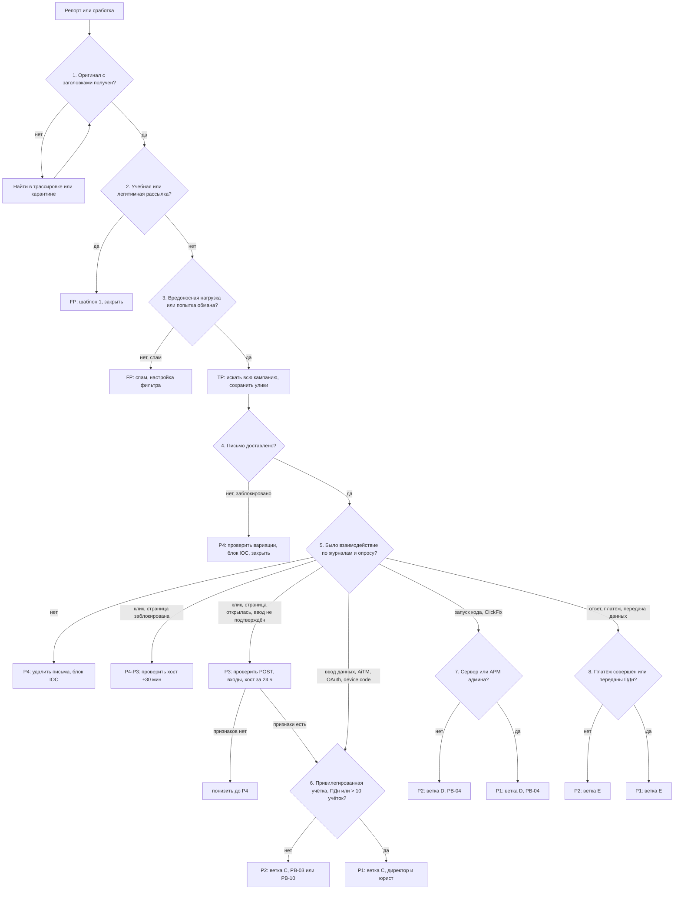

# PB-01 Фишинговое письмо

> Учебный плейбук для вымышленной компании «Альфа-Трейд». Роли, уровни критичности P1–P4, сроки и каналы связи взяты из [IR-плана](../plan/ir-plan.md). Всё, что нужно сверить с первоисточником, собрано в разделе [«Допущения и ограничения»](#допущения-и-ограничения). Сокращения расшифрованы в [Приложении Г](#приложение-г-сокращения).

## TL;DR

- **Когда применять:** сотрудник прислал подозрительное письмо, или почтовый шлюз, EDR, журнал входов либо прокси показали признаки фишинга.
- **Главное правило порядка:** **сохраните → найдите всю кампанию → удалите письма → отрежьте атакующего от учёток и хостов → проверьте закрепление → уведомите.**
- **Критичность определяйте по последствию, а не по действию пользователя.** Просто клик даёт P4–P3, ввод пароля или запуск файла даёт P2, привилегированная учётка, ПДн или совершённый платёж дают P1.
- **Берите в работу за 30 минут днём и за 1 час ночью, даже при P4.** За рабочий день, который даёт P4 по IR-плану, пароль по ссылке успеют ввести десятки людей.
- **Пароля мало.** Если человек ввёл данные, отзовите сессии и удалите правила ящика, новые MFA-методы и OAuth-приложения атакующего, а все пострадавшие учётки отрежьте одновременно.

## Шпаргалка: первые 30 минут

| № | Действие | Кто | Срок |
| --- | --- | --- | --- |
| 1 | **Возьмите репорт в работу**, запишите в тикет, кто сообщил, когда и как | L1 | ≤ 30 мин днём, ≤ 1 ч ночью |
| 2 | **Достаньте оригинал письма с заголовками** из трассировки или карантина, выгрузите `.eml`, посчитайте SHA-256 | L1 | ≤ 5 мин |
| 3 | **Сверьте с реестром учебных и легитимных рассылок.** Совпало, значит закройте как FP | L1 | ≤ 2 мин |
| 4 | **Проверьте заголовки и содержимое** только в изолированной VM, во внешние сервисы отправляйте только хеши и домены | L1 | ≤ 20 мин |
| 5 | **Вынесите вердикт TP/FP и стартовую P** по [дереву решений](#51-дерево-решений) | L1 | ≤ 15 мин от взятия |
| 6 | **Начните искать всю кампанию** по набору признаков, а не по одной теме, и эскалируйте на L2 | L1 → L2 | ≤ 30 мин |
| 7 | **Сохраните улики**, потом **удалите все копии (soft delete)** | L2 | ≤ 60 мин |
| 8 | **Заблокируйте URL и домены атакующего** на шлюзе, прокси и DNS | L2 | ≤ 30 мин |
| 9 | **Ввод данных подтверждён:** отзовите сессии, сбросьте пароль, удалите правила, MFA-методы и OAuth | L2 + ИТ | ≤ 30 мин от подтверждения |
| 10 | **Запуск кода подтверждён:** изолируйте хост в EDR | L2 | ≤ 15 мин от подтверждения |
| 11 | **Уведомите руководителя реагирования (IM)** | L2 | P2 ≤ 1 ч, P1 ≤ 15 мин |
| 12 | **Есть признаки доступа к ПДн:** сразу подключите юриста/DPO | IM | Решение в первые часы, до истечения 24 ч |

## Чего делать нельзя

- **Не удаляйте письмо, пока не сохранили оригинал** и не выгрузили трассировку и клики. Hard delete делайте только по решению IM.
- **Не ищите и не удаляйте по одной теме письма.** «Счёт на оплату» есть у сотни честных писем.
- **Не открывайте ссылку в своём рабочем браузере** и не загружайте вложение в публичный VirusTotal или urlscan.io.
- **Не анализируйте обычно пересланное письмо.** Его заголовки принадлежат коллеге, и SPF/DKIM покажут `pass`.
- **Не блокируйте IP CDN, облака и общего хостинга**, а также целые домены `sharepoint.com`, `docs.google.com`, `disk.yandex.ru` и бесплатной почты.
- **Не ограничивайтесь сбросом пароля.** Без отзыва сессий и удаления правил, MFA-методов и OAuth атакующий остаётся внутри.
- **Не меняйте пароль с заражённого компьютера.**
- **Не пишите пострадавшему в его же взломанный ящик.** Звоните или используйте резервный канал из IR-плана.
- **Не перезагружайте хост и не «прогоняйте антивирусом»**, пока не собрали данные.
- **Не рассылайте сотрудникам «живой» пример письма** с рабочими ссылками.

## 1. Цель и область применения

**Цель:** за минуты найти все копии фишинговой кампании, убрать их из ящиков, найти каждого пострадавшего и отрезать атакующего от учёток и хостов раньше, чем он закрепится.

**Что входит:**

- Письма сотрудникам «Альфа-Трейд», которые:
  - крадут учётные данные, в том числе через AiTM-страницы, которые обходят MFA;
  - доставляют вредонос;
  - обманывают без вредоносной нагрузки: BEC, подмена реквизитов;
  - получают доступ через OAuth-согласие или device code.
- Разновидности:
  - QR-код в письме или PDF (quishing);
  - ClickFix: «нажмите Win+R и вставьте команду»;
  - callback-фишинг: письмо с номером телефона;
  - ссылки на легитимные облачные сервисы;
  - письма со взломанных ящиков партнёров.
- Внутренний фишинг с уже взломанного ящика сотрудника.
- Фишинг через мессенджеры и внешние чаты. Для него действуют разделы 5–12, кроме поиска и удаления писем.

**Что не входит:**

- **Фишинг против клиентов магазина от имени «Альфа-Трейд»** (злоупотребление брендом, снятие сайтов). Это отдельный сценарий с PR и юристом, в каталоге его пока нет.
- **Полное расследование** компрометации учётки ведите по PB-03 или PB-10, вредоноса на хосте по PB-04, утечки по PB-05. PB-01 доводит инцидент до передачи и проверяет, что передача состоялась.
- **Вишинг и SMS без письма.** В этом плейбуке они только как второй шаг после письма.

## 2. Паспорт

| Поле | Значение |
| --- | --- |
| ID | PB-01 |
| Версия | 1.1 (31.10.2026) |
| Владелец | Руководитель ИБ, он же руководитель реагирования (IM) |
| Пересмотр | Раз в 6 месяцев и после каждого P1/P2 по фишингу |
| Критичность по умолчанию | P4, но в работу берите за 30 минут днём и за 1 час ночью |
| Повышение на один уровень | Получатель из администраторов, финансов или руководства; больше 50 доставок; письмо явно целевое |
| Понижение | Журналы подтвердили, что взаимодействия не было |
| Техники MITRE ATT&CK | [Приложение А](#приложение-а-mitre-attck) |
| Связанные плейбуки | PB-03 Компрометация учётки, PB-10 Компрометация облачного аккаунта, PB-04 Вредонос на рабочей станции, PB-05 Утечка данных, PB-02 Шифровальщик (если после запуска вложения началось шифрование), PB-S3 Сработка антивируса, PB-S4 Сработка EDR, PB-S2 Сработка NGFW |

**Целевые сроки** (учебные; отсчёт от вердикта TP, если не сказано иное):

| Этап | Цель |
| --- | --- |
| Взять репорт или сработку в работу | ≤ 30 мин днём, ≤ 1 ч ночью от поступления |
| Вердикт TP/FP и стартовая P | ≤ 15 мин от взятия |
| Найти все копии кампании (первая волна) | ≤ 30 мин |
| Сохранить улики и удалить письма из ящиков | ≤ 60 мин |
| Заблокировать URL и домены атакующего | ≤ 30 мин |
| Отозвать сессии и сбросить пароль при подтверждённом вводе данных | ≤ 30 мин от подтверждения |
| Изолировать хост при подтверждённом запуске кода | ≤ 15 мин от подтверждения |
| Уведомить IM | P2 ≤ 1 ч, P1 ≤ 15 мин |
| Подключить юриста/DPO при признаках доступа к ПДн | Сразу; решение в первые часы, до истечения 24 ч от выявления |

## 3. Подготовка

Без этих условий часть шагов невыполнима. Если пункт не выполнен, запишите это в тикет как ограничение расследования.

- [ ] В почтовом клиенте есть кнопка «Сообщить о фишинге». Она передаёт письмо вложением, с заголовками, а ящик `phishing@` сам создаёт тикет
- [ ] SIEM хранит не меньше 90 дней: журнал почтового шлюза и трассировку, аудит облачной почты (правила, пересылка, согласия), журнал входов IdP, прокси и NGFW, DNS, EDR
- [ ] Вы знаете, есть ли на NGFW TLS-инспекция. Без неё виден только домен, а не путь URL
- [ ] У L2 есть права искать и удалять (soft delete) письма во всех ящиках и отзывать сессии. Ночной контакт дежурного ИТ и почтового администратора есть в карточке смены
- [ ] Ведётся реестр учебных фишинговых кампаний и легитимных массовых рассылок
- [ ] Есть изолированная VM для анализа без доменных учёток и доступ к песочнице шлюза или приватной песочнице
- [ ] Есть контакты бухгалтерии и финансового директора 24/7 (для ветки BEC)
- [ ] Готовы шаблоны сообщений из раздела 11

## 4. Роли и ответственность

Матрица RACI: **R** выполняет, **A** утверждает и отвечает за результат, **C** консультирует, **I** получает информацию.

| Действие | L1 | L2 | IM | ИТ / почтовый админ | Владелец системы | Юрист/DPO | PR | Директор | Финансы |
| --- | --- | --- | --- | --- | --- | --- | --- | --- | --- |
| Тикет, триаж, вердикт TP/FP | R/A | C | | | | | | | |
| Поиск всей кампании | R | A | I | C | | | | | |
| Сохранение улик | | R/A | | C | | | | | |
| Удаление писем (soft delete) | | R/A | I; A при > 50 ящиках или если отправитель партнёр либо наш сотрудник | R, если у L2 нет прав | | | | | |
| Hard delete | | R | A | | | | | | |
| Блок адреса отправителя, URL, FQDN | | R/A | | | | | | | |
| Блок домена, который есть в легитимной переписке | | R | A | | | | | | |
| Блок одного внешнего IP | | R/A | | | | | | | |
| Блок нескольких IP, CDN, легитимного сервиса | | R | A | | | | | | |
| Отзыв сессий и сброс пароля обычного пользователя | | A | I | R | | | | | |
| То же для администратора или руководителя | | C | A | R | | | | I | |
| Изоляция рабочей станции | | R/A | I | | | | | | |
| Изоляция сервера или критичного АРМ (касса, склад) | | R | A | R | A | | | | |
| Звонок пострадавшим | | R | | | | | | | |
| Предупреждение сотрудникам | | C | A | | | | R | | |
| Уведомление партнёров и клиентов | | C | A | | | C | R | I | |
| Решение «утечка ПДн или нет», уведомление РКН | | C | C | | | R | | A | |
| Отзыв платежа (BEC) | | | I | | | C | | I | R/A |
| Заявление в полицию | | C | C | | | R | | A | |

В IR-плане нет роли финансовой службы. Для ветки BEC её стоит туда добавить.

## 5. Триаж

Триаж делится на две части. **Быстрый триаж (L1, до 15 минут)** отвечает на вопросы «это фишинг?» и «насколько всё плохо?». **Глубокий триаж (L2)** подтверждает факты по журналам и выбирает ветку сдерживания. Оба идут по одному дереву решений.

### 5.1. Дерево решений



Ниже каждый узел дерева расписан подробно. Номера узлов совпадают с номерами в схеме.

### 5.2. Быстрый триаж (L1, до 15 минут)

**Перед узлом 1. Зарегистрируйте инцидент (≤ 5 мин).**

- Примите тикет.
- Запишите, кто сообщил, когда и каким способом (кнопка, обычная пересылка, сработка), а также тему, отправителя и время получения.
- Дальше записывайте в тикет каждое действие со временем (UTC+3).

**Узел 1. Оригинал с заголовками получен? (≤ 5 мин)**

- Если пользователь нажал обычное «Переслать», заголовки принадлежат коллеге и SPF/DKIM покажут `pass`. Это ловушка.
- **Найдите оригинал** в трассировке по отправителю, теме и времени, в карантине шлюза или в ящике пользователя.
- **Выгрузите `.eml` и посчитайте SHA-256.**
- Не просите пользователя открыть письмо ещё раз.

**Узел 2. Учебная или легитимная рассылка? (≤ 2 мин)**

- Сверьте адрес отправителя, IP отправляющего сервера и домены ссылок с реестром учебных кампаний и легитимных рассылок.
- **Совпало:** закройте как FP «учебная/легитимная», ответьте шаблоном 1.
- **Учебную кампанию из ящиков не удаляйте.**

**Узел 3. Вредоносная нагрузка или попытка обмана? (≤ 20 мин)**

Сначала разберите заголовки:

| Поле | Что смотреть | Признак фишинга |
| --- | --- | --- |
| `From` (адрес и отображаемое имя) | Совпадают ли имя и адрес | «Генеральный директор» с `@gmail.com`; имя руководителя с внешнего адреса |
| `Reply-To` | Отличается ли от `From` | Ответ уходит на другой, бесплатный или похожий, домен. Типично для BEC |
| `Return-Path` (envelope-from) | Домен, по которому проверяется SPF | Не совпадает с доменом `From` |
| `Authentication-Results` | `spf=`, `dkim=` и `header.d=`, `dmarc=`, у Microsoft `compauth=` | `dmarc=fail` при доставке; `dkim=pass` с чужим `d=` (сервис рассылок) |
| `ARC-*` | Результаты проверок на промежуточных серверах | Нужны, чтобы не поднять ложную тревогу на пересылках и списках рассылки |
| `Received` (читайте снизу вверх) | Первый внешний сервер: IP, обратная DNS-запись, ASN, страна | Хостинг или VPS; несоответствие заявленному отправителю |
| `Message-ID`, `X-Mailer` | Домен, формат, почтовый клиент | Домен не соответствует отправителю; PHPMailer и скриптовые рассыльщики |
| Домен отправителя и ссылок | WHOIS, похожесть на наш | Моложе 30 дней; `a1fa-trade.ru`, `alfa-trade-ru.com`; punycode `xn--` |

**Запомните:** `SPF/DKIM/DMARC = pass` значит только то, что отправитель владеет доменом. Взломанный ящик партнёра и собственный домен атакующего проходят все три проверки.

Затем безопасно разберите содержимое:

- **Работайте только в изолированной VM**, никогда в своём рабочем браузере.
- **Извлеките все URL:** скрытые за текстом, внутри PDF, HTML и SVG-вложений. QR-коды декодируйте отдельно, например утилитой `zbarimg`. Снимите обёртку перезаписи ссылок.
- **В тикет и переписку пишите URL только в обезвреженном виде:** `hxxps://evil[.]example`.
- **Сначала проверяйте пассивно:** репутация URL, домена и хеша в TI, дата регистрации домена, журналы прозрачности сертификатов (CT), встречается ли домен в наших журналах.
- **Перед активной проверкой удалите из URL персональный токен получателя** (`?id=<base64 e-mail>`). Иначе вы «кликнете» от имени жертвы и подтвердите атакующему, что адрес живой.
- **Во внешние публичные сервисы отправляйте только хеши и домены.** Вложение может оказаться внутренним документом с ПДн, а атакующие следят за загрузками своих образцов. Запускайте образцы в песочнице шлюза или в приватном режиме.
- **Отсутствие хеша в TI ничего не значит.** HTML- и SVG-вложения уникальны для каждой жертвы. Ищите в них `atob(`, `eval(`, `window.location`, `<form action=` на внешний домен и заранее подставленный e-mail.

Классифицируйте письмо (≤ 3 мин):

| Класс | Что это |
| --- | --- |
| A | Сбор учётных данных, включая AiTM |
| B | Вредоносное вложение или загрузка |
| C | QR-код |
| D | ClickFix |
| E | BEC, подмена реквизитов, просьба без нагрузки |
| F | Callback (номер телефона) |
| G | OAuth-согласие или device code |
| H | Спам или маркетинг |
| I | Внутренний фишинг: отправитель из нашего тенанта |

- **H:** FP, ответьте шаблоном 1; если такое повторяется, заведите заявку на правило антиспама.
- **A–G, I:** TP. Поставьте стартовую P по [таблице 5.4](#54-критичность-по-последствию), эскалируйте на L2 и **ищите всю кампанию** (раздел 8, вопрос 1), пока L2 не подключится.

**Узел 4. Письмо доставлено?**

- Посмотрите статус доставки в трассировке.
- **Заблокировано у всех:** P4. Проверьте, не дошли ли вариации письма, заблокируйте IOC и закройте.

### 5.3. Глубокий триаж (L2)

**Узел 5. Было ли взаимодействие?** Подтверждайте журналами, а не только словами пользователя.

- **Ввод данных подтверждён, если есть хотя бы одно:**
  - пользователь сам это подтвердил;
  - с его хоста или учётки ушёл POST на фишинговый домен;
  - в течение 24 часов после клика был вход в его учётку из нетипичной инфраструктуры.
- **Запуск кода подтверждён**, если EDR или журналы показывают процесс-потомок или сработку антивируса на исполнение, а не на запись файла.
- **Не всякий клик сделал человек.** Песочница шлюза, перезапись ссылок, сканеры EDR и антиспам получателей открывают ссылки сами. Признаки бота:
  - клик через секунды после доставки;
  - IP облака провайдера или шлюза;
  - User-Agent сканера;
  - клики по всем ссылкам письма сразу.
- **Клик, страница открылась, ввод не подтверждён (P3):** проверьте POST, входы и хост за 24 часа. Признаков нет, значит понизьте до P4.
- **Клик, страница заблокирована:** проверьте хост в окне ±30 минут.

**Опросите пострадавших только звонком.** Примерный список вопросов:

1. Открывали письмо? Нажимали ссылку?
2. С какого устройства: рабочий ПК, телефон, домашний компьютер? Что открылось?
3. Вводили логин и пароль? Приходил запрос MFA или код, подтверждали?
4. Сканировали QR-код?
5. Открывали файл, нажимали «Разрешить редактирование»?
6. Копировали и вставляли команду?
7. Давали разрешение приложению?
8. Отвечали, пересылали, платили, отправляли документы?
9. И попросите: «Компьютер не перезагружайте».

Ответы проверяйте по журналам, а не принимайте на веру.

**Узел 6. Привилегированная учётка, ПДн или больше 10 учёток?** Да, значит P1 и ветка C с подключением директора и юриста. Нет, значит P2 и ветка C, дальше PB-03 или PB-10.

**Узел 7. Код запустился на сервере или АРМ администратора?** Да, значит P1, иначе P2. В обоих случаях ветка D и PB-04.

**Узел 8. Совершён платёж или переданы ПДн?** Да, значит P1, иначе P2. В обоих случаях ветка E.

### 5.4. Критичность по последствию

| P | Условия |
| --- | --- |
| P4 | Письмо заблокировано; или доставлено, но журналы подтверждают, что взаимодействия не было; или клик по заблокированной ссылке без загрузок; массовая нецелевая рассылка |
| P3 | Клик или открытие вложения без подтверждённого ввода данных и без запуска кода (до проверки); целевое письмо на VIP или финансы без взаимодействия; не меньше 3 репортов одной кампании |
| P2 | Подтверждён ввод учётных данных, есть признаки AiTM, OAuth-согласие или device code; запуск кода на рабочей станции; ответ атакующему с передачей данных; внутренний фишинг с нашего ящика; не меньше 5 пользователей дошли до формы ввода |
| P1 | Любое из P2 для привилегированной учётки (администратор AD, облака, почты, резервного копирования) или бухгалтера с доступом к банк-клиенту; запуск кода на сервере; совершённый платёж по реквизитам атакующего; доступ к ящику или файлам с ПДн клиентов; больше 10 скомпрометированных учёток; исходящая массовая рассылка с нашего домена клиентам |

### 5.5. Когда эскалировать

- **L1 → L2:** любой TP; FP с сомнением; не меньше 3 репортов одной кампании.
- **L2 → IM:** P2 и выше; удаление из больше чем 50 ящиков; отправитель партнёр или наш сотрудник; блокировка легитимного сервиса или нескольких IP; любая ветка E (BEC).
- **IM → директор и юрист/DPO:** P1; признаки доступа к ПДн; совершённый платёж.

## 6. Сдерживание

**Сначала сохраните улики** из раздела 7: оригинал, хеши, выгрузку трассировки и кликов. Только потом что-либо удаляйте.

**Если пострадавших несколько:**

1. **Быстро найдите все скомпрометированные учётки**, то есть входы с той же инфраструктуры атакующего.
2. **Отрежьте их одновременно.** Сброс одной учётки предупреждает атакующего, и он переключается на другие.
3. **Исключение:** если ущерб идёт прямо сейчас (рассылка, платёж), действуйте немедленно.

### 6.1. Первые шаги для любого TP

| № | Шаг | Кто | Инструмент | Кто утверждает |
| --- | --- | --- | --- | --- |
| 1 | **Удалите все доставленные копии кампании** по набору признаков, а не по одной теме. Сначала просмотрите результаты поиска и сверьте число с трассировкой, потом сделайте **soft delete**. Удалите копии из «Спама» и запретите выпуск из карантина. Через 15 минут повторите поиск: результат должен быть 0 | L2 или почтовый админ | M365: Threat Explorer или действие из Advanced Hunting, либо `New-ComplianceSearch` + `New-ComplianceSearchAction -Purge -PurgeType SoftDelete`. Google Workspace: investigation tool. Другая платформа: штатный механизм отзыва писем | IM при > 50 ящиках или если отправитель партнёр либо наш сотрудник |
| 2 | **Заблокируйте на шлюзе** конкретный адрес отправителя, URL и хеш вложения | L2 | Почтовый шлюз | — |
| 3 | **Заблокируйте домен отправителя**, только если он одноразовый (за 90 дней от него не было легитимных писем) и это не бесплатная почта | L2 | Шлюз | IM, если домен встречается в переписке |
| 4 | **Заблокируйте FQDN и URL страницы атакующего** и всю цепочку редиректов на прокси и DNS-фильтре | L2 | Прокси, DNS | IM для легитимных сервисов (SharePoint, Google Docs, Яндекс Диск): блокируйте точный URL, а не домен |
| 5 | **Заблокируйте IP на NGFW**, только если он выделенный (проверьте ASN и сколько доменов на нём). Не CDN и не общий хостинг | L2 | NGFW | Один IP L2 блокирует сам (по IR-плану), несколько утверждает IM |
| 6 | **Добавьте хеш вложения** в блок-лист EDR и антивируса | L2 | EDR | — |

### 6.2. Ветки сдерживания

**Ветка C. Ввод учётных данных, AiTM, OAuth-согласие, device code, подтверждённый push-запрос MFA.** P2, для привилегированных учёток P1. Делайте все шаги за один раз:

1. **Проверьте хост пользователя в EDR.** Есть признаки инфостилера, значит сначала выполните ветку D, а пароль меняйте только с чистого устройства.
2. **Выгрузите в тикет** текущие сессии, MFA-методы, зарегистрированные устройства, правила ящика, пересылку, делегирования, OAuth-согласия. Это улики.
3. **Отзовите все сессии и refresh-токены** (Entra ID: `Revoke-MgUserSignInSession`). Если атакующий прямо сейчас пользуется учёткой, временно заблокируйте вход: для обычной учётки решает L2, для руководства и администраторов IM.
4. **Сбросьте пароль** (ИТ по заявке L2). Новый пароль сообщите по телефону.
5. **Удалите MFA-методы и устройства, добавленные после клика.** Перерегистрируйте MFA после проверки личности: звонком по известному номеру или лично.
6. **Удалите вредоносные правила, пересылку и делегирования.** Отзовите согласие и удалите OAuth-приложение.
7. **Проверьте исходящую почту ящика.** Если с него рассылался фишинг от нашего имени, переходите к ветке F.
8. **Проверьте, есть ли ПДн в ящике и облачных файлах.** Есть, значит раздел 11.3 (DPO).
9. **Передайте инцидент в PB-03** (в PB-10 для облачной учётки). Уже выданные access-токены могут работать до истечения срока, у ряда провайдеров около часа. Поэтому следите за входами ещё 24–48 часов.

**Ветка D. Запуск кода: вложение, загрузка, ClickFix, макрос, ПО удалённого доступа после звонка.** P2, для сервера и АРМ администратора P1.

- **Изолируйте рабочую станцию в EDR.** Это L2 делает сам. Сервер или критичный АРМ изолируйте с согласия IM и владельца системы.
- **Не перезагружайте, не выключайте и не лечите антивирусом**, пока не собран триаж-пакет.
- **Считайте скомпрометированными все учётки, которые использовались на хосте.** Инфостилеры забирают пароли и cookies браузера. Для каждой выполните ветку C.
- Дальше работайте по PB-04.

**Ветка E. BEC, подмена реквизитов, ответ атакующему.** P2, при совершённом платеже P1.

- **IM немедленно звонит финансовому директору.**
- **Платёж уже ушёл:** бухгалтерия сразу связывается с банком, чтобы отозвать или приостановить его. Счёт идёт на часы.
- **Проверяйте реквизиты у поставщика по телефону из договора**, а не из письма.
- **Проверьте, не взломан ли ящик нашего участника переписки** (ветка C).
- Решение о заявлении в полицию принимает директор, заявление готовит юрист.

**Ветка F. Фишинг рассылается с нашего ящика.** P2.

- Выполните ветку C для ящика-отправителя.
- Найдите всех внешних и внутренних получателей и удалите внутренние копии.
- IM решает, уведомлять ли партнёров и клиентов (шаблон 4).
- Проверьте, не попал ли наш домен в спам-листы.

**Ветка G. QR-код, callback, мессенджер.**

- **QR:** опросите пользователей (могли перейти с личного телефона), проверьте входы в IdP с мобильных и новых IP и журналы MDM.
- **Callback:** выясните, звонил ли сотрудник, что сообщил, ставил ли ПО удалённого доступа. Ставил, значит ветка D.
- **Мессенджер:** сохраните скриншоты и ID аккаунта отправителя, подайте жалобу в сервис.

**Ветка H. Письмо со взломанного ящика партнёра.**

- **Не блокируйте домен партнёра целиком.**
- **Уведомите партнёра по телефону из договора**, а не ответом на письмо.
- Входящие от него отправляйте на ручную проверку, пока он не подтвердит, что устранил проблему.

### 6.3. Сдерживание на время кампании

- Временные правила шлюза на шаблон темы, `Message-ID` и IP отправляющей инфраструктуры.
- Блокировка свежезарегистрированных доменов на DNS-фильтре.
- Входящие от скомпрометированного партнёра в карантин с ручной проверкой.
- **Каждую временную блокировку записывайте** с автором, временем и сроком жизни (по умолчанию 30–90 дней), чтобы не копились «протухшие» блокировки.

## 7. Сбор и сохранение артефактов

**Собирайте по летучести: сначала то, что исчезает быстрее всего.**

1. **Память и состояние хоста** при ветке D (процессы, сетевые соединения) снимайте через EDR до изоляции, если это не даёт атаке распространиться. Подробно в PB-04.
2. **Активные сессии, MFA-методы, правила и OAuth-согласия** скомпрометированных учёток выгружайте до их удаления (ветка C, шаг 2).
3. **Инфраструктура атакующего:** скриншот страницы, цепочка редиректов, HAR из песочницы, DNS-резолвы, WHOIS, сертификат из CT-журналов. Страница может исчезнуть через несколько часов.
4. **Оригинал письма `.eml`** из ящика или карантина и все вложения.
5. **Журналы с ограниченным сроком хранения:** трассировка, клики, входы IdP, аудит ящиков, прокси, DNS. Выгружайте их за период от первой доставки, потому что облако хранит их 30–90 дней.
6. **Триаж-пакет хоста** при ветке D: Prefetch, Amcache, история браузера, `Zone.Identifier`, `%LOCALAPPDATA%\Microsoft\Windows\INetCache\Content.Outlook\`, `Downloads`, `%TEMP%`, ветка реестра `RunMRU` (PB-04).

**Как сохранить:**

- [ ] SHA-256 каждого `.eml`, вложения и выгрузки записан в тикет
- [ ] Файлы лежат в папке дела `INC-…/evidence/`, доступ только у команды реагирования (в письмах могут быть ПДн). Вложения упакованы в архив с паролем, чтобы их не открыли случайно
- [ ] Выгрузки журналов сохранены в исходном формате (CSV или JSON) вместе с запросом и временем выгрузки
- [ ] Ответы пользователей записаны со временем опроса
- [ ] Все блокировки и удаления записаны: что, кто, когда, сколько объектов затронуто

**Цепочка хранения.** Для каждого артефакта запишите в тикет, кто его получил, когда (UTC+3), откуда, его хеш, где он хранится и кто к нему обращался. Если дело может уйти в полицию (ветка E), не меняйте исходные копии и работайте с рабочими копиями.

## 8. Расследование

| № | Вопрос | Где искать |
| --- | --- | --- |
| 1 | Сколько писем в кампании и кому их доставили? | Трассировка и журнал шлюза за 14–30 дней по **набору** признаков: адрес и домен отправителя, IP отправляющего сервера, устойчивая часть темы, `Reply-To`, домены URL, хеш и имя вложения, шаблон `Message-ID`. Атакующие меняют тему и ссылку для каждого получателя |
| 2 | Где лежат копии? | Статус доставки: входящие, спам, карантин (пользователь мог выпустить письмо сам), заблокировано |
| 3 | Кто взаимодействовал? | Журнал перезаписи ссылок (лучший источник кликов); прокси и NGFW (без TLS-инспекции виден только SNI); DNS (при DoH в браузере может не быть видно); сетевые события EDR; Sysmon 3 и 22. `src_ip` сопоставляйте с пользователем по DHCP, EDR или Security 4624 на контроллере домена |
| 4 | Кто ввёл данные? | POST на фишинговый домен; входы в IdP после клика с хостинг-ASN, из новой страны или с новым User-Agent; MFA, пройденная «по токену»; device code в типе аутентификации |
| 5 | Кто открыл вложение или выполнил команду? | Sysmon 1 и Security 4688 (с командной строкой; нужна политика «Include command line»), Sysmon 11 и 15 (`Zone.Identifier` с `HostUrl`), PowerShell 4104, реестр `RunMRU`, дерево процессов EDR, сработки антивируса (для Defender 1116/1117) |
| 6 | Есть ли закрепление? | Security 4698 (задача), 4720 и 4732 (пользователь, группа), System 7045 (служба), Sysmon 13. В облаке: новые MFA-методы, устройства, OAuth, правила с именами вроде `.` или `..`, которые перемещают письма со словами «счёт», «пароль», «фишинг» в RSS Feeds или Archive |
| 7 | Кто ответил атакующему или переслал письмо? | Исходящие письма на адрес отправителя или `Reply-To`; пересылки внутри компании |
| 8 | Что атакующий сделал с учётками? | Аудит ящика (`MailItemsAccessed`, если позволяет лицензия), доступ к облачным файлам, созданные ссылки общего доступа, исходящая почта, боковое перемещение (4624 типы 3 и 10, 4648, 4768 и 4769) |
| 9 | Какие данные затронуты? | Содержимое ящиков и файлов скомпрометированных учёток: заказы клиентов, выгрузки из базы и 1С, резюме, сканы документов |
| 10 | Какая хронология? | Первая доставка → первый клик → первый ввод → первый вход атакующего → обнаружение → каждое действие команды. Нужна для MTTD и отчёта |

Готовые запросы и команды для этих вопросов собраны в [Приложении В](#приложение-в-примеры-запросов-и-команд).

## 9. Устранение

- [ ] Повторно найдите всё по IOC кампании за 30 дней, включая вариации темы, отправителя и URL. Удалите найденное
- [ ] У каждой скомпрометированной учётки откатите изменения атакующего: правила, пересылку, делегирования, MFA-методы, устройства, OAuth-приложения, пароли приложений. Проверьте созданные ссылки общего доступа
- [ ] Удалите вредонос или переустановите хост по PB-04
- [ ] Закройте техническую причину, если она есть. Например, пользователи могли сами давать OAuth-согласия, значит разрешите их только через администратора; автопересылка наружу была разрешена, значит запретите её
- [ ] Пожалуйтесь регистратору или хостеру фишингового домена (abuse). Для доменов .ru и .рф есть механизм через компетентные организации Координационного центра доменов
- [ ] Получите от партнёра со взломанным ящиком подтверждение, что он устранил проблему

## 10. Восстановление и мониторинг

**Восстановление:**

- [ ] Пользователи снова работают: новый пароль, MFA перерегистрирована после проверки личности
- [ ] Ошибочно удалённые легитимные письма восстановлены из soft delete
- [ ] Временные блокировки легитимных ресурсов сняты, карантин ложных срабатываний разобран
- [ ] Хосты из ветки D вернулись в сеть по PB-04, владелец подтвердил, что всё работает

**Мониторинг 14 дней** (IR-план требует не меньше 2 недель):

| Что | Правило | Срок |
| --- | --- | --- |
| IOC кампании | Алерт при появлении доменов, URL, IP, хешей и шаблона темы в почте, прокси, DNS, EDR | 14 дней, потом IOC в TI со сроком жизни 90 дней |
| Входы затронутых учёток | Новая страна или ASN, хостинг-IP, новый User-Agent, device code flow | 14 дней |
| Изменения ящиков затронутых пользователей | Новые правила, пересылка, делегирование, OAuth | 14 дней |
| MFA и устройства | Регистрация нового метода или устройства у затронутых | 14 дней |
| Исходящая почта затронутых | Массовая отправка, письма на новые внешние домены | 14 дней |
| Хосты из ветки D | Повторные сработки EDR, соединения с C2 из отчёта песочницы | 14 дней |

**Проверьте вручную через 24 часа и через 7 дней**, не появились ли у затронутых учёток новые правила, сессии и OAuth-приложения.

## 11. Коммуникации и уведомления

### 11.1. Внутри компании

| Кому | Кто сообщает | Когда | Канал |
| --- | --- | --- | --- |
| Сотрудник, сообщивший о письме | L1/L2 | После вердикта: FP сразу, TP после удаления писем | Почта, если его ящик не скомпрометирован |
| Пострадавший (клик, ввод, запуск) | L2 | Сразу после выявления | **Только звонок** или резервный мессенджер |
| IM | L2 | P2 ≤ 1 ч, P1 ≤ 15 мин; также при > 50 ящиках и BEC | Канал инцидента; при компрометации почты резервный |
| Директор, юрист/DPO | IM | P1, признаки ПДн, платёж | Звонок |
| Финансовый директор, бухгалтерия | IM | Ветка E | Звонок |
| Все сотрудники | IM или PR (не SOC) | После удаления писем, если кампания массовая | Канал по ситуации; скриншот без активных ссылок |
| Руководство (статус) | IM | P1 каждые 2 ч, P2 дважды в день | «Что известно, что сделано, что дальше, какие решения нужны» |

### 11.2. Вне компании

| Кому | Кто сообщает | Когда |
| --- | --- | --- |
| Партнёр со взломанным ящиком | IM или PR | После подтверждения, по телефону из договора |
| Партнёры и клиенты, получившие фишинг с нашего ящика | PR по решению IM и юриста | Ветка F |
| Банк (отзыв платежа) | Финансы | Немедленно в ветке E |
| Хостер, регистратор (abuse) | L2 | После сохранения улик по инфраструктуре |
| Роскомнадзор | Юрист/DPO | См. 11.3 |
| Полиция | Юрист по решению директора | BEC с ущербом, хищение |

### 11.3. Персональные данные (152-ФЗ)

1. **Атакующий получил доступ к ящику, облачным файлам или хосту?** L2 **в течение 1 часа** выясняет, были ли там ПДн: заказы клиентов, выгрузки из базы и 1С, резюме, сканы документов, списки сотрудников. Результат L2 сообщает IM.
2. **IM сразу подключает юриста/DPO.**
3. **DPO решает**, была ли неправомерная передача ПДн. Если да или исключить это нельзя:
   - **первичное уведомление в Роскомнадзор в течение 24 часов** с момента выявления;
   - **результаты расследования в течение 72 часов** (152-ФЗ, ст. 21 ч. 3.1, сроки по IR-плану).
4. **Записывайте время выявления в тикет с первой минуты**, от него считаются сроки.

С 2025 года ответственность за утечки и неуведомление ужесточена (КоАП, ст. 13.11). «Альфа-Трейд» не субъект КИИ, поэтому обязательного уведомления НКЦКИ нет.

### 11.4. Шаблоны

**Шаблон 1. Ответ сообщившему (FP).**
> Спасибо, что сообщили. Мы проверили письмо «‹тема›»: оно безопасно (это учебная рассылка). Продолжайте присылать подозрительные письма, это очень помогает.

**Шаблон 2. Ответ сообщившему (TP).**
> Спасибо! Письмо «‹тема›» оказалось фишинговым, мы удалили его у всех получателей. Если вы переходили по ссылке, вводили пароль или открывали вложение, позвоните, пожалуйста, на ‹номер SOC›. Это нормально и поможет нам быстро всё исправить.

**Шаблон 3. Предупреждение сотрудникам (отправляет IM или PR).**
> Коллеги, сегодня с ‹время› часть сотрудников получила письмо с темой «‹тема›» от «‹отправитель›». Это мошенничество, письмо уже удалено. Если вы открывали ссылку, вводили пароль или открывали файл, не меняйте пароль сами, а позвоните на ‹номер SOC›. Мы никогда не просим вводить пароль по ссылке из письма. Пример на изображении ниже (ссылки обезврежены).

**Шаблон 4. Уведомление партнёру (звонок и письмо с незатронутого ящика).**
> С ‹дата, время› по ‹время› с адреса ‹адрес› рассылались мошеннические письма с темой «‹тема›». Не открывайте ссылки и вложения из них и удалите письма. Если вы вводили данные, смените пароль. Контакт для вопросов: ‹ИБ «Альфа-Трейд», телефон›.

**Шаблон 5. Статус IM (P2).**
> INC-‹номер›, P2. Известно: ‹кампания, доставлено N, взаимодействовали M, скомпрометировано K›. Сделано: ‹удаление, блоки, отзыв сессий›. Дальше: ‹шаги, сроки›. Нужны решения: ‹список›.

## 12. Критерии закрытия

**Закрыть как TP можно, когда отмечены все пункты:**

- [ ] Все копии кампании, включая вариации, найдены за ретроспективный период и удалены или лежат в карантине; повторный поиск дал 0
- [ ] Каждый получатель отнесён к одной группе: «нет взаимодействия», «клик без ввода», «ввод данных», «запуск», «ответ». Группа подтверждена журналами
- [ ] По каждому «вводу данных» выполнена ветка C, сделана контрольная проверка через 24 часа, инцидент передан в PB-03 или PB-10
- [ ] По каждому «запуску» открыт инцидент по PB-04
- [ ] IOC заблокированы на шлюзе, DNS, прокси или NGFW и в EDR и поставлены на мониторинг со сроком жизни
- [ ] Решение DPO по ПДн записано с обоснованием; уведомления отправлены в срок, или записано, что они не нужны
- [ ] Партнёры уведомлены, если это нужно; сообщившему сотруднику дан ответ
- [ ] Улики сохранены, хеши записаны, хронология в тикете полная
- [ ] Метрики из раздела 13 записаны
- [ ] Заведены задачи на улучшения с ответственными и сроками; для P1 и P2 назначен разбор в течение 5 рабочих дней

**Закрыть как FP можно, когда отмечены все пункты:**

- [ ] Письмо есть в реестре учебных рассылок, **или** оно легитимное и это подтвердил отправитель по независимому каналу, **или** это спам без сбора данных и без нагрузки
- [ ] Обоснование записано в тикет
- [ ] Сообщившему сотруднику дан ответ
- [ ] Записано предложение по настройке фильтра или объяснено, почему оно не нужно

## 13. Метрики

| Метрика | Как считать | Что показывает |
| --- | --- | --- |
| MTTD (среднее время обнаружения) | Первая доставка → первое обнаружение (репорт или сработка) | Скорость обнаружения |
| MTTR (среднее время реагирования) | Обнаружение → закрытие или возврат доступа последнему пострадавшему | Скорость реагирования |
| Время до первого репорта | Первая доставка → первый репорт сотрудника | Насколько внимательны сотрудники |
| Время до удаления | Вердикт TP → повторный поиск дал 0 | Сколько времени у сотрудников была возможность кликнуть |
| Время до отзыва сессий | Подтверждение ввода → отзыв | Сколько времени у атакующего был доступ |
| Доля сообщивших | Сообщили / получили | Главный показатель культуры безопасности |
| Доля кликнувших и введших данные | Кликнули люди (без ботов) / получили; ввели / получили | Эффективность обучения и защиты |
| Доля FP среди репортов | FP / все репорты | Нагрузка на L1 и качество антиспама |
| Повторная компрометация | Учётки, скомпрометированные снова за 30 дней | Качество устранения |

## 14. Типичные ошибки

1. Разобрать одно письмо и не найти кампанию у других получателей, или искать только по точной теме, а не по набору признаков.
2. Анализировать обычно пересланное письмо. Заголовки принадлежат коллеге, SPF/DKIM = `pass`, и выходит ложный FP.
3. Считать `SPF/DKIM/DMARC = pass` доказательством, что письмо безопасно.
4. Открыть ссылку в своём браузере, загрузить вложение в публичный VirusTotal или «кликнуть» уникальную ссылку жертвы.
5. Удалить письмо до того, как сохранили оригинал и выгрузили клики.
6. Думать, что с включённой MFA ввод пароля безопасен. AiTM крадёт сессию уже после MFA.
7. Сбросить пароль, но не отозвать сессии и не удалить правила, MFA-методы и OAuth-приложения атакующего.
8. Сбрасывать учётки по одной, пока атакующий переключается на остальные.
9. Менять пароль с заражённого компьютера.
10. Писать пострадавшему в его взломанный ящик.
11. Заблокировать IP CDN или домен партнёра и остановить закупки и логистику.
12. Искать клики только в NGFW. Так пропускаются телефоны (QR), удалённые сотрудники без VPN и DoH.
13. Принять автоматический переход сканера за клик человека.
14. Закрыть ClickFix как «вложение не запускали, P3».
15. Поднять P2 на собственную учебную рассылку или вычистить её из ящиков.
16. Не подключить DPO, когда во взломанном ящике были ПДн, и пропустить срок 24 часа.
17. Не ответить сообщившему сотруднику. После этого сотрудники перестают сообщать.

## 15. Профилактика

**Почта**

- [ ] Для своего домена DMARC `p=reject` (после периода `p=none` с разбором отчётов rua), SPF без `+all`, DKIM у всех легитимных отправителей. Это защищает клиентов и партнёров от писем от имени «Альфа-Трейд»
- [ ] Метка «[ВНЕШНИЙ]» на входящих извне, предупреждение о первом письме от нового отправителя, обнаружение доменов, похожих на наш
- [ ] Блокировка опасных типов вложений: ISO, IMG, VHD/VHDX, LNK, HTA, JS, VBS, WSF, SCR, CHM, ONE. Архивы с паролем в карантин на ручную проверку
- [ ] Перезапись ссылок с проверкой в момент клика; блокировка свежезарегистрированных доменов на DNS-фильтре
- [ ] Запрет автопересылки на внешние адреса; алерт на создание правил пересылки
- [ ] Кнопка «Сообщить о фишинге» с автоматическим тикетом

**Учётки и доступ**

- [ ] MFA, устойчивая к фишингу (FIDO2, passkeys), в первую очередь для администраторов и финансов; отказ от SMS
- [ ] Условный доступ: почта только с управляемых устройств или из доверенных мест (если провайдер это умеет)
- [ ] Отключение устаревших протоколов (IMAP, POP, SMTP AUTH без современной аутентификации)
- [ ] Согласие на OAuth-приложения только через администратора; блокировка device code flow, если он не используется
- [ ] Алерты в SIEM: новый MFA-метод, вход с хостинг-ASN, «невозможное перемещение», массовая отправка от одного пользователя

**Рабочие станции**

- [ ] Правила сокращения поверхности атаки (ASR в Defender: запрет дочерних процессов Office) или аналог в вашем EDR
- [ ] Ограничение PowerShell для обычных пользователей, журнал 4104 в SIEM. Против ClickFix оцените ограничение диалога «Выполнить», но сначала проверьте влияние на работу
- [ ] Макросы из интернета заблокированы (метка MOTW), Sysmon с актуальной конфигурацией, 4688 с командной строкой

**Процессы**

- [ ] Регулярные учебные фишинговые рассылки с метриками из раздела 13
- [ ] Смена реквизитов поставщика подтверждается звонком по телефону из договора; двойная подпись платежей выше порога
- [ ] Финансовая служба добавлена в IR-план как роль

## 16. Учебная ситуация

**Вводная.** Пятница, 02:40. Три сотрудника склада через кнопку «Сообщить» прислали письмо «Изменение графика смен на ноябрь» от `hr@alfa-trade-hr.ru`. Ссылка ведёт на документ в SharePoint. Внутри кнопка «Открыть график», она ведёт на страницу входа, похожую на корпоративную почту. Трассировка показывает 47 доставок, 6 из них в бухгалтерию. В 03:05 IdP показывает успешный вход с MFA в учётку бригадира склада с IP хостинг-провайдера в другой стране. Через 4 минуты в его ящике появляется правило с именем `..`, которое перемещает письма со словом «пароль» в RSS Feeds. Ночью дежурного ИТ нет.

**Задания:**

1. **02:45.** Пройдите по дереву решений и запишите, на каком узле вы остановились и какую P поставили. Какой запрос в трассировке вы запустите первым и по каким полям?
2. **02:50.** Составьте список блокировок: что именно блокируете (URL SharePoint, домен `alfa-trade-hr.ru`, IP), на каком СЗИ и кто это утверждает по RACI. Что блокировать нельзя и почему?
3. **03:10.** Запишите по шагам, что делаете с учёткой бригадира: что выгружаете до удаления правила, какую команду запускаете для отзыва сессий, кто сбрасывает пароль, если ИТ ночью нет. Какая теперь P и кому вы звоните?
4. **03:20.** Как вы проверите остальных 46 получателей, включая тех, кто мог открыть письмо с телефона? Напишите запрос «клик + вход» и перечислите признаки, по которым отсеете клики сканера шлюза.
5. **03:40.** Составьте сообщение IM по шаблону 5. Напишите, что должно найтись в ящике бригадира или бухгалтеров, чтобы вы подключили DPO, и с какого момента пойдёт отсчёт 24 часов.

## 17. Источники

- MITRE ATT&CK, T1566 Phishing и подтехники: https://attack.mitre.org/techniques/T1566/
- MITRE ATT&CK, T1598 Phishing for Information: https://attack.mitre.org/techniques/T1598/
- NIST SP 800-61 Rev. 3, Incident Response Recommendations and Considerations for Cybersecurity Risk Management (2025): https://csrc.nist.gov/pubs/sp/800/61/r3/final. Для изучения процесса удобна Rev. 2
- NIST SP 800-177 Rev. 1, Trustworthy Email (SPF, DKIM, DMARC): https://csrc.nist.gov/pubs/sp/800/177/r1/final
- CISA, Phishing Guidance: Stopping the Attack Cycle at Phase One (вместе с NSA, FBI, MS-ISAC, 2023), на cisa.gov
- CISA, Implementing Phishing-Resistant MFA (fact sheet, 2022), на cisa.gov
- SANS, Incident Handler's Handbook: https://www.sans.org/white-papers/33901/
- RFC 7489 (DMARC), RFC 7208 (SPF), RFC 6376 (DKIM), RFC 8617 (ARC): https://www.rfc-editor.org/
- Microsoft Learn, плейбуки реагирования на фишинг, на компрометацию через правила пересылки и через OAuth consent grant: https://learn.microsoft.com/security/operations/incident-response-playbooks
- Федеральный закон № 152-ФЗ «О персональных данных», ст. 21: актуальная редакция на pravo.gov.ru или consultant.ru

## Допущения и ограничения

**Что нужно сверить перед реальным применением:**

| № | Что | Где в плейбуке | Почему нужна проверка |
| --- | --- | --- | --- |
| 1 | Сроки уведомления Роскомнадзора (24 и 72 часа), статья 21 ч. 3.1 152-ФЗ, части и размеры штрафов по ст. 13.11 КоАП | 11.3 | Закон менялся; сроки взяты из IR-плана, а не из текста закона |
| 2 | T1566.004 Spearphishing Voice (добавлена в 2024 г.) и T1204.004 Malicious Copy and Paste (ClickFix) | Приложение А | Могут отсутствовать в вашей версии ATT&CK |
| 3 | Синтаксис `New-ComplianceSearchAction -Purge` и лимит удаляемых элементов на ящик за одно действие | 6.1 | Зависит от версии Exchange Online |
| 4 | Investigation tool в Google Workspace | 6.1 | Доступен не во всех редакциях |
| 5 | Модуль и команда `Revoke-MgUserSignInSession`, модули Exchange Online PowerShell | 6.2, Прил. В | Модули Microsoft регулярно меняются |
| 6 | Срок жизни access-токена (около часа) | 6.2, ветка C | Зависит от IdP и настроек |
| 7 | Названия полей для device code и других типов аутентификации | 8 | Зависят от провайдера |
| 8 | `MailItemsAccessed` в аудите | 8 | Зависит от лицензии |
| 9 | Event ID антивируса 1116/1117 | 8 | Это коды Defender; у другого антивируса свои |
| 10 | KQL-таблица `EmailPostDeliveryEvents` и действие ZAP | Прил. Б | Есть только в Microsoft Defender for Office 365 |
| 11 | Порядок жалоб на домены .ru и .рф через Координационный центр | 9 | Порядок может меняться |
| 12 | Точный URL руководства CISA и путь к плейбукам Microsoft Learn | 17 | Адреса страниц меняются |

**Допущения:**

- Почта облачная, в примерах Microsoft 365 / Defender XDR как самая документированная платформа. Для Google Workspace, Яндекс 360 и VK WorkSpace поля и команды нужно сопоставить самостоятельно.
- Все запросы даны как примеры в псевдо-SPL или KQL. Имена полей и синтаксис зависят от вашего SIEM, EDR и почтовой платформы.
- Сроки в разделе 2 учебные. Реальные сроки утверждает руководитель ИБ.
- Ограничение диалога «Выполнить» против ClickFix может мешать работе, его влияние нужно оценить до внедрения.

## Приложение А. MITRE ATT&CK

| Тактика | Техника | ID |
| --- | --- | --- |
| Разведка | Phishing for Information | T1598 (.002, .003, .004) |
| Первоначальный доступ | Spearphishing Attachment / Link / via Service / Voice | T1566.001 / .002 / .003 / .004 |
| Первоначальный доступ | Cloud Accounts | T1078.004 |
| Выполнение | Malicious Link / Malicious File | T1204.001 / T1204.002 |
| Выполнение | Malicious Copy and Paste (ClickFix) | T1204.004 |
| Обход защиты | HTML Smuggling | T1027.006 |
| Обход защиты | Mark-of-the-Web Bypass | T1553.005 |
| Обход защиты | Email Hiding Rules | T1564.008 |
| Обход защиты | Impersonation | T1656 |
| Доступ к учётным данным | Adversary-in-the-Middle | T1557 |
| Доступ к учётным данным | Steal Web Session Cookie | T1539 |
| Доступ к учётным данным | Steal Application Access Token | T1528 |
| Доступ к учётным данным | Multi-Factor Authentication Request Generation | T1621 |
| Закрепление | Device Registration | T1098.005 |
| Сбор данных | Remote Email Collection | T1114.002 |
| Сбор данных | Email Forwarding Rule | T1114.003 |
| Боковое перемещение | Internal Spearphishing | T1534 |
| Боковое перемещение | Web Session Cookie | T1550.004 |

## Приложение Б. Источники данных и триггеры

| Источник | Что видим | Поля / Event ID | Пример правила или запроса | Стартовая P |
| --- | --- | --- | --- | --- |
| Кнопка «Сообщить» / `phishing@` | Репорт сотрудника | Тема, отправитель, `Message-ID`, время | `source=phish_mailbox \| stats count by subject, sender_domain`; не меньше 3 репортов одной кампании за 1 ч = P3 | P4 (в работу за 30 мин) |
| Почтовый шлюз, песочница **до доставки** | Письмо заблокировано | verdict, action=blocked, sha256 вложения | `source=mail_gw action=blocked verdict=malicious` | P4; проверить доставленные вариации |
| Почтовый шлюз **после доставки** | Письмо уже в ящиках признано вредоносным | `NetworkMessageId`, `DeliveryLocation`, `ThreatTypes` | KQL: `EmailPostDeliveryEvents \| where ActionType has "ZAP"` | P3, удалить немедленно |
| Журнал перезаписи ссылок | Клик пользователя, проход сквозь предупреждение | `AccountUpn`, `Url`, `IsClickedThrough` | KQL: `UrlClickEvents \| where IsClickedThrough == true` | P3 |
| Прокси / NGFW | Переход на домен из письма; **POST** на него | url или SNI, `http_method`, user, src_ip, `bytes_out` | `source=proxy dest_domain IN (<IOC>) http_method=POST` | P4 (блок) → P2 (POST) |
| DNS | Резолв домена кампании | query, src_ip | `source=dns query IN (<IOC>)` | P3 |
| EDR / Sysmon | Офис, браузер или `explorer.exe` запускает интерпретатор | Sysmon 1, 11, 15, 22; Security 4688; PowerShell 4104; реестр `RunMRU` | `parent IN (outlook, winword, excel, acrord32, msedge, chrome) AND child IN (powershell, cmd, mshta, wscript, rundll32, regsvr32)` | P3 → P2 |
| IdP / облачная почта | Вход с хостинг-ASN или из новой страны вскоре после клика; новый MFA-метод; device code flow | IP, ASN, страна, User-Agent, результат MFA, тип аутентификации | `source=idp result=success asn_type=hosting user IN (<получатели>) earliest=<время доставки>` | P2 |
| Аудит ящика | Новое правило пересылки или скрытия, делегирование, OAuth-согласие | `New-InboxRule`, `Set-InboxRule`, `UpdateInboxRules`, `Set-Mailbox`, `Add-MailboxPermission`, `Consent to application` | Как в Sigma: `operation IN (...) AND (forward_to != null OR move_to IN ("RSS Feeds","Archive"))` | P2 |
| Исходящая почта / DLP | Массовая рассылка от сотрудника | sender, число получателей за 10 мин | `source=mail_gw direction=out \| stats dc(recipient) by sender \| where dc > 50` | P2 (ветка F) |
| Внешний сигнал | Партнёр: «от вашего сотрудника пришло странное письмо»; отчёты DMARC (rua) с чужих IP | — | — | P2 |
| Бухгалтерия | «Поставщик сменил реквизиты» | — | — | P2 (ветка E) |
| TI-фид (ретро) | Новый IOC уже был в почтовом потоке | url_domain, sha256 | Ретро-поиск за 30 дней | P3 |

## Приложение В. Примеры запросов и команд

**Корреляция «клик + вход» (псевдо-SPL).**

```text
source=url_clicks OR source=proxy url_domain IN (<IOC>)  | rename user AS u, _time AS click_time
| join u [ search source=idp result=success | eval login_time=_time ]
| where login_time > click_time AND login_time < click_time + 3600
  AND (asn_type="hosting" OR country!=usual_country)
```

**KQL: все письма кампании и их получатели.**

```kql
let ids = union
  (EmailUrlInfo | where Timestamp > ago(14d) | where UrlDomain has "evil-example.com" | project NetworkMessageId),
  (EmailAttachmentInfo | where Timestamp > ago(14d) | where SHA256 == "<sha256>" | project NetworkMessageId);
EmailEvents
| where Timestamp > ago(14d)
| where NetworkMessageId in (ids) or SenderFromDomain =~ "evil-example.com" or SenderIPv4 == "203.0.113.10"
| project Timestamp, NetworkMessageId, SenderFromAddress, SenderMailFromAddress,
          RecipientEmailAddress, Subject, DeliveryAction, DeliveryLocation
```

**KQL: офис или браузер запускает интерпретатор.**

```kql
DeviceProcessEvents
| where Timestamp > ago(14d)
| where InitiatingProcessFileName in~ ("outlook.exe","winword.exe","excel.exe","acrord32.exe","msedge.exe","chrome.exe")
| where FileName in~ ("powershell.exe","pwsh.exe","cmd.exe","mshta.exe","wscript.exe","cscript.exe","rundll32.exe","regsvr32.exe","msiexec.exe","certutil.exe","curl.exe")
| project Timestamp, DeviceName, AccountName, InitiatingProcessFileName, FileName, ProcessCommandLine
```

У ClickFix родительским процессом будет `explorer.exe`. Это шумно, поэтому фильтруйте по командной строке (`-enc`, `iex`, `http`, `-w hidden`) и по записи в `RunMRU`.

**Проверка ящика (Exchange Online PowerShell).**

```powershell
Get-InboxRule -Mailbox user@alfa-trade.example | fl Name,Enabled,From,SubjectOrBodyContainsWords,MoveToFolder,DeleteMessage,ForwardTo,RedirectTo
Get-Mailbox user@alfa-trade.example | fl ForwardingSmtpAddress,ForwardingAddress,DeliverToMailboxAndForward
Search-UnifiedAuditLog -StartDate (Get-Date).AddDays(-14) -EndDate (Get-Date) -UserIds user@alfa-trade.example `
  -Operations New-InboxRule,Set-InboxRule,UpdateInboxRules,Set-Mailbox,Add-MailboxPermission
```

## Приложение Г. Сокращения

| Сокращение | Расшифровка |
| --- | --- |
| AiTM | Adversary-in-the-Middle: прокси-страница атакующего между жертвой и настоящим сайтом, крадёт сессию после MFA |
| ASN | Номер автономной системы: по нему видно, чья сеть (провайдер, хостинг, облако) |
| АРМ | Автоматизированное рабочее место |
| BEC | Business Email Compromise: мошенничество через деловую переписку, например подмена реквизитов |
| C2 | Command and Control: сервер управления вредоносом |
| CDN | Сеть доставки контента: общие IP для тысяч сайтов |
| CT | Certificate Transparency: публичные журналы выпущенных сертификатов |
| DKIM / SPF / DMARC | Механизмы проверки подлинности отправителя письма |
| DLP | Система предотвращения утечек данных |
| DoH | DNS over HTTPS: DNS-запросы внутри HTTPS, их не видно в обычном журнале DNS |
| DPO | Ответственный за обработку персональных данных |
| EDR | Система обнаружения и реагирования на конечных точках |
| FP / TP | Ложное срабатывание / подтверждённый инцидент |
| FQDN | Полное доменное имя |
| IdP | Провайдер учётных записей (например, Entra ID) |
| IM | Incident Manager: руководитель реагирования |
| IOC | Индикатор компрометации: домен, IP, хеш и т. п. |
| KQL / SPL | Языки запросов Microsoft и Splunk |
| L1 / L2 | Аналитик SOC первой / второй линии |
| MDM | Система управления мобильными устройствами |
| MFA | Многофакторная аутентификация |
| MOTW | Mark-of-the-Web: метка Windows «файл скачан из интернета» |
| MTTD / MTTR | Среднее время обнаружения / реагирования |
| NGFW | Межсетевой экран нового поколения |
| OAuth | Протокол, по которому пользователь даёт приложению доступ к своим данным |
| ПДн | Персональные данные |
| РКН | Роскомнадзор |
| RACI | Матрица ответственности: выполняет, утверждает, консультирует, информируется |
| SIEM | Система сбора и корреляции событий безопасности |
| SNI | Имя сайта, которое видно в TLS-соединении без расшифровки |
| SOC | Центр мониторинга безопасности |
| TI | Threat Intelligence: данные об угрозах |
| VIP | Руководство и другие особо важные пользователи |
| VM | Виртуальная машина |
