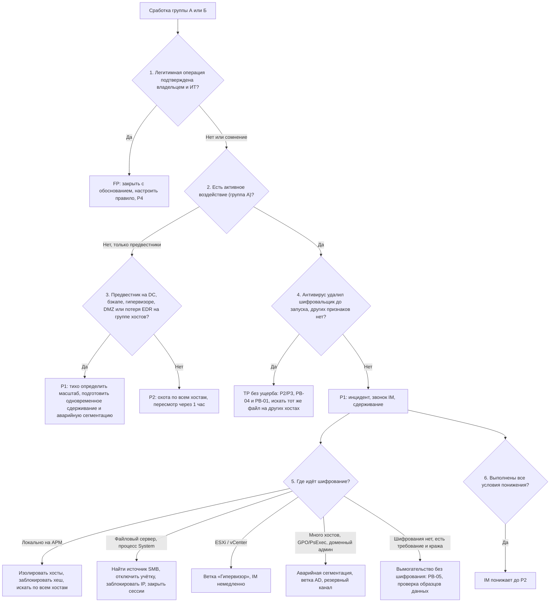

# PB-02 Шифровальщик и вымогательство

> Учебный плейбук для вымышленной компании «Альфа-Трейд». Роли, уровни критичности P1–P4, правила коммуникаций и шаблон отчёта взяты из [IR-плана](../plan/ir-plan.md); здесь только то, что относится к шифровальщику. Всё, что нужно сверить с первоисточником, и все допущения собраны в разделе [«Допущения и ограничения»](#допущения-и-ограничения). Сокращения расшифрованы в [Приложении Г](#приложение-г-сокращения).

## TL;DR

- **Шифрование — последний шаг атаки, которую ведёт человек.** До него были вход, разведка, кража учёток, боковое перемещение и почти всегда выгрузка данных.
- **Задача не «вылечить хосты»**, а **остановить распространение, найти источник, сохранить копии и улики, выселить атакующего за один раз и восстановиться в чистой среде.**
- **Любой признак активного шифрования даёт P1.** При сомнении тоже P1: ложная тревога ночью стоит меньше пропущенного шифровальщика.
- **Пароли и krbtgt не сбрасывайте на этапе сдерживания.** Только отключайте учётки атакующего. Массовая смена паролей идёт в одном согласованном окне выселения.
- **Бэкап защищайте в первые 30 минут**: остановите задания и очистку, проверьте журнал консоли и закройте доступ ко всему, кроме IR-хоста.

## Шпаргалка: первые 60 минут

| № | Действие | Кто | Срок |
| --- | --- | --- | --- |
| 1 | **Не закрывайте сработку, не перезагружайте и не выключайте хост.** Откройте тикет P1 | L1 | Сразу |
| 2 | **Позвоните L2, затем IM.** Сообщение в чате звонок не заменяет | L1 | ≤ 5 мин |
| 3 | **L2 не ответил за 5 минут:** изолируйте в EDR рабочую станцию, на которой идёт шифрование | L1 | ≤ 10 мин |
| 4 | **Вынесите вердикт TP/FP** и изолируйте первые хосты | L2 | ≤ 15 мин |
| 5 | **Назначьте хрониста**, который ведёт хронологию в тикете | IM | ≤ 15 мин |
| 6 | **Позвоните директору и юристу/DPO** | IM | ≤ 15 мин от объявления P1 |
| 7 | **Найдите источник шифрования.** Шифруется файловый сервер, значит ищите хост, который шифрует по SMB | L2 | ≤ 30 мин |
| 8 | **Защитите бэкап:** остановите задания и очистку, проверьте журнал консоли, оставьте доступ только IR-хосту | Админ бэкапа | ≤ 30 мин |
| 9 | **Решите, нужна ли аварийная сегментация** (запрет SMB, RDP, WinRM между сегментами) | IM | ≤ 30 мин |
| 10 | **Дайте первый статус директору** и решите, звать ли внешнюю IR-команду | IM | ≤ 60 мин |
| 11 | **Остановите распространение**, проинвентаризируйте копии, определите семейство | L2, админ бэкапа | ≤ 4 ч |
| 12 | **Решите вопрос об уведомлении Роскомнадзора** | Юрист/DPO, директор | ≤ 24 ч от выявления |

## Чего делать нельзя

- **Не выключайте и не перезагружайте затронутые хосты «для лечения».** Пропадает память, а некоторые семейства после перезагрузки шифруют в безопасном режиме, где EDR не работает. Исключение и его условия описаны в разделе 6.5.
- **Не изолируйте только жертву при удалённом шифровании.** Источник продолжит шифровать.
- **Не сбрасывайте массово пароли и krbtgt на этапе сдерживания.** Атакующий с DCSync или кейлоггером получит новые пароли и поймёт, что его нашли.
- **Не входите привилегированными учётками интерактивно на затронутые хосты.** Работайте через EDR или с чистой админской станции.
- **Не загружайте образец и записку в VirusTotal и публичные песочницы.** В записке ID жертвы и ссылка на чат. Публично отправляйте только хеш.
- **Не открывайте ссылки из записки и не связывайтесь с атакующим.** Это решает только директор (раздел 11.4).
- **Не обсуждайте инцидент в корпоративной почте и чатах**, если есть подозрение на компрометацию AD.
- **Не запускайте «чистящие» утилиты и не переустанавливайте хосты**, пока не собраны артефакты.
- **Не убирайте маяки по одному на стадии предвестников.** Атакующий заметит и ускорит шифрование. Сдерживайте одновременно.
- **Не «выдёргивайте интернет» без разрешённого списка.** Перестанут работать облачный EDR, SIEM и связь команды.

## 1. Цель и область применения

**Цель:** остановить распространение шифровальщика, найти источник и точку входа, сохранить резервные копии и улики, выселить атакующего за один раз и восстановить системы в чистой среде.

**Что входит:**

- Шифрование или уничтожение данных:
  - на рабочих станциях и серверах;
  - на гипервизорах (ESXi, vCenter) и NAS;
  - в облачных файлах через синхронизацию.
- **Удалённое шифрование:** шифровальщик работает на неуправляемом хосте и шифрует шары файлового сервера по SMB.
- **Предвестники шифровальщика:** разведка AD, кража учёток, массовое боковое перемещение, отключение EDR, атака на бэкап.
- **Вымогательство без шифрования:** только кража данных и шантаж публикацией. Ведётся вместе с PB-05.
- **Wiper под видом шифровальщика:** данные уничтожены, ключа не существует, выкуп бессмыслен.

**Что не входит:**

| Ситуация | Куда передать |
| --- | --- |
| Единичный вредонос, удалённый антивирусом, без признаков подготовки шифрования | PB-04, PB-S3 |
| Компрометация учётки без признаков подготовки | PB-03 |
| Утечка без вымогательства | PB-05 |
| Вымогательство через DDoS | PB-06 |

## 2. Паспорт

| Поле | Значение |
| --- | --- |
| ID | PB-02 |
| Версия | 1.1 (учебная), 31.10.2026 |
| Владелец | Руководитель ИБ (IM) |
| Пересмотр | Раз в 6 месяцев, после каждого инцидента и каждых учений |
| Критичность по умолчанию | **P1** при любом признаке активного воздействия (группа А в Приложении Б) |
| Повышение до P1 | Предвестник (группа Б) на DC, сервере бэкапа, гипервизоре или в DMZ; массовая потеря телеметрии EDR; подтверждённая компрометация доменного администратора; компания появилась на сайте утечек группы (DLS) |
| P2 | Предвестники только на рабочих станциях без признаков воздействия; антивирус удалил шифровальщик **до запуска**. Через 1 час пересмотрите: если распространение не исключено, повысьте до P1 |
| Понижение с P1 до P2 | Решает только IM, когда выполнены **все** условия: затронут один пользовательский хост, шифрование локальное, у атакующего нет доменных привилегий, выгрузка исключена, точка входа установлена |
| P4, закрытие | Ложная сработка, подтверждённая владельцем системы и ИТ (раздел 5.2). Вложение удалено почтовым шлюзом до доставки: работайте по PB-01 |
| Техники MITRE ATT&CK | [Приложение А](#приложение-а-mitre-attck) |
| Связанные плейбуки | PB-01 Фишинг (вектор входа), PB-03 Компрометация учётки, PB-04 Вредонос на рабочей станции (единичный детект), PB-05 Утечка данных (выгрузка, 152-ФЗ), PB-08 Взлом веб-приложения (вход через сайт или API), PB-10 Компрометация облачного аккаунта, PB-S3 и PB-S4 Сработки антивируса и EDR |

**Целевые сроки (учебные):**

| Этап | Срок |
| --- | --- |
| Принять сработку и позвонить IM | 5 мин |
| Вердикт TP/FP и изоляция первых хостов | 15 мин |
| Источник найден, бэкап защищён, решение по сегментации | 30 мин |
| Первый статус директору, решение о внешней IR-команде | 60 мин |
| Распространение остановлено, копии проинвентаризированы, семейство определено | 4 ч |
| Решение по уведомлению Роскомнадзора | до 24 ч от выявления |
| Хронология и план выселения | 72 ч |
| Восстановление критичных систем | По RTO из плана непрерывности (BCP) |

## 3. Подготовка

Без этих условий плейбук невыполним.

- [ ] **Офлайн-копия** плейбука, контактов, схемы сети и списка критичных серверов (IP, имена) хранится вне домена и файлового сервера, лучше на бумаге
- [ ] **Резервный канал связи** готов (мессенджер на личных телефонах, телефонное дерево), участники знают, куда переходить
- [ ] **Бэкап по правилу 3-2-1-1-0:** есть неизменяемая (immutable) или офлайн-копия; сервер бэкапа вне домена; локальные учётки консоли с MFA; восстановление проверяется раз в квартал
- [ ] **Заранее согласованные полномочия** (раздел 4.2) подписаны директором
- [ ] **На NGFW подготовлены и выключены** наборы правил «аварийная сегментация» и «запрет исходящего интернета» с разрешённым списком: облако EDR и SIEM, канал IR-команды
- [ ] **Аудит Windows включён:** 4688 с командной строкой, PowerShell Script Block Logging (4104), аудит доступа к шарам (5140, 5145) хотя бы на файловых серверах. Журналы ESXi, vCenter и консоли бэкапа уходят в SIEM
- [ ] **Канареечные файлы** (honeyfiles) лежат в общих папках, в SIEM есть правило на их изменение
- [ ] **Аптечка IR на чистом носителе:** средство снятия памяти, коллектор триажа (KAPE, Velociraptor или функция EDR), внешние диски, бланк цепочки хранения
- [ ] **Контакты** внешней IR-компании (договор-retainer), вендоров EDR и бэкапа, страховщика (если есть полис)

## 4. Роли и ответственность

### 4.1. Матрица RACI

**R** выполняет, **A** утверждает и отвечает за результат, **C** консультирует, **I** получает информацию.

| Действие | L1 | L2 | IM | ИТ (сеть, серверы) | Админ бэкапа | Админ виртуализации | Владелец системы | Юрист/DPO | PR | Директор |
| --- | --- | --- | --- | --- | --- | --- | --- | --- | --- | --- |
| Тикет P1, звонок L2 и IM | R | I | I | | | | | | | |
| TP/FP, масштаб, источник | C | R | A | C | | C | | | | |
| Изоляция рабочих станций и серверов (кроме DC, гипервизора, DMZ, бэкапа) | R¹ | R | I | C | | | I | | | |
| Изоляция DC, гипервизора, отключение VPN | | C | A | R | | R | C | | | I |
| Аварийная сегментация (SMB, RDP, WinRM, RPC) | | C | A² | R | | | I | | | I |
| Запрет исходящего интернета, остановка сайта | | C | R | R | | | A | C | C | A |
| Отключение учёток атакующего | | R | A² | R | | | | | | |
| Защита бэкапа | | C | A² | | R | | | | | |
| Сбор артефактов, цепочка хранения | | R | A | C | C | C | | C | | |
| Массовая смена паролей, krbtgt (окно выселения) | | C | A | R | | | C | | | I |
| Привлечение внешней IR-команды | | C | R | | | | | C | | A |
| Уведомление РКН, ГосСОПКА, полиции, страховщика | | C | C | | | | | R | | A |
| Контакт с атакующим, выкуп | | | C | | | | | C | | A/R |
| Сообщения сотрудникам и клиентам | | | R | | | | C | C | R | A |
| Возврат системы в сеть | | C | A | R | | R | A | | | |
| Хронология в тикете | | | A | | | | | | | |

¹ L1 изолирует только рабочую станцию с подтверждённым шифрованием и только если L2 не ответил за 5 минут.
² Заранее утверждено для P1-шифровальщика; IM уведомляют в течение 15 минут.

**Дополнительные роли этого сценария:**

- **Хронист.** IM назначает его в первые 15 минут. Хронист ведёт хронологию в тикете (UTC и местное время), потому что у IM на это не будет времени.
- **Администратор бэкапа и администратор виртуализации.** Это отдельные исполнители, а не «ИТ вообще».
- **Внешняя IR-команда и вендор EDR.** Подключаются по решению IM и директора (критерии в разделе 5.5).
- **Страховщик**, если есть полис. Часто требует уведомить его до привлечения подрядчиков.
- **HR и руководители подразделений** доводят инструкции до сотрудников. **Служба поддержки** отвечает клиентам по согласованному тексту.

### 4.2. Заранее согласованные полномочия

IR-план разрешает L2 изолировать только одну рабочую станцию. Для шифровальщика это не работает: пока ждут разрешения, шифруется файловый сервер. Поэтому директор заранее утверждает такие полномочия:

| Кто | Что может сделать сам |
| --- | --- |
| **L1** | Изолировать в EDR рабочую станцию, на которой идёт шифрование, если L2 не ответил за 5 минут |
| **L2** | Без согласования изолировать любой хост, кроме DC, гипервизоров, серверов DMZ и сервера бэкапа; отключить доменную учётку (кроме аварийной break-glass); заблокировать IP и домены на NGFW; закрыть SMB-сессии на файловых серверах. IM уведомить в течение 15 минут |
| **IM** | Изолировать DC и гипервизор, отключить VPN, включить аварийную сегментацию, запретить исходящий интернет из внутренних сегментов |
| **IM и владелец системы** (если владелец недоступен, IM и директор) | Остановить сайт и API, полностью отключить компанию от интернета |
| **Только директор** | Контакт с атакующим, вопрос выкупа, бюджет на внешнюю IR-команду |

## 5. Триаж

Триаж делится на две части. **Быстрый триаж (L1, первые 5 минут)** отвечает на вопрос «это шифровальщик или ложная сработка?» и запускает эскалацию. **Глубокий триаж (L2, 5–30 минут)** определяет фазу атаки, источник и масштаб и выбирает ветку сдерживания. Оба идут по одному дереву решений.

**Правило:** при сомнении эскалируйте как P1.

### 5.1. Дерево решений



Ниже каждый узел расписан подробно. Номера узлов совпадают с номерами в схеме.

### 5.2. Быстрый триаж (L1, первые 5 минут)

Распечатайте этот раздел и держите на рабочем месте.

1. **Не закрывайте сработку.** Не перезагружайте и не выключайте хост, не входите на него своей учёткой.
2. **Откройте тикет:** время сработки, хост, пользователь, процесс, командная строка, скриншот записки.
3. **Посмотрите в EDR дерево процессов:** родительский процесс, учётка, путь к исполняемому файлу.
4. **Узел 1. Это легитимная операция?** Проверьте в SIEM за 30 дней, было ли такое событие раньше, например ежедневно в 02:00 от бэкап-агента. Сравните с таблицей ниже.
5. **Узел 2. Есть признак группы А или сомнение?** Ставьте P1 и **звоните** L2, затем IM.
6. **L2 не ответил за 5 минут, шифрование на рабочей станции подтверждено:** изолируйте её в EDR, проверьте статус «изолирован», запишите время.
7. **Запустите запросы А1 и А4** из [Приложения В](#приложение-в-примеры-запросов-и-команд) и приложите результат к тикету: сколько хостов затронуто.

**Как отличить ложную сработку от атаки (узел 1):**

| Сработка | Признак легитимности | Признак атаки |
| --- | --- | --- |
| VSS, `vssadmin` | Родительский процесс — служба бэкап-агента, учётка службы, регулярное расписание | Родитель `cmd.exe` или `powershell.exe`, пользовательская или админская учётка, `delete shadows /all /quiet` |
| Массовые изменения файлов | Облачный клиент, архивация, перекодирование, сборка ПО, плановая миграция | Одно новое расширение, записки в каталогах, рост энтропии, неизвестный исполняемый файл |
| Ransom.\* от антивируса | Файл во вложении удалён до запуска (→ PB-01, PB-S3) | Действие «не удалось», файл в `ProgramData`, `Temp`, `ADMIN$` |
| Учения, пентест | Есть в календаре работ ИБ | Нет в календаре |

Список всех триггеров групп А и Б с полями и Event ID есть в [Приложении Б](#приложение-б-источники-данных-и-триггеры).

### 5.3. Глубокий триаж (L2, 5–30 минут)

Ответьте на вопросы по порядку и записывайте ответы в тикет.

| № | Вопрос | Где смотреть | Признак инцидента | Узел дерева |
| --- | --- | --- | --- | --- |
| 1 | **В какой фазе атака:** предвестники, идёт шифрование или уже завершено? | EDR: новые зашифрованные файлы, рост числа хостов с детектом | Число хостов или файлов растёт, значит шифрование идёт | 2, 3 |
| 2 | **Где источник:** локальный процесс, SMB с другого хоста, гипервизор, GPO или задача на многих хостах? | Дерево процессов EDR, запросы А2 и А3, `Get-SmbSession`, Б2, событие 7045 | Процесс `System` на файловом сервере; одинаковая задача или служба на многих хостах | 5 |
| 3 | **Работает ли EDR** на затронутых хостах? | Консоль EDR: агент онлайн, команды выполняются | Нет heartbeat; изоляция не подтвердилась за 2 минуты | 3 |
| 4 | **Какие активы затронуты:** АРМ, файловый сервер, 1С, база клиентов, AD, ESXi, бэкап, DMZ, облако? | Таблица масштаба (ниже) | Затронут любой сервер, значит P1 подтверждён | 3, 5 |
| 5 | **Какие привилегии у атакующего?** | Б1, события 4728, 4732, 4672, входы доменных админов с нетипичных хостов | DCSync, новые доменные админы → ветка AD и резервный канал | 5 |
| 6 | **Целы ли копии?** | Позвоните админу бэкапа: последние успешные задания, удаления в журнале, наличие immutable- или офлайн-копии | Удаления, изменение срока хранения → ветка «бэкап» (6.3) | — |
| 7 | **Была ли выгрузка?** | Б4; процессы rclone, MEGA, WinSCP; архивы; упоминание кражи в записке; сайт утечек | Аномальный исходящий объём с серверов | 5, 6 |
| 8 | **Какое семейство?** | Записка, расширение, хеш; ID Ransomware, Crypto Sheriff (No More Ransom). Отправляйте **только хеш или обезличенную записку** | Известные TTP и IOC, наличие дешифратора, признаки wiper | — |
| 9 | **Затронуты ли сайт и DMZ?** | EDR на серверах DMZ, WAF, связи с базой | Шифрование или закрепление в DMZ | 5 |

**Таблица масштаба** ведётся в тикете с первых минут. Колонки: хост, роль, статус (зашифрован, скомпрометирован, подозрительный, чистый), EDR онлайн, изолирован (кем и когда), артефакты собраны (да или нет).

**Узел 6. Условия понижения с P1 до P2.** Понижает только IM, когда выполнено всё: затронут один пользовательский хост, шифрование локальное, доменных привилегий у атакующего нет, выгрузка исключена, точка входа установлена.

### 5.4. Когда эскалировать

- **Звонок IM немедленно:**
  - любой признак группы А;
  - DCSync или новые доменные админы;
  - шифрование на сервере, DC или гипервизоре;
  - потеря EDR на 3 и более хостах;
  - удаления в консоли бэкапа.
- **Переход на резервный канал:** любой признак компрометации AD или облачной почты.
- **Директор и юрист:** сразу при объявлении P1 (до T+15 мин), а не «при признаках утечки».

### 5.5. Когда звать внешнюю IR-команду

Решают IM и директор, до T+2 ч, если выполнено любое условие:

- затронуты AD или гипервизоры;
- затронуто больше 10% хостов;
- источник не найден за 1 час;
- нет уверенности, что атакующий выселен.

## 6. Сдерживание

### 6.1. Первые 30 минут

| № | Шаг | Кто | Инструмент | Кто утверждает |
| --- | --- | --- | --- | --- |
| 1 | **Изолируйте хосты, где идёт шифрование.** Проверьте, что агент подтвердил изоляцию | L2 (L1 одну АРМ) | EDR | Заранее (4.2) |
| 2 | **Изоляция невозможна** (нет агента, агент убит, изоляция не применилась за 2 минуты): отключите порт коммутатора, VLAN, ACL на NGFW. Для ВМ отключите виртуальный адаптер, сделайте suspend или снапшот с памятью | ИТ | Коммутатор, NGFW, vCenter | L2 для АРМ и серверов; IM для критичных |
| 3 | **Удалённое шифрование:** найдите источник (`Get-SmbSession`, запрос А3), отключите учётку, заблокируйте IP, закройте сессии. Есть EDR на источнике, изолируйте его | L2, ИТ | AD, NGFW, PowerShell | Заранее |
| 4 | **Отключите (disable)** учётки атакующего и созданные во время атаки. Не удаляйте их и не сбрасывайте пароли массово. Отзовите сессии VPN и облачной почты этих учёток | L2, ИТ | AD, VPN, консоль облака | Заранее |
| 5 | **Защитите бэкап** (раздел 6.3) | Админ бэкапа | Консоль бэкапа, NGFW | Заранее |
| 6 | **Включите аварийную сегментацию:** запретите 445, 3389, 5985/5986, 135 и динамические RPC между сегментами, кроме хостов IR и ИТ | ИТ (сеть) | NGFW, заготовленный набор правил | IM (заранее для P1) |
| 7 | **Отключите VPN** для всех, кроме участников реагирования | ИТ (сеть) | NGFW или VPN-шлюз | IM |
| 8 | **Затронут гипервизор:** ветка 6.4 | Админ виртуализации | vCenter, NGFW | IM |
| 9 | **Шифруется DC:** изолируйте только по решению IM, потому что это сломает аутентификацию и часть инструментов | ИТ | EDR, NGFW | IM |

Команды для файлового сервера приведены в [Приложении В](#приложение-в-примеры-запросов-и-команд). Запускайте их с доверенного хоста и записывайте каждое действие в тикет.

### 6.2. До окна выселения (до T+4 ч)

1. **Заблокируйте IOC:** хеши в EDR, домены и IP C2 на NGFW, прокси и в DNS sinkhole (L2, ИТ).
2. **Отключите или исправьте вредоносные GPO и задачи распространения**, но **сначала сохраните их копию** для улик (ИТ, утверждает IM).
3. **Удалите или заблокируйте RMM-инструменты и туннели атакующего** контролем приложений на NGFW и в EDR (L2).
4. **Запретите исходящий интернет из внутренних сегментов** по критериям ниже. Сайт в DMZ продолжает работать (IM).
5. **Приостановите синхронизацию облачных файлов** на затронутых хостах и проверьте версии файлов в облаке (ИТ).
6. **Отключите интеграции и доступы подрядчиков**, если вход мог быть через них (ИТ, утверждает IM).
7. **Держите изолированные хосты включёнными**, пока не собраны артефакты.

**Ступени жёстких мер**, от мягкой к жёсткой:

1. Точечно: хосты, учётки, IOC.
2. Запрет SMB, RDP и WinRM между сегментами.
3. Запрет исходящего интернета из внутренних сегментов.
4. Отключение VPN.
5. Полное отключение от интернета. Это останавливает выручку (около 1 млн ₽/ч), а без разрешённого списка и облачный EDR, SIEM и почту команды.

**Переходите на ступень выше, если выполнено любое условие:**

- шифрование на 2 и более серверах или на 5 и более АРМ за 30 минут (порог учебный);
- подтверждена компрометация доменного администратора;
- источник шифрования не найден за 30 минут;
- EDR массово отключён;
- идёт выгрузка или активный C2 на многих хостах, и точечными мерами это не остановить.

**Сайт останавливайте**, только если он затронут (шифрование или закрепление в DMZ или в базе, к которой он подключён) или через него идёт атака. Иначе держите его в работе с усиленным мониторингом.

### 6.3. Защита резервных копий

Выполняет админ бэкапа в первые 15–30 минут.

1. **Не выключайте сервер бэкапа.** Экспортируйте или снимите скриншотом список точек восстановления критичных систем.
2. **Проверьте журнал консоли за 30 дней:** входы, удаление заданий и точек, изменение срока хранения, отключение immutability, новые учётки. Журнал сохраните в улики. При любом подозрении сразу сообщите IM.
3. **Приостановите задания и очистку по сроку хранения**, чтобы зашифрованные данные не вытеснили чистые точки.
4. **Включите или проверьте immutability (блокировку)**; на СХД и NAS защитите снапшоты.
5. **Оставьте сетевой доступ к серверу и репозиториям только с IR-хоста** (правило NGFW). Если сервер в домене и есть признаки его компрометации, физически отключите репозиторий.
6. **С чистой машины смените пароль консоли** (локальная учётка вне домена) и убедитесь, что включена MFA.
7. **Сообщите IM даты последних проверенных копий** AD, базы клиентов, 1С, сайта и файлового сервера.

Для Veeam Backup & Replication эксплуатировались, например, CVE-2023-27532 и CVE-2024-40711. Проверьте свою версию и патчи.

### 6.4. Ветка «Гипервизор» (ESXi, vCenter)

1. **Сообщите IM немедленно**, админ виртуализации должен быть на связи. EDR внутри гостевых ВМ не видит шифрования файлов ВМ.
2. **Сохраните журналы ESXi до любой перезагрузки:** `/var/log/hostd.log`, `shell.log`, `auth.log`, `vobd.log`, `vmkernel.log`. Без настроенного syslog или постоянного scratch-раздела часть журналов пропадёт.
3. **Закройте на NGFW доступ к интерфейсам управления ESXi и vCenter** из всех сегментов, кроме выделенного админского.
4. **С чистой машины смените пароли** root и администраторов vCenter, отключите SSH и ESXi Shell, проверьте локальные учётки командой `esxcli system account list`.
5. **Не удаляйте снапшоты, не перезапускайте зашифрованные ВМ и не перезагружайте хост**, пока не собраны улики.

### 6.5. Когда хост всё-таки можно выключить

Обычно хосты не выключают (см. «Чего делать нельзя»). **Исключение:** шифрование идёт, изолировать хост нельзя, а данные критичны. Тогда IM решает выключить хост, а для ВМ сделать suspend или снапшот. CISA #StopRansomware Guide допускает отключение питания как запасной вариант.

Довод «в памяти ключ шифрования» неверен. У современных семейств ключ каждого файла сразу шифруется публичным ключом атакующего, и извлечь его удаётся редко. Ценность памяти в другом: процессы, C2-импланты, командные строки, учётные данные.

## 7. Сбор и сохранение артефактов

- **Если на хосте идёт шифрование, сначала изолируйте, потом собирайте.**
- **Пишите всё на внешний носитель** или на выделенный ресурс IR вне домена, **а не на диск жертвы.**

**Порядок по летучести (RFC 3227):**

| № | Артефакт | С каких хостов | Как сохранить |
| --- | --- | --- | --- |
| 1 | **Дамп памяти** | Нулевой пациент, хост-источник шифрования, DC (при подозрении) | Функция EDR, winpmem, DumpIt, Magnet RAM Capture. Для ВМ снапшот с памятью или suspend (.vmem, .vmss) |
| 2 | **Процессы, соединения, сессии, DNS-кэш, задачи, службы** | Те же, если полного дампа нет | Live response в EDR или `tasklist /v`, `netstat -anob`, `query user`, `ipconfig /displaydns`, `schtasks /query /fo LIST /v`, `Get-CimInstance Win32_Process` и `Win32_Service` |
| 3 | **Журналы, которые ротируются или чистятся** | DC, затронутые серверы, ESXi, VPN, NGFW, DNS, прокси, консоль бэкапа, облачная почта | Экспорт `.evtx` (Security, System, PowerShell/Operational, TaskScheduler, TerminalServices, WMI-Activity, Defender); выгрузка из SIEM за весь предполагаемый период присутствия атакующего |
| 4 | **Триаж-пакет** | Ключевые хосты | KAPE, Velociraptor или EDR: `$MFT`, `$UsnJrnl:$J`, реестр (SYSTEM, SOFTWARE, SAM, NTUSER.DAT, Amcache.hve), Prefetch, SRUM, ShimCache, LNK, история PowerShell `ConsoleHost_history.txt` |
| 5 | **Образцы** | Где найдены | Исполняемый файл шифровальщика и загрузчика (часто самоудаляется: ищите в EDR, `C:\Windows\Temp`, `C:\ProgramData`, `C:\Users\Public`, SYSVOL, `ADMIN$`); скрипты `.bat` и `.ps1`; GPO; задачи; `rclone.conf`; ELF-файл на ESXi |
| 6 | **Записки и файлы** | Все типы систем | Записки; 2–3 пары «оригинал из копии и зашифрованный файл» (пригодятся для дешифратора) |
| 7 | **Образ диска** | Нулевой пациент, источник, DC; все хосты, если планируется обращение в полицию | Полный образ перед переустановкой |

**Цепочка хранения.** Для каждого артефакта запишите в журнал улик:

- что это и с какого хоста;
- кто собрал, когда (UTC и местное время) и каким инструментом;
- SHA-256 сразу после сбора;
- где хранится и кто получал доступ.

Храните улики в изолированном хранилище, доступ только у команды. Работайте с копиями, оригиналы не открывайте. Включите legal hold: журналы и носители не уничтожаются до конца разбирательств.

**Переустанавливать ключевой хост можно**, только когда в тикете стоит отметка «артефакты собраны, хеши записаны».

## 8. Расследование

| Вопрос | Источники | Результат |
| --- | --- | --- |
| **Масштаб:** какие хосты, учётки, сегменты, облачные ресурсы затронуты? | Поиск хеша, имени и командной строки шифровальщика по всем хостам в EDR; службы (7045, 4697) и задачи (4698) с одинаковым именем; GPO (5136, SYSVOL); входы учёток атакующего за весь срок хранения журналов | Таблица масштаба, список учёток, список IOC |
| **Как шифровальщик распространялся** | GPO, PsExec, WMI, WinRM, RDP; события 4624, 4648, 5140 (`ADMIN$`, `C$`) | Как доставили шифровальщик и что отключить (раздел 6.2) |
| **Вектор входа.** Определяйте по уликам, а не по принципу «обычно это RDP» | VPN (входы без MFA, геолокация), NGFW, WAF и веб-журналы (PB-08), почта (PB-01), RMM, доступы подрядчиков, уязвимости периметра | Подтверждённая точка входа и техника ATT&CK |
| **Хронология:** первичный доступ → разведка → привилегии → перемещение → выгрузка → удаление копий → шифрование | SIEM, EDR, `$MFT` и `$UsnJrnl`, первая записка, память | Время первичного доступа (dwell time) и начала шифрования. От него зависит выбор точки восстановления |
| **Привилегии и закрепление в AD** | Состав групп Domain Admins, Enterprise Admins, Administrators, Backup Operators; AdminSDHolder; SPN; делегирования; ADCS (шаблоны и выданные сертификаты); доверия; DSRM; `repadmin /showobjmeta` | Список закреплений для выселения |
| **Затронутые данные и выгрузка** | Запрос Б4; процессы выгрузки; архивы; аномальные выборки из базы и экспорт 1С; `rclone.conf`; сайт утечек группы | Один из трёх выводов: «выгрузка подтверждена (объём, категории ПДн)», «исключить нельзя», «исключена с обоснованием». Вывод передаётся юристу |
| **Семейство и мотив** | Записка, расширение, хеш, отчёты вендоров | Известные TTP, наличие дешифратора, признаки wiper или хактивизма. Часть атак на российские компании использует утёкшие билдеры LockBit 3.0 и Babuk и уничтожает данные без выкупа |
| **Целостность** | Сравнение данных базы и кода сайта с копией | Нет ли скрытых изменений |

Команды для проверки AD приведены в [Приложении В](#приложение-в-примеры-запросов-и-команд). Инструменты аудита AD (PingCastle, Purple Knight) запускайте после стабилизации, не в разгар инцидента.

## 9. Устранение

**Начинайте, только когда распространение остановлено** и хронология восстановлена от первичного доступа до шифрования.

1. **Проинвентаризируйте закрепление** (L2, при необходимости внешняя IR-команда):
   - учётки и группы, AdminSDHolder, GPO;
   - задачи, службы, WMI-подписки, ключи Run;
   - RMM, веб-шеллы в DMZ;
   - VPN-учётки и сертификаты, ADCS, доверия;
   - облачные учётки, OAuth-приложения, правила пересылки в почте.
2. **Составьте план окна выселения** (IM и ИТ): карта сервисных учёток и их зависимостей (1С, бэкап, SQL, сайт, интеграции), кто что меняет, в каком порядке, как откатиться.
3. **Проведите окно выселения.** Всё делается одновременно:
   - **закройте точку входа** (патч, MFA, закрыть RDP из интернета, отозвать доступ подрядчика) и проверьте, что она закрыта;
   - **отключите или удалите учётки атакующего** и удалите закрепление;
   - **смените пароли с чистой админской станции** в таком порядке:
     1. аварийные (break-glass) и доменные админы;
     2. сервисные учётки;
     3. администраторы серверов;
     4. локальные администраторы (LAPS) и DSRM;
     5. **krbtgt, первый сброс**;
     6. все пользователи;
     7. **krbtgt, второй сброс**;
   - **отзовите сертификаты, токены и сессии в облаке.**
4. **Сбросьте krbtgt дважды**, потому что AD хранит текущий и предыдущий пароли.
   - Между сбросами выждите не меньше максимального срока жизни TGT (по умолчанию 10 ч) плюс время репликации.
   - Используйте скрипт Microsoft `New-KrbtgtKeys.ps1`, репликацию проверяйте `repadmin /replsummary` до и после.
   - Ускоренный сброс при активном golden ticket делайте только по решению IM, понимая, что будут сбои.
   - Сброс krbtgt не устраняет закрепление через ADCS (поддельные сертификаты).
5. **Переустанавливайте, а не «лечите»** все хосты, на которых у атакующего были права администратора.
6. **Проверьте выселение:** 72 часа охоты по TTP инцидента, алерты на входы старых учёток и IOC.

## 10. Восстановление и мониторинг

1. **Подготовьте чистую среду (clean room):** изолированный сегмент, отдельные учётки, EDR. Восстановленное проверяйте там, до возврата в сеть.
2. **Выберите точку восстановления:**
   - данные берите из последней копии **до** первичного доступа или из копии, проверенной на IOC и закрепление;
   - ОС и ПО ставьте из «золотых» образов;
   - копии, сделанные после первичного доступа, считайте потенциально заражёнными;
   - если дата первичного доступа неизвестна, берите самую раннюю доступную копию и проверяйте особенно тщательно.
3. **Проверьте копию:** актуальные сигнатуры, YARA по IOC инцидента, поиск учёток, задач, служб и GPO атакующего, проверка целостности.
4. **AD:** при DCSync, golden ticket или неизвестных изменениях восстанавливайте лес по Microsoft AD Forest Recovery Guide или перестраивайте его, а не просто откатывайте DC из копии.
5. **Восстанавливайте по зависимостям:**
   1. сеть и NGFW;
   2. AD, DNS, DHCP;
   3. бэкап, EDR, SIEM;
   4. база клиентов и 1С;
   5. сайт и API (если затронуты);
   6. файловый сервер;
   7. рабочие станции по приоритету подразделений.

   Восстанавливайте только то, что скомпрометировано.
6. **Возвращайте систему в сеть, только когда выполнено всё:** EDR онлайн, патчи установлены, пароли новые, закрепление проверено, точка входа закрыта, владелец подтвердил работу в тикете. Решение записывает IM.
7. **Если копий нет:**
   - дешифраторы No More Ransom для определённого семейства;
   - теневые копии и снапшоты;
   - облачные версии файлов;
   - частично зашифрованные файлы (intermittent encryption);
   - вопрос о выкупе решает директор (раздел 11.4).

**Усиленный мониторинг 30 дней.** IR-план требует минимум 2 недели, для шифровальщика берём больше; это рекомендация, а не стандарт.

| Что | Правило | Срок |
| --- | --- | --- |
| IOC инцидента | Хеши, IP, домены, имена файлов в EDR, NGFW, DNS | 30 дней, потом в постоянный список |
| TTP инцидента | Инструменты этого инцидента (AdFind, rclone, конкретный RMM), запросы А1–Б5 с пониженными порогами | 30 дней, ежедневный обзор L2 |
| Учётки | Любые входы ранее скомпрометированных и отключённых учёток; изменения привилегированных групп и GPO | 30 дней |
| Точка входа | Входы в VPN без MFA, попытки эксплуатации исправленной уязвимости | 30 дней |
| Бэкап и ESXi | Входы в консоли, изменения срока хранения, включение SSH | Постоянно |
| Утечка | Сайт утечек группы, Telegram-каналы | 3–6 месяцев |
| Полнота телеметрии | Агенты EDR на 100% хостов, нет разрывов в журналах | Ежедневно 30 дней |

## 11. Коммуникации и уведомления

### 11.1. Внутри компании

| Кому | Кто сообщает | Когда | Канал |
| --- | --- | --- | --- |
| IM, L2 | L1 | T+5 мин | Звонок |
| Директор, юрист/DPO | IM | При объявлении P1, до T+15 мин | Звонок |
| Команда реагирования | IM | Сразу при признаках компрометации AD или почты | **Резервный канал** |
| Директор (статус) | IM | Каждый час первые 6 часов, затем каждые 2 часа (по IR-плану) | Резервный канал или звонок |
| Владельцы систем | IM | Перед решениями о сайте, 1С, базе | Звонок |
| Сотрудники | IM или PR через руководителей | До T+30 мин | Телефон, мессенджер, устно |
| Страховщик, вендоры, внешняя IR-команда | IM или юрист | По решению; страховщику до привлечения подрядчиков (если требует полис) | Звонок |

### 11.2. Вне компании

| Кому | Кто сообщает | Когда | Основание |
| --- | --- | --- | --- |
| Роскомнадзор, первичное уведомление | Юрист/DPO, утверждает директор | В течение 24 часов с момента **выявления** инцидента с неправомерной передачей ПДн | 152-ФЗ, ст. 21 ч. 3.1 |
| Роскомнадзор, результаты расследования | Юрист/DPO | В течение 72 часов | То же |
| ГосСОПКА (компания как оператор ПДн) | Юрист/DPO | По установленному порядку | 152-ФЗ, ст. 19 ч. 12; приказ ФСБ (по памяти № 77 от 2023 г.) |
| НКЦКИ по 187-ФЗ | — | Не требуется: «Альфа-Трейд» не субъект КИИ. Проверьте договорные обязательства перед субъектами КИИ | 187-ФЗ |
| Полиция | Юрист | По решению директора; с хронологией, IOC и уликами с цепочкой хранения | УК РФ ст. 272, 273, 163 (квалификацию даёт юрист) |
| Клиенты | PR и юрист | Если сайт недоступен или утечка подтверждена | — |
| Партнёры, банк-эквайер, контрагенты | IM и юрист | Если затронуты интеграции, платёжная часть или общие доступы | Договоры |

**С какого момента считать 24 часа.**

- Юрист подключается с объявления P1.
- Если атакующий имел доступ к базе клиентов или к файлам с ПДн и выгрузку нельзя исключить, считайте, что инцидент выявлен.
- IM и юрист записывают момент выявления и обоснование в тикет.

Ответственность за утечки и неуведомление ужесточена: оборотные штрафы по КоАП ст. 13.11, уголовная ответственность по УК ст. 272.1.

### 11.3. Шаблоны

**Статус директору.**
> P1 «Шифровальщик», INC-___, на ___ (время). Известно: ___ (масштаб, идёт ли шифрование, выгрузка). Сделано: ___. Дальше: ___. Нужны решения: ___ (интернет, сайт, внешняя IR-команда, уведомления) до ___. Влияние на бизнес: ___. Следующий статус: ___.

**Сотрудникам.**
> Коллеги, в сети компании технический инцидент. Не выключайте и не перезагружайте компьютеры, не открывайте файлы с незнакомыми расширениями, не подключайтесь к VPN и не вставляйте флешки. Отключайте кабель или Wi-Fi только по просьбе ИБ. Если видите сообщение с требованием выкупа, сфотографируйте экран и позвоните по номеру ___. Не обсуждайте ситуацию в почте, рабочих чатах и соцсетях. Следующее сообщение в ___.

**Клиентам (сайт недоступен, утечка не подтверждена).**
> Сайт «Альфа-Трейд» временно недоступен из-за технического инцидента. Мы работаем над восстановлением; ваши заказы ___. Сообщим, когда работа возобновится.

**Не пишите «данные не пострадали»**, пока выгрузка не исключена.

### 11.4. Контакт с атакующим и выкуп

- **С атакующим связывается только человек, которого назначил директор**, через внешнего специалиста по переговорам и с изолированного устройства. Все сообщения сохраняются. Остальным связываться запрещено, в том числе «чтобы узнать сумму».
- **Решение принимает директор** по представлению IM и юриста. Учитываются:
  - можно ли восстановиться без выкупа и за какой срок (RTO против примерно 1 млн ₽/ч простоя);
  - подтверждена ли выгрузка;
  - репутация группы;
  - признаки wiper;
  - правовая позиция: санкционные, налоговые и уголовно-правовые риски (оценивает только юрист).
- **Плейбук не рекомендует платить.** Оплата не гарантирует ни расшифровки, ни удаления данных и не отменяет уведомлений и устранения. Дешифратор атакующего проверяйте на копиях.
- **Проверяйте «компании, которые расшифровывают без выкупа».** Некоторые просто платят выкуп с наценкой.

## 12. Критерии закрытия

**IM закрывает инцидент, когда отмечены все пункты:**

- [ ] Точка входа установлена **по уликам** и закрыта; закрытие подтверждено проверкой (сканирование, тест входа без MFA и т. п.)
- [ ] Хронология от первичного доступа до шифрования восстановлена и записана в тикет
- [ ] Все закрепления из раздела 9 проверены и удалены; хосты, где у атакующего были права, переустановлены
- [ ] Окно выселения проведено: пароли привилегированных, сервисных и локальных учёток и DSRM сменены, krbtgt сброшен дважды, сертификаты и облачные токены отозваны
- [ ] Системы восстановлены по критериям раздела 10, владельцы подтвердили работу
- [ ] Прошло не меньше 14 дней усиленного мониторинга без срабатываний по IOC и TTP инцидента (правила перечислены в тикете); мониторинг продолжается до 30 дней
- [ ] В SIEM и EDR добавлены постоянные правила на TTP инцидента
- [ ] Уведомления отправлены (РКН, ГосСОПКА, полиция, страховщик, что применимо), или записано обоснованное решение не уведомлять
- [ ] Артефакты сохранены с цепочкой хранения, legal hold оформлен
- [ ] Отчёт по шаблону IR-плана написан, разбор без поиска виноватых проведён в течение 5 рабочих дней, план улучшений утверждён

## 13. Метрики

| Метрика | Как считать | Что показывает |
| --- | --- | --- |
| MTTD (время обнаружения) | От первичного доступа (первого IOC) до обнаружения | Насколько рано видим атаку |
| Время от первого предвестника до шифрования | По хронологии | Сколько времени было у SOC, чтобы остановить атаку |
| Время от сработки группы А до звонка IM | По тикету | Работа L1 |
| Время до изоляции первого хоста и до остановки распространения | По тикету | Эффективность сдерживания |
| MTTR (время восстановления) | От обнаружения до восстановления критичных систем | Основная метрика восстановления |
| Фактические RTO и RPO против плановых | По системам | Насколько реалистичен план непрерывности |
| Число зашифрованных хостов и их доля | Таблица масштаба | Ущерб |
| Объём выгруженных данных, число затронутых субъектов ПДн | Расследование | Регуляторные последствия |
| Простой сайта в часах и рублях | Мониторинг доступности × 1 млн ₽/ч | Бизнес-ущерб |
| Доля хостов без рабочего EDR в момент атаки | Консоль EDR | Пробелы в покрытии |
| Доля уцелевших точек восстановления | Инвентаризация бэкапа | Устойчивость копий |
| Время до уведомления РКН от момента выявления | По тикету | Соблюдение срока 24 часа |

## 14. Типичные ошибки

1. Восстановиться, не закрыв точку входа. Результат: повторное шифрование.
2. Изолировать жертву, а не источник удалённого шифрования.
3. Сбросить пароли до выселения. Атакующий видит новые пароли и ускоряется.
4. Сбросить krbtgt второй раз сразу после первого. Kerberos ломается во всём домене.
5. Восстановить AD из копии, сделанной после начала компрометации, вместе с закреплением.
6. «Отключить бэкап», не проверив консоль и не остановив задания. Копии уже удалены или вытесняются зашифрованными.
7. «Выдернуть интернет» и потерять облачный EDR, SIEM и связь команды.
8. Верить консоли EDR на слово. Агент мог быть убит (BYOVD), а статус «изолирован» не всегда означает изоляцию.
9. Забыть про гипервизоры, NAS и облачные файлы.
10. Переустановить нулевого пациента до сбора артефактов.
11. Загрузить записку с ID жертвы или файл с ПДн в публичный сервис.
12. Обсуждать инцидент во взломанной почте.
13. Ждать «признаков утечки» и пропустить 24 часа для РКН.
14. Остановить сайт без необходимости или оставить в работе затронутый.
15. Убирать маяки по одному на стадии предвестников и тем самым спровоцировать шифрование.
16. Ждать «массового переименования файлов». Частичное шифрование и семейства без смены расширения его не дают, поэтому обнаруживайте по совокупности признаков.
17. Держать плейбук и контакты только на файловом сервере в домене.

## 15. Профилактика

| Область | Меры |
| --- | --- |
| Периметр | MFA на VPN и всех внешних доступах; нет RDP из интернета; приоритетные патчи периметровых устройств и эксплуатируемых уязвимостей; мониторинг учёток компании в утечках и журналах инфостилеров; контроль доступов подрядчиков |
| Учётки | Модель уровней администрирования (tiering), отдельные админские учётки, защищённые админские станции (PAW), LAPS, защита LSASS (LSA protection, Credential Guard), группа Protected Users, отказ от RC4, удаление лишних прав репликации, аудит ADCS, регулярный аудит AD |
| Резервные копии | Правило 3-2-1-1-0, сервер вне домена, MFA, immutable-репозиторий, ежеквартальный тест восстановления AD, базы и сайта; журналы консоли в SIEM |
| Сеть | Сегментация; запрет SMB, RDP и WinRM между рабочими станциями; разрешённый список исходящего трафика серверов; контроль RMM и облачных хранилищ на NGFW; заготовленные аварийные наборы правил |
| Хосты | EDR на 100% устройств, включая серверы и Linux; защита от отключения (tamper protection); Microsoft Vulnerable Driver Blocklist; правила ASR или аналоги; запрет запуска из `%TEMP%` и `ProgramData` |
| Виртуализация | SSH выключен, lockdown mode, отдельная аутентификация vCenter вне общего домена, журналы в SIEM, запрет неподписанных исполняемых файлов (execInstalledOnly) |
| Обнаружение | Правила на группу Б, канареечные файлы, мониторинг исходящего объёма, алерты на изменения GPO и привилегированных групп, контроль «молчащих» агентов |
| Процессы | Офлайн-копия плейбука, резервный канал, tabletop по PB-02 раз в квартал, retainer с внешней IR-командой, решение руководства о киберстраховании |

## 16. Учебная ситуация

**Вводная.** Суббота, 03:10. EDR на файловом сервере FS-01 фиксирует больше 2000 изменений файлов в минуту процессом `System`, в шарах появляются файлы `README_RESTORE.txt`. Дежурит один L1, L2 на телефоне. За 30 минут до этого с трёх серверов перестала приходить телеметрия EDR. В записке указан сайт утечек и сказано, что «скопировано 120 ГБ». Админ бэкапа сообщает, что сервер бэкапа в домене, а в журнале консоли вчера в 23:40 удалено задание для базы клиентов.

**Задания:**

1. **03:10–03:15, вы L1.** Пройдите по дереву решений и назовите узлы, через которые вы прошли. Запишите, что вы делаете в первые 5 минут и что можете сделать сами, если L2 не отвечает. Объясните, почему изоляция FS-01 не остановит шифрование.
2. **03:15–03:30, вы L2.** Напишите, какую команду или запрос вы запустите, чтобы найти источник шифрования, и какие два действия сделаете с ним сразу. Что вы сделаете, если источник окажется хостом без EDR?
3. **03:20, вы админ бэкапа.** Расставьте по порядку свои действия с бэкапом. Объясните, почему «просто отключить сервер бэкапа от сети» мало, учитывая удалённое вчера задание.
4. **03:40, вы IM.** Директор по телефону предлагает «выдернуть интернет». Перечислите, что перестанет работать, назовите ступень мер, которую вы предложите, и критерий из раздела 6.2, на который вы опираетесь.
5. **Понедельник, вы юрист.** Выгрузку подтвердили только сейчас. Запишите, с какого момента вы считаете 24 часа для Роскомнадзора, кто принимает решение и какие строки вы добавите в тикет.

## 17. Источники

- MITRE ATT&CK: https://attack.mitre.org/ (тактика Impact, техники T1486, T1490 и др.)
- NIST SP 800-61 Rev. 3 и Rev. 2, Computer Security Incident Handling Guide: https://csrc.nist.gov/pubs/sp/800/61/r3/final
- NISTIR 8374, Ransomware Risk Management: A Cybersecurity Framework Profile: https://csrc.nist.gov/pubs/ir/8374/final
- NIST SP 1800-11, Data Integrity: Recovering from Ransomware and Other Destructive Events: https://csrc.nist.gov/pubs/sp/1800/11/final
- CISA #StopRansomware Guide: https://www.cisa.gov/stopransomware/ransomware-guide
- No More Ransom (дешифраторы, Crypto Sheriff): https://www.nomoreransom.org/
- SANS Incident Handler's Handbook: https://www.sans.org/white-papers/33901/
- RFC 3227, Guidelines for Evidence Collection and Archiving: https://www.rfc-editor.org/rfc/rfc3227
- Microsoft: Active Directory Forest Recovery Guide (learn.microsoft.com, раздел Windows Server / AD DS) и материалы Microsoft по human-operated ransomware
- SigmaHQ, открытые правила обнаружения в формате Sigma: https://github.com/SigmaHQ/sigma
- The DFIR Report, разборы реальных атак с хронологией от входа до шифрования: https://thedfirreport.com/
- Годовые отчёты по инцидентам: Mandiant M-Trends, Sophos Active Adversary; российские вендоры (F6, Positive Technologies, «Лаборатория Касперского», BI.ZONE) для актуальных TTP против российских компаний
- Тексты 152-ФЗ (ст. 19, 21), 187-ФЗ, КоАП ст. 13.11 в актуальной редакции на официальном портале правовой информации

## Допущения и ограничения

**Что нужно сверить перед реальным применением:**

| № | Что | Где | Почему нужна проверка |
| --- | --- | --- | --- |
| 1 | Сроки 24 и 72 часа, ст. 21 ч. 3.1 152-ФЗ | 11.2 | Редакция закона менялась |
| 2 | ГосСОПКА для операторов ПДн: номер и порядок приказа ФСБ (по памяти № 77 от 2023 г.), способ передачи | 11.2 | Указано по памяти |
| 3 | Оборотные штрафы по КоАП ст. 13.11, УК ст. 272.1, даты вступления в силу | 11.2 | Редакции и даты вступления в силу |
| 4 | Квалификация по УК РФ ст. 272, 273, 163 | 11.2 | Даёт только юрист |
| 5 | Правовая оценка выкупа (санкции, налоги, уголовные риски) | 11.4 | Только у юриста |
| 6 | Номера и названия техник ATT&CK; T1219 в новых версиях переименована | Прил. А | Матрица обновляется |
| 7 | GUID прав репликации для DCSync в событии 4662 | Прил. Б, В | Нужно сверить с документацией Microsoft |
| 8 | Пути журналов ESXi и команда `esxcli system account list`; сохранение журналов без syslog и scratch-раздела | 6.4, Прил. Б | Зависят от версии ESXi |
| 9 | CVE-2023-27532 и CVE-2024-40711 для Veeam | 6.3 | Применимость к вашему ПО и версии |
| 10 | Поведение семейств после перезагрузки (шифрование в безопасном режиме) | Чего делать нельзя | Зависит от семейства |
| 11 | Формулировка CISA об отключении питания | 6.5 | Нужно сверить с текстом руководства |
| 12 | Синтаксис средств снятия памяти | 7 | Зависит от инструмента и версии |
| 13 | Интервал между сбросами krbtgt (10 ч плюс репликация) и актуальность `New-KrbtgtKeys.ps1` | 9 | По рекомендациям Microsoft |
| 14 | Применимость Credential Guard | 15 | Зависит от оборудования и версии Windows |
| 15 | Параметр execInstalledOnly на ESXi | 15 | Зависит от версии |
| 16 | Утёкшие билдеры LockBit 3.0 и Babuk в атаках на российские компании | 8 | Сверить по свежим отчётам вендоров |
| 17 | Условия полиса киберстрахования (уведомление страховщика) | 4.1, 11.1 | Зависят от договора |

**Допущения:**

- Серверы виртуализованы на VMware ESXi и vCenter (в IR-плане этого нет, взята типичная картина для компании такого размера).
- Межсегментный трафик идёт через NGFW, поэтому аварийную сегментацию можно включить правилами NGFW.
- У компании может быть полис киберстрахования.
- Пороги в запросах и в ступенях жёстких мер учебные; реальные пороги подбирайте по базовой линии.
- Запросы написаны на нейтральном псевдо-SPL. Имена полей зависят от нормализации в вашем SIEM.
- 30 дней мониторинга вместо 14 по IR-плану это рекомендация, а не стандарт.
- Цифра простоя около 1 млн ₽/ч взята из IR-плана.

## Приложение А. MITRE ATT&CK

| Тактика | Техники |
| --- | --- |
| Воздействие (Impact) | T1486 Data Encrypted for Impact, T1490 Inhibit System Recovery, T1489 Service Stop, T1485 Data Destruction (wiper), T1529 System Shutdown/Reboot (ESXi), T1657 Financial Theft (вымогательство) |
| Первоначальный доступ | T1133 External Remote Services, T1190 Exploit Public-Facing Application, T1078 Valid Accounts, T1566 Phishing, T1199 Trusted Relationship |
| Выполнение и закрепление | T1059.001 PowerShell, T1047 WMI, T1569.002 Service Execution, T1053.005 Scheduled Task, T1136 Create Account, T1543.003 Windows Service, T1219 Remote Access Software, T1505.003 Web Shell |
| Повышение привилегий и обход защиты | T1068 (в том числе BYOVD), T1484.001 Group Policy Modification, T1562.001 Disable or Modify Tools, T1070.001 Clear Windows Event Logs |
| Доступ к учётным данным и разведка | T1003.001 LSASS Memory, T1003.003 NTDS, T1003.006 DCSync, T1558.003 Kerberoasting, T1087.002 Domain Account, T1482 Domain Trust Discovery, T1018, T1046, T1135 |
| Боковое перемещение и выгрузка | T1021.001 RDP, T1021.002 SMB/Admin Shares, T1021.006 WinRM, T1570 Lateral Tool Transfer, T1560.001 Archive via Utility, T1567.002 Exfiltration to Cloud Storage, T1048 |

## Приложение Б. Источники данных и триггеры

Триггеры делятся на две группы.

- **Группа А, активное воздействие:** шифрование идёт или уже прошло. Сразу P1.
- **Группа Б, предвестники:** за часы или дни до шифрования. P2, на критичных активах P1. **Главная ценность SOC в том, чтобы ловить группу Б.** По группе А вы уже опоздали.

### Группа А: активное воздействие

| Источник | Что видим | Поля / Event ID | Пример правила |
| --- | --- | --- | --- |
| EDR | Поведенческий детект шифрования, массовое изменение или переименование файлов одним процессом | process_name, process_id, file_path, file_extension, число событий в минуту | Запрос А2 |
| EDR на файловом сервере | Массовая запись файлов процессом `System` (PID 4). Это **удалённое шифрование по SMB** | process_name=System, file_extension | Запрос А2 с фильтром host=FS-\*, затем А3 |
| Антивирус | Детекты Ransom.\*, Filecoder.\*; действие «не удалось» | threat_name, action, file_path | threat_name содержит Ransom или Filecoder |
| Windows / Sysmon | Уничтожение средств восстановления: `vssadmin delete shadows`, `vssadmin resize shadowstorage`, `wmic shadowcopy delete`, `Win32_ShadowCopy` + `Delete()`, `wbadmin delete catalog`, `bcdedit ... recoveryenabled no`, `bcdedit ... ignoreallfailures` | Security 4688, Sysmon 1: CommandLine, ParentProcessName, user | Запрос А1 |
| Windows | Массовая остановка служб SQL, 1С, бэкапа, антивируса (`net stop`, `sc config ... start= disabled`, `taskkill`) | 4688, System 7036 и 7040 | Больше 10 команд остановки с одного хоста за 5 минут |
| Windows | Очистка журналов (`wevtutil cl`) | Security 1102, System 104 | Любое событие вне окна работ |
| EDR / Sysmon | Массовое создание записок: одно имя файла в десятках каталогов (`README*`, `RESTORE*`, `DECRYPT*`, `*.hta`), смена обоев | Sysmon 11: TargetFilename, Image | Запрос А4 |
| SIEM | Изменение канареечного файла | 4663 или файловое событие EDR по пути приманки | Любое изменение |
| ESXi / vCenter | Массовое выключение ВМ, включение SSH вне окна работ, ELF-файл в `/tmp`, новые расширения рядом с `.vmdk` | `/var/log/shell.log`, `hostd.log`, `auth.log`, события vCenter | Включение SSH или больше 5 выключений ВМ за 10 минут |
| Консоль бэкапа | Удаление заданий и точек, изменение срока хранения, отключение immutability, массовые ошибки заданий | Журнал аудита консоли | Любое удаление вне окна работ |
| Облачные файлы | Массовые изменения файлов через синхронизацию | Журнал аудита облака | Больше N изменений одним пользователем за 5 минут |
| Пользователи, мониторинг | «Файлы не открываются», странные расширения, записка, принтеры печатают записку; одновременное падение нескольких сервисов | Тикет, мониторинг доступности | — |
| Внешние | Компания на сайте утечек группы, письмо или звонок с требованием, сообщение партнёра или НКЦКИ | — | — |

### Группа Б: предвестники

| Источник | Что видим | Поля / Event ID | Пример правила |
| --- | --- | --- | --- |
| EDR | Фреймворки постэксплуатации (Cobalt Strike, Sliver, Brute Ratel), характерные named pipes | детект, pipe_name, сетевые соединения | Детект категории C2 framework |
| EDR / 4688 | Разведка: AdFind, SharpHound, `nltest /domain_trusts`, `net group "domain admins" /domain`, Advanced IP Scanner, SoftPerfect NetScan, nmap | CommandLine, Image, OriginalFileName | Совпадение по имени или оригинальному имени файла |
| EDR / Sysmon | Доступ к памяти LSASS, `ntdsutil ... ifm`, копирование NTDS.dit | Sysmon 10 (TargetImage=lsass.exe), 4688 | Доступ к lsass не из списка доверенных процессов |
| DC | DCSync с хоста, который не является DC | Security 4662: права репликации, GUID `1131f6aa-9c07-11d1-f79f-00c04fc2dcd2`, `1131f6ad-9c07-11d1-f79f-00c04fc2dcd2` | Запрос Б1 |
| DC | Kerberoasting | 4769, TicketEncryptionType=0x17 | Больше 10 TGS с RC4 от одной учётки за 10 минут |
| DC | Новые учётки, добавление в Domain Admins, Enterprise Admins, Administrators | 4720, 4728, 4732, 4756 | Любое изменение привилегированных групп |
| DC / SYSVOL | Новые или изменённые GPO, `ScheduledTasks.xml`, скрипты в SYSVOL и NETLOGON | 5136 (ObjectClass=groupPolicyContainer), файловые события EDR | Запрос Б2 |
| Windows | Массовое создание служб, PsExec (`PSEXESVC`), удалённый WMI или WinRM | System 7045, Security 4697, WMI-Activity 5861 | Одна служба на 3 и более хостах за 1 час |
| Windows | Один источник входит на много хостов | 4624 LogonType 3 и 10: IpAddress, TargetUserName | Запрос Б3 |
| EDR / NGFW | RMM и туннели вне разрешённого списка: AnyDesk, ScreenConnect, RustDesk, ngrok, Cloudflare Tunnel, Chisel | Image, app_name на NGFW | Совпадение с запрещённым списком |
| NGFW / EDR | Выгрузка: rclone (часто переименован, ищите по `copy`, `sync`, `--config`, `mega:`), MEGAsync, WinSCP, restic; архивы `7z a`, `rar a` на серверах | bytes_out, app, dest_category, CommandLine | Запрос Б4 |
| EDR / Defender | Отключение защиты: агент EDR перестал отвечать на группе хостов; Defender 5001 (выключена защита в реальном времени), 5007 (изменение конфигурации); новые исключения; загрузка уязвимых драйверов (BYOVD) | heartbeat, журнал Defender Operational, Sysmon 6 | Запрос Б5. **Потеря телеметрии с группы хостов = P1** |
| VPN | Вход без MFA, из нетипичной страны, ночью, с нового устройства | user, src_ip, geo, mfa_result | Вход без MFA или из новой страны |

## Приложение В. Примеры запросов и команд

Запросы написаны на нейтральном псевдо-SPL; адаптируйте их под свой SIEM. Пороги учебные.

```
# А1. Уничтожение средств восстановления (T1490)
index=windows (EventCode=4688 OR (source=Sysmon EventCode=1))
  (CommandLine="*delete*shadows*" OR CommandLine="*resize*shadowstorage*" OR CommandLine="*shadowcopy*delete*"
   OR CommandLine="*Win32_ShadowCopy*" OR CommandLine="*wbadmin*delete*"
   OR CommandLine="*recoveryenabled*no*" OR CommandLine="*ignoreallfailures*")
| stats min(_time) as first_seen values(CommandLine) values(ParentProcessName) by host, user
| sort first_seen          # самый ранний хост — кандидат в источник

# А2. Массовая модификация файлов одним процессом (T1486)
index=edr event_type IN (file_modify, file_rename, file_create)
| bin _time span=1m
| stats count dc(file_extension) as ext by _time, host, process_name, process_id
| where count > 300        # порог по базовой линии; process_name=System на файловом сервере -> А3

# А3. Источник удалённого шифрования на файловом сервере (нужен аудит 5145)
index=windows host=FS-* EventCode=5145
| bin _time span=1m
| stats dc(RelativeTargetName) as files by _time, IpAddress, SubjectUserName, ShareName
| where files > 200 | sort -files

# А4. Массовое создание записок
index=edr OR (source=Sysmon EventCode=11)
  (TargetFilename="*README*" OR TargetFilename="*RESTORE*" OR TargetFilename="*DECRYPT*" OR TargetFilename="*.hta")
| bin _time span=5m
| stats dc(file_dir) as dirs by _time, host, Image
| where dirs > 20

# Б1. DCSync с хоста, который не является DC
index=windows EventCode=4662 Properties IN ("*1131f6aa-9c07-11d1-f79f-00c04fc2dcd2*","*1131f6ad-9c07-11d1-f79f-00c04fc2dcd2*")
  NOT SubjectUserName IN ("DC01$","DC02$")

# Б2. Изменения GPO
index=windows EventCode=5136 ObjectClass=groupPolicyContainer
| table _time, SubjectUserName, ObjectDN, AttributeLDAPDisplayName

# Б3. Один источник — много целей
index=windows EventCode=4624 LogonType IN (3,10)
| bin _time span=15m
| stats dc(host) as targets values(host) by _time, IpAddress, TargetUserName
| where targets > 10

# Б4. Выгрузка
index=ngfw direction=outbound src_zone IN (servers, users)
| stats sum(bytes_out) as out by src_ip, dest_ip, app, dest_category
| where out > 1073741824 | sort -out     # 1 ГБ — учебный порог

# Б5. Отключение защиты и следов
index=windows EventCode IN (5001, 5007, 1102, 104, 4719)
| stats count values(EventCode) by host
# + отчёт консоли EDR: агенты без heartbeat за последний час
```

**Файловый сервер: найти и отрезать источник удалённого шифрования.** Запускайте с доверенного хоста.

```powershell
Get-SmbSession | Sort-Object NumOpens -Descending | Select ClientComputerName, ClientUserName, NumOpens
Get-SmbOpenFile | Group-Object ClientComputerName | Sort-Object Count -Descending
Close-SmbSession -ClientComputerName <IP> -Force   # только после отключения учётки и блока IP
```

**Проверка AD.** Запускайте с чистой админской станции.

```powershell
$since = (Get-Date).AddDays(-30)
Get-ADUser -Filter {whenCreated -ge $since} -Properties whenCreated, memberOf
"Domain Admins","Enterprise Admins","Administrators","Schema Admins","Backup Operators","Account Operators" |
  ForEach-Object { Get-ADGroupMember $_ -Recursive | Select @{n='Group';e={$_}}, SamAccountName }
Get-GPO -All | Where-Object { $_.ModificationTime -ge $since } | Select DisplayName, ModificationTime
```

## Приложение Г. Сокращения

| Сокращение | Расшифровка |
| --- | --- |
| AD | Active Directory: служба каталогов Windows (учётки, группы, политики) |
| ADCS | Active Directory Certificate Services: служба сертификатов AD |
| АРМ | Автоматизированное рабочее место |
| BCP | План непрерывности бизнеса |
| BYOVD | Bring Your Own Vulnerable Driver: атакующий загружает уязвимый драйвер, чтобы отключить защиту |
| C2 | Command and Control: сервер управления вредоносом |
| DA / EA | Domain Admins / Enterprise Admins: группы администраторов домена и леса |
| DC | Контроллер домена |
| DCSync | Атака, при которой атакующий выдаёт себя за DC и получает хеши паролей |
| DLS | Data Leak Site: сайт группы, где публикуют украденные данные |
| DMZ | Демилитаризованная зона: сегмент для сервисов, доступных из интернета |
| DPO | Ответственный за обработку персональных данных |
| DSRM | Режим восстановления служб каталогов и его пароль |
| EDR | Система обнаружения и реагирования на конечных точках |
| FP / TP | Ложное срабатывание / подтверждённый инцидент |
| GPO | Объект групповой политики |
| IM | Incident Manager: руководитель реагирования |
| IOC | Индикатор компрометации: хеш, IP, домен и т. п. |
| IR | Incident Response: реагирование на инциденты |
| krbtgt | Служебная учётка AD, ключом которой подписываются билеты Kerberos |
| L1 / L2 | Аналитик SOC первой / второй линии |
| LAPS | Решение Microsoft для уникальных паролей локальных администраторов |
| LSASS | Процесс Windows, который хранит учётные данные в памяти |
| MFA | Многофакторная аутентификация |
| MTTD / MTTR | Среднее время обнаружения / восстановления |
| NAS | Сетевое хранилище |
| НКЦКИ | Национальный координационный центр по компьютерным инцидентам |
| NGFW | Межсетевой экран нового поколения |
| PAW | Защищённая рабочая станция администратора |
| ПДн | Персональные данные |
| РКН | Роскомнадзор |
| RACI | Матрица ответственности: выполняет, утверждает, консультирует, информируется |
| RMM | Программы удалённого управления (AnyDesk, ScreenConnect и т. п.) |
| RPO / RTO | Допустимая потеря данных / допустимое время восстановления |
| SIEM | Система сбора и корреляции событий безопасности |
| SOC | Центр мониторинга безопасности |
| TGS / TGT | Билеты Kerberos: сервисный / основной |
| TTP | Тактики, техники и процедуры атакующего |
| VSS | Теневые копии Windows |
| ВМ | Виртуальная машина |
| КИИ | Критическая информационная инфраструктура |
| СХД | Система хранения данных |
