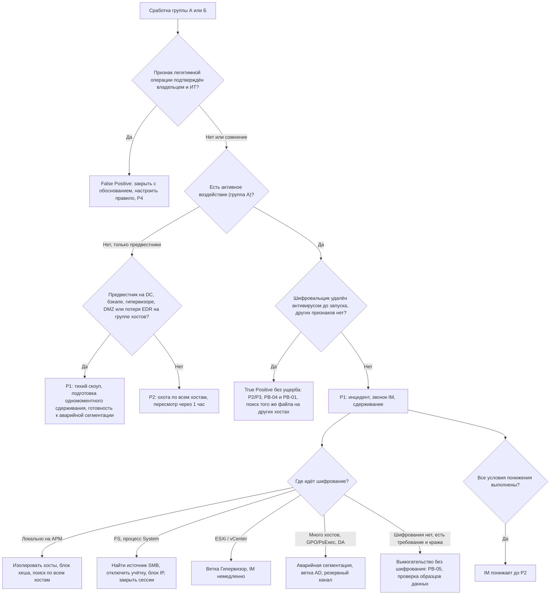

# PB-02 Шифровальщик и вымогательство (ransomware)

Учебный плейбук для вымышленной компании «Альфа-Трейд». Роли, критичность P1–P4, правила коммуникаций и шаблон отчёта берутся из IR-плана, здесь только то, что специфично для шифровальщика.

Пометки в тексте:
- **[проверить]**: точный срок, номер статьи, версию продукта или синтаксис нужно сверить с первоисточником перед применением.
- **[допущение]**: в IR-плане этого нет, предполагается типичная картина для компании такого размера (например, серверы виртуализованы на VMware ESXi).
- **(пример)**: запросы написаны на нейтральном псевдо-SPL. Имена полей зависят от нормализации в вашей SIEM, пороги подбираются по базовой линии.

Главная мысль плейбука: шифрование — **последний** шаг атаки, которую ведёт человек. Перед ним были вход, разведка, кража учёток, боковое перемещение и, как правило, выгрузка данных. Поэтому задача не «вылечить хосты», а **остановить распространение, найти источник, сохранить копии и улики, выселить атакующего одномоментно и восстановиться в чистой среде**.

---

## 1. Паспорт плейбука

| Поле | Значение |
| --- | --- |
| ID | PB-02 |
| Версия | 1.0 (учебная), дата: 31.10.2026 |
| Владелец | Руководитель ИБ (IM). Пересмотр раз в 6 месяцев, после каждого инцидента и каждых учений |
| Критичность по умолчанию | **P1** при любом признаке активного воздействия (раздел 3, группа А) |
| Повышение до P1 | Предвестник (группа Б) на DC, сервере бэкапа, гипервизоре или в DMZ; массовая потеря телеметрии EDR; подтверждённая компрометация доменного администратора; появление компании на сайте утечек (DLS) |
| P2 | Предвестники только на рабочих станциях без признаков воздействия; антивирус удалил шифровальщик **до запуска**. Пересмотр через 1 час: если распространение не исключено, повысить до P1 |
| Понижение с P1 до P2 (решает только IM) | Выполнены **все** условия: затронут один пользовательский хост, шифрование локальное, у атакующего нет доменных привилегий, выгрузка исключена, точка входа установлена |
| P4 / закрытие | Ложная сработка, подтверждённая владельцем системы и ИТ (раздел 5.1). Вложение удалено почтовым шлюзом до доставки: работать по PB-01 |
| MITRE ATT&CK, Impact | T1486 Data Encrypted for Impact, T1490 Inhibit System Recovery, T1489 Service Stop, T1485 Data Destruction (wiper), T1529 System Shutdown/Reboot (ESXi), T1657 Financial Theft (вымогательство) |
| Initial Access | T1133 External Remote Services, T1190 Exploit Public-Facing Application, T1078 Valid Accounts, T1566 Phishing, T1199 Trusted Relationship |
| Execution / Persistence | T1059.001 PowerShell, T1047 WMI, T1569.002 Service Execution, T1053.005 Scheduled Task, T1136 Create Account, T1543.003 Windows Service, T1219 Remote Access Software, T1505.003 Web Shell |
| Privilege Escalation / Defense Evasion | T1068 (в т. ч. BYOVD), T1484.001 Group Policy Modification, T1562.001 Disable or Modify Tools, T1070.001 Clear Windows Event Logs |
| Credential Access / Discovery | T1003.001 LSASS Memory, T1003.003 NTDS, T1003.006 DCSync, T1558.003 Kerberoasting, T1087.002 Domain Account, T1482 Domain Trust Discovery, T1018, T1046, T1135 |
| Lateral Movement / Exfiltration | T1021.001 RDP, T1021.002 SMB/Admin Shares, T1021.006 WinRM, T1570 Lateral Tool Transfer, T1560.001 Archive via Utility, T1567.002 Exfiltration to Cloud Storage, T1048 |
| Сверка ATT&CK | Номера и названия техник **[проверить по актуальной версии матрицы; T1219 в новых версиях переименована]** |
| Связанные плейбуки | PB-01 Фишинг (вектор входа), PB-03 Компрометация учётной записи, PB-04 Вредонос на рабочей станции (единичный детект), PB-05 Утечка данных (выгрузка, 152-ФЗ), PB-08 Взлом веб-приложения (вход через сайт или API), PB-10 Компрометация облачного аккаунта, PB-S3/PB-S4 Сработки антивируса и EDR |
| Целевые сроки по фазам (учебные) | Принятие сработки и звонок IM: **5 мин**. Решение TP/FP и изоляция первых хостов: **15 мин**. Источник найден, бэкап защищён, решение по сегментации: **30 мин**. Первый статус директору, решение о внешней IR-команде: **60 мин**. Распространение остановлено, копии инвентаризированы, семейство определено: **4 ч**. Решение по РКН: **до 24 ч** от выявления. Хронология и план выселения: **72 ч**. Восстановление критичных систем: по RTO из BCP |

---

## 2. Назначение и область применения

**Входит:**
- шифрование или уничтожение данных на рабочих станциях, серверах, гипервизорах (ESXi/vCenter), NAS, в облачных файлах (через синхронизацию);
- удалённое шифрование: шифровальщик работает на неуправляемом хосте и шифрует шары файлового сервера по SMB;
- предвестники шифровальщика (pre-ransomware): разведка AD, кража учёток, массовое боковое перемещение, отключение EDR, атака на бэкап;
- вымогательство без шифрования (только кража и шантаж публикацией) — совместно с PB-05;
- wiper под видом шифровальщика: данные уничтожены, ключа не существует, выкуп бессмыслен.

**Не входит (куда передать):**
- единичный вредонос, удалённый антивирусом, без признаков подготовки шифрования → PB-04 / PB-S3;
- компрометация учётки без признаков подготовки → PB-03;
- утечка без вымогательства → PB-05;
- DDoS-вымогательство → PB-06.

**Предусловия (подготовка, без которых плейбук невыполним):**
- [ ] Печатная или офлайн-копия плейбука, контактов, схемы сети, списка критичных серверов (IP, имена) — вне домена и файлового сервера.
- [ ] Резервный канал связи (мессенджер на личных телефонах, телефонное дерево), участники знают, куда переходить.
- [ ] Бэкап по правилу 3-2-1-1-0: есть неизменяемая (immutable) или офлайн-копия; сервер бэкапа вне домена, локальные учётки консоли с MFA; восстановление проверяется раз в квартал.
- [ ] Заранее согласованные полномочия (раздел 4.2) подписаны директором.
- [ ] На NGFW подготовлены и выключены наборы правил «аварийная сегментация» и «запрет исходящего интернета» с разрешённым списком (облако EDR и SIEM, канал IR-команды).
- [ ] Аудит Windows: 4688 с командной строкой, PowerShell Script Block Logging (4104), аудит доступа к шарам (5140/5145) хотя бы на файловых серверах; журналы ESXi/vCenter и консоли бэкапа отправляются в SIEM.
- [ ] Канареечные файлы (honeyfiles) в общих папках и правило SIEM на их изменение.
- [ ] Аптечка IR на чистом носителе: средство снятия памяти, коллектор триажа (KAPE, Velociraptor или функция EDR), внешние диски, бланк цепочки хранения.
- [ ] Контакты внешней IR-компании (договор-retainer), вендоров EDR и бэкапа, страховщика (если есть полис **[допущение]**).

---

## 3. Триггеры и источники обнаружения

Триггеры делятся на две группы. **А — активное воздействие** (шифрование идёт или прошло): сразу P1. **Б — предвестники** (за часы или дни до шифрования): P2, а на критичных активах P1. Ценность SOC — ловить группу Б: по группе А вы уже опоздали.

### Группа А: активное воздействие

| Источник | Что видим | Поля / Event ID | Пример правила (пример) |
| --- | --- | --- | --- |
| EDR | Поведенческий детект шифрования, массовое изменение или переименование файлов одним процессом | process_name, process_id, file_path, file_extension, число событий в минуту | Запрос А2 ниже |
| EDR на файловом сервере | Массовая запись файлов процессом `System` (PID 4) — **удалённое шифрование по SMB** | process_name=System, file_extension | Запрос А2 с фильтром host=FS-*, затем А3 |
| Антивирус | Детекты Ransom.\*, Filecoder.\*; действие «не удалось» | threat_name, action, file_path | threat_name содержит Ransom или Filecoder |
| Windows / Sysmon | Уничтожение средств восстановления: `vssadmin delete shadows`, `vssadmin resize shadowstorage`, `wmic shadowcopy delete`, `Win32_ShadowCopy` + `Delete()`, `wbadmin delete catalog`, `bcdedit ... recoveryenabled no`, `bcdedit ... ignoreallfailures` | Security 4688, Sysmon 1: CommandLine, ParentProcessName, user | Запрос А1 ниже |
| Windows | Массовая остановка служб SQL, 1С, бэкапа, антивируса (`net stop`, `sc config ... start= disabled`, `taskkill`) | 4688, System 7036/7040 | Более 10 команд остановки с одного хоста за 5 мин |
| Windows | Очистка журналов (`wevtutil cl`) | Security 1102, System 104 | Любое событие вне окна работ |
| EDR / Sysmon | Массовое создание записок: одно имя файла в десятках каталогов (`README*`, `RESTORE*`, `DECRYPT*`, `*.hta`), смена обоев | Sysmon 11: TargetFilename, Image | Запрос А4 ниже |
| SIEM | Изменение канареечного файла | 4663 или файловое событие EDR по пути приманки | Любое изменение |
| ESXi / vCenter | Массовое выключение ВМ, включение SSH вне окна работ, ELF-файл в `/tmp`, новые расширения рядом с `.vmdk` | `/var/log/shell.log`, `hostd.log`, `auth.log`, события vCenter | Включение SSH или более 5 выключений ВМ за 10 мин **[проверить пути для вашей версии]** |
| Консоль бэкапа | Удаление заданий и точек, изменение retention, отключение immutability, массовые ошибки заданий | Журнал аудита консоли | Любое удаление вне окна работ |
| Облачные файлы | Массовые изменения файлов через синхронизацию | Журнал аудита облака | Более N изменений одним пользователем за 5 мин |
| Пользователи, мониторинг | «Файлы не открываются», странные расширения, записка, принтеры печатают записку; одновременное падение нескольких сервисов | Тикет, мониторинг доступности | — |
| Внешние | Компания на сайте утечек группы, письмо или звонок с требованием, сообщение партнёра или НКЦКИ | — | — |

### Группа Б: предвестники

| Источник | Что видим | Поля / Event ID | Пример правила (пример) |
| --- | --- | --- | --- |
| EDR | Фреймворки постэксплуатации (Cobalt Strike, Sliver, Brute Ratel), характерные named pipes | детект, pipe_name, сетевые соединения | Детект категории C2 framework |
| EDR / 4688 | Разведка: AdFind, SharpHound, `nltest /domain_trusts`, `net group "domain admins" /domain`, Advanced IP Scanner, SoftPerfect NetScan, nmap | CommandLine, Image, OriginalFileName | Совпадение по имени или оригинальному имени файла |
| EDR / Sysmon | Доступ к памяти LSASS, `ntdsutil ... ifm`, копирование NTDS.dit | Sysmon 10 (TargetImage=lsass.exe), 4688 | Доступ к lsass не из списка доверенных процессов |
| DC | DCSync с хоста, не являющегося DC | Security 4662: права репликации, GUID `1131f6aa-9c07-11d1-f79f-00c04fc2dcd2`, `1131f6ad-9c07-11d1-f79f-00c04fc2dcd2` **[проверить]** | Б1 ниже |
| DC | Kerberoasting | 4769, TicketEncryptionType=0x17 | Более 10 TGS с RC4 от одной учётки за 10 мин |
| DC | Новые учётки, добавление в Domain/Enterprise Admins, Administrators | 4720, 4728, 4732, 4756 | Любое изменение привилегированных групп |
| DC / SYSVOL | Новые или изменённые GPO, `ScheduledTasks.xml`, скрипты в SYSVOL/NETLOGON | 5136 (ObjectClass=groupPolicyContainer), файловые события EDR | Б2 ниже |
| Windows | Массовое создание служб, PsExec (`PSEXESVC`), удалённый WMI/WinRM | System 7045, Security 4697, WMI-Activity 5861 | Одна служба на 3+ хостах за 1 ч |
| Windows | Один источник входит на много хостов | 4624 LogonType 3/10: IpAddress, TargetUserName | Б3 ниже |
| EDR / NGFW | RMM и туннели вне разрешённого списка: AnyDesk, ScreenConnect, RustDesk, ngrok, Cloudflare Tunnel, Chisel | Image, app_name NGFW | Совпадение с запрещённым списком |
| NGFW / EDR | Выгрузка: rclone (часто переименован, искать по `copy`, `sync`, `--config`, `mega:`), MEGAsync, WinSCP, restic; архивы `7z a`, `rar a` на серверах | bytes_out, app, dest_category, CommandLine | Б4 ниже |
| EDR / Defender | Отключение защиты: агент EDR перестал отвечать на группе хостов, Defender 5001 (отключена защита в реальном времени), 5007 (изменение конфигурации), новые исключения, загрузка уязвимых драйверов (BYOVD) | heartbeat, Defender Operational, Sysmon 6 | Б5 ниже. **Потеря телеметрии с группы хостов = P1** |
| VPN | Вход без MFA, из нетипичной страны, ночью, с нового устройства | user, src_ip, geo, mfa_result | Вход без MFA или из новой страны |

**Примеры запросов (пример, адаптировать):**

```
# А1. Уничтожение средств восстановления (T1490)
index=windows (EventCode=4688 OR (source=Sysmon EventCode=1))
  (CommandLine="*delete*shadows*" OR CommandLine="*resize*shadowstorage*" OR CommandLine="*shadowcopy*delete*"
   OR CommandLine="*Win32_ShadowCopy*" OR CommandLine="*wbadmin*delete*"
   OR CommandLine="*recoveryenabled*no*" OR CommandLine="*ignoreallfailures*")
| stats min(_time) as first_seen values(CommandLine) values(ParentProcessName) by host, user
| sort first_seen          # самый ранний хост — кандидат в источник

# А2. Массовая модификация файлов одним процессом (T1486)
index=edr event_type IN (file_modify, file_rename, file_create)
| bin _time span=1m
| stats count dc(file_extension) as ext by _time, host, process_name, process_id
| where count > 300        # порог по базовой линии; process_name=System на файловом сервере -> А3

# А3. Источник удалённого шифрования на файловом сервере (нужен аудит 5145)
index=windows host=FS-* EventCode=5145
| bin _time span=1m
| stats dc(RelativeTargetName) as files by _time, IpAddress, SubjectUserName, ShareName
| where files > 200 | sort -files

# А4. Массовое создание записок
index=edr OR (source=Sysmon EventCode=11)
  (TargetFilename="*README*" OR TargetFilename="*RESTORE*" OR TargetFilename="*DECRYPT*" OR TargetFilename="*.hta")
| bin _time span=5m
| stats dc(file_dir) as dirs by _time, host, Image
| where dirs > 20

# Б1. DCSync с не-DC
index=windows EventCode=4662 Properties IN ("*1131f6aa-9c07-11d1-f79f-00c04fc2dcd2*","*1131f6ad-9c07-11d1-f79f-00c04fc2dcd2*")
  NOT SubjectUserName IN ("DC01$","DC02$")

# Б2. Изменения GPO
index=windows EventCode=5136 ObjectClass=groupPolicyContainer
| table _time, SubjectUserName, ObjectDN, AttributeLDAPDisplayName

# Б3. Один источник — много целей
index=windows EventCode=4624 LogonType IN (3,10)
| bin _time span=15m
| stats dc(host) as targets values(host) by _time, IpAddress, TargetUserName
| where targets > 10

# Б4. Выгрузка
index=ngfw direction=outbound src_zone IN (servers, users)
| stats sum(bytes_out) as out by src_ip, dest_ip, app, dest_category
| where out > 1073741824 | sort -out     # 1 ГБ — учебный порог

# Б5. Отключение защиты и следов
index=windows EventCode IN (5001, 5007, 1102, 104, 4719)
| stats count values(EventCode) by host
# + отчёт консоли EDR: агенты без heartbeat за последний час
```

---

## 4. Роли и RACI

### 4.1. Матрица

R — выполняет, A — утверждает, C — консультирует, I — информируется.

| Действие | L1 | L2 | IM | ИТ (сеть/серверы) | Админ бэкапа | Админ виртуализации | Владелец системы | Юрист/DPO | PR | Директор |
| --- | --- | --- | --- | --- | --- | --- | --- | --- | --- | --- |
| Тикет P1, звонок L2 и IM | R | I | I | | | | | | | |
| TP/FP, масштаб, источник | C | R | A | C | | C | | | | |
| Изоляция рабочих станций и серверов (кроме DC, гипервизора, DMZ, бэкапа) | R* | R | I | C | | | I | | | |
| Изоляция DC, гипервизора, отключение VPN | | C | A | R | | R | C | | | I |
| Аварийная сегментация (SMB/RDP/WinRM/RPC) | | C | A** | R | | | I | | | I |
| Запрет исходящего интернета, остановка сайта | | C | R | R | | | A | C | C | A |
| Отключение учёток атакующего | | R | A** | R | | | | | | |
| Защита бэкапа | | C | A** | | R | | | | | |
| Сбор артефактов, цепочка хранения | | R | A | C | C | C | | C | | |
| Массовая смена паролей, krbtgt (окно выселения) | | C | A | R | | | C | | | I |
| Привлечение внешней IR-команды | | C | R | | | | | C | | A |
| Уведомление РКН, ГосСОПКА, полиции, страховщика | | C | C | | | | | R | | A |
| Контакт с атакующим, выкуп | | | C | | | | | C | | A/R |
| Сообщения сотрудникам и клиентам | | | R | | | | C | C | R | A |
| Возврат системы в сеть | | C | A | R | | R | A | | | |
| Хронология в тикете | | | A | | | | | | | |

\* L1 изолирует только рабочую станцию с подтверждённым шифрованием, если L2 не ответил за 5 минут.
\*\* Заранее утверждено для P1-шифровальщика, IM уведомляется в течение 15 минут.

Дополнительные роли этого сценария:
- **Хронист (scribe)**: назначается IM в первые 15 минут, ведёт хронологию в тикете (UTC и местное время). У IM на это не будет времени.
- **Администратор бэкапа и администратор виртуализации**: отдельные исполнители, а не «ИТ вообще».
- **Внешняя IR-команда и вендор EDR**: подключаются по решению IM и директора (критерии в разделе 5.3).
- **Страховщик** (если есть полис): часто требует уведомить его до привлечения подрядчиков **[проверить условия полиса]**.
- **HR и руководители подразделений**: доводят инструкции до сотрудников. **Служба поддержки**: отвечает клиентам по согласованному тексту.

### 4.2. Заранее согласованные полномочия (исключение из IR-плана)

IR-план разрешает L2 изолировать только одну рабочую станцию. Для P1-шифровальщика это не работает: пока ждут апрува, шифруется файловый сервер. Директор заранее утверждает:
- **L1** может изолировать в EDR рабочую станцию, на которой идёт шифрование, если L2 не ответил за 5 минут.
- **L2** без согласования: изолирует любой хост, кроме DC, гипервизоров, серверов DMZ и сервера бэкапа; отключает доменную учётку (кроме break-glass); блокирует IP и домены на NGFW; закрывает SMB-сессии на файловых серверах. IM уведомляется в течение 15 минут.
- **IM**: изоляция DC и гипервизора, отключение VPN, аварийная сегментация, запрет исходящего интернета из внутренних сегментов.
- **IM + владелец системы** (если недоступен — **IM + директор**): остановка сайта и API, полное отключение от интернета.
- **Только директор**: контакт с атакующим, вопрос выкупа, бюджет на внешнюю IR-команду.

---

## 5. Триаж (первые 15–30 минут)

Правило: **при сомнении эскалировать как P1**. Ложная тревога ночью стоит меньше пропущенного шифровальщика.

### 5.1. Карточка L1: первые 5 минут (распечатать)

1. Не закрывать сработку. Не перезагружать и не выключать хост. Не входить на хост своей учёткой.
2. Открыть тикет: время сработки, хост, пользователь, процесс, командная строка, скриншот записки.
3. В EDR посмотреть дерево процессов: родитель, учётка, путь бинарника.
4. Проверить в SIEM за 30 дней, было ли такое событие раньше (например, ежедневно в 02:00 от бэкап-агента).
5. Есть признак группы А или сомнение → P1, **позвонить** L2, затем IM. Сообщение в чате не заменяет звонок.
6. L2 не ответил за 5 минут, шифрование на рабочей станции подтверждено → изолировать её в EDR, проверить статус «изолирован», записать время.
7. Запустить запросы А1 и А4, приложить результат к тикету (сколько хостов).

**Типичные ложные сработки и чем они отличаются:**

| Сработка | Признак легитимности | Признак атаки |
| --- | --- | --- |
| VSS / `vssadmin` | Родитель — служба бэкап-агента, учётка службы, регулярное расписание | Родитель `cmd.exe` / `powershell.exe`, пользовательская или админская учётка, `delete shadows /all /quiet` |
| Массовые изменения файлов | Облачный клиент, архивация, перекодирование, сборка ПО, миграция по плану | Одно новое расширение, записки в каталогах, рост энтропии, неизвестный бинарник |
| Ransom.\* от антивируса | Файл во вложении удалён до запуска (→ PB-01, PB-S3) | Действие «не удалось», файл в `ProgramData`, `Temp`, `ADMIN$` |
| Учения, пентест | Есть в календаре работ ИБ | Нет в календаре |

### 5.2. Пошаговый триаж L2 (5–30 минут)

| # | Вопрос | Где смотреть | Признак инцидента |
| --- | --- | --- | --- |
| 1 | В какой фазе атака: предвестники / идёт шифрование / завершено? | EDR: новые зашифрованные файлы, рост числа хостов с детектом | Число хостов или файлов растёт → идёт |
| 2 | Где источник: локальный процесс, SMB с другого хоста, гипервизор, GPO/задача на многих хостах? | EDR (дерево процессов), А2/А3, `Get-SmbSession`, Б2, 7045 | Процесс `System` на FS; одинаковая задача или служба на многих хостах |
| 3 | Работает ли EDR на затронутых хостах? | Консоль EDR: агент онлайн, команды выполняются | Нет heartbeat, команда изоляции не подтверждена за 2 мин |
| 4 | Какие классы активов затронуты: АРМ, FS, 1С, база клиентов, AD, ESXi, бэкап, DMZ, облако? | Таблица масштаба (ниже) | Любой сервер → P1 подтверждён |
| 5 | Какие привилегии у атакующего? | Б1, 4728/4732, 4672, входы DA с нетипичных хостов | DCSync, новые DA → ветка «AD», резервный канал |
| 6 | Целы ли копии? | Звонок админу бэкапа: последние успешные задания, удаления в журнале, immutable/офлайн-копия | Удаления, изменение retention → ветка «бэкап» |
| 7 | Была ли выгрузка? | Б4, процессы rclone/MEGA/WinSCP, архивы, упоминание кражи в записке, DLS | Аномальный исходящий объём с серверов |
| 8 | Какое семейство? | Записка, расширение, хеш; ID Ransomware, Crypto Sheriff (No More Ransom) — **только хеш или обезличенная записка** | Известные TTP и IOC, наличие дешифратора, признаки wiper |
| 9 | Затронут ли сайт и DMZ? | EDR на серверах DMZ, WAF, связи с базой | Шифрование или закрепление в DMZ |

**Таблица масштаба** (ведётся в тикете): хост, роль, статус (зашифрован / скомпрометирован / подозрительный / чистый), EDR онлайн, изолирован (кем и когда), артефакты собраны (да/нет).

### 5.3. Дерево решений



### 5.4. Критерии эскалации

- **Звонок IM немедленно**: любой признак группы А; DCSync или новые DA; шифрование на сервере, DC или гипервизоре; потеря EDR на 3+ хостах; удаления в консоли бэкапа.
- **Резервный канал**: любой признак компрометации AD или облачной почты.
- **Директор и юрист**: при объявлении P1 (до T+15 мин), не «при признаках утечки».
- **Внешняя IR-команда** (решение IM и директора, до T+2 ч): затронуты AD или гипервизоры; затронуто более 10% хостов; источник не найден за 1 час; нет уверенности, что атакующий выселен.

---

## 6. Сдерживание

### 6.1. Краткосрочное (T+0 … T+30 мин)

| # | Шаг | Ответственный | Инструмент | Апрув |
| --- | --- | --- | --- | --- |
| 1 | Изолировать хосты, где идёт шифрование. **Проверить**, что агент подтвердил изоляцию | L2 (L1 — одна АРМ) | EDR | Заранее (4.2) |
| 2 | Изоляция невозможна (нет агента, агент убит, не применилась за 2 мин): порт коммутатора, VLAN, ACL на NGFW; для ВМ — отключить виртуальный адаптер, suspend или снапшот с памятью | ИТ | Коммутатор, NGFW, vCenter | L2 для АРМ и серверов; IM для критичных |
| 3 | Удалённое шифрование: найти источник (`Get-SmbSession`, А3), отключить учётку, заблокировать IP, закрыть сессии; изолировать источник, если на нём есть EDR | L2, ИТ | AD, NGFW, PowerShell | Заранее |
| 4 | Отключить (disable, **не удалять** и **не сбрасывать массово**) учётки атакующего и созданные во время атаки; отозвать сессии VPN и облачной почты этих учёток | L2, ИТ | AD, VPN, консоль облака | Заранее |
| 5 | Защитить бэкап (6.3) | Админ бэкапа | Консоль бэкапа, NGFW | Заранее |
| 6 | Аварийная сегментация: запрет 445, 3389, 5985/5986, 135 и динамических RPC между сегментами, кроме хостов IR и ИТ **[допущение: межсегментный трафик идёт через NGFW]** | ИТ (сеть) | NGFW, заготовленный набор правил | IM (заранее для P1) |
| 7 | Отключить VPN для всех, кроме участников реагирования | ИТ (сеть) | NGFW / VPN-шлюз | IM |
| 8 | Гипервизор затронут: ветка 6.4 | Админ виртуализации | vCenter, NGFW | IM |
| 9 | Шифруется DC: изоляция только по решению IM (сломает аутентификацию и часть инструментов) | ИТ | EDR, NGFW | IM |

Команды для файлового сервера (запуск с доверенного хоста, каждое действие — в тикет):

```powershell
Get-SmbSession | Sort-Object NumOpens -Descending | Select ClientComputerName, ClientUserName, NumOpens
Get-SmbOpenFile | Group-Object ClientComputerName | Sort-Object Count -Descending
Close-SmbSession -ClientComputerName <IP> -Force   # только после отключения учётки и блока IP
```

### 6.2. Долгосрочное (до T+4 ч и до окна выселения)

1. Блокировка IOC: хеши в EDR, домены и IP C2 на NGFW, прокси, DNS sinkhole (L2, ИТ).
2. Отключить или исправить вредоносные GPO и задачи распространения, **предварительно сохранив копию** для улик (ИТ, апрув IM).
3. Удалить или заблокировать RMM-инструменты и туннели атакующего: контроль приложений NGFW, блок в EDR (L2).
4. Запрет исходящего интернета из внутренних сегментов (сайт в DMZ продолжает работать) — по критериям ниже (IM).
5. Приостановить синхронизацию облачных файлов на затронутых хостах, проверить версии в облаке (ИТ).
6. Отключить интеграции и доступы подрядчиков, если вход мог быть через них (ИТ, апрув IM).
7. Держать изолированные хосты включёнными до сбора артефактов.

**Критерии жёстких мер.** Ступени от мягкой к жёсткой: точечно (хосты, учётки, IOC) → запрет SMB/RDP/WinRM между сегментами → запрет исходящего интернета из внутренних сегментов → отключение VPN → полное отключение от интернета (останавливает выручку, ~1 млн ₽/ч, и облачный EDR, SIEM, почту команды, если нет разрешённого списка).

Переходить на ступень выше, если выполнено **любое** условие:
- шифрование на 2+ серверах или на 5+ АРМ за 30 минут **[порог учебный]**;
- подтверждена компрометация доменного администратора;
- источник шифрования не найден за 30 минут;
- EDR массово отключён;
- идёт выгрузка или активный C2 на многих хостах, и точечно это не остановить.

**Сайт** останавливать только если он затронут (шифрование или закрепление в DMZ или в базе, к которой он подключён) или через него идёт атака. Иначе держать в работе с усиленным мониторингом.

### 6.3. Защита резервных копий (админ бэкапа, T+15–30 мин)

1. Не выключать сервер бэкапа. Экспортировать или снять скриншотом список точек восстановления критичных систем.
2. Проверить журнал консоли за 30 дней: входы, удаление заданий и точек, изменение retention, отключение immutability, новые учётки. Журнал — в улики; при любом подозрении сразу IM.
3. Приостановить задания и очистку по retention, чтобы зашифрованные данные не вытеснили чистые точки.
4. Включить или проверить immutability / lock; на СХД и NAS защитить снапшоты.
5. Оставить сетевой доступ к серверу и репозиториям только с IR-хоста (правило NGFW). Если сервер в домене и есть признаки его компрометации, физически отключить репозиторий.
6. С чистой машины сменить пароль консоли (локальная учётка вне домена), убедиться в MFA.
7. Сообщить IM даты последних проверенных копий AD, базы клиентов, 1С, сайта, файлового сервера.

Для Veeam Backup & Replication эксплуатировались, например, CVE-2023-27532 и CVE-2024-40711 — проверить версию и патчи **[проверить применимость к вашему ПО]**.

### 6.4. Ветка «Гипервизор» (ESXi/vCenter) **[допущение: серверы виртуализованы]**

1. IM немедленно, админ виртуализации на связи. EDR внутри гостевых ВМ шифрование файлов ВМ не видит.
2. Сохранить журналы ESXi (`/var/log/hostd.log`, `shell.log`, `auth.log`, `vobd.log`, `vmkernel.log`) до любой перезагрузки: без настроенного syslog или постоянного scratch-раздела часть журналов теряется **[проверить для вашей версии]**.
3. На NGFW закрыть доступ к интерфейсам управления ESXi и vCenter из всех сегментов, кроме выделенного админского.
4. С чистой машины сменить пароли root и администраторов vCenter, отключить SSH и ESXi Shell, проверить локальные учётки (`esxcli system account list`) **[проверить команды для версии]**.
5. Не удалять снапшоты, не перезапускать зашифрованные ВМ, не перезагружать хост до сбора улик.

### 6.5. Что НЕ делать

- Не выключать и не перезагружать затронутые хосты «для лечения»: теряется память, некоторые семейства после перезагрузки шифруют в безопасном режиме, где EDR не работает **[проверить для семейства]**. **Исключение:** шифрование идёт, изолировать нельзя, данные критичны — IM решает выключить (для ВМ — suspend/снапшот). CISA #StopRansomware Guide допускает отключение питания как запасной вариант **[проверить формулировку]**. Обоснование «в памяти ключ шифрования» неверно: у современных семейств ключ файла сразу шифруется публичным ключом атакующего, извлечь его удаётся редко. Ценность памяти — процессы, C2-импланты, командные строки, учётные данные.
- Не изолировать только жертву при удалённом шифровании: источник продолжит шифровать.
- Не сбрасывать массово пароли и krbtgt в сдерживании: атакующий с DCSync или кейлоггером получит новые и поймёт, что его нашли.
- Не входить привилегированными учётками интерактивно на затронутые хосты: действовать через EDR или с чистой админской станции.
- Не загружать образец и записку в VirusTotal и публичные песочницы: в записке ID жертвы и ссылка на чат. Публично — только хеш; образец — в приватную песочницу или вендору EDR по договору.
- Не открывать ссылки из записки и не связываться с атакующим (раздел 11.4).
- Не обсуждать инцидент в корпоративной почте и чатах при подозрении на компрометацию AD.
- Не запускать «чистящие» утилиты и не переустанавливать хосты до сбора артефактов.
- Не точечно «выщипывать» маяки на стадии предвестников: атакующий заметит и ускорит шифрование. Сдерживание — одномоментно.

---

## 7. Сбор и сохранение артефактов

Если на хосте идёт шифрование, сначала изоляция, потом сбор. Всё пишется на внешний носитель или выделенный ресурс IR вне домена, **не** на диск жертвы.

**Порядок по летучести (RFC 3227):**

| # | Артефакт | С каких хостов | Как сохранить |
| --- | --- | --- | --- |
| 1 | Дамп памяти | Нулевой пациент, хост-источник шифрования, DC (при подозрении) | Функция EDR, winpmem, DumpIt, Magnet RAM Capture; для ВМ — снапшот с памятью или suspend (.vmem/.vmss) **[проверить синтаксис инструмента]** |
| 2 | Процессы, соединения, сессии, DNS-кэш, задачи, службы | Те же, если полного дампа нет | Live response EDR или `tasklist /v`, `netstat -anob`, `query user`, `ipconfig /displaydns`, `schtasks /query /fo LIST /v`, `Get-CimInstance Win32_Process` / `Win32_Service` |
| 3 | Журналы, которые ротируются или чистятся | DC, затронутые серверы, ESXi, VPN, NGFW, DNS, прокси, консоль бэкапа, облачная почта | Экспорт `.evtx` (Security, System, PowerShell/Operational, TaskScheduler, TerminalServices, WMI-Activity, Defender); выгрузка из SIEM за весь предполагаемый период присутствия атакующего |
| 4 | Триаж-пакет | Ключевые хосты | KAPE / Velociraptor / EDR: `$MFT`, `$UsnJrnl:$J`, реестр (SYSTEM, SOFTWARE, SAM, NTUSER.DAT, Amcache.hve), Prefetch, SRUM, ShimCache, LNK, история PowerShell `ConsoleHost_history.txt` |
| 5 | Образцы | Где найдены | Бинарник шифровальщика и загрузчика (часто самоудаляется: искать в EDR, `C:\Windows\Temp`, `C:\ProgramData`, `C:\Users\Public`, SYSVOL, `ADMIN$`), скрипты `.bat`/`.ps1`, GPO, задачи, `rclone.conf`; ELF-файл на ESXi |
| 6 | Записки и файлы | Все типы систем | Записки; 2–3 пары «оригинал из копии + зашифрованный файл» (для дешифратора) |
| 7 | Образ диска | Нулевой пациент, источник, DC; все — если планируется полиция | Полный образ перед переустановкой |

**Цепочка хранения (chain of custody).** Для каждого артефакта в журнале улик: что; с какого хоста; кто собрал; когда (UTC и местное); каким инструментом; SHA-256 сразу после сбора; где хранится; кто получал доступ. Хранилище изолированное, доступ только у команды. Работать с копиями, оригиналы не открывать. Включить legal hold: журналы и носители не уничтожаются до конца разбирательств.

Условие переустановки любого ключевого хоста — отметка в тикете «артефакты собраны, хеши записаны».

---

## 8. Расследование

| Вопрос | Источники | Результат |
| --- | --- | --- |
| **Скоуп:** какие хосты, учётки, сегменты, облачные ресурсы затронуты? | Хеш, имя, командная строка шифровальщика по всем хостам в EDR; службы 7045/4697 и задачи 4698 с одинаковым именем; GPO (5136, SYSVOL); входы учёток атакующего за весь срок хранения журналов | Таблица масштаба, список учёток, список IOC |
| **Механизм распространения** | GPO, PsExec, WMI/WinRM, RDP; 4624/4648, 5140 (`ADMIN$`, `C$`) | Как доставили шифровальщик; что отключать в 6.2 |
| **Вектор входа** — по уликам, а не «обычно это RDP» | VPN (входы без MFA, геолокация), NGFW, WAF и веб-журналы (PB-08), почта (PB-01), RMM, доступы подрядчиков, уязвимости периметра | Подтверждённая точка входа, техника ATT&CK |
| **Хронология:** первичный доступ → разведка → привилегии → перемещение → выгрузка → удаление копий → шифрование | SIEM, EDR, `$MFT`/`$UsnJrnl`, первая записка, память | Время первичного доступа (dwell time) и начала шифрования. Определяет выбор точки восстановления |
| **Привилегии и закрепление в AD** | Состав DA/EA/Administrators/Backup Operators, AdminSDHolder, SPN, делегирования, ADCS (шаблоны и выданные сертификаты), доверия, DSRM, `repadmin /showobjmeta` | Список закреплений для выселения |
| **Затронутые данные и выгрузка** | Б4; процессы выгрузки; архивы; аномальные выборки из базы и экспорт 1С; `rclone.conf`; сайт утечек группы | Один из трёх выводов: «выгрузка подтверждена (объём, категории ПДн)», «нельзя исключить», «исключена с обоснованием». Передаётся юристу |
| **Семейство и мотив** | Записка, расширение, хеш, отчёты вендоров | Известные TTP, дешифратор, признаки wiper / хактивизма (часть атак на российские компании — утёкшие билдеры LockBit 3.0 и Babuk, уничтожение без выкупа **[проверить по свежим отчётам вендоров]**) |
| **Целостность** | Сравнение данных базы и кода сайта с копией | Нет ли скрытых изменений |

Пример проверок AD (с чистой админской станции):

```powershell
$since = (Get-Date).AddDays(-30)
Get-ADUser -Filter {whenCreated -ge $since} -Properties whenCreated, memberOf
"Domain Admins","Enterprise Admins","Administrators","Schema Admins","Backup Operators","Account Operators" |
  ForEach-Object { Get-ADGroupMember $_ -Recursive | Select @{n='Group';e={$_}}, SamAccountName }
Get-GPO -All | Where-Object { $_.ModificationTime -ge $since } | Select DisplayName, ModificationTime
```

Инструменты аудита AD (PingCastle, Purple Knight) — после стабилизации, не в разгар инцидента.

---

## 9. Устранение

Начинается только когда распространение остановлено и хронология восстановлена от первичного доступа до шифрования.

1. **Инвентаризация закрепления** (L2, внешняя IR при необходимости): учётки и группы, AdminSDHolder, GPO, задачи, службы, WMI-подписки, ключи Run, RMM, веб-шеллы в DMZ, VPN-учётки и сертификаты, ADCS, доверия, облачные учётки и OAuth-приложения, правила пересылки в почте.
2. **План окна выселения** (IM + ИТ): карта сервисных учёток и их зависимостей (1С, бэкап, SQL, сайт, интеграции), кто что меняет, порядок, откат.
3. **Окно выселения — одновременно:**
   - закрыть точку входа (патч, MFA, закрыть RDP из интернета, отозвать доступ подрядчика) и проверить закрытие;
   - отключить или удалить учётки атакующего, удалить закрепление;
   - с чистой админской станции сменить пароли в порядке: break-glass и DA → сервисные учётки → администраторы серверов → локальные администраторы (LAPS) и DSRM → **krbtgt, первый сброс** → все пользователи → **krbtgt, второй сброс**;
   - отозвать сертификаты, токены и сессии в облаке.
4. **krbtgt.** Меняется дважды, потому что хранятся текущий и предыдущий пароли. Интервал — не меньше максимального срока жизни TGT (по умолчанию 10 ч) плюс время репликации **[проверить по рекомендациям Microsoft]**. Инструмент — скрипт Microsoft `New-KrbtgtKeys.ps1` **[проверить актуальность]**, репликацию проверять `repadmin /replsummary` до и после. Ускоренный сброс при активном golden ticket — только по решению IM с принятием сбоев. Сброс krbtgt не лечит закрепление через ADCS (поддельные сертификаты).
5. **Переустанавливать, а не «лечить»** все хосты, где у атакующего были права администратора.
6. **Проверка выселения:** 72 часа охоты по TTP инцидента, алерты на входы старых учёток и IOC.

---

## 10. Восстановление и мониторинг после инцидента

1. **Чистая среда (clean room):** изолированный сегмент, отдельные учётки, EDR. Восстановленное проверяется там до возврата в сеть.
2. **Выбор точки восстановления:** данные — из последней копии **до** первичного доступа или проверенной на IOC и закрепление; ОС и ПО — из «золотых» образов. Копии после первичного доступа считаются потенциально заражёнными. Если дата неизвестна — самая ранняя доступная копия и особо тщательная проверка.
3. **Проверка копии:** актуальные сигнатуры, YARA по IOC инцидента, поиск учёток, задач, служб, GPO атакующего, проверка целостности.
4. **AD:** при DCSync, golden ticket или неизвестных изменениях — восстановление леса по Microsoft AD Forest Recovery Guide или перестроение, а не просто откат DC из копии.
5. **Порядок (по зависимостям):** сеть и NGFW → AD/DNS/DHCP → бэкап, EDR, SIEM → база клиентов и 1С → сайт и API (если затронуты) → файловый сервер → рабочие станции по приоритету подразделений. Восстанавливать только скомпрометированное.
6. **Критерии возврата в сеть** (каждая система): EDR онлайн, патчи установлены, пароли новые, закрепление проверено, точка входа закрыта, владелец подтвердил работу в тикете. Решение фиксирует IM.
7. **Если копий нет:** дешифраторы No More Ransom по определённому семейству, теневые копии и снапшоты, облачные версии файлов, частично зашифрованные файлы (intermittent encryption); вопрос о выкупе — директору (11.4).

**Усиленный мониторинг — 30 дней** (IR-план требует минимум 2 недели; для шифровальщика берём больше **[рекомендация, не стандарт]**):

| Что мониторить | Правило | Срок |
| --- | --- | --- |
| IOC инцидента | Хеши, IP, домены, имена файлов в EDR, NGFW, DNS | 30 дней, затем в постоянный список |
| TTP инцидента | Инструменты этого инцидента (AdFind, rclone, конкретный RMM), запросы А1–Б5 с пониженными порогами | 30 дней, ежедневный обзор L2 |
| Учётки | Любые входы ранее скомпрометированных и отключённых учёток; изменения привилегированных групп и GPO | 30 дней |
| Точка входа | Входы VPN без MFA, попытки эксплуатации исправленной уязвимости | 30 дней |
| Бэкап и ESXi | Входы в консоли, изменения retention, включение SSH | Постоянно |
| Утечка | Сайт утечек группы, Telegram-каналы | 3–6 месяцев |
| Полнота телеметрии | Агенты EDR на 100% хостов, нет разрывов в журналах | Ежедневно 30 дней |

---

## 11. Коммуникации и уведомления

### 11.1. Внутренние

| Кому | Кто | Когда | Канал |
| --- | --- | --- | --- |
| IM, L2 | L1 | T+5 мин | Звонок |
| Директор, юрист/DPO | IM | При объявлении P1, до T+15 мин | Звонок |
| Команда реагирования | IM | При признаках компрометации AD или почты — сразу | **Резервный канал** |
| Директор (статус) | IM | Каждый час первые 6 ч, затем каждые 2 ч (по IR-плану) | Резервный канал / звонок |
| Владельцы систем | IM | Перед решениями о сайте, 1С, базе | Звонок |
| Сотрудники | IM / PR через руководителей | До T+30 мин | Телефон, мессенджер, устно |
| Страховщик, вендоры, внешняя IR | IM / юрист | По решению, до привлечения подрядчиков (полис) | Звонок |

### 11.2. Внешние

| Кому | Кто | Когда | Основание |
| --- | --- | --- | --- |
| Роскомнадзор, первичное уведомление | Юрист/DPO, утверждает директор | В течение 24 ч с момента **выявления** инцидента с неправомерной передачей ПДн | 152-ФЗ, ст. 21 ч. 3.1 **[проверить редакцию]** |
| Роскомнадзор, результаты расследования | Юрист/DPO | В течение 72 ч | То же |
| ГосСОПКА (как оператор ПДн) | Юрист/DPO | По установленному порядку | 152-ФЗ, ст. 19 ч. 12; приказ ФСБ (по памяти № 77 от 2023 г.) **[проверить номер, порядок и способ передачи]** |
| НКЦКИ по 187-ФЗ | — | Неприменимо: «Альфа-Трейд» не субъект КИИ (проверить договорные обязательства перед субъектами КИИ) | 187-ФЗ |
| Полиция | Юрист | По решению директора; с хронологией, IOC и уликами с цепочкой хранения | УК РФ ст. 272, 273, 163 **[квалификация — у юриста]** |
| Клиенты | PR + юрист | Если сайт недоступен или подтверждена утечка | — |
| Партнёры, банк-эквайер, контрагенты | IM + юрист | Если затронуты интеграции, платёжная часть, общие доступы | Договоры |

**Момент выявления для 152-ФЗ.** Юрист подключается с объявления P1. Если атакующий имел доступ к базе клиентов или файлам с ПДн и выгрузку нельзя исключить, исходить из того, что инцидент выявлен. IM и юрист фиксируют момент и обоснование в тикете. Ответственность за утечки и неуведомление ужесточена (оборотные штрафы по КоАП ст. 13.11, УК ст. 272.1) **[проверить редакцию и даты вступления в силу]**.

### 11.3. Шаблоны

**Статус директору:**
> P1 «Шифровальщик», INC-___, на ___ (время). Известно: ___ (масштаб, идёт ли шифрование, выгрузка). Сделано: ___. Дальше: ___. Нужны решения: ___ (интернет, сайт, внешняя IR, уведомления) до ___. Влияние на бизнес: ___. Следующий статус: ___.

**Сотрудникам:**
> Коллеги, в сети компании технический инцидент. Не выключайте и не перезагружайте компьютеры, не открывайте файлы с незнакомыми расширениями, не подключайтесь к VPN и не подключайте флешки. Отключайте кабель или Wi-Fi только по просьбе ИБ. Если видите сообщение с требованием выкупа, сфотографируйте экран и позвоните по номеру ___. Не обсуждайте ситуацию в почте, рабочих чатах и соцсетях. Следующее сообщение — в ___.

**Клиентам (сайт недоступен, утечка не подтверждена):**
> Сайт «Альфа-Трейд» временно недоступен из-за технического инцидента. Мы работаем над восстановлением; ваши заказы ___. Сообщим, когда работа возобновится.

Писать «данные не пострадали», пока выгрузка не исключена, нельзя.

### 11.4. Контакт с атакующим и выкуп

- С атакующим связывается только лицо, назначенное директором, через внешнего специалиста по переговорам, с изолированного устройства; все сообщения сохраняются. Остальным — запрет, в том числе «узнать сумму».
- Решение принимает директор по представлению IM и юриста: можно ли восстановиться без выкупа и за какой срок (RTO против ~1 млн ₽/ч), подтверждена ли выгрузка, репутация группы, признаки wiper, правовая позиция (санкционные, налоговые, уголовно-правовые риски) **[правовая оценка — только у юриста]**.
- Плейбук не рекомендует платить: оплата не гарантирует ни дешифровку, ни удаление данных, не отменяет уведомлений и устранения. Дешифратор атакующего проверяется на копиях. «Компании, расшифровывающие без выкупа», проверять: некоторые просто платят выкуп с наценкой.

---

## 12. Критерии закрытия

IM закрывает инцидент, когда выполнено всё:

- [ ] Точка входа установлена **по уликам** и закрыта; закрытие подтверждено проверкой (скан, тест входа без MFA и т. п.).
- [ ] Хронология от первичного доступа до шифрования восстановлена и записана в тикете.
- [ ] Все закрепления из чек-листа раздела 9 проверены и удалены; хосты с правами атакующего переустановлены.
- [ ] Окно выселения проведено: пароли привилегированных, сервисных, локальных учёток и DSRM сменены, krbtgt сброшен дважды, сертификаты и облачные токены отозваны.
- [ ] Системы восстановлены по критериям раздела 10, владельцы подтвердили работу.
- [ ] Не менее 14 дней усиленного мониторинга без срабатываний по IOC/TTP инцидента (правила перечислены в тикете); мониторинг продолжается до 30 дней.
- [ ] В SIEM и EDR добавлены постоянные правила на TTP инцидента.
- [ ] Уведомления выполнены (РКН, ГосСОПКА, полиция, страховщик — что применимо) или зафиксировано обоснованное решение не уведомлять.
- [ ] Артефакты сохранены с цепочкой хранения, legal hold оформлен.
- [ ] Отчёт по шаблону IR-плана написан, разбор (blameless) проведён в течение 5 рабочих дней, план улучшений утверждён.

---

## 13. Метрики

| Метрика | Как считать | Зачем |
| --- | --- | --- |
| MTTD | От первичного доступа (первого IOC) до обнаружения | Насколько рано видим атаку |
| Время от первого предвестника до шифрования | По хронологии | Сколько было окна, которое SOC не использовал |
| Время от сработки группы А до звонка IM | Тикет | Работа L1 |
| Время до изоляции первого хоста и до остановки распространения | Тикет | Эффективность сдерживания |
| MTTR | От обнаружения до восстановления критичных систем | Основная метрика восстановления |
| Фактические RTO / RPO против плановых | По системам | Реалистичность BCP |
| Число зашифрованных хостов и доля от общего | Таблица масштаба | Ущерб |
| Объём выгруженных данных, число затронутых субъектов ПДн | Расследование | Регуляторные последствия |
| Простой сайта, часы и ₽ | Мониторинг доступности × 1 млн ₽/ч | Бизнес-ущерб |
| Доля хостов без рабочего EDR в момент атаки | Консоль EDR | Пробелы в покрытии |
| Доля уцелевших точек восстановления | Инвентаризация бэкапа | Устойчивость копий |
| Время до уведомления РКН от момента выявления | Тикет | Соблюдение 24 ч |

---

## 14. Типичные ошибки и ловушки

1. Восстановиться, не закрыв точку входа, — повторное шифрование.
2. Изолировать жертву, а не источник удалённого шифрования.
3. Сбросить пароли до выселения: атакующий видит новые и ускоряется.
4. Сбросить krbtgt второй раз сразу после первого: ломается Kerberos во всём домене.
5. Восстановить AD из копии, сделанной после начала компрометации, вместе с закреплением.
6. «Отключить бэкап» без проверки консоли и остановки заданий: копии уже удалены или вытесняются зашифрованными.
7. «Выдернуть интернет» и потерять облачный EDR, SIEM и связь команды.
8. Считать консоль EDR правдой: агент убит (BYOVD), статус «изолирован» не означает изоляцию.
9. Забыть про гипервизоры, NAS и облачные файлы.
10. Переустановить нулевого пациента до сбора артефактов.
11. Загрузить записку с ID жертвы или файл с ПДн в публичный сервис.
12. Обсуждать инцидент в скомпрометированной почте.
13. Ждать «признаков утечки» и пропустить 24 часа для РКН.
14. Остановить сайт без необходимости — или оставить в работе затронутый.
15. Точечно убирать маяки на стадии предвестников и спровоцировать шифрование.
16. Ждать «массового переименования»: частичное шифрование и семейства без смены расширения его не дают — детектировать по совокупности признаков.
17. Держать плейбук и контакты только на файловом сервере в домене.

---

## 15. Меры по предотвращению и улучшению защиты

| Область | Меры |
| --- | --- |
| Периметр | MFA на VPN и всех внешних доступах; нет RDP из интернета; приоритетные патчи периметровых устройств и эксплуатируемых уязвимостей; мониторинг учёток компании в утечках и логах инфостилеров; контроль доступов подрядчиков |
| Идентификация | Модель уровней администрирования (tiering), отдельные админские учётки, PAW, LAPS, защита LSASS (LSA protection, Credential Guard **[проверить применимость]**), Protected Users, отказ от RC4, удаление лишних прав репликации, аудит ADCS, регулярный аудит AD |
| Резервные копии | 3-2-1-1-0, сервер вне домена, MFA, immutable-репозиторий, ежеквартальный тест восстановления AD, базы, сайта; журналы консоли в SIEM |
| Сеть | Сегментация; запрет SMB/RDP/WinRM между рабочими станциями; allowlist исходящего трафика серверов; контроль RMM и облачных хранилищ на NGFW; заготовленные аварийные наборы правил |
| Хосты | EDR на 100% устройств, включая серверы и Linux; tamper protection; Microsoft Vulnerable Driver Blocklist; правила ASR или аналоги; запрет запуска из `%TEMP%` и `ProgramData` |
| Виртуализация | SSH выключен, lockdown mode, отдельная аутентификация vCenter вне общего домена, журналы в SIEM, запрет неподписанных бинарников (execInstalledOnly **[проверить]**) |
| Детект | Правила на группу Б, канареечные файлы, мониторинг исходящего объёма, алерты на изменения GPO и привилегированных групп, контроль «молчащих» агентов |
| Процессы | Офлайн-копия плейбука, резервный канал, tabletop по PB-02 раз в квартал, retainer с внешней IR-командой, решение руководства о киберстраховании |

---

## 16. Учебная мини-ситуация (tabletop)

**Вводная.** Суббота, 03:10. SIEM: на файловом сервере FS-01 EDR фиксирует более 2000 изменений файлов в минуту процессом `System`, в шарах появляются `README_RESTORE.txt`. Дежурит один L1, L2 на телефоне. За 30 минут до этого с трёх серверов перестала приходить телеметрия EDR. В записке указан сайт утечек и сказано, что «скопировано 120 ГБ». Админ бэкапа сообщает, что сервер бэкапа в домене, а в журнале консоли вчера в 23:40 удалено задание для базы клиентов.

**Вопросы:**
1. Что L1 делает в первые 5 минут и что ему разрешено сделать самому, если L2 не отвечает? Почему изоляция FS-01 не решает проблему?
2. Как найти источник шифрования и какие два действия нужно сделать с ним сразу? Что делать, если источник — хост без EDR?
3. Какие действия с бэкапом и в каком порядке? Почему «просто отключить сервер бэкапа от сети» недостаточно?
4. Директор по телефону предлагает «выдернуть интернет». Что перестанет работать, какую ступень вы предложите и по каким критериям?
5. С какого момента считать 24 часа для Роскомнадзора, если выгрузку подтвердят только в понедельник? Кто принимает решение и что фиксируется в тикете?

---

## 17. Источники и что почитать

- MITRE ATT&CK — https://attack.mitre.org/ (тактика Impact, техники T1486, T1490 и др.).
- NIST SP 800-61 r3 и r2 «Computer Security Incident Handling Guide» — https://csrc.nist.gov/pubs/sp/800/61/r3/final
- NISTIR 8374 «Ransomware Risk Management: A Cybersecurity Framework Profile» — https://csrc.nist.gov/pubs/ir/8374/final
- NIST SP 1800-11 «Data Integrity: Recovering from Ransomware and Other Destructive Events» — https://csrc.nist.gov/pubs/sp/1800/11/final
- CISA #StopRansomware Guide — https://www.cisa.gov/stopransomware/ransomware-guide
- No More Ransom (дешифраторы, Crypto Sheriff) — https://www.nomoreransom.org/
- SANS Incident Handler's Handbook — https://www.sans.org/white-papers/33901/
- RFC 3227 «Guidelines for Evidence Collection and Archiving» — https://www.rfc-editor.org/rfc/rfc3227
- Microsoft: Active Directory Forest Recovery Guide (learn.microsoft.com, раздел Windows Server / AD DS) и материалы Microsoft по human-operated ransomware.
- SigmaHQ — открытые правила детекта в формате Sigma: https://github.com/SigmaHQ/sigma
- The DFIR Report — разборы реальных атак с хронологией от входа до шифрования: https://thedfirreport.com/
- Годовые отчёты по инцидентам: Mandiant M-Trends, Sophos Active Adversary; российские вендоры (F6, Positive Technologies, «Лаборатория Касперского», BI.ZONE) — для актуальных TTP против российских компаний.
- Тексты 152-ФЗ (ст. 19, 21), 187-ФЗ, КоАП ст. 13.11 — в актуальной редакции на официальном портале правовой информации.
