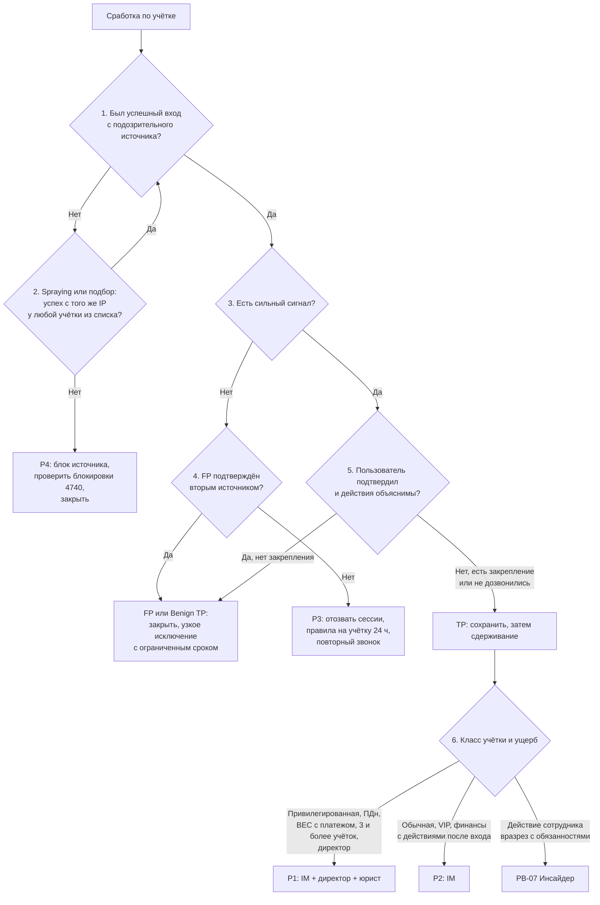

# PB-03 Компрометация учётной записи сотрудника

> Учебный плейбук для вымышленной компании «Альфа-Трейд». Роли, уровни критичности P1–P4, сроки и каналы связи взяты из [IR-плана](../plan/ir-plan.md). Всё, что нужно сверить с первоисточником, собрано в разделе [«Допущения и ограничения»](#допущения-и-ограничения). Сокращения расшифрованы в [Приложении Г](#приложение-г-сокращения).

## TL;DR

- **Когда применять:** есть признаки, что под учёткой сотрудника работает посторонний: подозрительный вход, новое правило ящика, чужой метод MFA, согласие OAuth-приложению, жалобы коллег или контрагентов на письма от него.
- **Главная мысль:** **у атакующего может быть не пароль, а сессия, токен или собственный второй фактор.** Смена пароля сама по себе ничего не закрывает.
- **Порядок действий:** **сохранить → изолировать хост, если на нём стилер → заблокировать вход → оборвать сессии → убрать закрепление → закрыть вектор → вернуть доступ под наблюдением.**
- **Критичность:** подозрительный вход до выяснения даёт P3, подтверждённая компрометация обычной учётки P2, привилегированная учётка, ПДн, BEC с платежом, учётка директора или 3 и более учётки одной кампанией дают P1. Попытки без единого успешного входа дают P4.
- **Ключевая метрика сценария:** время от сработки до отзыва сессий. Цель для P2 не больше 1 часа.
- **ПДн:** ящик сотрудника интернет-магазина почти всегда содержит ПДн. Если доступ к ним нельзя исключить, передавайте вопрос DPO сразу, не дожидаясь доказательств: у юриста 24 часа на первичное уведомление Роскомнадзора.

## Шпаргалка: первые 30 минут

| № | Действие | Кто | Срок |
| --- | --- | --- | --- |
| 1 | **Заведите тикет и обогатите событие:** класс учётки, статус в HR, IP, ASN и тип адреса, устройство, протокол, результат MFA, история за 30 дней | L1 | ≤ 10 мин |
| 2 | **Проверьте сильные сигналы** из [узла 3](#52-быстрый-триаж-l1-до-30-минут). Нашли хотя бы один, значит сразу эскалируйте на L2; привилегированная учётка, значит сразу L2 и IM | L1 | ≤ 10 мин |
| 3 | **Позвоните пользователю по номеру из HR-справочника** по скрипту, не на почту и не в мессенджер. Две попытки с интервалом 5 минут | L1 | ≤ 30 мин |
| 4 | **Вынесите вердикт TP/FP и стартовую P** по [дереву решений](#51-дерево-решений) | L1 → L2 | P1 +15 мин, P2 +30 мин, P3 +1 ч от взятия |
| 5 | **Экспортируйте улики до любых изменений:** правила ящика (включая скрытые), пересылку, права, методы MFA, устройства, согласия OAuth, журналы входов, атрибуты AD | L2 + админ почты | P1 +30 мин, P2 +1 ч |
| 6 | **Изолируйте хост в EDR**, если есть сигналы стилера или источник неясен. Не перезагружайте | L2 | Сразу |
| 7 | **Заблокируйте вход:** отключите учётку в облаке и в AD | ИТ | P1 15–30 мин, P2 ≤ 1 ч от TP |
| 8 | **Оборвите сессии:** отзовите сессии и refresh-токены, завершите VPN- и RDP-сессии | ИТ | Вместе с шагом 7 |
| 9 | **Уберите закрепление:** отключите правила, удалите пересылку, чужие MFA-методы, устройства, согласия OAuth, пароли приложений | Админ облака/почты | Сразу после шага 8 |
| 10 | **Уведомите IM:** P1 немедленно, P2 в течение 15 минут | L2 | По 5.5 |
| 11 | **Ветка BEC:** IM звонит финансовому директору, финансы звонят контрагентам и в банк | IM, финансы | Немедленно |
| 12 | **Нельзя исключить доступ к ПДн:** передайте факты DPO | L2 → IM → DPO | P1 ≤ 4 ч, P2 ≤ 8–12 ч от выявления |

## Чего делать нельзя

- **Не удаляйте правила, MFA-устройства и приложения до экспорта.** В правиле адрес атакующего и слова, которые его интересовали.
- **Не выдавайте новый пароль, пока на хосте может быть стилер.**
- **Не отправляйте новый пароль, ссылку или временный код на почту.**
- **Не звоните по номеру из подписи письма или из AD.** Атакующий мог его поменять. Берите номер из HR-справочника.
- **Не считайте блокировку IP на NGFW сдерживанием.** Облачная почта доступна из интернета напрямую, трафик к ней через NGFW не идёт.
- **Не включайте регистрацию MFA, пока пароль у атакующего.** Он зарегистрирует свой фактор первым.
- **Не перезагружайте хост и не «чистите» его антивирусом**, пока не собраны летучие данные.
- **Не обсуждайте инцидент через скомпрометированную почту.** При компрометации учётки ИТ, ИБ или администратора облака используйте резервный канал из IR-плана.
- **Не верьте «да, это я» при сильных сигналах** и не спрашивайте «это были вы?» вместо скрипта звонка.
- **Не блокируйте учётки кампании по одной.** Атакующий переключится на ещё не заблокированную.
- **Не отключайте сервисную учётку без владельца системы.** Так останавливают 1С и интеграции сайта.

## 1. Цель и область применения

**Цель:** за первый час понять, работает ли посторонний под учёткой сотрудника, отрезать его от всех видов доступа (пароль, сессии, токены, MFA, приложения, VPN) и выяснить, что он успел сделать и кого ещё затронул.

**Что входит:**

- Доменные учётки сотрудников (AD), VPN, рабочие станции и серверы, на которые входила учётка.
- Учётка сотрудника в облачной почте и файлах на пользовательском уровне: правила ящика, пересылка, методы MFA, устройства, согласия OAuth этого пользователя.
- Учётки во внутренних системах: 1С, админка сайта.
- Сервисные учётки, учётки подрядчиков, привилегированные учётки как отдельные ветки (см. [5.3](#53-глубокий-триаж-l2)).
- Векторы: подбор и spraying, credential stuffing, AiTM-фишинг, стилер, MFA fatigue, device code и OAuth consent phishing, социальная инженерия на сервис-деск, повторное использование пароля из утечек.

**Что не входит:**

| Ситуация | Куда |
| --- | --- |
| Учётки **покупателей** интернет-магазина (credential stuffing на личные кабинеты) | Другие данные, другие СЗИ (WAF, антибот), другие коммуникации. Нужен отдельный плейбук; в каталоге его пока нет |
| Компрометация облачного тенанта целиком: администратор облака, вредоносное приложение на уровне тенанта, изменённые политики | Ведущий **PB-10**. Граница: PB-03 ведущий, если затронуты AD, VPN или внутренние системы либо неизвестно, где начался доступ; PB-10 ведущий, если затронут только облачный уровень |
| Подтверждённая компрометация домена (DCSync, golden ticket) | PB-03 доводит до перехода и передаёт в отдельный плейбук «Компрометация AD». Пока его нет в каталоге, ведёт IM по разделу 9 этого плейбука |
| Злоупотребление доступом самим сотрудником | **PB-07** |

## 2. Паспорт

| Поле | Значение |
| --- | --- |
| ID | PB-03 |
| Версия | 1.0 (31.10.2026) |
| Владелец | Руководитель ИБ, он же руководитель реагирования (IM) |
| Пересмотр | Раз в 6 месяцев и после каждого P1/P2 по сценарию |
| Критичность по умолчанию | **P3** для подозрительного успешного входа до выяснения; **P2** для подтверждённой компрометации обычной учётки |
| Понижение до P4 | Попытки без единого успешного входа: подбор или spraying отбит |
| P2 | Подтверждённый вход и действия после него; учётка руководителя или финансов (обязательно информируйте финансового директора) |
| P1 | Привилегированная учётка (AD, администратор облака, EDR, SIEM, NGFW, резервного копирования, гипервизоров); доступ к базе клиентов или ПДн с признаками чтения или выгрузки либо невозможность это исключить при широком доступе; BEC с совершённым платежом или изменёнными реквизитами; учётка генерального директора; 3 и более учётки одной кампанией |
| Пересмотр критичности | После поиска других жертв (раздел 8) и оценки доступа к данным |
| Техники MITRE ATT&CK | [Приложение А](#приложение-а-mitre-attck) |
| Связанные плейбуки | PB-01 Фишинг (источник), PB-04 Вредонос на рабочей станции и PB-S4 Сработка EDR (стилер на хосте), PB-05 Утечка данных (ПДн), PB-07 Инсайдер, PB-10 Компрометация облачного аккаунта |

**Целевые сроки по фазам** (учебные; отсчёт от момента сработки T0, если не сказано иное):

| Этап | P1 | P2 | P3 |
| --- | --- | --- | --- |
| Взять в работу (L1, по IR-плану) | 15 мин | 1 ч | 4 ч |
| Триаж L1, включая звонок | +15 мин | +30 мин | +1 ч |
| Экспорт улик облака и почты | +30 мин | +1 ч | +4 ч |
| Сдерживание после подтверждения TP | 15–30 мин | ≤ 1 ч | ≤ 4 ч |
| Факты о доступе к ПДн переданы DPO | ≤ 4 ч от выявления | ≤ 8–12 ч от выявления | 1 рабочий день |
| Полный скоуп (все действия, все учётки) | 24 ч | 48 ч | 5 рабочих дней |

Срок «факты для DPO за 8–12 часов» нужен, чтобы юрист успел подготовить первичное уведомление Роскомнадзора в пределах 24 часов (152-ФЗ, ст. 21 ч. 3.1, сроки по IR-плану).

## 3. Подготовка

Без этих условий часть шагов невыполнима. Если пункт не выполнен, запишите это в тикет как ограничение расследования.

- [ ] Аудит на контроллерах домена (DC) включает Credential Validation, Kerberos Authentication Service, Kerberos Service Ticket Operations, Logon/Logoff, Account Lockout, User и Security Group Management, Directory Service Changes
- [ ] SIEM хранит не меньше 90 дней: DC, серверы, VPN (с выданным внутренним IP), облачные входы (включая неинтерактивные) и аудит, почтовый шлюз, EDR, прокси/DNS, журнал регистрации 1С
- [ ] Вы знаете срок хранения журналов у облачного провайдера: для входов он бывает 7–30 дней в зависимости от лицензии
- [ ] Вы знаете, что умеет провайдер: принудительно завершить все сессии, удалить метод MFA, отозвать согласие OAuth, запретить IMAP/POP/SMTP AUTH, выдать журнал чтения писем. Чего не умеет, записано как риск с компенсирующей мерой (обычно отключение учётки целиком)
- [ ] Есть справочник телефонов из **HR-системы**, а не из AD или подписи письма, плюс резервные номера руководства и администраторов
- [ ] Ведётся реестр привилегированных, сервисных, VIP и финансовых учёток с владельцами
- [ ] Проверены скрипты: экспорт правил ящика и аудита, отзыв сессий, отключение учётки, завершение VPN-сессии
- [ ] У сервис-деска есть процедура сброса пароля и MFA с проверкой личности: обратный звонок на номер из HR, подтверждение руководителем, личная явка для администраторов
- [ ] Есть break-glass учётки облака и домена с отдельным алертом на любой вход
- [ ] С юристом согласованы момент начала отсчёта 24 часов и объём доступа ИБ к **содержимому** переписки сотрудника

## 4. Роли и ответственность

Матрица RACI: **R** выполняет, **A** утверждает и отвечает за результат, **C** консультирует, **I** получает информацию.

| Действие | L1 | L2 | IM | ИТ: AD/сеть | ИТ: облако/почта | Владелец системы | DPO/юрист | Финансы |
| --- | --- | --- | --- | --- | --- | --- | --- | --- |
| Обогащение, звонок пользователю | R | C | I | | | | | |
| TP/FP, критичность | R (первично) | R | A (P1/P2) | | | | | |
| Экспорт улик облака и почты | | R | I | | R | | | |
| Изоляция одного хоста в EDR | | R/A | I | | | | | |
| Отзыв сессий, отключение обычной учётки при подтверждённом TP | | A | I (в течение часа) | R | R | | | |
| Отключение учётки руководителя (VIP) | | C | A, информирует директора | R | R | | | |
| Отключение привилегированной учётки | | C | A | R | R | | | |
| Отключение или смена пароля сервисной учётки | | C | A | R | R | A | | |
| Массовые действия (> 5 учёток, глобальный сброс сессий, запрет протокола для всех) | | C | A | R | R | C | | |
| Блок одного IP на NGFW/VPN | | R/A | I | C | | | | |
| Блок IP в условном доступе облака; блок страны или ASN | | R (один IP) | A (страна/ASN) | | R | | | |
| Отзыв согласия OAuth-приложения | | C | A | | R | C | | |
| Удаление внутреннего фишинга из ящиков | | R | A | | R | | | |
| Оценка доступа к ПДн | | R (факты) | A | | | C | R (решение) | |
| Уведомление РКН, ГосСОПКА | | C | C | | | | R | |
| Остановка платежей, звонок в банк | | | I | | | | C | R/A |
| Сообщения контрагентам и клиентам | | | A | | | C | C | C (PR выполняет) |
| Возврат доступа, перерегистрация MFA | | C | A (VIP/привилег.) | R | R | | | |
| Закрытие инцидента | | R | A | | | C | C | |

**Заранее согласованные полномочия:**

- **L2 сам** изолирует одну рабочую станцию в EDR, блокирует один IP на NGFW/VPN и в условном доступе облака, решает отключить обычную учётку при подтверждённом TP.
- **IM утверждает** отключение VIP, привилегированных и сервисных учёток, массовые действия, блок страны или ASN, удаление писем из ящиков, отзыв OAuth-приложения, которым пользуется не один человек.
- **Сервис-деск** не сбрасывает пароль или MFA по звонку без процедуры проверки личности. Новый пароль и временный код передаёт только по телефону из HR-справочника или лично.
- **HR подключается** только по решению IM (инсайдер, доступ к переписке).

## 5. Триаж

Триаж делится на две части. **Быстрый триаж (L1, до 30 минут)** отвечает на вопросы «был ли успешный вход?» и «есть ли сильный сигнал?» и заканчивается звонком пользователю. **Глубокий триаж (L2)** взвешивает ответы и журналы, выбирает ветку по классу учётки и вектору и ставит критичность. Оба идут по одному дереву решений.

### 5.1. Дерево решений



Ниже каждый узел дерева расписан подробно. Номера узлов совпадают с номерами в схеме. Узлы 1–3 и звонок проходит L1, узлы 4–6 закрывает L2.

### 5.2. Быстрый триаж (L1, до 30 минут)

**Перед узлом 1. Заведите тикет и обогатите событие (≤ 10 мин).**

- **Учётка:** ФИО, отдел, группы AD, класс (обычная / VIP / финансы / привилегированная / сервисная / подрядчик), статус в HR (работает, отпуск, увольняется).
- **Событие:** время в UTC и МСК, система, внешний IP, ASN и тип адреса, страна, устройство и его ID, user-agent, протокол, результат MFA.
- **История:** был ли вход с этого ASN, устройства или страны за 30 дней.
- Дальше записывайте в тикет каждое действие со временем и явным часовым поясом.

**Узел 1. Был успешный вход с подозрительного источника?**

- Смотрите успешные входы в облаке, на DC и VPN с того IP, ASN или устройства, по которому сработало правило.
- **Помните: гео-аномалии («невозможное путешествие», новая страна) слабый сигнал.** Для российской компании это один из самых шумных детектов: личные VPN сотрудников, выход мобильного оператора через другой город, облачные прокси браузеров. При этом настоящие атакующие всё чаще ходят через резидентные прокси в стране жертвы, и гео-правило их не видит.
- **Всегда обогащайте гео:** ASN и тип адреса, известность устройства, user-agent, был ли MFA, что делали после входа.

**Узел 2. Spraying или подбор без успеха?**

- Сработка только по неудачным попыткам (4625, 4771, 4776, 4740), значит **проверьте, что ни одна учётка из списка не вошла успешно с того же IP.** Spraying обычно «попадает» в 1–2 учётки из сотни.
- Успеха нет, значит P4: заблокируйте источник, проверьте блокировки 4740, закройте.
- Успех есть, значит возвращайтесь к узлу 1 уже для этой учётки.
- **MFA fatigue без подтверждённого push** тоже требует сброса пароля: пароль у атакующего уже есть.

**Узел 3. Есть сильный сигнал? (≤ 10 мин)**

Любой один сигнал означает **эскалацию на L2 сразу, не дожидаясь звонка.** Привилегированная учётка, значит сразу L2 и IM.

- [ ] новый метод MFA или устройство зарегистрированы вскоре после входа с нового IP;
- [ ] правило ящика с пересылкой наружу, удалением или перемещением в RSS/Архив/Заметки; пересылка на уровне ящика;
- [ ] согласие на OAuth-приложение не из списка разрешённых;
- [ ] вход с хостинга, VPN-сервиса или Tor и затем действия в почте или файлах;
- [ ] один `SessionId` с разных ASN; параллельные сессии из разных стран;
- [ ] пользователь сообщает о неожиданных запросах MFA или о том, что «подтвердил случайно»;
- [ ] жалобы коллег или контрагентов на письма от пользователя;
- [ ] успешный вход после серии неудачных с одного внешнего IP;
- [ ] учётка добавлена в привилегированную группу вне заявки.

**Признаки FP** записывайте вместе с тем, чем они подтверждены:

- IP в списке корпоративных egress/VPN;
- устройство управляемое и известное;
- user-agent обычный;
- командировка подтверждена вторым источником (руководитель, заявка);
- после входа нет действий из списка сильных сигналов.

**Звонок пользователю (≤ 30 мин от взятия).**

- Звоните **по номеру из HR-справочника**. Не пишите на почту и в корпоративный мессенджер, если он входит через ту же учётку.
- Две попытки с интервалом 5 минут. Не дозвонились, значит передайте L2 с пометкой «пользователь недоступен».
- **L1 сам ничего не удаляет и не отключает.**

Скрипт звонка:

> «Добрый день, это служба информационной безопасности, [имя]. Видим необычную активность, есть несколько коротких вопросов.»
> 1. Где вы сейчас и с какого устройства работали сегодня и вчера вечером?
> 2. Пользуетесь ли VPN-сервисом на личных устройствах?
> 3. Приходили ли запросы на подтверждение входа, которых вы не ждали? Нажимали ли «Подтвердить» хотя бы раз?
> 4. Вводили ли в последние дни пароль после перехода по ссылке? Вводили ли код с экрана на каком-то сайте?
> 5. Давали ли приложению доступ к почте или файлам?
> 6. Устанавливали ли программы, расширения, «исправляли ошибку» по инструкции с сайта?
> 7. Звонил ли кто-то от имени ИТ с просьбой назвать код или сменить пароль?

Правила звонка:

- **Не сообщайте** IP, страны, найденное и планы.
- **Попросите** ничего не удалять в почте и, при подозрении на заражение, не пользоваться устройством до звонка ИБ.
- **Записывайте ответы дословно** в тикет со временем.
- **«Да» на вопросы 3–5 означает TP** независимо от остальных ответов.
- Собеседник кажется не тем человеком, значит прекратите разговор и перезвоните через руководителя.
- **Почему не спрашивать просто «это были вы?»:** при AiTM и MFA fatigue пользователь честно ответит «да, я входил» или «да, я подтвердил», потому что действительно это делал.

### 5.3. Глубокий триаж (L2)

**Узел 4. FP подтверждён вторым источником?** Сильных сигналов нет.

- **Да** (командировка подтверждена руководителем или заявкой, устройство управляемое, IP корпоративный): закройте как FP или Benign TP. Исключение для правила делайте узким и с ограниченным сроком.
- **Нет:** P3. Отзовите сессии, поставьте правила на учётку на 24 часа, повторите звонок.

**Узел 5. Пользователь подтвердил вход, и действия объяснимы?** Сильный сигнал есть.

- **«Это был я» не закрывает тикет**, если есть объективные противоречия: другое устройство, правило пересылки, новый метод MFA.
- **Пользователь подтвердил push, но не входил:** это TP, а не «сам виноват, закрываем».
- **Не дозвонились** (ночь, отпуск): при закреплении (правило, MFA, OAuth) или входе с хостинга с последующими действиями ставьте TP и начинайте сдерживание в пределах полномочий, не дожидаясь ответа. Для привилегированной учётки согласуйте с IM по телефону. Пользователю оставьте сообщение с просьбой перезвонить на номер SOC, не по почте.
- **Да, и закрепления нет:** FP или Benign TP.
- **TP:** сначала сохраните улики (раздел 7), потом сдерживание (раздел 6).

**Узел 6. Класс учётки и ущерб.** Выберите ветку, она определяет P и особенности сдерживания:

| Ветка | Что особенного |
| --- | --- |
| Привилегированная AD | P1, сразу IM, резервный канал связи. Исходите из того, что домен мог быть скомпрометирован: проверьте 4662 с правами репликации от не-DC (DCSync), 4720, 4728/4732/4756, 5136 по GPO, новые SPN, AdminSDHolder, SIDHistory, задачи и службы на DC. Решение о двойном сбросе krbtgt принимает IM отдельной процедурой |
| Сервисная | Звоните владельцу системы. Не отключайте без IM и владельца: сначала выясните, где используется пароль (конфиги, задачи, службы). Сразу можно ограничить интерактивный вход. LogonType 2 или 10 у сервисной учётки сильный сигнал |
| BEC / финансы | Счёт на часы: найдите письма контрагентам о реквизитах (вопрос 8 в разделе 8), подключите финансы, при подозрении на платёж звоните в банк. Контрагентам звоните по номеру из договора |
| MFA fatigue | Пароль смените обязательно, включите number matching, ищите источник пароля (стилер, утечка) |
| Стилер на хосте | Сначала хост (изоляция, PB-04/PB-S4), потом пароль с чистого устройства. Смените все пароли, сохранённые в браузере; ротация ключей и токенов с хоста |
| AiTM / кража cookie | Отзыв сессий важнее смены пароля, но делайте оба. Найдите письмо-источник, других получателей и кликнувших (PB-01) |
| Массовый spraying с успехом | P2/P1, каждая успешная учётка проходит раздел 6, координирует IM, сдерживание одновременно |
| Подрядчик | Связь через ответственного за договор; при TP учётку можно отключить сразу, согласие IM постфактум |
| Инсайдер | Остановите PB-03, перейдите в PB-07. Сотруднику повторно не звоните, руководителю без IM не сообщайте, артефакты сохраните |

### 5.4. Критичность

| P | Условия |
| --- | --- |
| P4 | Попытки без единого успешного входа: подбор или spraying отбит (после проверки узла 2) |
| P3 | Подозрительный успешный вход до выяснения; сильных сигналов нет, FP вторым источником не подтверждён |
| P2 | Подтверждённый вход и действия после него у обычной учётки; учётка руководителя или финансов (информируйте финансового директора) |
| P1 | Привилегированная учётка (AD, администратор облака, EDR, SIEM, NGFW, резервного копирования, гипервизоров); доступ к базе клиентов или ПДн с признаками чтения или выгрузки либо невозможность это исключить при широком доступе; BEC с совершённым платежом или изменёнными реквизитами; учётка генерального директора; 3 и более учётки одной кампанией |

Критичность пересматривайте после поиска других жертв (раздел 8) и оценки доступа к данным.

### 5.5. Когда эскалировать

- **IM немедленно:** P1, любая привилегированная или сервисная учётка, директор, BEC, признаки ПДн, больше одной учётки.
- **IM в течение 15 минут:** P2.
- **DPO:** как только нельзя исключить доступ к ПДн. Не ждите доказательств (раздел 11).
- **Финансовый директор:** учётки финансов и руководства, любые письма о платежах.

## 6. Сдерживание

**IM решает за 15 минут после эскалации: сдерживать сразу или после быстрого скоупа.**

- **Сразу**, если есть активный ущерб (исходящие письма, пересылка, платёжная тематика, выгрузка данных) или учётка привилегированная.
- **После быстрого скоупа (≤ 60 мин)**, если ущерба не видно, но похоже на кампанию (общий IP, фишинговый домен). Затем **одновременно** сдерживайте все найденные учётки и хосты по команде IM. Если блокировать по одной, атакующий переключится на ещё не заблокированную.
- Для обычных учёток «наблюдать, чтобы понять масштаб» не применяйте: риск рассылки и BEC выше пользы.

### 6.1. Краткосрочное сдерживание: одна учётка, пакетом за 10–15 минут

Каждое действие записывайте в тикет со временем (UTC).

| Шаг | Действие | Кто | Инструмент | Кто утверждает |
| --- | --- | --- | --- | --- |
| 0 | **Экспортируйте улики** (раздел 7, приоритет 1): правила ящика, включая скрытые; пересылку; права на ящик; методы MFA; устройства; согласия OAuth; журналы входов и аудита; атрибуты AD. При активном ущербе делайте это параллельно с шагами 1–3, но строго до шага 4 | L2 + админ почты | PowerShell, консоль облака, SIEM | Не нужен |
| 1 | **Изолируйте хост пользователя**, если есть сигналы EDR или источник неясен. Не перезагружайте, не запускайте сканирование с удалением | L2 | EDR | Не нужен (одна станция, по IR-плану) |
| 2 | **Заблокируйте вход:** отключите учётку в облаке и в AD | ИТ | AD, консоль IdP | Обычная: L2; VIP и привилегированная: IM; сервисная: IM и владелец |
| 3 | **Оборвите сессии:** отзовите сессии и refresh-токены в облаке; завершите VPN-сессию на шлюзе (смена пароля её не рвёт; при VPN по сертификату отзовите сертификат); сделайте `logoff` RDP/SMB на хостах из 4624 | ИТ | `Revoke-MgUserSignInSession` или аналог, VPN-шлюз, `quser`/`logoff`, EDR | Как в шаге 2 |
| 4 | **Уберите закрепление:** правила ящика сначала отключите (удалите после расследования); удалите пересылку на уровне ящика и чужие права; удалите чужие методы MFA и устройства; отзовите согласия OAuth; удалите пароли приложений и партнёрства ActiveSync; верните телефон и почту для восстановления | Админ облака/почты | Консоль, PowerShell | Отзыв OAuth-приложения, которым пользуется не один человек: IM |
| 5 | **Остановите распространение:** заблокируйте фишинговый домен на прокси и шлюзе; найдите и после сохранения копии удалите внутренний фишинг из ящиков; при BEC финансы звонят контрагентам и в банк | L2, админ почты, финансы | Прокси, шлюз, поиск по ящикам | Удаление из ящиков: IM |
| 6 | **Дополнительно заблокируйте инфраструктуру:** IP в условном доступе облака и на VPN/NGFW, если адрес не общий (CGNAT, мобильный оператор); IOC добавьте в список SIEM для поиска | L2 | Условный доступ, NGFW | Один IP: L2; страна или ASN: IM |
| 7 | **Задайте новый пароль** только после шага 1, с чистого устройства, сообщите по телефону или лично. Учётка остаётся отключённой до восстановления (раздел 10) | ИТ | AD, IdP | — |

**Что сдерживание не закрывает сразу:**

- Выданный access-токен облака может жить до истечения (порядка часа) у сервисов без непрерывной оценки доступа.
- Kerberos-билеты действуют до истечения: TGT по умолчанию 10 часов, продление до 7 дней.
- Поэтому **после сдерживания наблюдайте 2 часа:** попытки входа в отключённую учётку (4625 с 0xC0000072, ошибки «учётка отключена» в облаке), активность с IP атакующего, новые правила в других ящиках.

### 6.2. Долгосрочное сдерживание

- Учётка остаётся отключённой, пока не выполнены условия раздела 10. Пользователю на время выдайте временный доступ к нужным функциям через руководителя, без почтового ящика, если возможно.
- Для сервисной учётки ограничьте хосты и запретите интерактивный вход до плановой смены пароля с владельцем системы.
- Временное правило условного доступа для учётки: вход только с управляемого устройства.
- Watchlist SIEM на учётку, хост и IOC инцидента.

## 7. Сбор и сохранение артефактов

**Собирайте по летучести и риску потери: сначала то, что исчезает быстрее всего.**

| Приоритет | Артефакт | Как сохранить | Почему сейчас |
| --- | --- | --- | --- |
| 1 | Активные сессии и состояние VPN | Скриншот или экспорт со шлюза и из консоли IdP | Исчезнут при сдерживании |
| 1 | Память, процессы, соединения хоста (при подозрении на стилер или RAT) | EDR live response, дамп памяти до перезагрузки | Перезагрузка уничтожит |
| 1 | Правила ящика (включая скрытые), пересылка, права на ящик, методы MFA, устройства, OAuth-согласия, пароли приложений | `Get-InboxRule -Mailbox <upn> -IncludeHidden \| Export-Csv`, `Get-Mailbox ... Forwarding*`, `Get-MailboxPermission`, `Get-MgUserAuthenticationMethod`, `Get-MgUserOauth2PermissionGrant`. Правила, созданные через MAPI, могут не отображаться: нужен инструмент уровня MAPI | Исчезнут при удалении |
| 1 | Журналы входов (интерактивные и **неинтерактивные**) и аудита облака: минимум 30 дней, лучше вся доступная глубина | Экспорт из консоли или SIEM, `Search-UnifiedAuditLog` или его замена в Purview/Graph | Ограниченный срок хранения у провайдера |
| 1 | Атрибуты учётки AD | `Get-ADUser <u> -Properties *` (`pwdLastSet`, `lastLogonTimestamp`, `memberOf`, `servicePrincipalName`, `userAccountControl`, `adminCount`, `SIDHistory`, `mobile`), `Get-ADReplicationAttributeMetadata` или `repadmin /showobjmeta` | Изменятся при сдерживании; метаданные репликации показывают, кто и когда менял атрибуты, даже если журналы перезаписаны |
| 2 | Отправленные и удалённые письма | Удержание ящика (hold), восстанавливаемые элементы, трассировка сообщений | Атакующий удаляет отправленное |
| 2 | События DC, серверов, VPN, NGFW, прокси, DNS за окно | Выгрузка из SIEM | Ротация журналов |
| 2 | Триаж-коллекция хоста (KAPE или аналог в EDR) | До переустановки | Переустановка уничтожит |
| 3 | Объяснение пользователя, скриншоты запросов MFA, письмо-источник с заголовками, журнал 1С | В тикет; письмо как `.eml` | Память и почта меняются |

**Цепочка хранения (chain of custody):**

- [ ] Каждый файл назван `INC-<номер>_<источник>_<UTC-время>.<ext>`
- [ ] В журнале улик записаны SHA-256, кто собрал, когда, откуда, где хранится
- [ ] Хранилище у команды ИБ с ограниченным доступом: не на пострадавшем хосте и не в скомпрометированном облачном диске
- [ ] Все времена в тикете с явным часовым поясом: облако пишет в UTC, Windows в локальном времени хоста, отчёт по IR-плану в UTC+3. Смешение поясов самая частая ошибка хронологии
- [ ] Если возможно обращение в полицию (BEC с платежом), этот порядок соблюдайте с первой минуты

## 8. Расследование

L2 письменно отвечает в тикете на вопросы ниже. Готовые запросы Q1–Q5 собраны в [Приложении В](#приложение-в-примеры-запросов-и-команд).

| № | Вопрос | Где смотреть |
| --- | --- | --- |
| 1 | **Окно компрометации:** когда первое подозрительное событие (не первая сработка) и последнее? Ищите назад минимум 30 дней | Облачные входы, DC, VPN |
| 2 | **Как вошли:** пароль + MFA; пароль без MFA через устаревший протокол; cookie без пароля; токен приложения; сброс через сервис-деск; VPN | `ClientAppUsed`, `AuthenticationRequirement`, `SessionId`, журнал согласий, тикеты сервис-деска, 4724 |
| 3 | **Вектор:** фишинг/AiTM (вход сразу после клика), стилер (EDR), spraying (4771/4776, 50126), утечка (TI), сервис-деск, OAuth/device code | Прокси, шлюз, EDR, TI |
| 4 | **Инфраструктура атакующего:** все IP, ASN, user-agent, ID устройств, сессии | Q1 |
| 5 | **Где был:** VPN → выданный внутренний IP → 4624 с этим `IpAddress` → NGFW (порты 445, 3389, 5985/5986, 88, 389, 1С, СУБД) | VPN, NGFW, DC, EDR |
| 6 | **Что сделал в почте:** правила, делегирование, что читал (`MailItemsAccessed` или аналог, зависит от лицензии), что искал («счёт», «оплата», «пароль»), что **отправил** и что удалил | Аудит почты, трассировка |
| 7 | **Что сделал с файлами и в системах:** скачивания, внешние ссылки, 1С (особенно банковские реквизиты контрагентов), база клиентов, админка сайта | Аудит файлов, журнал 1С, журналы приложений |
| 8 | **Закрепление:** новые учётки, группы, MFA, устройства, приложения, секреты, правила, задачи и службы | IdP, DC (Q4), EDR |
| 9 | **Масштаб:** кто ещё входил с той же инфраструктуры, кто получил то же письмо, есть ли такие же правила в других ящиках | Q2, Q3, PB-01 |
| 10 | **Blast radius:** к чему у учётки вообще есть доступ (группы, приложения, ящики, данные). Это ответ юристу «мог ли он видеть ПДн» | AD, IdP, владельцы систем |
| 11 | **Повторное использование пароля:** где тот же пароль мог работать (1С с собственной аутентификацией, админка, кабинеты поставщиков, банк-клиент) | Опрос пользователя, владельцы систем |

**Опорные Event ID AD.**

- 4624/4625 пишутся **на том хосте, куда входят.** Чтобы увидеть, где учётка аутентифицировалась в домене, нужны события DC. DC показывает, откуда пришёл запрос, хост показывает, что было дальше. Их надо коррелировать.
- **События DC:**
  - 4768: TGT; `TicketEncryptionType` 0x17 значит RC4, в современной среде подозрительно;
  - 4769: сервисный билет; RC4 признак Kerberoasting;
  - 4771: сбой предаутентификации, 0x18 значит неверный пароль;
  - 4776: NTLM;
  - 4740: блокировка, `CallerComputerName`.
- **Ключевые поля 4624:**
  - `LogonType`: 2 консоль, 3 сеть, 7 разблокировка, 9 `runas /netonly`, 10 RDP, 11 кэш;
  - `IpAddress`;
  - `AuthenticationPackageName`: NTLM там, где ждёте Kerberos, повод проверить pass-the-hash;
  - `TargetLogonId`.
- **Коды 4625:** 0xC000006A неверный пароль существующей учётки; 0xC0000064 учётки нет (перебор по словарю); 0xC0000234 заблокирована; 0xC0000072 отключена.
- **RDP:** 4778/4779, TerminalServices-LocalSessionManager 21/24/25, RemoteConnectionManager 1149.

**Хост пользователя (EDR).** Нашли что-то из списка, значит переходите в PB-04/PB-S4:

- не-браузерный процесс читает `...\User Data\<Profile>\Login Data`, `...\Network\Cookies`, `Local State` (Chromium, в том числе Яндекс Браузер), `logins.json`, `key4.db`, `cookies.sqlite` (Firefox);
- `powershell`/`mshta` из `explorer.exe` после посещения сайта и запись в `RunMRU` (ClickFix);
- архивы в `%TEMP%`;
- соединения с API мессенджеров и свежими доменами;
- AnyDesk/RustDesk без заявки;
- новые задачи, ключи `Run`, расширения браузера.

**Если провайдер не даёт журнала чтения писем**, ответ на вопрос «был ли доступ к ПДн в почте» звучит «**не можем исключить**», и так его и записывайте для DPO.

## 9. Устранение

- [ ] **Корневая причина подтверждена артефактом:** письмо-источник, процесс стилера, запись сервис-деска, учётка в утечке. Не найдена, значит запишите «не установлена» и считайте хост пользователя скомпрометированным до проверки
- [ ] **Хост:** при подтверждённом стилере или RAT переустановите из эталонного образа, а не лечите антивирусом
- [ ] **Секреты:** смените все пароли, которые хранились или вводились на хосте, и все, где пароль мог повторяться; ротация API-ключей, SSH-ключей, токенов, известных пользователю паролей сервисных учёток. Личные пароли: рекомендация сотруднику с объяснением
- [ ] **Закрепление по всей компании:** правила во всех ящиках (Q3), новые методы MFA у всех за окно, новые учётки и изменения групп (Q4), новые OAuth-приложения в тенанте. После расследования удалите отключённые правила
- [ ] **Привилегированная учётка:** сбросьте все административные учётки, работавшие на тех же хостах; по решению IM запустите процедуру компрометации AD (krbtgt, сервисные учётки, учётки DC)
- [ ] **Закройте вектор:** блок фишинговой инфраструктуры; отключение устаревших протоколов для учётки или тенанта; исправление исключений в условном доступе; ужесточение процедуры сервис-деска. Что применимо

## 10. Восстановление и мониторинг

**Восстановление:**

- [ ] Учётку включает ИТ по решению L2 (обычная) или IM (VIP, привилегированная, сервисная)
- [ ] Пользователь лично или по видеосвязи с документом получает временный код доступа, ограниченный по времени, и **сам** регистрирует MFA заново; для финансов и администраторов FIDO2-ключ или passkey
- [ ] Пользователь и, для сервисной учётки, владелец системы подтвердили, что работа восстановлена
- [ ] Проведён короткий разбор с сотрудником без поиска виновного: как выглядит AiTM-страница, MFA fatigue, ClickFix

**Мониторинг 30 дней** (IR-план требует не меньше 14; для привилегированных и финансовых учёток 30 обязательно). Ответственный L2, проверка раз в сутки:

- [ ] вход учётки с новых ASN, стран, устройств; вход через устаревшие протоколы;
- [ ] создание правил ящика, изменение пересылки, выдача прав на ящик;
- [ ] регистрация методов MFA и устройств, согласия OAuth, смена телефона для восстановления;
- [ ] любая активность с IOC инцидента (IP, ASN, user-agent, домены) по всем учёткам;
- [ ] срабатывания EDR на хосте пользователя;
- [ ] контрольные прогоны Q1 и Q2 через 24 часа и через 7 дней.

## 11. Коммуникации и уведомления

### 11.1. Внутри компании

| Кому | Кто сообщает | Когда | Канал |
| --- | --- | --- | --- |
| IM | L2 | По 5.5 | Тикет + звонок для P1 |
| Руководство | IM | P1 каждые 2 часа, P2 дважды в день (IR-план) | Чат инцидента или резервный канал |
| Пострадавший сотрудник | L2 / ИТ | При блокировке | Телефон |
| Руководитель сотрудника | IM | После блокировки; при инсайдере только IM и HR | Телефон |
| Коллеги, получившие фишинг из ящика | IM или ИТ | Сразу после удаления писем | Не с пострадавшего ящика: через руководителей или резервный канал |
| Финансы | IM | Ветка BEC, учётки руководства и финансов | Телефон |
| DPO | IM | Как только доступ к ПДн нельзя исключить | Телефон + тикет |

### 11.2. Вне компании

| Кому | Кто | Когда и как |
| --- | --- | --- |
| Банк | Финансы | При хищении немедленно |
| Полиция | Юрист по решению руководства | При хищении |
| Контрагенты и клиенты, которым писал атакующий | IM + PR + юрист | По согласованному тексту; при BEC звонок по номеру из договора, никогда не ответом на письмо |
| Роскомнадзор | DPO | См. 11.3 |
| ГосСОПКА (ФСБ) | DPO/юрист | См. 11.3 |

### 11.3. Персональные данные (152-ФЗ)

1. **Оценка ПДн обязательна, а не «если был доступ».** Почтовый ящик сотрудника интернет-магазина почти всегда содержит ПДн клиентов или работников.
2. **Правило: нельзя исключить, значит передаём DPO сейчас.** L2 передаёт факты, DPO принимает решение. Если ПДн не затронуты, DPO письменно фиксирует обоснование.
3. **Роскомнадзор (через DPO):** первичное уведомление в течение 24 часов с момента выявления, результаты расследования в течение 72 часов (152-ФЗ, ст. 21 ч. 3.1).
4. **ГосСОПКА:** операторы ПДн, по имеющимся данным, обязаны информировать ФСБ о компьютерных инцидентах, повлёкших неправомерную передачу ПДн (152-ФЗ ст. 19 ч. 12; порядок по приказу ФСБ № 77 от 13.02.2023). В IR-плане этой строки нет.
5. **Ответственность:** с 2025 года действуют повышенные штрафы по ст. 13.11 КоАП (закон № 420-ФЗ), в том числе за неуведомление РКН. Вывод для плейбука: неуведомление в срок самостоятельное нарушение.
6. **Тайна переписки.** Доступ к содержимому переписки сотрудника затрагивает тайну переписки (Конституция РФ, ст. 23). Объём согласуйте с юристом заранее, метаданные (кто, кому, когда, правила) анализируйте в первую очередь.

### 11.4. Шаблоны

**Шаблон 1. Статус IM.**
> «PB-03, INC-___, P_. Учётка: ___ (класс). Окно: ___–___ UTC. Как вошли: ___ (подтверждено / предполагается). Сделано: ___. Атакующий делал: ___. Другие учётки: проверено / найдено ___. ПДн: подтверждён / не исключён / исключён. Нужны решения: ___. Следующий статус: ___.»

**Шаблон 2. Сотруднику (по телефону).**
> «Ваша учётная запись временно заблокирована из соображений безопасности. Пожалуйста, ничего не удаляйте в почте и не пользуйтесь [устройство] до звонка специалиста ИБ. Новый доступ вы получите лично.»

**Шаблон 3. Коллегам.**
> «Письмо от [ФИО] с темой "[тема]" от [дата, время] отправлено не им. Не открывайте ссылку и вложения. Если уже перешли или ввели пароль, позвоните в ИБ по номеру ___.»

**Шаблон 4. Контрагенту (по телефону).**
> «С адреса нашего сотрудника [адрес] могли прийти письма об изменении реквизитов. Наши реквизиты не менялись. Пожалуйста, не проводите платежи по новым реквизитам и сообщите нам, если такое письмо пришло.»

## 12. Критерии закрытия

**Закрыть как TP может IM, когда отмечены все пункты:**

- [ ] Установлены окно компрометации и вектор, или явно записано, что вектор не установлен, и какие меры это компенсируют
- [ ] Все системы, где был атакующий, перечислены; по каждой действия изучены и записаны
- [ ] Сессии и токены отозваны, VPN и RDP завершены; после этого нет успешных входов с инфраструктуры атакующего (Q1 через 24 часа и через 7 дней)
- [ ] Закрепление удалено; экспорт до удаления приложен к тикету с хешами
- [ ] Поиск других жертв выполнен (Q2, Q3); другие учётки не затронуты или обработаны
- [ ] Отправленная атакующим почта найдена: письма удалены, получатели предупреждены
- [ ] Хост пользователя проверен в EDR или переустановлен; секреты с него сменены
- [ ] Решение DPO по ПДн записано; уведомления, если нужны, отправлены в срок
- [ ] MFA перерегистрирован по процедуре; мониторинг 30 дней назначен с ответственным
- [ ] Хронология в тикете в едином часовом поясе; улики в хранилище ИБ
- [ ] Правило детекта, которое должно было сработать раньше, создано или исправлено
- [ ] Встреча по урокам назначена (≤ 5 рабочих дней)

**Закрыть как FP или Benign TP можно, когда отмечены все пункты:**

- [ ] Сильных сигналов из узла 3 нет, и это подтверждено журналами
- [ ] FP подтверждён вторым источником (руководитель, заявка, список корпоративных egress/VPN, управляемое устройство), и источник записан в тикет
- [ ] Исключение для правила узкое и с ограниченным сроком
- [ ] Для spraying без успеха проверено, что ни одна учётка не вошла успешно с того же IP; источник заблокирован

## 13. Метрики

| Метрика | Как считать |
| --- | --- |
| MTTD (среднее время обнаружения) | От первого действия атакующего (начало окна) до сработки |
| Time to contain | От сработки до отзыва сессий. **Ключевая метрика сценария**, цель P2 ≤ 1 ч |
| MTTR (среднее время реагирования) | От сработки до восстановления доступа пользователя под наблюдением |
| Время до решения DPO | От выявления до решения по ПДн; сравните с 24 часами |
| Глубина заражения | Число затронутых учёток, писем, отправленных атакующим, кликнувших получателей |
| Источник первой сработки | Облако, AD, EDR, пользователь, контрагент. Поздний сигнал значит пробел в детекте |
| Доля FP по гео-правилам | Для тюнинга |

## 14. Типичные ошибки

1. Сменить пароль и забыть про сессии, токены, VPN, пароли приложений, OAuth-согласия.
2. Удалить правило пересылки, не сохранив его.
3. Выдать новый пароль, пока на хосте стилер.
4. Поверить «да, это я» при сильных сигналах; спросить «это были вы?» вместо скрипта.
5. Остановить триаж, потому что ночью пользователь не берёт трубку.
6. Не проверить, что атакующий отправил из ящика.
7. Не поискать другие учётки с той же инфраструктуры и такие же правила в других ящиках.
8. Блокировать IP на NGFW и считать облачную почту защищённой; заблокировать CGNAT и вместе с ним покупателей.
9. Блокировать учётки кампании по одной, а не одновременно.
10. Отключить сервисную учётку без владельца и остановить 1С или интеграции сайта.
11. Писать пользователю на скомпрометированную почту; звонить по номеру из AD.
12. Включить MFA без контроля регистрации: атакующий успеет первым.
13. Ждать доказательств доступа к ПДн, пока идут 24 часа.
14. Закрыть spraying как P4, не проверив единичный успех.
15. Смешать UTC и МСК в хронологии.

## 15. Профилактика

Оформляйте задачами с ответственным и сроком.

**Учётки и MFA**

- [ ] Фишингоустойчивая MFA (FIDO2-ключи, passkeys) для администраторов, финансов, директора, сотрудников с доступом к ПДн
- [ ] Push только с number matching и контекстом; лимит запросов; алерт на серию отклонённых push. SMS не используйте как основной фактор (SIM-swap)
- [ ] Запрет слабых и утёкших паролей, парольные фразы; мониторинг утечек учёток сотрудников
- [ ] Условный доступ: для привилегированных и финансовых ролей вход только с управляемых устройств; блок хостинга и анонимайзеров для входа сотрудников

**Почта и облако**

- [ ] Отключите устаревшие протоколы (IMAP, POP, SMTP AUTH с базовой аутентификацией) и пароли приложений там, где не нужны
- [ ] Запретите автоматическую пересылку на внешние адреса политикой исходящей почты; исключения по заявке
- [ ] Ограничьте согласия пользователей на OAuth-приложения (через администратора); заблокируйте device code flow, если не используется

**AD и хосты**

- [ ] AD: модель уровней администрирования, отдельные админские учётки, Protected Users, LAPS, отказ от RC4 в Kerberos, gMSA для сервисных учёток
- [ ] EDR: правило на доступ не-браузерных процессов к хранилищам паролей и cookie

**Детект и процессы**

- [ ] SIEM: правила из [Приложения Б](#приложение-б-источники-данных-и-триггеры): spraying по источнику, смена ASN в сессии, правила ящика, MFA после входа с нового ASN, согласия OAuth
- [ ] Сервис-деск: проверка личности при сбросе пароля и MFA, временные пароли только по телефону или лично
- [ ] Обучение на реальных примерах AiTM и MFA fatigue: «пришёл запрос, которого вы не делали, значит отклоните и позвоните в ИБ»

## 16. Учебная ситуация

**Вводная.** Пятница, 23:40 МСК. SIEM: учётка главного бухгалтера `o.smirnova` вошла в облачную почту с IP хостинг-провайдера в Нидерландах, браузер Chrome на Windows, MFA «удовлетворено требованием в токене». Через 6 минут создано правило ящика «..»: письма со словами «счёт», «оплата», «реквизиты» перемещать в RSS и помечать прочитанными. В 21:15 того же дня прокси фиксировал переход с её ноутбука на домен `alfa-trade-docs[.]com`. Телефон сотрудницы не отвечает. В понедельник у компании запланирован крупный платёж поставщику.

**Задания:**

1. **23:45, вы L1.** Пройдите узлы 1–3 дерева решений и запишите в тикет: какие признаки сильные, какие слабые, на каком узле вы остановились. Какую стартовую P вы ставите и кого будите ночью по разделу 5.5?
2. **23:55, вы L2, сотрудница не отвечает.** Составьте по шагам 0–7 таблицы 6.1 список действий: что вы делаете сами в пределах полномочий по RACI, а на что нужен звонок IM. В каком порядке и что экспортируете до отключения правила?
3. **00:10.** Объясните в двух предложениях для IM, почему смена пароля не выкинет атакующего. Запишите, что вы делаете вместо или вместе с ней, какую команду запускаете для отзыва сессий и сколько ещё может работать уже выданный токен.
4. **00:30.** Выберите из Приложения В два поиска по компании, которые запустите до понижения критичности, подставьте в них IP и правило из вводной. Напишите, что ищете в отправленных письмах ящика и какой ветке из 5.3 это соответствует.
5. **01:00.** Ящик бухгалтера содержит договоры с ПДн контрагентов-ИП. Запишите, в какой момент и с какими фактами вы передаёте вопрос DPO, до какого времени должно уйти первичное уведомление, если доступ нельзя исключить, и составьте статус IM по шаблону 1.

## 17. Источники

Ссылки ведут на официальные сайты; глубокие ссылки со временем меняются.

- MITRE ATT&CK, техники T1078, T1110, T1621, T1557, T1539, T1528, T1098, T1114, T1564.008: https://attack.mitre.org/
- NIST SP 800-61 Rev. 3, Incident Response Recommendations and Considerations for Cybersecurity Risk Management (2025): https://csrc.nist.gov/pubs/sp/800/61/r3/final
- NIST SP 800-63B, Digital Identity Guidelines: Authentication and Lifecycle Management (уровни аутентификаторов, фишингоустойчивость): https://pages.nist.gov/800-63-4/
- CISA, Implementing Phishing-Resistant MFA (fact sheet, 2022): раздел MFA на https://www.cisa.gov/
- CISA/FBI, Scattered Spider, advisory AA23-320A (социальная инженерия на сервис-деск, MFA fatigue): https://www.cisa.gov/news-events/cybersecurity-advisories/aa23-320a
- Microsoft, Incident response playbooks: Password spray, App consent grant, Phishing investigation: https://learn.microsoft.com/security/operations/incident-response-playbooks
- Microsoft, Appendix L: Events to Monitor (Securing Active Directory): https://learn.microsoft.com/windows-server/identity/ad-ds/plan/appendix-l--events-to-monitor
- SANS, Incident Handler's Handbook: https://www.sans.org/white-papers/33901/
- JPCERT/CC, Detecting Lateral Movement through Tracking Event Logs (соответствие инструментов и Event ID): https://www.jpcert.or.jp/english/
- 152-ФЗ «О персональных данных», ст. 19 и 21: актуальная редакция на pravo.gov.ru или в справочной правовой системе

## Допущения и ограничения

**Что нужно сверить перед реальным применением:**

| № | Что | Где в плейбуке | Почему нужна проверка |
| --- | --- | --- | --- |
| 1 | T1557 Adversary-in-the-Middle для AiTM-фишинга: отдельной подтехники для него нет; все идентификаторы техник | Прил. А | Сверить с актуальной версией ATT&CK |
| 2 | Сроки уведомления Роскомнадзора (24 и 72 часа), 152-ФЗ ст. 21 ч. 3.1, толкование «момента выявления» | 2, 11.3 | Сроки взяты из IR-плана; редакцию закона и толкование сверить с юристом |
| 3 | Состав аудита на DC (Credential Validation, Kerberos, Logon/Logoff, Account Lockout, управление учётками и группами, Directory Service Changes) | 3 | Зависит от вашей GPO |
| 4 | Срок хранения журналов входов у облачного провайдера (7–30 дней) | 3 | Зависит от провайдера и лицензии |
| 5 | Код `ResultType` 0 после 50126 как «успех после серии неудач» | Прил. Б | Коды результата зависят от провайдера |
| 6 | Поле `AutonomousSystemNumber` в журнале входов | Прил. Б | Может отсутствовать в вашей версии журнала |
| 7 | `ResultType` 500121 как признак отклонённого push (MFA fatigue) | Прил. Б | Код сверить с документацией провайдера |
| 8 | Имена операций аудита IdP: «User registered security info», «Register device», «Consent to application» | Прил. Б | Имена зависят от провайдера и версии |
| 9 | Интервал между двумя сбросами krbtgt | 5.3 | Сверить с рекомендациями Microsoft |
| 10 | `Revoke-MgUserSignInSession` и его аналоги | 6.1 | Модули Microsoft регулярно меняются |
| 11 | Срок жизни access-токена (порядка часа) у сервисов без непрерывной оценки доступа | 6.1 | Зависит от провайдера |
| 12 | Срок жизни TGT (10 часов, продление до 7 дней) | 6.1 | Проверить настройки своего домена |
| 13 | Параметр `-IncludeHidden` у `Get-InboxRule`; командлеты `Get-MgUserAuthenticationMethod`, `Get-MgUserOauth2PermissionGrant` | 7 | Имена и параметры зависят от версии модулей |
| 14 | `Search-UnifiedAuditLog` и его замена в Purview/Graph | 7 | Командлет менялся |
| 15 | Имена полей в запросе Q5 (KQL, Entra ID) | Прил. В | Зависят от версии схемы журналов |
| 16 | Коды 4625 (0xC000006A, 0xC0000064, 0xC0000234, 0xC0000072), `TicketEncryptionType`, значения `LogonType`, Event ID RDP | 8 | Сверить с документацией Microsoft |
| 17 | ГосСОПКА: 152-ФЗ ст. 19 ч. 12, приказ ФСБ № 77 от 13.02.2023, практический порядок и соотношение с уведомлением РКН | 11.3 | Сверить номер, дату и порядок с юристом; в IR-плане этой строки нет |
| 18 | Повышенные штрафы по ст. 13.11 КоАП с 2025 года, закон № 420-ФЗ, части статьи и даты | 11.3 | Закон менялся |
| 19 | Правовые основания доступа ИБ к содержимому переписки (Конституция РФ, ст. 23) | 3, 11.3 | Согласовать с юристом |
| 20 | Поддерживает ли провайдер блокировку device code flow | 15 | Зависит от провайдера |
| 21 | Формулировка MFA «удовлетворено требованием в токене» | 16 | Проверить формулировку в вашем журнале входов |
| 22 | Граница между PB-03 и PB-10 (облачный уровень против AD, VPN и внутренних систем) | 1 | Согласовать при доработке PB-10 |
| 23 | Ссылки в разделе 17 приведены по памяти | 17 | Глубокие ссылки со временем меняются |

**Допущения:**

- IR-план (в исходной версии плейбука он назывался `source/ir-plan.md`) не называет SIEM, EDR и облачного провайдера почты. Облачные примеры приведены на Microsoft 365 / Entra ID, потому что у них лучше всего документированы журналы. Для Яндекс 360, VK WorkSpace и других провайдеров эквиваленты найдите на этапе подготовки, а не во время инцидента.
- Все запросы даны как примеры в нейтральном псевдо-SPL или KQL. Имена полей и синтаксис зависят от вашей SIEM.
- Сроки в разделе 2 учебные. Реальные сроки утверждает руководитель ИБ.
- Порог «3 и более учётки одной кампанией» для P1 выбран как типичный для компании такого размера, в IR-плане его нет.
- Порог «больше 5 учёток» для массовых действий, требующих утверждения IM, тоже допущение.
- Подписка на TI с данными об утечках и логах стилеров: в IR-плане её нет, но она типична.
- Командировку можно подтвердить вторым источником (руководитель, заявка): предполагается, что такой источник есть.
- Учётку подрядчика при TP можно отключить сразу, а согласие IM получить постфактум.

## Приложение А. MITRE ATT&CK

| Тактика | Техника | ID |
| --- | --- | --- |
| Первоначальный доступ / Закрепление | Domain Accounts | T1078.002 |
| Первоначальный доступ / Закрепление | Cloud Accounts | T1078.004 |
| Первоначальный доступ / Закрепление | External Remote Services (VPN) | T1133 |
| Доступ к учётным данным | Password Guessing | T1110.001 |
| Доступ к учётным данным | Password Spraying | T1110.003 |
| Доступ к учётным данным | Credential Stuffing | T1110.004 |
| Доступ к учётным данным | Multi-Factor Authentication Request Generation | T1621 |
| Доступ к учётным данным | Adversary-in-the-Middle (AiTM-фишинг) | T1557 |
| Доступ к учётным данным | Steal Web Session Cookie | T1539 |
| Доступ к учётным данным | Credentials from Web Browsers | T1555.003 |
| Доступ к учётным данным | Steal Application Access Token | T1528 |
| Закрепление | Device Registration | T1098.005 |
| Закрепление | Additional Email Delegate Permissions | T1098.002 |
| Закрепление | Create Account | T1136 |
| Обход защиты | Web Session Cookie | T1550.004 |
| Обход защиты | Email Hiding Rules | T1564.008 |
| Обход защиты | Impersonation | T1656 |
| Сбор данных | Remote Email Collection | T1114.002 |
| Сбор данных | Email Forwarding Rule | T1114.003 |
| Боковое перемещение | Internal Spearphishing | T1534 |
| Боковое перемещение | Remote Desktop Protocol | T1021.001 |

## Приложение Б. Источники данных и триггеры

Примеры правил даны псевдокодом. Гео-аномалии в этой таблице намеренно нет: это слабый сигнал, который используйте только как обогащение (см. узел 1).

| Источник | Что видим | Поля / Event ID | Пример правила |
| --- | --- | --- | --- |
| DC (Security) | Password spraying: один источник, много учёток, мало попыток | 4625, 4771 (`Status` 0x18), 4776; `TargetUserName`, `IpAddress`, `Workstation` | `event_id IN (4625,4771,4776) earliest=-1h \| stats dc(user) as users, count as n by src_ip \| where users>=15 AND n/users<=3` |
| DC | Блокировки волной, подбор по одной учётке | 4740 (`CallerComputerName`), 4625 `SubStatus` 0xC000006A / 0xC0000064 | `event_id=4740 earliest=-1h \| stats dc(user) by caller_host \| where dc>=5` |
| DC, облако, VPN | Успешный вход после серии неудачных | 4624/4768 после 4625/4771; `ResultType` 0 после 50126 | `streamstats count(eval(outcome="failure")) as fails by user,src_ip reset_after="outcome=\"success\"" \| where outcome="success" AND fails>=5` |
| Облако: журнал входов | Вход с ASN хостинга, VPN-сервиса, Tor; новое устройство; скриптовый user-agent; устаревший протокол | `IPAddress`, `AutonomousSystemNumber`, `UserAgent`, `ClientAppUsed`, `DeviceDetail`, `AuthenticationRequirement` | `source=cloud_signin outcome=success (asn_type IN ("hosting","vpn","tor") OR client_app IN ("IMAP","POP","SMTP") OR user_agent="*python*")` |
| Облако: журнал входов | Кража сессии: один `SessionId` с разных ASN или стран | `SessionId`, `IPAddress`, страна | `union SigninLogs, AADNonInteractiveUserSignInLogs \| where ResultType==0 \| summarize ips=make_set(IPAddress) by UserPrincipalName, SessionId \| where array_length(ips)>1`. Смена IP мобильный ↔ Wi-Fi бывает легитимно, критерий: смена ASN или страны |
| Облако: MFA | MFA fatigue: серия отклонённых push, затем подтверждённый | `ResultType` 500121 многократно | `outcome=mfa_denied earliest=-1h \| stats count by user \| where count>=5` |
| Аудит IdP | Новый метод MFA или устройство вскоре после входа с нового IP; согласие на OAuth-приложение; смена телефона для восстановления | Операции «User registered security info», «Register device», «Consent to application» | `operation="User registered security info" \| join user [login from new ASN within 2h]` |
| Аудит почты | Правило пересылки, удаления или перемещения в RSS/Архив; пересылка на уровне ящика; права на ящик | `New-InboxRule`, `Set-InboxRule`, `UpdateInboxRules`, `Set-Mailbox` (`ForwardingSmtpAddress`), `Add-MailboxPermission` | `operation IN (...) AND (params="*Forward*" OR "*Redirect*" OR "*DeleteMessage*" OR "*MoveToFolder*")`. Имена правил «.», «..» подозрительны |
| Почтовый шлюз | Массовая или внутренняя рассылка из ящика, всплеск NDR | sender, recipient count, URL, вложения | `sender=<user> \| stats dc(recipient) by _time span=10m \| where dc>=30` |
| Аудит файлов | Массовое скачивание, анонимные ссылки | `FileDownloaded`, `AnonymousLinkCreated` | `operation=FileDownloaded \| stats count by user span=1h \| where count>=200` (порог по базовой линии) |
| VPN | Одновременные сессии с разных внешних IP, новый клиент, вход ночью с большим трафиком | user, внешний IP, выданный внутренний IP, версия клиента | `action=session_start \| bin span=1h \| stats dc(src_ip) by user \| where dc>1` |
| DC | Добавление в привилегированную группу вне заявки; сброс пароля, о котором пользователь не знает | 4728/4732/4756, 4724, 5136 | `event_id IN (4728,4732,4756) group IN (<priv_groups>)` |
| EDR / антивирус | Стилер, ClickFix, не-браузерный процесс читает `Login Data`, `Cookies`, `Local State` | дерево процессов, доступ к файлам | Sigma-логика: `TargetFilename` содержит `\User Data\` и `\Login Data` и `Image` не браузер |
| Сервис-деск | Заявка на сброс пароля или MFA с нетипичным каналом или временем | тикет | Ручная сверка |
| TI, внешние | Учётка в утечке или логах стилеров; жалоба контрагента «вы сменили реквизиты?»; пользователь сообщает о запросах MFA, которых не делал | — | — |

## Приложение В. Примеры запросов и команд

Все запросы псевдокод; имена полей подставьте из своей SIEM.

**Q1. Всё, что делали IP атакующего, во всех источниках.**

```text
index=* (src_ip IN (<IP1>,<IP2>) OR dest_ip IN (<IP1>,<IP2>)) earliest=-30d
| stats count, values(user), values(action), min(_time), max(_time) by sourcetype
```

**Q2. Кто ещё входил с инфраструктуры атакующего (поиск других жертв).**

```text
index=auth outcome=success earliest=-30d (src_ip IN (<IP1>,<IP2>) OR src_asn=<ASN> OR user_agent="<UA>")
| stats min(_time) as first, max(_time) as last, values(src_ip) by user
```

ASN крупного облака даст много FP: сузьте по user-agent и времени.

**Q3. Охота на правила ящиков по всей компании.**

```text
index=cloud_mail_audit earliest=-30d operation IN ("New-InboxRule","Set-InboxRule","UpdateInboxRules","Set-Mailbox")
| search params="*Forward*" OR params="*Redirect*" OR params="*DeleteMessage*" OR params="*MoveToFolder*"
| table _time, user, src_ip, operation, rule_name, params
```

**Q4. Изменения групп и паролей вокруг учётки.**

```text
index=ad event_id IN (4720,4722,4723,4724,4738,4728,4732,4756,4767,5136) (TargetUserName=<USER> OR SubjectUserName=<USER> OR MemberName="*<USER>*") earliest=-30d
| table _time, event_id, SubjectUserName, TargetUserName, MemberName, host
```

**Q5. Хронология облачной учётки (KQL, Entra ID).**

```kql
union SigninLogs, AADNonInteractiveUserSignInLogs
| where TimeGenerated > ago(30d) and UserPrincipalName =~ "<upn>"
| project TimeGenerated, IPAddress, Location, AppDisplayName, ClientAppUsed, UserAgent,
          DeviceDetail, ResultType, AuthenticationRequirement, ConditionalAccessStatus, SessionId
| order by TimeGenerated asc
```

**Экспорт улик ящика и учётки (PowerShell, см. раздел 7).**

- Правила ящика, включая скрытые: `Get-InboxRule -Mailbox <upn> -IncludeHidden \| Export-Csv`
- Пересылка на уровне ящика: `Get-Mailbox ... Forwarding*`
- Права на ящик: `Get-MailboxPermission`
- Методы MFA и согласия OAuth: `Get-MgUserAuthenticationMethod`, `Get-MgUserOauth2PermissionGrant`
- Аудит облака: `Search-UnifiedAuditLog`
- Атрибуты AD и метаданные репликации: `Get-ADUser <u> -Properties *`, `Get-ADReplicationAttributeMetadata` или `repadmin /showobjmeta`
- Отзыв сессий: `Revoke-MgUserSignInSession`
- Сессии RDP на хосте: `quser`, затем `logoff`

## Приложение Г. Сокращения

| Сокращение | Расшифровка |
| --- | --- |
| AD | Active Directory: служба каталогов и доменных учёток Windows |
| AiTM | Adversary-in-the-Middle: прокси-страница атакующего между жертвой и настоящим сайтом, крадёт сессию после MFA |
| ASN | Номер автономной системы: по нему видно, чья сеть (провайдер, хостинг, облако) |
| BEC | Business Email Compromise: мошенничество через деловую переписку, например подмена реквизитов |
| CGNAT | Общий внешний IP у многих абонентов оператора; его блокировка задевает посторонних |
| DC | Domain Controller: контроллер домена |
| DCSync | Атака, при которой атакующий запрашивает у DC хеши паролей, выдавая себя за другой контроллер |
| DPO | Ответственный за обработку персональных данных |
| EDR | Система обнаружения и реагирования на конечных точках |
| FIDO2 / passkey | Фишингоустойчивые аппаратные или программные ключи для входа |
| FP / TP | Ложное срабатывание / подтверждённый инцидент. Benign TP: сработка верная, но действие легитимное |
| gMSA | Групповая управляемая сервисная учётка AD с автоматической сменой пароля |
| GPO | Групповая политика Windows |
| ГосСОПКА | Государственная система обнаружения, предупреждения и ликвидации последствий компьютерных атак (ФСБ) |
| IdP | Провайдер учётных записей (например, Entra ID) |
| IM | Incident Manager: руководитель реагирования |
| IOC | Индикатор компрометации: домен, IP, хеш и т. п. |
| KAPE | Утилита для быстрого сбора артефактов с хоста Windows |
| KQL / SPL | Языки запросов Microsoft и Splunk |
| krbtgt | Учётка Kerberos в домене, ключом которой подписаны все билеты |
| L1 / L2 | Аналитик SOC первой / второй линии |
| LAPS | Решение Microsoft для уникальных паролей локальных администраторов |
| MAPI | Протокол доступа к Exchange, через который можно создать скрытые правила ящика |
| MFA | Многофакторная аутентификация |
| MFA fatigue | Атака: атакующий шлёт push-запросы, пока пользователь не нажмёт «Подтвердить» |
| MTTD / MTTR | Среднее время обнаружения / реагирования |
| NDR | Отчёт о недоставке письма |
| NGFW | Межсетевой экран нового поколения |
| OAuth | Протокол, по которому пользователь даёт приложению доступ к своим данным |
| ПДн | Персональные данные |
| PR | Служба связей с общественностью |
| RACI | Матрица ответственности: выполняет, утверждает, консультирует, информируется |
| RAT | Троян удалённого доступа |
| РКН | Роскомнадзор |
| RDP / SMB | Протоколы удалённого рабочего стола и доступа к файлам Windows |
| SIEM | Система сбора и корреляции событий безопасности |
| SOC | Центр мониторинга безопасности |
| SPN | Имя службы в Kerberos; новые SPN признак закрепления |
| TGT | Ticket Granting Ticket: билет Kerberos на получение сервисных билетов |
| TI | Threat Intelligence: данные об угрозах |
| UTC / МСК | Всемирное координированное время / московское время (UTC+3) |
| VIP | Руководство и другие особо важные пользователи |
| VPN | Виртуальная частная сеть для удалённого доступа |
| WAF | Межсетевой экран для веб-приложений |
