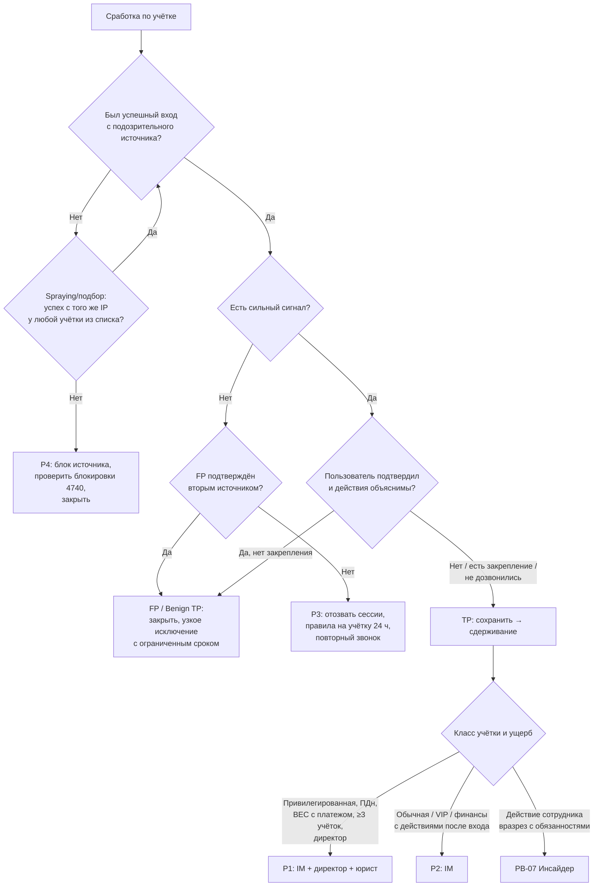

# PB-03 Компрометация учётной записи сотрудника

> Учебный плейбук для вымышленной компании «Альфа-Трейд». Опирается на IR-план (`source/ir-plan.md`): роли, критичность P1–P4, сроки и каналы связи берутся оттуда. Пометка **[проверить]** означает факт, который зависит от продукта, редакции закона или версии ATT&CK; перед реальным применением его нужно сверить с первоисточником. **[допущение]** означает то, чего нет в IR-плане, но что типично для компании такого размера. Примеры запросов даны в нейтральном псевдо-SPL/KQL: имена полей и синтаксис зависят от вашей SIEM. SIEM, EDR и облачный провайдер почты в IR-плане не названы; облачные примеры приведены на Microsoft 365 / Entra ID, потому что у них лучше всего документированы журналы. Для Яндекс 360, VK WorkSpace и других провайдеров эквиваленты нужно найти на этапе подготовки, а не во время инцидента.

Главная мысль плейбука: **у атакующего может быть не пароль, а сессия, токен или собственный второй фактор.** Поэтому смена пароля сама по себе ничего не закрывает. Порядок всех действий: **сохранить → изолировать хост, если на нём стилер → заблокировать вход → оборвать сессии → убрать закрепление → закрыть вектор → вернуть доступ под наблюдением.**

## 1. Паспорт плейбука

| Поле | Значение |
| --- | --- |
| ID | PB-03 |
| Версия | 1.0 (31.10.2026) |
| Владелец | Руководитель ИБ (он же руководитель реагирования, IM) |
| Пересмотр | Раз в 6 месяцев и после каждого P1/P2 по сценарию |
| Критичность по умолчанию | **P3** для подозрительного успешного входа до выяснения; **P2** для подтверждённой компрометации обычной учётки |
| Изменение критичности | **P4:** попытки без единого успешного входа (подбор, spraying отбит). **P2:** подтверждённый вход и действия после него; учётка руководителя или финансов (плюс обязательно информируется финансовый директор). **P1:** привилегированная учётка (AD, администратор облака, EDR, SIEM, NGFW, резервного копирования, гипервизоров); доступ к базе клиентов или ПДн с признаками чтения или выгрузки, либо невозможность это исключить при широком доступе; BEC с совершённым платежом или изменёнными реквизитами; учётка генерального директора; 3 и более учётки одной кампанией **[допущение: порог]**. Пересматривается после поиска других жертв (раздел 8) и оценки доступа к данным |
| MITRE ATT&CK | **Initial Access / Persistence:** T1078.002 Domain Accounts, T1078.004 Cloud Accounts, T1133 External Remote Services (VPN). **Credential Access:** T1110.001 Password Guessing, T1110.003 Password Spraying, T1110.004 Credential Stuffing, T1621 Multi-Factor Authentication Request Generation, T1557 Adversary-in-the-Middle (AiTM-фишинг; отдельной подтехники для него нет **[проверить]**), T1539 Steal Web Session Cookie, T1555.003 Credentials from Web Browsers, T1528 Steal Application Access Token. **Persistence:** T1098.005 Device Registration, T1098.002 Additional Email Delegate Permissions, T1136 Create Account. **Defense Evasion:** T1550.004 Web Session Cookie, T1564.008 Email Hiding Rules, T1656 Impersonation. **Collection:** T1114.002 Remote Email Collection, T1114.003 Email Forwarding Rule. **Lateral Movement:** T1534 Internal Spearphishing, T1021.001 RDP. Идентификаторы сверить с актуальной версией ATT&CK **[проверить]** |
| Связанные плейбуки | PB-01 Фишинг (источник), PB-04 Вредонос на рабочей станции и PB-S4 Сработка EDR (стилер на хосте), PB-05 Утечка данных (ПДн), PB-07 Инсайдер, PB-10 Компрометация облачного аккаунта |

**Целевые сроки по фазам** (учебные, от момента сработки T0, если не указано иное):

| Этап | P1 | P2 | P3 |
| --- | --- | --- | --- |
| Взятие в работу L1 (по IR-плану) | 15 мин | 1 ч | 4 ч |
| Триаж L1, включая звонок | +15 мин | +30 мин | +1 ч |
| Экспорт улик облака и почты | +30 мин | +1 ч | +4 ч |
| Сдерживание после подтверждения TP | 15–30 мин | ≤ 1 ч | ≤ 4 ч |
| Факты о доступе к ПДн переданы DPO | ≤ 4 ч от выявления | ≤ 8–12 ч от выявления | 1 рабочий день |
| Полный скоуп (все действия, все учётки) | 24 ч | 48 ч | 5 рабочих дней |

Срок «факты для DPO за 8–12 часов» нужен, чтобы юрист успел подготовить первичное уведомление Роскомнадзора в пределах 24 часов (152-ФЗ, ст. 21 ч. 3.1 по IR-плану **[проверить редакцию]**).

## 2. Назначение и область применения

**Цель:** за первый час понять, работает ли посторонний под учёткой сотрудника, отрезать его от всех видов доступа (пароль, сессии, токены, MFA, приложения, VPN) и выяснить, что он успел сделать и кого ещё затронул.

**Входит:**

- Доменные учётки сотрудников (AD), VPN, рабочие станции и серверы, на которые входила учётка.
- Учётка сотрудника в облачной почте и файлах на пользовательском уровне: правила ящика, пересылка, методы MFA, устройства, согласия OAuth этого пользователя.
- Учётки во внутренних системах: 1С, админка сайта.
- Сервисные учётки, учётки подрядчиков, привилегированные учётки (как ветки, см. 5.4).
- Векторы: подбор и spraying, credential stuffing, AiTM-фишинг, стилер, MFA fatigue, device code и OAuth consent phishing, социальная инженерия на сервис-деск, повторное использование пароля из утечек.

**Не входит:**

- Учётки **покупателей** интернет-магазина (credential stuffing на личные кабинеты): другие данные, другие СЗИ (WAF, антибот), другие коммуникации. Нужен отдельный плейбук; в каталоге его пока нет.
- Компрометация облачного тенанта целиком (администратор облака, вредоносное приложение на уровне тенанта, изменённые политики): ведущий **PB-10**. Граница: PB-03 ведущий, если затронуты AD, VPN или внутренние системы, либо неизвестно, где начался доступ; PB-10 ведущий, если затронут только облачный уровень **[согласовать при доработке PB-10]**.
- Подтверждённая компрометация домена (DCSync, golden ticket): PB-03 доводит до перехода и передаёт в отдельный плейбук «Компрометация AD» (пока нет в каталоге, до его появления ведёт IM по разделу 9 этого плейбука).
- Злоупотребление доступом самим сотрудником: **PB-07**.

**Предусловия (Preparation).** Невыполненный пункт записывается в тикет как ограничение расследования:

- [ ] Аудит на DC включает Credential Validation, Kerberos Authentication Service, Kerberos Service Ticket Operations, Logon/Logoff, Account Lockout, User и Security Group Management, Directory Service Changes **[проверить по вашей GPO]**
- [ ] В SIEM не менее 90 дней: DC, серверы, VPN (с выданным внутренним IP), облачные входы (включая неинтерактивные) и аудит, почтовый шлюз, EDR, прокси/DNS, журнал регистрации 1С
- [ ] Известен срок хранения журналов у облачного провайдера: у облаков он бывает 7–30 дней для входов в зависимости от лицензии **[проверить у своего провайдера]**
- [ ] Выяснено, что провайдер умеет: принудительно завершить все сессии, удалить метод MFA, отозвать согласие OAuth, запретить IMAP/POP/SMTP AUTH, выдать журнал чтения писем. Чего не умеет, записано как риск с компенсирующей мерой (обычно отключение учётки целиком)
- [ ] Справочник телефонов из **HR-системы**, а не из AD или подписи письма; резервные номера руководства и администраторов
- [ ] Реестр привилегированных, сервисных, VIP и финансовых учёток с владельцами
- [ ] Проверенные скрипты: экспорт правил ящика и аудита, отзыв сессий, отключение учётки, завершение VPN-сессии
- [ ] Процедура сервис-деска для сброса пароля и MFA с проверкой личности (обратный звонок на номер из HR, подтверждение руководителем, личная явка для администраторов)
- [ ] Break-glass учётки облака и домена с отдельным алертом на любой вход
- [ ] С юристом согласованы момент начала отсчёта 24 часов и объём доступа ИБ к **содержимому** переписки сотрудника

## 3. Триггеры и источники обнаружения

Гео-аномалии («невозможное путешествие», новая страна) — **слабый сигнал.** Для российской компании это один из самых шумных детектов: личные VPN сотрудников, выход мобильного оператора через другой город, облачные прокси браузеров. При этом настоящие атакующие всё чаще ходят через резидентные прокси в стране жертвы, и гео-правило их не видит. Гео всегда обогащается: ASN и тип адреса, известность устройства, user-agent, был ли MFA, что делали после входа.

| Источник | Что видим | Поля / Event ID | Пример правила (пример, псевдокод) |
| --- | --- | --- | --- |
| DC (Security) | Password spraying: один источник, много учёток, мало попыток | 4625, 4771 (`Status` 0x18), 4776; `TargetUserName`, `IpAddress`, `Workstation` | `event_id IN (4625,4771,4776) earliest=-1h \| stats dc(user) as users, count as n by src_ip \| where users>=15 AND n/users<=3` |
| DC | Блокировки волной, подбор по одной учётке | 4740 (`CallerComputerName`), 4625 `SubStatus` 0xC000006A / 0xC0000064 | `event_id=4740 earliest=-1h \| stats dc(user) by caller_host \| where dc>=5` |
| DC, облако, VPN | Успешный вход после серии неудачных | 4624/4768 после 4625/4771; `ResultType` 0 после 50126 **[проверить коды]** | `streamstats count(eval(outcome="failure")) as fails by user,src_ip reset_after="outcome=\"success\"" \| where outcome="success" AND fails>=5` |
| Облако: журнал входов | Вход с ASN хостинга, VPN-сервиса, Tor; новое устройство; скриптовый user-agent; устаревший протокол | `IPAddress`, `AutonomousSystemNumber` **[проверить наличие поля]**, `UserAgent`, `ClientAppUsed`, `DeviceDetail`, `AuthenticationRequirement` | `source=cloud_signin outcome=success (asn_type IN ("hosting","vpn","tor") OR client_app IN ("IMAP","POP","SMTP") OR user_agent="*python*")` |
| Облако: журнал входов | Кража сессии: один `SessionId` с разных ASN или стран | `SessionId`, `IPAddress`, страна | `union SigninLogs, AADNonInteractiveUserSignInLogs \| where ResultType==0 \| summarize ips=make_set(IPAddress) by UserPrincipalName, SessionId \| where array_length(ips)>1` (смена IP мобильный ↔ Wi-Fi бывает легитимно, критерий — смена ASN/страны) |
| Облако: MFA | MFA fatigue: серия отклонённых push, затем подтверждённый | `ResultType` 500121 многократно **[проверить]** | `outcome=mfa_denied earliest=-1h \| stats count by user \| where count>=5` |
| Аудит IdP | Новый метод MFA или устройство вскоре после входа с нового IP; согласие на OAuth-приложение; смена телефона для восстановления | Операции «User registered security info», «Register device», «Consent to application» **[проверить имена]** | `operation="User registered security info" \| join user [login from new ASN within 2h]` |
| Аудит почты | Правило пересылки, удаления или перемещения в RSS/Архив; пересылка на уровне ящика; права на ящик | `New-InboxRule`, `Set-InboxRule`, `UpdateInboxRules`, `Set-Mailbox` (`ForwardingSmtpAddress`), `Add-MailboxPermission` | `operation IN (...) AND (params="*Forward*" OR "*Redirect*" OR "*DeleteMessage*" OR "*MoveToFolder*")`; имена правил «.», «..» подозрительны |
| Почтовый шлюз | Массовая или внутренняя рассылка из ящика, всплеск NDR | sender, recipient count, URL, вложения | `sender=<user> \| stats dc(recipient) by _time span=10m \| where dc>=30` |
| Аудит файлов | Массовое скачивание, анонимные ссылки | `FileDownloaded`, `AnonymousLinkCreated` | `operation=FileDownloaded \| stats count by user span=1h \| where count>=200` (порог по базовой линии) |
| VPN | Одновременные сессии с разных внешних IP, новый клиент, вход ночью с большим трафиком | user, внешний IP, выданный внутренний IP, версия клиента | `action=session_start \| bin span=1h \| stats dc(src_ip) by user \| where dc>1` |
| DC | Добавление в привилегированную группу вне заявки; сброс пароля, о котором пользователь не знает | 4728/4732/4756, 4724, 5136 | `event_id IN (4728,4732,4756) group IN (<priv_groups>)` |
| EDR / антивирус | Стилер, ClickFix, не-браузерный процесс читает `Login Data`, `Cookies`, `Local State` | дерево процессов, доступ к файлам | Sigma-логика: `TargetFilename` содержит `\User Data\` и `\Login Data` и `Image` не браузер |
| Сервис-деск | Заявка на сброс пароля или MFA с нетипичным каналом или временем | тикет | Ручная сверка |
| TI, внешние | Учётка в утечке или логах стилеров **[допущение: есть подписка]**; жалоба контрагента «вы сменили реквизиты?»; пользователь сообщает о запросах MFA, которых не делал | — | — |

## 4. Роли и RACI

R — выполняет, A — утверждает, C — консультирует, I — информируется.

| Действие | L1 | L2 | IM | ИТ: AD/сеть | ИТ: облако/почта | Владелец системы | DPO/юрист | Финансы |
| --- | --- | --- | --- | --- | --- | --- | --- | --- |
| Обогащение, звонок пользователю | R | C | I | | | | | |
| TP/FP, критичность | R (первично) | R | A (P1/P2) | | | | | |
| Экспорт улик облака и почты | | R | I | | R | | | |
| Изоляция одного хоста в EDR | | R/A | I | | | | | |
| Отзыв сессий, отключение обычной учётки при подтверждённом TP | | A | I (в течение часа) | R | R | | | |
| Отключение учётки руководителя (VIP) | | C | A, информирует директора | R | R | | | |
| Отключение привилегированной учётки | | C | A | R | R | | | |
| Отключение или смена пароля сервисной учётки | | C | A | R | R | A | | |
| Массовые действия (> 5 учёток, глобальный сброс сессий, запрет протокола для всех) **[допущение: порог]** | | C | A | R | R | C | | |
| Блок одного IP на NGFW/VPN | | R/A | I | C | | | | |
| Блок IP в условном доступе облака; блок страны или ASN | | R (один IP) | A (страна/ASN) | | R | | | |
| Отзыв согласия OAuth-приложения | | C | A | | R | C | | |
| Удаление внутреннего фишинга из ящиков | | R | A | | R | | | |
| Оценка доступа к ПДн | | R (факты) | A | | | C | R (решение) | |
| Уведомление РКН, ГосСОПКА | | C | C | | | | R | |
| Остановка платежей, звонок в банк | | | I | | | | C | R/A |
| Сообщения контрагентам и клиентам | | | A | | | C | C | C (PR — R) |
| Возврат доступа, перерегистрация MFA | | C | A (VIP/привилег.) | R | R | | | |
| Закрытие инцидента | | R | A | | | C | C | |

Сервис-деск: не сбрасывает пароль или MFA по звонку без процедуры проверки личности; новый пароль и временный код передаёт только по телефону из HR-справочника или лично. HR подключается только по решению IM (инсайдер, доступ к переписке).

## 5. Триаж (первые 15–30 минут)

### 5.1. Карточка L1

1. **(≤ 10 мин) Завести тикет и обогатить.** Учётка: ФИО, отдел, группы AD, класс (обычная / VIP / финансы / привилегированная / сервисная / подрядчик), статус в HR (работает, отпуск, увольняется). Событие: время в UTC и МСК, система, внешний IP, ASN и тип адреса, страна, устройство и его ID, user-agent, протокол, результат MFA. История: был ли вход с этого ASN/устройства/страны за 30 дней.
2. **(≤ 10 мин) Проверить сильные сигналы.** Любой один означает эскалацию L2 сразу, не дожидаясь звонка; привилегированная учётка — сразу L2 и IM:
   - [ ] новый метод MFA или устройство зарегистрированы вскоре после входа с нового IP;
   - [ ] правило ящика с пересылкой наружу, удалением или перемещением в RSS/Архив/Заметки; пересылка на уровне ящика;
   - [ ] согласие на OAuth-приложение не из списка разрешённых;
   - [ ] вход с хостинга/VPN-сервиса/Tor и затем действия в почте или файлах;
   - [ ] один `SessionId` с разных ASN; параллельные сессии из разных стран;
   - [ ] пользователь сообщает о неожиданных запросах MFA или о том, что «подтвердил случайно»;
   - [ ] жалобы коллег или контрагентов на письма от пользователя;
   - [ ] успешный вход после серии неудачных с одного внешнего IP;
   - [ ] учётка добавлена в привилегированную группу вне заявки.
3. **Проверить признаки FP** (фиксировать, чем подтверждено): IP в списке корпоративных egress/VPN; устройство управляемое и известное; user-agent обычный; командировка подтверждена вторым источником (руководитель, заявка) **[допущение: такой источник есть]**; после входа нет действий из списка сильных сигналов.
4. **(≤ 30 мин) Позвонить пользователю** по номеру из HR-справочника, по скрипту 5.2. Не писать на почту и в корпоративный мессенджер, если он входит через ту же учётку. Две попытки с интервалом 5 минут; не дозвонились — L2 с пометкой «пользователь недоступен».
5. L1 сам ничего не удаляет и не отключает.

### 5.2. Скрипт звонка

> «Добрый день, это служба информационной безопасности, [имя]. Видим необычную активность, есть несколько коротких вопросов.»
> 1. Где вы сейчас и с какого устройства работали сегодня и вчера вечером?
> 2. Пользуетесь ли VPN-сервисом на личных устройствах?
> 3. Приходили ли запросы на подтверждение входа, которых вы не ждали? Нажимали ли «Подтвердить» хотя бы раз?
> 4. Вводили ли в последние дни пароль после перехода по ссылке? Вводили ли код с экрана на каком-то сайте?
> 5. Давали ли приложению доступ к почте или файлам?
> 6. Устанавливали ли программы, расширения, «исправляли ошибку» по инструкции с сайта?
> 7. Звонил ли кто-то от имени ИТ с просьбой назвать код или сменить пароль?

Не сообщать IP, страны, найденное и планы. Попросить ничего не удалять в почте и, при подозрении на заражение, не пользоваться устройством до звонка ИБ. Ответы — дословно в тикет со временем. «Да» на вопросы 3–5 означает TP независимо от остальных ответов. Если собеседник кажется не тем человеком, прекратить разговор и перезвонить через руководителя.

Почему не спрашивать просто «это были вы?»: при AiTM и MFA fatigue пользователь честно ответит «да, я входил» или «да, я подтвердил», потому что действительно это делал.

### 5.3. Дерево решений L2



Правила к дереву:

- **«Это был я» не закрывает тикет**, если есть объективные противоречия: другое устройство, правило пересылки, новый метод MFA.
- **Пользователь подтвердил push, но не входил** — это TP, а не «сам виноват, закрываем».
- **Не дозвонились** (ночь, отпуск): при закреплении (правило, MFA, OAuth) или входе с хостинга с последующими действиями — TP и сдерживание без ожидания в пределах полномочий; для привилегированной учётки — с IM по телефону. Пользователю оставить сообщение с просьбой перезвонить на номер SOC, не по почте.
- **Spraying без успеха — P4, но** обязательно проверить, что ни одна учётка из списка не вошла успешно с того же IP: spraying обычно «попадает» в 1–2 из сотни.
- **MFA fatigue без подтверждённого push** — всё равно сброс пароля: пароль у атакующего уже есть.

### 5.4. Ветки по классу учётки и вектору

| Ветка | Что особенного |
| --- | --- |
| Привилегированная AD | P1, сразу IM, резервный канал связи. Исходить из того, что домен мог быть скомпрометирован: проверить 4662 с правами репликации от не-DC (DCSync), 4720, 4728/4732/4756, 5136 по GPO, новые SPN, AdminSDHolder, SIDHistory, задачи и службы на DC. Решение о двойном сбросе krbtgt принимает IM, отдельной процедурой **[проверить интервал между сбросами в рекомендациях Microsoft]** |
| Сервисная | Звонить владельцу системы. Не отключать без IM и владельца: сначала выяснить, где используется пароль (конфиги, задачи, службы). Сразу можно ограничить интерактивный вход. LogonType 2 или 10 у сервисной учётки — сильный сигнал |
| BEC / финансы | Счёт на часы: найти письма контрагентам о реквизитах (Q8), подключить финансы, при подозрении на платёж — звонок в банк. Контрагентам звонить по номеру из договора |
| MFA fatigue | Пароль сменить обязательно, включить number matching, искать источник пароля (стилер, утечка) |
| Стилер на хосте | Сначала хост (изоляция, PB-04/PB-S4), потом пароль с чистого устройства. Сменить все пароли, сохранённые в браузере; ротация ключей и токенов с хоста |
| AiTM / кража cookie | Отзыв сессий важнее смены пароля, но делать оба. Найти письмо-источник, других получателей и кликнувших (PB-01) |
| Массовый spraying с успехом | P2/P1, каждая успешная учётка проходит раздел 6, координирует IM, сдерживание одновременно |
| Подрядчик | Связь через ответственного за договор; при TP учётку можно отключить сразу, согласие IM постфактум **[допущение]** |
| Инсайдер | Остановить PB-03, перейти в PB-07. Сотруднику повторно не звонить, руководителю без IM не сообщать, артефакты сохранить |

### 5.5. Критерии эскалации

- IM немедленно: P1, любая привилегированная или сервисная учётка, директор, BEC, признаки ПДн, больше одной учётки.
- IM в течение 15 минут: P2.
- DPO: как только нельзя исключить доступ к ПДн (не ждать доказательств, см. раздел 11).
- Финансовый директор: учётки финансов и руководства, любые письма о платежах.

## 6. Сдерживание

**Решение IM (≤ 15 мин после эскалации): сдерживать сразу или после быстрого скоупа.**

- **Сразу**, если есть активный ущерб (исходящие письма, пересылка, платёжная тематика, выгрузка данных) или учётка привилегированная.
- **После быстрого скоупа (≤ 60 мин)**, если ущерба не видно, но похоже на кампанию (общий IP, фишинговый домен). Затем **одновременное** сдерживание всех найденных учёток и хостов по команде IM: если блокировать по одной, атакующий переключится на ещё не заблокированную.
- Для обычных учёток «наблюдать, чтобы понять масштаб» не применять: риск рассылки и BEC выше пользы.

### 6.1. Краткосрочное сдерживание (одна учётка, пакетом за 10–15 минут)

Каждое действие записывается в тикет со временем (UTC).

| Шаг | Действие | Кто | Инструмент | Апрув |
| --- | --- | --- | --- | --- |
| 0 | **Экспорт улик** (раздел 7, приоритет 1): правила ящика, включая скрытые; пересылка; права на ящик; методы MFA; устройства; согласия OAuth; журналы входов и аудита; атрибуты AD. При активном ущербе — параллельно с шагами 1–3, но строго до шага 4 | L2 + админ почты | PowerShell, консоль облака, SIEM | Не нужен |
| 1 | Изолировать хост пользователя, если есть сигналы EDR или источник неясен. Не перезагружать, не запускать сканирование с удалением | L2 | EDR | Не нужен (одна станция, по IR-плану) |
| 2 | **Заблокировать вход:** отключить учётку в облаке и в AD | ИТ | AD, консоль IdP | Обычная — L2; VIP и привилегированная — IM; сервисная — IM и владелец |
| 3 | **Оборвать сессии:** отзыв сессий и refresh-токенов в облаке; завершение VPN-сессии на шлюзе (смена пароля её не рвёт; при VPN по сертификату — отзыв сертификата); `logoff` RDP/SMB на хостах из 4624 | ИТ | `Revoke-MgUserSignInSession` или аналог **[проверить]**, VPN-шлюз, `quser`/`logoff`, EDR | Как в шаге 2 |
| 4 | **Убрать закрепление:** правила ящика сначала отключить (удалить после расследования); удалить пересылку на уровне ящика и чужие права; удалить чужие методы MFA и устройства; отозвать согласия OAuth; удалить пароли приложений и партнёрства ActiveSync; вернуть телефон и почту для восстановления | Админ облака/почты | Консоль, PowerShell | Отзыв OAuth-приложения, используемого не одним пользователем, — IM |
| 5 | **Остановить распространение:** заблокировать фишинговый домен на прокси и шлюзе; найти и после сохранения копии удалить внутренний фишинг из ящиков; при BEC — финансы звонят контрагентам и в банк | L2, админ почты, финансы | Прокси, шлюз, поиск по ящикам | Удаление из ящиков — IM |
| 6 | **Дополнительно** заблокировать инфраструктуру: IP в условном доступе облака и на VPN/NGFW, если адрес не общий (CGNAT, мобильный оператор); IOC — в список SIEM для поиска | L2 | Условный доступ, NGFW | Один IP — L2; страна или ASN — IM |
| 7 | **Новый пароль** — только после шага 1, задаётся с чистого устройства, сообщается по телефону или лично. Учётка остаётся отключённой до восстановления (раздел 10) | ИТ | AD, IdP | — |

**Что сдерживание не закрывает сразу:** выданный access-токен облака может жить до истечения (порядка часа) у сервисов без непрерывной оценки доступа **[проверить для провайдера]**; Kerberos-билеты действуют до истечения (TGT по умолчанию 10 часов, продление до 7 дней **[проверить на своём домене]**). Поэтому после сдерживания обязательно наблюдение 2 часа: попытки входа в отключённую учётку (4625 с 0xC0000072, ошибки «учётка отключена» в облаке), активность с IP атакующего, новые правила в других ящиках.

### 6.2. Долгосрочное сдерживание

- Учётка остаётся отключённой, пока не выполнены условия раздела 10; пользователю на время выдаётся временный доступ к нужным функциям через руководителя (без почтового ящика, если возможно).
- Для сервисной учётки — ограничение по хостам и запрет интерактивного входа до плановой смены пароля с владельцем системы.
- Временное правило условного доступа для учётки: вход только с управляемого устройства.
- Watchlist SIEM на учётку, хост и IOC инцидента.

### 6.3. Что НЕ делать

- Не удалять правила, MFA-устройства и приложения до экспорта: в правиле адрес атакующего и слова, которые его интересовали.
- Не выдавать новый пароль, пока на хосте может быть стилер.
- Не отправлять новый пароль, ссылку или временный код на почту.
- Не звонить по номеру из подписи письма или из AD: атакующий мог его поменять.
- Не считать блокировку IP на NGFW сдерживанием: облачная почта доступна из интернета напрямую, трафик к ней через NGFW не идёт.
- Не включать регистрацию MFA, пока пароль у атакующего: он зарегистрирует свой фактор первым.
- Не перезагружать хост и не «чистить» его антивирусом до сбора летучих данных.
- Не обсуждать инцидент через скомпрометированную почту; при компрометации учётки ИТ, ИБ или администратора облака — резервный канал из IR-плана.

## 7. Сбор и сохранение артефактов

Порядок по летучести и риску потери:

| Приоритет | Артефакт | Как сохранить | Почему сейчас |
| --- | --- | --- | --- |
| 1 | Активные сессии и состояние VPN | Скриншот/экспорт со шлюза и из консоли IdP | Исчезнут при сдерживании |
| 1 | Память, процессы, соединения хоста (при подозрении на стилер/RAT) | EDR live response, дамп памяти до перезагрузки | Перезагрузка уничтожит |
| 1 | Правила ящика (включая скрытые), пересылка, права на ящик, методы MFA, устройства, OAuth-согласия, пароли приложений | `Get-InboxRule -Mailbox <upn> -IncludeHidden \| Export-Csv` **[проверить параметр]**, `Get-Mailbox ... Forwarding*`, `Get-MailboxPermission`, `Get-MgUserAuthenticationMethod`, `Get-MgUserOauth2PermissionGrant` **[проверить имена командлетов]**; правила, созданные через MAPI, могут не отображаться — нужен инструмент уровня MAPI | Исчезнут при удалении |
| 1 | Журналы входов (интерактивные и **неинтерактивные**) и аудита облака — минимум 30 дней, лучше вся доступная глубина | Экспорт из консоли/SIEM, `Search-UnifiedAuditLog` или его замена в Purview/Graph **[проверить]** | Ограниченный срок хранения у провайдера |
| 1 | Атрибуты учётки AD | `Get-ADUser <u> -Properties *` (`pwdLastSet`, `lastLogonTimestamp`, `memberOf`, `servicePrincipalName`, `userAccountControl`, `adminCount`, `SIDHistory`, `mobile`), `Get-ADReplicationAttributeMetadata` или `repadmin /showobjmeta` | Изменятся при сдерживании; метаданные репликации показывают, кто и когда менял атрибуты, даже если журналы перезаписаны |
| 2 | Отправленные и удалённые письма | Удержание ящика (hold), восстанавливаемые элементы, трассировка сообщений | Атакующий удаляет отправленное |
| 2 | События DC, серверов, VPN, NGFW, прокси, DNS за окно | Выгрузка из SIEM | Ротация журналов |
| 2 | Триаж-коллекция хоста (KAPE или аналог в EDR) | До переустановки | Переустановка уничтожит |
| 3 | Объяснение пользователя, скриншоты запросов MFA, письмо-источник с заголовками, журнал 1С | В тикет, письмо — как `.eml` | Память и почта меняются |

**Цепочка хранения (chain of custody):** каждый файл именуется `INC-<номер>_<источник>_<UTC-время>.<ext>`; в журнал улик записываются SHA-256, кто собрал, когда, откуда, где хранится. Хранилище — у команды ИБ с ограниченным доступом, не на пострадавшем хосте и не в скомпрометированном облачном диске. Все времена в тикете с явным часовым поясом: облако пишет в UTC, Windows — в локальном времени хоста, отчёт по IR-плану — UTC+3. Смешение поясов — самая частая ошибка хронологии. Если возможно обращение в полицию (BEC с платежом), этот порядок обязателен с первой минуты.

## 8. Расследование

L2 письменно отвечает в тикете на вопросы ниже. Примеры запросов — псевдокод.

| Вопрос | Где смотреть |
| --- | --- |
| **Окно компрометации:** когда первое подозрительное событие (не первая сработка) и последнее? Искать назад минимум 30 дней | Облачные входы, DC, VPN |
| **Как вошли:** пароль + MFA; пароль без MFA через устаревший протокол; cookie без пароля; токен приложения; сброс через сервис-деск; VPN | `ClientAppUsed`, `AuthenticationRequirement`, `SessionId`, журнал согласий, тикеты сервис-деска, 4724 |
| **Вектор:** фишинг/AiTM (вход сразу после клика), стилер (EDR), spraying (4771/4776, 50126), утечка (TI), сервис-деск, OAuth/device code | Прокси, шлюз, EDR, TI |
| **Инфраструктура атакующего:** все IP, ASN, user-agent, ID устройств, сессии | Q1 |
| **Где был:** VPN → выданный внутренний IP → 4624 с этим `IpAddress` → NGFW (порты 445, 3389, 5985/5986, 88, 389, 1С, СУБД) | VPN, NGFW, DC, EDR |
| **Что сделал в почте:** правила, делегирование, что читал (`MailItemsAccessed` или аналог, зависит от лицензии), что искал («счёт», «оплата», «пароль»), что **отправил** и что удалил | Аудит почты, трассировка |
| **Что сделал с файлами и в системах:** скачивания, внешние ссылки, 1С (особенно банковские реквизиты контрагентов), база клиентов, админка сайта | Аудит файлов, журнал 1С, журналы приложений |
| **Закрепление:** новые учётки, группы, MFA, устройства, приложения, секреты, правила, задачи и службы | IdP, DC (Q4), EDR |
| **Масштаб:** кто ещё входил с той же инфраструктуры, кто получил то же письмо, есть ли такие же правила в других ящиках | Q2, Q3, PB-01 |
| **Blast radius:** к чему у учётки вообще есть доступ (группы, приложения, ящики, данные) — это ответ юристу «мог ли он видеть ПДн» | AD, IdP, владельцы систем |
| **Повторное использование пароля:** где тот же пароль мог работать (1С с собственной аутентификацией, админка, кабинеты поставщиков, банк-клиент) | Опрос пользователя, владельцы систем |

```
# Q1. Всё, что делали IP атакующего, во всех источниках
index=* (src_ip IN (<IP1>,<IP2>) OR dest_ip IN (<IP1>,<IP2>)) earliest=-30d
| stats count, values(user), values(action), min(_time), max(_time) by sourcetype

# Q2. Кто ещё входил с инфраструктуры атакующего (поиск других жертв)
index=auth outcome=success earliest=-30d (src_ip IN (<IP1>,<IP2>) OR src_asn=<ASN> OR user_agent="<UA>")
| stats min(_time) as first, max(_time) as last, values(src_ip) by user
# ASN крупного облака даст много FP — сузить по user-agent и времени

# Q3. Охота на правила ящиков по всей компании
index=cloud_mail_audit earliest=-30d operation IN ("New-InboxRule","Set-InboxRule","UpdateInboxRules","Set-Mailbox")
| search params="*Forward*" OR params="*Redirect*" OR params="*DeleteMessage*" OR params="*MoveToFolder*"
| table _time, user, src_ip, operation, rule_name, params

# Q4. Изменения групп и паролей вокруг учётки
index=ad event_id IN (4720,4722,4723,4724,4738,4728,4732,4756,4767,5136) (TargetUserName=<USER> OR SubjectUserName=<USER> OR MemberName="*<USER>*") earliest=-30d
| table _time, event_id, SubjectUserName, TargetUserName, MemberName, host

# Q5. Хронология облачной учётки (KQL, Entra ID) [проверить имена полей]
union SigninLogs, AADNonInteractiveUserSignInLogs
| where TimeGenerated > ago(30d) and UserPrincipalName =~ "<upn>"
| project TimeGenerated, IPAddress, Location, AppDisplayName, ClientAppUsed, UserAgent,
          DeviceDetail, ResultType, AuthenticationRequirement, ConditionalAccessStatus, SessionId
| order by TimeGenerated asc
```

**Опорные Event ID AD.** 4624/4625 пишутся **на том хосте, куда входят**; чтобы увидеть, где учётка аутентифицировалась в домене, нужны события DC: 4768 (TGT; `TicketEncryptionType` 0x17 — RC4, в современной среде подозрительно), 4769 (сервисный билет; RC4 — признак Kerberoasting), 4771 (сбой предаутентификации, 0x18 — неверный пароль), 4776 (NTLM), 4740 (блокировка, `CallerComputerName`). DC показывает, откуда пришёл запрос, хост — что было дальше; их надо коррелировать. Ключевые поля 4624: `LogonType` (2 консоль, 3 сеть, 7 разблокировка, 9 `runas /netonly`, 10 RDP, 11 кэш), `IpAddress`, `AuthenticationPackageName` (NTLM там, где ждёшь Kerberos, — повод проверить pass-the-hash), `TargetLogonId`. Коды 4625: 0xC000006A — неверный пароль существующей учётки, 0xC0000064 — учётки нет (перебор по словарю), 0xC0000234 — заблокирована, 0xC0000072 — отключена. RDP: 4778/4779, TerminalServices-LocalSessionManager 21/24/25, RemoteConnectionManager 1149. Коды сверить с документацией Microsoft **[проверить]**.

**Хост пользователя (EDR):** не-браузерный процесс читает `...\User Data\<Profile>\Login Data`, `...\Network\Cookies`, `Local State` (Chromium, в том числе Яндекс Браузер), `logins.json`, `key4.db`, `cookies.sqlite` (Firefox); `powershell`/`mshta` из `explorer.exe` после посещения сайта и запись в `RunMRU` (ClickFix); архивы в `%TEMP%`; соединения с API мессенджеров и свежими доменами; AnyDesk/RustDesk без заявки; новые задачи, ключи `Run`, расширения браузера. Найдено — PB-04/PB-S4.

Если провайдер не даёт журнала чтения писем, ответ на вопрос «был ли доступ к ПДн в почте» — «**не можем исключить**», и это так и записывается для DPO.

## 9. Устранение

1. **Корневая причина подтверждена артефактом** (письмо-источник, процесс стилера, запись сервис-деска, учётка в утечке). Не найдена — записать «не установлена» и считать хост пользователя скомпрометированным до проверки.
2. **Хост:** при подтверждённом стилере или RAT — переустановка из эталонного образа, а не лечение антивирусом.
3. **Секреты:** сменить все пароли, которые хранились или вводились на хосте, и все, где пароль мог повторяться; ротация API-ключей, SSH-ключей, токенов, известных пользователю паролей сервисных учёток. Личные пароли — рекомендация сотруднику с объяснением.
4. **Закрепление по всей компании:** правила во всех ящиках (Q3), новые методы MFA у всех за окно, новые учётки и изменения групп (Q4), новые OAuth-приложения в тенанте; после расследования удалить отключённые правила.
5. **Привилегированная учётка:** сброс всех административных учёток, работавших на тех же хостах; по решению IM — процедура компрометации AD (krbtgt, сервисные учётки, учётки DC).
6. **Закрыть вектор:** блок фишинговой инфраструктуры; отключение устаревших протоколов для учётки или тенанта; исправление исключений в условном доступе; ужесточение процедуры сервис-деска — что применимо.

## 10. Восстановление и мониторинг после инцидента

1. Учётку включает ИТ по решению L2 (обычная) или IM (VIP, привилегированная, сервисная).
2. Пользователь лично или по видеосвязи с документом получает временный код доступа, ограниченный по времени, и **сам** регистрирует MFA заново; для финансов и администраторов — FIDO2-ключ или passkey.
3. Пользователь и (для сервисной учётки) владелец системы подтверждают, что работа восстановлена.
4. Короткий разбор с сотрудником без поиска виновного: как выглядит AiTM-страница, MFA fatigue, ClickFix.
5. **Мониторинг 30 дней** (IR-план требует не менее 14; для привилегированных и финансовых учёток 30 обязательно), ответственный L2, проверка раз в сутки:
   - [ ] вход учётки с новых ASN, стран, устройств; вход через устаревшие протоколы;
   - [ ] создание правил ящика, изменение пересылки, выдача прав на ящик;
   - [ ] регистрация методов MFA и устройств, согласия OAuth, смена телефона для восстановления;
   - [ ] любая активность с IOC инцидента (IP, ASN, user-agent, домены) по всем учёткам;
   - [ ] срабатывания EDR на хосте пользователя;
   - [ ] контрольные прогоны Q1 и Q2 через 24 часа и через 7 дней.

## 11. Коммуникации и уведомления

**Внутренние:**

| Кому | Кто | Когда | Канал |
| --- | --- | --- | --- |
| IM | L2 | По 5.5 | Тикет + звонок для P1 |
| Руководство | IM | P1 каждые 2 часа, P2 дважды в день (IR-план) | Чат инцидента или резервный канал |
| Пострадавший сотрудник | L2 / ИТ | При блокировке | Телефон |
| Руководитель сотрудника | IM | После блокировки; при инсайдере — только IM и HR | Телефон |
| Коллеги, получившие фишинг из ящика | IM или ИТ | Сразу после удаления писем | Не с пострадавшего ящика; через руководителей или резервный канал |
| Финансы | IM | Ветка BEC, учётки руководства и финансов | Телефон |
| DPO | IM | Как только доступ к ПДн нельзя исключить | Телефон + тикет |

**Внешние:**

- **Роскомнадзор** (через DPO): первичное уведомление в течение 24 часов с момента выявления, результаты расследования в течение 72 часов (152-ФЗ, ст. 21 ч. 3.1 **[проверить редакцию и толкование «момента выявления»]**). Почтовый ящик сотрудника интернет-магазина почти всегда содержит ПДн клиентов или работников, поэтому оценка ПДн — **обязательный** шаг, а не «если был доступ». Правило: «нельзя исключить — передаём DPO сейчас». Если ПДн не затронуты, DPO письменно фиксирует обоснование.
- **ГосСОПКА:** операторы ПДн, по имеющимся данным, обязаны информировать ФСБ о компьютерных инцидентах, повлёкших неправомерную передачу ПДн (152-ФЗ ст. 19 ч. 12; порядок — приказ ФСБ № 77 от 13.02.2023) **[проверить номер, дату, практический порядок и соотношение с уведомлением РКН — с юристом]**. В IR-плане этой строки нет.
- **Ответственность:** с 2025 года действуют повышенные штрафы по ст. 13.11 КоАП, в том числе за неуведомление РКН **[проверить: закон № 420-ФЗ, части статьи, даты]**. Вывод для плейбука: неуведомление в срок — самостоятельное нарушение.
- **Банк и полиция:** при хищении — финансы немедленно в банк, заявление в полицию по решению руководства.
- **Контрагенты и клиенты, которым писал атакующий:** по решению IM + PR + юриста, по согласованному тексту; при BEC — звонок по номеру из договора, никогда не ответом на письмо.
- **Доступ к содержимому переписки** сотрудника затрагивает тайну переписки (Конституция РФ, ст. 23); объём согласовать с юристом заранее, метаданные (кто, кому, когда, правила) анализировать в первую очередь **[правовые основания проверить с юристом]**.

**Шаблоны:**

> **Статус IM:** «PB-03, INC-___, P_. Учётка: ___ (класс). Окно: ___–___ UTC. Как вошли: ___ (подтверждено / предполагается). Сделано: ___. Атакующий делал: ___. Другие учётки: проверено / найдено ___. ПДн: подтверждён / не исключён / исключён. Нужны решения: ___. Следующий статус: ___.»

> **Сотруднику:** «Ваша учётная запись временно заблокирована из соображений безопасности. Пожалуйста, ничего не удаляйте в почте и не пользуйтесь [устройство] до звонка специалиста ИБ. Новый доступ вы получите лично.»

> **Коллегам:** «Письмо от [ФИО] с темой "[тема]" от [дата, время] отправлено не им. Не открывайте ссылку и вложения. Если уже перешли или ввели пароль — позвоните в ИБ по номеру ___.»

> **Контрагенту (по телефону):** «С адреса нашего сотрудника [адрес] могли прийти письма об изменении реквизитов. Наши реквизиты не менялись. Пожалуйста, не проводите платежи по новым реквизитам и сообщите нам, если такое письмо пришло.»

## 12. Критерии закрытия

Закрывает IM, когда отмечены все пункты:

- [ ] Установлены окно компрометации и вектор, или явно записано, что вектор не установлен, и какие меры это компенсируют
- [ ] Все системы, где был атакующий, перечислены; по каждой действия изучены и записаны
- [ ] Сессии и токены отозваны, VPN и RDP завершены; после этого нет успешных входов с инфраструктуры атакующего (Q1 через 24 часа и через 7 дней)
- [ ] Закрепление удалено; экспорт до удаления приложен к тикету с хешами
- [ ] Поиск других жертв выполнен (Q2, Q3); другие учётки не затронуты или обработаны
- [ ] Отправленная атакующим почта найдена: письма удалены, получатели предупреждены
- [ ] Хост пользователя проверен в EDR или переустановлен; секреты с него сменены
- [ ] Решение DPO по ПДн записано; уведомления, если нужны, отправлены в срок
- [ ] MFA перерегистрирован по процедуре; мониторинг 30 дней назначен с ответственным
- [ ] Хронология в тикете в едином часовом поясе; улики в хранилище ИБ
- [ ] Правило детекта, которое должно было сработать раньше, создано или исправлено
- [ ] Встреча по урокам назначена (≤ 5 рабочих дней)

## 13. Метрики

| Метрика | Как считать |
| --- | --- |
| MTTD | От первого действия атакующего (начало окна) до сработки |
| Time to contain | От сработки до отзыва сессий — **ключевая метрика сценария** (цель P2 ≤ 1 ч) |
| MTTR | От сработки до восстановления доступа пользователя под наблюдением |
| Время до решения DPO | От выявления до решения по ПДн; сравнить с 24 часами |
| Глубина заражения | Число затронутых учёток, писем, отправленных атакующим, кликнувших получателей |
| Источник первой сработки | Облако, AD, EDR, пользователь, контрагент (поздний сигнал = пробел в детекте) |
| Доля FP по гео-правилам | Для тюнинга |

## 14. Типичные ошибки и ловушки

1. Сменить пароль и забыть про сессии, токены, VPN, пароли приложений, OAuth-согласия.
2. Удалить правило пересылки, не сохранив его.
3. Выдать новый пароль, пока на хосте стилер.
4. Поверить «да, это я» при сильных сигналах; спросить «это были вы?» вместо скрипта.
5. Остановить триаж, потому что ночью пользователь не берёт трубку.
6. Не проверить, что атакующий отправил из ящика.
7. Не поискать другие учётки с той же инфраструктуры и такие же правила в других ящиках.
8. Блокировать IP на NGFW и считать облачную почту защищённой; заблокировать CGNAT и вместе с ним покупателей.
9. Блокировать учётки кампании по одной, а не одновременно.
10. Отключить сервисную учётку без владельца и остановить 1С или интеграции сайта.
11. Писать пользователю на скомпрометированную почту; звонить по номеру из AD.
12. Включить MFA без контроля регистрации — атакующий успеет первым.
13. Ждать доказательств доступа к ПДн, пока идут 24 часа.
14. Закрыть spraying как P4, не проверив единичный успех.
15. Смешать UTC и МСК в хронологии.

## 15. Меры по предотвращению и улучшению защиты

Оформляются задачами с ответственным и сроком:

1. Фишингоустойчивая MFA (FIDO2-ключи, passkeys) для администраторов, финансов, директора, сотрудников с доступом к ПДн.
2. Push только с number matching и контекстом; лимит запросов; алерт на серию отклонённых push. SMS не использовать как основной фактор (SIM-swap).
3. Отключить устаревшие протоколы (IMAP, POP, SMTP AUTH с базовой аутентификацией) и пароли приложений там, где не нужны.
4. Запрет автоматической пересылки на внешние адреса политикой исходящей почты; исключения по заявке.
5. Ограничить согласия пользователей на OAuth-приложения (через администратора); заблокировать device code flow, если не используется **[проверить, поддерживает ли провайдер]**.
6. Условный доступ: для привилегированных и финансовых ролей вход только с управляемых устройств; блок хостинга и анонимайзеров для входа сотрудников.
7. Запрет слабых и утёкших паролей, парольные фразы; мониторинг утечек учёток сотрудников.
8. AD: модель уровней администрирования, отдельные админские учётки, Protected Users, LAPS, отказ от RC4 в Kerberos, gMSA для сервисных учёток.
9. EDR: правило на доступ не-браузерных процессов к хранилищам паролей и cookie.
10. SIEM: правила из раздела 3 (spraying по источнику, смена ASN в сессии, правила ящика, MFA после входа с нового ASN, согласия OAuth).
11. Сервис-деск: проверка личности при сбросе пароля и MFA, временные пароли только по телефону или лично.
12. Обучение на реальных примерах AiTM и MFA fatigue: «пришёл запрос, которого вы не делали, — отклоните и позвоните в ИБ».

## 16. Учебная мини-ситуация (tabletop)

**Вводная.** Пятница, 23:40 МСК. SIEM: учётка главного бухгалтера `o.smirnova` вошла в облачную почту с IP хостинг-провайдера в Нидерландах, браузер Chrome на Windows, MFA «удовлетворено требованием в токене» **[проверить формулировку в вашем журнале]**. Через 6 минут создано правило ящика «..»: письма со словами «счёт», «оплата», «реквизиты» перемещать в RSS и помечать прочитанными. В 21:15 того же дня прокси фиксировал переход с её ноутбука на домен `alfa-trade-docs[.]com`. Телефон сотрудницы не отвечает. В понедельник у компании запланирован крупный платёж поставщику.

**Вопросы:**

1. TP или FP? Какие признаки вы считаете сильными, а какие слабыми? Какую критичность ставите и кого будите ночью?
2. Сотрудница не отвечает. Что вы делаете сами в пределах полномочий L2, а на что нужен звонок IM? В каком порядке?
3. Почему смена пароля не выкинет атакующего и что вы сделаете вместо или вместе с ней? Сколько ещё может работать уже выданный токен?
4. Какие два поиска по компании вы запустите до понижения критичности, и что будете искать в отправленных письмах?
5. Ящик бухгалтера содержит договоры с ПДн контрагентов-ИП. Когда вы передаёте вопрос DPO и до какого времени должно уйти первичное уведомление, если нельзя исключить доступ?

## 17. Источники и что почитать

Ссылки ведут на официальные сайты и приведены по памяти; глубокие ссылки со временем меняются.


- MITRE ATT&CK, техники T1078, T1110, T1621, T1557, T1539, T1528, T1098, T1114, T1564.008: https://attack.mitre.org/
- NIST SP 800-61 Rev. 3, Incident Response Recommendations and Considerations for Cybersecurity Risk Management (2025): https://csrc.nist.gov/pubs/sp/800/61/r3/final
- NIST SP 800-63B, Digital Identity Guidelines: Authentication and Lifecycle Management (уровни аутентификаторов, фишингоустойчивость): https://pages.nist.gov/800-63-4/
- CISA, Implementing Phishing-Resistant MFA (fact sheet, 2022): раздел MFA на https://www.cisa.gov/
- CISA/FBI, Scattered Spider, advisory AA23-320A (социальная инженерия на сервис-деск, MFA fatigue): https://www.cisa.gov/news-events/cybersecurity-advisories/aa23-320a
- Microsoft, Incident response playbooks: Password spray, App consent grant, Phishing investigation: https://learn.microsoft.com/security/operations/incident-response-playbooks
- Microsoft, Appendix L: Events to Monitor (Securing Active Directory): https://learn.microsoft.com/windows-server/identity/ad-ds/plan/appendix-l--events-to-monitor
- SANS, Incident Handler's Handbook: https://www.sans.org/white-papers/33901/
- JPCERT/CC, Detecting Lateral Movement through Tracking Event Logs (соответствие инструментов и Event ID): https://www.jpcert.or.jp/english/
- 152-ФЗ «О персональных данных», ст. 19 и 21 — актуальная редакция на pravo.gov.ru или в справочной правовой системе
