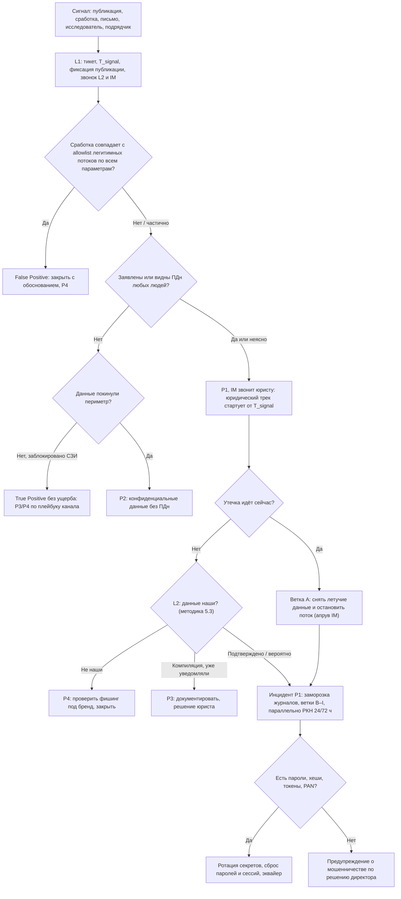

# PB-05 Утечка данных (персональных и конфиденциальных)

Учебный плейбук для вымышленной компании «Альфа-Трейд». Роли, критичность P1–P4, правила коммуникаций и шаблон отчёта берутся из IR-плана, здесь только то, что специфично для утечки.

Пометки в тексте:
- **[проверить]**: точный срок, номер статьи или приказа, формулировку закона, название события или функцию продукта нужно сверить с первоисточником (pravo.gov.ru, КонсультантПлюс, сайт РКН, документация вендора) перед применением. Всё про 152-ФЗ, КоАП, УК и ГосСОПКА — ориентиры, финальную позицию даёт юрист/DPO.
- **[учебное]**: порог, срок или цифра придуманы для учебного примера и подбираются по данным компании.
- **(пример)**: запросы написаны на нейтральном псевдо-SPL. Вендоры SIEM, EDR, СУБД и облачной почты в IR-плане не названы, имена индексов и полей условные; для MaxPatrol SIEM, KUMA, ELK логику нужно переложить.

Главная мысль плейбука: **при утечке ПДн сроки задаёт закон, а не расследование.** Юридический трек стартует с первого сигнала и идёт параллельно с техническим. Первичное уведомление РКН подаётся с тем, что известно, неизвестное помечается «уточняется». Вторая мысль: утечка — это **последствие**, а не техника. Плейбук ведёт от последствия к каналу, и каналов больше, чем «выгрузка через NGFW»: API, открытые хранилища, подрядчики, легитимные учётки, ошибки сотрудников.

---

## 1. Паспорт плейбука

| Поле | Значение |
| --- | --- |
| ID | PB-05 |
| Версия | 1.0 (учебная), дата: 31.10.2026 |
| Владелец | Руководитель ИБ (IM). Юридический раздел согласует юрист/DPO. Пересмотр раз в 6 месяцев, после каждого инцидента и учений |
| Критичность по умолчанию | **P1**: утечка или подозрение на утечку **любых** ПДн (клиентов, сотрудников, соискателей, физлиц-контрагентов) или платёжных данных, независимо от объёма; утечка идёт прямо сейчас; вымогательство с образцом, похожим на наши данные |
| P2 | Утечка конфиденциальных данных **без ПДн** (коммерческая тайна, договоры, цены, исходный код, конфигурации); утечка секретов (ключи API, пароли сервисных учёток) без признаков использования; открытое хранилище с ПДн без следов постороннего доступа (вопрос уведомления решает юрист) |
| P3 | Публикация оказалась компиляцией старых утечек, о которых компания уже знала и уведомляла; новых полей и записей нет |
| P4 | «База бренда» без данных наших клиентов; попытка выгрузки заблокирована NGFW/DLP и данные не покинули периметр (ведётся по плейбуку канала, не PB-05) |
| Правила изменения | При сомнении P1 сохраняется до опровержения. Понизить P1 может только **IM вместе с юристом**, с обоснованием в тикете. Повышение до P1 — любым участником, как только в данных обнаружены ПДн |
| MITRE ATT&CK, Initial Access (TA0001) | T1190 Exploit Public-Facing Application, T1078 Valid Accounts, T1133 External Remote Services, T1199 Trusted Relationship (подрядчик), T1566 Phishing |
| Credential Access (TA0006) | T1552.001 Credentials In Files (`.env`, конфиги), T1555.003 Credentials from Web Browsers (инфостилеры) |
| Collection (TA0009) | T1213 Data from Information Repositories, T1005 Data from Local System, T1039 Data from Network Shared Drive, T1530 Data from Cloud Storage, T1114 Email Collection, T1119 Automated Collection, T1074 Data Staged, T1560.001 Archive via Utility |
| Exfiltration (TA0010) | T1041 Over C2 Channel, T1048 Over Alternative Protocol (в т. ч. DNS), T1567.002 Exfiltration to Cloud Storage, T1537 Transfer Data to Cloud Account, T1052.001 Over USB, T1030 Data Transfer Size Limits, T1029 Scheduled Transfer, T1020 Automated Exfiltration |
| Impact (TA0040) | T1657 Financial Theft (вымогательство). Шантаж публикацией без шифрования отдельной техники не имеет, фиксируется в описании |
| Вне ATT&CK | Злоупотребление API (IDOR/BOLA, лишние поля в ответе) — OWASP API Security Top 10 2023, API1 и API3; в ATT&CK ложится в T1190 лишь условно |
| Сверка ATT&CK | Номера подтехник **[проверить по актуальной версии матрицы]** |
| Связанные плейбуки | PB-02 Шифровальщик (двойное вымогательство), PB-03 Компрометация учётной записи, PB-04 Вредонос на рабочей станции/сервере, PB-07 Инсайдер, PB-08 Взлом веб-приложения/API, PB-09 Потеря устройства, PB-10 Компрометация облачного аккаунта. **Правило совместной работы:** если затронуты ПДн, PB-05 запускается всегда и идёт параллельно с плейбуком канала. Плейбук канала отвечает за техническое сдерживание и устранение, PB-05 — за оценку утечки, улики по данным, юридический трек и защиту субъектов |
| Целевые сроки по фазам [учебное] | Тикет, T_signal, звонок L2 и IM, юрист в курсе: **15 мин**. Ветка определена, образец зафиксирован: **30 мин**. Журналы заморожены: **2 ч**. Первая сверка «наши / не наши», срез, оценка объёма: **2 ч**. Статус директору: **2 ч**. Решение о сдерживании (историческая утечка): **6 ч**. Черновик уведомления РКН: **12 ч**. Решение «подаём»: **18 ч**. Первичное уведомление РКН: **до 24 ч**. Канал установлен или версии зафиксированы, решение по клиентам: **48 ч**. Уведомление о результатах внутреннего расследования: **до 72 ч** |

---

## 2. Назначение и область применения

**Определения.**
- **Утечка ПДн** в смысле 152-ФЗ: неправомерная или случайная передача (предоставление, распространение, доступ) ПДн, повлёкшая нарушение прав субъектов **[проверить точную формулировку ч. 3.1 ст. 21]**.
- **Субъект** — человек, **запись** — строка. Считаем субъектов (после дедупликации), а не строки.
- **T_signal** — момент, когда первый сигнал поступил в компанию (сработка, сообщение, письмо). **T_confirm** — момент, когда L2 подтвердил, что данные наши. Оба времени фиксируются в UTC и МСК.
- **Подтверждённая / вероятная / опровергнутая** утечка — по критериям раздела 5.3.

**Входит:**
- публикация или продажа базы с упоминанием «Альфа-Трейд» (Telegram, форумы, paste-сайты);
- выгрузка с серверов, из СУБД, 1С, CRM, облачной почты и файлов;
- массовый сбор через API или сайт (перебор идентификаторов, IDOR/BOLA);
- открытые хранилища: БД, бакеты, бэкапы и дампы в веб-корне, `.git`/`.env`, тестовые стенды с копией прода;
- утечка у подрядчика или SaaS, которому ПДн переданы по поручению (доставка, колл-центр, рассылки, CRM);
- случайное раскрытие: письмо со списком клиентов не тому адресату, публичная ссылка на таблицу;
- вымогательство без шифрования («у нас ваша база, заплатите»);
- утечка ПДн сотрудников (1С:ЗУП, кадровые папки, пропуска).

**Не входит (куда передать):**
- попытка выгрузки, заблокированная СЗИ, данные не покинули периметр → плейбук канала (PB-03/04/08), P3/P4;
- шифрование с кражей данных → PB-02 ведущий, PB-05 параллельно для юридического трека;
- потеря ноутбука без признаков доступа к данным → PB-09; если на нём незашифрованная выгрузка ПДн, PB-05 параллельно.

**Нормативные рамки** [проверить актуальную редакцию]:
- 152-ФЗ, ч. 3.1 ст. 21: уведомление РКН в течение 24 часов (первичное) и 72 часов (результаты внутреннего расследования) с момента выявления инцидента.
- 152-ФЗ, ч. 12 ст. 19: взаимодействие операторов ПДн с ГосСОПКА, в том числе информирование о компьютерных инцидентах, повлёкших неправомерную передачу ПДн; порядок, по памяти, приказ ФСБ России от 13.02.2023 № 77 [проверить номер, сроки и канал]. Это дополняет таблицу IR-плана, где указано только уведомление РКН.
- КоАП, ст. 13.11 в редакции 420-ФЗ (действует с 30.05.2025): штрафы за утечку, ступенчатые по числу субъектов/записей, оборотные за повторное нарушение, отдельный штраф за неуведомление РКН [проверить пороги и суммы].
- УК РФ, ст. 272.1 (421-ФЗ): незаконное использование и передача компьютерной информации, содержащей ПДн [проверить]. Важна как основание для заявления в полицию и как аргумент, почему сотрудникам нельзя «скачать базу посмотреть».
- 187-ФЗ **не применяется**: «Альфа-Трейд» не субъект КИИ. Сроки «3 часа для значимых объектов» к нам не относятся.

**Предусловия (подготовка, без которой плейбук невыполним):**
- [ ] **Карта ПДн**: системы (БД заказов, 1С, ЗУП, CRM, рассылки, колл-центр с записями разговоров, веб-логи, бэкапы, тестовые стенды, облачные файлы), владелец, поля, число субъектов, кто имеет доступ, где журналы и сколько хранятся.
- [ ] **Карта легитимных потоков ПДн** (allowlist для L1): бэкап, обмен 1С со службой доставки, выгрузка сегментов в сервис рассылок, репликация — источник, назначение, учётка, расписание, типичный объём.
- [ ] **Реестр обработчиков ПДн**: контакт для инцидентов, договорный срок уведомления нас (рекомендуется ≤ 12–24 ч [учебное]) и обязанность предоставить журналы.
- [ ] **Аудит СУБД** по таблицам ПДн (pgaudit, SQL Server Audit, audit plugin MySQL/MariaDB), отправка в SIEM. Без него триггер «массовое чтение из БД» не работает.
- [ ] **Журналы веб/API** с `user_id`/`token_id`, размером ответа и реальным IP клиента за WAF; в SIEM.
- [ ] Хранение журналов доступа к ПДн **180–365 дней** (IR-план требует 90 для всех; утечки часто обнаруживают через месяцы) [учебное].
- [ ] **Канареечные записи (seed records)**: вымышленные клиенты с уникальными e-mail и телефонами — своя комбинация в каждой системе и в каждой выгрузке подрядчику; ящик и номер, которые кто-то регулярно проверяет.
- [ ] **Серверы БД без исходящего интернета** (egress deny), исключения задокументированы.
- [ ] **Изолированная ВМ** без доступа в корпоративную сеть и **исследовательские учётки** (не личные и не корпоративные) для работы с опубликованными данными; шифрованное хранилище улик с журналом доступа.
- [ ] **Доступ к порталу РКН** (по памяти pd.rkn.gov.ru [проверить адрес и способ подачи, нужна ли ЭП]) проверен у юриста и резервного лица.
- [ ] **Шаблоны**: уведомление РКН 24/72 ч с заполненными реквизитами, holding statement, письмо клиентам, скрипт колл-центра, запрос подрядчику.
- [ ] **Перечень ключей API и интеграций**: что сломается при отзыве, кто владелец.
- [ ] **Мониторинг утечек**: сервис DRP/TI или регламент ручного мониторинга профильных каналов; security.txt (RFC 9116) и адрес security@ для исследователей.

---

## 3. Триггеры и источники обнаружения

Большую часть утечек обнаруживают **снаружи**, а не СЗИ. Поэтому внешние сигналы так же важны, как сработки. Запросы ниже — (пример), пороги — [учебное].

| # | Источник | Что видим | Поля / Event ID | Пример правила или запроса | Старт. P / кто принимает |
| --- | --- | --- | --- | --- | --- |
| T1 | Мониторинг утечек, сотрудник, СМИ, клиент | Публикация или продажа «базы Альфа-Трейд» | URL, ID канала/поста, время, число записей | — (ручной приём, тикет) | P1 до опровержения / L1 → L2 + IM |
| T2 | Почта (общий ящик, поддержка, руководитель) | Требование выкупа с образцом | Полные заголовки `.eml`, вложения | — | P1 / L1 → L2 + IM |
| T3 | security@, соцсети, поддержка | Исследователь сообщает об открытом хранилище/уязвимости | Адрес, порт, URL | — | P2, P1 при доступе к ПДн / L2 |
| T4 | Канареечный ящик/номер | Спам, звонок, SMS на seed-запись | Какая запись → какая система | Правило почты: любое входящее на `seed-*@` → тикет | P1 / L2 + IM |
| T5 | Колл-центр, антифрод | Жалобы на звонки «от магазина» с точными данными заказов; всплеск credential stuffing | Число жалоб, номера заказов; неудачные входы | `index=web uri="/login" status=401 \| timechart count` > baseline ×5 | P2 / L1 → L2 |
| T6 | NGFW | Исходящий трафик с сервера БД, 1С, FS в интернет вне allowlist | `src_ip`, `dst_ip`, `app`, `sni`, `bytes_out`, `rule` | см. Q1 | P2 / L1 |
| T7 | NGFW / DNS | Серверный сегмент обращается к файлообменникам, облакам, `api.telegram.org`, туннелям (ngrok, trycloudflare); DNS-туннель | `query`, `sni`, `url_category`; Sysmon 22 | см. Q2, Q3 | P2 / L1 |
| T8 | EDR / Sysmon / Windows | Утилиты дампа, архивации, синхронизации на серверах; большие архивы в `Temp`, `ProgramData`, `/tmp`, `/dev/shm` | Процесс, командная строка, родитель, учётка; 4688, Sysmon 1/11, PowerShell 4104 | см. Q4 | P2, если не по расписанию сервисной учёткой / L1 |
| T9 | Аудит СУБД | Массовое чтение таблиц ПДн не учёткой приложения; `COPY ... TO`, `pg_dump`, `BACKUP DATABASE` вне окна бэкапа | `user`, `client_addr`, `application_name`, `statement`, `rows` | см. Q5 | P2 / L1 |
| T10 | WAF, веб/API-логи | Перебор `/api/*/orders/{id}`; много уникальных объектов на токен/IP с ответом 200; запросы к `/.env`, `/.git/`, `*.sql`, `*.bak` | `client_ip`, `uri`, `status`, `response_size`, `user_id`, `user_agent` | см. Q6 | P2 / L1 |
| T11 | Аудит облака | Массовое скачивание, анонимные ссылки, правило пересылки на внешний адрес | В M365, например: `FileDownloaded`, `AnonymousLinkCreated`, `New-InboxRule`; у Яндекс 360 / VK WorkSpace свои события [проверить] | > 200 файлов на учётку за час | P2 / L1 |
| T12 | IdP, VPN, TI | Вход в админку, 1С, CRM учёткой из логов инфостилера; подрядчик в нетипичное время | 4624 (тип 3/10), 4625, 4648; журналы VPN | Вход учётки из TI-списка | P2 / L1 |
| T13 | Файловый сервер, рабочие станции | Одна учётка читает тысячи файлов; запись на USB | 5140, 5145, 4663 (нужен SACL); 6416; `Partition/Diagnostic` 1006 | см. Q7 | P2 / L1, инсайдер → PB-07 |
| T14 | Сам сотрудник, аудит почты | Письмо с ПДн не тому адресату, публичная ссылка | Письмо, журнал доступа к ссылке | — | P3 → P1 по решению юриста / L2 + юрист |
| T15 | Подрядчик / SaaS / НКЦКИ | Уведомление об инциденте у них | Письмо, состав данных | — | P1, если затронуты наши ПДн / IM |

**Примеры запросов (пример):**

```
Q1  Исходящий объём серверов с ПДн в интернет (NGFW)
index=ngfw action=allowed src_zone=servers dest_zone=internet src_ip IN (<серверы из карты ПДн>) earliest=-14d
| stats sum(bytes_out) AS out, sum(bytes_in) AS in, values(app) AS apps, values(ssl_sni) AS sni BY src_ip, dest_ip
| eval out_mb=round(out/1048576,1), ratio=round(out/max(in,1),1)
| where out_mb > 50 OR ratio > 10
| lookup egress_allowlist src_ip dest_ip OUTPUT allowed | where isnull(allowed)
| sort - out_mb

Q2  Серверы и облака / файлообменники / туннели (DNS + NGFW)
(index=dns OR index=ngfw) src_zone=servers
  (query IN ("*mega.nz","api.telegram.org","*gofile.io","*file.io","*transfer.sh","*ngrok*","*trycloudflare.com",
             "*webhook.site","*pastebin.com","*dropboxapi.com","*disk.yandex.*") OR url_category IN ("file-sharing","online-storage"))
| stats count, earliest(_time) AS first, latest(_time) AS last BY src_ip, query, ssl_sni
(список доменов — пример, актуализировать; api.telegram.org с сервера БД — очень сильный сигнал)

Q3  DNS-туннель (T1048.003 / T1071.004)
index=dns src_zone=servers
| eval sub_len=len(mvindex(split(query,"."),0))
| stats dc(query) AS uniq, avg(sub_len) AS avg_len BY src_ip, registered_domain
| where uniq > 500 AND avg_len > 30

Q4  Утилиты дампа/архивации/синхронизации (EDR)
index=edr event=process_start host IN (<серверы с ПДн>)
  (process_name IN ("pg_dump*","mysqldump*","sqlcmd.exe","bcp.exe","expdp","rclone*","restic*","winscp*","mega*","7z*.exe","rar.exe")
   OR cmdline IN ("*COPY *TO*","*INTO OUTFILE*","*queryout*"," -hp*","*a -p*","*curl* -T *","*--upload-file*"))
| table _time host user process_name cmdline parent_name sha256
(исключать сервисную учётку бэкапа можно, только если совпали расписание И путь назначения из регламента)

Q5  Чтение таблиц ПДн не учёткой приложения (PostgreSQL + pgaudit)
index=db sourcetype=pgaudit object_name IN ("public.customers","public.orders","public.addresses")
  NOT user IN ("app_user","svc_backup")
| stats sum(rows) AS rows, count, values(statement) AS stmts, values(client_addr) AS ips BY user, application_name
| where rows > 10000 OR match(stmts,"(?i)copy|pg_dump")

Q6  Перебор идентификаторов в API (WAF / веб)
index=web uri_path="/api/*/orders/*" status=200 earliest=-30d
| rex field=uri_path "/orders/(?<obj_id>\d+)"
| bin _time span=1h
| stats dc(obj_id) AS uniq_ids, count AS reqs, sum(bytes) AS bytes BY _time, client_ip, user_id, user_agent
| where uniq_ids > 100
(обычный клиент видит единицы своих заказов; если user_id в логах нет — это пробел, записать)

Q7  Массовое чтение с файлового сервера (Windows 5145)
index=wineventlog EventCode=5145 share_name IN ("\\*\HR","\\*\Clients") 
| bin _time span=10m | stats dc(relative_target_name) AS files BY _time, user, src_ip | where files > 500
```

---

## 4. Роли и RACI для этого сценария

R — выполняет, A — утверждает, C — консультирует, I — информируется.

| Действие | L1 | L2 | IM | ИТ | Владелец системы | Юрист/DPO | PR | Директор |
| --- | --- | --- | --- | --- | --- | --- | --- | --- |
| Тикет, T_signal, фиксация публикации, звонок L2 и IM | R | I | I | | | I | | |
| Получение и фиксация образца, хеши | | R | A | | | C | | |
| Сверка «наши ли данные», срез, объём, категории | | R | A | C | C | C | | |
| Утверждение момента отсчёта (T0) | | C | C | | | A/R | | I |
| Заморозка журналов, сбор улик, цепочка хранения | | R | A | R | I | C | | |
| Поиск канала по гипотезам | | R | A | C | C | | | |
| Точечное сдерживание (токен, правило WAF, один внешний IP, учётка) | | R | A | R | I | | | |
| Остановка сервера, API, интеграции, блок облачного сервиса для компании | | C | R | R | A | I | I | A при простое сайта |
| Ротация секретов и сервисных паролей | | C | A | R | C | | | |
| Сброс паролей и сессий клиентов | | C | R | R | A | C | C | I |
| Решение «уведомлять РКН» и подача 24/72 ч | | C | C | | | R/A | | I (подпись) |
| Информирование ГосСОПКА [проверить порядок] | | C | R | | | A | | I |
| Запрос и требования подрядчику | | C | R | | A (владелец договора) | C | | |
| Уведомление клиентов, скрипт колл-центра | | C | C | | C | C | R | A |
| Публичные заявления, СМИ | | | C | | | C | R | A |
| Заявление в полицию, takedown публикации | | R (takedown) | A | | | R (полиция) | | A |
| Контакт с вымогателем, вопрос выкупа | | | C | | | C | C | A/R |
| Закрытие инцидента | | R | A | | C | C | | I |

**Дополнительные роли сценария:**
- **Хронист** (назначает IM в первые 15 минут): ведёт хронологию и таблицу решений в тикете.
- **Владелец договора с подрядчиком**: официальная переписка и требования по договору.
- **Колл-центр / поддержка**: работают только по утверждённому скрипту.
- **HR**: обязательно в ветке «инсайдер» и при утечке ПДн сотрудников.
- **Платёжный агент / эквайер**: при любых платёжных данных.

**Полномочия (из IR-плана, уточнение для PB-05):** L2 сам изолирует одну рабочую станцию, блокирует один **выделенный** внешний IP, отключает учётку пользователя и отзывает конкретный токен. Сервер с ПДн, API, сайт, интеграцию — только IM + владелец системы. При активной эксфильтрации IM доступен круглосуточно: звонить, а не писать.

---

## 5. Триаж (первые 15–30 минут)

Правила: **при сомнении P1**; **юрист узнаёт в момент открытия тикета P1, а не после подтверждения**; поиск канала — это расследование (раздел 8), а не триаж.

### 5.1. Карточка L1: первые 15 минут

1. Завести тикет P1 (если заявлены ПДн или неясно), кодовое имя инцидента (не «утечка базы» в теме). Записать **T_signal** в UTC и МСК и источник сигнала.
2. Сохранить публикацию: скриншот с видимыми URL, датой и временем, ID канала/поста, числом просмотров; архив страницы. Файлы **не скачивать** — это сделает L2 в изолированной среде.
3. **Позвонить** L2 и IM. IM звонит юристу/DPO. Сообщение в чате не заменяет звонок.
4. Если сигнал — сработка (T6–T13): сверить с картой легитимных потоков. Совпали источник, назначение, учётка, расписание и объём → FP с обоснованием. Совпало частично → эскалировать.
5. Есть признак, что выгрузка идёт **сейчас** (активная сессия, продолжающийся перебор, растущий объём)? → звонок L2 и IM с пометкой «активная эксфильтрация».

L1 не ищет причину, не сверяет образец и не оценивает объём. Для эскалации ответы на эти вопросы не нужны.

### 5.2. Пошаговый триаж L2 (до 30 минут; сверка — до 2 ч)

| # | Вопрос | Где смотреть | Признак инцидента |
| --- | --- | --- | --- |
| 1 | Утечка идёт сейчас? | NGFW (активные сессии), EDR (процессы и соединения), WAF (перебор в последний час), `pg_stat_activity` | Растёт объём, активная сессия к внешнему адресу, перебор продолжается → **ветка A** |
| 2 | Какой это тип сигнала и ветка? | Источник сигнала, раздел 6.3 | Определить ветку A–I |
| 3 | Заявлены или видны ПДн? Чьи? | Описание публикации, образец, объект сработки | ПДн любых людей → P1 |
| 4 | Данные наши? | Образец в изолированной ВМ, методика 5.3 | Совпадение служебных полей, ID, seed-записей |
| 5 | Когда срез? | Самая свежая `created_at` / дата заказа в образце; поля, появившиеся в схеме в известную дату | Задаёт окно поиска в журналах |
| 6 | Из какой системы? | Названия и порядок колонок, формат телефонов, внутренние ID, статусы заказов, сравнение с форматом выгрузок подрядчикам | Набор полей = конкретная таблица, отчёт 1С или выгрузка подрядчику |
| 7 | Есть ли секреты? | Образец | Хеши паролей (алгоритм, соль), токены, API-ключи, строки подключения → секреты в приоритет |
| 8 | Не повторная ли публикация? | Реестр прошлых инцидентов, база сервиса мониторинга утечек [возможности зависят от сервиса] | Срез старый **и** о нём уведомляли → P3. Срез старый, но мы о нём не знали → это новый инцидент |
| 9 | Есть ли платёжные данные? | Образец | Маска/токен — фиксировать; полный PAN или CVV → эквайер немедленно и отдельное расследование, почему они у нас есть |

### 5.3. Методика «данные наши»

1. Брать **только** публичный фрагмент или образец из письма вымогателя. Не покупать данные, не переписываться с продавцом, не регистрироваться на закрытых форумах без решения IM и юриста. Работать в изолированной ВМ с исследовательской учёткой: архивы в «утечках» бывают с вредоносом.
2. Посчитать SHA-256 каждого файла, записать в тикет вместе с URL и временем получения (UTC).
3. Сравнить структуру: служебные поля (`bonus_balance`, `utm_source`, статусы заказов в нашей терминологии) — сильный признак; ФИО + телефон — слабый, это есть в любой компиляции.
4. Выбрать 20–50 случайных строк и проверить точечными запросами по ключу на read-only реплике или через владельца БД, под учёткой с аудитом. Сравнивать по 2–3 полям. **Не выгружать прод целиком** и не загружать образец в продуктивную БД.
5. Проверить seed-записи: есть ли и из какой они системы.
6. Записать вывод одной формулировкой:

| Вывод | Критерий [учебное] | Что дальше |
| --- | --- | --- |
| Подтверждено | ≥ 80% совпадений по нескольким полям, или наши ID/служебные поля, или seed-запись | P1, юридический трек полным ходом |
| Вероятно наши / частично / от подрядчика | 20–80% совпадений, источник не определён | P1 сохраняется, юрист и IM решают об уведомлении (по умолчанию — подавать) |
| Компиляция старого | Срез старше известной утечки, о которой уведомляли, новых полей нет | P3, документировать, юрист подтверждает |
| Не наши | < 20%, чужой формат ID, нет наших служебных полей | P4, проверить фишинг под бренд, закрыть с обоснованием |

### 5.4. Дерево решений



### 5.5. Критерии эскалации

- **Звонок IM немедленно**: заявлены ПДн; активная эксфильтрация; вымогательство; seed-запись; уведомление подрядчика о затронутых ПДн.
- **Юрист/DPO**: при открытии любого P1, не после подтверждения.
- **Директор**: в течение 1 часа от P1; немедленно при вымогательстве или необходимости остановить сайт.
- **Резервный канал и кодовое имя**: пока не исключена компрометация почты/AD (PB-03, PB-10) или при подозрении на инсайдера.
- **HR**: с самого начала в ветке «инсайдер» и при утечке ПДн сотрудников.
- **Внешняя IR-команда** (IM + директор): канал не найден за 12 ч [учебное]; признаки присутствия атакующего на нескольких серверах; не хватает компетенций по API/облаку.

---

## 6. Сдерживание

Принцип: **в ветке A сначала остановить поток** — это важнее скрытности. **В остальных ветках сначала сохранить улики и закончить скоупинг, потом сдерживать одномоментно** по всем найденным точкам. Скрытый этап — не дольше 4–6 часов [учебное], решение принимает IM.

### 6.1. Краткосрочное

| # | Шаг | Кто | Инструмент | Апрув |
| --- | --- | --- | --- | --- |
| 1 | Снять летучие данные с сервера-источника (соединения, процессы, `pg_stat_activity`, `pg_stat_statements`, дамп памяти), затем снапшот ВМ | L2, ИТ | EDR live response, гипервизор | IM |
| 2 | Отключить учётку, через которую читали данные; завершить сессии, отозвать refresh-токены и OAuth-гранты | L2 / ИТ | AD, IdP, админка, CRM | L2 (пользователь), IM (сервисная) |
| 3 | Отозвать конкретный токен API или ключ; правило WAF: rate limit по токену/устройству, блок перебора ID | L2, разработчик | WAF, API-шлюз | IM + владелец сайта |
| 4 | Заблокировать назначение **по домену, SNI, App-ID или категории** для серверного сегмента, а не IP облака | ИТ (сеть) | NGFW | IM; один выделенный IP атакующего — L2 |
| 5 | Изолировать сервер в EDR (с исключением для канала EDR и, если нужно, репликации) | ИТ, L2 | EDR | IM + владелец системы |
| 6 | Открытое хранилище: зафиксировать ACL и журнал доступа, **затем** закрыть доступ, отозвать публичные ссылки, сменить ключи доступа | ИТ, L2 | Консоль хранилища, облако | IM |
| 7 | Подрядчик: приостановить выгрузки, отключить его учётки и VPN до ответа на запрос | ИТ, владелец договора | VPN, IdP | IM + владелец договора |
| 8 | Облако: удалить правила пересылки, отозвать внешние ссылки | L2 | Консоль облака | L2 |

### 6.2. Долгосрочное

- Запрет исходящего интернета с серверов БД и файлового сервера (egress deny) с документированными исключениями.
- Запрет подключений к СУБД с адресов, отличных от серверов приложений (`pg_hba.conf`, межсетевой экран); отзыв прав на таблицы ПДн у лишних ролей.
- Временное отключение уязвимого эндпоинта или лишних полей ответа API по согласованию с владельцем (PB-08).
- Takedown публикации: запрос площадке (Telegram, хостер, файлообменник), обращение в РКН о распространении ПДн [проверить порядок]; до удаления — фиксация, при планах на полицию или суд — нотариальный протокол осмотра страницы.
- Ветка B: одномоментное скоординированное сдерживание всех найденных точек в согласованное окно.

### 6.3. Ветки по каналу

| Ветка | Признаки | Сначала сохранить | Сдержать | Апрув | Плейбук |
| --- | --- | --- | --- | --- | --- |
| A. Активная эксфильтрация | Выгрузка идёт сейчас | Летучие данные, `pg_stat_*`, сессии | Остановить поток немедленно | IM | PB-04/08 |
| B. Публикация, канал неизвестен | Данные опубликованы, атакующий, возможно, внутри | Журналы всех систем с ПДн | Скрытый скоупинг, затем одномоментно | IM | по найденному каналу |
| C. Открытое хранилище | Исследователь, сканер, Shodan | ACL, журнал доступа хранилища, скриншоты | Закрыть сразу после фиксации; нет журнала доступа → считать, что скачано | IM | PB-08/10 |
| D. Подрядчик / SaaS | Seed-запись подрядчика, формат его выгрузки, его уведомление | Переписка, наши журналы VPN и учёток подрядчика | Приостановить доступ и передачу, официальный запрос с ответом за 12 ч [учебное] | IM + владелец договора | — |
| E. Инсайдер | Легитимная учётка, USB, личная почта/облако | Всё и тайно, не предупреждать | Решение IM + HR + юрист, возможно сначала наблюдение | IM + юрист | PB-07 |
| F. API / скрейпинг | Перебор ID, много объектов на токен | Журналы WAF/API, конфигурация эндпоинта | Правило WAF, rate limit, отключение эндпоинта, отзыв токенов | IM + владелец сайта; сайт — директор | PB-08 |
| G. Резервные копии | Доступ к СРК с нетипичной учётки | Журнал СРК | Блок учётки, смена ключей шифрования копий | IM + ИТ | PB-02 |
| H. Случайное раскрытие | Письмо не тому адресату, публичная ссылка | Письмо, журнал доступа к ссылке | Отозвать ссылку/письмо, письменно попросить получателя удалить и подтвердить | IM + юрист | — |
| I. Вымогательство | Требование выкупа | `.eml` с заголовками, вложения (хеши) | Не отвечать; параллельно ветки A–G по образцу | Директор + юрист | PB-02 при шифровании |

### 6.4. Что НЕ делать

- Скачивать и открывать файлы утечки на корпоративных устройствах; пересылать фрагменты в почте и мессенджерах.
- Писать продавцу, в канал или вымогателю; покупать данные. L1 и L2 в переписку не вступают.
- Комментировать публично или отвечать клиентам «да, у нас утечка» / «у нас всё в порядке» до утверждённого текста.
- Перезагружать, переустанавливать серверы-источники, перезапускать СУБД, деплоить исправление до снятия журналов и `pg_stat_*`/DMV.
- Удалять найденный дамп, открытое хранилище, публичную ссылку или ошибочное письмо до фиксации.
- Блокировать общие IP облаков, CDN, Telegram: сломаются интеграции, атакующий уйдёт на другой адрес.
- Отзывать ключи интеграций без плана замены (выпустить новый → перенастроить → отозвать старый).
- Обсуждать инцидент в корпоративной почте и чатах, пока не исключена их компрометация или инсайдер.
- Изолировать сервер БД через EDR без апрува IM: сайт останется без заказов.
- Рассылать всем клиентам письмо со ссылкой «смените пароль»: это готовый шаблон для фишинга.

---

## 7. Сбор и сохранение артефактов

Собирать **до** мер сдерживания, которые могут их уничтожить (исключение — ветка A, где летучие данные снимаются параллельно с остановкой потока). Порядок — по летучести (RFC 3227) и по сроку ротации.

| Приоритет | Артефакт | Как сохранить |
| --- | --- | --- |
| 1 | Опубликованные данные: пост/страница, образец, метаданные (ID канала и сообщения, автор, время UTC, просмотры) | Скриншот с URL и временем, HTML/архив страницы, экспорт истории канала через Telegram Desktop в изолированной ВМ; SHA-256 каждого файла |
| 2 | Письмо вымогателя | Исходник `.eml` с полными заголовками, хеши вложений |
| 3 | Летучие данные сервера-источника | EDR live response или вручную (только чтение): `ss -tnpa`, `ps auxwwf`, `last -Faiw`; Windows: `Get-NetTCPConnection`, `Get-CimInstance Win32_Process`; дамп памяти (WinPmem, AVML), затем снапшот ВМ с памятью |
| 4 | Статистика СУБД, сбрасываемая при рестарте | `SELECT * FROM pg_stat_activity;` и `SELECT userid::regrole, calls, rows, left(query,200) FROM pg_stat_statements ORDER BY rows DESC LIMIT 50;` в файл; MS SQL: `sys.dm_exec_sessions`, `sys.dm_exec_query_stats`, Query Store [проверить поля с числом строк] |
| 5 | Ротируемые журналы: веб/nginx, WAF, API-шлюз, журнал СУБД, контейнеры | **В первые 2 часа** остановить ротацию или продлить хранение, скопировать всё доступное за период «срез минус 30–90 дней» … сейчас |
| 6 | Журналы NGFW, DNS, EDR, AD (4624/4625/4648/4672/4688, 1102), VPN, файлового сервера (5140/5145/4663), USB (6416), 1С, СРК | Экспорт из SIEM и консолей за тот же период |
| 7 | Аудит облачной почты и диска, журналы SaaS (CRM, рассылки) | Экспорт сразу: провайдеры хранят аудит ограниченное время [проверить у своего провайдера]; если доступа нет — письменный запрос поставщику |
| 8 | Конфигурации на момент обнаружения | Правила WAF/NGFW, ACL хранилищ, настройки эндпоинта API, список ролей СУБД с правами на таблицы ПДн — экспорт/скриншоты до изменений |
| 9 | Образы дисков | Сервер БД и веб-сервер, если компрометация хоста подтверждена |
| 10 | Ответы подрядчика | Письменный запрос с датой, ответ и журналы подрядчика |

**Цепочка хранения.** Для каждого артефакта в журнал улик: что, откуда, кто собрал, когда (UTC), SHA-256, где хранится, кто получал доступ. Хранилище улик — шифрованное, доступ у L2, IM и юриста.

**Обращение с копией утёкших данных.** Это тоже обработка ПДн. Только изолированная ВМ, шифрованный контейнер, каждый доступ записывается в тикет; для обсуждения — маскированные примеры (`+7 9** ***-12-34`). Срок хранения и уничтожение определяет юрист, факт уничтожения фиксируется актом. Сотрудникам вне команды запрещено скачивать и пересылать опубликованную базу.

---

## 8. Расследование

| Вопрос | Как ответить | Источники |
| --- | --- | --- |
| **Скоуп:** какие системы и данные затронуты? | Набор полей → система; seed-записи; сравнение с выгрузками подрядчикам | Карта ПДн, реестр обработчиков, образец |
| Сколько субъектов? | Дедупликация по нормализованному телефону/e-mail. Если есть только sample, а заявлен полный объём — оценка **по источнику**: «в таблице X на дату среза было N субъектов». Юристу — **диапазон с методикой**, не одна цифра | Образец, СУБД (count по реплике) |
| Какие категории ПДн? | Идентификационные; адреса; история заказов; дата рождения, паспорт; хеши паролей (алгоритм); платёжные (маска, токен, PAN); специальные категории; ПДн сотрудников и контрагентов отдельно | Образец, схема БД |
| **Период:** когда начался доступ и где срез? | Самая свежая запись — верхняя граница; поле, добавленное в известную дату, — нижняя. Окно поиска: от «срез минус 30 дней» до T_signal | Образец, история миграций схемы |
| **Вектор (канал):** как вынесли? | Проверить гипотезы по порядку вероятности, каждую записать со статусом «подтверждено / отброшено / проверяется»: 1) API/IDOR (Q6); 2) открытое хранилище, `.git`/`.env`, дампы в веб-корне (внешний скан портов 5432, 3306, 1433, 27017, 9200, 6379, 8123; поиск секретов в репозиториях gitleaks/trufflehog); 3) учётка (вход из логов стилера, T12); 4) массовое чтение СУБД (Q5, `pg_stat_statements`); 5) сервер и сеть (Q1–Q4); 6) файловый сервер и облако (Q7, T11); 7) инсайдер/USB (6416, прокси, личная почта); 8) подрядчик (запрос, его журналы, наши VPN-журналы); 9) бэкапы (журнал СРК) | WAF, веб, СУБД, EDR, NGFW, DNS, AD, VPN, облако, СРК, ответ подрядчика |
| Продолжается ли доступ? Есть ли закрепление? | Активные сессии и токены, новые учётки, веб-шеллы (PB-08), задачи и службы на серверах (PB-04) | EDR, AD 4720/4728/4732, веб-корень |
| Какие секреты были доступны каналу? | Всё из `.env`, конфигов, строк подключения, CI/CD на скомпрометированной системе | Конфигурации, репозиторий |
| **Хронология** | Свести в тикет: первый несанкционированный доступ → сбор → вынос → публикация → T_signal → меры. Время только UTC, проверить NTP | Все источники выше |
| Кто причастен? | Учётки, IP, устройства; для 72-часового уведомления — сведения о лицах, чьи действия стали причиной (если установлены) [проверить состав] | AD, VPN, EDR, HR (инсайдер) |

**Справка юристу к T0 + 12 ч** (готовит L2): что известно (с уровнем уверенности), что неизвестно, категории ПДн, оценка числа субъектов диапазоном с методикой, вероятный канал, принятые меры. Неизвестное помечается «устанавливается».

---

## 9. Устранение

- [ ] Корневая причина подтверждена и закрыта: исправлена авторизация на уровне объектов API, закрыто хранилище, удалены `.git`/`.env`/дампы из веб-корня, изменён процесс выгрузки подрядчику, закрыта уязвимость (PB-08).
- [ ] Ротированы **все** секреты, к которым имел доступ канал: пароли сервисных учёток СУБД, строки подключения, ключи API партнёров, токены интеграций, ключи облачного хранилища, ключ подписи JWT, секреты в CI/CD. Порядок: новый секрет → перенастроить потребителя → отозвать старый, в согласованное с владельцем окно.
- [ ] Удалено закрепление атакующего (PB-04/PB-08), отключены лишние учётки, включена MFA на админке, 1С, CRM, VPN подрядчиков.
- [ ] Права на таблицы ПДн пересмотрены по минимальным привилегиям; подключения к СУБД только с серверов приложений.
- [ ] Удалены лишние копии ПДн: тестовые базы с реальными данными, старые выгрузки, бэкапы на веб-сервере, файлы в общих папках.
- [ ] Защита субъектов по критериям:

| Что утекло | Мера | Кто решает |
| --- | --- | --- |
| Хеши паролей (любые), токены сессий, или канал давал доступ к таблице учёток | Инвалидировать все сессии и refresh-токены; пометить учётки «смена пароля при следующем входе» (без массовой рассылки ссылок); защита от credential stuffing на WAF (rate limit, антибот) 30 дней [учебное]. Слабый алгоритм (MD5, SHA-1, SHA-256 без соли и растяжения) — сброс обязателен; bcrypt/scrypt/Argon2 — по риску, но рекомендуется | IM + владелец сайта, текст — PR и юрист |
| Ключи подписи токенов | Сменить ключ, инвалидировать все токены приложения | IM + владелец системы |
| Контакты + история заказов, адреса | Предупреждение о мошенничестве, скрипт колл-центру, мониторинг доменов, похожих на наш | Директор по предложению юриста |
| Паспортные данные | Уведомить клиентов, рекомендации по самозащите | Директор + юрист |
| Полный PAN / CVV | Эквайер или платёжный агент немедленно; выяснить, почему эти данные вообще хранились (PCI DSS запрещает хранить CVV после авторизации); перевыпуск карт решают банки | IM + финансы + юрист |
| ПДн сотрудников | Внутреннее уведомление через руководителей, повышенная бдительность бухгалтерии к социальной инженерии | IM + HR |

Пароли клиентов **не сбрасываются**, если не утекли пароли, хеши или токены: это нагрузка на поддержку и публичный сигнал до решения о коммуникации.

---

## 10. Восстановление и мониторинг после инцидента

1. Вернуть отключённые API, интеграции и учётки подрядчика после проверки исправления владельцем системы и L2 (повторный тест на IDOR, внешний скан, проверка ACL).
2. Владелец системы подтверждает, что интеграции (платёжный агент, доставка, рассылки) работают с новыми секретами.
3. Усиленный мониторинг:

| Что мониторить | Как | Срок [учебное] |
| --- | --- | --- |
| IOC инцидента (IP, токены, учётки, user-agent) | Правила SIEM, алерт P2 | 30 дней |
| Повторная выгрузка из того же источника | Q1, Q4, Q5 с понижённым порогом на затронутых серверах | 30 дней |
| Перебор API | Q6 с порогом 50 уникальных ID на токен в час | 30 дней, затем постоянно |
| Credential stuffing по утекшим логинам | Неудачные входы, входы с новых устройств, рост сбросов пароля | 30 дней |
| Seed-записи | Входящие на контрольные ящики и номера | Постоянно |
| Повторные публикации и продажа дампа | Мониторинг каналов и сервиса утечек, ежедневно первые 2 недели, затем еженедельно | 90 дней |
| Фишинговые домены и страницы под бренд | Мониторинг регистраций похожих доменов, жалобы клиентов | 90 дней |
| Отсутствие атакующего в среде | EDR/SIEM без новых признаков на затронутых хостах | 14 дней — условие закрытия |
| Обращения в колл-центр | Число и темы, обновление скрипта | 30 дней |

---

## 11. Коммуникации и уведомления

### 11.1. Внутренние

| Кому | Когда | Что | Канал | Кто |
| --- | --- | --- | --- | --- |
| IM | Сразу при P1 | Сигнал, T_signal, что сделано | Телефон | L1 |
| Юрист/DPO | Сразу при P1 | То же + «нужно утвердить момент отсчёта» | Телефон | IM |
| Директор | До 1 ч от P1 | Суть, риски, ближайшие решения | Телефон | IM |
| Рабочая группа (need-to-know) | Каждые 2 ч (P1, IR-план) | Что известно, что сделано, что дальше, какие нужны решения | Отдельный чат; резервный канал, если почта/AD не исключены или подозревается инсайдер | IM |
| Владелец системы | Когда установлена система-источник | Что затронуто, какие меры повлияют на работу | Телефон / чат | IM |
| Колл-центр, поддержка | **До** публичных сообщений | Скрипт «что отвечать», куда направлять | Брифинг | PR |
| Сотрудники | Если затронуты их ПДн или нужно действие | Не комментировать, не скачивать базу, не пересылать ссылки; что делать | Через руководителей | IM / HR |

### 11.2. Внешние

**Отсчёт срока.** По памяти, ч. 3.1 ст. 21 152-ФЗ отсчитывает срок «с момента выявления инцидента оператором, уполномоченным органом или иным заинтересованным лицом» [проверить формулировку]. Поэтому по умолчанию (консервативно) **24 и 72 часа считаются от T_signal**; T_confirm записывается отдельно. Иное решение может принять только юрист, письменно в тикете. Срок идёт в календарных часах: ночь и выходные его не останавливают. Затягивать подтверждение, чтобы отодвинуть T0, недопустимо — это выглядит как сокрытие.

| Когда | Кого | Срок | Кто готовит и подаёт | Основание |
| --- | --- | --- | --- | --- |
| Вероятная или подтверждённая утечка ПДн | РКН, первичное уведомление | 24 ч | Юрист; факты — L2 | 152-ФЗ ч. 3.1 ст. 21 [проверить] |
| То же | РКН, результаты внутреннего расследования | 72 ч | Юрист; факты — L2, IM | То же |
| Компьютерный инцидент, повлёкший неправомерную передачу ПДн | ГосСОПКА (НКЦКИ) | [проверить по приказу ФСБ № 77 от 13.02.2023] | IM + юрист | 152-ФЗ ч. 12 ст. 19 [проверить] |
| Вымогательство, взлом, установленный инсайдер | Полиция | По решению директора | Юрист | УК РФ ст. 163, 272, 272.1 [проверить применимость] |
| Платёжные данные | Эквайер / платёжный агент | По договору | IM + финансы | Договор, PCI DSS |
| Утечка у подрядчика | Подрядчик (запрос) | Сразу, ответ за 12 ч [учебное] | Владелец договора | Договор поручения; перед субъектом и РКН отвечает оператор (ч. 5 ст. 6 152-ФЗ) [проверить] |
| Затронуты данные партнёра; киберполис | Партнёр; страховщик | По договору / условиям полиса | Владелец договора; финансы | Договор [проверить условия] |
| Решение руководства | Клиенты | Рекомендация — до 72 ч от T_signal [учебное] | PR, утверждает директор | Общей обязанности уведомлять субъектов, как в ст. 34 GDPR, в 152-ФЗ, по моему пониманию, нет [проверить]; рекомендовать уведомление, если утекли контакты с историей заказов, пароли/хеши, паспорта, платёжные данные или утечка уже публична |
| Запрос СМИ | СМИ | Holding statement сразу, заявление после утверждения | PR | Правило единого голоса |

**Содержание первичного уведомления РКН** (по смыслу ч. 3.1 ст. 21, точный состав — по форме на портале [проверить]): описание инцидента и момент выявления; предполагаемые причины; предполагаемый вред правам субъектов; принятые меры; лицо, уполномоченное взаимодействовать с РКН; по форме — характеристика ПДн и примерное число субъектов. **72 часа**: результаты внутреннего расследования и сведения о лицах, чьи действия стали причиной (если установлены). Число субъектов и категории ПДн — юридически значимые цифры (от них зависят штрафы): без методики их не называть.

**Единый голос.** Публично комментирует только PR. Поддержка не подтверждает и не опровергает утечку до утверждённого текста. С вымогателем связываются только по решению директора и юриста, через назначенное лицо; рекомендация команды по умолчанию — не платить: оплата не гарантирует удаление данных.

### 11.3. Шаблоны

**Holding statement (PR, до выяснения):**
> Нам известно о публикации, в которой упоминается «Альфа-Трейд». Мы проводим проверку вместе со специалистами по информационной безопасности и сообщим о результатах. Мы никогда не запрашиваем по телефону коды из SMS, пароли и данные банковских карт.

**Статус рабочей группе (IM, каждые 2 ч):**
> [Кодовое имя] P1, статус на ЧЧ:ММ МСК. T_signal: … Дедлайн РКН 24 ч: … Известно: … (уверенность). Неизвестно: … Сделано: … Дальше: … Нужны решения: … Следующий статус: ЧЧ:ММ.

**Скрипт колл-центра:**
> Спасибо, что сообщили. Мы проверяем информацию. Мы не звоним с просьбой назвать код из SMS и не просим повторно оплатить заказ по ссылке. Если вам звонят от нашего имени, положите трубку и перезвоните по номеру на сайте. [Регистрировать обращение с темой «утечка».]

---

## 12. Критерии закрытия

- [ ] Принадлежность данных установлена (подтверждена или опровергнута), методика в тикете.
- [ ] Число субъектов (диапазон) и категории ПДн оценены, методика задокументирована.
- [ ] Канал установлен или задокументированы проверенные и отброшенные версии.
- [ ] Утечка не продолжается (запросы за последние 72 ч), нет признаков присутствия атакующего 14 дней.
- [ ] Канал закрыт; все секреты, к которым он давал доступ, ротированы; лишние копии ПДн удалены.
- [ ] Уведомления РКН 24 ч и 72 ч поданы, номера/подтверждения в тикете; запросы РКН, если были, отработаны.
- [ ] Вопрос ГосСОПКА решён юристом [проверить].
- [ ] Решение по клиентам принято и исполнено; колл-центр работает по скрипту.
- [ ] Меры для субъектов (сброс паролей, сессий, эквайер) выполнены, если требовались.
- [ ] Ответ подрядчика получен и оценён (ветка D).
- [ ] Запросы на удаление публикаций отправлены, результат зафиксирован.
- [ ] Правила SIEM на IOC и seed-записи включены; мониторинг повторных публикаций назначен (ответственный, срок 90 дней).
- [ ] Копии утёкших данных у команды уничтожены по акту или переданы на хранение по решению юриста.
- [ ] Отчёт по шаблону IR-плана, разбор назначен в течение 5 рабочих дней.

---

## 13. Метрики

| Метрика | Как считать | Цель [учебное] |
| --- | --- | --- |
| MTTD | От первого несанкционированного доступа (по журналам) до T_signal | Снижать; если неизвестно — записать почему |
| Время от публикации до обнаружения | От времени поста до T_signal | < 24 ч |
| Доля внешнего обнаружения | Инциденты, о которых узнали от третьих лиц, / все утечки | Снижать |
| T_signal → звонок юристу | | ≤ 15 мин |
| T_signal → вывод «наши / не наши» | | ≤ 2 ч |
| T_signal → подача уведомления РКН | | < 24 ч с запасом ≥ 4 ч |
| T_signal → установление канала | | ≤ 48 ч |
| MTTR | От T_signal до закрытия канала и ротации секретов | ≤ 72 ч |
| Окно экспозиции | От первого несанкционированного доступа до закрытия канала | Снижать |
| Объём | Уникальные субъекты по категориям ПДн | Фиксировать |
| Покрытие журналами | Доля систем из карты ПДн, где был нужный журнал за нужный период | 100% |
| Последствия | Обращений в колл-центр, случаев credential stuffing и мошенничества за 30 дней | Фиксировать |

---

## 14. Типичные ошибки и ловушки

- **Искать причину и пропустить 24 часа.** Первичное уведомление подаётся до конца расследования, неизвестное помечается «уточняется».
- **Считать срок от «подтвердили, что наши»**, а юриста звать после подтверждения.
- **Поставить P2 утечке ПДн сотрудников.** Кадровая база — тоже ПДн и тоже уведомление РКН.
- **Блокировать IP облаков на NGFW** вместо учёток, токенов, App-ID и egress: бизнес встаёт, атакующий уходит на другой адрес и понимает, что его нашли.
- **«Закрыть канал» до сохранения журналов**: деплой, рестарт СУБД, удаление бакета уничтожают доказательства масштаба, от которых зависят уведомление и штраф.
- **Скачать базу на рабочий ноутбук, переслать коллегам «это мы?»**, купить «полную версию», переписываться с продавцом.
- **Выгрузить прод целиком «для сравнения»** — ещё одна копия базы.
- **Закрыть как «старая база»**, не проверив, уведомляли ли о ней. Старый срез, о котором мы не знали, — новый инцидент.
- **«Это у подрядчика, не наша проблема».** Срок РКН идёт для нас.
- **Назвать юристу одну цифру** («2 млн записей») без методики: строки ≠ субъекты.
- **Разослать всем «смените пароль» со ссылкой** — фишеры получают шаблон.
- **Отозвать ключ интеграции без плана замены** — встают оплата и доставка.
- **Полагаться на «NGFW поймает выгрузку»**: API-скрейпинг, открытые хранилища и утечки у подрядчика NGFW не видит.
- **Ответ поддержки вымогателю** («уточните, что у вас есть») — подтверждение и начало торга.
- **Сотрудник «тихо удалил» публичную ссылку** и не сообщил в ИБ: инцидент не зарегистрирован, а основание для уведомления могло быть.

---

## 15. Меры по предотвращению и улучшению защиты

| Мера | Что даёт | Приоритет |
| --- | --- | --- |
| Канареечные записи по системам и подрядчикам | Мгновенно показывают источник | Высокий, дёшево — первой |
| Карта ПДн и легитимных потоков | Без неё триаж невозможен | Высокий |
| Аудит СУБД / DAM с детектом массовых чтений | Детект и доказательная база | Высокий |
| Egress deny для серверного сегмента | Исключает прямую выгрузку с серверов | Высокий |
| API security: авторизация на уровне объектов, минимум полей в ответе, rate limiting, антибот, тесты на IDOR в CI | Закрывает частый вектор e-commerce (OWASP API1/API3) | Высокий |
| Журналы веб/API с `user_id` и хранение журналов доступа к ПДн 180–365 дней | Возможность найти канал через месяцы | Высокий |
| Сканирование внешнего периметра и секретов (открытые порты СУБД, `.git`/`.env`, ключи в репозиториях) | Находит открытые хранилища раньше исследователей | Средний |
| Управление доступом подрядчиков: минимальные выгрузки, отдельные учётки с MFA, срочный VPN, договорные сроки уведомления и журналы | Закрывает ветку D | Средний |
| DLP на рабочих станциях и в почте (в наборе СЗИ «Альфа-Трейд» его нет) | Детект USB, личных облаков и почты | Средний |
| Минимизация и сроки хранения ПДн, маскирование в тестовых средах | Меньше данных — меньше вред и штраф | Средний |
| Токенизация платёжных данных у провайдера, проверка отсутствия CVV | Карточных данных у нас нет | Средний |
| Мониторинг утечек и упоминаний бренда (DRP/TI) | Раннее обнаружение публикаций | Средний |
| UEBA / базовые линии объёмов для сервисных учёток | Детект медленной выгрузки (T1030) | Средний |
| Security.txt и процедура ответственного раскрытия | Исследователи сообщают нам, а не публикуют | Низкий, дёшево |
| Учения по PB-05 раз в год с заполнением черновика уведомления РКН на время | Проверка портала, подписанта, шаблонов | Высокий |

**Вопросы разбора:** сколько прошло от начала утечки до T_signal и почему узнали снаружи; каких журналов не хватило (аудит СУБД, `user_id` в API, журналы подрядчика); уложились ли в 24 ч и что задержало (портал, подписант, спор о сроке); была ли система в карте ПДн, был ли подрядчик в реестре обработчиков; какие правила детекта и seed-записи добавить.

---

## 16. Учебная мини-ситуация (tabletop)

**Вводная.** Пятница, 21:40 МСК. Клиентка пишет в соцсетях, что ей позвонили «из Альфа-Трейд», назвали номер и состав её заказа и попросили «код для возврата». Через час сотрудник присылает ссылку на Telegram-канал: «База Альфа-Трейд, 1,2 млн строк, ФИО, телефоны, адреса, заказы. Sample 500 строк бесплатно». В образце максимальная дата заказа — 14.10.2026, есть поле `bonus_balance` и одна seed-запись, которую передавали только сервису email-рассылок. Параллельно WAF за последнюю неделю показывает, что один токен мобильного приложения запросил 38 000 разных `order_id`. Юрист в отпуске, резервное лицо — IM.

**Вопросы:**
1. Что делает L1 в первые 15 минут и что ему запрещено? Какое время записывается как T_signal — пост клиентки или ссылка на канал? До какого времени нужно подать первичное уведомление РКН и кто его подаёт, если юрист недоступен?
2. Какие признаки в образце подтверждают, что данные наши, и какие из них сильные, а какие слабые? Какое число субъектов вы передадите для уведомления и с какой методикой, если «1,2 млн строк» — это строки заказов?
3. У вас две гипотезы канала: подрядчик (seed-запись) и API (38 000 `order_id`). Как проверить каждую, какие журналы заморозить в первые 2 часа и что сдерживать первым? Почему не стоит сразу блокировать IP, с которых шёл перебор?
4. Нужно ли сбрасывать пароли клиентов? Какие меры для клиентов и колл-центра вы предложите директору и почему без массовой рассылки ссылок?
5. Подрядчик по рассылкам отвечает: «у нас всё в порядке, разберёмся в понедельник». Кто отвечает перед РКН, какие действия по договору и доступам вы предпримете сегодня?

---

## 17. Источники и что почитать

- MITRE ATT&CK — https://attack.mitre.org/ (тактики Collection TA0009, Exfiltration TA0010; техники T1213, T1530, T1567, T1048, T1030 и др.).
- NIST SP 800-61 r3 «Incident Response Recommendations and Considerations for Cybersecurity Risk Management» и r2 «Computer Security Incident Handling Guide» — https://csrc.nist.gov/pubs/sp/800/61/r3/final
- NIST SP 800-122 «Guide to Protecting the Confidentiality of Personally Identifiable Information (PII)» — https://csrc.nist.gov/pubs/sp/800/122/final
- OWASP API Security Top 10 (2023) — https://owasp.org/API-Security/ (API1 Broken Object Level Authorization, API3 Broken Object Property Level Authorization, API4 Unrestricted Resource Consumption).
- CISA «Cybersecurity Incident & Vulnerability Response Playbooks» (2021) — https://www.cisa.gov/ (раздел ресурсов по реагированию).
- SANS Incident Handler's Handbook — https://www.sans.org/white-papers/33901/
- RFC 3227 «Guidelines for Evidence Collection and Archiving» — https://www.rfc-editor.org/rfc/rfc3227
- RFC 9116 «A File Format to Aid in Security Vulnerability Disclosure» (security.txt) — https://www.rfc-editor.org/rfc/rfc9116
- EDPB Guidelines 01/2021 on Examples regarding Personal Data Breach Notification и ENISA «Recommendations for a methodology of the assessment of severity of personal data breaches» (2013) — для методики оценки вреда; это европейские документы (GDPR), к 152-ФЗ не применяются, полезны как пример подхода.
- SigmaHQ — открытые правила детекта (эксфильтрация, rclone, архивация): https://github.com/SigmaHQ/sigma
- The DFIR Report — разборы атак с этапами сбора и эксфильтрации: https://thedfirreport.com/
- Документация PostgreSQL (`pg_stat_statements`, `pg_stat_activity`) и расширения pgaudit — https://www.postgresql.org/docs/ и https://www.pgaudit.org/
- Тексты 152-ФЗ (ст. 6, 19, 21), КоАП ст. 13.11, УК РФ ст. 272.1, приказ ФСБ о взаимодействии операторов ПДн с ГосСОПКА — в актуальной редакции на официальном портале правовой информации http://pravo.gov.ru/; разъяснения и форма уведомления — на сайте Роскомнадзора https://rkn.gov.ru/.
