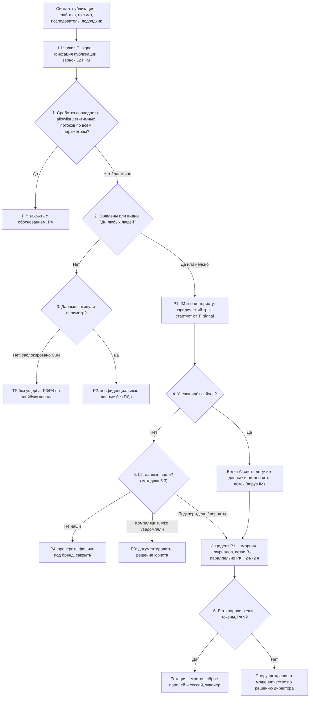

# PB-05 Утечка данных

> Учебный плейбук для вымышленной компании «Альфа-Трейд». Роли, уровни критичности P1–P4, правила коммуникаций и шаблон отчёта взяты из [IR-плана](../plan/ir-plan.md), здесь только то, что специфично для утечки. Всё, что нужно сверить с первоисточником, собрано в разделе [«Допущения и ограничения»](#допущения-и-ограничения). Сокращения расшифрованы в [Приложении Г](#приложение-г-сокращения).

## TL;DR

- **Когда применять:** опубликована или продаётся «база Альфа-Трейд», пришло требование выкупа с образцом, исследователь нашёл открытое хранилище, подрядчик сообщил об инциденте, или СЗИ показали массовое чтение и вынос персональных данных (ПДн) либо конфиденциальных данных.
- **Сроки задаёт закон, а не расследование.** Первичное уведомление Роскомнадзора (РКН) **до 24 часов**, результаты внутреннего расследования **до 72 часов**. По умолчанию отсчёт идёт от T_signal, то есть от первого сигнала, а не от подтверждения. Неизвестное в уведомлении помечайте «уточняется».
- **При сомнении ставьте P1.** Утечка или подозрение на утечку **любых** ПДн, независимо от объёма, это P1. Юрист/DPO узнаёт в момент открытия тикета, а не после подтверждения.
- **Утечка это последствие, а не техника.** Идите от последствия к каналу. Каналов больше, чем «выгрузка через NGFW»: API, открытые хранилища, подрядчики, легитимные учётки, ошибки сотрудников.
- **Порядок: сохраните улики → закончите скоупинг → сдерживайте одномоментно.** Исключение одно: если выгрузка идёт прямо сейчас, сначала остановите поток.
- **Юристу давайте диапазон с методикой, а не одну цифру.** Строки не равны субъектам; от числа субъектов зависят штрафы.

## Шпаргалка: первые 30 минут

| № | Действие | Кто | Срок |
| --- | --- | --- | --- |
| 1 | **Заведите тикет P1** (если заявлены ПДн или неясно) с кодовым именем, запишите **T_signal** в UTC и МСК и источник сигнала | L1 | ≤ 15 мин |
| 2 | **Сохраните публикацию:** скриншот с URL, датой, временем, ID канала/поста и числом просмотров; архив страницы. **Файлы не скачивайте** | L1 | ≤ 15 мин |
| 3 | **Позвоните L2 и IM.** IM звонит юристу/DPO. Сообщение в чате звонок не заменяет | L1, IM | ≤ 15 мин |
| 4 | **Сработка СЗИ?** Сверьте с картой легитимных потоков. Совпало всё: FP с обоснованием. Совпало частично: эскалируйте | L1 | ≤ 15 мин |
| 5 | **Выгрузка идёт сейчас?** Звоните L2 и IM с пометкой «активная эксфильтрация» | L1 | Немедленно |
| 6 | **Назначьте хрониста**, он ведёт хронологию и таблицу решений в тикете | IM | ≤ 15 мин |
| 7 | **Определите ветку A–I** по [дереву решений](#51-дерево-решений) и **зафиксируйте образец** (SHA-256, URL, время) в изолированной ВМ | L2 | ≤ 30 мин |
| 8 | **Ветка A:** снимите летучие данные и остановите поток | L2, ИТ | Немедленно, с апрувом IM |
| 9 | **Заморозьте журналы:** остановите ротацию веб/WAF/СУБД, скопируйте всё доступное | L2, ИТ | ≤ 2 ч |
| 10 | **Первая сверка «наши / не наши»**, срез, оценка объёма | L2 | ≤ 2 ч |
| 11 | **Доложите директору** | IM | ≤ 1 ч от P1; статус ≤ 2 ч |
| 12 | **Черновик уведомления РКН** готов | Юрист, факты от L2 | ≤ 12 ч |

## Чего делать нельзя

- **Не скачивайте и не открывайте файлы утечки на корпоративных устройствах**, не пересылайте фрагменты в почте и мессенджерах.
- **Не пишите продавцу, в канал или вымогателю и не покупайте данные.** L1 и L2 в переписку не вступают.
- **Не комментируйте публично** и не отвечайте клиентам «да, у нас утечка» или «у нас всё в порядке» до утверждённого текста.
- **Не перезагружайте и не переустанавливайте серверы-источники**, не перезапускайте СУБД, не деплойте исправление, пока не сняты журналы и `pg_stat_*`/DMV.
- **Не удаляйте найденный дамп, открытое хранилище, публичную ссылку или ошибочное письмо до фиксации.**
- **Не блокируйте общие IP облаков, CDN и Telegram:** сломаются интеграции, а атакующий уйдёт на другой адрес.
- **Не отзывайте ключи интеграций без плана замены.** Порядок: выпустить новый → перенастроить → отозвать старый.
- **Не обсуждайте инцидент в корпоративной почте и чатах**, пока не исключены их компрометация и инсайдер.
- **Не изолируйте сервер БД через EDR без апрува IM:** сайт останется без заказов.
- **Не рассылайте всем клиентам письмо со ссылкой «смените пароль»:** это готовый шаблон для фишинга.
- **Не ищите причину в ущерб сроку 24 часа** и не считайте срок от момента «подтвердили, что наши».
- **Не выгружайте прод целиком «для сравнения»:** это ещё одна копия базы.

## 1. Цель и область применения

**Цель:** быстро подтвердить или опровергнуть, что утекли наши данные, оценить объём и категории, найти и закрыть канал, уложиться в законные сроки уведомления и защитить субъектов ПДн.

### 1.1. Определения

- **Утечка ПДн** в смысле 152-ФЗ: неправомерная или случайная передача (предоставление, распространение, доступ) ПДн, повлёкшая нарушение прав субъектов.
- **Субъект** это человек, **запись** это строка. Считайте субъектов (после дедупликации), а не строки.
- **T_signal**: момент, когда первый сигнал поступил в компанию (сработка, сообщение, письмо). **T_confirm**: момент, когда L2 подтвердил, что данные наши. Оба времени записывайте в UTC и МСК.
- **T0**: момент отсчёта сроков уведомления. Его утверждает юрист/DPO; по умолчанию T0 = T_signal.
- **Подтверждённая / вероятная / опровергнутая** утечка: по критериям [методики 5.3](#53-глубокий-триаж-l2-до-30-минут-сверка-до-2-часов).

### 1.2. Что входит

- Публикация или продажа базы с упоминанием «Альфа-Трейд» (Telegram, форумы, paste-сайты).
- Выгрузка с серверов, из СУБД, 1С, CRM, облачной почты и файлов.
- Массовый сбор через API или сайт (перебор идентификаторов, IDOR/BOLA).
- Открытые хранилища: БД, бакеты, бэкапы и дампы в веб-корне, `.git`/`.env`, тестовые стенды с копией прода.
- Утечка у подрядчика или SaaS, которому ПДн переданы по поручению (доставка, колл-центр, рассылки, CRM).
- Случайное раскрытие: письмо со списком клиентов не тому адресату, публичная ссылка на таблицу.
- Вымогательство без шифрования («у нас ваша база, заплатите»).
- Утечка ПДн сотрудников (1С:ЗУП, кадровые папки, пропуска).

### 1.3. Что не входит

| Ситуация | Куда передать |
| --- | --- |
| Попытка выгрузки заблокирована СЗИ, данные не покинули периметр | Плейбук канала (PB-03/04/08), P3/P4 |
| Шифрование с кражей данных | PB-02 ведущий, PB-05 параллельно для юридического трека |
| Потеря ноутбука без признаков доступа к данным | PB-09; если на нём незашифрованная выгрузка ПДн, PB-05 параллельно |

**Правило совместной работы.** Если затронуты ПДн, PB-05 запускается всегда и идёт параллельно с плейбуком канала. Плейбук канала отвечает за техническое сдерживание и устранение, PB-05 за оценку утечки, улики по данным, юридический трек и защиту субъектов.

### 1.4. Нормативные рамки

Это ориентиры, финальную позицию даёт юрист/DPO (см. [Допущения и ограничения](#допущения-и-ограничения)).

- **152-ФЗ, ч. 3.1 ст. 21:** уведомление РКН в течение 24 часов (первичное) и 72 часов (результаты внутреннего расследования) с момента выявления инцидента.
- **152-ФЗ, ч. 12 ст. 19:** взаимодействие операторов ПДн с ГосСОПКА, в том числе информирование о компьютерных инцидентах, повлёкших неправомерную передачу ПДн. Порядок задаёт приказ ФСБ России от 13.02.2023 № 77. Это дополняет таблицу IR-плана, где указано только уведомление РКН.
- **КоАП, ст. 13.11** в редакции 420-ФЗ (действует с 30.05.2025): штрафы за утечку, ступенчатые по числу субъектов/записей, оборотные за повторное нарушение, отдельный штраф за неуведомление РКН.
- **УК РФ, ст. 272.1** (421-ФЗ): незаконное использование и передача компьютерной информации, содержащей ПДн. Это основание для заявления в полицию и аргумент, почему сотрудникам нельзя «скачать базу посмотреть».
- **187-ФЗ не применяется:** «Альфа-Трейд» не субъект КИИ. Сроки «3 часа для значимых объектов» к нам не относятся.

## 2. Паспорт

| Поле | Значение |
| --- | --- |
| ID | PB-05 |
| Версия | 1.0 (учебная), 31.10.2026 |
| Владелец | Руководитель ИБ, он же руководитель реагирования (IM). Юридический раздел согласует юрист/DPO |
| Пересмотр | Раз в 6 месяцев, после каждого инцидента и учений |
| Критичность по умолчанию | **P1**: утечка или подозрение на утечку любых ПДн или платёжных данных, независимо от объёма. Полная таблица в [разделе 5.4](#54-критичность) |
| Правила изменения | При сомнении P1 сохраняется до опровержения. Понизить P1 могут только **IM вместе с юристом**, с обоснованием в тикете. Повысить до P1 может любой участник, как только в данных обнаружены ПДн |
| Техники MITRE ATT&CK | [Приложение А](#приложение-а-mitre-attck) |
| Связанные плейбуки | PB-02 Шифровальщик (двойное вымогательство), PB-03 Компрометация учётной записи, PB-04 Вредонос на рабочей станции/сервере, PB-07 Инсайдер, PB-08 Взлом веб-приложения/API, PB-09 Потеря устройства, PB-10 Компрометация облачного аккаунта. Правило совместной работы в [разделе 1.3](#13-что-не-входит) |

**Целевые сроки** (учебные; отсчёт от T_signal):

| Этап | Цель |
| --- | --- |
| Тикет, T_signal, звонок L2 и IM, юрист в курсе | 15 мин |
| Ветка определена, образец зафиксирован | 30 мин |
| Журналы заморожены | 2 ч |
| Первая сверка «наши / не наши», срез, оценка объёма | 2 ч |
| Статус директору | 2 ч |
| Решение о сдерживании (историческая утечка) | 6 ч |
| Черновик уведомления РКН | 12 ч |
| Решение «подаём» | 18 ч |
| Первичное уведомление РКН | до 24 ч |
| Канал установлен или версии зафиксированы, решение по клиентам | 48 ч |
| Уведомление о результатах внутреннего расследования | до 72 ч |

## 3. Подготовка

Без этих условий плейбук невыполним. Если пункт не выполнен, запишите это в тикет как ограничение расследования.

- [ ] **Карта ПДн:** системы (БД заказов, 1С, ЗУП, CRM, рассылки, колл-центр с записями разговоров, веб-логи, бэкапы, тестовые стенды, облачные файлы), владелец, поля, число субъектов, кто имеет доступ, где журналы и сколько хранятся
- [ ] **Карта легитимных потоков ПДн** (allowlist для L1): бэкап, обмен 1С со службой доставки, выгрузка сегментов в сервис рассылок, репликация. Для каждого потока: источник, назначение, учётка, расписание, типичный объём
- [ ] **Реестр обработчиков ПДн:** контакт для инцидентов, договорный срок уведомления нас (рекомендуется ≤ 12–24 ч) и обязанность предоставить журналы
- [ ] **Аудит СУБД** по таблицам ПДн (pgaudit, SQL Server Audit, audit plugin MySQL/MariaDB) с отправкой в SIEM. Без него триггер «массовое чтение из БД» не работает
- [ ] **Журналы веб/API** с `user_id`/`token_id`, размером ответа и реальным IP клиента за WAF; в SIEM
- [ ] **Хранение журналов доступа к ПДн 180–365 дней.** IR-план требует 90 для всех, но утечки часто обнаруживают через месяцы
- [ ] **Канареечные записи (seed records):** вымышленные клиенты с уникальными e-mail и телефонами, своя комбинация в каждой системе и в каждой выгрузке подрядчику; ящик и номер, которые кто-то регулярно проверяет
- [ ] **Серверы БД без исходящего интернета** (egress deny), исключения задокументированы
- [ ] **Изолированная ВМ** без доступа в корпоративную сеть и **исследовательские учётки** (не личные и не корпоративные) для работы с опубликованными данными; шифрованное хранилище улик с журналом доступа
- [ ] **Доступ к порталу РКН** (pd.rkn.gov.ru) проверен у юриста и у резервного лица
- [ ] **Шаблоны:** уведомление РКН 24/72 ч с заполненными реквизитами, holding statement, письмо клиентам, скрипт колл-центра, запрос подрядчику
- [ ] **Перечень ключей API и интеграций:** что сломается при отзыве, кто владелец
- [ ] **Мониторинг утечек:** сервис DRP/TI или регламент ручного мониторинга профильных каналов; security.txt (RFC 9116) и адрес security@ для исследователей

## 4. Роли и ответственность

Матрица RACI: **R** выполняет, **A** утверждает и отвечает за результат, **C** консультирует, **I** получает информацию.

| Действие | L1 | L2 | IM | ИТ | Владелец системы | Юрист/DPO | PR | Директор |
| --- | --- | --- | --- | --- | --- | --- | --- | --- |
| Тикет, T_signal, фиксация публикации, звонок L2 и IM | R | I | I | | | I | | |
| Получение и фиксация образца, хеши | | R | A | | | C | | |
| Сверка «наши ли данные», срез, объём, категории | | R | A | C | C | C | | |
| Утверждение момента отсчёта (T0) | | C | C | | | A/R | | I |
| Заморозка журналов, сбор улик, цепочка хранения | | R | A | R | I | C | | |
| Поиск канала по гипотезам | | R | A | C | C | | | |
| Точечное сдерживание (токен, правило WAF, один внешний IP, учётка) | | R | A | R | I | | | |
| Остановка сервера, API, интеграции, блок облачного сервиса для компании | | C | R | R | A | I | I | A при простое сайта |
| Ротация секретов и сервисных паролей | | C | A | R | C | | | |
| Сброс паролей и сессий клиентов | | C | R | R | A | C | C | I |
| Решение «уведомлять РКН» и подача 24/72 ч | | C | C | | | R/A | | I (подпись) |
| Информирование ГосСОПКА | | C | R | | | A | | I |
| Запрос и требования подрядчику | | C | R | | A (владелец договора) | C | | |
| Уведомление клиентов, скрипт колл-центра | | C | C | | C | C | R | A |
| Публичные заявления, СМИ | | | C | | | C | R | A |
| Заявление в полицию, takedown публикации | | R (takedown) | A | | | R (полиция) | | A |
| Контакт с вымогателем, вопрос выкупа | | | C | | | C | C | A/R |
| Закрытие инцидента | | R | A | | C | C | | I |

**Дополнительные роли сценария:**

- **Хронист** (IM назначает в первые 15 минут): ведёт хронологию и таблицу решений в тикете.
- **Владелец договора с подрядчиком:** официальная переписка и требования по договору.
- **Колл-центр / поддержка:** работают только по утверждённому скрипту.
- **HR:** обязательно в ветке «инсайдер» и при утечке ПДн сотрудников.
- **Платёжный агент / эквайер:** при любых платёжных данных.

**Заранее согласованные полномочия** (из IR-плана, уточнение для PB-05):

- L2 сам изолирует одну рабочую станцию, блокирует один **выделенный** внешний IP, отключает учётку пользователя и отзывает конкретный токен.
- Сервер с ПДн, API, сайт, интеграцию останавливают только IM вместе с владельцем системы.
- При активной эксфильтрации IM доступен круглосуточно: звоните, а не пишите.

## 5. Триаж

Три правила триажа: **при сомнении P1**; **юрист узнаёт в момент открытия тикета P1, а не после подтверждения**; **поиск канала это расследование (раздел 8), а не триаж**.

Триаж делится на две части. **Быстрый триаж (L1, первые 15 минут)** регистрирует сигнал, отсеивает легитимные потоки и поднимает людей. **Глубокий триаж (L2, до 30 минут, сверка до 2 часов)** определяет ветку, проверяет, наши ли данные, и оценивает срез и объём. Оба идут по одному дереву решений.

### 5.1. Дерево решений



Ниже каждый узел расписан подробно. Номера узлов совпадают с номерами в схеме.

### 5.2. Быстрый триаж (L1, первые 15 минут)

**Перед узлом 1. Зарегистрируйте инцидент.**

1. **Заведите тикет P1**, если заявлены ПДн или неясно. Дайте инциденту кодовое имя, не пишите «утечка базы» в теме.
2. **Запишите T_signal** в UTC и МСК и источник сигнала.
3. **Сохраните публикацию:** скриншот с видимыми URL, датой и временем, ID канала/поста, числом просмотров; архив страницы. **Файлы не скачивайте**, это сделает L2 в изолированной среде.
4. **Позвоните L2 и IM.** IM звонит юристу/DPO. Сообщение в чате звонок не заменяет.

**Узел 1. Сработка совпадает с allowlist легитимных потоков?** Только для сработок СЗИ (триггеры T6–T13 из [Приложения Б](#приложение-б-источники-данных-и-триггеры)).

- Сверьте с картой легитимных потоков источник, назначение, учётку, расписание и объём.
- **Совпало всё:** закройте как FP с обоснованием.
- **Совпало частично:** эскалируйте на L2.

**Узел 2. Заявлены или видны ПДн любых людей?**

- ПДн клиентов, сотрудников, соискателей, физлиц-контрагентов или платёжные данные, любого объёма: **P1**. IM звонит юристу, юридический трек стартует от T_signal.
- Неясно: тоже **P1** до опровержения.

**Узел 3. Данные покинули периметр?** (только если ПДн нет)

- **Нет, попытку заблокировали СЗИ:** TP без ущерба, P3/P4, ведёт плейбук канала (PB-03/04/08), не PB-05.
- **Да:** P2, конфиденциальные данные без ПДн.

**Узел 4. Утечка идёт сейчас?** L1 проверяет первые признаки: активная сессия, продолжающийся перебор, растущий объём. Есть признак, значит звоните L2 и IM с пометкой **«активная эксфильтрация»**.

**Чего L1 не делает:** не ищет причину, не сверяет образец и не оценивает объём. Для эскалации ответы на эти вопросы не нужны.

### 5.3. Глубокий триаж (L2, до 30 минут; сверка до 2 часов)

L2 отвечает на девять вопросов. Каждый ответ записывайте в тикет.

| № | Вопрос | Узел дерева | Где смотреть | Признак инцидента |
| --- | --- | --- | --- | --- |
| 1 | Утечка идёт сейчас? | 4 | NGFW (активные сессии), EDR (процессы и соединения), WAF (перебор в последний час), `pg_stat_activity` | Растёт объём, активная сессия к внешнему адресу, перебор продолжается, значит **ветка A** |
| 2 | Какой это тип сигнала и ветка? | 4 → 5 | Источник сигнала, [раздел 6.2](#62-ветки-по-каналу) | Определите ветку A–I |
| 3 | Заявлены или видны ПДн? Чьи? | 2 | Описание публикации, образец, объект сработки | ПДн любых людей, значит P1 |
| 4 | Данные наши? | 5 | Образец в изолированной ВМ, методика ниже | Совпадение служебных полей, ID, seed-записей |
| 5 | Когда срез? | 5 | Самая свежая `created_at` или дата заказа в образце; поля, появившиеся в схеме в известную дату | Задаёт окно поиска в журналах |
| 6 | Из какой системы? | 5 | Названия и порядок колонок, формат телефонов, внутренние ID, статусы заказов, сравнение с форматом выгрузок подрядчикам | Набор полей равен конкретной таблице, отчёту 1С или выгрузке подрядчику |
| 7 | Есть ли секреты? | 6 | Образец | Хеши паролей (алгоритм, соль), токены, API-ключи, строки подключения: секреты в приоритет |
| 8 | Не повторная ли публикация? | 5 | Реестр прошлых инцидентов, база сервиса мониторинга утечек | Срез старый **и** о нём уведомляли, значит P3. Срез старый, но мы о нём не знали, значит новый инцидент |
| 9 | Есть ли платёжные данные? | 6 | Образец | Маска или токен: зафиксируйте. Полный PAN или CVV: эквайер немедленно и отдельное расследование, почему они у нас есть |

**Узел 5. Методика «данные наши».**

1. **Берите только публичный фрагмент** или образец из письма вымогателя. Не покупайте данные, не переписывайтесь с продавцом, не регистрируйтесь на закрытых форумах без решения IM и юриста. Работайте в изолированной ВМ с исследовательской учёткой: архивы в «утечках» бывают с вредоносом.
2. **Посчитайте SHA-256 каждого файла**, запишите в тикет вместе с URL и временем получения (UTC).
3. **Сравните структуру.** Служебные поля (`bonus_balance`, `utm_source`, статусы заказов в нашей терминологии) сильный признак. ФИО + телефон слабый признак, это есть в любой компиляции.
4. **Выберите 20–50 случайных строк** и проверьте точечными запросами по ключу на read-only реплике или через владельца БД, под учёткой с аудитом. Сравнивайте по 2–3 полям. **Не выгружайте прод целиком** и не загружайте образец в продуктивную БД.
5. **Проверьте seed-записи:** есть ли они и из какой они системы.
6. **Запишите вывод одной формулировкой:**

| Вывод | Критерий | Что дальше |
| --- | --- | --- |
| Подтверждено | ≥ 80% совпадений по нескольким полям, или наши ID/служебные поля, или seed-запись | P1, юридический трек полным ходом |
| Вероятно наши / частично / от подрядчика | 20–80% совпадений, источник не определён | P1 сохраняется, юрист и IM решают об уведомлении (по умолчанию подавать) |
| Компиляция старого | Срез старше известной утечки, о которой уведомляли, новых полей нет | P3, задокументируйте, юрист подтверждает |
| Не наши | < 20%, чужой формат ID, нет наших служебных полей | P4, проверьте фишинг под бренд, закройте с обоснованием |

**Узел 6. Есть пароли, хеши, токены, PAN?** Да, значит ротация секретов, сброс паролей и сессий, эквайер ([раздел 9](#9-устранение)). Нет, значит предупреждение о мошенничестве по решению директора.

### 5.4. Критичность

| P | Условия |
| --- | --- |
| P1 | Утечка или подозрение на утечку **любых** ПДн (клиентов, сотрудников, соискателей, физлиц-контрагентов) или платёжных данных, независимо от объёма; утечка идёт прямо сейчас; вымогательство с образцом, похожим на наши данные |
| P2 | Утечка конфиденциальных данных **без ПДн** (коммерческая тайна, договоры, цены, исходный код, конфигурации); утечка секретов (ключи API, пароли сервисных учёток) без признаков использования; открытое хранилище с ПДн без следов постороннего доступа (вопрос уведомления решает юрист) |
| P3 | Публикация оказалась компиляцией старых утечек, о которых компания уже знала и уведомляла; новых полей и записей нет |
| P4 | «База бренда» без данных наших клиентов; попытка выгрузки заблокирована NGFW/DLP и данные не покинули периметр (ведётся по плейбуку канала, не PB-05) |

### 5.5. Когда эскалировать

- **Звонок IM немедленно:** заявлены ПДн; активная эксфильтрация; вымогательство; seed-запись; уведомление подрядчика о затронутых ПДн.
- **Юрист/DPO:** при открытии любого P1, не после подтверждения.
- **Директор:** в течение 1 часа от P1; немедленно при вымогательстве или необходимости остановить сайт.
- **Резервный канал и кодовое имя:** пока не исключена компрометация почты/AD (PB-03, PB-10) или при подозрении на инсайдера.
- **HR:** с самого начала в ветке «инсайдер» и при утечке ПДн сотрудников.
- **Внешняя IR-команда** (решают IM и директор): канал не найден за 12 ч; признаки присутствия атакующего на нескольких серверах; не хватает компетенций по API/облаку.

## 6. Сдерживание

**Принцип.** В ветке A **сначала остановите поток**, это важнее скрытности. В остальных ветках **сначала сохраните улики и закончите скоупинг, потом сдерживайте одномоментно** по всем найденным точкам. Скрытый этап длится не дольше 4–6 часов, решение принимает IM.

### 6.1. Краткосрочные меры

| № | Шаг | Кто | Инструмент | Кто утверждает |
| --- | --- | --- | --- | --- |
| 1 | **Снимите летучие данные** с сервера-источника (соединения, процессы, `pg_stat_activity`, `pg_stat_statements`, дамп памяти), затем снапшот ВМ | L2, ИТ | EDR live response, гипервизор | IM |
| 2 | **Отключите учётку**, через которую читали данные; завершите сессии, отзовите refresh-токены и OAuth-гранты | L2 / ИТ | AD, IdP, админка, CRM | L2 (пользователь), IM (сервисная) |
| 3 | **Отзовите конкретный токен API или ключ**; правило WAF: rate limit по токену/устройству, блок перебора ID | L2, разработчик | WAF, API-шлюз | IM + владелец сайта |
| 4 | **Заблокируйте назначение по домену, SNI, App-ID или категории** для серверного сегмента, а не IP облака | ИТ (сеть) | NGFW | IM; один выделенный IP атакующего блокирует L2 |
| 5 | **Изолируйте сервер в EDR** (с исключением для канала EDR и, если нужно, репликации) | ИТ, L2 | EDR | IM + владелец системы |
| 6 | **Открытое хранилище:** зафиксируйте ACL и журнал доступа, **затем** закройте доступ, отзовите публичные ссылки, смените ключи доступа | ИТ, L2 | Консоль хранилища, облако | IM |
| 7 | **Подрядчик:** приостановите выгрузки, отключите его учётки и VPN до ответа на запрос | ИТ, владелец договора | VPN, IdP | IM + владелец договора |
| 8 | **Облако:** удалите правила пересылки, отзовите внешние ссылки | L2 | Консоль облака | L2 |

### 6.2. Ветки по каналу

| Ветка | Признаки | Сначала сохраните | Сдержите | Кто утверждает | Плейбук |
| --- | --- | --- | --- | --- | --- |
| A. Активная эксфильтрация | Выгрузка идёт сейчас | Летучие данные, `pg_stat_*`, сессии | Остановите поток немедленно | IM | PB-04/08 |
| B. Публикация, канал неизвестен | Данные опубликованы, атакующий, возможно, внутри | Журналы всех систем с ПДн | Скрытый скоупинг, затем одномоментно | IM | по найденному каналу |
| C. Открытое хранилище | Исследователь, сканер, Shodan | ACL, журнал доступа хранилища, скриншоты | Закройте сразу после фиксации; нет журнала доступа, значит считайте, что скачано | IM | PB-08/10 |
| D. Подрядчик / SaaS | Seed-запись подрядчика, формат его выгрузки, его уведомление | Переписка, наши журналы VPN и учёток подрядчика | Приостановите доступ и передачу, официальный запрос с ответом за 12 ч | IM + владелец договора | — |
| E. Инсайдер | Легитимная учётка, USB, личная почта/облако | Всё и тайно, не предупреждать | Решение IM + HR + юрист, возможно сначала наблюдение | IM + юрист | PB-07 |
| F. API / скрейпинг | Перебор ID, много объектов на токен | Журналы WAF/API, конфигурация эндпоинта | Правило WAF, rate limit, отключение эндпоинта, отзыв токенов | IM + владелец сайта; сайт останавливает директор | PB-08 |
| G. Резервные копии | Доступ к СРК с нетипичной учётки | Журнал СРК | Блок учётки, смена ключей шифрования копий | IM + ИТ | PB-02 |
| H. Случайное раскрытие | Письмо не тому адресату, публичная ссылка | Письмо, журнал доступа к ссылке | Отзовите ссылку/письмо, письменно попросите получателя удалить и подтвердить | IM + юрист | — |
| I. Вымогательство | Требование выкупа | `.eml` с заголовками, вложения (хеши) | Не отвечайте; параллельно ветки A–G по образцу | Директор + юрист | PB-02 при шифровании |

### 6.3. Долгосрочные меры

- **Запретите исходящий интернет** с серверов БД и файлового сервера (egress deny) с документированными исключениями.
- **Запретите подключения к СУБД** с адресов, отличных от серверов приложений (`pg_hba.conf`, межсетевой экран); отзовите права на таблицы ПДн у лишних ролей.
- **Временно отключите уязвимый эндпоинт** или лишние поля ответа API по согласованию с владельцем (PB-08).
- **Takedown публикации:** запрос площадке (Telegram, хостер, файлообменник), обращение в РКН о распространении ПДн. До удаления зафиксируйте страницу; если планируете полицию или суд, нужен нотариальный протокол осмотра страницы.
- **Ветка B:** одномоментное скоординированное сдерживание всех найденных точек в согласованное окно.

## 7. Сбор и сохранение артефактов

**Собирайте до мер сдерживания**, которые могут уничтожить улики. Исключение: ветка A, где летучие данные снимают параллельно с остановкой потока. Порядок: по летучести (RFC 3227) и по сроку ротации.

| Приоритет | Артефакт | Как сохранить |
| --- | --- | --- |
| 1 | Опубликованные данные: пост/страница, образец, метаданные (ID канала и сообщения, автор, время UTC, просмотры) | Скриншот с URL и временем, HTML/архив страницы, экспорт истории канала через Telegram Desktop в изолированной ВМ; SHA-256 каждого файла |
| 2 | Письмо вымогателя | Исходник `.eml` с полными заголовками, хеши вложений |
| 3 | Летучие данные сервера-источника | EDR live response или вручную (только чтение): `ss -tnpa`, `ps auxwwf`, `last -Faiw`; Windows: `Get-NetTCPConnection`, `Get-CimInstance Win32_Process`; дамп памяти (WinPmem, AVML), затем снапшот ВМ с памятью |
| 4 | Статистика СУБД, которая сбрасывается при рестарте | PostgreSQL: `SELECT * FROM pg_stat_activity;` и `SELECT userid::regrole, calls, rows, left(query,200) FROM pg_stat_statements ORDER BY rows DESC LIMIT 50;` в файл (см. [Приложение В](#приложение-в-примеры-запросов-и-команд)); MS SQL: `sys.dm_exec_sessions`, `sys.dm_exec_query_stats`, Query Store |
| 5 | Ротируемые журналы: веб/nginx, WAF, API-шлюз, журнал СУБД, контейнеры | **В первые 2 часа** остановите ротацию или продлите хранение, скопируйте всё доступное за период от «срез минус 30–90 дней» до текущего момента |
| 6 | Журналы NGFW, DNS, EDR, AD (4624/4625/4648/4672/4688, 1102), VPN, файлового сервера (5140/5145/4663), USB (6416), 1С, СРК | Экспорт из SIEM и консолей за тот же период |
| 7 | Аудит облачной почты и диска, журналы SaaS (CRM, рассылки) | Экспортируйте сразу: провайдеры хранят аудит ограниченное время; нет доступа, значит письменный запрос поставщику |
| 8 | Конфигурации на момент обнаружения | Правила WAF/NGFW, ACL хранилищ, настройки эндпоинта API, список ролей СУБД с правами на таблицы ПДн: экспорт или скриншоты до изменений |
| 9 | Образы дисков | Сервер БД и веб-сервер, если компрометация хоста подтверждена |
| 10 | Ответы подрядчика | Письменный запрос с датой, ответ и журналы подрядчика |

**Цепочка хранения.** Для каждого артефакта запишите в журнал улик: что, откуда, кто собрал, когда (UTC), SHA-256, где хранится, кто получал доступ. Хранилище улик шифрованное, доступ у L2, IM и юриста.

**Обращение с копией утёкших данных.** Это тоже обработка ПДн.

- Только изолированная ВМ и шифрованный контейнер; каждый доступ записывайте в тикет.
- Для обсуждения используйте маскированные примеры (`+7 9** ***-12-34`).
- Срок хранения и уничтожение определяет юрист, факт уничтожения оформляйте актом.
- Сотрудникам вне команды запрещено скачивать и пересылать опубликованную базу.

## 8. Расследование

| Вопрос | Как ответить | Источники |
| --- | --- | --- |
| **Скоуп:** какие системы и данные затронуты? | Набор полей → система; seed-записи; сравнение с выгрузками подрядчикам | Карта ПДн, реестр обработчиков, образец |
| Сколько субъектов? | Дедупликация по нормализованному телефону/e-mail. Если есть только sample, а заявлен полный объём, оценивайте **по источнику**: «в таблице X на дату среза было N субъектов». Юристу давайте **диапазон с методикой**, не одну цифру | Образец, СУБД (count по реплике) |
| Какие категории ПДн? | Идентификационные; адреса; история заказов; дата рождения, паспорт; хеши паролей (алгоритм); платёжные (маска, токен, PAN); специальные категории; ПДн сотрудников и контрагентов отдельно | Образец, схема БД |
| **Период:** когда начался доступ и где срез? | Самая свежая запись задаёт верхнюю границу; поле, добавленное в известную дату, нижнюю. Окно поиска: от «срез минус 30 дней» до T_signal | Образец, история миграций схемы |
| **Вектор (канал):** как вынесли? | Проверяйте гипотезы по порядку вероятности, каждую записывайте со статусом «подтверждено / отброшено / проверяется»: 1) API/IDOR (Q6); 2) открытое хранилище, `.git`/`.env`, дампы в веб-корне (внешний скан портов 5432, 3306, 1433, 27017, 9200, 6379, 8123; поиск секретов в репозиториях gitleaks/trufflehog); 3) учётка (вход из логов стилера, T12); 4) массовое чтение СУБД (Q5, `pg_stat_statements`); 5) сервер и сеть (Q1–Q4); 6) файловый сервер и облако (Q7, T11); 7) инсайдер/USB (6416, прокси, личная почта); 8) подрядчик (запрос, его журналы, наши VPN-журналы); 9) бэкапы (журнал СРК) | WAF, веб, СУБД, EDR, NGFW, DNS, AD, VPN, облако, СРК, ответ подрядчика |
| Продолжается ли доступ? Есть ли закрепление? | Активные сессии и токены, новые учётки, веб-шеллы (PB-08), задачи и службы на серверах (PB-04) | EDR, AD 4720/4728/4732, веб-корень |
| Какие секреты были доступны каналу? | Всё из `.env`, конфигов, строк подключения, CI/CD на скомпрометированной системе | Конфигурации, репозиторий |
| **Хронология** | Сведите в тикет: первый несанкционированный доступ → сбор → вынос → публикация → T_signal → меры. Время только UTC, проверьте NTP | Все источники выше |
| Кто причастен? | Учётки, IP, устройства; для 72-часового уведомления нужны сведения о лицах, чьи действия стали причиной (если установлены) | AD, VPN, EDR, HR (инсайдер) |

Запросы Q1–Q7 и триггеры T1–T15 собраны в [Приложении Б](#приложение-б-источники-данных-и-триггеры) и [Приложении В](#приложение-в-примеры-запросов-и-команд).

**Справка юристу к T0 + 12 ч** (готовит L2): что известно (с уровнем уверенности), что неизвестно, категории ПДн, оценка числа субъектов диапазоном с методикой, вероятный канал, принятые меры. Неизвестное помечайте «устанавливается».

## 9. Устранение

- [ ] **Корневая причина подтверждена и закрыта:** исправлена авторизация на уровне объектов API, закрыто хранилище, удалены `.git`/`.env`/дампы из веб-корня, изменён процесс выгрузки подрядчику, закрыта уязвимость (PB-08)
- [ ] **Ротированы все секреты**, к которым имел доступ канал: пароли сервисных учёток СУБД, строки подключения, ключи API партнёров, токены интеграций, ключи облачного хранилища, ключ подписи JWT, секреты в CI/CD. Порядок: новый секрет → перенастроить потребителя → отозвать старый, в согласованное с владельцем окно
- [ ] **Удалено закрепление атакующего** (PB-04/PB-08), отключены лишние учётки, включена MFA на админке, 1С, CRM, VPN подрядчиков
- [ ] **Права на таблицы ПДн пересмотрены** по минимальным привилегиям; подключения к СУБД только с серверов приложений
- [ ] **Удалены лишние копии ПДн:** тестовые базы с реальными данными, старые выгрузки, бэкапы на веб-сервере, файлы в общих папках
- [ ] **Защита субъектов выполнена** по таблице ниже

| Что утекло | Мера | Кто решает |
| --- | --- | --- |
| Хеши паролей (любые), токены сессий, или канал давал доступ к таблице учёток | Инвалидируйте все сессии и refresh-токены; пометьте учётки «смена пароля при следующем входе» (без массовой рассылки ссылок); защита от credential stuffing на WAF (rate limit, антибот) 30 дней. Слабый алгоритм (MD5, SHA-1, SHA-256 без соли и растяжения): сброс обязателен; bcrypt/scrypt/Argon2: по риску, но рекомендуется | IM + владелец сайта, текст готовят PR и юрист |
| Ключи подписи токенов | Смените ключ, инвалидируйте все токены приложения | IM + владелец системы |
| Контакты + история заказов, адреса | Предупреждение о мошенничестве, скрипт колл-центру, мониторинг доменов, похожих на наш | Директор по предложению юриста |
| Паспортные данные | Уведомите клиентов, дайте рекомендации по самозащите | Директор + юрист |
| Полный PAN / CVV | Эквайер или платёжный агент немедленно; выясните, почему эти данные вообще хранились (PCI DSS запрещает хранить CVV после авторизации); перевыпуск карт решают банки | IM + финансы + юрист |
| ПДн сотрудников | Внутреннее уведомление через руководителей, повышенная бдительность бухгалтерии к социальной инженерии | IM + HR |

**Пароли клиентов не сбрасывайте**, если не утекли пароли, хеши или токены: это нагрузка на поддержку и публичный сигнал до решения о коммуникации.

## 10. Восстановление и мониторинг

**Восстановление:**

- [ ] Отключённые API, интеграции и учётки подрядчика возвращены после проверки исправления владельцем системы и L2 (повторный тест на IDOR, внешний скан, проверка ACL)
- [ ] Владелец системы подтвердил, что интеграции (платёжный агент, доставка, рассылки) работают с новыми секретами

**Усиленный мониторинг:**

| Что мониторить | Как | Срок |
| --- | --- | --- |
| IOC инцидента (IP, токены, учётки, user-agent) | Правила SIEM, алерт P2 | 30 дней |
| Повторная выгрузка из того же источника | Q1, Q4, Q5 с понижённым порогом на затронутых серверах | 30 дней |
| Перебор API | Q6 с порогом 50 уникальных ID на токен в час | 30 дней, затем постоянно |
| Credential stuffing по утекшим логинам | Неудачные входы, входы с новых устройств, рост сбросов пароля | 30 дней |
| Seed-записи | Входящие на контрольные ящики и номера | Постоянно |
| Повторные публикации и продажа дампа | Мониторинг каналов и сервиса утечек: ежедневно первые 2 недели, затем еженедельно | 90 дней |
| Фишинговые домены и страницы под бренд | Мониторинг регистраций похожих доменов, жалобы клиентов | 90 дней |
| Отсутствие атакующего в среде | EDR/SIEM без новых признаков на затронутых хостах | 14 дней, это условие закрытия |
| Обращения в колл-центр | Число и темы, обновление скрипта | 30 дней |

## 11. Коммуникации и уведомления

### 11.1. Внутри компании

| Кому | Когда | Что | Канал | Кто |
| --- | --- | --- | --- | --- |
| IM | Сразу при P1 | Сигнал, T_signal, что сделано | Телефон | L1 |
| Юрист/DPO | Сразу при P1 | То же + «нужно утвердить момент отсчёта» | Телефон | IM |
| Директор | До 1 ч от P1 | Суть, риски, ближайшие решения | Телефон | IM |
| Рабочая группа (need-to-know) | Каждые 2 ч (P1, IR-план) | Что известно, что сделано, что дальше, какие нужны решения | Отдельный чат; резервный канал, если почта/AD не исключены или подозревается инсайдер | IM |
| Владелец системы | Когда установлена система-источник | Что затронуто, какие меры повлияют на работу | Телефон / чат | IM |
| Колл-центр, поддержка | **До** публичных сообщений | Скрипт «что отвечать», куда направлять | Брифинг | PR |
| Сотрудники | Если затронуты их ПДн или нужно действие | Не комментировать, не скачивать базу, не пересылать ссылки; что делать | Через руководителей | IM / HR |

### 11.2. Вне компании

| Когда | Кого | Срок | Кто готовит и подаёт | Основание |
| --- | --- | --- | --- | --- |
| Вероятная или подтверждённая утечка ПДн | РКН, первичное уведомление | 24 ч | Юрист; факты от L2 | 152-ФЗ ч. 3.1 ст. 21 |
| То же | РКН, результаты внутреннего расследования | 72 ч | Юрист; факты от L2 и IM | То же |
| Компьютерный инцидент, повлёкший неправомерную передачу ПДн | ГосСОПКА (НКЦКИ) | По приказу ФСБ № 77 от 13.02.2023 | IM + юрист | 152-ФЗ ч. 12 ст. 19 |
| Вымогательство, взлом, установленный инсайдер | Полиция | По решению директора | Юрист | УК РФ ст. 163, 272, 272.1 |
| Платёжные данные | Эквайер / платёжный агент | По договору | IM + финансы | Договор, PCI DSS |
| Утечка у подрядчика | Подрядчик (запрос) | Сразу, ответ за 12 ч | Владелец договора | Договор поручения; перед субъектом и РКН отвечает оператор (ч. 5 ст. 6 152-ФЗ) |
| Затронуты данные партнёра; киберполис | Партнёр; страховщик | По договору / условиям полиса | Владелец договора; финансы | Договор |
| Решение руководства | Клиенты | Рекомендация: до 72 ч от T_signal | PR, утверждает директор | Общей обязанности уведомлять субъектов, как в ст. 34 GDPR, в 152-ФЗ нет. Рекомендуйте уведомление, если утекли контакты с историей заказов, пароли/хеши, паспорта, платёжные данные или утечка уже публична |
| Запрос СМИ | СМИ | Holding statement сразу, заявление после утверждения | PR | Правило единого голоса |

### 11.3. Персональные данные (152-ФЗ)

**Отсчёт срока.**

- Ч. 3.1 ст. 21 152-ФЗ отсчитывает срок «с момента выявления инцидента оператором, уполномоченным органом или иным заинтересованным лицом». Поэтому по умолчанию (консервативно) **24 и 72 часа считайте от T_signal**; T_confirm записывайте отдельно.
- Иное решение может принять только юрист, письменно в тикете.
- Срок идёт в календарных часах: ночь и выходные его не останавливают.
- **Затягивать подтверждение, чтобы отодвинуть T0, недопустимо:** это выглядит как сокрытие.

**Содержание первичного уведомления РКН** (по смыслу ч. 3.1 ст. 21, точный состав по форме на портале):

- описание инцидента и момент выявления;
- предполагаемые причины;
- предполагаемый вред правам субъектов;
- принятые меры;
- лицо, уполномоченное взаимодействовать с РКН;
- по форме: характеристика ПДн и примерное число субъектов.

**Уведомление за 72 часа:** результаты внутреннего расследования и сведения о лицах, чьи действия стали причиной (если установлены). Число субъектов и категории ПДн юридически значимые цифры, от них зависят штрафы: **без методики их не называйте**.

**Единый голос.**

- Публично комментирует только PR.
- Поддержка не подтверждает и не опровергает утечку до утверждённого текста.
- С вымогателем связываются только по решению директора и юриста, через назначенное лицо. Рекомендация команды по умолчанию: не платить, оплата не гарантирует удаление данных.

### 11.4. Шаблоны

**Шаблон 1. Holding statement (PR, до выяснения).**
> Нам известно о публикации, в которой упоминается «Альфа-Трейд». Мы проводим проверку вместе со специалистами по информационной безопасности и сообщим о результатах. Мы никогда не запрашиваем по телефону коды из SMS, пароли и данные банковских карт.

**Шаблон 2. Статус рабочей группе (IM, каждые 2 ч).**
> [Кодовое имя] P1, статус на ЧЧ:ММ МСК. T_signal: … Дедлайн РКН 24 ч: … Известно: … (уверенность). Неизвестно: … Сделано: … Дальше: … Нужны решения: … Следующий статус: ЧЧ:ММ.

**Шаблон 3. Скрипт колл-центра.**
> Спасибо, что сообщили. Мы проверяем информацию. Мы не звоним с просьбой назвать код из SMS и не просим повторно оплатить заказ по ссылке. Если вам звонят от нашего имени, положите трубку и перезвоните по номеру на сайте. [Регистрировать обращение с темой «утечка».]

## 12. Критерии закрытия

**Закрыть как TP можно, когда отмечены все пункты:**

- [ ] Принадлежность данных установлена (подтверждена или опровергнута), методика в тикете
- [ ] Число субъектов (диапазон) и категории ПДн оценены, методика задокументирована
- [ ] Канал установлен или задокументированы проверенные и отброшенные версии
- [ ] Утечка не продолжается (запросы за последние 72 ч), нет признаков присутствия атакующего 14 дней
- [ ] Канал закрыт; все секреты, к которым он давал доступ, ротированы; лишние копии ПДн удалены
- [ ] Уведомления РКН 24 ч и 72 ч поданы, номера/подтверждения в тикете; запросы РКН, если были, отработаны
- [ ] Вопрос ГосСОПКА решён юристом
- [ ] Решение по клиентам принято и исполнено; колл-центр работает по скрипту
- [ ] Меры для субъектов (сброс паролей, сессий, эквайер) выполнены, если требовались
- [ ] Ответ подрядчика получен и оценён (ветка D)
- [ ] Запросы на удаление публикаций отправлены, результат зафиксирован
- [ ] Правила SIEM на IOC и seed-записи включены; мониторинг повторных публикаций назначен (ответственный, срок 90 дней)
- [ ] Копии утёкших данных у команды уничтожены по акту или переданы на хранение по решению юриста
- [ ] Отчёт по шаблону IR-плана готов, разбор назначен в течение 5 рабочих дней

**Закрыть как FP или «не наши» можно, когда отмечены все пункты:**

- [ ] Сработка совпала с картой легитимных потоков по всем параметрам, **или** данные не наши по методике 5.3 (< 20% совпадений, чужой формат ID, нет наших служебных полей)
- [ ] Для «не наших» проверен фишинг под бренд
- [ ] Обоснование записано в тикет

## 13. Метрики

| Метрика | Как считать | Цель |
| --- | --- | --- |
| MTTD (среднее время обнаружения) | От первого несанкционированного доступа (по журналам) до T_signal | Снижать; если неизвестно, запишите почему |
| Время от публикации до обнаружения | От времени поста до T_signal | < 24 ч |
| Доля внешнего обнаружения | Инциденты, о которых узнали от третьих лиц, / все утечки | Снижать |
| T_signal → звонок юристу | | ≤ 15 мин |
| T_signal → вывод «наши / не наши» | | ≤ 2 ч |
| T_signal → подача уведомления РКН | | < 24 ч с запасом ≥ 4 ч |
| T_signal → установление канала | | ≤ 48 ч |
| MTTR (среднее время реагирования) | От T_signal до закрытия канала и ротации секретов | ≤ 72 ч |
| Окно экспозиции | От первого несанкционированного доступа до закрытия канала | Снижать |
| Объём | Уникальные субъекты по категориям ПДн | Фиксировать |
| Покрытие журналами | Доля систем из карты ПДн, где был нужный журнал за нужный период | 100% |
| Последствия | Обращений в колл-центр, случаев credential stuffing и мошенничества за 30 дней | Фиксировать |

## 14. Типичные ошибки

1. **Искать причину и пропустить 24 часа.** Первичное уведомление подаётся до конца расследования, неизвестное помечается «уточняется».
2. **Считать срок от «подтвердили, что наши»** и звать юриста после подтверждения.
3. **Поставить P2 утечке ПДн сотрудников.** Кадровая база тоже ПДн и тоже требует уведомления РКН.
4. **Блокировать IP облаков на NGFW** вместо учёток, токенов, App-ID и egress: бизнес встаёт, атакующий уходит на другой адрес и понимает, что его нашли.
5. **«Закрыть канал» до сохранения журналов:** деплой, рестарт СУБД, удаление бакета уничтожают доказательства масштаба, от которых зависят уведомление и штраф.
6. **Скачать базу на рабочий ноутбук, переслать коллегам «это мы?»**, купить «полную версию», переписываться с продавцом.
7. **Выгрузить прод целиком «для сравнения»:** ещё одна копия базы.
8. **Закрыть как «старая база»**, не проверив, уведомляли ли о ней. Старый срез, о котором мы не знали, это новый инцидент.
9. **«Это у подрядчика, не наша проблема».** Срок РКН идёт для нас.
10. **Назвать юристу одну цифру** («2 млн записей») без методики: строки не равны субъектам.
11. **Разослать всем «смените пароль» со ссылкой:** фишеры получают шаблон.
12. **Отозвать ключ интеграции без плана замены:** встают оплата и доставка.
13. **Полагаться на «NGFW поймает выгрузку»:** API-скрейпинг, открытые хранилища и утечки у подрядчика NGFW не видит.
14. **Ответ поддержки вымогателю** («уточните, что у вас есть»): это подтверждение и начало торга.
15. **Сотрудник «тихо удалил» публичную ссылку** и не сообщил в ИБ: инцидент не зарегистрирован, а основание для уведомления могло быть.

## 15. Профилактика

| Мера | Что даёт | Приоритет |
| --- | --- | --- |
| Канареечные записи по системам и подрядчикам | Мгновенно показывают источник | Высокий, дёшево, делайте первой |
| Карта ПДн и легитимных потоков | Без неё триаж невозможен | Высокий |
| Аудит СУБД / DAM с детектом массовых чтений | Детект и доказательная база | Высокий |
| Egress deny для серверного сегмента | Исключает прямую выгрузку с серверов | Высокий |
| API security: авторизация на уровне объектов, минимум полей в ответе, rate limiting, антибот, тесты на IDOR в CI | Закрывает частый вектор e-commerce (OWASP API1/API3) | Высокий |
| Журналы веб/API с `user_id` и хранение журналов доступа к ПДн 180–365 дней | Возможность найти канал через месяцы | Высокий |
| Сканирование внешнего периметра и секретов (открытые порты СУБД, `.git`/`.env`, ключи в репозиториях) | Находит открытые хранилища раньше исследователей | Средний |
| Управление доступом подрядчиков: минимальные выгрузки, отдельные учётки с MFA, срочный VPN, договорные сроки уведомления и журналы | Закрывает ветку D | Средний |
| DLP на рабочих станциях и в почте (в наборе СЗИ «Альфа-Трейд» его нет) | Детект USB, личных облаков и почты | Средний |
| Минимизация и сроки хранения ПДн, маскирование в тестовых средах | Меньше данных, значит меньше вред и штраф | Средний |
| Токенизация платёжных данных у провайдера, проверка отсутствия CVV | Карточных данных у нас нет | Средний |
| Мониторинг утечек и упоминаний бренда (DRP/TI) | Раннее обнаружение публикаций | Средний |
| UEBA / базовые линии объёмов для сервисных учёток | Детект медленной выгрузки (T1030) | Средний |
| Security.txt и процедура ответственного раскрытия | Исследователи сообщают нам, а не публикуют | Низкий, дёшево |
| Учения по PB-05 раз в год с заполнением черновика уведомления РКН на время | Проверка портала, подписанта, шаблонов | Высокий |

**Вопросы для разбора после инцидента:**

- Сколько прошло от начала утечки до T_signal и почему узнали снаружи?
- Каких журналов не хватило (аудит СУБД, `user_id` в API, журналы подрядчика)?
- Уложились ли в 24 ч и что задержало (портал, подписант, спор о сроке)?
- Была ли система в карте ПДн, был ли подрядчик в реестре обработчиков?
- Какие правила детекта и seed-записи добавить?

## 16. Учебная ситуация

**Вводная.** Пятница, 21:40 МСК. Клиентка пишет в соцсетях, что ей позвонили «из Альфа-Трейд», назвали номер и состав её заказа и попросили «код для возврата». Через час сотрудник присылает ссылку на Telegram-канал: «База Альфа-Трейд, 1,2 млн строк, ФИО, телефоны, адреса, заказы. Sample 500 строк бесплатно». В образце максимальная дата заказа 14.10.2026, есть поле `bonus_balance` и одна seed-запись, которую передавали только сервису email-рассылок. Параллельно WAF за последнюю неделю показывает, что один токен мобильного приложения запросил 38 000 разных `order_id`. Юрист в отпуске, резервное лицо IM.

**Задания:**

1. **Вы L1, 21:45.** Запишите по шагам, что делаете в первые 15 минут и что вам запрещено. Какое время вы запишете как T_signal: пост клиентки или ссылку на канал? Посчитайте, до какого часа нужно подать первичное уведомление РКН, и назовите, кто его подаёт, если юрист недоступен (см. RACI).
2. **Вы L2, 22:30.** Пройдите узел 5 дерева решений по методике 5.3: выпишите признаки в образце, которые подтверждают, что данные наши, и отметьте, какие из них сильные, а какие слабые. Сформулируйте для уведомления число субъектов с методикой, если «1,2 млн строк» это строки заказов.
3. **Вы L2, 23:00.** У вас две гипотезы канала: подрядчик (seed-запись, ветка D) и API (38 000 `order_id`, ветка F). Напишите, какими запросами из Приложения В и какими журналами вы проверите каждую, какие журналы заморозите в первые 2 часа и что сдержите первым. Объясните, почему не стоит сразу блокировать IP, с которых шёл перебор.
4. **Вы IM, 01:00.** Пройдите узел 6: нужно ли сбрасывать пароли клиентов? Составьте для директора список мер для клиентов и колл-центра и обоснуйте, почему без массовой рассылки ссылок.
5. **Вы IM, суббота 10:00.** Подрядчик по рассылкам отвечает: «у нас всё в порядке, разберёмся в понедельник». Ответьте, кто отвечает перед РКН, и запишите, какие действия по договору и доступам (шаг 7 раздела 6.1, RACI) вы предпримете сегодня.

## 17. Источники

- MITRE ATT&CK: https://attack.mitre.org/ (тактики Collection TA0009, Exfiltration TA0010; техники T1213, T1530, T1567, T1048, T1030 и др.)
- NIST SP 800-61 r3 «Incident Response Recommendations and Considerations for Cybersecurity Risk Management» и r2 «Computer Security Incident Handling Guide»: https://csrc.nist.gov/pubs/sp/800/61/r3/final
- NIST SP 800-122 «Guide to Protecting the Confidentiality of Personally Identifiable Information (PII)»: https://csrc.nist.gov/pubs/sp/800/122/final
- OWASP API Security Top 10 (2023): https://owasp.org/API-Security/ (API1 Broken Object Level Authorization, API3 Broken Object Property Level Authorization, API4 Unrestricted Resource Consumption)
- CISA «Cybersecurity Incident & Vulnerability Response Playbooks» (2021): https://www.cisa.gov/ (раздел ресурсов по реагированию)
- SANS Incident Handler's Handbook: https://www.sans.org/white-papers/33901/
- RFC 3227 «Guidelines for Evidence Collection and Archiving»: https://www.rfc-editor.org/rfc/rfc3227
- RFC 9116 «A File Format to Aid in Security Vulnerability Disclosure» (security.txt): https://www.rfc-editor.org/rfc/rfc9116
- EDPB Guidelines 01/2021 on Examples regarding Personal Data Breach Notification и ENISA «Recommendations for a methodology of the assessment of severity of personal data breaches» (2013): методика оценки вреда. Это европейские документы (GDPR), к 152-ФЗ не применяются, полезны как пример подхода
- SigmaHQ, открытые правила детекта (эксфильтрация, rclone, архивация): https://github.com/SigmaHQ/sigma
- The DFIR Report, разборы атак с этапами сбора и эксфильтрации: https://thedfirreport.com/
- Документация PostgreSQL (`pg_stat_statements`, `pg_stat_activity`) и расширения pgaudit: https://www.postgresql.org/docs/ и https://www.pgaudit.org/
- Тексты 152-ФЗ (ст. 6, 19, 21), КоАП ст. 13.11, УК РФ ст. 272.1, приказ ФСБ о взаимодействии операторов ПДн с ГосСОПКА: актуальная редакция на официальном портале правовой информации http://pravo.gov.ru/; разъяснения и форма уведомления на сайте Роскомнадзора https://rkn.gov.ru/.

## Допущения и ограничения

**Что нужно сверить перед реальным применением.** Всё про 152-ФЗ, КоАП, УК и ГосСОПКА в этом плейбуке ориентиры; финальную позицию даёт юрист/DPO после сверки с первоисточником (pravo.gov.ru, КонсультантПлюс, сайт РКН, документация вендора).

| № | Что | Где в плейбуке | Почему нужна проверка |
| --- | --- | --- | --- |
| 1 | Точная формулировка определения утечки ПДн и момента выявления инцидента в ч. 3.1 ст. 21 152-ФЗ | 1.1, 11.3 | Формулировка закона записана по памяти; от неё зависит T0 |
| 2 | Актуальная редакция нормативных рамок: 152-ФЗ ч. 3.1 ст. 21, ч. 12 ст. 19, ч. 5 ст. 6 | 1.4, 11.2 | Закон менялся; сроки и основания взяты по памяти и из IR-плана |
| 3 | Приказ ФСБ России от 13.02.2023 № 77: номер, сроки и канал информирования ГосСОПКА | 1.4, 4, 11.2, 12 | Номер и порядок записаны по памяти |
| 4 | КоАП ст. 13.11 в редакции 420-ФЗ: пороги по числу субъектов/записей и суммы штрафов | 1.4 | Ступени и суммы не приведены, их нужно взять из текста закона |
| 5 | УК РФ ст. 272.1 (421-ФЗ) и применимость ст. 163, 272 к вымогательству и взлому | 1.4, 11.2 | Квалификацию даёт юрист |
| 6 | Адрес портала РКН (pd.rkn.gov.ru), способ подачи, нужна ли электронная подпись | 3 | Адрес записан по памяти; без проверки подача в 24 ч может сорваться |
| 7 | Точный состав первичного уведомления и сведений о лицах для 72-часового уведомления | 8, 11.3 | Состав задаёт форма на портале РКН |
| 8 | Отсутствие в 152-ФЗ общей обязанности уведомлять субъектов (аналог ст. 34 GDPR) | 11.2 | Авторское понимание, нужна позиция юриста |
| 9 | Порядок обращения в РКН о распространении ПДн (takedown) | 6.3 | Порядок может меняться |
| 10 | Номера техник и подтехник MITRE ATT&CK | Приложение А | Сверить по актуальной версии матрицы |
| 11 | События аудита облака у Яндекс 360 и VK WorkSpace | Приложение Б, T11 | В примере названы события M365; у других провайдеров свои |
| 12 | Поля с числом строк в `sys.dm_exec_query_stats` и Query Store MS SQL | 7 | Имена полей зависят от версии |
| 13 | Срок хранения аудита у облачного провайдера почты и диска | 7 | У каждого провайдера свой срок |
| 14 | Возможности сервиса мониторинга утечек по поиску прошлых публикаций | 5.3, вопрос 8 | Зависят от сервиса |
| 15 | Условия киберполиса: срок и порядок уведомления страховщика | 11.2 | Зависят от договора |

**Допущения:**

- Все целевые сроки, пороги и цифры учебные и подбираются по данным компании: сроки по фазам в разделе 2; договорный срок уведомления подрядчиком ≤ 12–24 ч и ответ подрядчика за 12 ч; хранение журналов 180–365 дней; критерии 80% / 20% в методике «данные наши»; скрытый этап 4–6 ч; привлечение внешней IR-команды, если канал не найден за 12 ч; защита от credential stuffing 30 дней; сроки мониторинга в разделе 10; цели метрик в разделе 13; рекомендация уведомить клиентов до 72 ч от T_signal. Реальные значения утверждает руководитель ИБ.
- Запросы Q1–Q7 и пороги в них (например, 50 МБ, 10 000 строк, 100 уникальных ID, 500 файлов) примеры на нейтральном псевдо-SPL. Вендоры SIEM, EDR, СУБД и облачной почты в IR-плане не названы, имена индексов и полей условные. Для MaxPatrol SIEM, KUMA, ELK логику нужно переложить.
- Список доменов файлообменников и туннелей в Q2 пример, его нужно актуализировать.
- «Альфа-Трейд» не субъект КИИ, поэтому 187-ФЗ и сроки для значимых объектов не применяются.
- DLP в наборе СЗИ «Альфа-Трейд» нет, поэтому триггеры по USB и личной почте опираются на журналы Windows и прокси.
- Шантаж публикацией без шифрования отдельной техники ATT&CK не имеет и фиксируется в описании; злоупотребление API (IDOR/BOLA) ложится в T1190 лишь условно.

## Приложение А. MITRE ATT&CK

| Тактика | Техника | ID |
| --- | --- | --- |
| Первоначальный доступ (TA0001) | Exploit Public-Facing Application | T1190 |
| Первоначальный доступ (TA0001) | Valid Accounts | T1078 |
| Первоначальный доступ (TA0001) | External Remote Services | T1133 |
| Первоначальный доступ (TA0001) | Trusted Relationship (подрядчик) | T1199 |
| Первоначальный доступ (TA0001) | Phishing | T1566 |
| Доступ к учётным данным (TA0006) | Credentials In Files (`.env`, конфиги) | T1552.001 |
| Доступ к учётным данным (TA0006) | Credentials from Web Browsers (инфостилеры) | T1555.003 |
| Сбор данных (TA0009) | Data from Information Repositories | T1213 |
| Сбор данных (TA0009) | Data from Local System | T1005 |
| Сбор данных (TA0009) | Data from Network Shared Drive | T1039 |
| Сбор данных (TA0009) | Data from Cloud Storage | T1530 |
| Сбор данных (TA0009) | Email Collection | T1114 |
| Сбор данных (TA0009) | Automated Collection | T1119 |
| Сбор данных (TA0009) | Data Staged | T1074 |
| Сбор данных (TA0009) | Archive via Utility | T1560.001 |
| Эксфильтрация (TA0010) | Exfiltration Over C2 Channel | T1041 |
| Эксфильтрация (TA0010) | Exfiltration Over Alternative Protocol (в т. ч. DNS) | T1048 |
| Эксфильтрация (TA0010) | Exfiltration to Cloud Storage | T1567.002 |
| Эксфильтрация (TA0010) | Transfer Data to Cloud Account | T1537 |
| Эксфильтрация (TA0010) | Exfiltration over USB | T1052.001 |
| Эксфильтрация (TA0010) | Data Transfer Size Limits | T1030 |
| Эксфильтрация (TA0010) | Scheduled Transfer | T1029 |
| Эксфильтрация (TA0010) | Automated Exfiltration | T1020 |
| Воздействие (TA0040) | Financial Theft (вымогательство) | T1657 |
| Вне ATT&CK | Злоупотребление API (IDOR/BOLA, лишние поля в ответе) | OWASP API Security Top 10 2023, API1 и API3 |

В запросе Q3 для DNS-туннеля упомянуты также T1048.003 и T1071.004.

## Приложение Б. Источники данных и триггеры

Большую часть утечек обнаруживают **снаружи**, а не СЗИ. Поэтому внешние сигналы так же важны, как сработки. Запросы Q1–Q7 приведены в [Приложении В](#приложение-в-примеры-запросов-и-команд).

| # | Источник | Что видим | Поля / Event ID | Пример правила или запроса | Стартовая P / кто принимает |
| --- | --- | --- | --- | --- | --- |
| T1 | Мониторинг утечек, сотрудник, СМИ, клиент | Публикация или продажа «базы Альфа-Трейд» | URL, ID канала/поста, время, число записей | — (ручной приём, тикет) | P1 до опровержения / L1 → L2 + IM |
| T2 | Почта (общий ящик, поддержка, руководитель) | Требование выкупа с образцом | Полные заголовки `.eml`, вложения | — | P1 / L1 → L2 + IM |
| T3 | security@, соцсети, поддержка | Исследователь сообщает об открытом хранилище/уязвимости | Адрес, порт, URL | — | P2, P1 при доступе к ПДн / L2 |
| T4 | Канареечный ящик/номер | Спам, звонок, SMS на seed-запись | Какая запись → какая система | Правило почты: любое входящее на `seed-*@` → тикет | P1 / L2 + IM |
| T5 | Колл-центр, антифрод | Жалобы на звонки «от магазина» с точными данными заказов; всплеск credential stuffing | Число жалоб, номера заказов; неудачные входы | `index=web uri="/login" status=401 \| timechart count` > baseline ×5 | P2 / L1 → L2 |
| T6 | NGFW | Исходящий трафик с сервера БД, 1С, FS в интернет вне allowlist | `src_ip`, `dst_ip`, `app`, `sni`, `bytes_out`, `rule` | см. Q1 | P2 / L1 |
| T7 | NGFW / DNS | Серверный сегмент обращается к файлообменникам, облакам, `api.telegram.org`, туннелям (ngrok, trycloudflare); DNS-туннель | `query`, `sni`, `url_category`; Sysmon 22 | см. Q2, Q3 | P2 / L1 |
| T8 | EDR / Sysmon / Windows | Утилиты дампа, архивации, синхронизации на серверах; большие архивы в `Temp`, `ProgramData`, `/tmp`, `/dev/shm` | Процесс, командная строка, родитель, учётка; 4688, Sysmon 1/11, PowerShell 4104 | см. Q4 | P2, если не по расписанию сервисной учёткой / L1 |
| T9 | Аудит СУБД | Массовое чтение таблиц ПДн не учёткой приложения; `COPY ... TO`, `pg_dump`, `BACKUP DATABASE` вне окна бэкапа | `user`, `client_addr`, `application_name`, `statement`, `rows` | см. Q5 | P2 / L1 |
| T10 | WAF, веб/API-логи | Перебор `/api/*/orders/{id}`; много уникальных объектов на токен/IP с ответом 200; запросы к `/.env`, `/.git/`, `*.sql`, `*.bak` | `client_ip`, `uri`, `status`, `response_size`, `user_id`, `user_agent` | см. Q6 | P2 / L1 |
| T11 | Аудит облака | Массовое скачивание, анонимные ссылки, правило пересылки на внешний адрес | В M365, например: `FileDownloaded`, `AnonymousLinkCreated`, `New-InboxRule`; у Яндекс 360 / VK WorkSpace свои события | > 200 файлов на учётку за час | P2 / L1 |
| T12 | IdP, VPN, TI | Вход в админку, 1С, CRM учёткой из логов инфостилера; подрядчик в нетипичное время | 4624 (тип 3/10), 4625, 4648; журналы VPN | Вход учётки из TI-списка | P2 / L1 |
| T13 | Файловый сервер, рабочие станции | Одна учётка читает тысячи файлов; запись на USB | 5140, 5145, 4663 (нужен SACL); 6416; `Partition/Diagnostic` 1006 | см. Q7 | P2 / L1, инсайдер → PB-07 |
| T14 | Сам сотрудник, аудит почты | Письмо с ПДн не тому адресату, публичная ссылка | Письмо, журнал доступа к ссылке | — | P3 → P1 по решению юриста / L2 + юрист |
| T15 | Подрядчик / SaaS / НКЦКИ | Уведомление об инциденте у них | Письмо, состав данных | — | P1, если затронуты наши ПДн / IM |

## Приложение В. Примеры запросов и команд

Все запросы написаны на нейтральном псевдо-SPL, имена индексов и полей условные, пороги учебные.

**Q1. Исходящий объём серверов с ПДн в интернет (NGFW).**

```text
index=ngfw action=allowed src_zone=servers dest_zone=internet src_ip IN (<серверы из карты ПДн>) earliest=-14d
| stats sum(bytes_out) AS out, sum(bytes_in) AS in, values(app) AS apps, values(ssl_sni) AS sni BY src_ip, dest_ip
| eval out_mb=round(out/1048576,1), ratio=round(out/max(in,1),1)
| where out_mb > 50 OR ratio > 10
| lookup egress_allowlist src_ip dest_ip OUTPUT allowed | where isnull(allowed)
| sort - out_mb
```

**Q2. Серверы и облака / файлообменники / туннели (DNS + NGFW).**

```text
(index=dns OR index=ngfw) src_zone=servers
  (query IN ("*mega.nz","api.telegram.org","*gofile.io","*file.io","*transfer.sh","*ngrok*","*trycloudflare.com",
             "*webhook.site","*pastebin.com","*dropboxapi.com","*disk.yandex.*") OR url_category IN ("file-sharing","online-storage"))
| stats count, earliest(_time) AS first, latest(_time) AS last BY src_ip, query, ssl_sni
```

Список доменов пример, актуализируйте его. `api.telegram.org` с сервера БД очень сильный сигнал.

**Q3. DNS-туннель (T1048.003 / T1071.004).**

```text
index=dns src_zone=servers
| eval sub_len=len(mvindex(split(query,"."),0))
| stats dc(query) AS uniq, avg(sub_len) AS avg_len BY src_ip, registered_domain
| where uniq > 500 AND avg_len > 30
```

**Q4. Утилиты дампа/архивации/синхронизации (EDR).**

```text
index=edr event=process_start host IN (<серверы с ПДн>)
  (process_name IN ("pg_dump*","mysqldump*","sqlcmd.exe","bcp.exe","expdp","rclone*","restic*","winscp*","mega*","7z*.exe","rar.exe")
   OR cmdline IN ("*COPY *TO*","*INTO OUTFILE*","*queryout*"," -hp*","*a -p*","*curl* -T *","*--upload-file*"))
| table _time host user process_name cmdline parent_name sha256
```

Исключать сервисную учётку бэкапа можно, только если совпали расписание **и** путь назначения из регламента.

**Q5. Чтение таблиц ПДн не учёткой приложения (PostgreSQL + pgaudit).**

```text
index=db sourcetype=pgaudit object_name IN ("public.customers","public.orders","public.addresses")
  NOT user IN ("app_user","svc_backup")
| stats sum(rows) AS rows, count, values(statement) AS stmts, values(client_addr) AS ips BY user, application_name
| where rows > 10000 OR match(stmts,"(?i)copy|pg_dump")
```

**Q6. Перебор идентификаторов в API (WAF / веб).**

```text
index=web uri_path="/api/*/orders/*" status=200 earliest=-30d
| rex field=uri_path "/orders/(?<obj_id>\d+)"
| bin _time span=1h
| stats dc(obj_id) AS uniq_ids, count AS reqs, sum(bytes) AS bytes BY _time, client_ip, user_id, user_agent
| where uniq_ids > 100
```

Обычный клиент видит единицы своих заказов. Если `user_id` в логах нет, это пробел, запишите его.

**Q7. Массовое чтение с файлового сервера (Windows 5145).**

```text
index=wineventlog EventCode=5145 share_name IN ("\\*\HR","\\*\Clients") 
| bin _time span=10m | stats dc(relative_target_name) AS files BY _time, user, src_ip | where files > 500
```

**Статистика PostgreSQL перед рестартом (раздел 7, приоритет 4).**

```sql
SELECT * FROM pg_stat_activity;
SELECT userid::regrole, calls, rows, left(query,200) FROM pg_stat_statements ORDER BY rows DESC LIMIT 50;
```

Сохраняйте вывод в файл. Для MS SQL используйте `sys.dm_exec_sessions`, `sys.dm_exec_query_stats` и Query Store.

**Летучие данные сервера-источника (раздел 7, приоритет 3), только чтение.**

- Linux: `ss -tnpa`, `ps auxwwf`, `last -Faiw`
- Windows: `Get-NetTCPConnection`, `Get-CimInstance Win32_Process`
- Дамп памяти: WinPmem, AVML; затем снапшот ВМ с памятью

## Приложение Г. Сокращения

| Сокращение | Расшифровка |
| --- | --- |
| ACL | Список контроля доступа |
| AD | Active Directory: служба каталогов Windows |
| API | Программный интерфейс приложения |
| App-ID | Идентификация приложения на NGFW по содержимому трафика, а не по порту |
| ASN | Номер автономной системы: по нему видно, чья сеть (провайдер, хостинг, облако) |
| CDN | Сеть доставки контента: общие IP для тысяч сайтов |
| CI/CD | Конвейер сборки и доставки кода |
| CRM | Система управления отношениями с клиентами |
| CVV | Код проверки подлинности банковской карты |
| DAM | Мониторинг активности в базах данных |
| DLP | Система предотвращения утечек данных |
| DMV | Dynamic Management Views: системные представления MS SQL с текущей статистикой |
| DPO | Ответственный за обработку персональных данных |
| DRP | Digital Risk Protection: сервис мониторинга утечек и упоминаний бренда |
| EDR | Система обнаружения и реагирования на конечных точках |
| FP / TP | Ложное срабатывание / подтверждённый инцидент |
| FS | Файловый сервер |
| GDPR | Европейский регламент о защите персональных данных |
| HR | Кадровая служба |
| IdP | Провайдер учётных записей |
| IDOR / BOLA | Небезопасная прямая ссылка на объект / нарушение авторизации на уровне объекта: перебор чужих записей по ID через API |
| IM | Incident Manager: руководитель реагирования |
| IOC | Индикатор компрометации: домен, IP, хеш и т. п. |
| IR | Incident Response: реагирование на инциденты |
| JWT | JSON Web Token: формат токена доступа с подписью |
| L1 / L2 | Аналитик SOC первой / второй линии |
| M365 | Microsoft 365 |
| MFA | Многофакторная аутентификация |
| MTTD / MTTR | Среднее время обнаружения / реагирования |
| NGFW | Межсетевой экран нового поколения |
| NTP | Протокол синхронизации времени |
| OAuth | Протокол, по которому пользователь даёт приложению доступ к своим данным |
| OWASP | Открытый проект по безопасности веб-приложений |
| PAN | Полный номер банковской карты |
| PCI DSS | Стандарт безопасности данных платёжных карт |
| PR | Служба связей с общественностью |
| RACI | Матрица ответственности: выполняет, утверждает, консультирует, информируется |
| SaaS | Облачный сервис, предоставляемый как услуга |
| SACL | Системный список контроля доступа: включает аудит обращений к объекту в Windows |
| SIEM | Система сбора и корреляции событий безопасности |
| SNI | Имя сайта, которое видно в TLS-соединении без расшифровки |
| SOC | Центр мониторинга безопасности |
| SPL | Язык запросов Splunk; в плейбуке псевдо-SPL |
| TI | Threat Intelligence: данные об угрозах |
| UEBA | Анализ поведения пользователей и сущностей |
| USB | Съёмный носитель |
| VPN | Виртуальная частная сеть |
| WAF | Межсетевой экран для веб-приложений |
| АРМ | Автоматизированное рабочее место |
| БД / СУБД | База данных / система управления базами данных |
| ВМ | Виртуальная машина |
| ГосСОПКА | Государственная система обнаружения, предупреждения и ликвидации последствий компьютерных атак |
| ЗУП | 1С: Зарплата и управление персоналом |
| ИБ | Информационная безопасность |
| КИИ | Критическая информационная инфраструктура |
| КоАП | Кодекс об административных правонарушениях |
| НКЦКИ | Национальный координационный центр по компьютерным инцидентам |
| ПДн | Персональные данные |
| РКН | Роскомнадзор |
| СЗИ | Средства защиты информации |
| СМИ | Средства массовой информации |
| СРК | Система резервного копирования |
| УК | Уголовный кодекс |
| ЭП | Электронная подпись |
