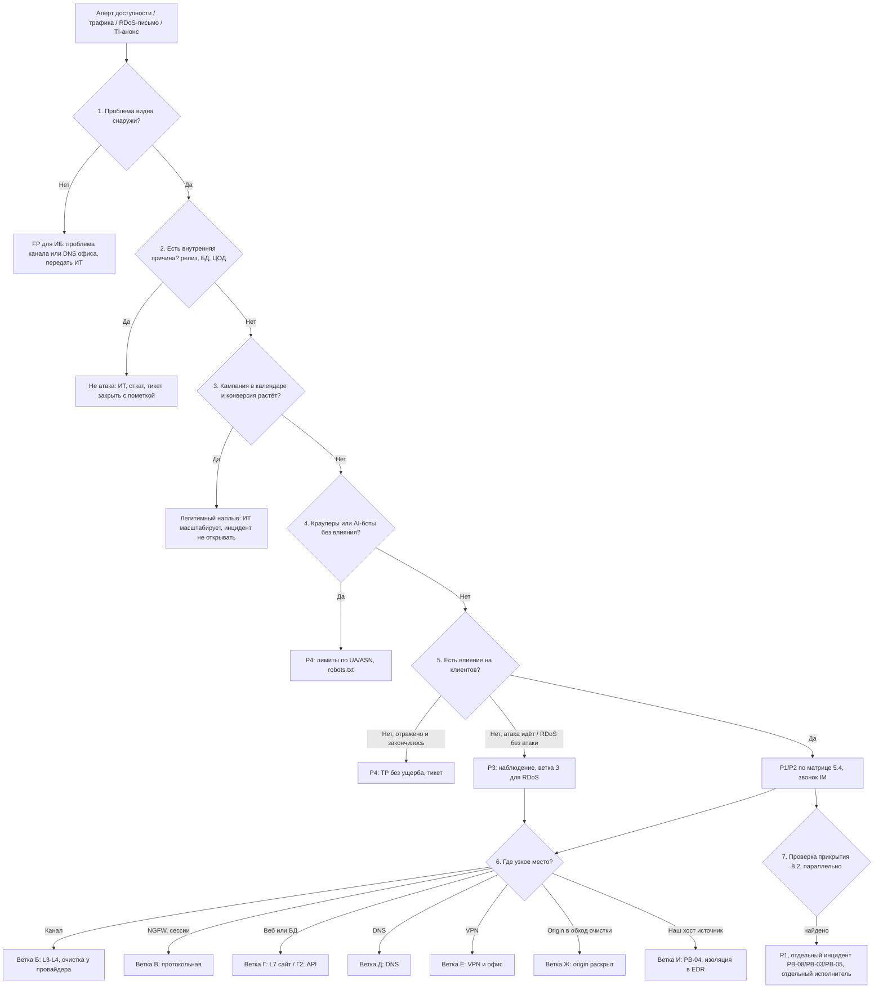

# PB-06 DDoS-атака на публичные сервисы

> Учебный плейбук для вымышленной компании «Альфа-Трейд». Роли, уровни критичности P1–P4, сроки и каналы связи взяты из [IR-плана](../plan/ir-plan.md). Всё, что нужно сверить с первоисточником, собрано в разделе [«Допущения и ограничения»](#допущения-и-ограничения). Сокращения расшифрованы в [Приложении Г](#приложение-г-сокращения).

## TL;DR

- **Когда применять:** сайт магазина, API мобильного приложения, DNS, VPN или весь периметр недоступны либо деградируют, а внешний мониторинг, NetFlow, NGFW, WAF, провайдер, TI или письмо вымогателя указывают на атаку на доступность.
- **Исход DDoS решается до атаки.** Без договора с анти-DDoS-провайдером, скрытого origin, заготовленных правил и контактов NOC реагирование сводится к ожиданию. Поэтому раздел 3 «Подготовка» здесь важнее, чем в любом другом плейбуке.
- **Главное правило порядка:** **подтвердите снаружи → исключите «не атаку» → найдите узкое место → включите самую узкую работающую меру → параллельно ищите прикрытие → снимайте меры по одной.**
- **Стартовая критичность P2 до завершения триажа.** Сайт и API приносят всю выручку: около 1 млн ₽/ч, около 17 тыс. ₽/мин. Сайт, заказ, оплата или API недоступны с 2 и более внешних точек дольше 3 минут, значит P1.
- **Не ждите подтверждения маркетинга.** Ложная тревога по DDoS дешевле 30 минут простоя (около 0,5 млн ₽). Нет кампании в календаре и есть 2 и более признака атаки, значит это атака.
- **DDoS может быть прикрытием.** Проверку вторжения начинайте сразу после подтверждения атаки, отдельным исполнителем. Под нагрузкой WAF и IPS уходят в fail-open, SIEM теряет события, поэтому отсутствие сработок ничего не доказывает.

## Шпаргалка: первые 30 минут

Отсчёт от T0, времени первой сработки. Сроки для P1, учебные.

| № | Действие | Кто | Срок |
| --- | --- | --- | --- |
| 1 | **Зафиксируйте T0** (UTC+3), заведите тикет «DDoS (подозрение)», дальше пишите каждое действие со временем | L1 | T0 + 2 мин |
| 2 | **Подтвердите снаружи**: внешний мониторинг с 2 и более точек или `dig` и `curl` с устройства вне корпоративной сети ([Приложение В](#приложение-в-примеры-запросов-и-команд)) | L1 | T0 + 5 мин |
| 3 | **Отметьте, что именно не работает:** сайт, корзина, оплата, API, DNS, VPN, почта. Не работает всё на периметре, значит сразу P1 и звонок сетевику | L1 | T0 + 5 мин |
| 4 | **Исключите внутреннюю причину** (релиз, конфигурация, сброс кэша CDN за 2–4 часа) **и легитимный наплыв** (календарь кампаний, дашборд WAF, таблица 5.2) | L1 | T0 + 10 мин |
| 5 | **Проверьте контекст:** RDoS-письма, уведомление провайдера, анонс в TI, параллельные сработки высокой критичности в SIEM | L1 | T0 + 10 мин |
| 6 | **Эскалируйте звонком L2 и дежурному сетевику, сообщите IM** при P1/P2 или 2 и более признаках атаки | L1 | T0 + 10 мин |
| 7 | **Классифицируйте вектор и узкое место:** не атака / L3–L4 / протокольная / L7 / DNS / VPN, цепочка «канал → бордер → NGFW → WAF → веб-сервер → приложение → БД» | L2 | T0 + 15 мин |
| 8 | **Решите о переключении на очистку или режиме деградации** | IM | T0 + 15–20 мин |
| 9 | **Включите защиту или отправьте запрос в NOC** по шаблону из раздела 6.2 | Сетевик / L2 | T0 + 30 мин (реально по TTM из договора) |
| 10 | **Запустите проверку «прикрытия»** (раздел 8.2) параллельно сдерживанию | L2 (отдельный исполнитель) | T0 + 30 мин |
| 11 | **Сохраните первые артефакты:** графики, состояние NGFW, конфигурацию «до изменений», семпл трафика на сенсоре | L2, сетевик | Сразу, параллельно |
| 12 | **Дайте первый статус директору и владельцу сайта**, дальше каждые 30–60 мин в острой фазе | IM | T0 + 30 мин |

## Чего делать нельзя

- **Не блокируйте «список IP-источников» при отражённой атаке.** Это легитимные DNS- и NTP-серверы, канал забит до NGFW, а собственный резолвинг или NTP может сломаться.
- **Не блокируйте IP провайдера очистки после переключения.** Теперь это «источник» всего трафика, и сайт отключится своими руками.
- **Не включайте капчу и JS-challenge на API, платёжные колбэки, интеграции и внешний мониторинг.**
- **Не делайте гео-блок «всего зарубежного» без апрува.** Отрежутся клиенты в роуминге и через VPN, партнёры, мониторинг (вы «ослепнете»), поисковые боты. Против российских резидентных прокси он не помогает.
- **Не лимитируйте только по IP.** За одним IP мобильного оператора (CGNAT) тысячи клиентов.
- **Не кэшируйте персонализированные страницы.** Ошибка кэша показывает клиенту А корзину клиента Б, а это уже утечка ПДн.
- **Не перезагружайте NGFW или WAF «чтобы сбросить сессии»** без экспорта состояния и апрува IM. Пропадут журналы, появится окно без фильтрации, failover может уйти в неожиданный режим.
- **Не пишите полный pcap на атакуемом продакшен-сервере.** Сбор улик сам уронит сервер.
- **Не подключайте экстренно иностранный сервис защиты без апрува юриста/DPO.** В трафике ПДн.
- **Не отвечайте вымогателю, не платите и не обсуждайте детали защиты публично.**
- **Не откладывайте проверку прикрытия до конца атаки.**
- **L1 не блокирует IP и страны, не меняет правила WAF и NGFW, не отвечает на письма вымогателя, не звонит провайдеру без L2/IM и не публикует ничего от имени компании.**

## 1. Цель и область применения

**Цель:** быстро отличить атаку на доступность от сбоя или легитимного наплыва, найти узкое место, восстановить доступность самой узкой работающей мерой, не отрезав настоящих клиентов, и одновременно убедиться, что DDoS не прикрывает вторжение.

**Что входит:**

- Атаки на доступность публичных сервисов «Альфа-Трейд»: сайт магазина, API мобильного приложения, авторитативный DNS, VPN-шлюз, почтовый шлюз в DMZ, публичные IP офиса, весь префикс (канал и NGFW).
- Все классы атак:
  - объёмные L3–L4: UDP-флуд, отражённые атаки, carpet bombing по подсети;
  - протокольные: SYN/ACK/RST flood, исчерпание таблицы сессий NGFW;
  - прикладные L7: HTTP-флуд, тяжёлые запросы к поиску и фильтрам, HTTP/2 Rapid Reset и аналоги;
  - атаки на DNS, в том числе random subdomain (water torture);
  - мультивекторные и пульсирующие (pulse-wave).
- RDoS: письмо с требованием выкупа, в том числе без атаки или с «демонстрационной» атакой. Анонс атаки в Telegram-каналах хактивистов.
- Экономический DoS (EDoS): атака не кладёт сервис, но раздувает счёт за облачное автомасштабирование.

**Что не входит:**

| Ситуация | Что делать |
| --- | --- |
| Сбои без злого умысла: неудачный релиз, медленная БД, сбой у провайдера или в ЦОД | Плейбук помогает их **распознать** (узлы 1–2 дерева) и передаёт в ИТ |
| Агрессивные краулеры, AI-боты, парсеры конкурентов | Не инцидент ИБ уровня P1; P4 с лимитами (узел 4 дерева) |
| Бот-атаки на бизнес-логику: credential stuffing, card testing, скальпинг | Распознаются здесь, расследуются по PB-03 или с участием платёжного провайдера |
| Исходящий флуд из нашей сети: наш хост участник ботнета или открытый рефлектор | PB-04 |
| Расследование вторжения, найденного под прикрытием DDoS | PB-08, PB-03, PB-05 |

## 2. Паспорт

| Поле | Значение |
| --- | --- |
| ID | PB-06 |
| Версия | 1.0 (31.10.2026) |
| Владелец | Руководитель ИБ, он же руководитель реагирования (IM) |
| Пересмотр | Раз в 6 месяцев, после каждого P1/P2 по DDoS и после смены анти-DDoS-провайдера или схемы подключения |
| Критичность по умолчанию | **P2 до завершения триажа**: сайт и API приносят всю выручку (≈1 млн ₽/ч, ≈17 тыс. ₽/мин) |
| Повышение до P1 | Сайт, оформление заказа, оплата или API недоступны с ≥2 внешних точек > 3 мин или 5xx > 20 %; не резолвится DNS-зона; любые признаки параллельного вторжения |
| Понижение до P3 | Атака продолжается, но полностью отражается без влияния на клиентов; RDoS-письмо без атаки |
| Понижение до P4 | Всплеск отражён автоматически и закончился до триажа. Полная матрица в 5.4 |
| Техники MITRE ATT&CK | [Приложение А](#приложение-а-mitre-attck) |
| Связанные плейбуки | PB-08 Взлом веб-приложения (DDoS как прикрытие), PB-03 Компрометация учётной записи (credential stuffing на `/login`), PB-05 Утечка данных (найден доступ к ПДн, ошибка кэша), PB-04 Вредонос на рабочей станции (наш хост источник флуда), PB-10 Компрометация облачного аккаунта (входы в облачную почту под шумок), PB-S1 Сработка WAF, PB-S2 Сработка NGFW |

**Целевые сроки по фазам** (учебные, для P1; отсчёт от первой сработки T0):

| Этап | Цель | Кто |
| --- | --- | --- |
| Подтверждение недоступности с внешних точек, тикет | T0 + 5 мин | L1 |
| Эскалация L2 и дежурному сетевику **звонком**, сообщение IM | T0 + 10 мин | L1 |
| Классификация: не атака / L3–L4 / протокольная / L7 / DNS / VPN | T0 + 15 мин | L2 |
| Решение IM о переключении на очистку или режиме деградации | T0 + 15–20 мин | IM |
| Защита включена или запрос в NOC отправлен | T0 + 30 мин (реально по TTM из договора) | Сетевик / L2 |
| Старт проверки «прикрытия» | T0 + 30 мин, параллельно сдерживанию | L2 (отдельный исполнитель) |
| Первый статус директору и владельцу сайта | T0 + 30 мин, далее каждые 30–60 мин в острой фазе | IM |
| Эскалация к директору для решений по бюджету | T0 + 1 ч, если сайт ещё недоступен | IM |
| Начало снятия мер | ≥ 2 ч без всплесков выше 2× baseline | L2 + IM |
| Закрытие | 72 ч (P1) / 48 ч (P2) без повторной волны | IM |

## 3. Подготовка

Невыполненный пункт запишите в тикет как ограничение реагирования и внесите в список улучшений.

- [ ] **Договор с анти-DDoS-провайдером** на L3–L4 и L7. Зафиксированы: модель (always-on или on-demand), способ подключения (DNS, BGP-анонс, GRE-туннель), гарантированное время включения (TTM), лимит по объёму и цена сверх лимита, номер договора, ID клиента, кодовое слово, список лиц «Альфа-Трейд», которые вправе инициировать включение. Для сайта с простоем 1 млн ₽/ч целевая модель **always-on для L7**, on-demand только резерв
- [ ] **ПДн в трафике провайдера.** При L7-защите провайдер расшифровывает TLS и видит логины, телефоны, адреса клиентов. Договор содержит поручение обработки ПДн (152-ФЗ, ст. 6 ч. 3); если провайдер иностранный, оценена трансграничная передача (ст. 12, порядок уведомления РКН). Юрист/DPO решает это заранее, а не во время атаки
- [ ] **Контакты 24/7** с телефоном, почтой и порталом: NOC интернет-провайдера, NOC анти-DDoS-провайдера, хостинг/ЦОД, регистратор и DNS-провайдер, CDN, платёжный провайдер. Проверяйте раз в квартал. **Офлайн-копия** у дежурного L2, сетевика и IM: при DDoS могут лежать почта и VPN
- [ ] **Процедура переключения на очистку** пошагово: кто, где, что меняет; как проверить; как откатить. Протестирована хотя бы раз
- [ ] **TTL** A/AAAA/CNAME сайта и API ≤ 300 с, если переключение идёт через DNS. DNS-зона у провайдера с anycast; есть вторичный DNS у другого провайдера
- [ ] **Origin скрыт и закрыт.** На NGFW входящие 80/443 к origin разрешены только с подсетей провайдера защиты (список в приложении, обновляется ежеквартально). IP origin не используется для MX, SPF и поддоменов (`dev.`, `old.`, `mail.`, `ftp.`), не светится в заголовках исходящих писем сайта
- [ ] **Baseline** по часам и дням недели (будни, выходные, распродажи): bps, pps, новые соединения/с (CPS), сессии NGFW, RPS всего и по ключевым URI, уникальные IP в минуту, доля 4xx/5xx, p95 латентности, cache hit ratio, распределение по странам и ASN. Хранится в SIEM как lookup, обновляется ежемесячно
- [ ] **Календарь маркетинга** (распродажи, рассылки, push, реклама) доступен L1 без звонка: wiki или lookup в SIEM
- [ ] **Внешний мониторинг** из ≥3 точек (разные регионы и операторы) по главной, `/cart`, `/api/health`; алерт в SIEM и на телефон дежурного
- [ ] **Режим деградации**, подписанный владельцем сайта: что ИТ отключает без отдельного апрува (полнотекстовый поиск, рекомендации, сложные фильтры, отзывы, промокоды) и что нельзя (корзина, оплата, ЛК). Feature flags, статическая версия каталога, страница «заказ по телефону»
- [ ] **Заготовленные правила WAF и NGFW** в режиме «выключено» или «только лог»: лимиты на `/search`, `/catalog`, `/login`, `/cart`, `/api/*`; challenge на HTML-пути; «under attack»; гео/ASN-профили; DoS-профили NGFW. Протестированы на стенде
- [ ] **Allowlist**, который нельзя ломать: платёжный провайдер (webhook), службы доставки, партнёры по API, внешний мониторинг, поисковые боты (проверка по обратному DNS), офис, CI/CD. Мобильное приложение распознаётся по токену или заголовку, а не по IP
- [ ] **Журналы под нагрузкой.** NetFlow/sFlow/IPFIX с бордера собирается. Флуд-события WAF/NGFW уходят в SIEM агрегатами, сырые журналы в отдельное хранилище с запасом диска. Есть алерт на превышение EPS и на потерю событий, алерт на переход WAF/IPS в bypass (fail-open)
- [ ] **Канал управления вне атакуемого** (отдельный провайдер или LTE) к консолям NGFW, WAF, гипервизоров и SIEM
- [ ] **Статус-страница** на независимой инфраструктуре (не тот ЦОД, не тот IP) и заготовленные тексты
- [ ] **Облако:** лимиты автомасштабирования и бюджетные алерты (защита от EDoS)
- [ ] **TI:** мониторинг анонсов атак на компанию и отрасль в Telegram-каналах хактивистов и бюллетенях провайдеров защиты
- [ ] **Учения:** tabletop по этому плейбуку раз в квартал (в том числе RDoS); технический тест переключения раз в год, только по письменной договорённости с провайдером связи, анти-DDoS-провайдером и хостингом

## 4. Роли и ответственность

Матрица RACI: **R** выполняет, **A** утверждает и отвечает за результат, **C** консультирует, **I** получает информацию.

| Действие | L1 | L2 | IM | ИТ (сеть / веб) | Владелец сайта | Юрист / DPO | PR | Директор |
| --- | --- | --- | --- | --- | --- | --- | --- | --- |
| Детект, тикет, первичный триаж | R | C | I | C | | | | |
| Определение вектора и цели | C | R | A | C | | | | |
| Присвоение P1/P2 | C | R | A | | I | | | I (P1) |
| Переключение на очистку (DNS/BGP), вызов NOC | | C | A | R | I | | | C (если доплата) |
| Узкие меры WAF (лимиты, сигнатуры) | | R | A | C | I | | | |
| Challenge на весь сайт, гео/ASN-челлендж, «under attack» | | R | A | C | A | | | |
| Отключение функций, статический режим | | C | A | R | A | | I | C (P1 > 1 ч) |
| RTBH на IP, смена IP origin | | C | A | R | A | | | |
| Проверка «прикрытия» | | R | A | C | | I | | |
| Сбор артефактов | | R | A | C | | C | | |
| Скрипт поддержки, статус-страница, соцсети | | | A | | C | C | R | |
| RDoS: решение о контактах и обращении в полицию | | C | R | | C | R | C | A |
| Остановка рекламы и рассылок | | | C | | R | | R | |
| Сверка заказов и платежей | | | I | C | R | | | |
| Снятие мер, закрытие | | R | A | C | C | | I | I |

**Заранее согласованные полномочия (по IR-плану):**

- **L2 сам** блокирует **один** внешний IP и включает заготовленные узкие правила.
- **Всё, что затрагивает весь трафик сайта или его функции,** требует апрува IM.
- **Остановка или деградация сайта** требует ещё и апрува владельца сайта.
- Полная матрица апрувов в разделе 6.1.

## 5. Триаж

Триаж делится на две части. **Быстрый триаж (L1, первые 10 минут)** отвечает на вопросы «это видно снаружи?», «это вообще атака?» и «насколько всё плохо?». **Глубокий триаж (L2)** находит узкое место и вектор, выбирает ветку сдерживания и запускает проверку прикрытия. Обе части идут по одному дереву решений.

### 5.1. Дерево решений



Ниже каждый узел дерева расписан подробно. Номера узлов совпадают с номерами в схеме.

### 5.2. Быстрый триаж (L1, первые 10 минут)

**Перед узлом 1. Зафиксируйте T0 и заведите тикет.**

- Запишите T0 по первой сработке (UTC+3).
- Заведите тикет «DDoS (подозрение)».
- Всё дальнейшее записывайте в тикет со временем.

**Узел 1. Проблема видна снаружи?**

- **Подтвердите снаружи:** внешний мониторинг (≥2 точки) или проверка с устройства вне корпоративной сети командами `dig` и `curl` из [Приложения В](#приложение-в-примеры-запросов-и-команд) (блок В.1).
- Проблема только изнутри офиса, значит вероятнее собственный канал или DNS офиса. Это ИТ, не DDoS.
- **Отметьте, что именно не работает:** сайт / корзина / оплата / API / DNS / VPN / почта.
- Не работает **всё** на периметре, значит сразу P1 и звонок сетевику.

**Узел 2. Есть внутренняя причина?**

- Проверьте журнал изменений и CI/CD за 2–4 часа: релиз, смена конфигурации, сброс кэша CDN.
- Откройте дашборд приложения. Трафик в норме, а время ответа БД выросло, значит это сбой, не атака. Передайте ИТ.

**Узел 3. Кампания в календаре и конверсия растёт?**

- Проверьте календарь кампаний и дашборд WAF «топ URI / Referer / доля статики / конверсия».
- Сравнивайте признаки по таблице «Наплыв или атака» ниже.
- **Правило: кампании нет и есть ≥2 признака атаки, значит атака.**
- Кампания есть, значит проверьте конверсию и распределение URI. При наплыве передайте ИТ (масштабирование), инцидент ИБ не открывайте.
- Резидентные прокси и headless-браузеры делают источники похожими на обычных абонентов, поэтому поведенческие признаки и фингерпринты важнее гео.

**Таблица 5.2. Наплыв или атака**

| Признак | Легитимный наплыв | L7-атака |
| --- | --- | --- |
| Календарь кампаний | Есть рассылка, push, реклама | Нет |
| Referer | Реклама, поиск, рассылка (utm-метки) | Пусто или одинаковый |
| Распределение URI | Широкое: главная, каталог, карточки, корзина | Узкое: 1–3 URI (`/search?q=<случайное>`, `/catalog?filter=...`, `/api/...`) |
| Статика (css/js/img) | Запрашивается пропорционально | Почти не запрашивается |
| Cookies и сессии | Большинство с сессионной cookie, есть повторные клиенты | Почти все сессии новые, без cookie или с одной и той же |
| User-Agent и TLS | Реалистичное распределение | Один UA, устаревшие UA; UA не совпадает с TLS-фингерпринтом (JA4); один JA4 на тысячи IP |
| Конверсия | Растут корзины и заказы | RPS растёт, заказы стоят или падают |
| Cache hit ratio | Растёт (все смотрят акцию) | Падает (случайные параметры сбивают кэш) |
| Гео / ASN | Домашние и мобильные операторы целевых регионов | Хостинги, облака, VPN-сервисы; либо резидентные сети, но с аномальным поведением |
| Поведение | Навигация, паузы | Одинаковые интервалы, повтор одного запроса |

**Узел 4. Краулеры или AI-боты без влияния?**

- Да, значит P4: лимиты по UA/ASN, robots.txt. Инцидент ИБ уровня P1 не открывайте.

**Проверьте контекст перед эскалацией:**

- RDoS-письма (поиск по ключевым словам из Приложения Б: «DDoS», «bitcoin», «BTC», «Monero», «ваш сайт будет», «attack», за 7 дней по всем ящикам);
- уведомление провайдера;
- анонс в TI;
- параллельные сработки высокой критичности в SIEM.

**Узел 5. Есть влияние на клиентов?**

- **Нет, отражено и закончилось:** P4, TP без ущерба, тикет.
- **Нет, атака идёт, или RDoS без атаки:** P3, наблюдение; для RDoS ветка З.
- **Да:** P1/P2 по матрице 5.4 и **звонок IM**.
- **Эскалируйте немедленно**, если P1/P2 или ≥2 признака атаки: звонок L2 и дежурному сетевику, сообщение IM. **Не ждите подтверждения маркетинга:** ложная тревога по DDoS дешевле 30 минут простоя (≈0,5 млн ₽).

**L1 не делает:** не блокирует IP и страны, не меняет правила WAF и NGFW, не отвечает на письма вымогателя, не звонит провайдеру без L2/IM, не публикует ничего от имени компании.

### 5.3. Глубокий триаж (L2)

**Узел 6. Где узкое место и какой вектор?**

Пройдите цепочку снаружи внутрь: **канал → бордер → NGFW → WAF/балансировщик → веб-сервер → приложение → БД.** Узкое место определяет ветку сдерживания (раздел 6.2). Запросы для каждого шага собраны в [Приложении В](#приложение-в-примеры-запросов-и-команд).

**A. Канал и бордер (L3–L4).** Запустите NetFlow по портам источника (блок В.3).

- UDP с портов источника 53 (DNS), 123 (NTP), 389 (CLDAP), 1900 (SSDP), 11211 (memcached), 19 (CharGEN), 3702 (WS-Discovery), крупные пакеты, значит отражённая атака (T1498.002). IP-источники здесь легитимные отражатели, **не атакующий**: блокировать их список бессмысленно.
- Много TCP SYN без завершения рукопожатия, значит SYN flood (T1499.001).
- Много фрагментов UDP/ICMP, значит направленный флуд (T1498.001).
- Тот же запрос `by dest_subnet24` покажет carpet bombing.

**B. NGFW (протокольная).** Посмотрите CPU dataplane, заполнение таблицы сессий, отброшенные пакеты, срабатывания DoS-профиля. Конкретные команды и пути в интерфейсе зависят от вашего NGFW. Если NGFW захлебнулся, страдает весь периметр, включая VPN и исходящий трафик.

**C. Веб-сервер (Linux).** Выполняет ИТ или L2 с доступом: сводка по сокетам, полуоткрытые и установленные соединения, conntrack, топ URI и UA из access.log (блок В.4). За прокси в первом столбце будет IP прокси, нужен столбец X-Forwarded-For.

- Для IIS смотрите журналы `%SystemDrive%\inetpub\logs\LogFiles\` и HTTP.sys `%SystemRoot%\System32\LogFiles\HTTPERR\` (причины вида `Connection_Dropped`, `Timer_ConnectionIdle`).
- Windows Event ID для самого DDoS малоинформативны: картина в сетевых журналах.

**D. L7 в WAF.** Постройте динамику по кодам ответа (блок В.5):

- рост 502/503/504: бэкенд не справляется;
- 499 (nginx): клиенты не дожидаются ответа;
- 403/429: уже работают WAF или лимиты.

Затем сгруппируйте по JA4, UA и ASN (блок В.6):

- Один JA4 на сотни IP с разными UA, значит ботнет с подделанным UA.
- JA3 менее стабилен из-за рандомизации расширений TLS в браузерах, JA4 предпочтительнее.
- Если перед WAF стоит CDN или очистка, в `src_ip` будет IP провайдера. Реальный IP в `X-Forwarded-For` или вендорском заголовке, и доверять ему можно **только** для запросов из диапазонов провайдера.

**E. HTTP/2.** Много `RST_STREAM` на соединение при малом числе соединений, значит признак HTTP/2 Rapid Reset (CVE-2023-44487); также класс атак CONTINUATION flood (2024). ИТ сверяет версии nginx/HAProxy/WAF с бюллетенями вендоров.

**F. Бизнес-логика.** Нагрузка на `/login`, `/api/*/auth`, значит проверьте долю успешных входов (блок В.7).

- Растут успешные входы с новых устройств, значит **credential stuffing**, параллельно PB-03.
- Короткие серии разных карт на `/payment`, значит **card testing**, уведомите платёжного провайдера.
- Если приложение не пишет событие «успешный вход», это пробел подготовки.

**G. Цель.** Какой IP/FQDN атакован. Атака идёт на IP origin в обход провайдера очистки, значит **origin раскрыт** (ветка Ж).

**Запишите в тикет:** векторы, цель, пиковые bps/pps/RPS, T0, подтехнику ATT&CK, гипотезу о мотиве (RDoS, хактивизм, конкурент, прикрытие).

**Узел 7. Проверка прикрытия.** Сразу после подтверждения атаки отдельный исполнитель запускает чек-лист 8.2. Найдено хотя бы одно подтверждение, значит P1 и отдельный связанный инцидент по PB-08/PB-03/PB-05.

### 5.4. Критичность по худшему признаку

| Уровень | Условие (любое) | Реакция до | Кого уведомить |
| --- | --- | --- | --- |
| **P1** | Сайт, оформление заказа, оплата или API недоступны с ≥2 внешних точек > 3 мин или 5xx > 20 % дольше 5 мин; DNS-зона не резолвится; лежит весь периметр; **любые** признаки параллельного вторжения или утечки | 15 мин, 24/7 | IM, директор, юрист (по IR-плану), владелец сайта, сетевик/ИТ; PR и поддержка сразу, потому что клиенты уже видят |
| **P2** | Деградация: p95 корзины или оплаты > 3× baseline или 5xx 5–20 %; недоступен VPN; атака отражается, но провайдер сообщает о росте объёмов | 1 ч | IM, ИТ, владелец сайта |
| **P3** | Атака продолжается и отражается без влияния на клиентов (в том числе после ручных мер L2); RDoS-письмо без атаки или с короткой демонстрационной атакой; анонс атаки в TI | 4 ч | Дежурный L2; IM информационно; при RDoS IM и юрист обязательно |
| **P4** | Всплеск отражён автоматически (облачная защита, DoS-профиль NGFW) и закончился до триажа; нагрузка от краулеров без влияния | 1 рабочий день | Только тикет |

Для продолжающейся отражённой атаки ставьте P3, а не P4 из IR-плана: атака активна и может усилиться или сменить вектор.

### 5.5. Когда эскалировать

- **Немедленно IM (звонок):** любой P1/P2; недоступность > 10 мин; провайдер не отвечает или очистка не дала эффекта за 15 мин; нужна мера с апрувом IM (6.1).
- **Директор:** P1 (по IR-плану); сайт недоступен > 1 ч; нужна доплата сверх лимита или экстренный договор; решение по RDoS.
- **Юрист/DPO:** RDoS-письмо; признаки доступа к ПДн; ошибка кэширования, показавшая данные одного клиента другому; экстренное подключение провайдера без договора поручения.
- **Владелец сайта:** любая мера, влияющая на конверсию (challenge на весь сайт, гео, отключение функций), и оценка ущерба.

## 6. Сдерживание

Принцип: **самая узкая мера, которая работает.**

- После каждой меры дайте 5–15 минут на оценку эффекта: RPS к origin, доля 5xx, внешний мониторинг, число заказов в минуту.
- Не помогло за 15 минут, значит переходите к следующему шагу.

### 6.1. Матрица полномочий

| Действие | Делает | Апрув | Примечание |
| --- | --- | --- | --- |
| Блок одного внешнего IP / узкой подсети хостинга | L2 | Не нужен (IR-план) | Против ботнета малоэффективно |
| Rate limit на URI из заготовленного списка | L2 | Не нужен, уведомить IM | Заготовленные правила |
| Блок по точной сигнатуре (JA4, набор заголовков, шаблон параметра) | L2 | IM, можно постфактум в течение 15 мин | Сначала 5 мин в режиме monitor |
| Блок по ASN хостинга | L2 | IM | Проверить, что там нет партнёров |
| JS/managed challenge на HTML-пути всего сайта | L2 | IM | Влияет на конверсию |
| Капча или «under attack» для всех | L2 | IM + владелец сайта | Существенное влияние на продажи |
| Гео/ASN-**челлендж** (не блок) | L2 / ИТ | IM + владелец сайта | Только с allowlist |
| Гео-**блок** | L2 / ИТ | IM + владелец сайта | Крайняя мера, см. «Чего делать нельзя» |
| Отключение функции из списка «можно» | ИТ | Не нужен (согласовано заранее) | Записать в тикет |
| Отключение корзины, оплаты, ЛК; статический режим | ИТ | Владелец сайта + IM; директор при P1 > 1 ч | |
| Переключение на очистку (DNS/BGP) | Сетевик | IM (при always-on уведомить IM) | Время в тикет |
| Ослабление инспекции IPS на NGFW | Сетевик | IM | Обязательно вернуть |
| RTBH на IP | Сетевик через провайдера | IM + владелец сайта | Доводит атаку на этот IP «до конца» |
| Смена IP origin | ИТ | IM + владелец сайта | Только после включения защиты |
| Оплата сверх лимита, экстренный договор | IM | Директор | Иностранный сервис: ещё юрист/DPO |
| Возврат ранее снятой меры при повторной волне | L2 | Не нужен (апрув дан заранее) | |

### 6.2. Ветки сдерживания

**Ветка Б. Объёмная L3–L4.** Своими силами забитый канал не спасти: трафик теряется у провайдера до NGFW.

1. **L2/сетевик звонит в NOC анти-DDoS-провайдера** по номеру из контактов (не ищите на сайте во время атаки), шаблон обращения ниже. Апрув IM.
2. **Вариант DNS** (вероятный для «Альфа-Трейд» без собственного AS): сетевик меняет A/CNAME сайта и API на адреса провайдера. Эффект наступает по мере истечения TTL у резолверов.
3. **Вариант BGP** (если есть свой AS и префикс не уже /24): провайдер анонсирует префикс, чистый трафик возвращается по GRE-туннелю или стыку. Проверьте MTU туннеля, частую причину «висящих» HTTPS-сессий.
4. **Сразу после переключения:** на NGFW разрешите 80/443 к origin только с подсетей провайдера. **Не блокируйте IP провайдера:** теперь это «источник» всего трафика.
5. **Провайдер связи:** фильтрация по портам источника отражённых атак (UDP 53/123/389/1900/11211 к нашим адресам, где мы эти сервисы не принимаем), Flowspec или ACL. RTBH только на IP, без которого бизнес переживёт, или как крайняя мера ради остального канала.
6. **Проверьте из нескольких внешних точек:** сайт открывается, сертификат корректен, платёжные колбэки доходят.
7. **Таймер:** нет эффекта за 15 мин, значит эскалация на руководителя смены провайдера и IM; при наличии договора резервный провайдер.

**Шаблон обращения в NOC:**
> Компания «Альфа-Трейд», договор № ___, ID клиента ___, кодовое слово ___. Атакуемые ресурсы: ___ (IP / подсеть / FQDN). Начало: ___ UTC (___ МСК). Тип по нашим данным: ___ (например, UDP-амплификация с портов 123/389, пик ~__ Гбит/с, ~__ Mpps; или HTTP-флуд на /search, ~__ тыс. RPS, JA4 ___). Влияние: недоступность / деградация с ___. Сделано: ___. Просим: включить фильтрацию / ужесточить профиль / сохранить данные и прислать отчёт по векторам. Контакт: ___, резервный ___.

**Ветка В. Протокольная (NGFW захлёбывается).**

1. **Сетевик включает или ужесточает DoS-защиту на NGFW:** SYN cookies или SYN proxy, лимит новых сессий на источник и на назначение, снижает таймауты полуоткрытых и неактивных соединений для атакуемого сервиса.
2. Таблица сессий всё равно переполняется, значит **переносите фильтрацию выше:** к провайдеру или в stateless ACL на бордер-маршрутизаторе.
3. **Временный вывод атакуемого IP из-под тяжёлых профилей IPS** делайте **только с апрувом IM**, с записью в тикет и обязательным возвратом: это снижает защиту от параллельной атаки.
4. **ИТ на веб-серверах Linux** проверяет `net.ipv4.tcp_syncookies=1` и размер backlog; изменения sysctl проводит через тикет.

**Ветка Г. L7, сайт.** Поэтапная эскалация, до шагов 3–7 обязателен allowlist (раздел 3).

| Шаг | Мера | Риск для клиентов |
| --- | --- | --- |
| 1 | Rate limit на атакуемый URI по составному ключу: IP + URI, сессия/cookie, JA4 (например, `/search` не более N в минуту на сессию; N по baseline) | Низкий |
| 2 | Блок по точной сигнатуре: JA4, набор и порядок заголовков, фиксированный UA, шаблон параметра | Низкий при узкой сигнатуре |
| 3 | Challenge для подозрительных: хостинг-ASN, нет cookie, плохая репутация. **Не для API, колбэков и мониторинга** | Средний |
| 4 | Отключение тяжёлых функций через feature flags | Средний (конверсия) |
| 5 | Гео/ASN-челлендж вне целевой аудитории | Средний: клиенты через VPN с зарубежными IP |
| 6 | «Under attack»: challenge для всех HTML-запросов | Высокий |
| 7 | Статическая версия сайта или страница «заказ по телефону» | Очень высокий |

- **Только по IP лимитировать нельзя:** за одним IP мобильного оператора (CGNAT) тысячи клиентов.
- **Headless-браузеры проходят простой JS-challenge.** Шаг 3 не помог, значит нужны поведенческие проверки и фингерпринты; набор функций зависит от WAF.
- **Проверяйте, что мера не задела клиентов:** доля 403/429 у запросов с cookie и Referer с сайта, заказы в минуту по данным владельца.
- **Кэшируйте только безопасное:** анонимные страницы каталога и статику. Не кэшируйте ответы с `Set-Cookie` и `Cache-Control: private`, пути `/cart`, `/checkout`, `/account`, `/api/user*`. Ошибка кэша показывает клиенту А корзину или адрес клиента Б, а это уже утечка ПДн (PB-05).

**Ветка Г2. L7, API мобильного приложения.** Никакой капчи и JS-challenge: приложение перестанет работать.

- Лимиты по токену или идентификатору устройства.
- Отказ неаутентифицированным запросам к тяжёлым методам.
- Проверка подписи запросов или attestation, если они заложены в приложение (зависит от платформы).
- Приоритет авторизованным клиентам.
- При возможности отдельный пул серверов для API.

**Ветка Д. DNS.** Признак: сайт не открывается по имени, но открывается по IP (проверка `curl --resolve`, блок В.8).

1. **Сетевик связывается с DNS-провайдером** и убеждается, что NS у регистратора указывают и на вторичного провайдера.
2. **Временно увеличьте TTL** записей сайта и API, чтобы резолверы дольше держали кэш (если провайдер принимает изменения).

**Ветка Е. VPN и офис.**

- **ИТ переводит критичных сотрудников** (ИБ, ИТ, поддержка, финансы) на резервный канал или альтернативный шлюз; команда реагирования переходит на резервный канал связи.
- **С провайдером связи:** фильтрация офисного диапазона.
- **Проверьте VPN на перебор паролей под шумок:** журналы аутентификации VPN, Event ID 4625 на RADIUS/NPS при интеграции с AD.
- Если сайт пострадал от атаки на офис, значит у них общий канал. Это урок для архитектуры.

**Ветка Ж. Origin раскрыт.** Признак: сайт за провайдером, но на NGFW соединения к origin идут не с адресов провайдера, или провайдер показывает «чистую» картину, а origin перегружен.

1. **Сетевик немедленно разрешает 80/443 к origin только с подсетей провайдера.**
2. Атака на IP origin забивает канал, значит фильтрация или RTBH у провайдера связи; ИТ выделяет новый IP, провайдер перенастраивает upstream. **Новый IP нигде не публикуется.**
3. После стабилизации L2 ищет источник утечки (раздел 9).

**Ветка З. RDoS.**

1. **Не отвечайте, не переходите по ссылкам, не пересылайте письмо как есть, не платите.** Тикет P3 (или по матрице, если идёт демонстрационная атака).
2. **L2 с администратором почты:** экспорт `.eml` с полными заголовками, SHA-256, извлеките отправителя, Reply-To, `Received`, адрес кошелька, сумму, сроки. Найдите похожие письма у других сотрудников.
3. **IM:** проверьте готовность защиты, предупредите анти-DDoS-провайдера и провайдера связи о возможной атаке в названное время, назначьте усиленное дежурство на срок ультиматума.
4. **Юрист:** решение об обращении в полицию, пакет документов. **Директор** решает о любых контактах. **Рекомендация плейбука: не платить.** Оплата не гарантирует прекращения и помечает компанию как платящую. Отвечайте только по решению директора и юриста, с одного согласованного адреса.

**Ветка И. Наш хост источник.** Изолируйте хост в EDR (в пределах полномочий L2), заблокируйте исходящее на NGFW, переходите в PB-04.

**Маркетинг (все ветки при P1):** владелец сайта и PR приостанавливают платную рекламу и рассылки. Они тратят деньги на неработающий сайт и добавляют нагрузку.

### 6.3. Долгосрочное сдерживание

- Защита остаётся в режиме always-on до решения на разборе; закрытый origin не снимается никогда.
- Временные правила WAF/NGFW переведите в постоянные или назначьте им владельца и дату пересмотра.
- Усиленное дежурство на срок RDoS-ультиматума и на даты, анонсированные хактивистами.
- Агрегированное логирование флуд-правил, чтобы SIEM не «ослеп» на следующей волне.
- Проверка лимитов автомасштабирования и бюджетных алертов в облаке.

## 7. Сбор и сохранение артефактов

Принцип: **доступность важнее улик, но сбор идёт параллельно сдерживанию.** Под нагрузкой журналы WAF ротируются, а буферы перезаписываются. Сбор не должен задерживать меры.

| Порядок (по летучести) | Артефакт | Как сохранить | Кто |
| --- | --- | --- | --- |
| 1. Сразу | Графики bps/pps/RPS/сессий, внешний мониторинг | Экспорт данных и скриншоты с видимыми метками времени | L2 |
| 1. Сразу | Состояние NGFW (сессии, CPU, DoS-события) и конфигурация WAF/NGFW «до изменений» | Экспорт политики, вывод счётчиков в файл | Сетевик |
| 1. Сразу | Семпл трафика | Короткий ротируемый pcap на сенсоре или SPAN, не на нагруженном сервере: `timeout 60 tcpdump -i <iface> -nn -s 128 -G 30 -W 2 -w /var/tmp/ddos_%Y%m%dT%H%M%S.pcap 'not port 22'` (блок В.9) | Сетевик / L2 |
| 2. Первый час | Журналы WAF, NGFW, балансировщика, веб-серверов (access/error с реальным IP клиента), приложения, медленные запросы БД | Выгрузка в отдельное хранилище за период «T0 − 24 ч … сейчас» | L2 / ИТ |
| 2. Первый час | NetFlow/sFlow/IPFIX с бордера | Выгрузка за тот же период | Сетевик |
| 2. Первый час | Данные провайдеров | Попросите провайдера связи и анти-DDoS-провайдера сохранить их данные (срок хранения у них может быть коротким) | IM |
| 3. При наличии | RDoS-письмо | `.eml` с полными заголовками из облачной почты (не пересылать вложением), SHA-256, ссылки не открывать | L2 + админ почты |
| 3. При наличии | Анонсы хактивистов | Скриншот и веб-архив поста с URL, временем, SHA-256 | L2 |
| 4. Весь инцидент | Журнал мер | Что, когда, кем и с чьего апрува включено и снято | L2 |
| 5. После атаки | Итоговый отчёт провайдера (векторы, пики, длительность, топ-источники), экспорт событий SIEM за окно, оценка ущерба от владельца | Приложить к тикету | IM / владелец |

**Цепочка хранения:**

- [ ] Каждый файл хеширован (SHA-256), в тикете записано: кто собрал, когда, откуда, хеш, где хранится, кто получал доступ
- [ ] Хранилище с ограниченным доступом и без права изменения для исполнителей
- [ ] Время везде по NTP, в отчёте одна зона (UTC+3)

Это нужно, если юрист решит подавать заявление в полицию.

## 8. Расследование

### 8.1. Вопросы и источники

| № | Вопрос | Где искать |
| --- | --- | --- |
| 1 | Что атаковано (IP, FQDN, сервис, вся подсеть)? | NetFlow, NGFW, WAF, отчёт провайдера |
| 2 | Какие векторы и как они менялись во времени (мультивекторная, pulse-wave)? | NetFlow, WAF по минутам, отчёт провайдера |
| 3 | Пиковые bps/pps/RPS, длительность, число уникальных источников? | Провайдер, NetFlow, WAF |
| 4 | Почему атака удалась: раскрыт ли origin, какие эндпоинты «тяжёлые», нет ли лимитов, уязвим ли веб-стек (HTTP/2)? | Журналы NGFW у origin, APM, профиль запросов, версии ПО |
| 5 | Когда началась атака и когда мы узнали (для MTTD)? | NetFlow и провайдер против времени первого алерта |
| 6 | Был ли «слепой» период мониторинга (потери EPS, bypass WAF/IPS)? | Счётчики SIEM и коллекторов, журналы WAF/NGFW |
| 7 | Был ли DDoS прикрытием? Затронуты ли данные? | Чек-лист 8.2 |
| 8 | Задели ли меры легитимных клиентов? | 403/429 у «чистых» сессий, жалобы, конверсия |
| 9 | Потерянные, задвоенные или «зависшие» заказы и платежи? | БД заказов, платёжный провайдер |
| 10 | Мотив и атрибуция (RDoS, хактивисты, конкурент)? | Письмо, TI, анонсы |

### 8.2. Проверка «прикрытия» (smokescreen)

- **Запускайте сразу после подтверждения атаки** отдельным исполнителем и повторите после её окончания.
- **Окно:** «T0 − 2 ч … конец атаки + 24 ч».
- Под нагрузкой WAF/IPS могут уйти в fail-open, а SIEM терять события, поэтому **отсутствие сработок не доказывает отсутствие атаки**.
- Запросы для поиска сработок и исходящих объёмов в блоке В.10 Приложения В.

Чек-лист:

- [ ] **Целостность мониторинга:** потери событий в SIEM, переполнение очередей коллекторов, bypass WAF/IPS, ослабленная инспекция. Есть слепое окно, значит зафиксируйте его и смотрите первичные журналы на устройствах
- [ ] **Веб-приложение (T1190):** SQLi, RCE, path traversal, загрузка файлов, особенно **успешные** (200) и на админ-пути, `/.git`, `/.env`, бэкапы, с IP, не участвующих в флуде
- [ ] **Личный кабинет (T1110.004):** рост неуспешных входов, успешные входы с новых устройств, смена телефона, e-mail или адреса доставки, списание бонусов
- [ ] **Платежи и заказы:** аномалии в возвратах, промокодах, подарочных картах
- [ ] **Удалённый доступ (T1078):** VPN и облачная почта, входы из новых стран и ASN; Windows Event ID 4624 (особенно Logon Type 10), 4625, 4740, 4672
- [ ] **AD и серверы:** 4720, 4728/4732/4756 (добавление в группы), 7045 (служба), 4698 (задача), 1102 (очистка журнала)
- [ ] **EDR (серверы DMZ и серверного сегмента):** все детекты за окно; дочерние процессы веб-сервера (`nginx`/`php-fpm`/`w3wp` → `sh`/`cmd`/`powershell`); новые файлы в веб-каталогах
- [ ] **Эксфильтрация (T1041, T1567):** исходящие объёмы с серверов БД и файлового сервера, облачные хранилища, DNS-туннелирование (длинные поддомены, много TXT)

**Найдено хоть одно подтверждение:**

- P1, отдельный связанный инцидент по PB-08/PB-03/PB-05, уведомите юриста.
- **DDoS и вторжение не разбирает один человек.**
- Против вторжения не делайте резких видимых действий, пока не собраны данные.
- Не обсуждайте находки в каналах, которые могут быть скомпрометированы.

## 9. Устранение

Корневая причина DDoS не вредонос внутри, а слабые места архитектуры, из-за которых атака удалась.

- [ ] **Утечка origin.** Проверьте исторические DNS-записи, поддомены, MX/SPF, заголовки исходящих писем сайта, CT-логи сертификатов, ответы API и страниц со ссылками на прямой IP. При раскрытии смените IP (после включения защиты) и закройте источник
- [ ] **Модель защиты.** IM и директор с расчётом ущерба принимают решение о переходе на always-on для L7 и о договоре L3–L4 с SLA
- [ ] **Тяжёлые эндпоинты.** Разработка: кэш анонимных выдач, ограничение размера выдачи и глубины пагинации, индексы в БД, постоянные лимиты
- [ ] **Веб-стек.** Патчи nginx/HAProxy/WAF против известных атак на HTTP/2, лимиты потоков (`max_concurrent_streams` и аналоги)
- [ ] **Временные правила** переведите в постоянные (с владельцем и датой пересмотра) или снимите
- [ ] **Детект.** Обновите baseline и пороги; правила на carpet bombing, на потерю EPS и на fail-open; агрегацию флуд-событий
- [ ] **Бизнес-логика.** Был credential stuffing или card testing, значит меры по PB-03 и с платёжным провайдером

## 10. Восстановление и мониторинг

**Когда начинать снимать меры:** метрики ≤ baseline + 20 % (и без всплесков выше 2× baseline) не менее 2 часов, провайдер подтвердил окончание атаки.

**Порядок снятия:** обратный порядку включения, от самых дорогих для бизнеса, по одной мере, 30–60 мин наблюдения между шагами.

1. «Under attack» / капча на весь сайт и статический режим.
2. Гео/ASN-ограничения.
3. Feature flags (вернуть функции).
4. Challenge для подозрительных.
5. Узкие сигнатуры и лимиты: их часто оставляют навсегда.

- **Вернулась волна:** предыдущая мера включается обратно без нового апрува.
- **Не снимаются:** always-on, закрытый origin.
- **Верните штатную инспекцию** на NGFW/WAF, если её ослабляли.

**Проверка работы:**

- [ ] Владелец сайта подтвердил главную, каталог, корзину, оплату, ЛК и API приложения
- [ ] Сверены заказы и платежи за период атаки с платёжным провайдером (зависшие, задвоенные, неподтверждённые оплаты)

**Что мониторить и сколько:**

| Что | Как | Срок |
| --- | --- | --- |
| Повторные волны: bps/pps/RPS против baseline, carpet bombing по подсети | Правила SIEM с пониженными порогами | 14 дней (IR-план: не менее 2 недель) |
| Фингерпринты и сигнатуры этой атаки (JA4, UA, шаблоны URI, ASN) | Правило-индикатор в WAF/SIEM | 14 дней, дальше по решению разбора |
| Прямые обращения к origin не с адресов провайдера | Правило на NGFW | Постоянно |
| Входы в ЛК, VPN, облачную почту; исходящие объёмы | Правила из 8.2 | 14 дней |
| Даты из RDoS-ультиматума и анонсов | Усиленное дежурство | До даты + 48 ч |
| Счёт и автоскейлинг облака | Бюджетные алерты | 30 дней |
| Конверсия и жалобы (ложные блокировки) | Дашборд владельца | 7 дней |

## 11. Коммуникации и уведомления

**Рабочий канал:** отдельный чат и тикет. DDoS положил VPN или корпоративный мессенджер, значит переходите на резервный канал из IR-плана (мессенджер на личных телефонах, звонки), контакты берите из офлайн-копии.

### 11.1. Кого и когда уведомлять

| Кому | Кто сообщает | Когда |
| --- | --- | --- |
| IM | L1 / L2 | P1/P2 сразу звонком; P3 информационно |
| Директор, юрист | IM | P1 в течение 15 мин (IR-план); при RDoS юрист всегда |
| Владелец сайта, дежурный сетевик/ИТ | L1 / IM | P1/P2 сразу |
| Анти-DDoS-провайдер, интернет-провайдер | Сетевик / L2 по апруву IM | При решении о переключении или фильтрации |
| DNS-провайдер, регистратор | Сетевик | Ветка Д |
| Платёжный провайдер, службы доставки, партнёры по API | Владелец сайта | Затронута оплата или интеграции; card testing |
| Поддержка и call-центр | PR + IM | С первых минут P1: скрипт ответа |
| Клиенты (статус-страница, соцсети) | PR по апруву IM | P1, заметно клиентам |
| Маркетинг | Владелец сайта | P1: остановить рекламу и рассылки |
| Полиция | Юрист по решению директора | RDoS, значительный ущерб |
| Роскомнадзор | Юрист/DPO | **Только** если найдена утечка или неправомерный доступ к ПДн (в том числе через ошибку кэша): по PB-05, сроки 24/72 ч по IR-плану (152-ФЗ, ст. 21 ч. 3.1). Сам по себе DDoS нарушает доступность и уведомления не требует |
| НКЦКИ | — | «Альфа-Трейд» не субъект КИИ, обязательного уведомления нет; возможно добровольное взаимодействие |

**Ритм статусов:** в острой фазе P1 каждые 30–60 минут (план требует минимум раз в 2 часа, но при простое бизнесу нужен ритм чаще); после стабилизации по IR-плану.

### 11.2. Правила публичных сообщений

- **Публично (PR):** факт проблемы, ожидаемое время, альтернативный способ заказа.
- **Не называйте** провайдера защиты, IP, работающие и неработающие меры.
- **Не говорите** «хакеры», «атака», «выкуп», пока это не подтверждено и не согласовано с IM и юристом.
- Фразу «ваши данные в безопасности» добавляйте **только** после завершённой проверки 8.2.

**Правовые оговорки (решает юрист):**

- Вымогательство может квалифицироваться по ст. 163 УК РФ, сама атака по статьям гл. 28 УК РФ (ст. 272–274).
- Упоминаемая в профильной прессе возможность помощи от Роскомнадзора (ЦМУ ССОП) при атаках на российские ресурсы: дополнительный канал, не основной.

### 11.3. Шаблоны

**Шаблон 1. Внутренний статус.**
> [ЧЧ:ММ МСК] PB-06, P_. Сайт: недоступен / деградация / восстановлен с ЧЧ:ММ. Тип: ___ (подтверждено / предположительно). Сделано: ___. Влияние: ___ мин недоступности, заказы ___ (данные владельца). Проверка прикрытия: идёт / чисто / найдено. Дальше: ___. Нужны решения: ___ (кто, до какого времени). Следующий статус: ЧЧ:ММ.

**Шаблон 2. Для поддержки (после апрува IM).**
> Сейчас сайт работает с перебоями из-за повышенной нагрузки, специалисты уже восстанавливают работу. Оформленные заказы сохранены. Оформить заказ можно по телефону ___. Приносим извинения за неудобства.

**Шаблон 3. Обращение в NOC** приведён в разделе 6.2 (ветка Б).

## 12. Критерии закрытия

**Закрыть как TP можно, когда отмечены все пункты:**

- [ ] Атака прекратилась по данным провайдера и собственного мониторинга; всплесков выше 2× baseline нет **72 ч (P1) / 48 ч (P2)**
- [ ] Владелец сайта подтвердил работу главной, каталога, корзины, оплаты, ЛК и API
- [ ] Сверка заказов и платежей с платёжным провайдером завершена
- [ ] Временные меры сняты или переведены в постоянные с владельцем и датой пересмотра
- [ ] Инспекция NGFW/WAF возвращена к штатной
- [ ] Проверка прикрытия (8.2) завершена и задокументирована, включая слепые окна мониторинга
- [ ] Origin проверен на раскрытие; при раскрытии IP сменён
- [ ] Отчёт провайдера получен; артефакты собраны, хешированы, хранятся по политике
- [ ] Журнал применённых мер с апрувами приложен к тикету
- [ ] Решение по always-on принято и задокументировано
- [ ] RDoS: юрист принял решение о полиции, письмо сохранено
- [ ] Включён повышенный мониторинг на 14 дней (раздел 10)
- [ ] Назначен разбор в течение 5 рабочих дней (IR-план)

**Закрыть как «не атака» (узлы 1–3 дерева) можно, когда отмечены все пункты:**

- [ ] Причина подтверждена: проблема канала или DNS офиса, релиз, БД, ЦОД **или** легитимный наплыв с кампанией в календаре и растущей конверсией
- [ ] Тикет передан ИТ, закрыт с пометкой «не атака»
- [ ] Краулеры и AI-боты: лимиты по UA/ASN и robots.txt применены, тикет P4 закрыт

## 13. Метрики

| Метрика | Определение |
| --- | --- |
| MTTD | От начала атаки (по провайдеру или NetFlow) до первого алерта |
| Time-to-escalate | От алерта до подключения IM |
| Time-to-divert | От решения IM до фактического перевода трафика на очистку (сравнить с TTM по договору) |
| Time-to-mitigate | От начала атаки до восстановления доступности для клиентов |
| MTTR | От обнаружения до полного восстановления (сайт работает без временных мер, кроме постоянных) |
| Downtime / degradation | Минуты полной недоступности и деградации, отдельно |
| Пики | bps, pps, RPS; векторы; число уникальных источников |
| Collateral damage | Доля легитимных клиентов, задетых мерами: отказы на challenge, ложные 403/429, жалобы, падение конверсии сверх ожидаемого |
| Слепое окно | Минуты потери событий SIEM или bypass WAF/IPS |
| Ущерб | Время простоя × 1 млн ₽/ч (учебная оценка) + фактические потерянные заказы + расходы на провайдера и сверхлимит + сверхурочные |

## 14. Типичные ошибки

| Ошибка | Последствие | Как правильно |
| --- | --- | --- |
| «Подключить очистку» без договора | Часы или дни простоя, десятки миллионов ₽ | Договор, контакты и процедура до атаки (раздел 3) |
| Ждать подтверждения маркетинга ночью | Потеряны первые 30 минут | Календарь в SIEM; ≥2 признака, значит эскалация |
| Нет ветки «не DDoS» | Капчей лечат сбой релиза или БД | Узел 2 дерева: изменения и метрики приложения |
| Credential stuffing принят за DDoS | Нагрузку отбили, а взломанные аккаунты никто не проверил | Подветка F в 5.3, PB-03 |
| Гео-блок «всего зарубежного» | Отрезаны клиенты через VPN, партнёры, мониторинг; против резидентных прокси не помогает | Гео-челлендж, апрув владельца, allowlist |
| Rate limit только по IP | Тысячи клиентов за CGNAT получают 429 | Составной ключ: IP + URI + сессия + JA4 |
| Капча «на всё» | Ломаются мобильное приложение, колбэки, интеграции | Challenge только на HTML-пути, allowlist |
| Кэширование без ограничений | Клиент видит чужую корзину: утечка ПДн | Только анонимные страницы и статика |
| Блок IP провайдера после переключения | Сайт отключён своими руками | Реальный IP из заголовка |
| Не проверен origin | Атака продолжается на старый IP, «провайдер не справляется» | Ветка Ж, закрытый origin |
| Проверка прикрытия после атаки | Данные уже ушли | Старт сразу после подтверждения |
| «Чисто» при потерянных событиях | Пропущено вторжение | Сначала проверить целостность мониторинга |
| Полный pcap на продакшене | Сбор улик сам роняет сервер | Короткий ротируемый семпл на сенсоре |
| Ответ вымогателю | Подтверждение «живой цели», повторные атаки | Не отвечать, сохранить `.eml`, юрист |
| Снятие мер «через час» | Вторая волна, повторный простой | Критерии раздела 10 |
| Закрытие через 24 ч | Следующая волна кампании застаёт врасплох | 48/72 ч и 14 дней мониторинга |
| Реклама продолжает работать | Деньги на лежащий сайт, лишняя нагрузка | Остановить кампании при P1 |
| Детали защиты в публичном сообщении | Атакующий перестраивается | Только факт и время восстановления |
| Автоскейлинг без лимитов | Сервис жив, а счёт на миллионы (EDoS) | Лимиты и бюджетные алерты |

## 15. Профилактика

**Архитектура и сеть**

- [ ] L7-защита always-on через reverse proxy; L3–L4-очистка по договору с SLA
- [ ] Закрытый и скрытый origin с регулярной проверкой
- [ ] Разделение каналов офиса и публичных сервисов; канал управления вне основного
- [ ] DNS: anycast у двух независимых провайдеров; TTL под выбранную модель защиты
- [ ] NGFW: настроенные DoS-профили, SYN cookies, мониторинг таблицы сессий и CPU

**Приложение и веб-стек**

- [ ] Постоянные лимиты на тяжёлые эндпоинты; кэш анонимных выдач
- [ ] Feature flags и статический режим, проверенные на учениях
- [ ] Отдельная защита API: токены, лимиты по устройству, подпись запросов
- [ ] Бот-менеджмент: фингерпринты (JA4, HTTP/2) и поведенческие признаки вместо одних IP-лимитов
- [ ] Своевременные патчи против атак на HTTP/2, лимиты потоков

**Мониторинг и облако**

- [ ] Внешние проверки из ≥3 точек; baseline по часам и дням
- [ ] Агрегация флуд-событий; алерты на потерю EPS и на fail-open; NetFlow с бордера
- [ ] Облако: лимиты автомасштабирования и бюджетные алерты
- [ ] TI: мониторинг анонсов хактивистов и бюллетеней провайдеров защиты

**Процессы и право**

- [ ] Контакты проверяются раз в квартал; tabletop раз в квартал; тест переключения раз в год по договорённости с провайдерами
- [ ] Обратная связь провайдеру после каждого инцидента (фактический TTM против SLA)
- [ ] Договор поручения обработки ПДн с провайдером защиты; оценка трансграничной передачи до подключения

## 16. Учебная ситуация

**Вводная.** Четверг, 11:00 (UTC+3). На общий ящик `info@` пришло письмо на английском: «Заплатите 0,3 BTC до понедельника, иначе ваш сайт ляжет. В доказательство 30-минутная атака сегодня». В 14:10 внешний мониторинг фиксирует таймауты с двух точек из трёх. NGFW показывает рост новых сессий в 6 раз, загрузка канала 40 %. WAF: RPS в 15 раз выше baseline, 80 % запросов идут на `/search?q=<случайная строка>`, почти без cookie; один JA4 у 4 000 IP, почти все российские домашние и мобильные операторы. Маркетинг на совещании до 15:00. Защита у провайдера по договору on-demand, переключение через DNS, TTL 3600 с. В 14:25 в SIEM появляется сработка WAF средней критичности: запрос к `/admin/backup.zip` с кодом 200 с IP, которого нет среди источников флуда.

**Задания:**

1. **11:05, вы L1.** Письмо вымогателя лежит в `info@`. Пройдите по дереву решений и запишите, на каком узле остановились и какую P поставили. Перечислите, что из письма сохраняете (ветка З, раздел 7) и кому из RACI сообщаете в первую очередь.
2. **14:15, вы L1.** Пройдите узлы 1–5 дерева и запишите ответ на каждый: что подтвердили снаружи, как исключили релиз и наплыв без маркетинга (таблица 5.2), какая теперь P по матрице 5.4. Кому звоните и какой запрос из Приложения В запускаете первым, чтобы подтвердить узкое место?
3. **14:20, вы L2.** Составьте список мер WAF по ветке Г в порядке включения, для каждой укажите, кто утверждает по матрице 6.1. Напишите, почему гео-блок здесь не поможет, а лимит по IP навредит, и как вы проверите через 15 минут, что мера не задела клиентов.
4. **14:20, вы IM.** Защита on-demand через DNS, TTL 3600 с. Запишите, какое решение принимаете о переключении, чем опасен TTL 3600 с и что сетевик делает с origin сразу после переключения. Заполните шаблон обращения в NOC из раздела 6.2.
5. **14:25, вы L2.** Появилась сработка на `/admin/backup.zip` с кодом 200. Какая теперь P и почему? Как вы распределите людей между DDoS и этой сработкой? Перечислите три проверки из чек-листа 8.2, которые запустите первыми, и напишите, при каком результате понадобится DPO.
6. **15:00, вы IM.** Составьте внутренний статус по шаблону 1. Напишите, что вы ответите на письмо вымогателя и кто принимает это решение. Предложите два улучшения из раздела 3, которые вынесете на разбор.

## 17. Источники

- MITRE ATT&CK: T1498 Network Denial of Service: https://attack.mitre.org/techniques/T1498/ ; T1499 Endpoint Denial of Service: https://attack.mitre.org/techniques/T1499/ ; T1657 Financial Theft: https://attack.mitre.org/techniques/T1657/ ; M1037 Filter Network Traffic: https://attack.mitre.org/mitigations/M1037/
- MITRE D3FEND (сопоставление техник и контрмер): https://d3fend.mitre.org/
- NIST SP 800-61 Rev. 3: https://csrc.nist.gov/pubs/sp/800/61/r3/final ; Rev. 2 проще для новичка
- NIST SP 800-189, Resilient Interdomain Traffic Exchange: BGP Security and DDoS Mitigation: https://csrc.nist.gov/pubs/sp/800/189/final
- CISA, FBI, MS-ISAC: Understanding and Responding to Distributed Denial-of-Service Attacks; материалы CISA по DDoS: https://www.cisa.gov/ (поиск «DDoS»)
- SANS Incident Handler's Handbook: https://www.sans.org/white-papers/33901/
- RFC 4987, TCP SYN Flooding Attacks and Common Mitigations: https://www.rfc-editor.org/rfc/rfc4987
- RFC 5635, Remote Triggered Black Hole Filtering with uRPF: https://www.rfc-editor.org/rfc/rfc5635
- RFC 8955, Dissemination of Flow Specification Rules (BGP Flowspec): https://www.rfc-editor.org/rfc/rfc8955
- RFC 3227, Guidelines for Evidence Collection and Archiving: https://www.rfc-editor.org/rfc/rfc3227
- CVE-2023-44487 (HTTP/2 Rapid Reset) в NVD: https://nvd.nist.gov/vuln/detail/CVE-2023-44487
- OWASP Automated Threats to Web Applications (credential stuffing, carding, scraping, scalping, denial of service): https://owasp.org/www-project-automated-threats-to-web-applications/
- JA4+ (FoxIO): https://github.com/FoxIO-LLC/ja4
- 152-ФЗ «О персональных данных», УК РФ: актуальные редакции на consultant.ru / garant.ru

## Допущения и ограничения

**Что нужно сверить перед реальным применением:**

| № | Что | Где в плейбуке | Почему нужна проверка |
| --- | --- | --- | --- |
| 1 | Описание T1657 Financial Theft покрывает RDoS-вымогательство | Приложение А | Зависит от версии ATT&CK |
| 2 | Поручение обработки ПДн провайдеру защиты: 152-ФЗ, ст. 6 ч. 3 | 3 | Закон менялся, номер части нужно сверить с актуальной редакцией |
| 3 | Трансграничная передача ПДн иностранному провайдеру: ст. 12 152-ФЗ, порядок уведомления РКН | 3 | Нужна актуальная редакция статьи и порядка |
| 4 | Счётчики и события NGFW (сессии > 80 % лимита, CPS > 5× baseline, CPU > 85 %) | Приложение Б | Конкретные счётчики и события зависят от вендора |
| 5 | Команды и пути в интерфейсе NGFW для CPU dataplane, таблицы сессий, DoS-профиля | 5.3, шаг B | Впишите для своего NGFW |
| 6 | Перечень причин HTTP.sys (`Connection_Dropped`, `Timer_ConnectionIdle`) для IIS | 5.3, шаг C | Сверьте по документации Microsoft |
| 7 | CVE для класса атак CONTINUATION flood (2024) | 5.3, шаг E | Зависят от конкретных продуктов |
| 8 | Поведенческие проверки и фингерпринты в WAF | 6.2, ветка Г | Возможности зависят от вашего WAF |
| 9 | Проверка подписи запросов или attestation для API мобильного приложения | 6.2, ветка Г2 | Зависит от платформы |
| 10 | Имена параметров лимитов потоков HTTP/2 (`max_concurrent_streams` и аналоги) | 9 | Зависят от продукта: nginx, HAProxy, WAF |
| 11 | Сроки уведомления Роскомнадзора 24/72 ч, 152-ФЗ, ст. 21 ч. 3.1 | 11.1 | Сроки взяты из IR-плана, редакцию закона нужно сверить |
| 12 | Порядок добровольного взаимодействия с НКЦКИ для не-субъектов КИИ | 11.1 | Порядок нужно уточнить |
| 13 | Квалификация вымогательства по ст. 163 УК РФ и атаки по гл. 28 УК РФ (ст. 272–274) | 11.2 | Практику квалификации проверяет юрист |
| 14 | Помощь от Роскомнадзора (ЦМУ ССОП) при атаках на российские ресурсы | 11.2 | Проверьте существование и порядок обращения для коммерческих компаний |

**Допущения:**

- Примеры запросов и команд даны для ориентира: синтаксис написан в нейтральном псевдо-SPL, а имена полей зависят от вашего SIEM (MaxPatrol SIEM, KUMA, RuSIEM и т. п.), NGFW и WAF.
- Все пороги и тайминги учебные. В реальной компании их ставят по собственной baseline, SLA провайдеров и стоимости простоя. Порог 500 МБ в запросе исходящих объёмов (блок В.10) тоже учебный.
- «Альфа-Трейд» рассматривается как компания без собственной автономной системы (AS), поэтому вероятный вариант переключения на очистку через DNS. Вариант BGP описан для случая, когда AS и префикс есть.
- Оценка ущерба 1 млн ₽/ч (17 тыс. ₽/мин) учебная; её используют для расчёта стоимости простоя и приоритета решений.
- IR-план в исходной версии плейбука указан по пути `source/ir-plan.md`; в этом каталоге он лежит в `../plan/ir-plan.md`.

## Приложение А. MITRE ATT&CK

| Тактика | Техника | ID | Контекст |
| --- | --- | --- | --- |
| Impact (TA0040) | Direct Network Flood | T1498.001 | Направленный флуд, фрагменты UDP/ICMP |
| Impact (TA0040) | Reflection Amplification | T1498.002 | Отражённые атаки с портов 53, 123, 389, 1900, 11211, 19, 3702 |
| Impact (TA0040) | OS Exhaustion Flood | T1499.001 | SYN flood |
| Impact (TA0040) | Service Exhaustion Flood | T1499.002 | Исчерпание сервиса |
| Impact (TA0040) | Application Exhaustion Flood | T1499.003 | HTTP-флуд, тяжёлые запросы |
| Impact (TA0040) | Application or System Exploitation | T1499.004 | HTTP/2 Rapid Reset и аналоги |
| Impact (TA0040) | Financial Theft | T1657 | RDoS-вымогательство |
| Resource Development (TA0042), контекст TI | Botnet (acquire / compromise) | T1583.005 / T1584.005 | Инфраструктура атакующего |
| Смежные при «прикрытии» | Exploit Public-Facing Application | T1190 | Проверка 8.2 |
| Смежные при «прикрытии» | Credential Stuffing | T1110.004 | Проверка 8.2, PB-03 |
| Смежные при «прикрытии» | Valid Accounts | T1078 | Проверка 8.2 |
| Смежные при «прикрытии» | Exfiltration Over C2 Channel / Over Web Service | T1041 / T1567 | Проверка 8.2 |
| Смягчение | Filter Network Traffic | M1037 | Фильтрация трафика |

## Приложение Б. Источники данных и триггеры

| Источник | Что видим | Поля / показатели | Пример правила или запроса |
| --- | --- | --- | --- |
| Внешний мониторинг (≥3 точки) | Сайт или API не отвечает, медленно отвечает | HTTP-код, время ответа, точка проверки | 2 из 3 точек: ошибка или ответ > 5 с два раза подряд → алерт; ≥2 точек недоступны > 3 мин → P1 |
| NetFlow / SNMP бордера | Рост входящего трафика, пакетов | bps, pps на uplink и по префиксу; `protocol`, `src_port`, `dst_ip`, размер пакета | bps > 70 % ёмкости канала ≥ 1 мин или pps > 5× baseline этого часа |
| NGFW | Рост новых соединений, заполнение таблицы сессий, рост CPU, срабатывания DoS-профиля | CPS, active sessions, session table utilization, CPU dataplane, события DoS/IPS (SYN flood threshold, UDP flood) | Сессии > 80 % лимита модели, CPS > 5× baseline, CPU > 85 % (счётчики зависят от вендора) |
| WAF / балансировщик | Рост RPS, концентрация на нескольких URI, рост 5xx/499 | `uri_path`, `http_status`, `src_ip`, `X-Forwarded-For`, `http_user_agent`, `http_referer`, `ja4`/`ja3`, `src_asn`, `src_country`, наличие cookie | RPS > 3× baseline того же часа и дня недели или 5xx > 5 %; доля top-1 URI > 40 % |
| Веб-сервер, APM | Рост латентности, очереди воркеров, ошибки | nginx `$request_time`, `$upstream_response_time`, `stub_status` (active connections); p95 | p95 > 3× baseline ≥ 5 мин |
| БД | Пул соединений исчерпан, медленные запросы | активные соединения, slow query log | > 80 % пула |
| DNS-провайдер | Рост QPS, много NXDOMAIN | QPS, rcode, случайные поддомены | NXDOMAIN > 50 % при росте QPS → признак water torture |
| Анти-DDoS-провайдер | Уведомление об атаке, отчёт | портал, почта, webhook/API в SIEM | Любое уведомление → тикет L1, информирование IM |
| Интернет-провайдер | Сообщение о blackhole (RTBH) на наш IP | звонок, письмо NOC | Сайт «пропал», а на наших графиках атаки нет → спросить провайдера |
| Почтовый шлюз / облачная почта | RDoS-письмо | тема, отправитель, тело: «DDoS», «bitcoin», «BTC», «Monero», «ваш сайт будет», «attack» | Поиск по ключевым словам за 7 дней по всем ящикам |
| Поддержка, соцсети | Жалобы клиентов | обращения «сайт не открывается», «не проходит оплата» | ≥ 5 обращений за 10 мин → L1 |
| TI | Анонс «Альфа-Трейд» как цели | скриншот поста, канал, дата | Любое упоминание → L2 → IM |
| Облако | Аномальный рост инстансов и счёта | метрики автоскейлинга, бюджетный алерт | Превышение бюджетного порога |
| NGFW (исходящее) | Наш хост генерирует флуд | `src_zone=internal`, большие объёмы на много внешних адресов | Обратный сценарий → PB-04 |

**Правило сравнения с baseline:** сравнивайте с **тем же часом того же дня недели** прошлой недели, а не со средним за сутки, иначе каждое утро будет «аномалией». Запрос в блоке В.2.

**Признак carpet bombing:** каждый отдельный адрес ниже порога, но вся подсеть растёт равномерно. Поэтому пороги NetFlow считайте и по `dst_ip`, и по агрегату `dst_subnet24`.

## Приложение В. Примеры запросов и команд

**В.1. Проверка снаружи (узел 1).** С устройства вне корпоративной сети:

```bash
dig +short shop.alfa-trade.example A
dig +short shop.alfa-trade.example NS
curl -o /dev/null -s -w 'code=%{http_code} connect=%{time_connect} ttfb=%{time_starttransfer} total=%{time_total}\n' https://shop.alfa-trade.example/
```

**В.2. Сравнение RPS с тем же часом прошлой недели (Приложение Б, псевдо-SPL).**

```
index=waf dest_host="shop.alfa-trade.example" earliest=-2h
| timechart span=1m count AS rps_now
| appendcols [ search index=waf dest_host="shop.alfa-trade.example" earliest=-7d-2h latest=-7d
  | timechart span=1m count AS rps_week_ago ]
| eval ratio=round(rps_now/rps_week_ago,1)
| where ratio > 3
```

**В.3. NetFlow по портам источника (узел 6, шаг A).**

```
index=netflow dest_ip IN (<подсеть DMZ>) earliest=-15m
| stats sum(bytes) AS bytes sum(packets) AS pkts dc(src_ip) AS uniq_src by protocol, src_port
| sort -bytes | head 20
```

Тот же запрос `by dest_subnet24` показывает carpet bombing.

**В.4. Веб-сервер Linux (узел 6, шаг C).**

```bash
ss -s                                          # сводка по сокетам
ss -Htan state syn-recv | wc -l                 # полуоткрытые соединения
ss -Htan state established '( sport = :443 )' | wc -l
cat /proc/sys/net/netfilter/nf_conntrack_count /proc/sys/net/netfilter/nf_conntrack_max
# Топ URI без параметров, топ UA (формат combined). За прокси $1 — IP прокси, нужен столбец X-Forwarded-For
tail -n 100000 /var/log/nginx/access.log | awk '{split($7,a,"?"); print a[1]}' | sort | uniq -c | sort -rn | head -20
tail -n 100000 /var/log/nginx/access.log | awk -F'"' '{print $6}' | sort | uniq -c | sort -rn | head -20
```

**В.5. Динамика кодов ответа в WAF (узел 6, шаг D).**

```
index=waf dest_host="shop.alfa-trade.example" earliest=-30m
| timechart span=1m count by http_status
```

**В.6. Группировка по JA4, UA и ASN (узел 6, шаг D).**

```
index=waf earliest=-15m
| stats count dc(src_ip) AS uniq_ip dc(uri_path) AS uniq_uri by ja4, http_user_agent, src_asn
| sort -count | head 20
```

**В.7. Доля успешных входов (узел 6, шаг F).**

```
index=web (uri_path="/login" OR uri_path="/api/v1/auth*") earliest=-30m
| eval result=case(login_result="success","success", http_status IN (401,403),"fail", true(),"other")
| timechart span=1m count by result
```

**В.8. Проверка «сайт открывается по IP, но не по имени» (ветка Д).**

```bash
curl -s -o /dev/null -w '%{http_code}\n' --resolve shop.alfa-trade.example:443:<IP> https://shop.alfa-trade.example/
```

**В.9. Семпл трафика на сенсоре или SPAN (раздел 7).** Не на нагруженном сервере:

```bash
timeout 60 tcpdump -i <iface> -nn -s 128 -G 30 -W 2 -w /var/tmp/ddos_%Y%m%dT%H%M%S.pcap 'not port 22'
```

**В.10. Проверка прикрытия (раздел 8.2).** Все сработки за окно, кроме DoS:

```
index=* tag=alert earliest=<T0-2h> NOT (category IN ("dos","ddos") OR signature="*flood*")
| stats count min(_time) AS first max(_time) AS last values(dest) AS targets by source_product, signature, severity
| sort -severity -count
```

Исходящие объёмы с серверов (порог 500 МБ учебный):

```
index=ngfw direction=outbound src_zone IN ("servers","dmz") earliest=<T0-2h>
| stats sum(bytes_out) AS out by src_ip, dest_ip, dest_port, app
| where out > 500000000
| sort -out
```

## Приложение Г. Сокращения

| Сокращение | Расшифровка |
| --- | --- |
| ACL | Access Control List: список правил фильтрации на маршрутизаторе |
| AD | Active Directory: служба каталогов Microsoft |
| APM | Application Performance Monitoring: мониторинг производительности приложения |
| AS / ASN | Автономная система / её номер: по нему видно, чья сеть (провайдер, хостинг, облако) |
| BGP | Border Gateway Protocol: протокол маршрутизации между автономными системами, через него провайдер анонсирует наш префикс |
| BTC | Биткоин, криптовалюта из требований вымогателей |
| CDN | Сеть доставки контента |
| CGNAT | Carrier-Grade NAT: тысячи абонентов мобильного оператора за одним публичным IP |
| CI/CD | Непрерывная интеграция и доставка: конвейер релизов |
| CLDAP | Connectionless LDAP: протокол, который используют для отражённых атак (порт 389) |
| CPS | Connections per second: новых соединений в секунду |
| CT | Certificate Transparency: публичные журналы выпущенных сертификатов |
| CVE | Common Vulnerabilities and Exposures: идентификатор уязвимости |
| DDoS / DoS | Распределённая атака / атака на отказ в обслуживании |
| DMZ | Демилитаризованная зона: сегмент сети для публичных сервисов |
| DNS | Система доменных имён |
| DPO | Ответственный за обработку персональных данных |
| EDoS | Economic Denial of Sustainability: атака, которая раздувает счёт за облако |
| EDR | Система обнаружения и реагирования на конечных точках |
| EPS | Events per second: событий в секунду, нагрузка на SIEM |
| FP / TP | Ложное срабатывание / подтверждённый инцидент |
| FQDN | Полное доменное имя |
| GRE | Generic Routing Encapsulation: туннель, по которому провайдер возвращает очищенный трафик |
| HTTP/2 | Вторая версия протокола HTTP; атаки Rapid Reset и CONTINUATION flood |
| IM | Incident Manager: руководитель реагирования |
| IPFIX / NetFlow / sFlow | Протоколы экспорта статистики потоков трафика с маршрутизаторов |
| IPS | Система предотвращения вторжений |
| JA3 / JA4 | TLS-фингерпринты клиента; JA4 новее и стабильнее |
| КИИ | Критическая информационная инфраструктура |
| L1 / L2 | Аналитик SOC первой / второй линии |
| L3–L4 / L7 | Сетевой и транспортный уровни / прикладной уровень модели OSI |
| ЛК | Личный кабинет клиента |
| LTE | Мобильная сеть 4G, резервный канал управления |
| MTTD / MTTR | Среднее время обнаружения / реагирования |
| MTU | Максимальный размер передаваемого пакета; важен для GRE-туннеля |
| MX / SPF | DNS-записи почтового сервера и разрешённых отправителей |
| NGFW | Межсетевой экран нового поколения |
| НКЦКИ | Национальный координационный центр по компьютерным инцидентам |
| NOC | Network Operations Center: дежурная смена сетевого оператора или провайдера |
| NPS / RADIUS | Сервер сетевых политик Microsoft / протокол аутентификации, через них VPN проверяет пароли в AD |
| NTP | Протокол синхронизации времени (порт 123) |
| NXDOMAIN | Ответ DNS «домен не существует» |
| Origin | Исходный сервер сайта, который прячут за провайдером защиты |
| p95 | 95-й перцентиль, например латентности |
| ПДн | Персональные данные |
| pcap | Файл захвата сетевого трафика |
| PR | Связи с общественностью |
| QPS / RPS / bps / pps | Запросов DNS в секунду / HTTP-запросов в секунду / бит в секунду / пакетов в секунду |
| RACI | Матрица ответственности: выполняет, утверждает, консультирует, информируется |
| RCE | Remote Code Execution: удалённое выполнение кода |
| RDoS | Ransom DDoS: DDoS с требованием выкупа |
| РКН | Роскомнадзор |
| RTBH | Remote Triggered Black Hole: провайдер отбрасывает весь трафик на наш IP |
| SIEM | Система сбора и корреляции событий безопасности |
| SLA | Соглашение об уровне обслуживания |
| SNMP | Протокол мониторинга сетевого оборудования |
| SOC | Центр мониторинга безопасности |
| SPAN | Зеркалирование трафика порта коммутатора на сенсор |
| SPL / KQL | Языки запросов Splunk и Microsoft; здесь псевдо-SPL |
| SQLi | SQL-инъекция |
| SSDP | Simple Service Discovery Protocol (порт 1900), используется для отражённых атак |
| SYN / ACK / RST | Флаги TCP-сегментов; SYN flood оставляет полуоткрытые соединения |
| TI | Threat Intelligence: данные об угрозах |
| TLS | Протокол шифрования соединений |
| TTL | Время жизни DNS-записи в кэше резолверов |
| TTM | Time to Mitigate: гарантированное договором время включения защиты |
| UA | User-Agent: заголовок с названием браузера или клиента |
| URI | Путь запроса на сайте |
| UTC | Всемирное координированное время; МСК = UTC+3 |
| VPN | Виртуальная частная сеть для удалённого доступа сотрудников |
| WAF | Межсетевой экран уровня веб-приложений |
| ЦМУ ССОП | Центр мониторинга и управления сетью связи общего пользования (Роскомнадзор) |
| ЦОД | Центр обработки данных |
