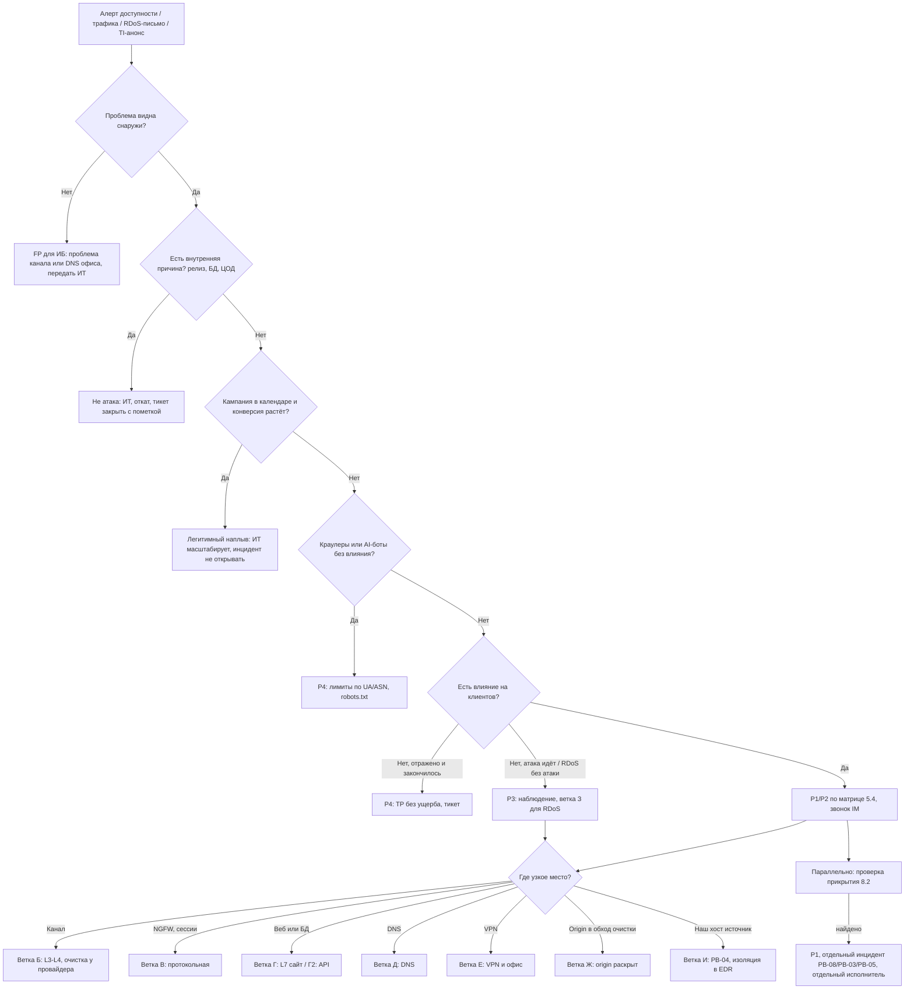

# PB-06 DDoS-атака на публичные сервисы

> Учебный плейбук для вымышленной компании «Альфа-Трейд». Опирается на IR-план (`source/ir-plan.md`): роли, критичность P1–P4, сроки и каналы связи берутся оттуда. Пометка **[проверить]** означает факт, который зависит от продукта, редакции закона или версии ATT&CK; перед реальным применением его нужно сверить с первоисточником. Примеры запросов и команд даны для ориентира: синтаксис написан в нейтральном псевдо-SPL, а имена полей зависят от вашего SIEM (MaxPatrol SIEM, KUMA, RuSIEM и т. п.), NGFW и WAF. Все пороги и тайминги учебные: в реальной компании их ставят по собственной baseline, SLA провайдеров и стоимости простоя.

Главный принцип: **при DDoS исход решается до атаки.** Если нет договора с анти-DDoS-провайдером, скрытого origin, заготовленных правил и контактов NOC, реагирование сводится к ожиданию. Поэтому раздел «Предусловия» (2.3) здесь важнее, чем в любом другом плейбуке.

Главный порядок действий: **подтвердить снаружи → исключить «не атаку» → найти узкое место → включить самую узкую работающую меру → параллельно искать прикрытие → снимать меры по одной.**

## 1. Паспорт плейбука

| Поле | Значение |
| --- | --- |
| ID | PB-06 |
| Версия | 1.0 (31.10.2026) |
| Владелец | Руководитель ИБ (он же руководитель реагирования, IM) |
| Пересмотр | Раз в 6 месяцев, после каждого P1/P2 по DDoS и после смены анти-DDoS-провайдера или схемы подключения |
| Критичность по умолчанию | **P2 до завершения триажа**: сайт и API приносят всю выручку (≈1 млн ₽/ч, ≈17 тыс. ₽/мин) |
| Изменение критичности | **Повышается до P1:** сайт, оформление заказа, оплата или API недоступны с ≥2 внешних точек > 3 мин или 5xx > 20 %; не резолвится DNS-зона; есть любые признаки параллельного вторжения. **Понижается до P3:** атака продолжается, но полностью отражается без влияния на клиентов; RDoS-письмо без атаки. **До P4:** всплеск отражён автоматически и закончился до триажа. Полная матрица — 5.4 |
| MITRE ATT&CK | **Impact (TA0040):** T1498.001 Direct Network Flood; T1498.002 Reflection Amplification; T1499.001 OS Exhaustion Flood; T1499.002 Service Exhaustion Flood; T1499.003 Application Exhaustion Flood; T1499.004 Application or System Exploitation; T1657 Financial Theft — для RDoS-вымогательства **[проверить, что описание T1657 в вашей версии ATT&CK покрывает вымогательство]**. **Resource Development (TA0042), контекст TI:** T1583.005 / T1584.005 Botnet. **Смежные при «прикрытии»:** T1190 Exploit Public-Facing Application, T1110.004 Credential Stuffing, T1078 Valid Accounts, T1041 / T1567 Exfiltration. **Смягчение:** M1037 Filter Network Traffic |
| Связанные плейбуки | PB-08 Взлом веб-приложения (DDoS как прикрытие), PB-03 Компрометация учётной записи (credential stuffing на /login), PB-05 Утечка данных (найден доступ к ПДн, ошибка кэша), PB-04 Вредонос на рабочей станции (наш хост — источник флуда), PB-10 Компрометация облачного аккаунта (входы в облачную почту под шумок), PB-S1 Сработка WAF, PB-S2 Сработка NGFW |

**Целевые сроки по фазам** (учебные, для P1; отсчёт от первой сработки T0):

| Этап | Цель | Кто |
| --- | --- | --- |
| Подтверждение недоступности с внешних точек, тикет | T0 + 5 мин | L1 |
| Эскалация L2 и дежурному сетевику **звонком**, сообщение IM | T0 + 10 мин | L1 |
| Классификация: не атака / L3–L4 / протокольная / L7 / DNS / VPN | T0 + 15 мин | L2 |
| Решение IM о переключении на очистку или режиме деградации | T0 + 15–20 мин | IM |
| Защита включена или запрос в NOC отправлен | T0 + 30 мин (реально — по TTM из договора) | Сетевик / L2 |
| Старт проверки «прикрытия» | T0 + 30 мин, параллельно сдерживанию | L2 (отдельный исполнитель) |
| Первый статус директору и владельцу сайта | T0 + 30 мин, далее каждые 30–60 мин в острой фазе | IM |
| Эскалация к директору для решений по бюджету | T0 + 1 ч, если сайт ещё недоступен | IM |
| Начало снятия мер | ≥ 2 ч без всплесков выше 2× baseline | L2 + IM |
| Закрытие | 72 ч (P1) / 48 ч (P2) без повторной волны | IM |

## 2. Назначение и область применения

**Цель:** быстро отличить атаку на доступность от сбоя или легитимного наплыва, найти узкое место, восстановить доступность самой узкой работающей мерой, не отрезав настоящих клиентов, и одновременно убедиться, что DDoS не прикрывает вторжение.

### 2.1 Входит в область

- Атаки на доступность публичных сервисов «Альфа-Трейд»: сайт магазина, API мобильного приложения, авторитативный DNS, VPN-шлюз, почтовый шлюз в DMZ, публичные IP офиса, весь префикс (канал и NGFW).
- Все классы: объёмные L3–L4 (UDP-флуд, отражённые атаки, carpet bombing по подсети), протокольные (SYN/ACK/RST flood, исчерпание таблицы сессий NGFW), прикладные L7 (HTTP-флуд, тяжёлые запросы к поиску и фильтрам, HTTP/2 Rapid Reset и аналоги), атаки на DNS (в том числе random subdomain / water torture), мультивекторные и пульсирующие (pulse-wave).
- RDoS: письмо с требованием выкупа, в том числе без атаки или с «демонстрационной» атакой. Анонс атаки в Telegram-каналах хактивистов.
- Экономический DoS (EDoS): атака не кладёт сервис, но раздувает счёт за облачное автомасштабирование.

### 2.2 Не входит

- Сбои без злого умысла: неудачный релиз, медленная БД, сбой у провайдера или в ЦОД. Плейбук помогает их **распознать** (ветка А) и передаёт в ИТ.
- Агрессивные краулеры, AI-боты, парсеры конкурентов — не инцидент ИБ уровня P1; обрабатываются как P4 с лимитами (ветка А2).
- Бот-атаки на бизнес-логику (credential stuffing, card testing, скальпинг) распознаются здесь, но расследуются по PB-03 или с участием платёжного провайдера.
- Исходящий флуд из нашей сети (наш хост — участник ботнета или открытый рефлектор) — PB-04.
- Расследование вторжения, найденного под прикрытием DDoS, — PB-08, PB-03, PB-05.

### 2.3 Предусловия (подготовка)

Невыполненный пункт записывается в тикет как ограничение реагирования и попадает в список улучшений.

- [ ] **Договор с анти-DDoS-провайдером** на L3–L4 и L7. Зафиксированы: модель (always-on или on-demand), способ подключения (DNS, BGP-анонс, GRE-туннель), гарантированное время включения (TTM), лимит по объёму и цена сверх лимита, номер договора, ID клиента, кодовое слово, список лиц «Альфа-Трейд», вправе инициировать включение. Для сайта с простоем 1 млн ₽/ч целевая модель — **always-on для L7**, on-demand — только резерв.
- [ ] **ПДн в трафике провайдера.** При L7-защите провайдер расшифровывает TLS и видит логины, телефоны, адреса клиентов. Договор содержит поручение обработки ПДн (152-ФЗ, ст. 6 ч. 3 **[проверить]**); если провайдер иностранный, оценена трансграничная передача (ст. 12, порядок уведомления РКН **[проверить актуальную редакцию]**). Решается юристом/DPO заранее, не во время атаки.
- [ ] **Контакты 24/7** с телефоном, почтой и порталом: NOC интернет-провайдера, NOC анти-DDoS-провайдера, хостинг/ЦОД, регистратор и DNS-провайдер, CDN, платёжный провайдер. Проверяются раз в квартал. **Офлайн-копия** у дежурного L2, сетевика и IM: при DDoS могут лежать почта и VPN.
- [ ] **Процедура переключения на очистку** пошагово (кто, где, что меняет; как проверить; как откатить). Протестирована хотя бы раз.
- [ ] **TTL** A/AAAA/CNAME сайта и API ≤ 300 с, если переключение идёт через DNS. DNS-зона у провайдера с anycast; есть вторичный DNS у другого провайдера.
- [ ] **Origin скрыт и закрыт.** На NGFW входящие 80/443 к origin разрешены только с подсетей провайдера защиты (список — в приложении, обновляется ежеквартально). IP origin не используется для MX, SPF и поддоменов (`dev.`, `old.`, `mail.`, `ftp.`), не светится в заголовках исходящих писем сайта.
- [ ] **Baseline** по часам и дням недели (будни, выходные, распродажи): bps, pps, новые соединения/с (CPS), сессии NGFW, RPS всего и по ключевым URI, уникальные IP в минуту, доля 4xx/5xx, p95 латентности, cache hit ratio, распределение по странам и ASN. Хранится в SIEM как lookup, обновляется ежемесячно.
- [ ] **Календарь маркетинга** (распродажи, рассылки, push, реклама) доступен L1 без звонка: wiki или lookup в SIEM.
- [ ] **Внешний мониторинг** из ≥3 точек (разные регионы и операторы) по главной, `/cart`, `/api/health`; алерт в SIEM и на телефон дежурного.
- [ ] **Режим деградации**, подписанный владельцем сайта: что ИТ отключает без отдельного апрува (полнотекстовый поиск, рекомендации, сложные фильтры, отзывы, промокоды) и что нельзя (корзина, оплата, ЛК). Feature flags, статическая версия каталога, страница «заказ по телефону».
- [ ] **Заготовленные правила WAF и NGFW** в режиме «выключено» или «только лог»: лимиты на `/search`, `/catalog`, `/login`, `/cart`, `/api/*`; challenge на HTML-пути; «under attack»; гео/ASN-профили; DoS-профили NGFW. Протестированы на стенде.
- [ ] **Allowlist**, который нельзя ломать: платёжный провайдер (webhook), службы доставки, партнёры по API, внешний мониторинг, поисковые боты (проверка по обратному DNS), офис, CI/CD. Мобильное приложение распознаётся по токену или заголовку, а не по IP.
- [ ] **Журналы под нагрузкой.** NetFlow/sFlow/IPFIX с бордера собирается. Флуд-события WAF/NGFW уходят в SIEM агрегатами, сырые журналы — в отдельное хранилище с запасом диска. Есть алерт на превышение EPS и на потерю событий, алерт на переход WAF/IPS в bypass (fail-open).
- [ ] **Канал управления вне атакуемого** (отдельный провайдер или LTE) к консолям NGFW, WAF, гипервизоров и SIEM.
- [ ] **Статус-страница** на независимой инфраструктуре (не тот ЦОД, не тот IP) и заготовленные тексты.
- [ ] **Облако:** лимиты автомасштабирования и бюджетные алерты (защита от EDoS).
- [ ] **TI:** мониторинг анонсов атак на компанию и отрасль в Telegram-каналах хактивистов и бюллетенях провайдеров защиты.
- [ ] **Учения:** tabletop по этому плейбуку раз в квартал (в том числе RDoS); технический тест переключения раз в год — только по письменной договорённости с провайдером связи, анти-DDoS-провайдером и хостингом.

## 3. Триггеры и источники обнаружения

| Источник | Что видим | Поля / показатели | Пример правила или запроса (пример) |
| --- | --- | --- | --- |
| Внешний мониторинг (≥3 точки) | Сайт или API не отвечает, медленно отвечает | HTTP-код, время ответа, точка проверки | 2 из 3 точек: ошибка или ответ > 5 с два раза подряд → алерт; ≥2 точек недоступны > 3 мин → P1 |
| NetFlow / SNMP бордера | Рост входящего трафика, пакетов | bps, pps на uplink и по префиксу; `protocol`, `src_port`, `dst_ip`, размер пакета | bps > 70 % ёмкости канала ≥ 1 мин или pps > 5× baseline этого часа |
| NGFW | Рост новых соединений, заполнение таблицы сессий, рост CPU, срабатывания DoS-профиля | CPS, active sessions, session table utilization, CPU dataplane, события DoS/IPS (SYN flood threshold, UDP flood) | Сессии > 80 % лимита модели, CPS > 5× baseline, CPU > 85 % **[конкретные счётчики и события зависят от вендора]** |
| WAF / балансировщик | Рост RPS, концентрация на нескольких URI, рост 5xx/499 | `uri_path`, `http_status`, `src_ip`, `X-Forwarded-For`, `http_user_agent`, `http_referer`, `ja4`/`ja3`, `src_asn`, `src_country`, наличие cookie | RPS > 3× baseline того же часа и дня недели или 5xx > 5 %; доля top-1 URI > 40 % |
| Веб-сервер, APM | Рост латентности, очереди воркеров, ошибки | nginx `$request_time`, `$upstream_response_time`, `stub_status` (active connections); p95 | p95 > 3× baseline ≥ 5 мин |
| БД | Пул соединений исчерпан, медленные запросы | активные соединения, slow query log | > 80 % пула |
| DNS-провайдер | Рост QPS, много NXDOMAIN | QPS, rcode, случайные поддомены | NXDOMAIN > 50 % при росте QPS → признак water torture |
| Анти-DDoS-провайдер | Уведомление об атаке, отчёт | портал, почта, webhook/API в SIEM | Любое уведомление → тикет L1, информирование IM |
| Интернет-провайдер | Сообщение о blackhole (RTBH) на наш IP | звонок, письмо NOC | Сайт «пропал», а на наших графиках атаки нет → спросить провайдера |
| Почтовый шлюз / облачная почта | RDoS-письмо | тема, отправитель, тело: «DDoS», «bitcoin», «BTC», «Monero», «ваш сайт будет», «attack» | Поиск по ключевым словам за 7 дней по всем ящикам |
| Поддержка, соцсети | Жалобы клиентов | обращения «сайт не открывается», «не проходит оплата» | ≥ 5 обращений за 10 мин → L1 |
| TI | Анонс «Альфа-Трейд» как цели | скриншот поста, канал, дата | Любое упоминание → L2 → IM |
| Облако | Аномальный рост инстансов и счёта | метрики автоскейлинга, бюджетный алерт | Превышение бюджетного порога |
| NGFW (исходящее) | Наш хост генерирует флуд | `src_zone=internal`, большие объёмы на много внешних адресов | Обратный сценарий → PB-04 |

Правило сравнения с baseline (пример): сравнивать с **тем же часом того же дня недели** прошлой недели, а не со средним за сутки, иначе каждое утро будет «аномалией».

```
index=waf dest_host="shop.alfa-trade.example" earliest=-2h
| timechart span=1m count AS rps_now
| appendcols [ search index=waf dest_host="shop.alfa-trade.example" earliest=-7d-2h latest=-7d
  | timechart span=1m count AS rps_week_ago ]
| eval ratio=round(rps_now/rps_week_ago,1)
| where ratio > 3
```

Признак **carpet bombing**: каждый отдельный адрес ниже порога, но вся подсеть растёт равномерно. Поэтому пороги NetFlow считают и по `dst_ip`, и по агрегату `dst_subnet24`.

## 4. Роли и RACI

R — выполняет, A — утверждает и отвечает, C — консультирует, I — информируется.

| Действие | L1 | L2 | IM | ИТ (сеть / веб) | Владелец сайта | Юрист / DPO | PR | Директор |
| --- | --- | --- | --- | --- | --- | --- | --- | --- |
| Детект, тикет, первичный триаж | R | C | I | C | | | | |
| Определение вектора и цели | C | R | A | C | | | | |
| Присвоение P1/P2 | C | R | A | | I | | | I (P1) |
| Переключение на очистку (DNS/BGP), вызов NOC | | C | A | R | I | | | C (если доплата) |
| Узкие меры WAF (лимиты, сигнатуры) | | R | A | C | I | | | |
| Challenge на весь сайт, гео/ASN-челлендж, «under attack» | | R | A | C | A | | | |
| Отключение функций, статический режим | | C | A | R | A | | I | C (P1 > 1 ч) |
| RTBH на IP, смена IP origin | | C | A | R | A | | | |
| Проверка «прикрытия» | | R | A | C | | I | | |
| Сбор артефактов | | R | A | C | | C | | |
| Скрипт поддержки, статус-страница, соцсети | | | A | | C | C | R | |
| RDoS: решение о контактах и обращении в полицию | | C | R | | C | R | C | A |
| Остановка рекламы и рассылок | | | C | | R | | R | |
| Сверка заказов и платежей | | | I | C | R | | | |
| Снятие мер, закрытие | | R | A | C | C | | I | I |

Правило полномочий IR-плана в этом сценарии: L2 сам блокирует **один** внешний IP и включает заготовленные узкие правила. Всё, что затрагивает весь трафик сайта или его функции, — с апрувом IM, а остановка или деградация сайта — ещё и владельца сайта. Полная матрица апрувов — 6.1.

## 5. Триаж (первые 15–30 минут)

### 5.1 L1: первые 10 минут

1. **Зафиксировать T0** по первой сработке (UTC+3), завести тикет «DDoS (подозрение)». Всё дальнейшее записывать в тикет со временем.
2. **Подтвердить снаружи.** Внешний мониторинг (≥2 точки) или проверка с устройства вне корпоративной сети:
   ```bash
   dig +short shop.alfa-trade.example A
   dig +short shop.alfa-trade.example NS
   curl -o /dev/null -s -w 'code=%{http_code} connect=%{time_connect} ttfb=%{time_starttransfer} total=%{time_total}\n' https://shop.alfa-trade.example/
   ```
   Проблема только изнутри офиса → вероятно, собственный канал или DNS офиса → ИТ, не DDoS.
3. **Что именно не работает.** Отметить: сайт / корзина / оплата / API / DNS / VPN / почта. Не работает **всё** на периметре → сразу P1 и звонок сетевику.
4. **Исключить внутреннюю причину.** Журнал изменений и CI/CD за 2–4 часа: релиз, смена конфигурации, сброс кэша CDN. Дашборд приложения: трафик в норме, а время ответа БД выросло → сбой, не атака → ИТ.
5. **Исключить наплыв.** Календарь кампаний; дашборд WAF «топ URI / Referer / доля статики / конверсия». Признаки — таблица 5.2.
6. **Проверить контекст.** RDoS-письма (поиск по ключевым словам из раздела 3), уведомление провайдера, анонс в TI, параллельные сработки высокой критичности в SIEM.
7. **Эскалация.** P1/P2 или ≥2 признака атаки — немедленно звонок L2 и дежурному сетевику, сообщение IM. Не ждать подтверждения маркетинга: ложная тревога по DDoS дешевле 30 минут простоя (≈0,5 млн ₽).

**L1 НЕ делает:** не блокирует IP и страны, не меняет правила WAF и NGFW, не отвечает на письма вымогателя, не звонит провайдеру без L2/IM, не публикует ничего от имени компании.

### 5.2 Наплыв или атака

| Признак | Легитимный наплыв | L7-атака |
| --- | --- | --- |
| Календарь кампаний | Есть рассылка, push, реклама | Нет |
| Referer | Реклама, поиск, рассылка (utm-метки) | Пусто или одинаковый |
| Распределение URI | Широкое: главная, каталог, карточки, корзина | Узкое: 1–3 URI (`/search?q=<случайное>`, `/catalog?filter=...`, `/api/...`) |
| Статика (css/js/img) | Запрашивается пропорционально | Почти не запрашивается |
| Cookies и сессии | Большинство с сессионной cookie, есть повторные клиенты | Почти все сессии новые, без cookie или с одной и той же |
| User-Agent и TLS | Реалистичное распределение | Один UA, устаревшие UA; UA не совпадает с TLS-фингерпринтом (JA4); один JA4 на тысячи IP |
| Конверсия | Растут корзины и заказы | RPS растёт, заказы стоят или падают |
| Cache hit ratio | Растёт (все смотрят акцию) | Падает (случайные параметры сбивают кэш) |
| Гео / ASN | Домашние и мобильные операторы целевых регионов | Хостинги, облака, VPN-сервисы; либо резидентные сети, но с аномальным поведением |
| Поведение | Навигация, паузы | Одинаковые интервалы, повтор одного запроса |

Правило: **кампании нет и ≥2 признака атаки → атака.** Кампания есть → проверить конверсию и распределение URI; при наплыве передать ИТ (масштабирование), инцидент ИБ не открывать. Резидентные прокси и headless-браузеры делают источники похожими на обычных абонентов, поэтому поведенческие признаки и фингерпринты важнее гео.

### 5.3 L2: где узкое место и какой вектор

Пройти цепочку снаружи внутрь: **канал → бордер → NGFW → WAF/балансировщик → веб-сервер → приложение → БД.** Узкое место определяет ветку.

**A. Канал и бордер (L3–L4).** NetFlow по портам источника (пример):
```
index=netflow dest_ip IN (<подсеть DMZ>) earliest=-15m
| stats sum(bytes) AS bytes sum(packets) AS pkts dc(src_ip) AS uniq_src by protocol, src_port
| sort -bytes | head 20
```
- UDP с портов источника 53 (DNS), 123 (NTP), 389 (CLDAP), 1900 (SSDP), 11211 (memcached), 19 (CharGEN), 3702 (WS-Discovery), крупные пакеты → отражённая атака (T1498.002). IP-источники — легитимные отражатели, **не атакующий**: блокировать их список бессмысленно.
- Много TCP SYN без завершения рукопожатия → SYN flood (T1499.001).
- Много фрагментов UDP/ICMP → направленный флуд (T1498.001).
- Тот же запрос `by dest_subnet24` → carpet bombing.

**B. NGFW (протокольная).** CPU dataplane, заполнение таблицы сессий, отброшенные пакеты, срабатывания DoS-профиля **[конкретные команды и пути в интерфейсе вписать для своего NGFW]**. Если NGFW захлебнулся, страдает весь периметр, включая VPN и исходящий трафик.

**C. Веб-сервер (Linux), выполняет ИТ или L2 с доступом:**
```bash
ss -s                                          # сводка по сокетам
ss -Htan state syn-recv | wc -l                 # полуоткрытые соединения
ss -Htan state established '( sport = :443 )' | wc -l
cat /proc/sys/net/netfilter/nf_conntrack_count /proc/sys/net/netfilter/nf_conntrack_max
# Топ URI без параметров, топ UA (формат combined). За прокси $1 — IP прокси, нужен столбец X-Forwarded-For
tail -n 100000 /var/log/nginx/access.log | awk '{split($7,a,"?"); print a[1]}' | sort | uniq -c | sort -rn | head -20
tail -n 100000 /var/log/nginx/access.log | awk -F'"' '{print $6}' | sort | uniq -c | sort -rn | head -20
```
Для IIS: журналы `%SystemDrive%\inetpub\logs\LogFiles\` и HTTP.sys `%SystemRoot%\System32\LogFiles\HTTPERR\` (причины вида `Connection_Dropped`, `Timer_ConnectionIdle` **[проверить перечень по документации Microsoft]**). Windows Event ID для самого DDoS малоинформативны: картина — в сетевых журналах.

**D. L7 в WAF (пример):**
```
index=waf dest_host="shop.alfa-trade.example" earliest=-30m
| timechart span=1m count by http_status
```
Рост 502/503/504 — бэкенд не справляется; 499 (nginx) — клиенты не дожидаются ответа; 403/429 — уже работают WAF или лимиты.
```
index=waf earliest=-15m
| stats count dc(src_ip) AS uniq_ip dc(uri_path) AS uniq_uri by ja4, http_user_agent, src_asn
| sort -count | head 20
```
Один JA4 на сотни IP с разными UA — ботнет с подделанным UA. JA3 менее стабилен из-за рандомизации расширений TLS в браузерах, JA4 предпочтительнее. Если перед WAF стоит CDN или очистка, в `src_ip` будет IP провайдера; реальный IP — в `X-Forwarded-For` или вендорском заголовке, и доверять ему можно **только** для запросов из диапазонов провайдера.

**E. HTTP/2.** Много `RST_STREAM` на соединение при малом числе соединений — признак HTTP/2 Rapid Reset (CVE-2023-44487); класс атак CONTINUATION flood (2024) **[проверить CVE по конкретным продуктам]**. ИТ сверяет версии nginx/HAProxy/WAF с бюллетенями вендоров.

**F. Бизнес-логика.** Нагрузка на `/login`, `/api/*/auth` → проверить долю успешных входов (пример):
```
index=web (uri_path="/login" OR uri_path="/api/v1/auth*") earliest=-30m
| eval result=case(login_result="success","success", http_status IN (401,403),"fail", true(),"other")
| timechart span=1m count by result
```
Растут успешные входы с новых устройств → **credential stuffing**, параллельно PB-03. Короткие серии разных карт на `/payment` → **card testing**, уведомить платёжного провайдера. Если приложение не пишет событие «успешный вход», это пробел подготовки.

**G. Цель.** Какой IP/FQDN атакован. Атака идёт на IP origin в обход провайдера очистки → **origin раскрыт** (ветка Ж).

Записать в тикет: векторы, цель, пиковые bps/pps/RPS, T0, подтехнику ATT&CK, гипотезу о мотиве (RDoS, хактивизм, конкурент, прикрытие).

### 5.4 Матрица критичности (по худшему признаку)

| Уровень | Условие (любое) | Реакция до | Кого уведомить |
| --- | --- | --- | --- |
| **P1** | Сайт, оформление заказа, оплата или API недоступны с ≥2 внешних точек > 3 мин или 5xx > 20 % дольше 5 мин; DNS-зона не резолвится; лежит весь периметр; **любые** признаки параллельного вторжения или утечки | 15 мин, 24/7 | IM, директор, юрист (по IR-плану), владелец сайта, сетевик/ИТ; PR и поддержка — сразу, т. к. клиенты уже видят |
| **P2** | Деградация: p95 корзины или оплаты > 3× baseline или 5xx 5–20 %; недоступен VPN; атака отражается, но провайдер сообщает о росте объёмов | 1 ч | IM, ИТ, владелец сайта |
| **P3** | Атака продолжается и отражается без влияния на клиентов (в том числе после ручных мер L2); RDoS-письмо без атаки или с короткой демонстрационной атакой; анонс атаки в TI | 4 ч | Дежурный L2; IM — информационно; при RDoS — IM и юрист обязательно |
| **P4** | Всплеск отражён автоматически (облачная защита, DoS-профиль NGFW) и закончился до триажа; нагрузка от краулеров без влияния | 1 рабочий день | Только тикет |

P3 для продолжающейся отражённой атаки, а не P4 из IR-плана, оправдан тем, что атака активна и может усилиться или сменить вектор.

### 5.5 Дерево решений



### 5.6 Критерии эскалации

- **Немедленно IM (звонок):** любой P1/P2; недоступность > 10 мин; провайдер не отвечает или очистка не дала эффекта за 15 мин; нужна мера с апрувом IM (6.1).
- **Директор:** P1 (по IR-плану); сайт недоступен > 1 ч; нужна доплата сверх лимита или экстренный договор; решение по RDoS.
- **Юрист/DPO:** RDoS-письмо; признаки доступа к ПДн; ошибка кэширования, показавшая данные одного клиента другому; экстренное подключение провайдера без договора поручения.
- **Владелец сайта:** любая мера, влияющая на конверсию (challenge на весь сайт, гео, отключение функций), и оценка ущерба.

## 6. Сдерживание

Принцип: **самая узкая мера, которая работает.** После каждой меры 5–15 минут на оценку эффекта по RPS к origin, доле 5xx, внешнему мониторингу и числу заказов в минуту. Не помогло за 15 минут — следующий шаг.

### 6.1 Матрица полномочий

| Действие | Делает | Апрув | Примечание |
| --- | --- | --- | --- |
| Блок одного внешнего IP / узкой подсети хостинга | L2 | Не нужен (IR-план) | Против ботнета малоэффективно |
| Rate limit на URI из заготовленного списка | L2 | Не нужен, уведомить IM | Заготовленные правила |
| Блок по точной сигнатуре (JA4, набор заголовков, шаблон параметра) | L2 | IM, можно постфактум в течение 15 мин | Сначала 5 мин в режиме monitor |
| Блок по ASN хостинга | L2 | IM | Проверить, что там нет партнёров |
| JS/managed challenge на HTML-пути всего сайта | L2 | IM | Влияет на конверсию |
| Капча или «under attack» для всех | L2 | IM + владелец сайта | Существенное влияние на продажи |
| Гео/ASN-**челлендж** (не блок) | L2 / ИТ | IM + владелец сайта | Только с allowlist |
| Гео-**блок** | L2 / ИТ | IM + владелец сайта | Крайняя мера, см. 6.5 |
| Отключение функции из списка «можно» | ИТ | Не нужен (согласовано заранее) | Записать в тикет |
| Отключение корзины, оплаты, ЛК; статический режим | ИТ | Владелец сайта + IM; директор при P1 > 1 ч | |
| Переключение на очистку (DNS/BGP) | Сетевик | IM (при always-on — уведомить IM) | Время — в тикет |
| Ослабление инспекции IPS на NGFW | Сетевик | IM | Обязательно вернуть |
| RTBH на IP | Сетевик через провайдера | IM + владелец сайта | Доводит атаку на этот IP «до конца» |
| Смена IP origin | ИТ | IM + владелец сайта | Только после включения защиты |
| Оплата сверх лимита, экстренный договор | IM | Директор | Иностранный сервис — ещё юрист/DPO |
| Возврат ранее снятой меры при повторной волне | L2 | Не нужен (апрув дан заранее) | |

### 6.2 Краткосрочное сдерживание по веткам

**Ветка Б. Объёмная L3–L4.** Своими силами забитый канал не спасти: трафик теряется у провайдера до NGFW.
1. L2/сетевик: звонок в NOC анти-DDoS-провайдера по номеру из контактов (не искать на сайте во время атаки), шаблон обращения — ниже. Апрув IM.
2. Сетевик, **вариант DNS** (вероятный для «Альфа-Трейд» без собственного AS): сменить A/CNAME сайта и API на адреса провайдера. Эффект наступает по мере истечения TTL у резолверов.
3. Сетевик, **вариант BGP** (если есть свой AS и префикс не уже /24): провайдер анонсирует префикс, чистый трафик возвращается по GRE-туннелю или стыку. Проверить MTU туннеля — частая причина «висящих» HTTPS-сессий.
4. **Сразу после переключения:** на NGFW разрешить 80/443 к origin только с подсетей провайдера. **Не блокировать IP провайдера** — теперь это «источник» всего трафика.
5. Провайдер связи: фильтрация по портам источника отражённых атак (UDP 53/123/389/1900/11211 к нашим адресам, где мы эти сервисы не принимаем), Flowspec или ACL. RTBH — только на IP, без которого бизнес переживёт, или как крайняя мера ради остального канала.
6. Проверить из нескольких внешних точек: сайт открывается, сертификат корректен, платёжные колбэки доходят.
7. Таймер: нет эффекта за 15 мин → эскалация на руководителя смены провайдера и IM; при наличии договора — резервный провайдер.

**Шаблон обращения в NOC:**
> Компания «Альфа-Трейд», договор № ___, ID клиента ___, кодовое слово ___. Атакуемые ресурсы: ___ (IP / подсеть / FQDN). Начало: ___ UTC (___ МСК). Тип по нашим данным: ___ (например, UDP-амплификация с портов 123/389, пик ~__ Гбит/с, ~__ Mpps; или HTTP-флуд на /search, ~__ тыс. RPS, JA4 ___). Влияние: недоступность / деградация с ___. Сделано: ___. Просим: включить фильтрацию / ужесточить профиль / сохранить данные и прислать отчёт по векторам. Контакт: ___, резервный ___.

**Ветка В. Протокольная (NGFW захлёбывается).**
1. Сетевик: на NGFW включить или ужесточить DoS-защиту — SYN cookies или SYN proxy, лимит новых сессий на источник и на назначение, снизить таймауты полуоткрытых и неактивных соединений для атакуемого сервиса.
2. Если таблица сессий всё равно переполняется — переносить фильтрацию выше: к провайдеру или в stateless ACL на бордер-маршрутизаторе.
3. Временный вывод атакуемого IP из-под тяжёлых профилей IPS — **только с апрувом IM**, с записью в тикет и обязательным возвратом: это снижает защиту от параллельной атаки.
4. ИТ на веб-серверах Linux: проверить `net.ipv4.tcp_syncookies=1` и размер backlog; изменения sysctl — через тикет.

**Ветка Г. L7, сайт.** Поэтапная эскалация, до шагов 3–7 обязателен allowlist (2.3).

| Шаг | Мера | Риск для клиентов |
| --- | --- | --- |
| 1 | Rate limit на атакуемый URI по составному ключу: IP + URI, сессия/cookie, JA4 (например, `/search` — не более N в минуту на сессию; N по baseline) | Низкий |
| 2 | Блок по точной сигнатуре: JA4, набор и порядок заголовков, фиксированный UA, шаблон параметра | Низкий при узкой сигнатуре |
| 3 | Challenge для подозрительных: хостинг-ASN, нет cookie, плохая репутация. **Не для API, колбэков и мониторинга** | Средний |
| 4 | Отключение тяжёлых функций через feature flags | Средний (конверсия) |
| 5 | Гео/ASN-челлендж вне целевой аудитории | Средний: клиенты через VPN с зарубежными IP |
| 6 | «Under attack»: challenge для всех HTML-запросов | Высокий |
| 7 | Статическая версия сайта или страница «заказ по телефону» | Очень высокий |

Только по IP лимитировать нельзя: за одним IP мобильного оператора (CGNAT) тысячи клиентов. Headless-браузеры проходят простой JS-challenge, поэтому при неэффективности шага 3 нужны поведенческие проверки и фингерпринты (функции зависят от WAF **[проверить возможности своего WAF]**). Проверка, что мера не задела клиентов: доля 403/429 у запросов с cookie и Referer с сайта, заказы в минуту по данным владельца.

**Кэширование — только безопасное.** Кэшировать анонимные страницы каталога и статику. Не кэшировать ответы с `Set-Cookie` и `Cache-Control: private`, пути `/cart`, `/checkout`, `/account`, `/api/user*`. Ошибка кэша показывает клиенту А корзину или адрес клиента Б — это уже утечка ПДн (PB-05).

**Ветка Г2. L7, API мобильного приложения.** Никакой капчи и JS-challenge (приложение перестанет работать). Лимиты по токену или идентификатору устройства; отказ неаутентифицированным запросам к тяжёлым методам; проверка подписи запросов или attestation, если они заложены в приложение **[зависит от платформы]**; приоритет авторизованным клиентам; при возможности — отдельный пул серверов для API.

**Ветка Д. DNS.** Признак: сайт не открывается по имени, но открывается по IP:
```bash
curl -s -o /dev/null -w '%{http_code}\n' --resolve shop.alfa-trade.example:443:<IP> https://shop.alfa-trade.example/
```
1. Сетевик: связаться с DNS-провайдером; убедиться, что NS у регистратора указывают и на вторичного провайдера.
2. Временно увеличить TTL записей сайта и API, чтобы резолверы дольше держали кэш (если провайдер принимает изменения).

**Ветка Е. VPN и офис.** ИТ переводит критичных сотрудников (ИБ, ИТ, поддержка, финансы) на резервный канал или альтернативный шлюз; команда реагирования переходит на резервный канал связи. С провайдером связи — фильтрация офисного диапазона. Проверить VPN на перебор паролей под шумок: журналы аутентификации VPN, Event ID 4625 на RADIUS/NPS при интеграции с AD. Если сайт пострадал от атаки на офис, значит, у них общий канал — урок для архитектуры.

**Ветка Ж. Origin раскрыт.** Признак: сайт за провайдером, но на NGFW соединения к origin не с адресов провайдера, или провайдер показывает «чистую» картину, а origin перегружен.
1. Сетевик: немедленно разрешить 80/443 к origin только с подсетей провайдера.
2. Если атака на IP origin забивает канал: фильтрация или RTBH у провайдера связи; ИТ выделяет новый IP, провайдер перенастраивает upstream. Новый IP нигде не публикуется.
3. После стабилизации L2 ищет источник утечки (раздел 9).

**Ветка З. RDoS.**
1. Не отвечать, не переходить по ссылкам, не пересылать письмо как есть, **не платить**. Тикет P3 (или по матрице, если идёт демонстрационная атака).
2. L2 с администратором почты: экспорт `.eml` с полными заголовками, SHA-256, извлечь отправителя, Reply-To, `Received`, адрес кошелька, сумму, сроки. Найти похожие письма у других сотрудников.
3. IM: проверить готовность защиты, предупредить анти-DDoS-провайдера и провайдера связи о возможной атаке в названное время, назначить усиленное дежурство на срок ультиматума.
4. Юрист: решение об обращении в полицию, пакет документов. Директор решает о любых контактах; **рекомендация плейбука — не платить**: оплата не гарантирует прекращения и помечает компанию как платящую. Отвечать — только по решению директора и юриста, с одного согласованного адреса.

**Ветка И. Наш хост — источник.** Изоляция хоста в EDR (в пределах полномочий L2), блок исходящего на NGFW, переход в PB-04.

**Маркетинг (все ветки при P1):** владелец сайта и PR приостанавливают платную рекламу и рассылки — они тратят деньги на неработающий сайт и добавляют нагрузку.

### 6.3 Долгосрочное сдерживание

- Защита остаётся в режиме always-on до решения на разборе; закрытый origin не снимается никогда.
- Временные правила WAF/NGFW переводятся в постоянные или получают владельца и дату пересмотра.
- Усиленное дежурство на срок RDoS-ультиматума и на даты, анонсированные хактивистами.
- Агрегированное логирование флуд-правил, чтобы SIEM не «ослеп» на следующей волне.
- Проверка лимитов автомасштабирования и бюджетных алертов в облаке.

### 6.4 Что НЕ делать

- Не блокировать «список IP-источников» при отражённой атаке: это легитимные DNS/NTP-серверы, канал забит до NGFW, а собственный резолвинг или NTP может сломаться.
- Не блокировать IP провайдера очистки после переключения — сайт отключится своими руками.
- Не включать капчу и JS-challenge на API, платёжные колбэки, интеграции и внешний мониторинг.
- Не делать гео-блок «всего зарубежного» без апрува: отрежутся клиенты в роуминге и через VPN, партнёры, мониторинг (вы «ослепнете»), поисковые боты; против российских резидентных прокси он не помогает.
- Не кэшировать персонализированные страницы.
- Не перезагружать NGFW или WAF «чтобы сбросить сессии» без экспорта состояния и апрува IM: пропадут журналы, возникнет окно без фильтрации, failover может уйти в неожиданный режим.
- Не писать полный pcap на атакуемом продакшен-сервере.
- Не подключать экстренно иностранный сервис защиты без апрува юриста/DPO (ПДн в трафике).
- Не отвечать вымогателю и не обсуждать детали защиты публично.
- Не откладывать проверку прикрытия до конца атаки.

## 7. Сбор и сохранение артефактов

Принцип: **доступность важнее улик, но сбор идёт параллельно сдерживанию**, потому что под нагрузкой журналы WAF ротируются, а буферы перезаписываются. Сбор не должен задерживать меры.

| Порядок (по летучести) | Артефакт | Как сохранить | Кто |
| --- | --- | --- | --- |
| 1. Сразу | Графики bps/pps/RPS/сессий, внешний мониторинг | Экспорт данных и скриншоты с видимыми метками времени | L2 |
| 1. Сразу | Состояние NGFW (сессии, CPU, DoS-события) и конфигурация WAF/NGFW «до изменений» | Экспорт политики, вывод счётчиков в файл | Сетевик |
| 1. Сразу | Семпл трафика | Короткий ротируемый pcap на сенсоре или SPAN, не на нагруженном сервере: `timeout 60 tcpdump -i <iface> -nn -s 128 -G 30 -W 2 -w /var/tmp/ddos_%Y%m%dT%H%M%S.pcap 'not port 22'` | Сетевик / L2 |
| 2. Первый час | Журналы WAF, NGFW, балансировщика, веб-серверов (access/error с реальным IP клиента), приложения, медленные запросы БД | Выгрузка в отдельное хранилище за период «T0 − 24 ч … сейчас» | L2 / ИТ |
| 2. Первый час | NetFlow/sFlow/IPFIX с бордера | Выгрузка за тот же период | Сетевик |
| 2. Первый час | Данные провайдеров | Попросить провайдера связи и анти-DDoS-провайдера сохранить их данные (срок хранения у них может быть коротким) | IM |
| 3. При наличии | RDoS-письмо | `.eml` с полными заголовками из облачной почты (не пересылать вложением), SHA-256, ссылки не открывать | L2 + админ почты |
| 3. При наличии | Анонсы хактивистов | Скриншот и веб-архив поста с URL, временем, SHA-256 | L2 |
| 4. Весь инцидент | Журнал мер | Что, когда, кем и с чьего апрува включено и снято | L2 |
| 5. После атаки | Итоговый отчёт провайдера (векторы, пики, длительность, топ-источники), экспорт событий SIEM за окно, оценка ущерба от владельца | Приложить к тикету | IM / владелец |

**Цепочка хранения.** Каждый файл хешируется (SHA-256) и записывается в тикет: кто собрал, когда, откуда, хеш, где хранится, кто получал доступ. Хранилище с ограниченным доступом и без права изменения для исполнителей. Время везде по NTP, в отчёте одна зона (UTC+3). Это нужно, если юрист решит подавать заявление в полицию.

## 8. Расследование

### 8.1 Вопросы и источники

| Вопрос | Источники |
| --- | --- |
| Что атаковано (IP, FQDN, сервис, вся подсеть)? | NetFlow, NGFW, WAF, отчёт провайдера |
| Какие векторы и как они менялись во времени (мультивекторная, pulse-wave)? | NetFlow, WAF по минутам, отчёт провайдера |
| Пиковые bps/pps/RPS, длительность, число уникальных источников? | Провайдер, NetFlow, WAF |
| Почему атака удалась: раскрыт ли origin, какие эндпоинты «тяжёлые», нет ли лимитов, уязвим ли веб-стек (HTTP/2)? | Журналы NGFW у origin, APM, профиль запросов, версии ПО |
| Когда началась атака и когда мы узнали (для MTTD)? | NetFlow и провайдер против времени первого алерта |
| Был ли «слепой» период мониторинга (потери EPS, bypass WAF/IPS)? | Счётчики SIEM и коллекторов, журналы WAF/NGFW |
| Был ли DDoS прикрытием? Затронуты ли данные? | Чек-лист 8.2 |
| Задели ли меры легитимных клиентов? | 403/429 у «чистых» сессий, жалобы, конверсия |
| Потерянные, задвоенные или «зависшие» заказы и платежи? | БД заказов, платёжный провайдер |
| Мотив и атрибуция (RDoS, хактивисты, конкурент)? | Письмо, TI, анонсы |

### 8.2 Проверка «прикрытия» (smokescreen)

Запускается **сразу после подтверждения атаки** отдельным исполнителем и повторяется после её окончания. Окно: «T0 − 2 ч … конец атаки + 24 ч». Под нагрузкой WAF/IPS могут уйти в fail-open, а SIEM — терять события, поэтому **отсутствие сработок не доказывает отсутствие атаки**.

- [ ] **Целостность мониторинга:** потери событий в SIEM, переполнение очередей коллекторов, bypass WAF/IPS, ослабленная инспекция. Есть слепое окно — зафиксировать и смотреть первичные журналы на устройствах.
- [ ] **Веб-приложение (T1190):** SQLi, RCE, path traversal, загрузка файлов, особенно **успешные** (200) и на админ-пути, `/.git`, `/.env`, бэкапы — с IP, не участвующих в флуде.
- [ ] **Личный кабинет (T1110.004):** рост неуспешных входов, успешные входы с новых устройств, смена телефона, e-mail или адреса доставки, списание бонусов.
- [ ] **Платежи и заказы:** аномалии в возвратах, промокодах, подарочных картах.
- [ ] **Удалённый доступ (T1078):** VPN и облачная почта — входы из новых стран и ASN; Windows Event ID 4624 (особенно Logon Type 10), 4625, 4740, 4672.
- [ ] **AD и серверы:** 4720, 4728/4732/4756 (добавление в группы), 7045 (служба), 4698 (задача), 1102 (очистка журнала).
- [ ] **EDR (серверы DMZ и серверного сегмента):** все детекты за окно; дочерние процессы веб-сервера (`nginx`/`php-fpm`/`w3wp` → `sh`/`cmd`/`powershell`); новые файлы в веб-каталогах.
- [ ] **Эксфильтрация (T1041, T1567):** исходящие объёмы с серверов БД и файлового сервера, облачные хранилища, DNS-туннелирование (длинные поддомены, много TXT).

Примеры запросов:
```
index=* tag=alert earliest=<T0-2h> NOT (category IN ("dos","ddos") OR signature="*flood*")
| stats count min(_time) AS first max(_time) AS last values(dest) AS targets by source_product, signature, severity
| sort -severity -count
```
```
index=ngfw direction=outbound src_zone IN ("servers","dmz") earliest=<T0-2h>
| stats sum(bytes_out) AS out by src_ip, dest_ip, dest_port, app
| where out > 500000000
| sort -out
```
(Порог 500 МБ учебный.) Найдено хоть одно подтверждение → P1, отдельный связанный инцидент по PB-08/PB-03/PB-05, уведомить юриста. **DDoS и вторжение не разбирает один человек.** Против вторжения не делать резких видимых действий, пока не собраны данные, и не обсуждать находки в каналах, которые могут быть скомпрометированы.

## 9. Устранение

Корневая причина DDoS — не вредонос внутри, а слабые места архитектуры, из-за которых атака удалась.

1. **Утечка origin.** Проверить исторические DNS-записи, поддомены, MX/SPF, заголовки исходящих писем сайта, CT-логи сертификатов, ответы API и страниц со ссылками на прямой IP. При раскрытии — смена IP (после включения защиты) и закрытие источника.
2. **Модель защиты.** IM и директор с расчётом ущерба принимают решение о переходе на always-on для L7 и о договоре L3–L4 с SLA.
3. **Тяжёлые эндпоинты.** Разработка: кэш анонимных выдач, ограничение размера выдачи и глубины пагинации, индексы в БД, постоянные лимиты.
4. **Веб-стек.** Патчи nginx/HAProxy/WAF против известных атак на HTTP/2, лимиты потоков (`max_concurrent_streams` и аналоги **[проверить имена параметров для своих продуктов]**).
5. **Временные правила** → постоянные (с владельцем и датой пересмотра) или снять.
6. **Детект.** Обновить baseline и пороги; правила на carpet bombing, на потерю EPS и на fail-open; агрегацию флуд-событий.
7. **Бизнес-логика.** Если был credential stuffing или card testing — меры по PB-03 и с платёжным провайдером.

## 10. Восстановление и мониторинг после инцидента

**Когда начинать снимать меры:** метрики ≤ baseline + 20 % (и без всплесков выше 2× baseline) не менее 2 часов, провайдер подтвердил окончание атаки.

**Порядок снятия** — обратный порядку включения, от самых дорогих для бизнеса, по одной мере, 30–60 мин наблюдения между шагами:
1. «Under attack» / капча на весь сайт и статический режим.
2. Гео/ASN-ограничения.
3. Feature flags (вернуть функции).
4. Challenge для подозрительных.
5. Узкие сигнатуры и лимиты — часто оставляются навсегда.

Вернулась волна — предыдущая мера включается обратно без нового апрува. **Не снимаются:** always-on, закрытый origin. Вернуть штатную инспекцию на NGFW/WAF, если её ослабляли.

**Проверка работы:** владелец сайта подтверждает главную, каталог, корзину, оплату, ЛК и API приложения; сверка заказов и платежей за период атаки с платёжным провайдером (зависшие, задвоенные, неподтверждённые оплаты).

**Что мониторить и сколько:**

| Что | Как | Срок |
| --- | --- | --- |
| Повторные волны: bps/pps/RPS против baseline, carpet bombing по подсети | Правила SIEM с пониженными порогами | 14 дней (IR-план: не менее 2 недель) |
| Фингерпринты и сигнатуры этой атаки (JA4, UA, шаблоны URI, ASN) | Правило-индикатор в WAF/SIEM | 14 дней, дальше по решению разбора |
| Прямые обращения к origin не с адресов провайдера | Правило на NGFW | Постоянно |
| Входы в ЛК, VPN, облачную почту; исходящие объёмы | Правила из 8.2 | 14 дней |
| Даты из RDoS-ультиматума и анонсов | Усиленное дежурство | До даты + 48 ч |
| Счёт и автоскейлинг облака | Бюджетные алерты | 30 дней |
| Конверсия и жалобы (ложные блокировки) | Дашборд владельца | 7 дней |

## 11. Коммуникации и уведомления

Рабочий канал — отдельный чат и тикет. Если DDoS положил VPN или корпоративный мессенджер — резервный канал из IR-плана (мессенджер на личных телефонах, звонки), контакты из офлайн-копии.

| Кому | Кто сообщает | Когда |
| --- | --- | --- |
| IM | L1 / L2 | P1/P2 — сразу звонком; P3 — информационно |
| Директор, юрист | IM | P1 — в течение 15 мин (IR-план); RDoS — юрист всегда |
| Владелец сайта, дежурный сетевик/ИТ | L1 / IM | P1/P2 — сразу |
| Анти-DDoS-провайдер, интернет-провайдер | Сетевик / L2 по апруву IM | При решении о переключении или фильтрации |
| DNS-провайдер, регистратор | Сетевик | Ветка Д |
| Платёжный провайдер, службы доставки, партнёры по API | Владелец сайта | Затронута оплата или интеграции; card testing |
| Поддержка и call-центр | PR + IM | С первых минут P1 — скрипт ответа |
| Клиенты (статус-страница, соцсети) | PR по апруву IM | P1, заметно клиентам |
| Маркетинг | Владелец сайта | P1 — остановить рекламу и рассылки |
| Полиция | Юрист по решению директора | RDoS, значительный ущерб |
| Роскомнадзор | Юрист/DPO | **Только** если найдена утечка или неправомерный доступ к ПДн (в том числе через ошибку кэша) — по PB-05, сроки 24/72 ч по IR-плану (152-ФЗ, ст. 21 ч. 3.1 **[проверить редакцию]**). Сам по себе DDoS — нарушение доступности и уведомления не требует |
| НКЦКИ | — | «Альфа-Трейд» не субъект КИИ — обязательного уведомления нет; добровольное взаимодействие **[проверить порядок для не-субъектов]** |

**Ритм статусов:** в острой фазе P1 — каждые 30–60 минут (план требует минимум раз в 2 часа, но при простое бизнесу нужен ритм чаще); после стабилизации — по IR-плану.

**Внутренний статус (шаблон):**
> [ЧЧ:ММ МСК] PB-06, P_. Сайт: недоступен / деградация / восстановлен с ЧЧ:ММ. Тип: ___ (подтверждено / предположительно). Сделано: ___. Влияние: ___ мин недоступности, заказы ___ (данные владельца). Проверка прикрытия: идёт / чисто / найдено. Дальше: ___. Нужны решения: ___ (кто, до какого времени). Следующий статус: ЧЧ:ММ.

**Для поддержки (после апрува IM):**
> Сейчас сайт работает с перебоями из-за повышенной нагрузки, специалисты уже восстанавливают работу. Оформленные заказы сохранены. Оформить заказ можно по телефону ___. Приносим извинения за неудобства.

Фразу «ваши данные в безопасности» добавлять **только** после завершённой проверки 8.2.

**Публично (PR):** факт проблемы, ожидаемое время, альтернативный способ заказа. Не называть провайдера защиты, IP, работающие и неработающие меры; не говорить «хакеры», «атака», «выкуп», пока это не подтверждено и не согласовано с IM и юристом.

**Правовые оговорки (решает юрист):** вымогательство может квалифицироваться по ст. 163 УК РФ, сама атака — по статьям гл. 28 УК РФ (ст. 272–274) **[проверить практику квалификации]**. Упоминаемая в профильной прессе возможность помощи от Роскомнадзора (ЦМУ ССОП) при атаках на российские ресурсы — дополнительный канал, не основной **[проверить существование и порядок обращения для коммерческих компаний]**.

## 12. Критерии закрытия

- [ ] Атака прекратилась по данным провайдера и собственного мониторинга; всплесков выше 2× baseline нет **72 ч (P1) / 48 ч (P2)**
- [ ] Владелец сайта подтвердил работу главной, каталога, корзины, оплаты, ЛК и API
- [ ] Сверка заказов и платежей с платёжным провайдером завершена
- [ ] Временные меры сняты или переведены в постоянные с владельцем и датой пересмотра
- [ ] Инспекция NGFW/WAF возвращена к штатной
- [ ] Проверка прикрытия (8.2) завершена и задокументирована, включая слепые окна мониторинга
- [ ] Origin проверен на раскрытие; при раскрытии IP сменён
- [ ] Отчёт провайдера получен; артефакты собраны, хешированы, хранятся по политике
- [ ] Журнал применённых мер с апрувами приложен к тикету
- [ ] Решение по always-on принято и задокументировано
- [ ] RDoS: юрист принял решение о полиции, письмо сохранено
- [ ] Включён повышенный мониторинг на 14 дней (раздел 10)
- [ ] Назначен разбор в течение 5 рабочих дней (IR-план)

## 13. Метрики

| Метрика | Определение |
| --- | --- |
| MTTD | От начала атаки (по провайдеру или NetFlow) до первого алерта |
| Time-to-escalate | От алерта до подключения IM |
| Time-to-divert | От решения IM до фактического перевода трафика на очистку (сравнить с TTM по договору) |
| Time-to-mitigate | От начала атаки до восстановления доступности для клиентов |
| MTTR | От обнаружения до полного восстановления (сайт работает без временных мер, кроме постоянных) |
| Downtime / degradation | Минуты полной недоступности и деградации — отдельно |
| Пики | bps, pps, RPS; векторы; число уникальных источников |
| Collateral damage | Доля легитимных клиентов, задетых мерами: отказы на challenge, ложные 403/429, жалобы, падение конверсии сверх ожидаемого |
| Слепое окно | Минуты потери событий SIEM или bypass WAF/IPS |
| Ущерб | Время простоя × 1 млн ₽/ч (учебная оценка) + фактические потерянные заказы + расходы на провайдера и сверхлимит + сверхурочные |

## 14. Типичные ошибки и ловушки

| Ошибка | Последствие | Как правильно |
| --- | --- | --- |
| «Подключить очистку» без договора | Часы или дни простоя, десятки миллионов ₽ | Договор, контакты и процедура — до атаки (2.3) |
| Ждать подтверждения маркетинга ночью | Потеряны первые 30 минут | Календарь в SIEM; ≥2 признака — эскалация |
| Нет ветки «не DDoS» | Капчей лечат сбой релиза или БД | Шаг 4 триажа: изменения и метрики приложения |
| Credential stuffing принят за DDoS | Нагрузку отбили, а взломанные аккаунты никто не проверил | Подветка F в 5.3, PB-03 |
| Гео-блок «всего зарубежного» | Отрезаны клиенты через VPN, партнёры, мониторинг; против резидентных прокси не помогает | Гео-челлендж, апрув владельца, allowlist |
| Rate limit только по IP | Тысячи клиентов за CGNAT получают 429 | Составной ключ: IP + URI + сессия + JA4 |
| Капча «на всё» | Ломаются мобильное приложение, колбэки, интеграции | Challenge только на HTML-пути, allowlist |
| Кэширование без ограничений | Клиент видит чужую корзину — утечка ПДн | Только анонимные страницы и статика |
| Блок IP провайдера после переключения | Сайт отключён своими руками | Реальный IP — из заголовка |
| Не проверен origin | Атака продолжается на старый IP, «провайдер не справляется» | Ветка Ж, закрытый origin |
| Проверка прикрытия после атаки | Данные уже ушли | Старт сразу после подтверждения |
| «Чисто» при потерянных событиях | Пропущено вторжение | Сначала проверить целостность мониторинга |
| Полный pcap на продакшене | Сбор улик сам роняет сервер | Короткий ротируемый семпл на сенсоре |
| Ответ вымогателю | Подтверждение «живой цели», повторные атаки | Не отвечать, сохранить `.eml`, юрист |
| Снятие мер «через час» | Вторая волна, повторный простой | Критерии раздела 10 |
| Закрытие через 24 ч | Следующая волна кампании застаёт врасплох | 48/72 ч и 14 дней мониторинга |
| Реклама продолжает работать | Деньги на лежащий сайт, лишняя нагрузка | Остановить кампании при P1 |
| Детали защиты в публичном сообщении | Атакующий перестраивается | Только факт и время восстановления |
| Автоскейлинг без лимитов | Сервис жив, а счёт на миллионы (EDoS) | Лимиты и бюджетные алерты |

## 15. Меры по предотвращению и улучшению защиты

- **Архитектура:** L7-защита always-on через reverse proxy; L3–L4-очистка по договору с SLA; закрытый и скрытый origin с регулярной проверкой; разделение каналов офиса и публичных сервисов; канал управления вне основного.
- **DNS:** anycast у двух независимых провайдеров; TTL под выбранную модель защиты.
- **Приложение:** постоянные лимиты на тяжёлые эндпоинты; кэш анонимных выдач; feature flags и статический режим, проверенные на учениях; отдельная защита API (токены, лимиты по устройству, подпись запросов).
- **Бот-менеджмент:** фингерпринты (JA4, HTTP/2) и поведенческие признаки вместо одних IP-лимитов.
- **Веб-стек:** своевременные патчи против атак на HTTP/2, лимиты потоков.
- **NGFW:** настроенные DoS-профили, SYN cookies, мониторинг таблицы сессий и CPU.
- **Мониторинг:** внешние проверки из ≥3 точек; baseline по часам и дням; агрегация флуд-событий; алерты на потерю EPS и на fail-open; NetFlow с бордера.
- **Облако:** лимиты автомасштабирования и бюджетные алерты.
- **TI:** мониторинг анонсов хактивистов и бюллетеней провайдеров защиты.
- **Процессы:** контакты проверяются раз в квартал; tabletop раз в квартал; тест переключения раз в год по договорённости с провайдерами; обратная связь провайдеру после каждого инцидента (фактический TTM против SLA).
- **Право:** договор поручения обработки ПДн с провайдером защиты; оценка трансграничной передачи — до подключения.

## 16. Учебная мини-ситуация (tabletop)

**Вводная.** Четверг, 11:00 (UTC+3). На общий ящик `info@` пришло письмо на английском: «Заплатите 0,3 BTC до понедельника, иначе ваш сайт ляжет. В доказательство — 30-минутная атака сегодня». В 14:10 внешний мониторинг фиксирует таймауты с двух точек из трёх. NGFW показывает рост новых сессий в 6 раз, загрузка канала 40 %. WAF: RPS в 15 раз выше baseline, 80 % запросов идут на `/search?q=<случайная строка>`, почти без cookie; один JA4 у 4 000 IP, почти все — российские домашние и мобильные операторы. Маркетинг на совещании до 15:00. Защита у провайдера по договору on-demand, переключение через DNS, TTL — 3600 с. В 14:25 в SIEM появляется сработка WAF средней критичности: запрос к `/admin/backup.zip` с кодом 200 с IP, которого нет среди источников флуда.

**Вопросы:**
1. Какую ветку и критичность вы присвоите в 14:15 и после 14:25? Кого и как уведомите?
2. Какие меры на WAF вы включите и в каком порядке? Почему гео-блок здесь не поможет, а лимит по IP навредит?
3. Чем опасен TTL 3600 с при переключении на провайдера и что нужно сделать с origin сразу после переключения?
4. Как вы распределите людей между DDoS и сработкой на `/admin/backup.zip`? Какие проверки из 8.2 запустите первыми и когда может понадобиться DPO?
5. Что вы ответите на письмо вымогателя и какие артефакты по нему сохраните? Какие два улучшения предложите на разборе?

## 17. Источники и что почитать

- MITRE ATT&CK: T1498 Network Denial of Service — https://attack.mitre.org/techniques/T1498/ ; T1499 Endpoint Denial of Service — https://attack.mitre.org/techniques/T1499/ ; T1657 Financial Theft — https://attack.mitre.org/techniques/T1657/ ; M1037 Filter Network Traffic — https://attack.mitre.org/mitigations/M1037/
- MITRE D3FEND (сопоставление техник и контрмер) — https://d3fend.mitre.org/
- NIST SP 800-61 Rev. 3 — https://csrc.nist.gov/pubs/sp/800/61/r3/final ; Rev. 2 проще для новичка.
- NIST SP 800-189, Resilient Interdomain Traffic Exchange: BGP Security and DDoS Mitigation — https://csrc.nist.gov/pubs/sp/800/189/final
- CISA, FBI, MS-ISAC: Understanding and Responding to Distributed Denial-of-Service Attacks; материалы CISA по DDoS — https://www.cisa.gov/ (поиск «DDoS»)
- SANS Incident Handler's Handbook — https://www.sans.org/white-papers/33901/
- RFC 4987, TCP SYN Flooding Attacks and Common Mitigations — https://www.rfc-editor.org/rfc/rfc4987
- RFC 5635, Remote Triggered Black Hole Filtering with uRPF — https://www.rfc-editor.org/rfc/rfc5635
- RFC 8955, Dissemination of Flow Specification Rules (BGP Flowspec) — https://www.rfc-editor.org/rfc/rfc8955
- RFC 3227, Guidelines for Evidence Collection and Archiving — https://www.rfc-editor.org/rfc/rfc3227
- CVE-2023-44487 (HTTP/2 Rapid Reset) в NVD — https://nvd.nist.gov/vuln/detail/CVE-2023-44487
- OWASP Automated Threats to Web Applications (credential stuffing, carding, scraping, scalping, denial of service) — https://owasp.org/www-project-automated-threats-to-web-applications/
- JA4+ (FoxIO) — https://github.com/FoxIO-LLC/ja4
- 152-ФЗ «О персональных данных», УК РФ — актуальные редакции на consultant.ru / garant.ru.
