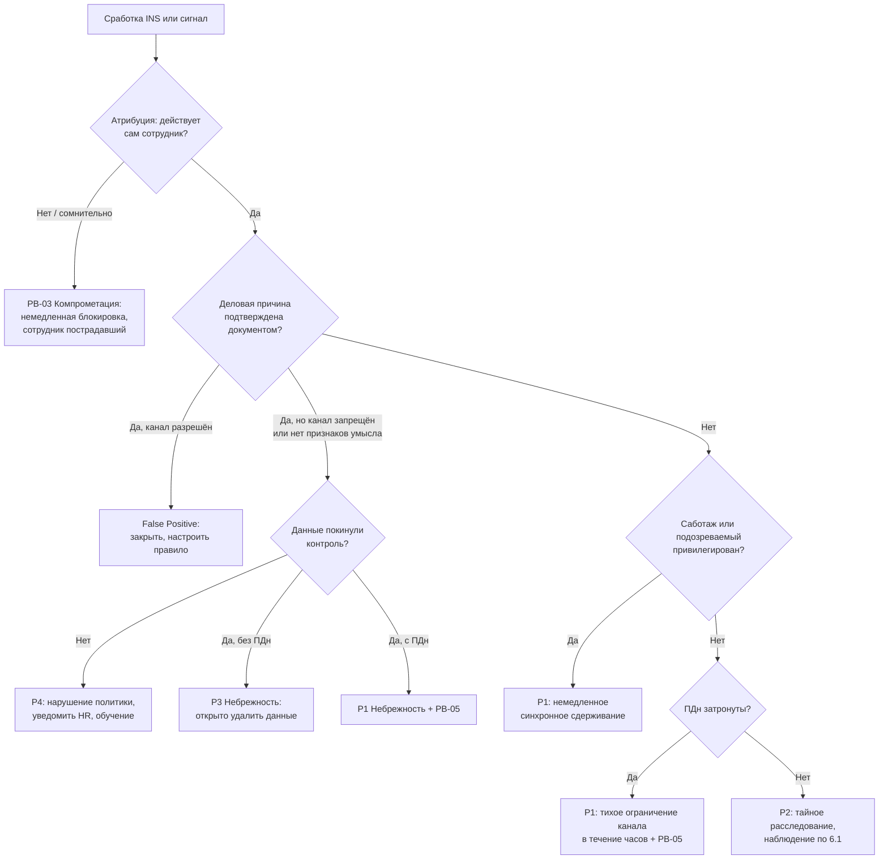

# PB-07 Инсайдер: вынос данных, саботаж и злоупотребление доступом сотрудника

> Учебный плейбук для вымышленной компании «Альфа-Трейд». Опирается на IR-план (`source/ir-plan.md`): роли, критичность P1–P4, сроки и каналы связи берутся оттуда. Пометки: **[проверить]** — номер статьи, срок, Event ID, название поля или функция продукта, которые нужно сверить с первоисточником, документацией вендора или юристом; **[учебное]** — порог или срок придуман для примера и калибруется по данным компании; **(пример)** — запрос на нейтральном псевдо-SPL/KQL, имена индексов и полей условные. Всё о ТК РФ, УК РФ, 98-ФЗ и 152-ФЗ — вопросы к юристу, а не юридическое заключение.

Главная мысль: **инсайдер — это не одна ситуация, а развилка.** Первое решение L2 — не «как поймать», а «кто это»: злонамеренный сотрудник, небрежный сотрудник или внешний атакующий под его учёткой. Действия в этих ветках противоположны: в первой — тайно и с юристом, во второй — открыто и быстро, в третьей — немедленная блокировка по PB-03. Вторая мысль: **тайность не отменяет сроков.** Продолжающийся вынос ПДн, саботаж и привилегированный подозреваемый требуют сдерживания в течение часов, а 24 часа на уведомление РКН идут с момента выявления.

> **L1, прочитай до любых действий:**
> 1. **Не связывайся** с сотрудником, его руководителем и коллегами. Не пиши в общие чаты и общую очередь.
> 2. Тикет — тип «Закрытый», кодовое имя (например, «Кедр»). В заголовке и описании **только логин**, без ФИО и слова «инсайдер».
> 3. Не изолируй хост и не блокируй учётку сам, даже если правило это предлагает. Исключение — явные признаки внешней компрометации (раздел 5.1, шаг 3).
> 4. Эскалируй **звонком** дежурному L2. Если подозреваемый — сотрудник ИТ или ИБ, звони сразу IM по резервному каналу.

---

## 1. Паспорт плейбука

| Поле | Значение |
| --- | --- |
| ID | PB-07 |
| Версия | 1.0 (учебная), 31.10.2026 |
| Владелец | Руководитель ИБ (IM). Правовые разделы согласует юрист/DPO, разделы о беседе и изъятии — HR. Пересмотр раз в 6 месяцев и после каждого инцидента |
| Критичность по умолчанию | **P2** для подтверждённого выноса без ПДн. До подтверждения сигнал коллег или одиночная сработка — **P3** |
| Повышение до P1 | Вынос или массовый просмотр ПДн клиентов или сотрудников (в т. ч. «пробив»); признаки саботажа (удаление, изменение конфигураций, закладки); подозреваемый — администратор AD, резервных копий, СЗИ, сотрудник ИБ или член руководства |
| P3 / P4 | P3 — небрежность без ПДн, данные не покинули контролируемую среду или возвращены. P4 — нарушение политики без выноса (запись на USB заблокирована EDR) |
| Правила изменения | При сомнении «есть ли ПДн» действует P1 до опровержения. Понизить P1 может только IM вместе с юристом, с обоснованием в тикете. Если выяснилось, что учётка скомпрометирована, критичность назначается по PB-03 |
| MITRE ATT&CK **[проверить по актуальной версии]** | Отдельной тактики «инсайдер» нет, действия раскладываются по существующим. **Initial Access / Persistence:** T1078 Valid Accounts. **Collection (TA0009):** T1005 Data from Local System, T1039 Data from Network Shared Drive, T1213 Data from Information Repositories (1С, CRM), T1530 Data from Cloud Storage, T1114.003 Email Forwarding Rule, T1074 Data Staged, T1560.001 Archive via Utility. **Exfiltration (TA0010):** T1052.001 Exfiltration over USB, T1567.002 Exfiltration to Cloud Storage, T1567 Exfiltration Over Web Service (личная почта, мессенджеры, GenAI), T1537 Transfer Data to Cloud Account, T1048 Exfiltration Over Alternative Protocol. **Defense Evasion (TA0005):** T1070.001 Clear Windows Event Logs, T1070.004 File Deletion, T1562 Impair Defenses. **Persistence (TA0003):** T1136 Create Account, T1098 Account Manipulation, T1053.005 Scheduled Task. **Impact (TA0040):** T1485 Data Destruction, T1490 Inhibit System Recovery, T1565.001 Stored Data Manipulation, T1531 Account Access Removal |
| Связанные плейбуки | **PB-03** Компрометация учётной записи (ветка «внешний атакующий под учёткой сотрудника»); **PB-05** Утечка данных (запускается параллельно при любых ПДн, ведёт юридический трек и РКН); PB-02 Шифровальщик (если саботаж выглядит как шифрование); PB-09 Потеря устройства (если сотрудник «потерял» ноутбук перед уходом) |
| Целевые сроки по фазам **[учебное]** | Закрытый тикет и звонок L2: **15 мин** (P1/P2), 4 ч (P3). Атрибуция и исключение компрометации: **1 ч**. Подтверждение TP, IM подключает юриста и HR: **2 ч** (при сигнале от людей юрист — сразу). Экспорт журналов, legal hold, сохранение видео: **4 ч**. Первичная оценка «ПДн или нет» DPO: **12 ч**. Письменное решение о стратегии: **24 ч** (при продолжающемся выносе ПДн или саботаже — **2 ч**). Первичное уведомление РКН через PB-05: **до 24 ч** с момента выявления. Полный отзыв доступов в «момент Х»: **≤ 30 мин** с начала беседы. Мониторинг после ухода: **90 дней** |

---

## 2. Назначение и область применения

**Входит.** Действия работника, подрядчика или бывшего работника, который использует **свои легитимные доступы** во вред компании:

| Тип | Пример в «Альфа-Трейд» | Чем отличается реагирование |
| --- | --- | --- |
| Кража данных | Менеджер перед уходом к конкуренту уносит базу клиентов и прайсы поставщиков | Тайное расследование, юрист и HR, ограниченное наблюдение |
| «Пробив» | Оператор колл-центра продаёт данные отдельных клиентов через Telegram | Медленный паттерн без массовой выгрузки; почти всегда P1 по 152-ФЗ |
| Саботаж | Администратор перед уходом ставит задачу удаления резервных копий | **Наблюдение запрещено**, немедленное синхронное сдерживание |
| Мошенничество | Фиктивные возвраты, промокоды, смена реквизитов в 1С | Совместно с финансами и владельцем 1С |
| Небрежность | Выгрузка заказов на личную почту «поработать из дома», вставка таблицы в публичный чат-бот | Тайность не нужна: быстро убрать данные, обучить; при ПДн всё равно PB-05 |

**Не входит.**
- Внешний атакующий под учёткой сотрудника → **PB-03**. Сотрудник в этом случае пострадавший, а не подозреваемый.
- Утечка без участия сотрудника (взлом сайта, открытое хранилище) → PB-05, PB-08.
- Дисциплинарные нарушения без угрозы данным (игры, соцсети) → HR, не ИБ.

**Ограничения среды, которые нужно знать заранее.** В «Альфа-Трейд» **нет DLP**. Поэтому:
- мы почти всегда видим **факт и объём** передачи, но не **содержимое**;
- NGFW без TLS-инспекции видит категорию приложения, SNI и байты, но не имена файлов **[проверить: зависит от модели и включённой расшифровки]**;
- запись на USB видна, только если в EDR или антивирусе включён модуль device control **[проверить по своему продукту]**;
- фото экрана телефоном и печать без аудита технически почти не обнаруживаются.

**Предпосылки (без них плейбук не сработает):**
- [ ] Введён режим коммерческой тайны: перечень сведений, учёт допущенных, ознакомление под подпись (98-ФЗ, ст. 10 **[проверить]**)
- [ ] Локальный акт о контроле корпоративных ресурсов (почта, веб, USB, печать) с ознакомлением под подпись; в трудовом договоре и NDA — обязанность вернуть и удалить данные при увольнении
- [ ] Аудит доступа к файлам (4663/5145) и SACL на папках «Клиенты», «Финансы», «Договоры»; аудит Removable Storage и PnP (6416); командная строка в 4688
- [ ] Device control хотя бы в режиме аудита; NGFW с User-ID и категориями «облака / файлообменники / мессенджеры / GenAI»
- [ ] Аудит облачной почты и хранилища, журнал регистрации 1С и аудит СУБД базы клиентов отправляются в SIEM
- [ ] Хранение журналов NGFW, облака и файлового сервера ≥ 180 дней (90 дней из IR-плана может не хватить: подготовка к выносу часто начинается за 1–3 месяца до ухода)
- [ ] HR еженедельно передаёт в ИБ список подавших заявление → watchlist в SIEM до последнего дня + 30 дней
- [ ] Ключи BitLocker хранятся централизованно; есть хранилище улик, форма цепочки хранения, акт изъятия, договор с внешним форензиком

---

## 3. Триггеры и источники обнаружения

Пороги **[учебное]**, их калибруют по базовой линии пользователя (30 дней) и его группы коллег (peer group). Для watchlist пороги снижаются примерно вдвое.

| ID | Источник | Что видим | Поля / Event ID | Пример правила **(пример)** | Старт. P |
| --- | --- | --- | --- | --- | --- |
| INS-01 | Аудит файлового сервера | Массовое чтение | 5145: `SubjectUserName`, `IpAddress`, `ShareName`, `RelativeTargetName`, `AccessMask`; 4663 (нужен SACL) | `dc(RelativeTargetName) > 500 за 1 ч` или `> 5× личной медианы за 30 дн` | P3 (P2 watchlist) |
| INS-02 | EDR device control; Windows 6416, 4663 (Removable Storage) | Запись на USB | Серийный номер, вендор, объём, путь | Запись > 100 МБ или > 50 файлов; любая запись для watchlist | P3 |
| INS-03 | NGFW / прокси | Выгрузка в облака, файлообменники, мессенджеры, GenAI | `src_user`, `app`, категория, SNI, **`bytes_sent`** | > 200 МБ за сутки в облака; > 100 МБ в мессенджеры; > 1 МБ POST в GenAI | P3 |
| INS-04 | Журнал облачной почты | Письмо себе на публичный домен | Отправитель, получатель, домен, вложения, размер | Получатель @gmail.com/@mail.ru/@yandex.ru и др., вложение > 5 МБ или архив | P3 |
| INS-05 | Аудит облачной почты | Правило пересылки наружу | M365: `New-InboxRule`, `Set-InboxRule`, `Set-Mailbox` (`ForwardingSmtpAddress`) **[проверить по провайдеру]** | Любое на внешний адрес | P2 (может быть и PB-03) |
| INS-06 | Аудит облачного хранилища | Ссылка «для всех» | M365: `AnonymousLinkCreated`, `SharingSet`, `FileDownloaded`, `FileSyncDownloadedFull` **[проверить]** | Любая анонимная ссылка на папку с ПДн/КТ или > 100 файлов | P3 |
| INS-07 | EDR, 4688, Sysmon 1 | Архив с паролем, синхронизаторы | `NewProcessName`, `CommandLine` | `7z/rar/winrar` с `-p`/`-hp`; `rclone.exe`, `megasync.exe` | P3 / P2 (rclone) |
| INS-08 | Журнал 1С, аудит СУБД, админка сайта/CRM | Массовая выгрузка | Пользователь, объект, число строк, экспорт | > 1000 записей клиентов вне роли аналитика; SELECT без WHERE не от сервисной учётки | P2 |
| INS-09 | 1С/CRM + Service Desk | «Пробив» | Просмотр карточки без связанного обращения | > 20 карточек в смену или > 3× медианы группы | P2 |
| INS-10 | AD, серверы, EDR | Саботаж, закладки | 4720, 4728/4732/4756, 4698, 7045, 1102, 4719; удаление бэкапов; tamper агента EDR | Любое от администратора из watchlist; любая очистка журнала | P1/P2 |
| INS-11 | PrintService/Operational 307 (по умолчанию выключен **[проверить]**) | Массовая печать | Документ, страницы, принтер | > 100 страниц в сутки для watchlist | P3 |
| INS-12 | Канал доверия, руководитель, HR | Сигнал от людей | — | Всегда триаж L2, без проверки L1; источник конфиденциален | P3 до проверки |

Пример корреляции (псевдо-SPL) для INS-03 с обогащением из watchlist:

```spl
index=ngfw action=allow app_category IN ("cloud-storage","file-sharing","instant-messaging","generative-ai") earliest=-24h
| stats sum(bytes_sent) AS up values(app) AS apps by src_user
| eval up_mb=round(up/1024/1024,1)
| lookup hr_watchlist user AS src_user OUTPUT reason, last_day
| where up_mb > 200 OR (isnotnull(reason) AND up_mb > 100)
```

Типовые ложные срабатывания: миграция ноутбука и синхронизация облачного клиента, резервное копирование, передача дел по распоряжению, ежемесячные отчёты аналитиков, работа маркетинга с фотобанками.

---

## 4. Роли и RACI для этого сценария

Дополнительно к ролям IR-плана здесь участвуют **HR** (беседа, кадровые документы) и **офис-менеджер / охрана** (изъятие ноутбука, пропуск). Если подозреваемый — IM, руководитель ИТ или директор, расследование ведёт следующий независимый руководитель (юрист или финансовый директор) с внешней командой.

| Действие | L1 | L2 | IM | ИТ | HR | Юрист/DPO | Владелец | Директор |
| --- | --- | --- | --- | --- | --- | --- | --- | --- |
| Закрытый тикет, первичные запросы | R | I | A | | | | | |
| Атрибуция, деловая причина, масштаб | | R | A | | C | | C | |
| Тип инсайдера и критичность | | C | R/A | | C | C | | |
| Экспорт журналов, legal hold | | R | A | R | | C | | |
| «Это утечка ПДн?» | | C | C | | | R/A | C | I |
| Усиленный мониторинг (без ПДн) | | R | A | | C | A | | I |
| Наблюдение при ПДн или по администратору | | R | C | | C | C | | A |
| Тихое ограничение канала | | R | A | R | | C | C | |
| Беседа с сотрудником | | | C | | R | R | | I |
| Синхронный отзыв доступов | | C | A | R | C | | C | |
| Изъятие устройства и образ диска | | R | A | C | R | C | | |
| Уведомление руководителя подразделения | | | R | | C | A | | |
| Уведомление РКН (через PB-05) | | | C | | | R | | A |
| Заявление в полицию, претензия получателю | | C | C | | C | R | | A |
| Смена общих секретов | | C | A | R | | | R | |
| Внешние коммуникации (PR — R) | | | C | | | C | | A |

R — выполняет, A — утверждает и отвечает, C — консультирует, I — информируется.

---

## 5. Триаж (первые 15–30 минут)

### 5.1. Карточка L1 (≤ 15 мин)

1. Завести закрытый тикет с кодовым именем, записать время T0. Сигнал от людей сразу передать L2, источник в тикете не называть.
2. Выполнить запросы за 30 дней по логину и приложить результаты: массовое чтение (INS-01), USB, облака, почта, входы. **Только читать журналы**, ничего не запускать на хосте пользователя.
3. Проверить явные признаки внешней компрометации: вход из новой страны, с хостинга или Tor; MFA-отказы перед успешным входом; новый метод MFA; одновременные сессии из двух мест. Если есть — это PB-03, эскалация L2 и IM немедленно.
4. Позвонить L2. Эскалация обязательна при: INS-05, INS-07 (rclone), INS-08, INS-09, INS-10; любом срабатывании по watchlist; превышении порога в 3 раза; любом сигнале от людей.

### 5.2. Триаж L2 (≤ 1–2 ч)

| Шаг | Вопрос | Где смотреть | Признак |
| --- | --- | --- | --- |
| 1. Атрибуция | Действует ли сам сотрудник? | IdP/AD (4624, `LogonType`, `IpAddress`), VPN, MFA-журнал, СКУД, EDR (устройство) | Привычные устройство и IP, был в офисе по СКУД или в своей VPN-сессии → сотрудник. Новые IP/страны/устройства, активность во время больничного или отпуска → **PB-03** |
| 2. Деловая причина | Есть ли документ, объясняющий действие? | Service Desk (миграция, бэкап), трекер задач, служебные записки, базовая линия | Документ создан **до** события → FP. Спрашивать сотрудника и руководителя **запрещено** |
| 3. Данные | Что за данные, есть ли ПДн, сколько субъектов? | Пути файлов, таблицы СУБД, отчёты 1С, владелец данных | ПДн клиентов или сотрудников → P1, сразу IM и DPO |
| 4. Канал и получатель | Куда ушло? | NGFW (`bytes_sent`), почта, EDR (серийник USB), облачный аудит | Личный канал (личная почта, личное облако, неучтённый USB) |
| 5. Умысел | Есть ли сокрытие? | EDR, 4688, 4660, Sysmon 23/26, история браузера в EDR | Пароль на архиве, смена расширений, разбиение, удаление после копирования, очистка истории, ночная работа, совпадение с заявлением |
| 6. Саботаж | Есть ли риск вреда системам? | 4720/4738, 4698, 7045, 1102/4719, задания бэкапа, конфигурации | Новые учётки, задачи, службы, изменения политик аудита, попытки отключить EDR |
| 7. Статус в HR | Увольняется, испытательный срок, конфликт? | Watchlist; запрос IM в HR (не L2 напрямую) | Заявление подано, известен переход к конкуренту |

### 5.3. Дерево решений



### 5.4. Критерии эскалации

- **L1 → L2:** по списку шага 5.1.4, всегда звонком.
- **L2 → IM:** подтверждена атрибуция и нет документальной причины; любые ПДн; саботаж; привилегированный подозреваемый; сигнал от людей с подтверждающими фактами.
- **IM → юрист и HR:** после подтверждения TP (≤ 2 ч). Раньше подключать HR опасно: миграция ноутбука выглядит как массовое копирование, и невиновного начнут подозревать. Исключение — сигнал от людей: юрист подключается сразу.
- **IM → DPO:** сразу при «ПДн да или не исключено».
- **IM → директор:** P1; подозреваемый из руководства; вопрос о полиции; наблюдение при ПДн или по администратору.
- **В обход стандартной цепочки:** если подозреваемый видит SIEM, EDR, тикеты или почту ИБ — отдельное хранилище материалов, резервный канал, проверка целостности журналов (1102, 4719), при необходимости внешняя команда.

---

## 6. Сдерживание

### 6.1. Стратегия: наблюдать или сдерживать

IM записывает решение в тикет: обоснование, срок, кто утвердил, компенсирующие меры, дата пересмотра.

| Условие | Решение | Апрув |
| --- | --- | --- |
| Признаки саботажа | Немедленное открытое сдерживание, наблюдение запрещено | IM |
| Подозреваемый — администратор или сотрудник ИБ | Синхронное сдерживание в течение часов; сначала снять привилегии на критичных системах | IM + директор |
| Вынос ПДн продолжается | Точечно перекрыть канал в течение **часов**, остальное синхронизировать с HR. Доказательства уже в журналах. Наблюдение без ограничения запрещено | IM + юрист |
| Вынос завершён, ПДн нет, нужен получатель или сообщники | Наблюдение до 48 ч, продление письменно, суммарно ≤ 5 рабочих дней **[учебное]**, ежедневный пересмотр | IM + юрист |
| Сотрудник подал заявление | Наблюдение не дольше последнего рабочего дня; сдерживание в момент беседы | IM + юрист + HR |
| До конца месячного срока на взыскание < 7 дней (ТК, ст. 193 **[проверить с юристом, с какого момента считается срок]**) | Наблюдение прекращается | Юрист |
| Небрежность | Без тайности: IM с руководителем связываются с сотрудником, данные удаляются под контролем | IM |

### 6.2. Краткосрочное сдерживание (лестница мер)

| № | Мера | Кто | Инструмент | Апрув | Риск раскрытия |
| --- | --- | --- | --- | --- | --- |
| 1 | Усиленный мониторинг: сниженные пороги, правила на логин и хост | L2 | SIEM, EDR | IM + юрист | Нет, если правила не в общей очереди |
| 2 | Тихое ограничение: USB «только чтение» на отдел, блок файлообменников и GenAI для группы, снятие прав на папку под легендой планового изменения | ИТ | EDR device control, NGFW, AD | IM + владелец | Средний |
| 3 | Точечный блок канала для пользователя | ИТ | NGFW (политика по User-ID), EDR | IM | Высокий |
| 4 | Удаление правил пересылки, отзыв анонимных ссылок | ИТ | Консоль облака | IM | Высокий, но обязателен при ПДн |
| 5 | Снятие доступа к чувствительным системам | ИТ | AD, 1С, CRM | IM | Высокий |
| 6 | Полный отзыв в «момент Х» (6.3) | ИТ | Все системы | IM + юрист, синхронно с HR | Открытая фаза |

Сетевая изоляция в EDR в злонамеренной ветке — только по решению IM: она раскрывает расследование.

### 6.3. «Момент Х»: синхронный отзыв доступов

Сотрудника приглашают на встречу с HR и юристом. В это время ИТ выполняет чек-лист, отмечая время каждого шага, охрана или офис-менеджер забирает устройство по акту.

- [ ] AD: отключить основную, административные, тестовые учётки; сбросить пароль; удалить из привилегированных групп; завершить сессии на серверах (билеты Kerberos живут до 10 ч по умолчанию **[проверить политику домена]**)
- [ ] Облако: заблокировать вход, **отозвать сессии и refresh-токены**, удалить мобильные устройства, OAuth-разрешения, пароли приложений, правила пересылки, делегирование ящика
- [ ] MFA: удалить зарегистрированные методы
- [ ] VPN: отозвать сертификат, разорвать сессии
- [ ] Бизнес-системы: 1С, CRM, админка сайта, маркетплейсы, рекламные кабинеты, платёжный шлюз, регистратор доменов, DNS, соцсети
- [ ] Общие секреты, которые знал сотрудник: сервисные учётки, локальные администраторы (если нет LAPS), СУБД, админки NGFW/WAF/EDR, API-ключи, SSH-ключи, Wi-Fi
- [ ] СКУД: деактивировать пропуск; MDM: удалить **только корпоративный контейнер**
- [ ] Через 1 ч и 24 ч: проверить попытки входа (4625, 4771, облачные журналы, VPN)

### 6.4. Долгосрочное сдерживание

Ограничения для отдела (USB, облака) остаются до пересмотра прав; правила SIEM на учётки, хосты, серийные номера USB и адреса получателей из инцидента; удержание (legal hold) ящика и облачных файлов до решения юриста.

### 6.5. Что НЕ делать

- Не звонить и не писать сотруднику, его руководителю, коллегам «уточнить».
- Не блокировать учётку «в лоб» посреди дня, пока ноутбук у сотрудника: он успеет стереть локальные копии.
- Не блокировать только AD, забыв токены, VPN, мобильную синхронизацию и общие пароли.
- Не входить в личное облако, почту или мессенджер сотрудника по сохранённой сессии и не читать личную переписку (Конституция, ст. 23; УК, ст. 138, 272 **[проверить с юристом]**).
- Не изымать и не осматривать личные устройства без добровольного письменного согласия.
- Не переустанавливать и не передавать другим устройства из инцидента, не удалять ящик до решения юриста; не делать полный remote wipe телефона.
- Не блокировать категорию сервисов для всей компании без владельца процесса: остановится маркетинг или обмен с поставщиками.
- Не «наблюдать» за продолжающимся выносом ПДн «чтобы собрать побольше».

---

## 7. Сбор и сохранение артефактов

Для инсайдера «летучесть» — это не только память, но и **ротация**: видео СКУД стирается через 14–30 дней, журналы NGFW и EDR — через 30–180 дней. Порядок сбора:

1. **Видео и СКУД** за ключевые моменты (запись на USB, печать) — сразу, это самое короткоживущее.
2. **Централизованные журналы** (SIEM, файловый сервер, AD, NGFW, VPN, облачный аудит, 1С, СУБД, EDR) по всем учёткам сотрудника, его хостам и IP — за максимальный доступный период, минимум 90 дней или с даты заявления, что раньше. Экспорт в CSV/JSON, SHA-256 каждого файла.
3. **Legal hold**: ящик и облачные файлы, исключение журналов NGFW и видео из ротации.
4. **Тихий триаж хоста**, пока сотрудник работает, через EDR live response или Velociraptor в незаметное время, убедившись, что агент не показывает уведомлений: реестр USB, LNK, Jump Lists, SRUM, Prefetch, Amcache, `$MFT`, `$UsnJrnl:$J`, журналы Windows, история браузеров. Только сбор, не просмотр файлов пользователя «вживую».
5. **При изъятии**: если ноутбук включён и разблокирован, по решению L2 и IM сначала дамп памяти (WinPMem, Magnet RAM Capture **[проверить актуальность]**), затем проверить доступность ключа BitLocker, затем выключить, опечатать.
6. **Образ диска** через блокиратор записи (FTK Imager, ewfacquire), SHA-256, анализ только на копии.

| Артефакт | Где | Что даёт |
| --- | --- | --- |
| USB | `HKLM\SYSTEM\CurrentControlSet\Enum\USBSTOR`, `HKLM\SYSTEM\MountedDevices`, `NTUSER.DAT\...\Explorer\MountPoints2`, `C:\Windows\INF\setupapi.dev.log`, Partition/Diagnostic 1006 **[проверить версию Windows]** | Носители, серийные номера, время первого и последнего подключения |
| Открытые файлы | LNK (`%APPDATA%\Microsoft\Windows\Recent`), Jump Lists, Shellbags, OpenSaveMRU | Что открывалось, в том числе с USB |
| Файловая система | `$MFT`, `$UsnJrnl:$J` | Копирование, переименование, удаление, папки «для выноса» |
| Сеть по приложениям | SRUM (`C:\Windows\System32\sru\SRUDB.dat`) | Байты по приложениям по часам, даже без NGFW |
| Запуски | Prefetch, Amcache, BAM | Архиваторы, rclone, облачные клиенты, «чистильщики» |
| Браузеры | History, Downloads | disk.yandex.ru, cloud.mail.ru, drive.google.com, web.telegram.org, GenAI |
| Почта | OST/PST, экспорт ящика | Отправленные письма |

**Цепочка хранения.** На каждый объект — запись: номер улики (INC-2026-xxx-E01), описание (модель, серийный и инвентарный номер), источник, кто собрал, когда (UTC+3), как (инструмент, формат), SHA-256, место хранения (сейф, `\\evidence\INC-...\`), все передачи с подписями. Изъятие — комиссией не менее двух человек с актом: дата, время, место, состояние, номер пломбы, присутствующие, подпись сотрудника или отметка об отказе.

---

## 8. Расследование

L2 отвечает письменно в тикете и указывает источник каждого факта.

| Вопрос | Источники |
| --- | --- |
| Какие данные, сколько записей, сколько субъектов ПДн? | Пути файлов (5145), выгрузки 1С, аудит СУБД, владелец данных |
| Какими каналами? Проверить **все** из раздела 3, а не только сработавший | NGFW, почта, EDR, облако, печать, SRUM |
| С какого момента? | Минимум 90 дней назад или с даты заявления; базовая линия |
| Куда ушло? | Серийник USB, сервис и домен, адрес получателя, анонимные ссылки и журнал скачиваний по ним |
| Есть ли сообщники? | Кто ещё обращался к тем же данным, переписка в корпоративной почте (только в нужном объёме и после согласования с юристом), общие получатели |
| Есть ли закладки и саботаж? | 4720/4738/4728, 4698, 7045, `authorized_keys`, правила NGFW, webhook-и, задания бэкапа |
| Какие общие секреты знал сотрудник? | Менеджер паролей, владельцы систем |
| Были ли данные опубликованы? | Мониторинг утечек, канареечные записи |

Примеры запросов **(пример)**:

```spl
# Q1. Всплеск чтения файлов относительно личной медианы
index=wineventlog EventCode=5145 SubjectUserName="<user>" earliest=-30d
| bin _time span=1d
| stats dc(RelativeTargetName) AS files by _time
| eventstats median(files) AS med
| where files > 5*med AND files > 500
```

```kql
// Q2. Архивация с паролем и синхронизаторы (EDR)
DeviceProcessEvents
| where Timestamp > ago(90d) and AccountName =~ "<user>"
| where FileName in~ ("7z.exe","7za.exe","rar.exe","winrar.exe","rclone.exe","megasync.exe")
| project Timestamp, DeviceName, FileName, ProcessCommandLine, InitiatingProcessFileName, SHA256
```

```spl
# Q3. «Пробив»: карточки клиентов без обращения
index=crm_access action="view_customer" earliest=-7d
| join type=left user, customer_id [ search index=helpdesk earliest=-7d | fields user, customer_id, ticket_id ]
| where isnull(ticket_id)
| stats dc(customer_id) AS cards by user, date_mday
| where cards > 20
```

```spl
# Q4. Закладки администратора
index=wineventlog EventCode IN (4720,4722,4728,4732,4756,4738,4698,4702,7045,1102,4719) earliest=-90d
| search SubjectUserName IN ("<user>","<adm-user>")
| table _time, host, EventCode, SubjectUserName, TargetUserName, TaskName, ServiceName
```

Для KQL-запросов по USB поле `ActionType` (`UsbDriveMounted`, `PnpDeviceConnected`) и наличие событий зависят от вендора и включённого device control **[проверить]**.

---

## 9. Устранение

1. Удалить найденные закладки: учётки, задачи, службы, ключи, правила пересылки, webhook-и. Каждое удаление записать в тикет с временем.
2. Сменить общие секреты по списку из раздела 8.
3. **Вынесенные данные:** отозвать ссылки и проверить журнал скачиваний; юрист решает, требовать ли возврата носителей и письменного подтверждения удаления (добровольная выдача оформляется актом); претензия новому работодателю — по решению директора.
4. **Саботаж:** восстановить из резервной копии, сделанной до первого вредного действия; владелец системы проверяет целостность 1С и базы клиентов.
5. **Мошенничество:** финансы сверяют операции, владелец 1С откатывает изменения.
6. Пересмотреть права в отделе по принципу минимальных привилегий — **только после окончания тайной фазы**, иначе это сигнал подозреваемому.

---

## 10. Восстановление и мониторинг после инцидента

Устройство из инцидента возвращается в оборот только по письменному решению юриста, после снятия образа. Мониторинг **90 дней** **[учебное]** после ухода (дольше, чем 2 недели по IR-плану, потому что данные и знания остаются у человека):

- попытки входа под отключёнными учётками и с IP, устройств, VPN-сертификатов сотрудника;
- использование общих учёток и API-ключей, которые он знал (до смены — ежедневно);
- обращения к анонимным ссылкам, созданным до инцидента;
- всплытие данных: канареечные записи, уникальные строки базы, Telegram-каналы «пробива», форумы утечек;
- для отдела: те же правила INS с сниженными порогами на 30 дней (возможные сообщники);
- для саботажа: целостность резервных копий и конфигураций, ежедневная проверка заданий планировщика на серверах в течение 2 недель.

---

## 11. Коммуникации и уведомления

**Внутренние правила.**
- Кодовое имя, закрытый тикет, список допущенных лиц (имя, роль, дата допуска). Обсуждение — звонком или в выделенном закрытом канале; при подозрении на ИТ или ИБ — резервный канал из IR-плана.
- IM проверяет конфликт интересов у каждого участника (дружба, подчинение) и отстраняет при необходимости.
- Руководитель подразделения узнаёт только после решения IM и юриста, в минимальном объёме, с обязательством о конфиденциальности.
- Статус руководству: P1 — каждые 2 ч по IR-плану; в тайной фазе — устно, ежедневно директору.
- Коллективу после ухода — нейтральный текст без причин и оценок (иначе риск иска о защите репутации, ГК ст. 152 **[проверить]**).

**Внешние уведомления.**

| Кого | Когда | Кто | Основание |
| --- | --- | --- | --- |
| Роскомнадзор, первичное | Вынос ПДн вне служебных целей, скорее всего, «неправомерная передача». **До 24 ч** с момента выявления; тайность расследования срок не останавливает | DPO/юрист по PB-05, апрув директора | 152-ФЗ, ст. 21 ч. 3.1 **[проверить]** |
| Роскомнадзор, результаты | До 72 ч | DPO | То же |
| Прекращение неправомерной обработки | Не более 3 рабочих дней **[проверить]** | IM, ИТ | 152-ФЗ, ст. 21 ч. 3 **[проверить]** |
| Полиция | По решению директора; материалы передаются через юриста с актом | Юрист | УК, ст. 183 (коммерческая тайна), 272, 272.1 (ПДн) **[проверить актуальную редакцию]** |
| Клиенты | Только если требует закон или данные всплыли | PR, текст утверждает юрист | — |
| НКЦКИ | Не применяется: компания не субъект КИИ | — | 187-ФЗ |

**Шаблоны.**

> **Статус директору (тайная фаза, устно или в закрытом канале):** «Кейс "Кедр", P_. Подтверждено: [что, сколько, каким каналом]. ПДн: [да / нет / уточняется]. Канал [перекрыт / под наблюдением до ДД.ММ ЧЧ:ММ]. Нужно решение: [момент Х / полиция / уведомление РКН].»

> **Коллективу:** «С [дата] [ФИО] не работает в компании. Вопросы по его задачам — к [руководитель].»

> **Сигнал от коллеги (ответ источнику):** «Спасибо, информация принята. Пожалуйста, никому её не пересказывайте. Если заметите что-то ещё, сообщите напрямую [контакт].»

---

## 12. Критерии закрытия

**Общие:**
- [ ] Тип инсайдера определён, атрибуция подтверждена (или кейс передан в PB-03)
- [ ] Объём, каналы и получатели установлены или записано, почему это невозможно
- [ ] Доступы отозваны по чек-листу 6.3, через 24 ч нет попыток входа
- [ ] Общие секреты сменены, закладки удалены
- [ ] Решение по 152-ФЗ задокументировано: номер и время уведомления РКН или обоснование, почему оно не требуется
- [ ] Legal hold действует, улики в хранилище, журнал цепочки хранения заполнен
- [ ] Мониторинг после ухода настроен на 90 дней
- [ ] Разбор проведён, улучшения назначены с ответственными и сроками; юрист определил срок хранения материалов

**По веткам:**
- [ ] *Злой умысел:* решение по сотруднику и решение директора по полиции и претензии зафиксированы
- [ ] *Небрежность:* данные удалены с подтверждением, обучение проведено, права пересмотрены
- [ ] *Саботаж:* системы восстановлены, владелец подтвердил целостность данных
- [ ] *Ложная сработка:* документальная причина приложена, правило настроено (например, исключение на время миграции)

---

## 13. Метрики

| Метрика | Как считать |
| --- | --- |
| MTTD | От первого действия по выносу (по ретроспективе) до первой сработки или сигнала |
| MTTR | От обнаружения до закрытия всех каналов и отзыва доступов |
| Время атрибуции | T0 → решение «сотрудник / компрометация» |
| Время до перекрытия канала | T0 → канал вывода закрыт (для ПДн цель — часы) |
| Полнота «момента Х» | Доля систем из чек-листа 6.3, отозванных за 30 мин; число «забытых» доступов, найденных позже |
| Объём ущерба | Файлы, МБ, число субъектов ПДн, сумма при мошенничестве |
| Покрытие watchlist | Доля увольняющихся, попавших в watchlist до последнего дня |
| Точность правил INS | Доля FP по каждому правилу за квартал |
| Соблюдение сроков | РКН ≤ 24 ч; решение о стратегии ≤ 24 ч; отзыв доступов к концу последнего дня |

---

## 14. Типичные ошибки и ловушки

1. **L1 по привычке уточняет у пользователя.** Расследование раскрыто, следы удалены.
2. **Деловую причину спрашивают у руководителя.** Он может быть соучастником. Сначала документы; с руководителем говорит только IM после согласования с юристом.
3. **HR подключают до подтверждения.** Невиновный под подозрением из-за миграции ноутбука.
4. **Не исключили компрометацию.** Команда сутки «тайно наблюдает» за внешним атакующим и обвиняет пострадавшего.
5. **Наблюдение без срока при текущем выносе ПДн.** Каждый час — новые записи клиентов и рост ответственности; истекает месячный срок по ТК.
6. **Журналы не экспортированы сразу.** Ранние события и видео ушли в ротацию.
7. **ИТ переустанавливает ноутбук** уволившегося по стандартной процедуре — главное доказательство уничтожено.
8. **Ноутбук выключили без ключа BitLocker** — диск нечитаем.
9. **Отзыв «по дате приказа» и без перечня систем:** две недели продолжения выгрузки и забытый VPN-сертификат или API-ключ.
10. **Нет ветки привилегированного инсайдера:** администратор видит тикет и чистит журналы.
11. **Чтение личной переписки** — правонарушение со стороны компании, доказательства теряют силу.
12. **«Уволен за кражу базы»** в общем чате — риск иска.
13. **Закрытие «материалы переданы юристу»** без проверки секретов, закладок и решения по PB-05.
14. **Шумный сбор через EDR:** всплывающие окна и изоляция «на минутку» выдают расследование.

---

## 15. Меры по предотвращению и улучшению защиты

1. DLP хотя бы для почты, веба и USB (класс решений: InfoWatch Traffic Monitor, Solar Dozor, SearchInform КИБ, Falcongaze SecureTower **[проверить актуальность]**).
2. Device control в EDR: белый список носителей, по умолчанию «только чтение».
3. TLS-инспекция для файлообменников и GenAI (с исключениями для банков и медицины); блок неразрешённых облаков, личной почты и публичных чат-ботов с разрешённой корпоративной альтернативой.
4. Ограничение экспорта в 1С, CRM и админке сайта: права по ролям, лимиты записей, журнал выгрузок.
5. Обязательная ссылка на обращение при открытии карточки клиента; видимые водяные знаки с ID пользователя против фото экрана.
6. PAM для администраторов: отдельные админские учётки, запись сессий, выдача прав по запросу (JIT).
7. HR-фид в SIEM, автоматический watchlist; UEBA с базовой линией и peer group.
8. Offboarding к концу последнего дня по чек-листу 6.3: исполняет ИТ, контролирует ИБ.
9. Ежеквартальная ресертификация доступов к базе клиентов и финансовым папкам.
10. Классификация данных (метки «ПДн», «КТ») и канареечные записи в базе клиентов.
11. Неизменяемая копия журналов, хранение журналов NGFW и облака ≥ 180 дней.
12. Обучение руководителей: признаки риска и как сообщить, не раскрыв подозрений.

---

## 16. Учебная мини-ситуация (tabletop)

**Вводная.** Пятница, 16:20. Менеджер по работе с ключевыми клиентами подал заявление в понедельник, последний день через 9 дней. SIEM: INS-01 — 2 400 файлов из папки «Клиенты» за час; INS-07 — `7z.exe a -p ... clients.7z`; через 20 минут INS-04 — письмо на личный gmail.com с вложением 38 МБ. Вход с его обычного ноутбука, СКУД показывает его в офисе. Заявок в Service Desk нет. Руководитель отдела — его давний друг. Через час сотрудник уходит домой с ноутбуком.

**Вопросы.**
1. Какую ветку и критичность вы выберете и на основании каких фактов? Почему нельзя позвонить руководителю отдела?
2. Можно ли «понаблюдать до понедельника»? Что делаете до 17:20 и кто это утверждает?
3. В каком порядке собираете артефакты и что рискуете потерять, если отложить до понедельника?
4. До какого времени нужно принять решение по уведомлению РКН и кто его принимает?
5. Сотрудник на беседе показывает личный телефон и говорит: «Проверьте, я всё удалил». Что можно и что нельзя сделать?

---

## 17. Источники и что почитать

Ссылки ведут на официальные сайты и приведены по памяти; глубокие ссылки со временем меняются.

- MITRE ATT&CK, тактики Collection, Exfiltration, Impact: https://attack.mitre.org/
- MITRE Center for Threat-Informed Defense, Insider Threat TTP Knowledge Base: https://ctid.mitre.org/ **[проверить актуальный адрес проекта]**
- Insider Threat Matrix (сообщество, классификация поведения инсайдеров): https://insiderthreatmatrix.org/
- NIST SP 800-61 Rev. 3, Incident Response Recommendations and Considerations for Cybersecurity Risk Management (2025): https://csrc.nist.gov/pubs/sp/800/61/r3/final
- NIST SP 800-86, Guide to Integrating Forensic Techniques into Incident Response: https://csrc.nist.gov/pubs/sp/800/86/final
- RFC 3227, Guidelines for Evidence Collection and Archiving (порядок летучести): https://www.rfc-editor.org/rfc/rfc3227
- CISA, Insider Threat Mitigation Guide и раздел Insider Threat Mitigation: https://www.cisa.gov/topics/physical-security/insider-threat-mitigation
- CERT/SEI, Common Sense Guide to Mitigating Insider Threats, Seventh Edition (2022): https://insights.sei.cmu.edu/
- SANS, Incident Handler's Handbook: https://www.sans.org/white-papers/33901/
- Microsoft, Appendix L: Events to Monitor: https://learn.microsoft.com/windows-server/identity/ad-ds/plan/appendix-l--events-to-monitor
- Законы РФ (актуальная редакция на pravo.gov.ru или в справочной правовой системе): 152-ФЗ ст. 19, 21; 98-ФЗ «О коммерческой тайне» ст. 10; ТК РФ ст. 80, 81, 192, 193, 243; УК РФ ст. 138, 183, 272, 272.1; КоАП ст. 13.11 (оборотные штрафы за повторную утечку ПДн, с 30.05.2025 **[проверить]**)
