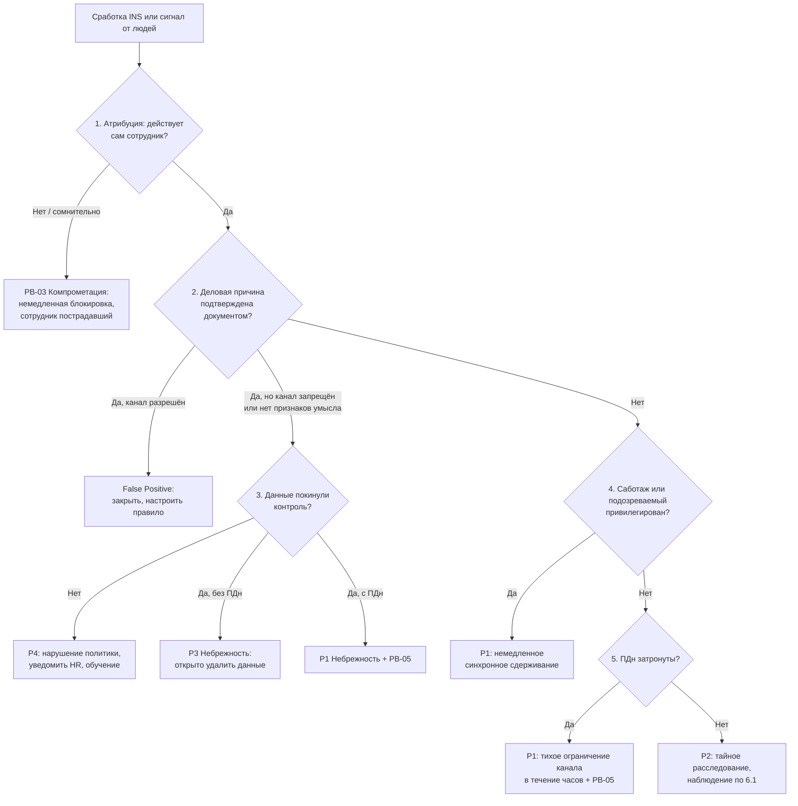

# PB-07 Инсайдер: вынос данных, саботаж и злоупотребление доступом сотрудника

> Учебный плейбук для вымышленной компании «Альфа-Трейд». Роли, уровни критичности P1–P4, сроки и каналы связи взяты из [IR-плана](../plan/ir-plan.md). Всё, что нужно сверить с первоисточником, документацией вендора или юристом, собрано в разделе [«Допущения и ограничения»](#допущения-и-ограничения). Сокращения расшифрованы в [Приложении Г](#приложение-г-сокращения).

## TL;DR

- **Когда применять:** работник, подрядчик или бывший работник использует **свои легитимные доступы** во вред компании: уносит данные, «пробивает» клиентов, саботирует системы, мошенничает или по небрежности выкладывает данные наружу.
- **Инсайдер, это не одна ситуация, а развилка.** Первое решение L2 звучит не «как поймать», а «кто это»: злонамеренный сотрудник, небрежный сотрудник или внешний атакующий под его учёткой. Действия в ветках противоположны: злой умысел ведите тайно и с юристом, небрежность разбирайте открыто и быстро, компрометацию блокируйте немедленно по PB-03.
- **Тайность не отменяет сроков.** Продолжающийся вынос ПДн (персональных данных), саботаж и привилегированный подозреваемый требуют сдерживания в течение часов, а 24 часа на уведомление Роскомнадзора (РКН) идут с момента выявления.
- **L1 ничего не блокирует и никому не звонит, кроме L2.** Закрытый тикет с кодовым именем, запросы по журналам, звонок дежурному L2. Исключение одно: явные признаки внешней компрометации, тогда немедленно PB-03.
- **Саботаж и администраторы: наблюдение запрещено.** Сначала снимите привилегии на критичных системах, потом разбирайтесь.
- **В «Альфа-Трейд» нет DLP.** Вы видите факт и объём передачи, но не содержимое. Учитывайте это при каждом выводе.

## Шпаргалка: первые 30 минут

| № | Действие | Кто | Срок |
| --- | --- | --- | --- |
| 1 | **Заведите закрытый тикет с кодовым именем** (например, «Кедр»), запишите время T0. В заголовке и описании только логин, без ФИО и слова «инсайдер» | L1 | ≤ 5 мин |
| 2 | **Сигнал от людей сразу передайте L2**, источник в тикете не называйте | L1 | Сразу |
| 3 | **Выполните запросы за 30 дней по логину** и приложите результаты: массовое чтение (INS-01), USB, облака, почта, входы. Только читайте журналы, ничего не запускайте на хосте пользователя | L1 | ≤ 15 мин |
| 4 | **Проверьте признаки внешней компрометации:** новая страна, хостинг или Tor, MFA-отказы перед успешным входом, новый метод MFA, две сессии из разных мест. Есть, значит PB-03, эскалация L2 и IM немедленно | L1 | ≤ 15 мин |
| 5 | **Позвоните дежурному L2.** Если подозреваемый из ИТ или ИБ, звоните сразу IM по резервному каналу | L1 | 15 мин (P1/P2), 4 ч (P3) |
| 6 | **Проведите атрибуцию и исключите компрометацию** по узлу 1 [дерева решений](#51-дерево-решений) | L2 | ≤ 1 ч |
| 7 | **Найдите деловую причину по документам**, не спрашивая сотрудника и руководителя (узел 2) | L2 | В рамках 1–2 ч триажа |
| 8 | **Определите тип инсайдера и критичность**, при любом сомнении «есть ли ПДн» ставьте P1 | IM | ≤ 2 ч |
| 9 | **Подтверждён TP: IM подключает юриста и HR.** При сигнале от людей юрист подключается сразу | IM | ≤ 2 ч |
| 10 | **Экспортируйте журналы, включите legal hold, сохраните видео СКУД** | L2 + ИТ | ≤ 4 ч |
| 11 | **Саботаж или привилегированный подозреваемый: синхронное сдерживание**, сначала снять привилегии на критичных системах | ИТ по решению IM (+ директор) | В течение часов |
| 12 | **ПДн затронуты: запустите PB-05 параллельно**, первичное уведомление РКН до 24 ч с момента выявления | IM → DPO/юрист | ≤ 12 ч на оценку DPO, ≤ 24 ч на уведомление |

## Чего делать нельзя

- **Не звоните и не пишите сотруднику, его руководителю и коллегам «уточнить».** Расследование раскрыто, следы удалены. Руководитель может быть соучастником.
- **Не пишите в общие чаты и общую очередь.** Только закрытый тикет и выделенный канал.
- **Не блокируйте учётку «в лоб» посреди дня**, пока ноутбук у сотрудника: он успеет стереть локальные копии.
- **Не блокируйте только AD**, забыв токены, VPN, мобильную синхронизацию и общие пароли.
- **Не входите в личное облако, почту или мессенджер сотрудника по сохранённой сессии** и не читайте личную переписку: это правонарушение со стороны компании, и доказательства теряют силу (Конституция, ст. 23; УК, ст. 138, 272).
- **Не изымайте и не осматривайте личные устройства** без добровольного письменного согласия.
- **Не переустанавливайте и не передавайте другим устройства из инцидента**, не удаляйте ящик до решения юриста, не делайте полный remote wipe телефона.
- **Не блокируйте категорию сервисов для всей компании без владельца процесса:** остановится маркетинг или обмен с поставщиками.
- **Не «наблюдайте» за продолжающимся выносом ПДн «чтобы собрать побольше».** Каждый час добавляет записи клиентов и ответственность.
- **Не изолируйте хост в EDR «на минутку» и не собирайте шумно:** всплывающие окна агента выдают расследование.

## 1. Цель и область применения

**Цель:** быстро понять, кто действует под учёткой сотрудника, не раскрыть расследование раньше времени, сохранить доказательства до их ротации, перекрыть канал выноса в срок и отозвать все доступы синхронно, а при ПДн уложиться в сроки 152-ФЗ.

**Что входит.** Действия работника, подрядчика или бывшего работника, который использует **свои легитимные доступы** во вред компании:

| Тип | Пример в «Альфа-Трейд» | Чем отличается реагирование |
| --- | --- | --- |
| Кража данных | Менеджер перед уходом к конкуренту уносит базу клиентов и прайсы поставщиков | Тайное расследование, юрист и HR, ограниченное наблюдение |
| «Пробив» | Оператор колл-центра продаёт данные отдельных клиентов через Telegram | Медленный паттерн без массовой выгрузки; почти всегда P1 по 152-ФЗ |
| Саботаж | Администратор перед уходом ставит задачу удаления резервных копий | **Наблюдение запрещено**, немедленное синхронное сдерживание |
| Мошенничество | Фиктивные возвраты, промокоды, смена реквизитов в 1С | Совместно с финансами и владельцем 1С |
| Небрежность | Выгрузка заказов на личную почту «поработать из дома», вставка таблицы в публичный чат-бот | Тайность не нужна: быстро убрать данные, обучить; при ПДн всё равно PB-05 |

**Что не входит:**

- **Внешний атакующий под учёткой сотрудника** → PB-03. Сотрудник в этом случае пострадавший, а не подозреваемый.
- **Утечка без участия сотрудника** (взлом сайта, открытое хранилище) → PB-05, PB-08.
- **Дисциплинарные нарушения без угрозы данным** (игры, соцсети) → HR, не ИБ.

**Ограничения среды, которые нужно знать заранее.** В «Альфа-Трейд» **нет DLP** (системы предотвращения утечек). Поэтому:

- вы почти всегда видите **факт и объём** передачи, но не **содержимое**;
- NGFW без TLS-инспекции видит категорию приложения, SNI и байты, но не имена файлов;
- запись на USB видна, только если в EDR или антивирусе включён модуль device control;
- фото экрана телефоном и печать без аудита технически почти не обнаруживаются.

## 2. Паспорт

| Поле | Значение |
| --- | --- |
| ID | PB-07 |
| Версия | 1.0 (учебная), 31.10.2026 |
| Владелец | Руководитель ИБ (IM). Правовые разделы согласует юрист/DPO, разделы о беседе и изъятии согласует HR |
| Пересмотр | Раз в 6 месяцев и после каждого инцидента |
| Критичность по умолчанию | **P2** для подтверждённого выноса без ПДн. До подтверждения сигнал коллег или одиночная сработка дают **P3** |
| Повышение до P1 | Вынос или массовый просмотр ПДн клиентов или сотрудников (в т. ч. «пробив»); признаки саботажа (удаление, изменение конфигураций, закладки); подозреваемый администратор AD, резервных копий, СЗИ, сотрудник ИБ или член руководства |
| P3 / P4 | P3: небрежность без ПДн, данные не покинули контролируемую среду или возвращены. P4: нарушение политики без выноса (запись на USB заблокирована EDR) |
| Правила изменения | При сомнении «есть ли ПДн» действует P1 до опровержения. Понизить P1 может только IM вместе с юристом, с обоснованием в тикете. Если выяснилось, что учётка скомпрометирована, критичность назначайте по PB-03 |
| Техники MITRE ATT&CK | [Приложение А](#приложение-а-mitre-attck) |
| Связанные плейбуки | **PB-03** Компрометация учётной записи (ветка «внешний атакующий под учёткой сотрудника»); **PB-05** Утечка данных (запускается параллельно при любых ПДн, ведёт юридический трек и РКН); PB-02 Шифровальщик (если саботаж выглядит как шифрование); PB-09 Потеря устройства (если сотрудник «потерял» ноутбук перед уходом) |

**Целевые сроки** (учебные, калибруются по данным компании):

| Этап | Цель |
| --- | --- |
| Закрытый тикет и звонок L2 | **15 мин** (P1/P2), 4 ч (P3) |
| Атрибуция и исключение компрометации | **1 ч** |
| Подтверждение TP, IM подключает юриста и HR | **2 ч** (при сигнале от людей юрист подключается сразу) |
| Экспорт журналов, legal hold, сохранение видео | **4 ч** |
| Первичная оценка «ПДн или нет» DPO | **12 ч** |
| Письменное решение о стратегии | **24 ч** (при продолжающемся выносе ПДн или саботаже **2 ч**) |
| Первичное уведомление РКН через PB-05 | **до 24 ч** с момента выявления |
| Полный отзыв доступов в «момент Х» | **≤ 30 мин** с начала беседы |
| Мониторинг после ухода | **90 дней** |

## 3. Подготовка

Без этих условий плейбук не сработает. Если пункт не выполнен, запишите это в тикет как ограничение расследования.

- [ ] Введён режим коммерческой тайны: перечень сведений, учёт допущенных, ознакомление под подпись (98-ФЗ, ст. 10)
- [ ] Есть локальный акт о контроле корпоративных ресурсов (почта, веб, USB, печать) с ознакомлением под подпись; в трудовом договоре и NDA закреплена обязанность вернуть и удалить данные при увольнении
- [ ] Включён аудит доступа к файлам (4663/5145) и SACL на папках «Клиенты», «Финансы», «Договоры»; аудит Removable Storage и PnP (6416); командная строка пишется в 4688
- [ ] Device control работает хотя бы в режиме аудита; NGFW с User-ID и категориями «облака / файлообменники / мессенджеры / GenAI»
- [ ] Аудит облачной почты и хранилища, журнал регистрации 1С и аудит СУБД базы клиентов отправляются в SIEM
- [ ] Журналы NGFW, облака и файлового сервера хранятся ≥ 180 дней (90 дней из IR-плана может не хватить: подготовка к выносу часто начинается за 1–3 месяца до ухода)
- [ ] HR еженедельно передаёт в ИБ список подавших заявление → watchlist в SIEM до последнего дня + 30 дней
- [ ] Ключи BitLocker хранятся централизованно; есть хранилище улик, форма цепочки хранения, акт изъятия, договор с внешним форензиком
- [ ] Готовы шаблоны сообщений из раздела 11

## 4. Роли и ответственность

Матрица RACI: **R** выполняет, **A** утверждает и отвечает за результат, **C** консультирует, **I** получает информацию.

Дополнительно к ролям IR-плана здесь участвуют **HR** (беседа, кадровые документы) и **офис-менеджер / охрана** (изъятие ноутбука, пропуск).

| Действие | L1 | L2 | IM | ИТ | HR | Юрист/DPO | Владелец | Директор |
| --- | --- | --- | --- | --- | --- | --- | --- | --- |
| Закрытый тикет, первичные запросы | R | I | A | | | | | |
| Атрибуция, деловая причина, масштаб | | R | A | | C | | C | |
| Тип инсайдера и критичность | | C | R/A | | C | C | | |
| Экспорт журналов, legal hold | | R | A | R | | C | | |
| «Это утечка ПДн?» | | C | C | | | R/A | C | I |
| Усиленный мониторинг (без ПДн) | | R | A | | C | A | | I |
| Наблюдение при ПДн или по администратору | | R | C | | C | C | | A |
| Тихое ограничение канала | | R | A | R | | C | C | |
| Беседа с сотрудником | | | C | | R | R | | I |
| Синхронный отзыв доступов | | C | A | R | C | | C | |
| Изъятие устройства и образ диска | | R | A | C | R | C | | |
| Уведомление руководителя подразделения | | | R | | C | A | | |
| Уведомление РКН (через PB-05) | | | C | | | R | | A |
| Заявление в полицию, претензия получателю | | C | C | | C | R | | A |
| Смена общих секретов | | C | A | R | | | R | |
| Внешние коммуникации (PR выполняет) | | | C | | | C | | A |

**Заранее согласованные полномочия и особые случаи:**

- **Если подозреваемый IM, руководитель ИТ или директор**, расследование ведёт следующий независимый руководитель (юрист или финансовый директор) с внешней командой.
- **Если подозреваемый видит SIEM, EDR, тикеты или почту ИБ:** отдельное хранилище материалов, резервный канал, проверка целостности журналов (1102, 4719), при необходимости внешняя команда.
- **IM проверяет конфликт интересов** у каждого участника (дружба, подчинение) и отстраняет при необходимости.
- **Запрос статуса в HR делает IM**, а не L2 напрямую.

## 5. Триаж

Триаж делится на две части. **Быстрый триаж (L1, до 15 минут)** заводит закрытый тикет, собирает журналы и отвечает на один вопрос: «нет ли явной внешней компрометации?». **Глубокий триаж (L2, 1–2 часа)** проводит атрибуцию, ищет деловую причину и выбирает ветку по дереву решений. Оба идут по одному дереву.

### 5.1. Дерево решений



Ниже каждый узел дерева расписан подробно. Номера узлов совпадают с номерами в схеме.

### 5.2. Быстрый триаж (L1, до 15 минут)

**Перед узлом 1. Заведите закрытый тикет и соберите журналы.**

1. **Заведите закрытый тикет** типа «Закрытый» с кодовым именем (например, «Кедр»), запишите время T0. В заголовке и описании **только логин**, без ФИО и слова «инсайдер».
2. **Сигнал от людей сразу передайте L2.** Источник в тикете не называйте: это всегда триаж L2, без проверки L1.
3. **Выполните запросы за 30 дней по логину** и приложите результаты к тикету: массовое чтение (INS-01), USB, облака, почта, входы. **Только читайте журналы**, ничего не запускайте на хосте пользователя.
4. **Не связывайтесь** с сотрудником, его руководителем и коллегами. Не пишите в общие чаты и общую очередь.
5. **Не изолируйте хост и не блокируйте учётку сами**, даже если правило это предлагает. Исключение одно: явные признаки внешней компрометации (узел 1).

**Узел 1 (часть L1). Есть ли явные признаки внешней компрометации?**

Проверьте:

- вход из новой страны, с хостинга или Tor;
- MFA-отказы перед успешным входом;
- новый метод MFA;
- одновременные сессии из двух мест.

**Есть хотя бы один признак**, значит это PB-03: эскалируйте на L2 и IM немедленно. Полную атрибуцию проводит L2 (узел 1 ниже).

**Эскалация на L2.** Позвоните дежурному L2. Эскалация обязательна при:

- INS-05, INS-07 (rclone), INS-08, INS-09, INS-10;
- любом срабатывании по watchlist;
- превышении порога в 3 раза;
- любом сигнале от людей.

Если подозреваемый сотрудник ИТ или ИБ, звоните сразу IM по резервному каналу.

### 5.3. Глубокий триаж (L2, 1–2 часа)

L2 проходит узлы 1–5 и отвечает письменно в тикете, указывая источник каждого факта.

**Узел 1. Атрибуция: действует ли сам сотрудник?**

- **Где смотреть:** IdP/AD (4624, `LogonType`, `IpAddress`), VPN, MFA-журнал, СКУД, EDR (устройство).
- **Сотрудник:** привычные устройство и IP, был в офисе по СКУД или в своей VPN-сессии.
- **PB-03:** новые IP, страны, устройства; активность во время больничного или отпуска. Критичность назначайте по PB-03, сотрудник пострадавший.
- **Срок:** атрибуция и исключение компрометации за 1 ч.

**Узел 2. Деловая причина подтверждена документом?**

- **Где смотреть:** Service Desk (миграция, бэкап), трекер задач, служебные записки, базовая линия.
- **Документ создан до события**, значит FP: закройте, настройте правило (например, исключение на время миграции).
- **Спрашивать сотрудника и руководителя запрещено.** С руководителем говорит только IM после согласования с юристом.
- Типовые ложные срабатывания: миграция ноутбука и синхронизация облачного клиента, резервное копирование, передача дел по распоряжению, ежемесячные отчёты аналитиков, работа маркетинга с фотобанками.
- **Причина есть, но канал запрещён или нет признаков умысла**, значит ветка небрежности (узел 3). **Причины нет**, значит узел 4.

**Узел 3. Небрежность: данные покинули контроль?**

- **Нет:** P4, нарушение политики. Уведомьте HR, проведите обучение.
- **Да, без ПДн:** P3. Без тайности: IM с руководителем связываются с сотрудником, данные удаляются под контролем.
- **Да, с ПДн:** P1 и параллельно PB-05.

**Узел 4. Саботаж или подозреваемый привилегирован?**

- **Признаки саботажа.** Где смотреть: 4720/4738, 4698, 7045, 1102/4719, задания бэкапа, конфигурации. Признаки: новые учётки, задачи, службы, изменения политик аудита, попытки отключить EDR.
- **Привилегированный подозреваемый:** администратор AD, резервных копий, СЗИ, сотрудник ИБ или член руководства.
- **Да:** P1, немедленное синхронное сдерживание (раздел 6.1). Наблюдение запрещено.

**Узел 5. ПДн затронуты?**

- **Где смотреть:** пути файлов, таблицы СУБД, отчёты 1С, владелец данных. Вопрос: что за данные, есть ли ПДн, сколько субъектов?
- **Да или не исключено:** P1, сразу IM и DPO. Тихое ограничение канала в течение часов, параллельно PB-05.
- **Нет:** P2, тайное расследование и наблюдение по разделу 6.1.

**Дополнительные проверки L2 для выбора стратегии (раздел 6.1):**

| Вопрос | Где смотреть | Признак |
| --- | --- | --- |
| Канал и получатель: куда ушло? | NGFW (`bytes_sent`), почта, EDR (серийник USB), облачный аудит | Личный канал (личная почта, личное облако, неучтённый USB) |
| Умысел: есть ли сокрытие? | EDR, 4688, 4660, Sysmon 23/26, история браузера в EDR | Пароль на архиве, смена расширений, разбиение, удаление после копирования, очистка истории, ночная работа, совпадение с заявлением |
| Статус в HR: увольняется, испытательный срок, конфликт? | Watchlist; запрос IM в HR (не L2 напрямую) | Заявление подано, известен переход к конкуренту |

### 5.4. Критичность

| P | Условия |
| --- | --- |
| P1 | Вынос или массовый просмотр ПДн клиентов или сотрудников (в т. ч. «пробив»); признаки саботажа; подозреваемый администратор AD, резервных копий, СЗИ, сотрудник ИБ или член руководства; сомнение «есть ли ПДн» до опровержения |
| P2 | Подтверждённый вынос без ПДн (по умолчанию) |
| P3 | Небрежность без ПДн, данные не покинули контролируемую среду или возвращены; сигнал коллег или одиночная сработка до подтверждения |
| P4 | Нарушение политики без выноса (запись на USB заблокирована EDR) |

Понизить P1 может только IM вместе с юристом, с обоснованием в тикете.

### 5.5. Когда эскалировать

- **L1 → L2:** по списку из раздела 5.2, всегда звонком.
- **L2 → IM:** подтверждена атрибуция и нет документальной причины; любые ПДн; саботаж; привилегированный подозреваемый; сигнал от людей с подтверждающими фактами.
- **IM → юрист и HR:** после подтверждения TP (≤ 2 ч). Раньше подключать HR опасно: миграция ноутбука выглядит как массовое копирование, и невиновного начнут подозревать. Исключение: при сигнале от людей юрист подключается сразу.
- **IM → DPO:** сразу при «ПДн да или не исключено».
- **IM → директор:** P1; подозреваемый из руководства; вопрос о полиции; наблюдение при ПДн или по администратору.
- **В обход стандартной цепочки:** если подозреваемый видит SIEM, EDR, тикеты или почту ИБ, используйте отдельное хранилище материалов, резервный канал, проверьте целостность журналов (1102, 4719), при необходимости подключите внешнюю команду.

## 6. Сдерживание

### 6.1. Стратегия: наблюдать или сдерживать

IM записывает решение в тикет: обоснование, срок, кто утвердил, компенсирующие меры, дата пересмотра.

| Условие | Решение | Кто утверждает |
| --- | --- | --- |
| Признаки саботажа | Немедленное открытое сдерживание, наблюдение запрещено | IM |
| Подозреваемый администратор или сотрудник ИБ | Синхронное сдерживание в течение часов; сначала снять привилегии на критичных системах | IM + директор |
| Вынос ПДн продолжается | Точечно перекрыть канал в течение **часов**, остальное синхронизировать с HR. Доказательства уже в журналах. Наблюдение без ограничения запрещено | IM + юрист |
| Вынос завершён, ПДн нет, нужен получатель или сообщники | Наблюдение до 48 ч, продление письменно, суммарно ≤ 5 рабочих дней, ежедневный пересмотр | IM + юрист |
| Сотрудник подал заявление | Наблюдение не дольше последнего рабочего дня; сдерживание в момент беседы | IM + юрист + HR |
| До конца месячного срока на взыскание < 7 дней (ТК, ст. 193) | Наблюдение прекращается | Юрист |
| Небрежность | Без тайности: IM с руководителем связываются с сотрудником, данные удаляются под контролем | IM |

### 6.2. Краткосрочное сдерживание: лестница мер

| № | Мера | Кто | Инструмент | Кто утверждает | Риск раскрытия |
| --- | --- | --- | --- | --- | --- |
| 1 | **Усиленный мониторинг:** сниженные пороги, правила на логин и хост | L2 | SIEM, EDR | IM + юрист | Нет, если правила не в общей очереди |
| 2 | **Тихое ограничение:** USB «только чтение» на отдел, блок файлообменников и GenAI для группы, снятие прав на папку под легендой планового изменения | ИТ | EDR device control, NGFW, AD | IM + владелец | Средний |
| 3 | **Точечный блок канала** для пользователя | ИТ | NGFW (политика по User-ID), EDR | IM | Высокий |
| 4 | **Удаление правил пересылки, отзыв анонимных ссылок** | ИТ | Консоль облака | IM | Высокий, но обязателен при ПДн |
| 5 | **Снятие доступа к чувствительным системам** | ИТ | AD, 1С, CRM | IM | Высокий |
| 6 | **Полный отзыв в «момент Х»** (6.3) | ИТ | Все системы | IM + юрист, синхронно с HR | Открытая фаза |

Сетевую изоляцию в EDR в злонамеренной ветке делайте только по решению IM: она раскрывает расследование.

### 6.3. «Момент Х»: синхронный отзыв доступов

HR и юрист приглашают сотрудника на встречу. В это время ИТ выполняет чек-лист и отмечает время каждого шага, а охрана или офис-менеджер забирает устройство по акту. Цель: ≤ 30 мин с начала беседы.

- [ ] AD: отключить основную, административные, тестовые учётки; сбросить пароль; удалить из привилегированных групп; завершить сессии на серверах (билеты Kerberos живут до 10 ч по умолчанию)
- [ ] Облако: заблокировать вход, **отозвать сессии и refresh-токены**, удалить мобильные устройства, OAuth-разрешения, пароли приложений, правила пересылки, делегирование ящика
- [ ] MFA: удалить зарегистрированные методы
- [ ] VPN: отозвать сертификат, разорвать сессии
- [ ] Бизнес-системы: 1С, CRM, админка сайта, маркетплейсы, рекламные кабинеты, платёжный шлюз, регистратор доменов, DNS, соцсети
- [ ] Общие секреты, которые знал сотрудник: сервисные учётки, локальные администраторы (если нет LAPS), СУБД, админки NGFW/WAF/EDR, API-ключи, SSH-ключи, Wi-Fi
- [ ] СКУД: деактивировать пропуск; MDM: удалить **только корпоративный контейнер**
- [ ] Через 1 ч и 24 ч: проверить попытки входа (4625, 4771, облачные журналы, VPN)

### 6.4. Долгосрочное сдерживание

- Ограничения для отдела (USB, облака) остаются до пересмотра прав.
- Правила SIEM на учётки, хосты, серийные номера USB и адреса получателей из инцидента.
- Удержание (legal hold) ящика и облачных файлов до решения юриста.

## 7. Сбор и сохранение артефактов

**Для инсайдера «летучесть» означает не только память, но и ротацию:** видео СКУД стирается через 14–30 дней, журналы NGFW и EDR через 30–180 дней. Собирайте в этом порядке:

1. **Видео и СКУД** за ключевые моменты (запись на USB, печать). Это самое короткоживущее, забирайте сразу.
2. **Централизованные журналы** (SIEM, файловый сервер, AD, NGFW, VPN, облачный аудит, 1С, СУБД, EDR) по всем учёткам сотрудника, его хостам и IP. Период: максимальный доступный, минимум 90 дней или с даты заявления, что раньше. Экспорт в CSV/JSON, SHA-256 каждого файла.
3. **Legal hold:** ящик и облачные файлы; исключите журналы NGFW и видео из ротации.
4. **Тихий триаж хоста**, пока сотрудник работает: через EDR live response или Velociraptor в незаметное время, убедившись, что агент не показывает уведомлений. Забирайте реестр USB, LNK, Jump Lists, SRUM, Prefetch, Amcache, `$MFT`, `$UsnJrnl:$J`, журналы Windows, историю браузеров. **Только сбор**, не просмотр файлов пользователя «вживую».
5. **При изъятии:** если ноутбук включён и разблокирован, по решению L2 и IM сначала снимите дамп памяти (WinPMem, Magnet RAM Capture), затем проверьте доступность ключа BitLocker, затем выключите и опечатайте.
6. **Образ диска** через блокиратор записи (FTK Imager, ewfacquire), SHA-256, анализ только на копии.

| Артефакт | Где | Что даёт |
| --- | --- | --- |
| USB | `HKLM\SYSTEM\CurrentControlSet\Enum\USBSTOR`, `HKLM\SYSTEM\MountedDevices`, `NTUSER.DAT\...\Explorer\MountPoints2`, `C:\Windows\INF\setupapi.dev.log`, Partition/Diagnostic 1006 | Носители, серийные номера, время первого и последнего подключения |
| Открытые файлы | LNK (`%APPDATA%\Microsoft\Windows\Recent`), Jump Lists, Shellbags, OpenSaveMRU | Что открывалось, в том числе с USB |
| Файловая система | `$MFT`, `$UsnJrnl:$J` | Копирование, переименование, удаление, папки «для выноса» |
| Сеть по приложениям | SRUM (`C:\Windows\System32\sru\SRUDB.dat`) | Байты по приложениям по часам, даже без NGFW |
| Запуски | Prefetch, Amcache, BAM | Архиваторы, rclone, облачные клиенты, «чистильщики» |
| Браузеры | History, Downloads | disk.yandex.ru, cloud.mail.ru, drive.google.com, web.telegram.org, GenAI |
| Почта | OST/PST, экспорт ящика | Отправленные письма |

**Цепочка хранения.** На каждый объект заведите запись:

- номер улики (INC-2026-xxx-E01);
- описание: модель, серийный и инвентарный номер;
- источник, кто собрал, когда (UTC+3), как (инструмент, формат);
- SHA-256;
- место хранения (сейф, `\\evidence\INC-...\`);
- все передачи с подписями.

**Изъятие** проводит комиссия не менее чем из двух человек с актом: дата, время, место, состояние, номер пломбы, присутствующие, подпись сотрудника или отметка об отказе.

## 8. Расследование

L2 отвечает письменно в тикете и указывает источник каждого факта.

| № | Вопрос | Источники |
| --- | --- | --- |
| 1 | Какие данные, сколько записей, сколько субъектов ПДн? | Пути файлов (5145), выгрузки 1С, аудит СУБД, владелец данных |
| 2 | Какими каналами? Проверьте **все** каналы из Приложения Б, а не только сработавший | NGFW, почта, EDR, облако, печать, SRUM |
| 3 | С какого момента? | Минимум 90 дней назад или с даты заявления; базовая линия |
| 4 | Куда ушло? | Серийник USB, сервис и домен, адрес получателя, анонимные ссылки и журнал скачиваний по ним |
| 5 | Есть ли сообщники? | Кто ещё обращался к тем же данным, переписка в корпоративной почте (только в нужном объёме и после согласования с юристом), общие получатели |
| 6 | Есть ли закладки и саботаж? | 4720/4738/4728, 4698, 7045, `authorized_keys`, правила NGFW, webhook-и, задания бэкапа |
| 7 | Какие общие секреты знал сотрудник? | Менеджер паролей, владельцы систем |
| 8 | Были ли данные опубликованы? | Мониторинг утечек, канареечные записи |

Готовые запросы Q1–Q4 для этих вопросов собраны в [Приложении В](#приложение-в-примеры-запросов-и-команд).

## 9. Устранение

- [ ] **Удалите найденные закладки:** учётки, задачи, службы, ключи, правила пересылки, webhook-и. Каждое удаление запишите в тикет с временем
- [ ] **Смените общие секреты** по списку из раздела 8 (вопрос 7)
- [ ] **Вынесенные данные:** отзовите ссылки и проверьте журнал скачиваний. Юрист решает, требовать ли возврата носителей и письменного подтверждения удаления (добровольную выдачу оформляйте актом). Претензия новому работодателю по решению директора
- [ ] **Саботаж:** восстановите из резервной копии, сделанной до первого вредного действия; владелец системы проверяет целостность 1С и базы клиентов
- [ ] **Мошенничество:** финансы сверяют операции, владелец 1С откатывает изменения
- [ ] **Пересмотрите права в отделе** по принципу минимальных привилегий, но **только после окончания тайной фазы**, иначе это сигнал подозреваемому

## 10. Восстановление и мониторинг

**Восстановление:**

- [ ] Устройство из инцидента возвращается в оборот только по письменному решению юриста, после снятия образа
- [ ] Ограничения для отдела сняты или переведены в постоянные после пересмотра прав

**Мониторинг 90 дней** после ухода (дольше, чем 2 недели по IR-плану, потому что данные и знания остаются у человека):

| Что | Правило | Срок |
| --- | --- | --- |
| Попытки входа | Под отключёнными учётками и с IP, устройств, VPN-сертификатов сотрудника | 90 дней |
| Общие учётки и API-ключи, которые он знал | Использование; до смены проверять ежедневно | 90 дней |
| Анонимные ссылки, созданные до инцидента | Обращения к ним | 90 дней |
| Всплытие данных | Канареечные записи, уникальные строки базы, Telegram-каналы «пробива», форумы утечек | 90 дней |
| Отдел (возможные сообщники) | Те же правила INS со сниженными порогами | 30 дней |
| Саботаж | Целостность резервных копий и конфигураций, ежедневная проверка заданий планировщика на серверах | 2 недели |

## 11. Коммуникации и уведомления

### 11.1. Внутри компании

- **Кодовое имя, закрытый тикет, список допущенных лиц** (имя, роль, дата допуска).
- **Обсуждайте звонком или в выделенном закрытом канале.** При подозрении на ИТ или ИБ используйте резервный канал из IR-плана.
- **IM проверяет конфликт интересов** у каждого участника (дружба, подчинение) и отстраняет при необходимости.
- **Руководитель подразделения узнаёт только после решения IM и юриста**, в минимальном объёме, с обязательством о конфиденциальности.
- **Статус руководству:** P1 каждые 2 ч по IR-плану; в тайной фазе устно, ежедневно директору.
- **Коллективу после ухода:** нейтральный текст без причин и оценок, иначе риск иска о защите репутации (ГК, ст. 152).

### 11.2. Вне компании

| Кого | Когда | Кто | Основание |
| --- | --- | --- | --- |
| Роскомнадзор, первичное | Вынос ПДн вне служебных целей, скорее всего, «неправомерная передача». **До 24 ч** с момента выявления; тайность расследования срок не останавливает | DPO/юрист по PB-05, утверждает директор | 152-ФЗ, ст. 21 ч. 3.1 |
| Роскомнадзор, результаты | До 72 ч | DPO | То же |
| Прекращение неправомерной обработки | Не более 3 рабочих дней | IM, ИТ | 152-ФЗ, ст. 21 ч. 3 |
| Полиция | По решению директора; материалы передаёт юрист с актом | Юрист | УК, ст. 183 (коммерческая тайна), 272, 272.1 (ПДн) |
| Клиенты | Только если требует закон или данные всплыли | PR, текст утверждает юрист | — |
| НКЦКИ | Не применяется: компания не субъект КИИ | — | 187-ФЗ |

### 11.3. Шаблоны

**Шаблон 1. Статус директору (тайная фаза, устно или в закрытом канале).**
> Кейс "Кедр", P_. Подтверждено: [что, сколько, каким каналом]. ПДн: [да / нет / уточняется]. Канал [перекрыт / под наблюдением до ДД.ММ ЧЧ:ММ]. Нужно решение: [момент Х / полиция / уведомление РКН].

**Шаблон 2. Коллективу.**
> С [дата] [ФИО] не работает в компании. Вопросы по его задачам — к [руководитель].

**Шаблон 3. Сигнал от коллеги (ответ источнику).**
> Спасибо, информация принята. Пожалуйста, никому её не пересказывайте. Если заметите что-то ещё, сообщите напрямую [контакт].

## 12. Критерии закрытия

**Закрыть как TP можно, когда отмечены все общие пункты и пункты вашей ветки:**

Общие:

- [ ] Тип инсайдера определён, атрибуция подтверждена (или кейс передан в PB-03)
- [ ] Объём, каналы и получатели установлены, или записано, почему это невозможно
- [ ] Доступы отозваны по чек-листу 6.3, через 24 ч нет попыток входа
- [ ] Общие секреты сменены, закладки удалены
- [ ] Решение по 152-ФЗ задокументировано: номер и время уведомления РКН или обоснование, почему оно не требуется
- [ ] Legal hold действует, улики в хранилище, журнал цепочки хранения заполнен
- [ ] Мониторинг после ухода настроен на 90 дней
- [ ] Разбор проведён, улучшения назначены с ответственными и сроками; юрист определил срок хранения материалов

По веткам:

- [ ] *Злой умысел:* решение по сотруднику и решение директора по полиции и претензии зафиксированы
- [ ] *Небрежность:* данные удалены с подтверждением, обучение проведено, права пересмотрены
- [ ] *Саботаж:* системы восстановлены, владелец подтвердил целостность данных

**Закрыть как FP можно, когда отмечены все пункты:**

- [ ] Документальная причина приложена (документ создан до события)
- [ ] Правило настроено (например, исключение на время миграции)
- [ ] Обоснование записано в тикет

## 13. Метрики

| Метрика | Как считать |
| --- | --- |
| MTTD (среднее время обнаружения) | От первого действия по выносу (по ретроспективе) до первой сработки или сигнала |
| MTTR (среднее время реагирования) | От обнаружения до закрытия всех каналов и отзыва доступов |
| Время атрибуции | T0 → решение «сотрудник / компрометация» |
| Время до перекрытия канала | T0 → канал вывода закрыт (для ПДн цель: часы) |
| Полнота «момента Х» | Доля систем из чек-листа 6.3, отозванных за 30 мин; число «забытых» доступов, найденных позже |
| Объём ущерба | Файлы, МБ, число субъектов ПДн, сумма при мошенничестве |
| Покрытие watchlist | Доля увольняющихся, попавших в watchlist до последнего дня |
| Точность правил INS | Доля FP по каждому правилу за квартал |
| Соблюдение сроков | РКН ≤ 24 ч; решение о стратегии ≤ 24 ч; отзыв доступов к концу последнего дня |

## 14. Типичные ошибки

1. **L1 по привычке уточняет у пользователя.** Расследование раскрыто, следы удалены.
2. **Деловую причину спрашивают у руководителя.** Он может быть соучастником. Сначала документы; с руководителем говорит только IM после согласования с юристом.
3. **HR подключают до подтверждения.** Невиновный под подозрением из-за миграции ноутбука.
4. **Не исключили компрометацию.** Команда сутки «тайно наблюдает» за внешним атакующим и обвиняет пострадавшего.
5. **Наблюдение без срока при текущем выносе ПДн.** Каждый час добавляет записи клиентов и ответственность; истекает месячный срок по ТК.
6. **Журналы не экспортированы сразу.** Ранние события и видео ушли в ротацию.
7. **ИТ переустанавливает ноутбук** уволившегося по стандартной процедуре: главное доказательство уничтожено.
8. **Ноутбук выключили без ключа BitLocker:** диск нечитаем.
9. **Отзыв «по дате приказа» и без перечня систем:** две недели продолжения выгрузки и забытый VPN-сертификат или API-ключ.
10. **Нет ветки привилегированного инсайдера:** администратор видит тикет и чистит журналы.
11. **Чтение личной переписки:** правонарушение со стороны компании, доказательства теряют силу.
12. **«Уволен за кражу базы» в общем чате:** риск иска.
13. **Закрытие «материалы переданы юристу»** без проверки секретов, закладок и решения по PB-05.
14. **Шумный сбор через EDR:** всплывающие окна и изоляция «на минутку» выдают расследование.

## 15. Профилактика

**Технические меры**

- [ ] DLP хотя бы для почты, веба и USB (класс решений: InfoWatch Traffic Monitor, Solar Dozor, SearchInform КИБ, Falcongaze SecureTower)
- [ ] Device control в EDR: белый список носителей, по умолчанию «только чтение»
- [ ] TLS-инспекция для файлообменников и GenAI (с исключениями для банков и медицины); блок неразрешённых облаков, личной почты и публичных чат-ботов с разрешённой корпоративной альтернативой
- [ ] Ограничение экспорта в 1С, CRM и админке сайта: права по ролям, лимиты записей, журнал выгрузок
- [ ] Обязательная ссылка на обращение при открытии карточки клиента; видимые водяные знаки с ID пользователя против фото экрана
- [ ] PAM для администраторов: отдельные админские учётки, запись сессий, выдача прав по запросу (JIT)
- [ ] Классификация данных (метки «ПДн», «КТ») и канареечные записи в базе клиентов
- [ ] Неизменяемая копия журналов, хранение журналов NGFW и облака ≥ 180 дней

**Процессы**

- [ ] HR-фид в SIEM, автоматический watchlist; UEBA с базовой линией и peer group
- [ ] Offboarding к концу последнего дня по чек-листу 6.3: исполняет ИТ, контролирует ИБ
- [ ] Ежеквартальная ресертификация доступов к базе клиентов и финансовым папкам
- [ ] Обучение руководителей: признаки риска и как сообщить, не раскрыв подозрений

## 16. Учебная ситуация

**Вводная.** Пятница, 16:20. Менеджер по работе с ключевыми клиентами подал заявление в понедельник, последний день через 9 дней. SIEM: INS-01 показал 2 400 файлов из папки «Клиенты» за час; INS-07 поймал `7z.exe a -p ... clients.7z`; через 20 минут INS-04 показал письмо на личный gmail.com с вложением 38 МБ. Вход с его обычного ноутбука, СКУД показывает его в офисе. Заявок в Service Desk нет. Руководитель отдела его давний друг. Через час сотрудник уходит домой с ноутбуком.

**Задания:**

1. **16:25, вы L1.** Заведите закрытый тикет: запишите, что попадёт в заголовок, а что нет. Пройдите узел 1 из раздела 5.2 и перечислите, какие признаки внешней компрометации вы проверили и где. Кому и каким каналом вы звоните и почему не руководителю отдела?
2. **16:40, вы L2.** Пройдите узлы 1–5 дерева решений и запишите ветку и критичность с фактами из вводной по каждому узлу. Какой запрос из Приложения В вы запустите первым и что должно в нём найтись, чтобы подтвердить умысел?
3. **16:50, вы IM.** Можно ли «понаблюдать до понедельника»? Выберите строку таблицы 6.1 и ступень лестницы 6.2, запишите, что сделаете до 17:20, кто это утверждает по RACI и какие ПДн (сколько субъектов) могут быть в 2 400 файлах.
4. **17:00, вы L2.** Составьте порядок сбора артефактов из раздела 7 на ближайший час и укажите, что именно вы потеряете, если отложить до понедельника (видео, журналы, локальные копии на ноутбуке).
5. **17:10, вы IM.** Запишите, до какого времени нужно принять решение по уведомлению РКН, от какого момента идёт отсчёт, кто принимает решение по RACI и как составить статус директору по шаблону 1.
6. **Беседа, вы юрист или HR.** Сотрудник показывает личный телефон и говорит: «Проверьте, я всё удалил». Запишите, что можно и что нельзя сделать и на какие пункты раздела «Чего делать нельзя» вы опираетесь.

## 17. Источники

Ссылки ведут на официальные сайты и приведены по памяти; глубокие ссылки со временем меняются.

- MITRE ATT&CK, тактики Collection, Exfiltration, Impact: https://attack.mitre.org/
- MITRE Center for Threat-Informed Defense, Insider Threat TTP Knowledge Base: https://ctid.mitre.org/
- Insider Threat Matrix (сообщество, классификация поведения инсайдеров): https://insiderthreatmatrix.org/
- NIST SP 800-61 Rev. 3, Incident Response Recommendations and Considerations for Cybersecurity Risk Management (2025): https://csrc.nist.gov/pubs/sp/800/61/r3/final
- NIST SP 800-86, Guide to Integrating Forensic Techniques into Incident Response: https://csrc.nist.gov/pubs/sp/800/86/final
- RFC 3227, Guidelines for Evidence Collection and Archiving (порядок летучести): https://www.rfc-editor.org/rfc/rfc3227
- CISA, Insider Threat Mitigation Guide и раздел Insider Threat Mitigation: https://www.cisa.gov/topics/physical-security/insider-threat-mitigation
- CERT/SEI, Common Sense Guide to Mitigating Insider Threats, Seventh Edition (2022): https://insights.sei.cmu.edu/
- SANS, Incident Handler's Handbook: https://www.sans.org/white-papers/33901/
- Microsoft, Appendix L: Events to Monitor: https://learn.microsoft.com/windows-server/identity/ad-ds/plan/appendix-l--events-to-monitor
- Законы РФ (актуальная редакция на pravo.gov.ru или в справочной правовой системе): 152-ФЗ ст. 19, 21; 98-ФЗ «О коммерческой тайне» ст. 10; ТК РФ ст. 80, 81, 192, 193, 243; УК РФ ст. 138, 183, 272, 272.1; КоАП ст. 13.11 (оборотные штрафы за повторную утечку ПДн, с 30.05.2025)

## Допущения и ограничения

**Что нужно сверить перед реальным применением:**

| № | Что | Где в плейбуке | Почему нужна проверка |
| --- | --- | --- | --- |
| 1 | Номера и названия техник MITRE ATT&CK | Приложение А | Сверить по актуальной версии матрицы |
| 2 | NGFW без TLS-инспекции видит категорию, SNI и байты, но не имена файлов | 1 | Зависит от модели и включённой расшифровки |
| 3 | Запись на USB видна только при включённом модуле device control | 1, Прил. Б | Проверить по своему продукту EDR или антивируса |
| 4 | 98-ФЗ, ст. 10 (режим коммерческой тайны) | 3, 17 | Номер статьи сверить с юристом |
| 5 | Операции аудита почты M365: `New-InboxRule`, `Set-InboxRule`, `Set-Mailbox` (`ForwardingSmtpAddress`) | Прил. Б, INS-05 | Названия операций зависят от провайдера |
| 6 | Операции аудита хранилища M365: `AnonymousLinkCreated`, `SharingSet`, `FileDownloaded`, `FileSyncDownloadedFull` | Прил. Б, INS-06 | Названия операций зависят от провайдера и версии |
| 7 | PrintService/Operational 307 выключен по умолчанию | Прил. Б, INS-11 | Проверить на своей версии Windows |
| 8 | ТК, ст. 193: с какого момента считается месячный срок на взыскание | 6.1 | Сверить с юристом |
| 9 | Билеты Kerberos живут до 10 ч по умолчанию | 6.3 | Проверить политику домена |
| 10 | Конституция, ст. 23; УК, ст. 138, 272 (чтение личной переписки) | «Чего делать нельзя», 14 | Сверить с юристом |
| 11 | Инструменты дампа памяти WinPMem, Magnet RAM Capture | 7 | Проверить актуальность инструментов |
| 12 | Журнал Partition/Diagnostic 1006 | 7 | Зависит от версии Windows |
| 13 | Поле `ActionType` (`UsbDriveMounted`, `PnpDeviceConnected`) в KQL-запросах по USB | Прил. В | Наличие событий зависит от вендора EDR и включённого device control |
| 14 | ГК, ст. 152 (защита репутации) | 11.1 | Номер статьи сверить с юристом |
| 15 | 152-ФЗ, ст. 21 ч. 3.1 (уведомление РКН за 24 и 72 ч) | 11.2 | Закон менялся; сроки взяты из IR-плана |
| 16 | Прекращение неправомерной обработки не более 3 рабочих дней, 152-ФЗ, ст. 21 ч. 3 | 11.2 | Срок и номер части сверить с юристом |
| 17 | УК, ст. 183, 272, 272.1 | 11.2, 17 | Проверить актуальную редакцию |
| 18 | Класс DLP-решений: InfoWatch Traffic Monitor, Solar Dozor, SearchInform КИБ, Falcongaze SecureTower | 15 | Проверить актуальность продуктов |
| 19 | Адрес проекта Insider Threat TTP Knowledge Base (ctid.mitre.org) | 17 | Проверить актуальный адрес проекта |
| 20 | КоАП, ст. 13.11: оборотные штрафы с 30.05.2025 | 17 | Проверить дату и редакцию |

**Допущения:**

- Плейбук опирается на IR-план (в исходнике он указан как `source/ir-plan.md`, в этом каталоге это [../plan/ir-plan.md](../plan/ir-plan.md)).
- Всё о ТК РФ, УК РФ, 98-ФЗ и 152-ФЗ в этом плейбуке, это вопросы к юристу, а не юридическое заключение.
- Пороги правил INS учебные: их калибруют по базовой линии пользователя (30 дней) и его группы коллег (peer group). Для watchlist пороги снижаются примерно вдвое.
- Целевые сроки по фазам (раздел 2) учебные, их калибруют по данным компании.
- Срок наблюдения «суммарно ≤ 5 рабочих дней» (раздел 6.1) учебный.
- Мониторинг 90 дней после ухода (раздел 10) учебный.
- Все запросы даны как примеры на нейтральном псевдо-SPL/KQL; имена индексов и полей условные и зависят от вашего SIEM и EDR.
- Ссылки в разделе 17 приведены по памяти; глубокие ссылки со временем меняются.

## Приложение А. MITRE ATT&CK

Отдельной тактики «инсайдер» нет, действия раскладываются по существующим.

| Тактика | Техника | ID |
| --- | --- | --- |
| Первоначальный доступ / Закрепление | Valid Accounts | T1078 |
| Сбор данных (TA0009) | Data from Local System | T1005 |
| Сбор данных (TA0009) | Data from Network Shared Drive | T1039 |
| Сбор данных (TA0009) | Data from Information Repositories (1С, CRM) | T1213 |
| Сбор данных (TA0009) | Data from Cloud Storage | T1530 |
| Сбор данных (TA0009) | Email Forwarding Rule | T1114.003 |
| Сбор данных (TA0009) | Data Staged | T1074 |
| Сбор данных (TA0009) | Archive via Utility | T1560.001 |
| Эксфильтрация (TA0010) | Exfiltration over USB | T1052.001 |
| Эксфильтрация (TA0010) | Exfiltration to Cloud Storage | T1567.002 |
| Эксфильтрация (TA0010) | Exfiltration Over Web Service (личная почта, мессенджеры, GenAI) | T1567 |
| Эксфильтрация (TA0010) | Transfer Data to Cloud Account | T1537 |
| Эксфильтрация (TA0010) | Exfiltration Over Alternative Protocol | T1048 |
| Обход защиты (TA0005) | Clear Windows Event Logs | T1070.001 |
| Обход защиты (TA0005) | File Deletion | T1070.004 |
| Обход защиты (TA0005) | Impair Defenses | T1562 |
| Закрепление (TA0003) | Create Account | T1136 |
| Закрепление (TA0003) | Account Manipulation | T1098 |
| Закрепление (TA0003) | Scheduled Task | T1053.005 |
| Воздействие (TA0040) | Data Destruction | T1485 |
| Воздействие (TA0040) | Inhibit System Recovery | T1490 |
| Воздействие (TA0040) | Stored Data Manipulation | T1565.001 |
| Воздействие (TA0040) | Account Access Removal | T1531 |

## Приложение Б. Источники данных и триггеры

Пороги учебные, их калибруют по базовой линии пользователя (30 дней) и его группы коллег (peer group). Для watchlist пороги снижаются примерно вдвое.

| ID | Источник | Что видим | Поля / Event ID | Пример правила | Стартовая P |
| --- | --- | --- | --- | --- | --- |
| INS-01 | Аудит файлового сервера | Массовое чтение | 5145: `SubjectUserName`, `IpAddress`, `ShareName`, `RelativeTargetName`, `AccessMask`; 4663 (нужен SACL) | `dc(RelativeTargetName) > 500 за 1 ч` или `> 5× личной медианы за 30 дн` | P3 (P2 watchlist) |
| INS-02 | EDR device control; Windows 6416, 4663 (Removable Storage) | Запись на USB | Серийный номер, вендор, объём, путь | Запись > 100 МБ или > 50 файлов; любая запись для watchlist | P3 |
| INS-03 | NGFW / прокси | Выгрузка в облака, файлообменники, мессенджеры, GenAI | `src_user`, `app`, категория, SNI, **`bytes_sent`** | > 200 МБ за сутки в облака; > 100 МБ в мессенджеры; > 1 МБ POST в GenAI | P3 |
| INS-04 | Журнал облачной почты | Письмо себе на публичный домен | Отправитель, получатель, домен, вложения, размер | Получатель @gmail.com/@mail.ru/@yandex.ru и др., вложение > 5 МБ или архив | P3 |
| INS-05 | Аудит облачной почты | Правило пересылки наружу | M365: `New-InboxRule`, `Set-InboxRule`, `Set-Mailbox` (`ForwardingSmtpAddress`) | Любое на внешний адрес | P2 (может быть и PB-03) |
| INS-06 | Аудит облачного хранилища | Ссылка «для всех» | M365: `AnonymousLinkCreated`, `SharingSet`, `FileDownloaded`, `FileSyncDownloadedFull` | Любая анонимная ссылка на папку с ПДн/КТ или > 100 файлов | P3 |
| INS-07 | EDR, 4688, Sysmon 1 | Архив с паролем, синхронизаторы | `NewProcessName`, `CommandLine` | `7z/rar/winrar` с `-p`/`-hp`; `rclone.exe`, `megasync.exe` | P3 / P2 (rclone) |
| INS-08 | Журнал 1С, аудит СУБД, админка сайта/CRM | Массовая выгрузка | Пользователь, объект, число строк, экспорт | > 1000 записей клиентов вне роли аналитика; SELECT без WHERE не от сервисной учётки | P2 |
| INS-09 | 1С/CRM + Service Desk | «Пробив» | Просмотр карточки без связанного обращения | > 20 карточек в смену или > 3× медианы группы | P2 |
| INS-10 | AD, серверы, EDR | Саботаж, закладки | 4720, 4728/4732/4756, 4698, 7045, 1102, 4719; удаление бэкапов; tamper агента EDR | Любое от администратора из watchlist; любая очистка журнала | P1/P2 |
| INS-11 | PrintService/Operational 307 (по умолчанию выключен) | Массовая печать | Документ, страницы, принтер | > 100 страниц в сутки для watchlist | P3 |
| INS-12 | Канал доверия, руководитель, HR | Сигнал от людей | — | Всегда триаж L2, без проверки L1; источник конфиденциален | P3 до проверки |

**Типовые ложные срабатывания:** миграция ноутбука и синхронизация облачного клиента, резервное копирование, передача дел по распоряжению, ежемесячные отчёты аналитиков, работа маркетинга с фотобанками.

## Приложение В. Примеры запросов и команд

Все запросы даны как примеры на псевдо-SPL/KQL. Имена индексов и полей условные.

**Корреляция для INS-03 с обогащением из watchlist (псевдо-SPL).**

```spl
index=ngfw action=allow app_category IN ("cloud-storage","file-sharing","instant-messaging","generative-ai") earliest=-24h
| stats sum(bytes_sent) AS up values(app) AS apps by src_user
| eval up_mb=round(up/1024/1024,1)
| lookup hr_watchlist user AS src_user OUTPUT reason, last_day
| where up_mb > 200 OR (isnotnull(reason) AND up_mb > 100)
```

**Q1. Всплеск чтения файлов относительно личной медианы (вопрос 1 раздела 8, узел 2).**

```spl
# Q1. Всплеск чтения файлов относительно личной медианы
index=wineventlog EventCode=5145 SubjectUserName="<user>" earliest=-30d
| bin _time span=1d
| stats dc(RelativeTargetName) AS files by _time
| eventstats median(files) AS med
| where files > 5*med AND files > 500
```

**Q2. Архивация с паролем и синхронизаторы в EDR (признаки умысла, вопрос 2 раздела 8).**

```kql
// Q2. Архивация с паролем и синхронизаторы (EDR)
DeviceProcessEvents
| where Timestamp > ago(90d) and AccountName =~ "<user>"
| where FileName in~ ("7z.exe","7za.exe","rar.exe","winrar.exe","rclone.exe","megasync.exe")
| project Timestamp, DeviceName, FileName, ProcessCommandLine, InitiatingProcessFileName, SHA256
```

**Q3. «Пробив»: карточки клиентов без обращения (INS-09).**

```spl
# Q3. «Пробив»: карточки клиентов без обращения
index=crm_access action="view_customer" earliest=-7d
| join type=left user, customer_id [ search index=helpdesk earliest=-7d | fields user, customer_id, ticket_id ]
| where isnull(ticket_id)
| stats dc(customer_id) AS cards by user, date_mday
| where cards > 20
```

**Q4. Закладки администратора (узел 4, вопрос 6 раздела 8).**

```spl
# Q4. Закладки администратора
index=wineventlog EventCode IN (4720,4722,4728,4732,4756,4738,4698,4702,7045,1102,4719) earliest=-90d
| search SubjectUserName IN ("<user>","<adm-user>")
| table _time, host, EventCode, SubjectUserName, TargetUserName, TaskName, ServiceName
```

Для KQL-запросов по USB используйте поле `ActionType` (`UsbDriveMounted`, `PnpDeviceConnected`); наличие событий зависит от вендора и включённого device control.

## Приложение Г. Сокращения

| Сокращение | Расшифровка |
| --- | --- |
| AD | Active Directory: служба каталогов и учётных записей Windows |
| API | Программный интерфейс приложения; API-ключ даёт доступ к сервису без пароля |
| BAM | Background Activity Moderator: журнал Windows о запусках программ |
| BitLocker | Шифрование диска Windows; без ключа выключенный диск нечитаем |
| CRM | Система управления отношениями с клиентами |
| DLP | Система предотвращения утечек данных |
| DNS | Система доменных имён |
| DPO | Ответственный за обработку персональных данных |
| EDR | Система обнаружения и реагирования на конечных точках |
| FP / TP | Ложное срабатывание / подтверждённый инцидент |
| GenAI | Генеративный ИИ: публичные чат-боты и сервисы вроде ChatGPT |
| HR | Кадровая служба |
| IdP | Провайдер учётных записей (например, Entra ID) |
| IM | Incident Manager: руководитель реагирования |
| INS | Префикс правил обнаружения инсайдера в этом плейбуке (INS-01 … INS-12) |
| JIT | Just-in-Time: выдача прав по запросу на ограниченное время |
| KQL / SPL | Языки запросов Microsoft и Splunk |
| КИИ | Критическая информационная инфраструктура |
| КТ | Коммерческая тайна |
| L1 / L2 | Аналитик SOC первой / второй линии |
| LAPS | Local Administrator Password Solution: уникальные пароли локальных администраторов |
| LNK | Файл-ярлык Windows, хранит сведения об открытых файлах |
| M365 | Microsoft 365: облачная почта и хранилище Microsoft |
| MDM | Система управления мобильными устройствами |
| MFA | Многофакторная аутентификация |
| MTTD / MTTR | Среднее время обнаружения / реагирования |
| NDA | Соглашение о неразглашении |
| NGFW | Межсетевой экран нового поколения |
| НКЦКИ | Национальный координационный центр по компьютерным инцидентам |
| OAuth | Протокол, по которому пользователь даёт приложению доступ к своим данным |
| OST / PST | Файлы локального хранилища почты Outlook |
| PAM | Система управления привилегированным доступом |
| ПДн | Персональные данные |
| PnP | Plug and Play: подключение устройств |
| PR | Служба связей с общественностью |
| RACI | Матрица ответственности: выполняет, утверждает, консультирует, информируется |
| РКН | Роскомнадзор |
| SACL | Системный список контроля доступа: включает аудит обращений к объекту |
| SIEM | Система сбора и корреляции событий безопасности |
| СКУД | Система контроля и управления доступом (пропуска, турникеты) |
| SNI | Имя сайта, которое видно в TLS-соединении без расшифровки |
| SOC | Центр мониторинга безопасности |
| SRUM | System Resource Usage Monitor: журнал Windows об использовании сети и ресурсов по приложениям |
| SSH | Протокол защищённого удалённого доступа; SSH-ключ заменяет пароль |
| СУБД | Система управления базами данных |
| СЗИ | Средство защиты информации |
| TLS | Протокол шифрования соединений; TLS-инспекция означает их расшифровку на NGFW |
| Tor | Анонимная сеть, скрывает реальный адрес пользователя |
| UEBA | Аналитика поведения пользователей и сущностей |
| USB | Съёмные носители |
| UTC+3 | Московское время |
| VPN | Виртуальная частная сеть для удалённого доступа |
| WAF | Межсетевой экран для веб-приложений |
| Watchlist | Список учёток повышенного внимания в SIEM (например, подавшие заявление об увольнении) |
| Legal hold | Удержание: запрет на удаление и ротацию данных до решения юриста |
| «Момент Х» | Синхронный отзыв всех доступов во время беседы с сотрудником (раздел 6.3) |
| 1С | Учётная система компании (бухгалтерия, продажи, склад) |
