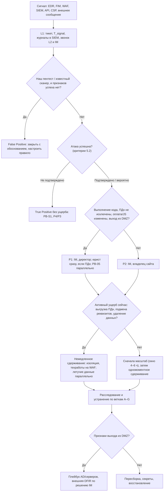

# PB-08 Компрометация публичного веб-приложения (сайт, API, админка)

Учебный плейбук для вымышленной компании «Альфа-Трейд». Роли, критичность P1–P4, правила коммуникаций и шаблон отчёта берутся из IR-плана, здесь только то, что специфично для успешной атаки на сайт магазина, API мобильного приложения и админку CMS.

Пометки в тексте:
- **[проверить]**: точный срок, номер статьи или приказа, номер подтехники ATT&CK, CVE, название журнала или функция конкретного продукта. Сверить с первоисточником (pravo.gov.ru, сайт РКН, attack.mitre.org, документация вендора) перед применением. Всё про 152-ФЗ, КоАП, УК, ГосСОПКА и PCI DSS — ориентиры, финальную позицию даёт юрист/DPO.
- **[учебное]**: порог, срок или цифра придуманы для учебного примера и подбираются по данным компании.
- **(пример)**: запросы на нейтральном псевдо-SPL или Sigma. Вендоры SIEM, WAF, EDR и стек сайта в IR-плане не названы, поэтому имена индексов, полей и пути даны для типовых вариантов (nginx/Apache + PHP, IIS/.NET, Tomcat/Java). Для MaxPatrol SIEM, KUMA, ELK логику нужно переложить.

Главная мысль плейбука: **сначала масштаб, потом одномоментное сдерживание.** Удалить один найденный веб-шелл и заблокировать один IP — значит предупредить атакующего и потерять улики, пока у него остаются запасные точки входа. Исключение одно: идёт выгрузка ПДн, подмена платёжных реквизитов или разрушение данных — тогда изолируем сразу. Вторая мысль: **сервер с выполнением кода считается полностью скомпрометированным**, его не лечат, а пересобирают, и все секреты на нём меняются. Третья: **юрист узнаёт сразу**, как только доступ к ПДн нельзя исключить, а не «потом, в PB-05».

---

## 1. Паспорт плейбука

| Поле | Значение |
| --- | --- |
| ID | PB-08 |
| Версия | 1.0 (учебная), дата: 31.10.2026 |
| Владелец | Руководитель ИБ (IM). Разделы про код и CI/CD согласует руководитель разработки (или подрядчик-разработчик). Пересмотр раз в 6 месяцев, после каждого применения и учений |
| Критичность по умолчанию | **P2**: подтверждённая успешная эксплуатация без признаков выполнения кода и доступа к ПДн (хранимая XSS в отзывах, SQLi в БД каталога без ПДн, дефейс через админку) |
| P1 | Любое из: выполнение кода на сервере (RCE, веб-шелл, процесс веб-сервера запускает интерпретатор команд); доступ к данным с ПДн через SQLi/LFI/SSRF/BOLA, **даже если выгрузка не подтверждена**; изменение страницы оплаты, внедрённый JS, подмена реквизитов; компрометация учётки админки с правами экспорта клиентов или установки модулей; признаки выхода из DMZ в серверный сегмент; вымогательство «база у нас» |
| P3 | Эксплуатация подтверждена, но на изолированном тестовом стенде без копии боевых ПДн и без связей с продом |
| P4 | Атака не удалась (WAF заблокировал, приложение ответило ошибкой без данных) — это не PB-08, а PB-S1 |
| Правила изменения | При сомнении P1 сохраняется до опровержения. Понизить P1 может только IM, с обоснованием в тикете; если повод для P1 — ПДн, то вместе с юристом. Повысить может любой участник |
| MITRE ATT&CK, Reconnaissance (TA0043) | T1595.002 Vulnerability Scanning, T1595.003 Wordlist Scanning |
| Initial Access (TA0001) | **T1190 Exploit Public-Facing Application**, T1078 Valid Accounts (админка), T1195.002 Compromise Software Supply Chain (зависимость, подрядчик, CI/CD) |
| Execution (TA0002) | T1059.004 Unix Shell, T1059.003 Windows Command Shell, T1059.001 PowerShell, T1059.007 JavaScript (скимминг) |
| Persistence (TA0003) | **T1505.003 Web Shell**, T1505.004 IIS Components, T1053.003 Cron, T1543.002 Systemd Service, T1098.004 SSH Authorized Keys, T1136.001 Local Account, T1554 Compromise Host Software Binary |
| Privilege Escalation (TA0004) | T1068 Exploitation for Privilege Escalation |
| Defense Evasion (TA0005) | T1070.002 Clear Linux or Mac System Logs, T1070.004 File Deletion, T1070.006 Timestomp, T1027 Obfuscated Files or Information |
| Credential Access (TA0006) | T1552.001 Credentials In Files (`.env`, конфиги CMS), T1552.005 Cloud Instance Metadata API (через SSRF), T1003.008 /etc/passwd and /etc/shadow |
| Discovery, Lateral Movement (TA0007, TA0008) | T1082, T1083, T1046 Network Service Discovery; T1021.004 SSH, T1210 Exploitation of Remote Services |
| Collection, C2, Exfiltration (TA0009, TA0011, TA0010) | T1005, T1213, T1560.001; T1071.001, T1572 Protocol Tunneling, T1090 Proxy, T1105 Ingress Tool Transfer; T1041, T1048, T1567.002 |
| Impact (TA0040) | T1491.002 External Defacement, T1565.001 Stored Data Manipulation (цены, реквизиты), T1496 Resource Hijacking (майнер), T1485 Data Destruction |
| Вне ATT&CK | BOLA/IDOR в API — OWASP API Security Top 10 2023, API1; в ATT&CK ложится в T1190 лишь условно. Веб-скимминг однозначной техники не имеет **[проверить сопоставление]**. Номера подтехник сверить с актуальной матрицей Enterprise **[проверить]** |
| Связанные плейбуки | **PB-S1** Сработка WAF (отбитая попытка; граница с PB-08 — признаки успеха, раздел 5.2). **PB-05** Утечка данных — запускается **параллельно**, как только ПДн затронуты или не исключены. PB-03 Компрометация учётной записи (админы CMS, разработчики). PB-04 Вредонос на сервере. PB-06 DDoS (может быть прикрытием атаки). PB-10 Облачный аккаунт (ключи облака, украденные через SSRF). Компрометация AD/серверного сегмента — если атакующий вышел из DMZ (отдельный плейбук, номер уточнить) |
| Целевые сроки по фазам [учебное] | Тикет, эскалация L2 и IM, ничего не трогать на сервере: **15 мин**. Журналы вне сервера подтверждены, успех атаки подтверждён/опровергнут: **30 мин**. Критичность, юрист (если ПДн не исключены), владелец: **45 мин**. Решение о стратегии сдерживания (сразу или после масштаба): **1 ч**. Летучие данные сняты: **2 ч**. Первичный масштаб (шеллы, закрепление, выход из DMZ, доступ к ПДн): **4 ч**. Одномоментное сдерживание: **4–6 ч** (сразу при активной выгрузке). Первичное уведомление РКН: **до 24 ч** с момента выявления. Результаты расследования в РКН: **до 72 ч**. Пересборка и возврат в работу: обычно **1–3 суток**. Усиленный мониторинг: **30 дней** для P1 (IR-план — минимум 2 недели) |

---

## 2. Назначение и область применения

Плейбук описывает действия, когда атака на публичное веб-приложение **удалась или вероятно удалась**: атакующий получил данные, выполнил код, вошёл в админку, изменил контент или страницы оплаты.

**Подсценарии (ветки).** Их может быть несколько одновременно: SQLi часто ведёт к чтению конфига, а тот — к админке.

| Код | Подсценарий | Типичные признаки | Ключевые техники |
| --- | --- | --- | --- |
| A | Доступ к данным через уязвимость: SQLi, LFI/Path Traversal с чтением `.env`/`wp-config.php`/`bitrix/.settings.php`, SSRF (в том числе к метаданным облака), XXE | Аномальные запросы, серии time-based ответов, чтение конфигов, OOB DNS | T1190, T1552.001, T1552.005, T1213 |
| B | Выполнение кода и веб-шелл: RCE, загрузка файла, десериализация, SSTI; файловые и in-memory шеллы (Java Filter/Servlet/Valve, модули IIS) | Веб-сервер порождает `sh`/`cmd.exe`; новые или **изменённые** скрипты; редкие POST-цели | T1505.003, T1505.004, T1059 |
| C | Скомпрометирована админка CMS | Вход с нового ASN без MFA, новые администраторы, штатный экспорт клиентов, установка модуля | T1078, T1110, T1098, T1136 |
| D | Злоупотребление API: BOLA/IDOR, mass assignment, массовый перебор | Много уникальных ID объектов на один токен, ответы 200 нормального размера | T1190 (условно), OWASP API1 |
| E | Внедрение на клиентской стороне: скиммер на оформлении заказа, вредоносный JS | Изменённый JS на странице оплаты, CSP-нарушения с внешним доменом, жалобы клиентов на списания | T1059.007, T1565.001 [проверить] |
| F | Дефейс, SEO-спам, фишинговые страницы на нашем домене | Изменение контента, новые страницы, жалобы поисковиков | T1491.002 |
| G | Цепочка поставок: зависимость npm/composer, сторонний виджет, подрядчик, CI/CD | Бэкдор в коде релиза, подозрительный коммит, изменённый lock-файл | T1195.002, T1554 |

**Входит:** сайт магазина, API мобильного приложения (оба в DMZ за WAF), админка CMS, staging и тестовые стенды (часто с копией боевой БД), поддомены, контейнерные развёртывания сайта.

**Не входит (куда передать):**
- отбитая попытка, ответ без данных → **PB-S1**, P4/P3;
- DDoS → **PB-06** (но проверить, не прикрытие ли это для эксплуатации);
- компрометация облачной почты → **PB-10**; учёток сотрудников → **PB-03**;
- утечка ПДн как последствие → **PB-05 параллельно**, PB-08 остаётся ведущим по технике;
- выход атакующего в серверный сегмент или AD → плейбук компрометации AD/серверов становится ведущим, PB-08 продолжает по DMZ.

**Предусловия (подготовка, без которой половина шагов невыполнима):**
- [ ] **Карточка стека сайта**: платформа (например, 1С-Битрикс, самописный PHP/Java/.NET), версии, пути к webroot, журналам и конфигам с секретами, владельцы, подрядчик. В IR-плане стек не описан — заполнить.
- [ ] **Эталон релиза**: git-тег и SHA-256 файлов текущей версии на проде — для сравнения.
- [ ] **Журналы**: access-журнал с реальным IP клиента за WAF (`X-Forwarded-For`/`X-Real-IP`), временем ответа, размером, User-Agent и сквозным `X-Request-ID` от WAF до приложения; журнал входов и действий в админке; аудит СУБД (pgaudit, MariaDB Audit Plugin, SQL Server Audit) по таблицам с ПДн; всё отправляется в SIEM **в реальном времени** (атакующий с root чистит локальные журналы, T1070.002). Хранение — 90 дней по IR-плану.
- [ ] **EDR** (или auditd + Sysmon for Linux) на веб-серверах и сервере БД, **FIM** на webroot и конфигурациях.
- [ ] **Egress-политика DMZ** «запрещено всё, кроме списка»: платёжный шлюз, доставка, SMS, почта, обновления, NTP, DNS — список согласован заранее.
- [ ] **Origin** принимает 80/443 только от адресов WAF/балансировщика.
- [ ] **Страница техработ** на WAF/CDN/балансировщике, а не на самом сервере; возможность переключиться на чистый резервный экземпляр (blue/green, IaC, «золотой образ»).
- [ ] **Инструменты сбора** в доверенном месте: AVML или LiME, UAC, офлайн-коллектор Velociraptor; для Windows — WinPMem, KAPE **[проверить условия лицензии]**; YARA-правила для веб-шеллов.
- [ ] **Матрица секретов** (раздел 9.2) и контакты: хостинг/облако, CDN/WAF-провайдер, платёжный провайдер, подрядчик-разработчик, юрист.
- [ ] Роль **«Разработка/DevOps»** добавлена в IR-план (сейчас её там нет).

---

## 3. Триггеры и источники обнаружения

Узкий признак «WAF пропустил, ответ 200 с большим телом» не работает при blind/time-based SQLi (много маленьких ответов), при error-based SQLi (ответ 500), при шифрованных шеллах (Godzilla, Behinder), при BOLA (тысячи нормальных ответов) и при OOB-выгрузке через DNS. Поэтому нужен набор независимых детектов. Запросы — (пример), пороги — [учебное].

| # | Источник | Что видим | Поля / Event ID | Пример правила или запроса | Ветка |
| --- | --- | --- | --- | --- | --- |
| 1 | EDR, Sysmon (Windows/Linux), auditd, Security | Процесс веб-сервера запускает интерпретатор или утилиту | Sysmon EID 1 (`ParentImage`, `Image`, `CommandLine`, `User`); Security 4688; auditd `execve` (`ppid`, `exe`) | Sigma-логика: `parent.name in (nginx, httpd, apache2, php-fpm*, java, tomcat*, w3wp.exe, node) AND process.name in (sh, bash, dash, python*, perl, cmd.exe, powershell.exe, pwsh.exe, whoami, id, uname, curl, wget, nc, base64)` | B |
| 2 | EDR, Sysmon, FIM | Веб-сервер создаёт исполняемый файл в webroot | Sysmon EID 11 (`TargetFilename`, `Image`); FIM: путь, хеш, владелец | `file.path startswith (/var/www, C:\inetpub\) AND file.ext in (php, phtml, phar, jsp, jspx, war, aspx, ashx, asmx, cshtml) AND writer in (веб-серверы)`; отдельно `.htaccess`, `.user.ini`, `web.config` | B |
| 3 | FIM | Изменён **существующий** файл вне окна релиза | Хеш до/после, ctime | Любое изменение хеша в webroot вне окна деплоя | B, E, G |
| 4 | Access-журнал | Редкие POST-цели (кандидаты в шеллы) | `method`, `uri_path`, `status`, `src_ip` | `index=web method=POST status=200 earliest=-30d \| stats dc(src_ip) as ips count by uri_path \| where ips<=2` | B |
| 5 | WAF + access | Атака помечена (detect/log), но не заблокирована, и приложение ответило успешно | WAF: `action`, `rule_id`, `attack_class`, `request_id`; веб: `status`, `bytes` | `index=waf action IN (detect,log,pass) attack_class IN (sqli,rce,lfi,upload,ssrf,deser) \| join request_id [search index=web status<400]` | A, B |
| 6 | Access-журнал | Серия time-based ответов | nginx `$request_time`, IIS `time-taken` | Один URI, вариации параметра, время ответа ≈ N секунд кратно | A |
| 7 | API-шлюз, журнал приложения | Перебор объектов | `token_id`/`user_id`, `object_id`, `bytes` | `stats dc(object_id) by token_id span=1h \| where dc > 200` [учебное]; `sum(bytes) by token > baseline×5` | D |
| 8 | NGFW, Sysmon EID 3 | Веб-сервер или сервер БД ходит наружу на неожиданные адреса | `src`, `dst`, `dport`, `bytes_out` | `src in DMZ_web AND dst not in egress_allowlist` | B, A |
| 9 | DNS-журнал, Sysmon EID 22 | OOB-эксфильтрация, туннели | `query`, `src` | Длинные поддомены с высокой энтропией; `*.oast.*`, `*.interact.sh`, `*.burpcollaborator.net` | A, B |
| 10 | NGFW | Обход WAF: соединения на origin не с WAF | `dst`, `dport`, `src` | `dst = web_origin AND dport IN (80,443) AND src NOT IN WAF_ranges` | Все |
| 11 | Журнал админки CMS | Вход с нового ASN/страны без MFA, новый администратор, экспорт, установка модуля | `user`, `ip`, `action`, `mfa` | Первый вход с данного ASN за 30 дней; любое создание/повышение роли | C |
| 12 | Мониторинг целостности страниц, CSP `report-uri` | Изменён JS на оформлении заказа | Хеш скрипта, `blocked-uri`, `document-uri` | Хеш отличается от эталона; CSP-нарушение с неизвестным доменом на `/checkout` | E |
| 13 | Аудит СУБД, `pg_stat_statements` | Нетипичные запросы учётки приложения | `user`, `statement`, `rows` | `UNION SELECT`, `information_schema`, `pg_sleep`, `INTO OUTFILE`, `COPY ... TO PROGRAM`, `xp_cmdshell`; `SELECT` по таблице клиентов без `LIMIT` | A |
| 14 | Windows Security на сервере | Новые учётки и задачи, очистка журнала | 4720, 4732/4728, 4698, 7045 (System), 1102 | Любое событие на веб-сервере вне change-окна | B |
| 15 | CI/CD, Git | Изменения конвейера и зависимостей | Автор, коммит, lock-файл | Коммит не от известного автора, изменение lock-файла без задачи | G |
| 16 | Внешние | Исследователь, клиент, CERT, банк-эквайер (компрометация карт), публикация в Telegram | — | Ручная регистрация, T_signal = время поступления | Все |

**Учёт времени.** Журналы IIS (формат W3C) по умолчанию пишут в UTC; WAF часто тоже в UTC; nginx — в локальном времени сервера. В тикете всё приводится к UTC+3 (МСК), как в IR-плане. **Реальный IP.** В журнале веб-сервера за WAF в `remote_addr` стоит IP самого WAF — смотреть `X-Forwarded-For` (и помнить, что его можно подделать, если origin доступен напрямую). **Тело POST** в access-журналах обычно не пишется — смотреть в WAF, если он сохраняет тело **[проверить для конкретного WAF]**.

---

## 4. Роли и RACI для этого сценария

R — выполняет, A — утверждает, C — консультирует, I — информируется.

| Действие | L1 | L2 | IM | ИТ | Разработка/DevOps | Владелец сайта | Юрист/DPO | PR | Директор |
| --- | --- | --- | --- | --- | --- | --- | --- | --- | --- |
| Приём сработки, тикет, T_signal, эскалация | R | A | I | | | | | | |
| Сохранение журналов вне сервера | R | A | | C | | | | | |
| Подтверждение успеха, выбор веток | C | R | A | | C | | | | |
| Критичность | | C | R/A | | | I | I | | I |
| Снятие памяти, летучих данных, образов | | R/A | I | R | C | | | | |
| Виртуальный патч WAF на класс уязвимости | | R/A | I | | C | | | | |
| Перевод группы правил WAF в block, закрытие origin | | R | A | R | | I | | | |
| Изоляция сервера, переключение балансировщика на чистый экземпляр | | C | A | R | C | C | | | |
| Отключение функции/модуля, ограничение прав учётки БД | | C | A | R | R | A | | | |
| Страница техработ | | C | A | R | | A | | C | I (более 4 ч — A) |
| Анализ кода, исправление, ревизия CI/CD | | C | I | | R/A | I | | | |
| Смена секретов | | C | A | R | R | I | | | |
| Решение «бэкап или очистка БД» | | C | A | R | C | A | | | |
| Уведомление РКН | | C | C | | | I | R/A | I | I |
| Платёжный провайдер, клиенты | | | C | | | C | C | R | A |
| Заявление в полицию, ответ на шантаж | | C | C | | | | R | | A |
| Закрытие инцидента | | R | A | | C | C | C | | I |

**Полномочия (из IR-плана, уточнение для PB-08).** L2 сам: блокирует один внешний IP, ставит виртуальный патч на один URL, если он не ломает бизнес-функцию, переводит реакцию EDR на сервере в «блокировать и сохранять». Всё, что останавливает или ограничивает сайт, API или оплату, — только IM + владелец сайта. Полная остановка более 4 ч или в пиковый период — с директором. Если владелец недоступен 30 минут при активной выгрузке ПДн, IM решает сам и фиксирует это в тикете **[учебное, утвердить у руководства]**.

**Дополнительные роли:** хронист (назначает IM в первые 15 минут); DBA; внешние — хостинг/облако, CDN/WAF-провайдер, платёжный провайдер, внешняя DFIR-команда (решение IM, бюджет — директор). Действия на скомпрометированном сервере ИТ и разработчики выполняют **только под контролем L2 и по чек-листу**.

---

## 5. Триаж (первые 15–30 минут)

Правила: при сомнении P1; на сервере ничего не трогаем, пока не сохранены журналы и не принято решение о стратегии; поиск всех точек закрепления — это расследование (раздел 8), а не триаж.

### 5.1. Карточка L1: первые 15 минут

- [ ] Принять сработку, завести тикет, записать T_signal (UTC+3), источник, хост, URI, IP.
- [ ] Проверить, не наш ли это пентест, сканирование подрядчика или bug bounty (календарь работ, IP подрядчика). Даже если пентест — сработка №1 из раздела 3 всё равно эскалируется.
- [ ] Убедиться, что журналы WAF, балансировщика, веб-сервера, NGFW и EDR по хосту приходят в SIEM. Если нет — сообщить L2 в первую очередь.
- [ ] Позвонить L2 и IM (звонок, не письмо). Шаблон эскалации: «PB-08, хост …, сработка …, время …, признак успеха: … / не ясен, на сервере ничего не трогали».
- [ ] **Не делать:** не открывать подозрительный URL в браузере, не блокировать IP, не просить ИТ «посмотреть сервер».

### 5.2. Пошаговый триаж L2 (до 30 минут)

| Шаг | Вопрос | Где смотреть | Признак |
| --- | --- | --- | --- |
| 1 | Журналы в безопасности? | SIEM, экспорт WAF/CDN | Есть 90 дней в SIEM; если нет — выгрузить копию, отключить удаление по logrotate |
| 2 | Атака успешна? | WAF + access по `request_id` или времени/IP/URI/UA | См. критерии ниже |
| 3 | Есть выполнение кода? | EDR: дерево процессов веб-сервера за 90 дней; FIM | Дочерние процессы `sh`/`cmd.exe`/`curl`; новые/изменённые скрипты → P1, ветка B |
| 4 | Доступны ли ПДн? | Какая БД/таблица за уязвимым эндпоинтом; учётка БД приложения и её права | Учётка приложения читает таблицу клиентов → ПДн **не исключены** → P1, юрист |
| 5 | Атакующий активен? | Запросы IOC-IP/токена/к шеллу за последние 60 минут; активные соединения в EDR/NGFW | Есть запросы или исходящий поток → решение по ветке «немедленно» |
| 6 | Есть выход из DMZ? | NGFW DMZ → серверный сегмент, кроме порта БД | Любые SMB/RDP/SSH/LDAP с веб-сервера → P1, плейбук AD |
| 7 | Обход WAF? | NGFW: входящие на origin не с WAF | Есть → журналы WAF «чистые» ничего не доказывают |
| 8 | Когда началось? | Первое появление IOC за всю глубину хранения | Шелл мог появиться за недели до сработки |

**Критерии «атака успешна»:**
- **Подтверждено:** ответ содержит данные или результат команды; EDR видит процессы от веб-сервера; появились или изменились файлы; созданы учётки; есть исходящие соединения с сервера; последующие запросы атакующего используют полученные данные (имена таблиц, ID, пути).
- **Вероятно:** серия time-based ответов с закономерностью; объём ответов по источнику/токену в разы выше нормы; запросы к редкому скрипту POST-ом с ответом 200; атака прошла мимо WAF в режиме detect, а ответ приложения неизвестен.
- **Не подтверждено:** все ответы 4xx/5xx без данных, нет процессов, файлов, учёток и исходящих соединений, origin закрыт → PB-S1.

«Вероятно» ведётся как «подтверждено» до опровержения.

### 5.3. Дерево решений



### 5.4. Критерии эскалации

- **IM немедленно (звонок):** любое «подтверждено/вероятно»; выполнение кода; изменения на странице оплаты.
- **Юрист/DPO:** в момент, когда доступ к ПДн нельзя исключить, а не после подтверждения выгрузки. В тикете отдельное поле «момент выявления» — от него юрист считает 24 ч (что считать моментом выявления, заранее согласовать с юристом **[проверить]**).
- **Директор:** в течение 1 часа от P1; немедленно при шантаже или если нужна остановка сайта более 4 ч.
- **Резервный канал:** если атакующий мог читать почту/мессенджеры ИТ, разработчиков или тикеты подрядчика.
- **Платёжный провайдер:** ветка E или подмена реквизитов — по решению IM в первые часы.
- **Внешняя DFIR-команда:** in-memory шелл в Java/.NET, выход из DMZ, контейнерный кластер без экспертизы в команде, масштаб не определён за 12 ч [учебное].

---

## 6. Сдерживание

**Стратегия по умолчанию — «сначала масштаб, затем всё в час Ч».** Пока L2 собирает улики и определяет масштаб (до 4–6 ч для P1), допустимы только «тихие» меры, которые не раскрывают обнаружение: виртуальный патч на класс уязвимости, включение журналирования, перевод EDR в режим без автоудаления. Затем по согласованному списку **одновременно**: изоляция, отзыв токенов и сессий, закрытие origin, egress-запрет, отключение функции. **Исключение:** активная выгрузка ПДн, деструктив, подмена реквизитов — тогда сразу.

### 6.1. Краткосрочное

| # | Мера | Что закрывает | Кто / инструмент | Апрув | Влияние |
| --- | --- | --- | --- | --- | --- |
| 1 | EDR на сервере: «обнаруживать и сохранять», без автоудаления и «лечения» | Порчу улик | L2 / консоль EDR | L2 | Нет |
| 2 | Виртуальный патч на **класс** уязвимости на эндпоинте: строгая валидация параметра (`id` только `^\d{1,10}$`), запрет загрузки кроме разрешённых типов с проверкой сигнатуры содержимого | Повторную эксплуатацию | L2 / WAF | L2, сообщить IM | Низкое, проверить функцию |
| 3 | Проверить, что правило в **block**, WAF разбирает формат тела (JSON, XML, multipart, GraphQL), тело не длиннее лимита инспекции; повторить безопасную нагрузку из журнала и убедиться в блокировке | Ловушку «правило есть, но не работает» | L2 / WAF | IM (тест на проде) | Нет |
| 4 | Закрыть origin для всех, кроме WAF/балансировщика | Обход WAF | ИТ / NGFW | IM | Низкое |
| 5 | Админка только через VPN или по списку IP + MFA; инвалидация сессий администраторов | Ветку C | ИТ, разработка | IM | Низкое |
| 6 | Отзыв токенов, rate limit на API-метод | Ветку D | Разработка / API-шлюз, WAF | IM | Клиентам перелогиниться |
| 7 | Отключить уязвимый модуль или функцию (загрузка файлов, поиск, метод API) | Точку входа | Разработка/ИТ | IM + владелец | Среднее |
| 8 | Изоляция сервера в EDR **с переключением балансировщика на чистый экземпляр** | Активный доступ к узлу | ИТ + L2 | IM | Низкое при резерве |
| 9 | Egress DMZ только по списку; DMZ → серверный сегмент только порт БД с конкретного сервера; DNS только через внутренний резолвер | C2, OOB, туннели, боковое перемещение | ИТ / NGFW | IM (+ владелец, если затронуты оплата/доставка) | Низкое при готовом списке, высокое без него |
| 10 | Ограничить права учётки БД приложения (отозвать FILE, SUPERUSER, `xp_cmdshell`, `COPY ... TO PROGRAM`, лишние таблицы) | Массовую выгрузку, выполнение команд через БД | DBA | IM + владелец | Среднее |
| 11 | Страница техработ **на WAF/CDN/балансировщике** | Всё, что идёт через сайт | ИТ | IM + владелец; более 4 ч — директор | Высокое (~1 млн ₽/ч) |
| 12 | Блокировка IP атакующего — вспомогательная мера: после масштаба или сразу при активной выгрузке; срок и ссылка на тикет в комментарии правила; не блокировать диапазоны мобильных операторов (CGNAT) и облачных прокси целиком | Автоматическое сканирование | L2 / NGFW, WAF | L2 (один IP), IM (диапазоны) | Риск блокировки клиентов |

**Критерий для страницы техработ:** продолжение работы сайта даёт атакующему доступ к ПДн или платежам, и это нельзя закрыть точечной мерой (функция, виртуальный патч, изоляция одного узла). Решение и время — в тикет. **Проверка результата сдерживания** через 30–60 минут: нет запросов к известным шеллам с ответом 200, нет исходящих соединений с IOC, нет новых процессов от веб-сервера.

### 6.2. Долгосрочное

- Работа на чистом экземпляре за WAF, старый сервер изолирован и сохранён как улика.
- Виртуальный патч остаётся до выхода исправления в коде и после — как дополнительный слой.
- Временный усиленный режим: группы правил WAF для классов атак инцидента в block, rate limit на API, админка только через VPN.
- Релизы — только после проверки репозитория и CI/CD (ветка G), с ручным ревью.
- Ключевые секреты меняются только **после** отсечения доступа атакующего (раздел 9.2).

### 6.3. Что НЕ делать

- Не удалять веб-шелл до определения масштаба (исключение — активный ущерб, решение IM). Типичная картина: удалили один, а у атакующего было ещё пять.
- Не перезагружать сервер, не перезапускать веб-сервер, пул приложений, JVM, под или контейнер до снятия памяти: in-memory шелл исчезнет вместе с уликами.
- Не открывать URL веб-шелла и не «проверять» его работу с корпоративного IP.
- Не выполнять на живом сервере `git status`, антивирусное сканирование с лечением и другие изменяющие операции (git переписывает `.git/index`).
- Не включать страницу техработ подменой `index.php` на скомпрометированном сервере.
- Не менять пароль БД, пока атакующий имеет RCE: он прочитает новый из конфига через минуту.
- Не менять egress-правила без списка разрешённых направлений: сломается оплата и доставка.
- Не обсуждать инцидент в каналах, к которым мог получить доступ атакующий, в том числе в тикет-системе подрядчика.
- Не вступать в переписку с вымогателем без решения директора и юриста.

---

## 7. Сбор и сохранение артефактов

Порядок по летучести (RFC 3227). Инструменты запускаются с доверенного носителя, вывод пишется **не** на исследуемый диск. Каждая единица фиксируется в журнале улик: что, откуда, когда (UTC+3), кто, чем снято, SHA-256, где хранится, кто получал доступ.

| Порядок | Артефакт | Linux | Windows/IIS | Кто |
| --- | --- | --- | --- | --- |
| 0 | Журналы вне сервера: WAF, CDN, балансировщик, NGFW, DNS, EDR, SIEM за 90 дней | Экспорт; приостановить удаление по ротации | То же + EVTX | L1/L2 |
| 1 | Память | AVML или LiME (модуль под ядро); анализ Volatility 3 (нужна таблица символов под ядро) | WinPMem или аналог **[проверить актуальность инструментов]** | L2 |
| 1a | Память JVM (если Java) | Heap dump процесса **до перезапуска** (`jcmd <pid> GC.heap_dump`) для поиска зарегистрированных Filter/Servlet/Valve | — | L2 + разработка |
| 2 | Процессы, сеть, файлы | `ps -eo pid,ppid,user,lstart,cmd --forest`, `ss -tanpu`, `lsof -nP`, `ls -l /proc/*/exe 2>/dev/null \| grep deleted`, `/proc/<pid>/{cmdline,environ,cwd}` | `tasklist /v`, `netstat -anob`, Autoruns, `appcmd list modules` | L2 |
| 3 | Триаж-коллекция | UAC или офлайн-коллектор Velociraptor | KAPE или Velociraptor | L2 |
| 4 | Webroot с метаданными | Сначала `stat` (mtime, ctime, atime, birth, владелец, inode), затем `tar --xattrs --acls -cpf`, SHA-256 | Из теневой копии/снимка, Robocopy `/COPY:DATSOU` | L2/ИТ |
| 5 | Диск | Снимок ВМ/облачного диска или `dc3dd`/`ewfacquire` | Снимок ВМ, FTK Imager | ИТ под контролем L2 |
| 6 | БД | Журналы аудита, `pg_stat_statements`/`performance_schema`, пользователи и права, триггеры и процедуры, снимок БД (если допустимо по объёму) | SQL Server Audit, Extended Events | DBA |
| 7 | Контейнеры | `docker inspect`, `docker diff`, `docker export`, журналы контейнера, снимок узла; журналы аудита API Kubernetes; не удалять под | — | DevOps под контролем L2 |
| 8 | Админка и CMS | Таблица пользователей (даты создания/изменения), журнал входов и действий, установленные модули, агенты/cron CMS | — | Разработка |
| 9 | Внешние | Журналы CDN/WAF-провайдера, хостинга, платёжного провайдера, CSP-отчёты | — | IM запрашивает |

Пример фиксации webroot (пример):

```bash
# Вывод — на подключённое хранилище улик, не на исследуемый диск
find /var/www -xdev -type f -printf '%TY-%Tm-%Td %TT | %CY-%Cm-%Cd %CT | %u:%g | %s | %p\n' \
  | sort > /evidence/INC-xxx/webroot_times.txt
tar --xattrs --acls -cpf /evidence/INC-xxx/webroot.tar /var/www
sha256sum /evidence/INC-xxx/webroot.tar >> /evidence/INC-xxx/hashes.txt
```

Образцы веб-шеллов анализируются **как файлы** в изолированной среде; извлечённые из карантина EDR — с хешами и записью в журнал.

---

## 8. Расследование

Каждое утверждение помечается «подтверждено» или «предположение». Результат — хронология и таблица IOC в тикете.

| Вопрос | Что выяснить | Источники и приёмы |
| --- | --- | --- |
| **Как вошли?** | Первая успешная эксплуатация: дата, URI, уязвимость, IP. Почему WAF пропустил: detect-режим, нет правила, кодировка, тело не разбирается или длиннее лимита, обход через origin. Нет ли известной CVE с активной эксплуатацией | WAF + access за 90 дней; поиск первого появления каждого IOC; каталог CISA KEV, БДУ ФСТЭК; версии CMS и модулей |
| **Разведка до атаки?** | Сканеры, перебор путей | User-Agent (`sqlmap`, `nuclei`, `ffuf`, `dirsearch` — признак вспомогательный, UA подделывается), всплески 404 |
| **Что получили?** | Выполнение кода (под кем: `www-data`, `IIS APPPOOL\…`, root/SYSTEM), какие файлы прочитаны, какие секреты | EDR, `/proc/<pid>/environ`, история shell, обращения к `.env`, к 169.254.169.254 (SSRF) |
| **Где закрепились?** | Все шеллы — новые **и изменённые** файлы против эталона, `.htaccess`/`.user.ini` с `auto_prepend_file`, PHP в картинках и каталоге загрузок; in-memory; cron, systemd, `authorized_keys`, новые пользователи, sudoers, `/etc/ld.so.preload`, PAM; модули IIS; модули и агенты CMS; триггеры и процедуры БД; учётки админки | Сравнение **копии** webroot с git-тегом (`git diff --stat <tag>` на копии); YARA; FIM; heap dump; см. команды ниже |
| **Куда пошли дальше?** | DMZ → серверный сегмент; входы учёток с веб-сервера в AD; туннели (chisel, frp, ngrok, SSH -R); другие серверы фермы, staging, API | NGFW; журналы AD 4624/4625/4768/4769/4776 с IP из DMZ; EDR на сервере БД; долгие исходящие сессии |
| **Что изменили?** | Цены, реквизиты оплаты, промокоды, JS на страницах, шаблоны писем, настройки платёжного модуля | Сравнение БД с бэкапом до компрометации; аудит действий админов; хеши клиентских скриптов |
| **Что вынесли?** | Таблицы, число строк и субъектов, канал (HTTP-ответы, OOB DNS, выгрузка в облако T1567.002) | Аудит СУБД, `pg_stat_statements.rows`; суммарный `bytes` по IP/токену; трафик веб → БД (NetFlow) против нормы; для blind SQLi — число запросов (одна строка требует сотен–тысяч запросов) |
| **Побочные цели?** | Майнер, спам-рассылка, фишинговые и SEO-страницы на нашем домене | Загрузка CPU, исходящий SMTP, новые страницы |
| **Цепочка поставок?** | Коммиты за период, авторы, токены CI/CD, раннеры, изменения lock-файлов | Git, журналы CI/CD |

**Правило для юриста.** Если доступ к таблицам с ПДн технически был, а журналов, опровергающих выгрузку, нет, исходим из того, что выгрузка была. Оценка объёма передаётся как «предварительные сведения» с допущениями; формулировку для РКН утверждает юрист. Число субъектов и категории ПДн считаются по методике PB-05.

Проверки закрепления на Linux (доверенные бинарники, вывод на внешний носитель):

```bash
ls -la /etc/cron* /var/spool/cron/crontabs/ 2>/dev/null; crontab -l -u www-data
systemctl list-unit-files --state=enabled; ls -lt /etc/systemd/system/ | head -30
cat /etc/ld.so.preload 2>/dev/null
awk -F: '$3==0 || $3>=1000' /etc/passwd
find / -xdev -name authorized_keys -exec ls -l {} \; -exec cat {} \; 2>/dev/null
ls -la /tmp /var/tmp /dev/shm
grep -RniE 'auto_prepend_file|auto_append_file' /var/www /etc/php* 2>/dev/null
find /var/www -xdev -type f -path '*upload*' -iname '*.ph*'
```

Боковое перемещение из DMZ (пример):

```
index=ngfw src_ip IN (<web_servers>) dest_zone="server_segment" earliest=-90d
| stats count values(dest_port) min(_time) max(_time) by dest_ip
| where NOT (dest_ip=<db_server> AND dest_port=<db_port>)
```

Grep по `eval(`, `base64_decode`, `gzinflate`, `system(`, `shell_exec(` даёт много ложных срабатываний в коде CMS: использовать только вместе со сравнением с эталоном.

---

## 9. Устранение

### 9.1. Чек-лист

- [ ] Корневая причина установлена: запрос → уязвимый код/компонент → версия. Если не установлена — это записано, восстановление идёт с компенсирующими мерами и усиленным мониторингом.
- [ ] Код исправлен или компонент обновлён, прошёл ревью; ретест на стенде; тот же класс уязвимости проверен в других контроллерах и методах API.
- [ ] Удаление **всех** шеллов и механизмов закрепления — одномоментно, в согласованный час Ч, под контролем L2.
- [ ] Сервер или контейнеры собраны с нуля из эталонного образа/IaC. Лечение на месте при ветке B не допускается. Старый сервер сохранён как улика и выведен из эксплуатации.
- [ ] Репозиторий и CI/CD проверены (коммиты, авторы, ветки, токены, раннеры); lock-файлы сверены, сборка воспроизводима.
- [ ] Каталог загрузок (переносится при пересборке!) проверен YARA и по сигнатурам содержимого; исполнение скриптов в нём запрещено конфигурацией веб-сервера.
- [ ] БД очищена: лишние администраторы, внедрённый JS/HTML в контенте и настройках, изменённые цены/реквизиты/промокоды, вредоносные триггеры и процедуры. Решение «восстановить из бэкапа до компрометации или точечно очистить» приняли владелец и IM (откат может стереть заказы и платежи за недели).
- [ ] Секреты сменены по матрице 9.2 **после** отсечения доступа атакующего, новые секреты развёрнуты только на чистую инфраструктуру.
- [ ] Все сессии администраторов и пользователей инвалидированы, ключ подписи сессий/JWT заменён.
- [ ] При утечке хешей паролей клиентов — принудительная смена паролей; слабый алгоритм (MD5/SHA-1 без соли) мигрирован на bcrypt/Argon2.
- [ ] Если был выход из DMZ — устранение по плейбуку AD/серверов завершено.

### 9.2. Матрица секретов

| Секрет | Где | Что даёт атакующему | Как сменить | Влияние | Кто |
| --- | --- | --- | --- | --- | --- |
| Учётка БД приложения | `.env`, конфиг CMS | Все данные приложения | Новая учётка с минимальными правами, старую удалить | Перезапуск приложения | DBA + разработка |
| Ключ подписи сессий/JWT, `APP_KEY`, `secret_key_base`, `machineKey` | Конфиг | Подделка сессий; для ASP.NET — RCE через ViewState | Новый ключ | Все разлогинены | Разработка |
| Ключи платёжного шлюза | Конфиг/БД | Подмена callback, мошеннические возвраты | Кабинет провайдера | Короткий перерыв оплат | Владелец + разработка |
| API-ключи доставки, SMS, рассылок | Конфиг | Рассылки от имени магазина, адреса клиентов | Кабинеты сервисов | Минимальное | Разработка |
| Приватный ключ TLS | Веб-сервер | MitM | Перевыпуск и отзыв сертификата | Минимальное | ИТ |
| SSH-ключи деплоя, токены CI/CD и Git | Сервер, CI | Внедрение кода в будущие релизы | Отзыв и перевыпуск | Пауза релизов | DevOps |
| Ключи облачного/S3-хранилища | Конфиг, метаданные ВМ | Медиа, бэкапы | Перевыпуск, проверка журналов доступа (PB-10) | Минимальное | ИТ |
| Учётка интеграции с 1С | Конфиг | Учётная система | Смена пароля, проверка журналов 1С | Пауза обмена | ИТ |
| Доменные учётки (если сервер в домене) | Память, конфиги | Боковое перемещение в AD | По плейбуку AD | Зависит | ИТ |

---

## 10. Восстановление и мониторинг после инцидента

1. Новый экземпляр подключается **только за WAF**; origin принимает соединения только от WAF/балансировщика; egress DMZ — по списку.
2. До открытия: включены FIM, EDR, отправка всех журналов в SIEM, аудит СУБД, правила SIEM на IOC инцидента; внешний скан и ретест уязвимости пройдены.
3. Открытие поэтапно (например, каталог и просмотр → корзина → оплата), каждый этап подтверждает владелец сайта.
4. Усиленный мониторинг **30 дней** для P1 [учебное] (IR-план — минимум 2 недели), ежедневный просмотр L2:

| Что мониторить | Как | Порог тревоги |
| --- | --- | --- |
| Запросы к старым путям веб-шеллов и уязвимому эндпоинту | WAF + access | Любой запрос с ответом не 403/404 |
| Процессы от веб-сервера | EDR, правило №1 | Любой |
| Изменения файлов в webroot | FIM | Любое вне окна релиза |
| Исходящие соединения из DMZ | NGFW | Любое вне списка |
| Входы в админку | Журнал CMS | Новый ASN, без MFA, новые администраторы |
| Перебор в API | Правило №7 | Порог [учебное] |
| Скрипты на странице оплаты | Мониторинг целостности, CSP-отчёты | Любое отличие от эталона |
| IOC инцидента (IP, домены, хеши, User-Agent) | SIEM | Любое совпадение |
| Публикации базы | Telegram-каналы, форумы — совместно с PB-05 | Упоминание «Альфа-Трейд» |

5. Владелец сайта подтверждает корректность работы и данных (цены, реквизиты, заказы).

---

## 11. Коммуникации и уведомления

### 11.1. Внутренние

| Кому | Когда | Срок | Кто | Канал / содержание |
| --- | --- | --- | --- | --- |
| IM | Успех атаки подтверждён или вероятен | Сразу | L2 | Звонок + тикет |
| Владелец сайта | P1/P2 | ≤ 1 ч | IM | Что известно, какие решения об ограничении функций нужны |
| Директор | P1 | ≤ 1 ч, затем каждые 2 ч | IM | Формат IR-плана: известно / сделано / дальше / нужны решения |
| Юрист/DPO | ПДн затронуты или не исключены | Сразу (≤ 1 ч) | IM | Момент выявления, что известно о составе и объёме |
| Разработка (внутренняя или подрядчик) | Нужен анализ кода | По решению IM | IM | Отдельный канал; подрядчику — минимум деталей до проверки ветки G |
| Служба поддержки | Сайт недоступен или клиенты получают уведомления | До публикации | PR | Скрипт ответов |

### 11.2. Внешние

| Кому | Когда | Срок | Кто | Основание / примечание |
| --- | --- | --- | --- | --- |
| Роскомнадзор | Неправомерная передача (предоставление, распространение, доступ) ПДн | 24 ч — первичное, 72 ч — результаты расследования | Юрист | 152-ФЗ, ст. 21, ч. 3.1; форма и способ подачи **[проверить]** |
| ГосСОПКА (НКЦКИ) | Компьютерный инцидент, повлёкший неправомерную передачу ПДн | По порядку взаимодействия **[проверить: 152-ФЗ ст. 19 ч. 12, приказ ФСБ России от 13.02.2023 № 77]** | Юрист | 187-ФЗ к «Альфа-Трейд» не применяется (не субъект КИИ) |
| Платёжный провайдер / эквайер | Ветка E, изменены страницы оплаты или реквизиты | По договору, обычно немедленно | IM + юрист | PCI DSS — если применим к модели оплаты **[проверить: своя форма или страница/iframe провайдера]** |
| Хостинг, облако, CDN | Нужны их журналы, снимки, блокировки | По необходимости | IM/ИТ | Официальный запрос |
| Клиенты | Утечка ПДн, требующая действий клиентов | По решению директора и юриста | PR | Что произошло, какие данные, что делать |
| Полиция | Признаки преступления, шантаж | По решению руководства | Юрист | УК РФ ст. 272, 272.1 **[проверить]**; улики передаются с описью и хешами |

Ответственность за неуведомление РКН — отдельное нарушение по КоАП ст. 13.11 (редакция, действующая с 30.05.2025) **[проверить части статьи и размеры штрафов у юриста]**.

### 11.3. Шаблоны

**Статус рабочей группе (IM, P1 каждые 2 ч):**
> [Кодовое имя] PB-08, P1, статус на ЧЧ:ММ МСК. T_signal: … Момент выявления (для РКН): … Ветки: B, A. Известно: вход через … (подтверждено), шелл в … (подтверждено), доступ к таблице клиентов (предположение). Неизвестно: объём выгрузки, выход из DMZ. Сделано: … Дальше: час Ч в … Нужны решения: техработы на оплату (владелец). Следующий статус: ЧЧ:ММ.

**Страница техработ / поддержка:**
> Сайт временно недоступен из-за технических работ. Ваши заказы сохранены. Мы никогда не запрашиваем по телефону коды из SMS, пароли и данные карт.

**Holding statement (PR):**
> Мы обнаружили подозрительную активность на сайте и проводим проверку со специалистами по информационной безопасности. Мы сообщим о результатах. Если вам звонят от имени «Альфа-Трейд» с просьбой назвать код или оплатить заказ повторно, положите трубку.

---

## 12. Критерии закрытия

- [ ] Корневая причина установлена (или записано, почему нет, и приняты компенсирующие меры).
- [ ] Уязвимость исправлена в коде/компоненте, ретест пройден; виртуальный патч оставлен как дополнительный слой. **Одного правила WAF недостаточно.**
- [ ] Все известные шеллы и механизмы закрепления удалены, сервер пересобран, старый сохранён как улика.
- [ ] Проверено отсутствие атакующего за пределами DMZ (NGFW, AD, EDR на сервере БД).
- [ ] Секреты сменены по матрице, сессии и токены инвалидированы.
- [ ] БД очищена, владелец подтвердил корректность цен, реквизитов и заказов.
- [ ] Origin закрыт для всех, кроме WAF; egress DMZ по списку.
- [ ] Уведомления (РКН 24/72 ч, при необходимости платёжный провайдер и клиенты) отправлены в сроки, подтверждения в тикете; PB-05 закрыт или передан.
- [ ] Период усиленного мониторинга завершён без повторных признаков.
- [ ] Улики описаны и хранятся по журналу цепочки хранения; срок хранения согласован с юристом.
- [ ] Отчёт по шаблону IR-плана, разбор в течение 5 рабочих дней, улучшения с ответственными и сроками.

---

## 13. Метрики

| Метрика | Как считать | Цель [учебное] |
| --- | --- | --- |
| MTTD | От первой успешной эксплуатации (по хронологии) до T_signal | Дни, а не месяцы; для веб-шелла — часы |
| Окно уязвимости (exposure window) | От появления уязвимости на проде (релиз, публикация CVE) до исправления | Критичные CVE на периметре — ≤ 72 ч |
| Время до подтверждения успеха | T_signal → решение L2 «подтверждено/не подтверждено» | ≤ 30 мин |
| Время до сдерживания (MTTC) | T_signal → проверенное одномоментное сдерживание | ≤ 6 ч для P1 |
| MTTR | T_signal → возврат сайта в работу на чистой инфраструктуре | 1–3 суток |
| Время до юриста и до уведомления РКН | Момент выявления → оповещение юриста / подача | ≤ 1 ч / ≤ 24 ч |
| Доля сработок, где WAF был в detect | Сработки PB-08, прошедшие мимо WAF в detect | Стремится к 0 |
| Повторная компрометация | Признаки атакующего в 30 дней после восстановления | 0 |
| Простой и выручка | Часы техработ × ~1 млн ₽/ч | Для отчёта |
| Найдено точек закрепления до / после часа Ч | Сколько шеллов нашли при масштабировании и сколько всплыло позже | После часа Ч — 0 |

---

## 14. Типичные ошибки и ловушки

| Ошибка | Чем опасна | Как правильно |
| --- | --- | --- |
| Ограничиться правилом WAF | Атакующий меняет нагрузку; уязвимость остаётся | Исправление в коде + ретест; виртуальный патч на класс, а не на строку эксплойта |
| Удалить найденный шелл сразу | Атакующий уходит на запасные шеллы, туннели, украденные учётки или переходит к деструктиву | Масштаб, затем час Ч |
| Перезагрузка, передеплой, перезапуск пода | Уничтожение memshell, процессов, соединений | Память и heap dump до любых перезапусков |
| Копия шелла без `stat` и хеша | Бесполезна для хронологии и как доказательство | `stat` → копия с атрибутами → SHA-256 → журнал улик |
| Антивирус/EDR в режиме «удалить» | Образцы уничтожены, метаданные изменены | «Обнаруживать и сохранять» на время расследования |
| Искать только вокруг сработки | Сработка — действие после проникновения, вход был неделями раньше | Ретроспектива на 90 дней, первое появление каждого IOC |
| «В журнале WAF чисто — атаки не было» | Обход через origin, атака на API в обход правил | Проверка входящих на origin по NGFW |
| IP атакующего в журнале веб-сервера | Там IP WAF, а `X-Forwarded-For` подделывается | Связка WAF ↔ веб по `request_id` |
| Не тот часовой пояс | Хронология «не сходится» | Всё в UTC+3, явная пометка исходного пояса |
| Egress-запрет «в лоб» | Сломаны оплата и доставка, хаотичный откат | Список разрешённых направлений заранее |
| Смена секретов при живом шелле | Атакующий читает новые секреты | Сначала отсечь, потом менять |
| «Чистая сборка» с заражённым репозиторием или uploads | Повторное заражение | Проверка Git, CI/CD, lock-файлов, uploads |
| Юрист «потом, после PB-05» | Пропуск 24 ч | Юрист сразу, как ПДн не исключены |
| Забыли сессии и токены | Атакующий остаётся в админке по украденной cookie/JWT (T1550.004) | Инвалидация, ротация ключа подписи |
| Не проверили staging и соседние серверы фермы | Тот же шелл и та же уязвимость остаются | Хант IOC по всей ферме и стендам |

---

## 15. Меры по предотвращению и улучшению защиты

**Приложение и разработка**
- [ ] Исправить класс уязвимости по всему коду; SAST/SCA в CI, DAST перед релизом; обновление CMS и модулей по графику, отказ от неподдерживаемых модулей.
- [ ] Авторизация на уровне объекта в API (BOLA), rate limit, запрет mass assignment.
- [ ] CSP и SRI для страниц оплаты, мониторинг изменений клиентских скриптов (для PCI DSS v4.0 это требования 6.4.3 и 11.6.1 **[проверить номера и применимость]**).
- [ ] Ключи подписи и секреты — в хранилище секретов, не в репозитории и не в webroot; плановая ротация.

**Инфраструктура**
- [ ] Origin доступен только с WAF; WAF в block для критичных групп правил, инспекция JSON/multipart/GraphQL, проверка лимита тела.
- [ ] Egress DMZ по списку; DMZ → серверный сегмент только порт БД; веб-сервер не в домене AD.
- [ ] Учётка БД с минимальными правами (без FILE, SUPERUSER, `xp_cmdshell`), отдельная учётка на чтение для отчётов.
- [ ] Webroot только на чтение для пользователя веб-сервера, кроме нужных каталогов; запрет исполнения скриптов в каталогах загрузок.
- [ ] Контейнеры: read-only файловая система, без привилегий, минимальные права сервисных токенов.

**Доступ**
- [ ] Админка только через VPN + MFA, персональные учётки администраторов, журнал их действий в SIEM.

**Обнаружение**
- [ ] Правила 1–16 из раздела 3 в SIEM; EDR/auditd на веб-серверах и БД; FIM; аудит СУБД; внешний мониторинг целостности страниц.
- [ ] Honeytokens: фиктивная запись клиента в БД и фиктивный ключ в конфиге — обращение к ним даёт сработку.

**Процесс**
- [ ] Инвентаризация внешнего периметра (поддомены, стенды, API); регулярный пентест; программа bug bounty и `security.txt` (RFC 9116).
- [ ] Подписка на бюллетени по стеку (CISA KEV, БДУ ФСТЭК, вендор CMS) с регламентом «критичная CVE на периметре — патч или виртуальный патч за 72 ч» [учебное].
- [ ] Учения по PB-08 раз в полгода; роль «Разработка/DevOps» в IR-плане.

---

## 16. Учебная мини-ситуация (tabletop)

**Вводная.** Вторник, 03:20 МСК. EDR на веб-сервере `web-02` (DMZ, nginx + PHP-FPM) сообщает: процесс `php-fpm` запустил `sh -c "id; uname -a"`. L1 видит в access-журнале 14 POST-запросов к `/upload/iblock/7f3/thumb.php` за последние 10 дней с двух IP хостинга VPS; WAF в журнале этих запросов почти не показывает. Файла `thumb.php` нет в git-теге текущего релиза. NGFW фиксирует с `web-02` единичное соединение на порт 445 сервера 1С две недели назад. Учётка БД сайта имеет права на чтение таблицы `customers` (около 400 тыс. записей). Последний запрос к шеллу был 40 минут назад. Владелец сайта не отвечает на звонки, утром начинается распродажа.

**Вопросы:**
1. Что делает L1 в первые 15 минут и что ему запрещено? Какую критичность вы присваиваете и почему? Когда и кому IM звонит в первую очередь, нужен ли юрист прямо сейчас?
2. Почему WAF «почти не видел» запросов? Какие две гипотезы проверите первыми и по каким журналам?
3. Атакующий активен? Выберите стратегию: немедленное сдерживание или масштаб и час Ч. Какие «тихие» меры допустимы до часа Ч? Кто решает о техработах, если владелец недоступен?
4. Перечислите артефакты в порядке летучести для `web-02`. Почему нельзя перезапустить PHP-FPM и удалить `thumb.php` прямо сейчас?
5. Что означает соединение на 445 к серверу 1С для масштаба инцидента, какие журналы AD и EDR проверить и какой плейбук подключить? Какие секреты и в каком порядке будете менять?

---

## 17. Источники и что почитать

- MITRE ATT&CK — https://attack.mitre.org/ (T1190, T1505.003, T1505.004, T1059, T1552, T1070, T1567 и др.).
- NIST SP 800-61 r3 «Incident Response Recommendations and Considerations for Cybersecurity Risk Management» и r2 «Computer Security Incident Handling Guide» — https://csrc.nist.gov/pubs/sp/800/61/r3/final
- SANS Incident Handler's Handbook — https://www.sans.org/white-papers/33901/
- RFC 3227 «Guidelines for Evidence Collection and Archiving» — https://www.rfc-editor.org/rfc/rfc3227
- NSA и ASD «Detect and Prevent Web Shell Malware» (2020) и репозиторий с правилами и скриптами — https://github.com/nsacyber/Mitigating-Web-Shells
- OWASP Top 10 — https://owasp.org/www-project-top-ten/ и OWASP API Security Top 10 (2023) — https://owasp.org/API-Security/
- OWASP Web Security Testing Guide — https://owasp.org/www-project-web-security-testing-guide/
- CISA Known Exploited Vulnerabilities Catalog — https://www.cisa.gov/known-exploited-vulnerabilities-catalog
- CISA «Cybersecurity Incident & Vulnerability Response Playbooks» (2021) — https://www.cisa.gov/
- Банк данных угроз ФСТЭК России — https://bdu.fstec.ru/
- SigmaHQ (правила «web server spawning shell», веб-шеллы) — https://github.com/SigmaHQ/sigma
- Инструменты: UAC — https://github.com/tclahr/uac; Velociraptor — https://docs.velociraptor.app/; AVML — https://github.com/microsoft/avml; Volatility 3 — https://github.com/volatilityfoundation/volatility3
- PCI DSS v4.0 — https://www.pcisecuritystandards.org/ (требования к скриптам платёжных страниц; применимость проверить).
- The DFIR Report — разборы реальных атак с веб-шеллами — https://thedfirreport.com/
- Тексты 152-ФЗ (ст. 19, 21), КоАП ст. 13.11, УК РФ ст. 272, 272.1, приказ ФСБ о взаимодействии с ГосСОПКА — в актуальной редакции на http://pravo.gov.ru/; форма уведомления — на https://rkn.gov.ru/.
