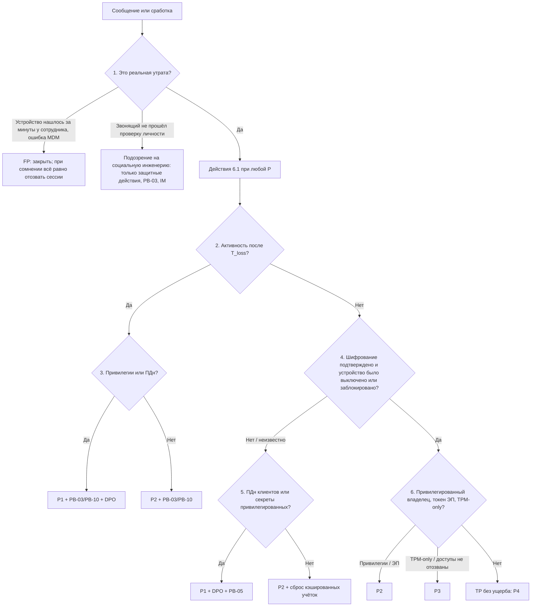

# PB-09 Утрата, кража или изъятие устройства или носителя

> Учебный плейбук для вымышленной компании «Альфа-Трейд». Роли, уровни критичности P1–P4, сроки и каналы связи взяты из [IR-плана](../plan/ir-plan.md). Всё, что нужно сверить с первоисточником, документацией вендора, юристом или DPO, собрано в разделе [«Допущения и ограничения»](#допущения-и-ограничения). Сокращения расшифрованы в [Приложении Г](#приложение-г-сокращения).

## TL;DR

- **Когда применять:** потерян, украден или изъят корпоративный ноутбук, телефон, планшет, флешка, токен электронной подписи (ЭП), ключ FIDO2, пропуск, либо личный телефон с рабочими данными (BYOD).
- **Главная мысль: шифрование диска защищает только выключенное устройство.** Основной риск 2025–2026 годов не в том, что «прочитают диск», а в живых сессиях и токенах: cookie браузера, refresh-токены почты, приложение-аутентификатор, VPN-профиль, SIM с SMS-кодами.
- **Порядок одинаков при любой критичности:** сначала **лишите устройство доступа** к нашим системам (быстро, обратимо, без апрувов), потом **оцените, что на нём было**, потом **решайте про очистку и уведомления**.
- **Первые 30 минут выполняйте круглосуточно при любой P, включая P4 и выходные.** Токены работают все выходные, а «P4 до понедельника» означает, что почта на украденном телефоне синхронизируется два дня.
- **Звонок «я потерял телефон» может быть атакой на хелпдеск.** Действия, которые лишают доступа, выполняйте по любому сообщению. Действия, которые выдают доступ (новый пароль, новый MFA, ключ восстановления BitLocker), только после проверки личности.
- **Стартовая критичность P3**, итоговая по худшему признаку. Статус «неизвестно» считайте худшим вариантом, пока MDM или EDR не подтвердили обратное.

## Шпаргалка: первые 30 минут

| № | Действие | Кто | Срок |
| --- | --- | --- | --- |
| 1 | **Заведите тикет «Утрата/кража устройства»** и пройдите анкету с сотрудником. Запишите время сообщения (T_report) в UTC и UTC+3 и **альтернативный номер для связи** | L1 | ≤ 15 мин от сообщения |
| 2 | **Проверьте личность заявителя:** обратный звонок на номер из HR-системы или справочника либо подтверждение руководителя. Способ и результат запишите в тикет | L1 | До выдачи любого доступа |
| 3 | **Соберите идентификаторы** из CMDB, MDM, EDR, AD, IdP: hostname, серийный и инвентарный номер, MAC, IMEI, SIM, Device ID, Agent ID, серийные номера сертификатов, ID ключа восстановления | L1 | ≤ 15 мин |
| 4 | **Отзовите сессии и refresh-токены**, удалите пароли приложений, **заблокируйте почтовое партнёрство** утраченного телефона | L1/L2 | ≤ 30 мин, 24/7, при любой P |
| 5 | **Отключите (не удаляйте) устройство в IdP**, в MDM поставьте **Lock или Lost Mode, не Wipe** | L2, ИТ | ≤ 30 мин |
| 6 | **В EDR поставьте тег `LOST-INC-xxxx` и сетевую изоляцию**, экспортируйте карточки устройства из MDM и EDR в тикет с SHA-256 | L2 | ≤ 30 мин |
| 7 | **Удалите методы MFA, привязанные к телефону**, и добавьте идентификаторы в watchlist SIEM | L2/ИТ | ≤ 30 мин |
| 8 | **Утрачен токен ЭП:** звоните бухгалтерии и юристу, банк блокирует ключ по звонку, УЦ отзывает сертификат | L1 → IM | Немедленно |
| 9 | **Позвоните L2 (всегда)** и сообщите DPO, если на вопрос о ПДн ответ «да» или «не знаю» | L1 | Сразу после шагов 4–7 |
| 10 | **Повторите запрос Q1** через 15–30 минут: новых входов и синхронизации быть не должно. Подтвердите **статус шифрования** и постройте **хронологию** | L2 | ≤ 1 ч |
| 11 | **Поставьте итоговую P** по [дереву решений](#51-дерево-решений) и эскалируйте: P1 звонок IM сразу | L2 | ≤ 1 ч |
| 12 | **Смените пароль AD, отзовите сертификаты, заблокируйте SIM и пропуск, сбросьте LAPS, ротируйте секреты** | ИТ под контролем L2 | ≤ 4 ч |

## Чего делать нельзя

- **Не связывайтесь с сотрудником через корпоративную почту и мессенджер.** Они открыты на украденном устройстве. Только личный или чужой телефон.
- **Не спрашивайте про шифрование, а проверяйте** в MDM или EDR. Нет данных, значит считайте «не зашифровано». Не ставьте P4 со слов «у меня всё зашифровано».
- **Не выдавайте новый пароль, новый MFA и ключ восстановления BitLocker до проверки личности.** Отзывать сессии и блокировать можно сразу.
- **Не отправляйте новый пароль или ссылку** на корпоративную почту и в корпоративный мессенджер.
- **Не запускайте удалённую очистку (wipe) сами.** Lock и Lost Mode можно, wipe только по апруву из раздела 6.3.
- **Не удаляйте ничего из AD, MDM и IdP** до wipe или списания. Вместе с объектом компьютера исчезают ключи BitLocker и пароль LAPS, а удалённому из MDM устройству команда не дойдёт.
- **Не делайте полный wipe личного телефона без письменного согласия** и не трогайте изъятое устройство без юриста.
- **Не отслеживайте геолокацию личного устройства без согласия.** Геолокацию корпоративного смотрите только по политике и для передачи в полицию.
- **Не ездите забирать устройство по геолокации**, ни сотрудник, ни ИБ. Данные передайте юристу для полиции.
- **Не подключайте вернувшееся устройство к сети и не отдавайте его сотруднику без переустановки.**
- **Не откладывайте действия первых 30 минут до рабочего дня.**

## 1. Цель и область применения

**Цель:** за 30 минут лишить утраченное устройство доступа к системам «Альфа-Трейд», за час понять, что на нём было и было ли оно использовано посторонним, и в срок решить вопросы очистки, уведомлений, замены устройства и персональных данных (ПДн).

**Что входит:**

| Объект | Особенность реагирования |
| --- | --- |
| Корпоративный ноутбук или ПК (Windows, macOS) | Wipe дойдёт, только если устройство выйдет в интернет. Главная мера: отзыв всего, что на нём лежит |
| Корпоративный смартфон, планшет | MDM Lock / Lost Mode, MFA, SIM, почтовое партнёрство |
| Личный телефон с рабочими данными (BYOD) | Только селективная очистка корпоративных данных; полная с письменного согласия |
| Флешка, внешний диск | Сдерживать нечего; ключевое: восстановить, что на нём было |
| Токен ЭП (Рутокен, JaCarta), ключ FIDO2, смарт-карта | Отзыв сертификата в УЦ, блокировка в банк-клиенте, удаление ключа из IdP |
| Пропуск СКУД, утерянный вместе с устройством | Блокировка пропуска |
| Изъятие или досмотр устройства (полиция, таможня, граница) | Юридическая ветка, очистка только по решению юриста |
| Найденное или возвращённое устройство | Карантин, проверка, переустановка |

**Что не входит:**

- **Невозврат устройства уволенным сотрудником.** Это процесс ИТ; в PB-09 он передаётся через 5 рабочих дней или сразу при признаках использования.
- **Бумажные документы:** процедура PB-05.
- **Компрометация учётки без утраты устройства:** PB-03 или PB-10.
- **Подтверждённый умышленный вынос данных:** PB-07, при этом PB-09 остаётся родительским тикетом.

## 2. Паспорт

| Поле | Значение |
| --- | --- |
| ID | PB-09 |
| Версия | 1.1 (учебная), 31.10.2026 |
| Владелец | Руководитель ИБ, он же руководитель реагирования (IM). Разделы о ПДн, BYOD и изъятии согласует юрист/DPO, разделы об ответственности сотрудника согласует HR |
| Пересмотр | Раз в год и после каждого P1/P2 по этому плейбуку |
| Критичность по умолчанию | **P3** до получения технического статуса из MDM/EDR. Итоговая по [матрице 5.4](#54-критичность-по-худшему-признаку), по худшему признаку |
| Повышение до P1 | Незашифрованное (или с неизвестным статусом) устройство или носитель с выгрузкой ПДн клиентов; незашифрованное устройство администратора AD или с секретами к базе клиентов и сайту; подтверждённое использование привилегированной учётки после утраты |
| Повышение до P2 | Любая успешная активность учётки или устройства после утраты; ноутбук украден включённым или разблокированным; телефон, код которого мог видеть вор; утрачен токен ЭП; устройство привилегированного пользователя при любом шифровании |
| Понижение до P4 | Только при всех условиях сразу: шифрование подтверждено системой, устройство было выключено или заблокировано, активности после утраты нет, сессии, токены и сертификаты уже отозваны. P1 понижает IM вместе с DPO, с обоснованием в тикете |
| Техники MITRE ATT&CK | Отдельной техники «утрата устройства» нет, это физический вектор. Раскладываются последствия, см. [Приложение А](#приложение-а-mitre-attck) |
| Связанные плейбуки | **PB-03** Компрометация учётной записи и **PB-10** Компрометация облачной учётки (при активности после утраты); **PB-05** Утечка данных (при ПДн, ведёт трек РКН); **PB-07** Инсайдер (если «потеря» прикрывает вынос данных); **PB-S4** Сработка EDR (если устройство вышло на связь) |

**Целевые сроки** (учебные; отсчёт от сообщения T_report):

| Этап | Цель |
| --- | --- |
| Тикет, анкета | ≤ 15 мин |
| Отзыв сессий, MDM Lock, изоляция EDR | ≤ 30 мин, 24/7, при любой P |
| Статус шифрования и хронология | ≤ 1 ч |
| Итоговая критичность и эскалация | ≤ 1 ч; при P1 звонок IM сразу |
| Сертификаты, SIM, MFA, секреты | ≤ 4 ч |
| Решение DPO о квалификации | ≤ 12 ч (запас до 24 ч на уведомление РКН) |
| Новое устройство сотруднику | ≤ 1 рабочий день |
| Watchlist | 30 дней; 90 дней для незашифрованных и привилегированных |

## 3. Подготовка

Без этих условий плейбук не выполнить. Если пункт не выполнен, запишите это в тикет как ограничение расследования.

- [ ] Горячая линия 24/7, её номер есть на бейдже и в памятке сотрудника
- [ ] CMDB, где по ФИО находятся все устройства, серийные номера, IMEI и корпоративные SIM
- [ ] MDM стоит на всех корпоративных устройствах и отдаёт отчёт о шифровании
- [ ] Ключи BitLocker/FileVault хранятся централизованно
- [ ] LAPS внедрён на рабочих станциях
- [ ] EDR умеет сетевую изоляцию
- [ ] VPN-шлюз проверяет CRL/OCSP
- [ ] У хелпдеска есть процедура проверки личности
- [ ] Подписано соглашение BYOD с условиями очистки
- [ ] Есть контакт оператора связи 24/7
- [ ] Известен срок хранения видеозаписей и журналов СКУД
- [ ] Готовы шаблоны сообщений из раздела 11

## 4. Роли и ответственность

Дополнительно к ролям IR-плана участвуют **HR** (вопросы ответственности, увольнение), **бухгалтерия** (токены ЭП, банк-клиент, списание) и **офис-менеджер / охрана** (видео, СКУД, приём найденного устройства).

Матрица RACI: **R** выполняет, **A** утверждает и отвечает за результат, **C** консультирует, **I** получает информацию.

| Действие | L1 | L2 | IM | ИТ | Юрист/DPO | HR | Директор |
| --- | --- | --- | --- | --- | --- | --- | --- |
| Тикет, анкета, поиск устройств в CMDB/MDM/EDR | R | I | I | C | | | |
| Проверка личности заявителя | R | A | | C | | | |
| Действия первых 30 минут (6.1) | R | A | I | R | | | |
| Статус шифрования, хронология, итоговая P | C | R | A | C | | | |
| Отзыв сертификатов, SIM, MFA, ротация секретов | | A | I | R | | | |
| Выдача нового пароля и MFA | | C | | R | | | |
| Wipe корпоративного устройства | | C | A | R | | | |
| Wipe личного устройства (селективный / полный) | | C | A | R | C / A | C | |
| Действия с изъятым устройством | | C | C | | A | | I |
| Оценка данных на устройстве | C | R | A | C | C | | |
| «Это инцидент с ПДн? Уведомлять РКН?» | | C | C | | R/A | | I |
| Заявление в полицию (корпоративное имущество) | | C | C | | R | | A |
| Проверка ветки «инсайдер» | | R | A | | C | C | |
| Материальная ответственность | | | I | | C | R/A | |
| Новое устройство, CMDB, списание | | I | | R | | | |

**Заранее согласованные полномочия (апрув не нужен):**

- Все действия первых 30 минут из раздела 6.1 L1 и L2 выполняют по любому сообщению, 24/7, при любой P.
- L2 изолирует одну рабочую станцию в EDR сам (по IR-плану).
- При P1/P2 и выходе устройства на связь не у сотрудника L2 запускает полный wipe корпоративного устройства по заранее одобренному правилу.
- Lock и Lost Mode ставит L1, L2 или ИТ сразу.

## 5. Триаж

Триаж делится на две части. **Быстрый триаж (L1, ≤ 15 минут)** отвечает на вопросы «это реальная утрата?» и «кто звонит?» и запускает защитные действия. **Глубокий триаж (L2, ≤ 1 час)** подтверждает шифрование, строит хронологию и ставит итоговую критичность. Оба идут по одному дереву решений.

### 5.1. Дерево решений



Ниже каждый узел дерева расписан подробно. Номера узлов совпадают с номерами в схеме.

### 5.2. Быстрый триаж (L1, ≤ 15 минут)

**Перед узлом 1. Заведите тикет и пройдите анкету.**

- Заведите тикет «Утрата/кража устройства». Время сообщения равно времени выявления (T_report), запишите его в UTC и UTC+3.
- **Пройдите анкету дословно, в blameless-тоне:** «Спасибо, что сообщили сразу, это сильно снижает риск».
  1. Как с вами связаться в ближайшие сутки, если телефон утрачен? (Запишите альтернативный номер.)
  2. Что утрачено: ноутбук, телефон, планшет, флешка, диск, токен ЭП, ключ FIDO2, пропуск? Что ещё было в той же сумке (записанные пароли, PIN)?
  3. Корпоративное или личное? Инвентарный номер, если помните.
  4. Когда последний раз точно видели устройство, где и когда обнаружили пропажу (T_loss)? Потеря, кража или изъятие (кем)?
  5. В каком состоянии было: выключено, крышка закрыта (сон), открыто и разблокировано? Мог ли кто-то видеть код телефона?
  6. Был ли выполнен вход в браузере в почту, облачные файлы, 1С, банк-клиент? Открыт ли менеджер паролей?
  7. Хранили ли на устройстве выгрузки с данными клиентов или сотрудников (Excel, CSV, отчёты 1С)? Примерно сколько записей?
  8. Есть ли на устройстве SSH-ключи, сохранённые RDP/VPN-подключения, конфигурации доступа?
  9. На телефоне аутентификатор? Приходят ли на эту SIM коды? Корпоративная ли SIM, какой номер?
  10. Включены ли «Найти iPhone» / «Найти устройство»? Подавали ли заявление в полицию?
- Говорите «описание обстоятельств», а не «объяснительная». Иначе сотрудник скроет, что ноутбук был открыт.

**Узел 1. Это реальная утрата?**

- **Проверьте личность заявителя:** обратный звонок на номер из HR-системы или справочника (не на тот, с которого звонят) **или** подтверждение руководителя сотрудника. Результат и способ запишите в тикет.
- **Звонящий не прошёл проверку:** подозрение на социальную инженерию. Выполняйте только защитные действия (отзыв, блокировка), ничего не выдавайте, передайте в PB-03 и сообщите IM.
- **Устройство нашлось за минуты у сотрудника или сработала ошибка MDM:** FP. При сомнении всё равно отзовите сессии.
- **Утрата реальна:** переходите к идентификаторам и действиям 6.1.

**После узла 1. Идентификаторы и немедленные действия.**

- **Соберите идентификаторы** из CMDB, MDM, EDR, AD, IdP: hostname, серийный и инвентарный номер, MAC, IMEI, номер SIM, Device ID в MDM и IdP, Agent ID в EDR, серийные номера сертификатов, ID ключа восстановления.
- **Выполните действия раздела 6.1** или передайте их дежурному L2/ИТ, если у L1 нет прав.
- **Позвоните L2.** Всегда.
- **Сообщите DPO**, если на вопрос 7 анкеты ответ «да» или «не знаю».

### 5.3. Глубокий триаж (L2, ≤ 1 час)

L2 проходит девять проверок. Каждая привязана к узлу дерева.

| Шаг | Узел | Вопрос | Где смотреть | Признак |
| --- | --- | --- | --- | --- |
| 1. Шифрование | 4 | Было ли шифрование активно? | MDM (отчёт о шифровании, дата), EDR, AD: дочерние объекты `msFVE-RecoveryInformation`; macOS: статус FileVault и эскроу ключа | Ключ в AD значит, что BitLocker **когда-то** включали. Нужен статус «защита включена» из MDM/EDR. **Suspended** равно «не зашифровано» |
| 2. Протекторы | 6 | TPM-only или TPM+PIN? | MDM, результаты инвентаризации (`manage-bde -status`, `Get-BitLockerVolume`) | TPM-only уязвим к атакам с физическим доступом: перехват на шине TPM, DMA, «bitpixie» CVE-2023-21563 |
| 3. Блокировка | 4 | Мог ли экран остаться разблокированным? | GPO/MDM: таймаут блокировки; в SIEM до утраты 4800/4801, 4624 LogonType 7 | Таймаут 30 мин и «оставил открытым в кафе», значит считайте разблокированным |
| 4. Хронология | 2 | Что было после T_loss? | Запросы Q1–Q3 ([Приложение В](#приложение-в-примеры-запросов-и-команд)) | Любая успешная активность: минимум P2, PB-03/PB-10 |
| 5. Владелец | 3, 6 | Привилегирован ли он? | Группы AD, роли в IdP, доступ к банк-клиенту, продакшену, 1С-админке | Привилегированный: минимум P2 |
| 6. Кто ещё входил | 5 | Кэш чьих учёток на диске? | SIEM/EDR: 4624 LogonType 2, 10, 11 на этом хосте за период хранения | Входы администраторов: сброс их паролей при неподтверждённом шифровании |
| 7. LAPS | 5 | Уникален ли пароль локального администратора? | Атрибуты LAPS у объекта компьютера | Нет LAPS и нет шифрования: повышение P, смена пароля на всех ПК |
| 8. Инсайдер | 1 | Нет ли признаков прикрытия? | EDR/DLP за 30 дней: USB, облака, массовое копирование; статус в HR (через IM) | Массовое копирование, заявление об увольнении, повторные «потери»: IM, PB-07, сотруднику не сообщать |
| 9. Ключ восстановления | 2 | Не запрашивал ли кто-то ключ после T_loss? | Аудит IdP («Read BitLocker key» в Entra ID), журнал хелпдеска | Запрос после утраты: красный флаг, P2 |

**Узел 2. Активность после T_loss?** Выполните Q1, Q2, Q3. Любой успешный вход с чужого IP, страны или устройства, неинтерактивный вход приложения с утраченного телефона, новый метод MFA, правило пересылки, OAuth-согласие, VPN по сертификату устройства или `LoggedOnUsers` в EDR после T_loss означают «да».

**Узел 3. Привилегии или ПДн?** Активность по привилегированной учётке или с доступом к ПДн даёт P1, подключайте DPO. Иначе P2. В обоих случаях передавайте в PB-03 или PB-10.

**Узел 4. Шифрование подтверждено и устройство было выключено или заблокировано?** Только статус из MDM, EDR или AD (шаги 1 и 3). Suspended, «неизвестно», сон с TPM-only или разблокированный экран дают «нет».

**Узел 5. ПДн клиентов или секреты привилегированных?** Да: P1, DPO и PB-05. Нет: P2 и сброс всех кэшированных учёток (шаги 6 и 7).

**Узел 6. Привилегированный владелец, токен ЭП, TPM-only?** Привилегии или ЭП дают P2. TPM-only или ещё не отозванные доступы дают P3. Ничего из этого: TP без ущерба, P4.

### 5.4. Критичность по худшему признаку

«Неизвестно» равно худшему варианту до подтверждения. Статус шифрования берите только из MDM, EDR или AD.

| Уровень | Признаки (достаточно одного) |
| --- | --- |
| **P1** | Нет шифрования / Suspended / статус неизвестен **и** выгрузка ПДн клиентов (сотни записей и более): потенциальная утечка ПДн по IR-плану. Незашифрованное устройство администратора AD или с секретами к базе клиентов и сайту. Активность после утраты по привилегированной учётке или с доступом к ПДн |
| **P2** | Нет шифрования / неизвестно, корпоративные учётные данные без значимого объёма ПДн. Зашифрованный ноутбук утрачен включённым, в сне или разблокированным. Телефон, код которого мог знать вор. Любая успешная активность после T_loss. Устройство привилегированного пользователя (бухгалтерия с банк-клиентом, администратор 1С, разработчик, директор) при любом шифровании. Утрачен токен ЭП |
| **P3** | Шифрование подтверждено, устройство выключено или заблокировано, но: TPM-only; сессии ещё не отозваны; хронология не завершена. Флешка без ПДн с внутренними документами. Пропуск без устройства |
| **P4** | Шифрование подтверждено, устройство было выключено или заблокировано, активности после T_loss нет, сессии, токены и сертификаты отозваны, вне шифрованного диска ПДн не было |

Пересматривайте критичность после оценки данных (раздел 8, вопрос 5) и после решения DPO. **P4 не означает «до понедельника»:** действия 6.1 выполняйте при любой P, критичность определяет только эскалацию и глубину расследования.

### 5.5. Когда эскалировать

- **L1 → L2:** всегда, звонком, после действий 6.1.
- **L2 → IM:** P1/P2 звонок сразу (P1 в пределах 15 минут, круглосуточно); P3 сообщение в канале инцидентов; P4 тикет и дневная сводка.
- **→ DPO:** сразу при «ПДн да или не исключено», независимо от P.
- **→ директор и юрист:** P1 по IR-плану; изъятие госорганами; вопрос о полиции.
- **→ бухгалтерия и юрист:** утрачен токен ЭП, немедленно; банк блокирует ключ по звонку.
- **В обход сотрудника:** при признаках инсайдера только IM, юрист, HR. Сотрудника о подробностях не информируйте.

## 6. Сдерживание

### 6.1. Первые 30 минут (без апрува, любая P, 24/7)

Порядок важен: **сначала отзыв доступа, потом экспорт карточек, потом остальное. Ничего не удаляйте.**

| № | Действие | Кто | Инструмент | Апрув |
| --- | --- | --- | --- | --- |
| 1 | **Отзовите сессии и refresh-токены** пользователя, удалите пароли приложений | L1/L2 | IdP / консоль почты (`Revoke-MgUserSignInSession`) | Не нужен |
| 2 | **Заблокируйте или удалите почтовое партнёрство** утраченного телефона (ActiveSync и аналоги) | L1/L2/ИТ | Консоль почты (`Get-MobileDevice`, блокировка DeviceId) | Не нужен |
| 3 | **Отключите (не удаляйте) устройство в облачном каталоге.** В Entra ID это делает недействительным PRT устройства | L2 | IdP (`Update-MgDevice -AccountEnabled:$false`) | Не нужен |
| 4 | **MDM: Lock;** для iOS supervised Lost Mode с номером для возврата. **Не Wipe** | L1/L2/ИТ | MDM | Не нужен |
| 5 | **EDR: тег `LOST-INC-xxxx` и сетевая изоляция.** У многих EDR изоляция применяется при следующем выходе на связь; телеметрия продолжает идти | L2 | EDR | Не нужен (IR-план: L2 изолирует одну рабочую станцию) |
| 6 | **Экспортируйте карточки устройства** из MDM и EDR (CSV/PDF) в тикет, посчитайте SHA-256 | L2 | MDM, EDR | — |
| 7 | **Удалите методы MFA, привязанные к утраченному телефону** (push, TOTP, passkey); учётке поставьте режим «вход только после проверки в ИТ» | L2/ИТ | IdP (`Get-MgUserAuthenticationMethod`) | Не нужен (защитное) |
| 8 | **Добавьте идентификаторы в watchlist SIEM** (раздел 10) | L2 | SIEM | Не нужен |
| 9 | **Утрачен токен ЭП:** звонок бухгалтерии/юристу для блокировки ключа в банке и УЦ | L1 → IM | Телефон | — |

**Проверьте результат:** через 15–30 минут повторите Q1. Новых успешных входов и синхронизации почты быть не должно. В тикете у каждого действия: время, исполнитель, статус (успех / pending / ошибка).

**Почему «сбросил пароль, значит всё» не работает:**

- Уже выданные токены доступа в облаке живут до истечения (в Entra ID порядка часа), если сервис и клиент не поддерживают немедленный отзыв (Continuous Access Evaluation).
- Kerberos TGT действует до 10 часов (продление до 7 дней) по умолчанию. Смена пароля блокирует получение новых билетов, но не убивает выданные мгновенно.
- Пароли приложений, OAuth-согласия и резервные коды MFA сброс пароля не отзывает.

### 6.2. До 4 часов (ИТ под контролем L2)

1. **Смените пароль пользователя в AD** как защитное действие (случайный, не сообщать). Новый пароль передавайте **только после проверки личности**: лично, обратным звонком или через руководителя, не по почте.
   ```powershell
   Set-ADAccountPassword -Identity "<user>" -Reset -NewPassword (Read-Host -AsSecureString)
   Set-ADUser -Identity "<user>" -ChangePasswordAtLogon $true
   ```
2. **Шифрование не подтверждено:** сбросьте пароли всех доменных учёток, входивших интерактивно (кэш DCC2, T1003.005), и пароли из браузера и менеджера паролей (список составьте с сотрудником и ИТ).
3. **LAPS:** пометьте пароль истёкшим (`Set-LapsADPasswordExpirationTime -Identity "<host>"`; для legacy LAPS `Reset-AdmPwdPassword`). Нет LAPS, значит отдельная задача: сменить пароль локального администратора на всех ПК.
4. **Сертификаты** (машинный 802.1X/VPN и пользовательский): отзовите с причиной Key Compromise и опубликуйте CRL.
   ```cmd
   certutil -revoke <SerialNumber> 1
   certutil -crl
   ```
   Затем **проверьте**, что VPN-шлюз и RADIUS отклоняют старый сертификат: многие шлюзы кэшируют CRL до истечения его срока. Дублирующая мера: блокировка VPN-профиля пользователя на NGFW до выдачи нового устройства. Отзыв на AD CS пишется событием 4870.
5. **Объект компьютера в AD отключите и пометьте, не удаляйте:** вместе с ним удаляются ключи BitLocker и пароль LAPS.
   ```powershell
   Disable-ADAccount -Identity "<host>$"
   Set-ADComputer -Identity "<host>" -Description "LOST INC-2026-___ <дата>, не удалять"
   ```
6. **Ключ восстановления** этого устройства выдавайте только с визой IM.
7. **SIM** (корпоративная): блокировка у оператора. **Пропуск СКУД:** блокировка.
8. **Секреты с устройства:** SSH-ключи (удалите публичный ключ из `authorized_keys` и с Git-хостинга), токены Git и облачных CLI (`.aws/credentials`, `.kube/config`), API-ключи, пароли сервисных учёток из конфигов, KeePass (если диск не зашифрован, а мастер-пароль слабый, смените всё из базы), Wi-Fi PSK. Ротацию делайте с владельцами систем.
9. **Токен ЭП:** отзыв сертификата в УЦ, письменное подтверждение блокировки в банке. Владелец ЭП обязан не использовать ключ при подозрении на компрометацию и уведомить УЦ (63-ФЗ, ст. 10).

### 6.3. Очистка (wipe): условия и апрувы

| Действие | Кто | Апрув | Условия |
| --- | --- | --- | --- |
| Lock, Lost Mode | L1/L2/ИТ | Не нужен | Сразу |
| Селективная очистка / Retire (BYOD, рабочий профиль) | ИТ | IM, по политике BYOD | Уведомить сотрудника |
| Полный wipe корпоративного устройства | ИТ | IM (по телефону, фиксация в тикете); при P1/P2 и выходе устройства на связь не у сотрудника L2 по заранее одобренному правилу | Перед wipe: экспорт карточек, проверка, что на устройстве нет единственной копии данных, при онлайне 5–10 минут сбора (раздел 7) |
| Полный wipe личного устройства | ИТ | IM + юрист + письменное согласие сотрудника | Только так |
| Любые действия с изъятым устройством | — | Юрист + IM | Удалённая очистка может быть расценена как уничтожение доказательств; отзыв доступов на стороне компании выполняйте |

**Статус команды в MDM: pending не равно «очищено».** В тикете различайте «команда отправлена», «очистка подтверждена (время)» и «устройство не выходило на связь». Не исключайте устройство из MDM до выполнения команды, иначе она не будет доставлена.

### 6.4. Долгосрочное сдерживание

- **Правило условного доступа или NGFW:** запрет входа с Device ID, сертификата и hostname утраченного устройства.
- **Watchlist на 30/90 дней** (раздел 10).
- **Учётку пользователя оставьте включённой.** Отключайте её только при признаках использования посторонним или по решению IM, иначе сотрудник неделю не работает.
- **Объекты устройства в AD, IdP, MDM храните отключёнными** до закрытия и ещё 6 месяцев на случай возврата.

## 7. Сбор и сохранение артефактов

Самого устройства у нас нет, поэтому «летучесть» здесь означает данные в системах, которые исчезнут первыми. **Собирайте до разрушающих действий** (wipe, retire, удаление).

| Порядок | Артефакт | Почему срочно | Как сохранить |
| --- | --- | --- | --- |
| 1 | Устройство онлайн в EDR: вошедшие пользователи, сетевые соединения, внешний IP, запущенные процессы | Исчезнет при выключении или wipe | Live response EDR, 5–10 мин, затем wipe по апруву |
| 2 | Карточки устройства в MDM и EDR: шифрование, протекторы, last check-in, compliance, история команд, приложения | Часть вендоров обнуляет запись после wipe/retire | Экспорт CSV/PDF, SHA-256 |
| 3 | Неинтерактивные входы и журналы мобильной синхронизации | Короткое хранение в облаке | Экспорт по пользователю с T_loss − 7 дней |
| 4 | Видео и СКУД (кража в офисе) | Перезапись через несколько дней | Письменный запрос охране в первые сутки |
| 5 | Журналы DC, VPN, IdP-аудит, DLP/EDR о копировании за 30 дней | SIEM хранит 90 дней | Результаты Q1–Q5 (CSV) + тексты запросов |
| 6 | Анкета сотрудника, способ проверки личности, идентификаторы, ID ключа восстановления (сам ключ в тикет **не копировать**) | — | В тикете |
| 7 | Отозванные доступы с временем, серийные номера сертификатов, подтверждение CRL, статусы wipe | — | В тикете |
| 8 | Решения IM и DPO с временем и обоснованием; номера обращений в полицию (талон КУСП), к оператору, в банк и УЦ | — | В тикете |
| 9 | Найденное устройство | Риск порчи доказательств | Акт приёма, опечатанный пакет, журнал цепочки хранения; не включать |

**Цепочка хранения:**

- Все выгрузки кладите в защищённое хранилище инцидентов с ограниченным доступом и SHA-256.
- В журнале фиксируйте: что, кто, когда, откуда выгрузил, кто получал доступ.
- Время во всех артефактах пишите в UTC и UTC+3.
- При P1/P2 или заявлении в полицию ставьте журналы инцидента на legal hold не менее 1 года сверх стандартных 90 дней.

## 8. Расследование

| № | Вопрос | Источники | Результат |
| --- | --- | --- | --- |
| 1 | Хронология: T_loss, T_last_seen, T_report | MDM, EDR, VPN, IdP, DC | Если T_last_seen > T_loss, устройство выходило на связь после утраты; если T_report − T_loss > 24 ч, расширьте окно поиска и учтите в метриках |
| 2 | Используется ли учётка или устройство посторонним? | Q1, Q2, Q3 | Признаки: успешный вход с чужого IP/страны/устройства; неинтерактивные входы приложений с утраченного телефона; новые методы MFA, правила пересылки, OAuth-согласия; VPN по сертификату устройства; `LoggedOnUsers` в EDR после T_loss. Любой признак: P2+ и PB-03/PB-10 |
| 3 | Скоуп учётных данных | Анкета, 4624 на хосте, EDR, группы AD | Список учёток, токенов, ключей и секретов для ротации |
| 4 | Вектор и обстоятельства | Анкета, полиция, видео, СКУД | Потеря / кража / целевая кража / изъятие; признаки прикрытия (PB-07) |
| 5 | Затронутые данные | Q4, Q5, DLP, журналы облачного хранилища (что синхронизировалось на устройство), журнал регистрации 1С, опрос сотрудника и руководителя | Таблица для DPO: категория (ПДн клиентов / ПДн сотрудников / коммерческая тайна / секреты), где лежали, объём, число субъектов, чем защищены |
| 6 | Была ли неправомерная передача ПДн? | Таблица из вопроса 5 + статус шифрования + вопрос 2 | Решение DPO. Явного освобождения при шифровании, как в GDPR, в 152-ФЗ нет |

Готовые запросы Q1–Q5 собраны в [Приложении В](#приложение-в-примеры-запросов-и-команд). Переменные `<user>`, `<upn>`, `<host>`, `<T_loss>` берите с запасом минус 1–2 часа.

## 9. Устранение

- [ ] Все учётные данные и секреты из инвентаризации (раздел 8, вопрос 3) ротированы, включая учётки администраторов, входивших на устройство
- [ ] Методы MFA перерегистрированы **после проверки личности** (лично в ИТ с документом или по процедуре с подтверждением руководителя); для привилегированных с визой IM
- [ ] Выпущены новые сертификаты; старые отозваны, CRL проверен на шлюзе
- [ ] Пароль локального администратора сменён (LAPS или на всех ПК, если LAPS нет)
- [ ] При активности после T_loss устранение ведётся по PB-03/PB-10 (правила пересылки, OAuth-приложения, зарегистрированные устройства)
- [ ] Сотруднику рекомендовано сменить пароли личных аккаунтов, использовавшихся на корпоративном устройстве, и не реагировать на SMS «ваш iPhone найден» (фишинг для снятия блокировки активации)
- [ ] Корневая причина записана: почему не было шифрования, почему ПДн лежали локально, почему сообщили поздно. Это пробел подготовки, а не «невезение»

## 10. Восстановление и мониторинг

**Восстановление:**

- [ ] Новое устройство из эталонного образа выдано **после** отзыва доступов; compliance проверен до выдачи (шифрование, для привилегированных TPM+PIN, EDR, MDM)
- [ ] Данные восстановлены из облачного хранилища или резервной копии. Если они хранились только локально, потеря доступности зафиксирована; для ПДн это тоже инцидент безопасности
- [ ] CMDB: статус «утрачено / украдено / изъято», номер тикета; списание по процессу бухгалтерии
- [ ] Старое устройство удалено из MDM и IdP только после подтверждённого wipe или решения о списании

**Мониторинг** (IR-план требует усиленного режима не менее 2 недель; здесь 30 / 90 дней):

| Что | Правило | Срок |
| --- | --- | --- |
| Device ID в MDM, IdP, Agent ID EDR, hostname, MAC, IMEI | Любое событие → алерт high, L1 будит L2 | 30 дней; 90 для незашифрованных и привилегированных |
| Серийные номера отозванных сертификатов | Попытка VPN/802.1X, отказ по CRL → алерт | То же |
| DeviceId почтового партнёрства | Попытка синхронизации → алерт | То же |
| Учётка сотрудника | Вход с неуправляемого устройства или не из его новых устройств; новая страна/ASN; новый метод MFA; правила пересылки; массовое скачивание → алерт | 30 дней |
| Учётки, входившие на устройство | Всплеск неудачных входов (признак офлайн-подбора кэша) → алерт | 30 / 90 дней |
| Ключ восстановления | Любой запрос ключа BitLocker этого устройства → алерт | До списания |

**Повторяйте Q1 через 24 часа и в последний день мониторинга.** После закрытия инцидента watchlist остаётся с пониженным приоритетом до даты окончания, у него назначен ответственный.

## 11. Коммуникации и уведомления

| Кому | Когда | Кто | Канал | Что |
| --- | --- | --- | --- | --- |
| Сотрудник | Сразу и при выдаче устройства | L1 / ИТ | Альтернативный номер, лично | Что сделано, что сделать ему, когда получит новое устройство |
| Руководитель сотрудника | В течение рабочего дня (для проверки личности сразу) | L1 / ИТ | Телефон | Временная недоступность сотрудника |
| IM | P1 ≤ 15 мин, P2 ≤ 1 ч, звонок; P3 канал; P4 сводка | L2 | Канал инцидентов | Статус по формату IR-плана (P1 каждые 2 ч, P2 дважды в день) |
| DPO / юрист | Сразу при «ПДн да / не знаю»; таблица данных по готовности | L2 / IM | Телефон + тикет | Категории и объём ПДн, шифрование, активность после утраты |
| Директор | P1 | IM | Телефон | |
| Владельцы систем | Если на устройстве были их секреты | L2 | Телефон, тикет | Какие секреты ротировать |
| Банк, УЦ | Утрачен токен ЭП: немедленно | Главбух / юрист | Горячая линия банка, затем письменно | |
| Оператор связи | Корпоративная SIM: в течение часа | ИТ | | |
| Полиция | Кража, по решению IM | Юрист от имени компании (корпоративное имущество); сотрудник по личному имуществу | | Идентификаторы (IMEI, серийный номер), обстоятельства; получить талон КУСП |
| РКН | По решению DPO: первичное уведомление 24 ч с момента выявления, результаты 72 ч (152-ФЗ, ст. 21 ч. 3.1) | DPO | Портал РКН | Через PB-05 |
| Страховая, PR | Если имущество застраховано / если инцидент публичен | Юрист / IM | | |

**Правило «без наказания».** Расследование ИБ не используется для дисциплинарных мер за сам факт утраты при своевременном сообщении. Материальную ответственность HR решает отдельной процедурой (ТК РФ, ст. 238 и далее). Формулировку согласуйте с HR, иначе первое удержание из зарплаты убьёт доверие к правилу.

### 11.1. Шаблоны

**Шаблон 1. Сообщение сотруднику (по телефону или SMS на личный номер).**
> «Мы заблокировали ваш [ноутбук/телефон] и завершили все рабочие сеансы. Пожалуйста: 1) не входите в рабочие сервисы с чужих устройств; 2) новый пароль получите [лично в ИТ / по звонку с номера ___]; 3) завершите сеансы [Telegram и др.] с другого устройства и отметьте устройство как потерянное в «Найти iPhone» / «Найти устройство»; 4) если придёт SMS или письмо «ваше устройство найдено» — не переходите по ссылке, перешлите нам. Спасибо, что сообщили быстро.»

**Шаблон 2. Статус IM.**
> «INC-2026-___, PB-09, P_. Утрачен [что] сотрудника [логин] в [время]. Шифрование: [подтверждено / нет / неизвестно]. Активность после утраты: [нет / есть — PB-03]. Сделано: [сессии, MDM, EDR, MFA]. Нужно решение: [wipe / DPO / полиция].»

## 12. Критерии закрытия

**Закрыть как TP можно, когда отмечены все пункты:**

- [ ] Сессии, токены, пароли приложений, почтовые партнёрства отозваны; Q1 через 24 часа и в конце мониторинга без активности (или активность расследована по PB-03/PB-10)
- [ ] Сертификаты отозваны, шлюз отклоняет старый сертификат (проверено)
- [ ] Объекты устройства отключены во всех системах; wipe подтверждён **или** зафиксировано, что устройство не выходило на связь, и IM принял риск (для зашифрованных это нормально)
- [ ] Пароли, MFA и секреты из инвентаризации ротированы после проверки личности
- [ ] Решение DPO о квалификации записано с временем; при необходимости PB-05 выполнен, первичное и итоговое уведомления РКН направлены
- [ ] Сотрудник работает на новом устройстве; данные восстановлены или их потеря зафиксирована
- [ ] CMDB обновлена; номер КУСП, обращения к оператору, в банк и УЦ записаны в тикете
- [ ] Watchlist настроен с датой окончания и ответственным
- [ ] Если устройство найдено: принято по акту, проверено, переустановлено или списано
- [ ] Для P1/P2 разбор проведён в течение 5 рабочих дней; для P3/P4 запись в тикете и строка в квартальной статистике. Улучшения внесены в реестр

**Закрыть как FP можно, когда отмечены все пункты:**

- [ ] Устройство нашлось у сотрудника за минуты, **или** сработка оказалась ошибкой MDM
- [ ] При малейшем сомнении сессии всё равно отозваны
- [ ] Обоснование записано в тикет

## 13. Метрики

| Метрика | Как считать | Цель (учебная) |
| --- | --- | --- |
| Время до сообщения (аналог MTTD) | T_report − T_loss | Медиана < 2 ч |
| Время до отзыва доступа | Время действия 6.1.1 − T_report | < 30 мин, 24/7 |
| MTTR | Закрытие − T_report | ≤ 1 рабочего дня до нового устройства |
| Доля устройств с подтверждённым шифрованием | Из MDM, по парку | 100%; Suspended > 24 ч: алерт |
| Доля ноутбуков привилегированных с TPM+PIN | Из MDM | 100% |
| Время до решения DPO | Решение − T_report | ≤ 12 ч |
| Доля подтверждённых wipe | Completed / отправленные | Растёт; pending фиксируется явно |
| Попытки социальной инженерии | Звонки «потерял телефон», не прошедшие проверку | Считать и разбирать каждый |
| Время доставки команды MDM | Ежеквартальный тест на стендовом устройстве | Известно и стабильно |

## 14. Типичные ошибки

1. **Сотрудник сообщает через несколько дней из страха наказания.** Нужна политика «без наказания за быстрое сообщение», согласованная с HR, и номер горячей линии на бейдже.
2. **Шифрование «подтверждают» со слов сотрудника** или по наличию ключа в AD, не видя статуса Suspended.
3. **P4 для ноутбука, украденного в спящем режиме:** ключ в памяти, сессии открыты.
4. **P2 вместо P1 для незашифрованной выгрузки ПДн:** расхождение с IR-планом, DPO узнаёт поздно, срок РКН пропущен.
5. **P4 означает «в понедельник»:** токены работают все выходные.
6. **Пароль сменили, сессии не отозвали:** почта на украденном телефоне синхронизируется.
7. **MFA перенесли по звонку без проверки:** захват учётки через хелпдеск (T1656).
8. **Новый пароль отправили на почту**, открытую на украденном телефоне.
9. **Забыли про аутентификатор, SIM, токен ЭП, пропуск** в той же сумке.
10. **Удалили компьютер из AD:** пропали ключи BitLocker и пароль LAPS.
11. **Удалили устройство из MDM до wipe:** команда не дойдёт.
12. **«Очищено» при статусе pending.**
13. **Сертификат отозван, CRL на шлюзе старый:** VPN пускает.
14. **Не сбросили пароли администраторов, входивших на незашифрованный ноутбук:** офлайн-подбор кэша.
15. **Полный wipe личного телефона без согласия;** очистка изъятого устройства без юриста.
16. **Поездка за устройством по геолокации.**
17. **Вернувшийся ноутбук подключили к сети:** риск закладки («evil maid»).
18. **Не проверили активность до утраты:** вынос данных маскируется под потерю.
19. **Слово «объяснительная»** вместо «описание обстоятельств»: сотрудник скрывает, что ноутбук был открыт.

## 15. Профилактика

**Снижение ущерба**

- [ ] Принудительное полнодисковое шифрование с отчётностью в MDM/SIEM; алерт на Suspended дольше 24 часов
- [ ] TPM+PIN для ноутбуков администраторов, руководителей и бухгалтерии; Kernel DMA Protection; гибернация вместо сна при закрытии крышки для устройств повышенного риска
- [ ] Таймаут блокировки экрана 5–10 минут; сложный код на телефонах через MDM; на iPhone «Защита украденного устройства» (iOS 17.3+)
- [ ] Условный доступ: почта и файлы только с управляемых соответствующих устройств, тогда отключение устройства в MDM закрывает доступ автоматически
- [ ] Phishing-resistant MFA (FIDO2/passkeys), ключ хранится отдельно от ноутбука; отказ от SMS-MFA
- [ ] DLP: запрет локальных выгрузок ПДн; контроль съёмных носителей, только корпоративные зашифрованные флешки по белому списку (BitLocker To Go или аналог)
- [ ] LAPS на всех рабочих станциях; администраторы не входят на пользовательские ПК привилегированными учётками (tiering)
- [ ] MAM или рабочий профиль для всех BYOD; подписанное соглашение BYOD с условиями очистки
- [ ] Токены ЭП в сейфе, не в сумке с ноутбуком

**Обнаружение и реагирование**

- [ ] Горячая линия 24/7 и кнопка «Я потерял устройство» на портале самообслуживания; памятка сотруднику
- [ ] Процедура проверки личности для хелпдеска; правило «сообщение о потере телефона + новый MFA в 24 ч»
- [ ] Готовые инструкции «завершить все сессии» под реальный стек (Microsoft 365 / Яндекс 360 / VK WorkSpace)
- [ ] Ежеквартальный тест Lock и wipe на стендовом устройстве; проверка, что шлюз отклоняет отозванный сертификат
- [ ] Регулярный отчёт: устройства без check-in 14+ дней, без шифрования, в Suspended

## 16. Учебная ситуация

**Вводная.** Суббота, 02:55. На горячую линию звонит главный бухгалтер с номера, которого нет в справочнике: «В 23:40 из машины украли рюкзак с ноутбуком и телефоном. Ещё там был Рутокен для банк-клиента. Ноутбук я, кажется, просто закрыла, не выключала». MDM: ноутбук зашифрован BitLocker, протектор TPM-only, последний check-in 23:52. Телефон корпоративный, iOS, supervised, последний check-in 01:10. В журнале входов облачной почты неинтерактивные входы с этого телефона в 00:30 и 01:05. LAPS в компании не внедрён. Последний месяц бухгалтер выгружала из 1С отчёты по контрагентам.

**Задания:**

1. **02:55, вы L1.** Номер незнакомый. Запишите, как вы проверите личность звонящего ночью и что делаете прямо сейчас, до результата проверки (узел 1 дерева, шаги 1–9 таблицы 6.1). Какие действия вы не имеете права выполнить, пока проверка не пройдена?
2. **03:10, вы L1.** Кого вы будите и в каком порядке? Кто по RACI звонит в банк по поводу Рутокена, а кто в УЦ? Какие идентификаторы вы достаёте из CMDB, MDM и IdP, прежде чем передать тикет L2?
3. **03:30, вы L2.** Пройдите узлы 2–6 дерева и запишите итоговую P с обоснованием. Что меняют check-in ноутбука в 23:52 и неинтерактивные входы с телефона в 00:30 и 01:05 после кражи в 23:40? Какие запросы (Q1, Q2, Q3) вы запускаете и с каким `<T_loss>`?
4. **03:45, вы L2.** Нужно ли сейчас делать wipe ноутбука и телефона? Кто это решает по таблице 6.3 и что вы собираете до wipe по разделу 7? Как вы учтёте, что LAPS нет, а протектор TPM-only?
5. **04:00, вы L2.** Составьте статус IM по шаблону 2. Запишите, до какого времени DPO должен принять решение о квалификации, и перечислите, что вы должны отдать DPO (раздел 8, вопрос 5), учитывая выгрузки из 1С по контрагентам.

## 17. Источники

Ссылки ведут на официальные сайты и приведены по памяти; глубокие ссылки со временем меняются.

- MITRE ATT&CK Enterprise и Mobile: https://attack.mitre.org/ (T1539, T1528, T1555, T1003.005, T1656, T1098.005, T1461)
- NIST SP 800-61 Rev. 3, Incident Response Recommendations and Considerations for Cybersecurity Risk Management (2025): https://csrc.nist.gov/pubs/sp/800/61/r3/final
- NIST SP 800-124 Rev. 2, Guidelines for Managing the Security of Mobile Devices in the Enterprise (2023): https://csrc.nist.gov/pubs/sp/800/124/r2/final
- NIST SP 800-111, Guide to Storage Encryption Technologies for End User Devices: https://csrc.nist.gov/pubs/sp/800/111/final
- NIST SP 800-86, Guide to Integrating Forensic Techniques into Incident Response: https://csrc.nist.gov/pubs/sp/800/86/final
- RFC 3227, Guidelines for Evidence Collection and Archiving: https://www.rfc-editor.org/rfc/rfc3227
- CISA, Implementing Phishing-Resistant MFA (fact sheet): https://www.cisa.gov/
- SANS, Incident Handler's Handbook: https://www.sans.org/white-papers/33901/
- Microsoft Learn: BitLocker countermeasures; Windows LAPS; Revoke user access in Microsoft Entra ID; Exchange Online mobile devices: https://learn.microsoft.com/
- Apple Support, Stolen Device Protection for iPhone: https://support.apple.com/
- Законы РФ (актуальная редакция на pravo.gov.ru или в справочной правовой системе): 152-ФЗ ст. 19, 21; 63-ФЗ «Об электронной подписи» ст. 10; ТК РФ ст. 238, 241–243. Это вопросы к юристу, а не юридическое заключение.

## Допущения и ограничения

**Что нужно сверить перед реальным применением:**

| № | Что | Где в плейбуке | Почему нужна проверка |
| --- | --- | --- | --- |
| 1 | Номера техник MITRE ATT&CK, в том числе T1461 Lockscreen Bypass (Mobile) | Приложение А | Сверить по актуальной версии матрицы |
| 2 | Применимость «bitpixie» CVE-2023-21563 к вашим сборкам Windows и патчам | 5.3, шаг 2 | Зависит от версии и обновлений |
| 3 | Название операции «Read BitLocker key» в аудите Entra ID | 5.3, шаг 9 | Название операции может отличаться в вашем IdP |
| 4 | Инструменты первых 30 минут и правила триггеров MDM | 6.1, Приложение Б | Зависят от стека: MDM, EDR, облачная почта и VPN-шлюз в IR-плане не названы |
| 5 | Отключение устройства в IdP делает недействительным PRT (так в Entra ID) | 6.1, шаг 3 | Проверить для вашего IdP |
| 6 | Изоляция EDR применяется только при следующем выходе на связь | 6.1, шаг 5 | Зависит от EDR |
| 7 | Срок жизни токенов доступа (в Entra ID порядка часа) и применимость Continuous Access Evaluation | 6.1 | Зависит от IdP, лицензии и клиентов |
| 8 | Какой LAPS внедрён: Windows LAPS (`Set-LapsADPasswordExpirationTime`) или legacy LAPS (`Reset-AdmPwdPassword`) | 6.2, шаг 3 | Команды разные |
| 9 | Событие 4870 на AD CS при отзыве сертификата | 6.2, шаг 4 | Сверить с документацией |
| 10 | Обязанность владельца ЭП уведомить УЦ: 63-ФЗ, ст. 10 | 6.2, шаг 9 | Сверить статью с юристом |
| 11 | Удалённая очистка изъятого устройства как уничтожение доказательств | 6.3 | Вопрос к юристу |
| 12 | Срок хранения неинтерактивных входов и журналов мобильной синхронизации в облаке | 7, п. 3 | Зависит от лицензии |
| 13 | Отсутствие в 152-ФЗ освобождения при шифровании (как в GDPR) и наличие разъяснений РКН | 8, вопрос 6 | Проверить у DPO |
| 14 | Имена таблиц KQL для неинтерактивных входов (`AADNonInteractiveUserSignInLogs`) | Приложение В, Q1 | Зависят от подключения журналов |
| 15 | Таблица `DeviceFileEvents` и запрос Q4 (Defender for Endpoint) | Приложение В, Q4 | Есть только в Defender for Endpoint |
| 16 | Значения ActionType для USB в EDR в запросе Q5 | Приложение В, Q5 | Зависят от EDR |
| 17 | Потеря доступности ПДн как инцидент безопасности | 10 | Проверить у DPO |
| 18 | Порядок подачи заявления в полицию от имени компании | 11 | Проверить порядок с юристом |
| 19 | Сроки уведомления РКН (24 и 72 часа), редакция 152-ФЗ ст. 21 ч. 3.1 и трактовка «момента выявления» | 11 | Закон менялся; сроки взяты из IR-плана |
| 20 | Способ подачи уведомления в РКН (портал) | 11 | Проверить способ подачи |
| 21 | Материальная ответственность: ТК РФ, ст. 238 и далее | 11 | Проверить у юриста |
| 22 | Совместимость Kernel DMA Protection с парком | 15 | Зависит от оборудования |
| 23 | «Защита украденного устройства» с iOS 17.3+ | 15 | Проверить версию |
| 24 | Точные адреса документов CISA, страниц Microsoft Learn и Apple Support | 17 | Адреса страниц меняются |

**Допущения:**

- IR-план в исходнике плейбука указан как `source/ir-plan.md`; здесь ссылка ведёт на `../plan/ir-plan.md`. MDM, EDR, облачная почта и VPN-шлюз в IR-плане не названы.
- Облачные примеры даны на Microsoft 365 / Entra ID, потому что у них лучше всего документированы журналы. Для Яндекс 360, VK WorkSpace или Google Workspace эквиваленты найдите на этапе подготовки, а не во время инцидента.
- Все запросы даны как примеры на нейтральном псевдо-SPL/KQL, имена индексов и полей условные.
- Целевые сроки в разделе 2 и цели метрик в разделе 13 учебные. Реальные сроки утверждает руководитель ИБ.
- Учебные пороги и сроки: передача невозврата устройства в PB-09 через 5 рабочих дней; «сотни записей и более» как порог ПДн для P1; хранение объектов устройства 6 месяцев после закрытия; legal hold не менее 1 года.

## Приложение А. MITRE ATT&CK

Отдельной техники «утрата устройства» нет, это физический вектор. В таблице раскладываются последствия.

| Тактика | Техника | ID |
| --- | --- | --- |
| Доступ к учётным данным (TA0006) | Steal Web Session Cookie | T1539 |
| Доступ к учётным данным (TA0006) | Steal Application Access Token | T1528 |
| Доступ к учётным данным (TA0006) | Credentials from Web Browsers | T1555.003 |
| Доступ к учётным данным (TA0006) | Password Managers | T1555.005 |
| Доступ к учётным данным (TA0006) | Credentials In Files | T1552.001 |
| Доступ к учётным данным (TA0006) | Private Keys | T1552.004 |
| Доступ к учётным данным (TA0006) | Cached Domain Credentials | T1003.005 |
| Первоначальный доступ / Закрепление | Valid Accounts | T1078 |
| Первоначальный доступ / Закрепление | Device Registration | T1098.005 |
| Обход защиты / Боковое перемещение | Web Session Cookie | T1550.004 |
| Обход защиты / Боковое перемещение | Impersonation (звонок в хелпдеск) | T1656 |
| Сбор данных (TA0009) | Data from Local System | T1005 |
| Сбор данных (TA0009) | Data from Removable Media | T1025 |
| Первоначальный доступ | Hardware Additions (вернувшееся устройство) | T1200 |
| Mobile | Lockscreen Bypass | T1461 |

## Приложение Б. Источники данных и триггеры

| Источник | Что видим | Поля / Event ID | Пример правила (пример) |
| --- | --- | --- | --- |
| Сотрудник, руководитель, охрана, ресепшен | Сообщение о потере или краже, «нашли ноутбук в переговорке» | Время сообщения = время выявления | Вручную: тикет «Утрата устройства» |
| Полиция, таможня, погранслужба | Изъятие или досмотр | Протокол, контакт | Вручную, сразу юрист |
| MDM | Устройство не выходило на связь N дней, jailbreak/root, смена SIM, выход из рабочего профиля | `device_id`, `last_checkin`, `compliance_state`, `encryption_status`, `ownership` | `mdm.last_checkin < now()-14d AND ownership="corporate"` → тикет ИТ |
| EDR | Выход на связь из новой страны или ASN, загрузка с другой ОС, отключение агента | `agent_id`, `last_seen`, `public_ip`, `logged_on_users` | `edr.device IN watchlist_lost` → алерт high |
| Контроллеры домена | Аутентификация учётки сотрудника или компьютера `HOST$` после утраты | 4768, 4769, 4771 (`TargetUserName`, `IpAddress`), 4776 (`Workstation`), 4624/4625 (`LogonType`), 4740 | `EventCode IN (4768,4776,4624) AND TargetUserName IN watchlist_lost_users,hosts` |
| VPN / NGFW, RADIUS (NPS) | VPN по сертификату утраченного устройства, отказ по CRL | `user`, `cert_serial`, `src_ip`; NPS 6272/6273 | `vpn.cert_serial IN watchlist_lost_certs` |
| Облачная почта / IdP: входы | Вход с неуправляемого устройства, из новой страны, неинтерактивные входы с утраченного телефона | `IPAddress`, `Location`, `ClientAppUsed`, `DeviceDetail.deviceId`, `isCompliant` | `SigninLogs WHERE deviceId IN watchlist` |
| Облачная почта / IdP: аудит | Новый метод MFA, правило пересылки, OAuth-согласие, запрос ключа BitLocker | `OperationName`, `InitiatedBy`, `TargetResources` | «Сообщение о потере телефона» + новый метод MFA в течение 24 ч → алерт high |
| Хелпдеск | Запрос сброса MFA или ключа восстановления по непроверенному каналу | Номер звонящего, текст заявки | Любой запрос ключа BitLocker для устройства из watchlist → алерт |

## Приложение В. Примеры запросов и команд

Все запросы даны как примеры. Переменные `<user>`, `<upn>`, `<host>`, `<T_loss>` берите с запасом минус 1–2 часа.

**Q1. Активность учётки после утраты (главный запрос).**

```
# Q1. Активность учётки после утраты (главный запрос)
source IN (dc_security, vpn, cloud_signin, cloud_signin_noninteractive, edr_logon)
  user IN ("<user>", "<upn>") AND time > <T_loss>
| table time, source, src_ip, src_country, device_id, app, client, result, mfa
| sort time
```

**Q1 для Entra ID** (повторите по `AADNonInteractiveUserSignInLogs`, имена таблиц см. в «Допущениях»).

```kusto
// Q1 для Entra ID; повторить по AADNonInteractiveUserSignInLogs
SigninLogs
| where TimeGenerated > datetime(<T_loss>) and UserPrincipalName =~ "<upn>"
| project TimeGenerated, IPAddress, Location, AppDisplayName, ClientAppUsed,
          DeviceDetail, ResultType, AuthenticationRequirement
| order by TimeGenerated asc
```

**Q2. Само устройство: учётка компьютера, VPN-сертификат, EDR.**

```spl
# Q2. Само устройство: учётка компьютера, VPN-сертификат, EDR
(index=wineventlog EventCode IN (4768,4769,4771,4776,4624,4625)
   (TargetUserName="<host>$" OR Workstation="<host>" OR WorkstationName="<host>"))
OR (index=vpn (cert_serial="<serial>" OR client_hostname="<host>"))
OR (index=edr hostname="<host>")
earliest="<T_loss>"
| table _time index EventCode TargetUserName IpAddress src_ip public_ip logged_on_users
```

**Q3. Закрепление после утраты.**

```
# Q3. Закрепление после утраты
source IN (idp_audit, mail_audit, dc_security) AND time > <T_loss>
  AND (target="<upn>" OR initiator="<upn>")
  AND action IN (auth_method_added, device_registered, password_reset,
                 inbox_rule_created, forwarding_set, oauth_consent,
                 bitlocker_key_read, 4723, 4724, 4738)
```

**Q4. Что было на устройстве за 30 дней: выгрузки и секреты (Defender for Endpoint).**

```kusto
// Q4. Что было на устройстве за 30 дней: выгрузки и секреты (Defender for Endpoint)
DeviceFileEvents
| where Timestamp > ago(30d) and DeviceName startswith "<host>"
| where FileName matches regex @"(?i)\.(xlsx?|csv|zip|7z|dt|sql|bak|pst|ost|kdbx|pem|key|ppk|ovpn|rdp)$"
| summarize cnt=count(), size=sum(FileSize) by FolderPath, FileName, InitiatingProcessFileName
| order by size desc
```

Интерпретация: CSV/XLSX от сотен КБ, созданные `1cv8.exe`/`1cv8c.exe` или браузером после выгрузки из CRM, кандидаты в «выгрузку ПДн»; `kdbx`, `pem`, `key`, `ppk`, `ovpn`, `rdp` секреты к ротации.

**Q5. Флешка и ветка «инсайдер»: что копировалось на USB и в личные облака за 30 дней.**

```
# Q5. Флешка и ветка «инсайдер»: что копировалось на USB и в личные облака за 30 дней
(source=edr action IN (UsbDriveMounted, file_written_removable) host="<host>")
OR (source=dlp usb_serial="<serial>")
OR (source=ngfw user="<user>" app_category IN (cloud_storage, file_sharing) | stats sum(bytes_sent))
OR (source=windows EventCode=6416 host="<host>")
```

**Команды сдерживания (раздел 6.2).**

```powershell
Set-ADAccountPassword -Identity "<user>" -Reset -NewPassword (Read-Host -AsSecureString)
Set-ADUser -Identity "<user>" -ChangePasswordAtLogon $true
```

```cmd
certutil -revoke <SerialNumber> 1
certutil -crl
```

```powershell
Disable-ADAccount -Identity "<host>$"
Set-ADComputer -Identity "<host>" -Description "LOST INC-2026-___ <дата>, не удалять"
```

## Приложение Г. Сокращения

| Сокращение | Расшифровка |
| --- | --- |
| 1С | Система учёта «1С:Предприятие»; в плейбуке источник выгрузок с данными клиентов |
| 802.1X | Стандарт аутентификации устройств в сети (Wi-Fi, проводная) по сертификату |
| AD | Active Directory: каталог учётных записей и компьютеров |
| AD CS | Active Directory Certificate Services: удостоверяющий центр Microsoft |
| ActiveSync | Протокол синхронизации почты на мобильных устройствах (почтовое партнёрство) |
| API | Программный интерфейс; API-ключ даёт доступ к сервису без пароля |
| ASN | Номер автономной системы: по нему видно, чья сеть (провайдер, хостинг, облако) |
| BYOD | Bring Your Own Device: личное устройство с рабочими данными |
| CLI | Интерфейс командной строки (например, облачные CLI с сохранёнными токенами) |
| CMDB | База конфигурационных единиц: инвентарь устройств и их владельцев |
| CRL / OCSP | Список отозванных сертификатов / онлайн-проверка статуса сертификата |
| CVE | Идентификатор публично известной уязвимости |
| DC | Контроллер домена |
| DCC2 | Кэш доменных учётных данных на диске Windows, цель офлайн-подбора |
| DLP | Система предотвращения утечек данных |
| DMA | Прямой доступ к памяти; атаки через порты с DMA обходят TPM-only |
| DPO | Ответственный за обработку персональных данных |
| EDR | Система обнаружения и реагирования на конечных точках |
| ЭП | Электронная подпись; токен ЭП (Рутокен, JaCarta) хранит ключ подписи |
| FIDO2 | Стандарт аппаратных ключей для MFA, устойчивой к фишингу |
| FP / TP | Ложное срабатывание / подтверждённый инцидент |
| GDPR | Европейский регламент о защите персональных данных |
| GPO | Групповая политика Windows |
| HR | Служба персонала |
| IdP | Провайдер учётных записей (например, Entra ID) |
| IM | Incident Manager: руководитель реагирования |
| IMEI | Уникальный номер мобильного устройства |
| IR-план | План реагирования на инциденты «Альфа-Трейд» |
| KQL / SPL | Языки запросов Microsoft и Splunk |
| КУСП | Книга учёта сообщений о преступлениях; талон КУСП подтверждает приём заявления в полиции |
| L1 / L2 | Аналитик SOC первой / второй линии |
| LAPS | Решение Microsoft для уникальных паролей локального администратора |
| MAC | Аппаратный адрес сетевого интерфейса |
| MAM | Управление мобильными приложениями без управления всем устройством (для BYOD) |
| MDM | Система управления мобильными устройствами |
| MFA | Многофакторная аутентификация |
| MTTD / MTTR | Среднее время обнаружения / реагирования |
| NGFW | Межсетевой экран нового поколения |
| NPS | Network Policy Server: RADIUS-сервер Microsoft |
| OAuth | Протокол, по которому пользователь даёт приложению доступ к своим данным |
| ПДн | Персональные данные |
| PIN | Короткий код доступа к устройству или протектору TPM |
| PRT | Primary Refresh Token: токен устройства в Entra ID для единого входа |
| PSK | Общий ключ Wi-Fi |
| RACI | Матрица ответственности: выполняет, утверждает, консультирует, информируется |
| RADIUS | Протокол аутентификации для VPN и 802.1X |
| RDP | Протокол удалённого рабочего стола |
| РКН | Роскомнадзор |
| SIEM | Система сбора и корреляции событий безопасности |
| SIM | Модуль абонента в телефоне; на него приходят SMS-коды |
| СКУД | Система контроля и управления доступом (пропуска) |
| SOC | Центр мониторинга безопасности |
| SSH | Протокол защищённого удалённого доступа; SSH-ключи дают доступ без пароля |
| T_loss / T_report / T_last_seen | Время утраты / время сообщения о ней / время последнего выхода устройства на связь |
| TGT | Билет Kerberos на получение других билетов |
| ТК РФ | Трудовой кодекс Российской Федерации |
| TOTP | Одноразовые коды по времени (приложение-аутентификатор) |
| TPM | Доверенный модуль платформы, хранит ключ BitLocker; TPM-only означает без PIN |
| УЦ | Удостоверяющий центр, выпускает и отзывает сертификаты ЭП |
| UTC | Всемирное координированное время |
| VPN | Защищённое подключение к корпоративной сети |
| Wipe / Retire / Lock / Lost Mode | Команды MDM: полная очистка / отзыв корпоративных данных / блокировка / режим пропажи |
| 152-ФЗ / 63-ФЗ | Федеральные законы «О персональных данных» / «Об электронной подписи» |
