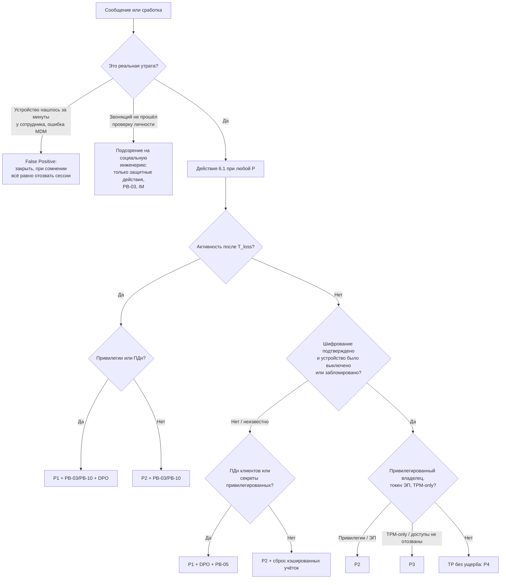

# PB-09 Утрата, кража или изъятие устройства или носителя

> Учебный плейбук для вымышленной компании «Альфа-Трейд». Опирается на IR-план (`source/ir-plan.md`): роли, критичность P1–P4, сроки и каналы связи берутся оттуда. Пометки: **[проверить]** — номер статьи, срок, Event ID, название функции или поля, которые нужно сверить с первоисточником, документацией вендора или юристом; **[учебное]** — порог или срок придуман для примера; **(пример)** — запрос на нейтральном псевдо-SPL/KQL, имена индексов и полей условные. MDM, EDR, облачная почта и VPN-шлюз в IR-плане не названы. Облачные примеры даны на Microsoft 365 / Entra ID, потому что у них лучше всего документированы журналы; для Яндекс 360, VK WorkSpace или Google Workspace эквиваленты нужно найти на этапе подготовки, а не во время инцидента.

Главная мысль: **шифрование диска защищает только выключенное устройство.** Основной риск 2025–2026 годов — не «прочитают диск», а живые сессии и токены: cookie браузера, refresh-токены почты, приложение-аутентификатор, VPN-профиль, SIM с SMS-кодами. Поэтому первые 30 минут одинаковы для любой критичности: **сначала лишить устройство доступа к нашим системам (быстро, обратимо, без апрувов), потом оценить, что на нём было, потом решать про очистку и уведомления.** Вторая мысль: **звонок «я потерял телефон» может быть атакой** на хелпдеск. Действия, которые лишают доступа, выполняются по любому сообщению; действия, которые выдают доступ, — только после проверки личности.

> **L1, ночная смена, прочитай до любых действий:**
> 1. Связь с сотрудником — **только по личному или чужому телефону**, не через корпоративную почту и мессенджер: они открыты на украденном устройстве.
> 2. Шифрование **не спрашивай, а проверяй** в MDM/EDR. Нет данных — считай «не зашифровано».
> 3. До проверки личности **никаких** новых паролей, новых MFA и ключей восстановления BitLocker. Отзывать сессии и блокировать можно сразу.
> 4. Действия первых 30 минут (раздел 6.1) выполняй **при любой критичности**, включая P4 и выходные.
> 5. Удалённую очистку (wipe) сам не запускай. Ничего не удаляй из AD и MDM.

---

## 1. Паспорт плейбука

| Поле | Значение |
| --- | --- |
| ID | PB-09 |
| Версия | 1.0 (учебная), 31.10.2026 |
| Владелец | Руководитель ИБ (IM). Разделы о ПДн, BYOD и изъятии согласует юрист/DPO, разделы об ответственности сотрудника — HR. Пересмотр раз в год и после каждого P1/P2 по этому плейбуку |
| Критичность по умолчанию | **P3** до получения технического статуса из MDM/EDR. Итоговая — по матрице раздела 5.3, по худшему признаку |
| Повышение | **P1:** незашифрованное (или с неизвестным статусом) устройство или носитель с выгрузкой ПДн клиентов; незашифрованное устройство администратора AD или с секретами к базе клиентов и сайту; подтверждённое использование привилегированной учётки после утраты. **P2:** любая успешная активность учётки или устройства после утраты; ноутбук украден включённым или разблокированным; телефон, код которого мог видеть вор; утрачен токен ЭП; устройство привилегированного пользователя при любом шифровании |
| Понижение | До **P4** — только при всех условиях: шифрование подтверждено системой, устройство было выключено или заблокировано, активности после утраты нет, сессии, токены и сертификаты уже отозваны. P1 понижает IM вместе с DPO, с обоснованием в тикете |
| MITRE ATT&CK **[проверить номера по актуальной версии]** | Отдельной техники «утрата устройства» нет, это физический вектор; раскладываются последствия. **Credential Access (TA0006):** T1539 Steal Web Session Cookie, T1528 Steal Application Access Token, T1555.003 Credentials from Web Browsers, T1555.005 Password Managers, T1552.001 Credentials In Files, T1552.004 Private Keys, T1003.005 Cached Domain Credentials. **Initial Access / Persistence:** T1078 Valid Accounts, T1098.005 Device Registration. **Defense Evasion / Lateral Movement:** T1550.004 Web Session Cookie, T1656 Impersonation (звонок в хелпдеск). **Collection (TA0009):** T1005 Data from Local System, T1025 Data from Removable Media. **Initial Access:** T1200 Hardware Additions (вернувшееся устройство). **Mobile:** T1461 Lockscreen Bypass |
| Связанные плейбуки | **PB-03** Компрометация учётной записи и **PB-10** Компрометация облачной учётки (при активности после утраты); **PB-05** Утечка данных (при ПДн, ведёт трек РКН); **PB-07** Инсайдер (если «потеря» прикрывает вынос данных); **PB-S4** Сработка EDR (если устройство вышло на связь) |
| Целевые сроки от сообщения **[учебное]** | Тикет, анкета: **15 мин**. Отзыв сессий, MDM lock, изоляция EDR: **30 мин, 24/7, при любой P**. Статус шифрования и хронология: **1 ч**. Итоговая критичность и эскалация: **1 ч** (P1 — звонок IM сразу). Сертификаты, SIM, MFA, секреты: **4 ч**. Решение DPO о квалификации: **≤ 12 ч** (запас до 24 ч на уведомление РКН). Новое устройство: **1 рабочий день**. Watchlist: **30 дней**, 90 — для незашифрованных и привилегированных |

---

## 2. Назначение и область применения

**Входит:**

| Объект | Особенность реагирования |
| --- | --- |
| Корпоративный ноутбук или ПК (Windows, macOS) | Wipe дойдёт, только если устройство выйдет в интернет. Главная мера — отзыв всего, что на нём лежит |
| Корпоративный смартфон, планшет | MDM lock / Lost Mode, MFA, SIM, почтовое партнёрство |
| Личный телефон с рабочими данными (BYOD) | Только селективная очистка корпоративных данных; полная — с письменного согласия |
| Флешка, внешний диск | Сдерживать нечего; ключевое — восстановить, что на нём было |
| Токен ЭП (Рутокен, JaCarta), ключ FIDO2, смарт-карта | Отзыв сертификата в УЦ, блокировка в банк-клиенте, удаление ключа из IdP |
| Пропуск СКУД, утерянный вместе с устройством | Блокировка пропуска |
| Изъятие или досмотр устройства (полиция, таможня, граница) | Юридическая ветка, очистка только по решению юриста |
| Найденное или возвращённое устройство | Карантин, проверка, переустановка |

**Не входит:**
- невозврат устройства уволенным сотрудником — процесс ИТ; передаётся в PB-09 через 5 рабочих дней **[учебное]** или сразу при признаках использования;
- бумажные документы — процедура PB-05;
- компрометация учётки без утраты устройства — PB-03/PB-10;
- подтверждённый умышленный вынос данных — PB-07 (PB-09 остаётся родительским тикетом).

**Предусловия (без них плейбук не выполнить):** горячая линия 24/7, номер которой есть на бейдже и в памятке; CMDB, где по ФИО находятся все устройства, серийные номера, IMEI и корпоративные SIM; MDM на всех корпоративных устройствах с отчётом о шифровании; ключи BitLocker/FileVault хранятся централизованно; LAPS; EDR с сетевой изоляцией; VPN-шлюз проверяет CRL/OCSP; процедура проверки личности для хелпдеска; соглашение BYOD; контакт оператора связи 24/7; известный срок хранения видеозаписей.

---

## 3. Триггеры и источники обнаружения

| Источник | Что видим | Поля / Event ID | Пример правила **(пример)** |
| --- | --- | --- | --- |
| Сотрудник, руководитель, охрана, ресепшен | Сообщение о потере или краже, «нашли ноутбук в переговорке» | Время сообщения = время выявления | Вручную: тикет «Утрата устройства» |
| Полиция, таможня, погранслужба | Изъятие или досмотр | Протокол, контакт | Вручную, сразу юрист |
| MDM | Устройство не выходило на связь N дней, jailbreak/root, смена SIM, выход из рабочего профиля | `device_id`, `last_checkin`, `compliance_state`, `encryption_status`, `ownership` | `mdm.last_checkin < now()-14d AND ownership="corporate"` → тикет ИТ **[зависит от стека]** |
| EDR | Выход на связь из новой страны или ASN, загрузка с другой ОС, отключение агента | `agent_id`, `last_seen`, `public_ip`, `logged_on_users` | `edr.device IN watchlist_lost` → алерт high |
| Контроллеры домена | Аутентификация учётки сотрудника или компьютера `HOST$` после утраты | 4768, 4769, 4771 (`TargetUserName`, `IpAddress`), 4776 (`Workstation`), 4624/4625 (`LogonType`), 4740 | `EventCode IN (4768,4776,4624) AND TargetUserName IN watchlist_lost_users,hosts` |
| VPN / NGFW, RADIUS (NPS) | VPN по сертификату утраченного устройства, отказ по CRL | `user`, `cert_serial`, `src_ip`; NPS 6272/6273 | `vpn.cert_serial IN watchlist_lost_certs` |
| Облачная почта / IdP: входы | Вход с неуправляемого устройства, из новой страны, неинтерактивные входы с утраченного телефона | `IPAddress`, `Location`, `ClientAppUsed`, `DeviceDetail.deviceId`, `isCompliant` | `SigninLogs WHERE deviceId IN watchlist` |
| Облачная почта / IdP: аудит | Новый метод MFA, правило пересылки, OAuth-согласие, запрос ключа BitLocker | `OperationName`, `InitiatedBy`, `TargetResources` | «Сообщение о потере телефона» + новый метод MFA в течение 24 ч → алерт high |
| Хелпдеск | Запрос сброса MFA или ключа восстановления по непроверенному каналу | Номер звонящего, текст заявки | Любой запрос ключа BitLocker для устройства из watchlist → алерт |

---

## 4. Роли и RACI для этого сценария

Дополнительно к ролям IR-плана участвуют **HR** (вопросы ответственности, увольнение), **бухгалтерия** (токены ЭП, банк-клиент, списание) и **офис-менеджер / охрана** (видео, СКУД, приём найденного устройства).

| Действие | L1 | L2 | IM | ИТ | Юрист/DPO | HR | Директор |
| --- | --- | --- | --- | --- | --- | --- | --- |
| Тикет, анкета, поиск устройств в CMDB/MDM/EDR | R | I | I | C | | | |
| Проверка личности заявителя | R | A | | C | | | |
| Действия первых 30 минут (6.1) | R | A | I | R | | | |
| Статус шифрования, хронология, итоговая P | C | R | A | C | | | |
| Отзыв сертификатов, SIM, MFA, ротация секретов | | A | I | R | | | |
| Выдача нового пароля и MFA | | C | | R | | | |
| Wipe корпоративного устройства | | C | A | R | | | |
| Wipe личного устройства (селективный / полный) | | C | A | R | C / A | C | |
| Действия с изъятым устройством | | C | C | | A | | I |
| Оценка данных на устройстве | C | R | A | C | C | | |
| «Это инцидент с ПДн? Уведомлять РКН?» | | C | C | | R/A | | I |
| Заявление в полицию (корпоративное имущество) | | C | C | | R | | A |
| Проверка ветки «инсайдер» | | R | A | | C | C | |
| Материальная ответственность | | | I | | C | R/A | |
| Новое устройство, CMDB, списание | | I | | R | | | |

R — выполняет, A — утверждает и отвечает, C — консультирует, I — информируется.

---

## 5. Триаж (первые 15–30 минут)

### 5.1. Карточка L1 (≤ 15 мин)

1. **Тикет** «Утрата/кража устройства». Время сообщения = время выявления (T_report), в UTC и UTC+3.
2. **Анкета** (дословно, в blameless-тоне: «Спасибо, что сообщили сразу, это сильно снижает риск»):
   1. Как с вами связаться в ближайшие сутки, если телефон утрачен? (Записать альтернативный номер.)
   2. Что утрачено: ноутбук, телефон, планшет, флешка, диск, токен ЭП, ключ FIDO2, пропуск? Что ещё было в той же сумке (записанные пароли, PIN)?
   3. Корпоративное или личное? Инвентарный номер, если помните.
   4. Когда последний раз точно видели устройство, где и когда обнаружили пропажу (T_loss)? Потеря, кража или изъятие (кем)?
   5. В каком состоянии было: выключено, крышка закрыта (сон), открыто и разблокировано? Мог ли кто-то видеть код телефона?
   6. Был ли выполнен вход в браузере в почту, облачные файлы, 1С, банк-клиент? Открыт ли менеджер паролей?
   7. Хранили ли на устройстве выгрузки с данными клиентов или сотрудников (Excel, CSV, отчёты 1С)? Примерно сколько записей?
   8. Есть ли на устройстве SSH-ключи, сохранённые RDP/VPN-подключения, конфигурации доступа?
   9. На телефоне аутентификатор? Приходят ли на эту SIM коды? Корпоративная ли SIM, какой номер?
   10. Включены ли «Найти iPhone» / «Найти устройство»? Подавали ли заявление в полицию?
3. **Проверка личности.** Обратный звонок на номер из HR-системы или справочника (не на тот, с которого звонят) **или** подтверждение руководителя сотрудника. Результат и способ — в тикет.
4. **Идентификаторы** из CMDB, MDM, EDR, AD, IdP: hostname, серийный и инвентарный номер, MAC, IMEI, номер SIM, Device ID в MDM и IdP, Agent ID в EDR, серийные номера сертификатов, ID ключа восстановления.
5. **Немедленные действия** раздела 6.1 (или передать дежурному L2/ИТ, если у L1 нет прав).
6. **Звонок L2** — всегда. Сообщение DPO, если на вопрос 7 ответ «да» или «не знаю».

### 5.2. Проверки L2 (≤ 1 ч)

| Шаг | Вопрос | Где смотреть | Признак |
| --- | --- | --- | --- |
| 1. Шифрование | Было ли шифрование активно? | MDM (отчёт о шифровании, дата), EDR, AD: дочерние объекты `msFVE-RecoveryInformation`; macOS — статус FileVault и эскроу ключа | Ключ в AD значит, что BitLocker **когда-то** включали. Нужен статус «защита включена» из MDM/EDR. **Suspended** = не зашифровано |
| 2. Протекторы | TPM-only или TPM+PIN? | MDM, результаты инвентаризации (`manage-bde -status`, `Get-BitLockerVolume`) | TPM-only уязвим к атакам с физическим доступом (перехват на шине TPM, DMA, «bitpixie» CVE-2023-21563 **[проверить применимость к сборкам и патчам]**) |
| 3. Блокировка | Мог ли экран остаться разблокированным? | GPO/MDM: таймаут блокировки; в SIEM до утраты — 4800/4801, 4624 LogonType 7 | Таймаут 30 мин и «оставил открытым в кафе» → считать разблокированным |
| 4. Хронология | Что было после T_loss? | Запросы Q1–Q3 (раздел 8) | Любая успешная активность → минимум P2, PB-03/PB-10 |
| 5. Владелец | Привилегирован ли он? | Группы AD, роли в IdP, доступ к банк-клиенту, продакшену, 1С-админке | Привилегированный → минимум P2 |
| 6. Кто ещё входил | Кэш чьих учёток на диске? | SIEM/EDR: 4624 LogonType 2, 10, 11 на этом хосте за период хранения | Входы администраторов → сброс их паролей при неподтверждённом шифровании |
| 7. LAPS | Уникален ли пароль локального администратора? | Атрибуты LAPS у объекта компьютера | Нет LAPS + нет шифрования → повышение P, смена пароля на всех ПК |
| 8. Инсайдер | Нет ли признаков прикрытия? | EDR/DLP за 30 дней: USB, облака, массовое копирование; статус в HR (через IM) | Массовое копирование, заявление об увольнении, повторные «потери» → IM, PB-07, сотруднику не сообщать |
| 9. Ключ восстановления | Не запрашивал ли кто-то ключ после T_loss? | Аудит IdP («Read BitLocker key» в Entra ID **[проверить]**), журнал хелпдеска | Запрос после утраты — красный флаг, P2 |

### 5.3. Матрица критичности

Определяется по худшему признаку. «Неизвестно» = худший вариант до подтверждения. Статус шифрования только из MDM/EDR/AD.

| Уровень | Признаки (достаточно одного) |
| --- | --- |
| **P1** | Нет шифрования / Suspended / статус неизвестен **и** выгрузка ПДн клиентов (сотни записей и более **[учебное]**) — потенциальная утечка ПДн по IR-плану. Незашифрованное устройство администратора AD или с секретами к базе клиентов и сайту. Активность после утраты по привилегированной учётке или с доступом к ПДн |
| **P2** | Нет шифрования / неизвестно, корпоративные учётные данные без значимого объёма ПДн. Зашифрованный ноутбук утрачен включённым, в сне или разблокированным. Телефон, код которого мог знать вор. Любая успешная активность после T_loss. Устройство привилегированного пользователя (бухгалтерия с банк-клиентом, администратор 1С, разработчик, директор) при любом шифровании. Утрачен токен ЭП |
| **P3** | Шифрование подтверждено, устройство выключено или заблокировано, но: TPM-only; сессии ещё не отозваны; хронология не завершена. Флешка без ПДн с внутренними документами. Пропуск без устройства |
| **P4** | Шифрование подтверждено, устройство было выключено или заблокировано, активности после T_loss нет, сессии, токены и сертификаты отозваны, вне шифрованного диска ПДн не было |

Пересмотр — после оценки данных (8, вопрос 5) и после решения DPO. **P4 не означает «до понедельника»:** действия 6.1 выполняются при любой P, критичность определяет только эскалацию и глубину расследования.

### 5.4. Дерево решений



### 5.5. Критерии эскалации

- **L1 → L2:** всегда, звонком, после 6.1.
- **L2 → IM:** P1/P2 — звонок сразу (P1 — в пределах 15 минут, круглосуточно); P3 — сообщение в канале инцидентов; P4 — тикет и дневная сводка.
- **→ DPO:** сразу при «ПДн да или не исключено», независимо от P.
- **→ директор и юрист:** P1 по IR-плану; изъятие госорганами; вопрос о полиции.
- **→ бухгалтерия и юрист:** утрачен токен ЭП — немедленно, банк блокирует ключ по звонку.
- **В обход:** при признаках инсайдера — только IM, юрист, HR; сотрудника о подробностях не информировать.

---

## 6. Сдерживание

### 6.1. Краткосрочное: первые 30 минут (без апрува, любая P, 24/7)

Порядок важен: сначала отзыв доступа, потом экспорт карточек, потом остальное. **Ничего не удалять.**

| № | Действие | Кто | Инструмент **[зависит от стека]** | Апрув |
| --- | --- | --- | --- | --- |
| 1 | Отозвать сессии и refresh-токены пользователя, удалить пароли приложений | L1/L2 | IdP / консоль почты (`Revoke-MgUserSignInSession`) | Не нужен |
| 2 | Заблокировать или удалить почтовое партнёрство утраченного телефона (ActiveSync и аналоги) | L1/L2/ИТ | Консоль почты (`Get-MobileDevice`, блокировка DeviceId) | Не нужен |
| 3 | Отключить (не удалять) устройство в облачном каталоге — в Entra ID это делает недействительным PRT устройства **[проверить для вашего IdP]** | L2 | IdP (`Update-MgDevice -AccountEnabled:$false`) | Не нужен |
| 4 | MDM: Lock; для iOS supervised — Lost Mode с номером для возврата. **Не Wipe** | L1/L2/ИТ | MDM | Не нужен |
| 5 | EDR: тег `LOST-INC-xxxx` и сетевая изоляция (у многих EDR применяется при следующем выходе на связь **[проверить]**); телеметрия продолжает идти | L2 | EDR | Не нужен (IR-план: L2 изолирует одну рабочую станцию) |
| 6 | Экспорт карточек устройства из MDM и EDR (CSV/PDF) в тикет, SHA-256 | L2 | MDM, EDR | — |
| 7 | Удалить методы MFA, привязанные к утраченному телефону (push, TOTP, passkey); учётка — «вход только после проверки в ИТ» | L2/ИТ | IdP (`Get-MgUserAuthenticationMethod`) | Не нужен (защитное) |
| 8 | Идентификаторы — в watchlist SIEM (раздел 10) | L2 | SIEM | Не нужен |
| 9 | Утрачен токен ЭП → звонок бухгалтерии/юристу для блокировки ключа в банке и УЦ | L1 → IM | Телефон | — |

**Проверка результата:** через 15–30 минут повторить Q1. Новых успешных входов и синхронизации почты быть не должно. В тикете у каждого действия: время, исполнитель, статус (успех / pending / ошибка).

**Важно про «сбросил пароль — значит всё».** Уже выданные токены доступа в облаке живут до истечения (в Entra ID порядка часа **[проверить]**), если сервис и клиент не поддерживают немедленный отзыв (Continuous Access Evaluation **[проверить применимость]**). Kerberos TGT действует до 10 часов (продление до 7 дней) по умолчанию: смена пароля блокирует получение новых билетов, но не убивает выданные мгновенно. Пароли приложений, OAuth-согласия и резервные коды MFA сброс пароля не отзывает.

### 6.2. Краткосрочное: до 4 часов (ИТ под контролем L2)

1. **Сменить пароль пользователя** в AD как защитное действие (случайный, не сообщать). Новый пароль передаётся **только после проверки личности**: лично, обратным звонком или через руководителя, не по почте.
   ```powershell
   Set-ADAccountPassword -Identity "<user>" -Reset -NewPassword (Read-Host -AsSecureString)
   Set-ADUser -Identity "<user>" -ChangePasswordAtLogon $true
   ```
2. **Шифрование не подтверждено** → сбросить пароли всех доменных учёток, входивших интерактивно (кэш DCC2, T1003.005), и пароли из браузера и менеджера паролей (список с сотрудником и ИТ).
3. **LAPS:** пометить пароль истёкшим (`Set-LapsADPasswordExpirationTime -Identity "<host>"`; для legacy LAPS — `Reset-AdmPwdPassword` **[проверить, какой LAPS]**). Нет LAPS — отдельная задача сменить пароль локального администратора на всех ПК.
4. **Сертификаты** (машинный 802.1X/VPN и пользовательский): отзыв с причиной Key Compromise и публикация CRL.
   ```cmd
   certutil -revoke <SerialNumber> 1
   certutil -crl
   ```
   Затем **проверить**, что VPN-шлюз и RADIUS отклоняют старый сертификат: многие шлюзы кэшируют CRL до истечения его срока. Дублирующая мера — блокировка VPN-профиля пользователя на NGFW до выдачи нового устройства. Отзыв на AD CS пишется событием 4870 **[проверить]**.
5. **Объект компьютера в AD — отключить и пометить, не удалять:** вместе с ним удаляются ключи BitLocker и пароль LAPS.
   ```powershell
   Disable-ADAccount -Identity "<host>$"
   Set-ADComputer -Identity "<host>" -Description "LOST INC-2026-___ <дата>, не удалять"
   ```
6. **Ключ восстановления** этого устройства — выдача только с визой IM.
7. **SIM** (корпоративная) — блокировка у оператора; **пропуск СКУД** — блокировка.
8. **Секреты с устройства:** SSH-ключи (удалить публичный ключ из `authorized_keys` и с Git-хостинга), токены Git и облачных CLI (`.aws/credentials`, `.kube/config`), API-ключи, пароли сервисных учёток из конфигов, KeePass (если диск не зашифрован, а мастер-пароль слабый — сменить всё из базы), Wi-Fi PSK. Ротацию делают с владельцами систем.
9. **Токен ЭП:** отзыв сертификата в УЦ, письменное подтверждение блокировки в банке. Владелец ЭП обязан не использовать ключ при подозрении на компрометацию и уведомить УЦ (63-ФЗ, ст. 10 **[проверить]**).

### 6.3. Очистка (wipe): условия и апрувы

| Действие | Кто | Апрув | Условия |
| --- | --- | --- | --- |
| Lock, Lost Mode | L1/L2/ИТ | Не нужен | Сразу |
| Селективная очистка / Retire (BYOD, рабочий профиль) | ИТ | IM, по политике BYOD | Уведомить сотрудника |
| Полный wipe корпоративного устройства | ИТ | IM (по телефону, фиксация в тикете); при P1/P2 и выходе устройства на связь не у сотрудника — L2 по заранее одобренному правилу | Перед wipe: экспорт карточек, проверка, что на устройстве нет единственной копии данных, при онлайне — 5–10 минут сбора (раздел 7) |
| Полный wipe личного устройства | ИТ | IM + юрист + письменное согласие сотрудника | Только так |
| Любые действия с изъятым устройством | — | Юрист + IM | Удалённая очистка может быть расценена как уничтожение доказательств **[проверить у юриста]**; отзыв доступов на стороне компании выполняется |

Статус команды в MDM: **pending ≠ очищено.** В тикете различать «команда отправлена», «очистка подтверждена (время)» и «устройство не выходило на связь». Устройство не исключать из MDM до выполнения команды, иначе она не будет доставлена.

### 6.4. Долгосрочное сдерживание

- Правило условного доступа или NGFW: запрет входа с Device ID, сертификата и hostname утраченного устройства.
- Watchlist на 30/90 дней (раздел 10).
- Учётка пользователя остаётся включённой: отключать её только при признаках использования посторонним или по решению IM, иначе сотрудник неделю не работает.
- Объекты устройства в AD, IdP, MDM хранить отключёнными до закрытия и ещё 6 месяцев **[учебное]** на случай возврата.

### 6.5. Что НЕ делать

- Не сбрасывать пароль и не переносить MFA по звонку без проверки личности.
- Не отправлять новый пароль или ссылку на корпоративную почту и в корпоративный мессенджер.
- Не ставить P4 со слов сотрудника «у меня всё зашифровано».
- Не удалять компьютер из AD и устройство из MDM/IdP до wipe или списания.
- Не делать полный wipe личного телефона без письменного согласия и не трогать изъятое устройство без юриста.
- Не отслеживать геолокацию личного устройства без согласия; геолокацию корпоративного — только по политике и для передачи в полицию.
- Не ехать забирать устройство по геолокации — ни сотруднику, ни ИБ. Данные передаются юристу для полиции.
- Не подключать вернувшееся устройство к сети и не отдавать его сотруднику без переустановки.
- Не откладывать действия 6.1 до рабочего дня.

---

## 7. Сбор и сохранение артефактов

Самого устройства у нас нет, поэтому «летучесть» здесь — это данные в системах, которые исчезнут первыми. Собирать **до** разрушающих действий (wipe, retire, удаление).

| Порядок | Артефакт | Почему срочно | Как сохранить |
| --- | --- | --- | --- |
| 1 | Если устройство онлайн в EDR: вошедшие пользователи, сетевые соединения, внешний IP, запущенные процессы | Исчезнет при выключении или wipe | Live response EDR, 5–10 мин, затем wipe по апруву |
| 2 | Карточки устройства в MDM и EDR: шифрование, протекторы, last check-in, compliance, история команд, приложения | Часть вендоров обнуляет запись после wipe/retire | Экспорт CSV/PDF, SHA-256 |
| 3 | Неинтерактивные входы и журналы мобильной синхронизации | Короткое хранение в облаке **[проверить срок для лицензии]** | Экспорт по пользователю с T_loss − 7 дней |
| 4 | Видео и СКУД (кража в офисе) | Перезапись через несколько дней | Письменный запрос охране в первые сутки |
| 5 | Журналы DC, VPN, IdP-аудит, DLP/EDR о копировании за 30 дней | SIEM хранит 90 дней | Результаты Q1–Q5 (CSV) + тексты запросов |
| 6 | Анкета сотрудника, способ проверки личности, идентификаторы, ID ключа восстановления (сам ключ в тикет **не копировать**) | — | В тикете |
| 7 | Отозванные доступы с временем, серийные номера сертификатов, подтверждение CRL, статусы wipe | — | В тикете |
| 8 | Решения IM и DPO с временем и обоснованием; номера обращений в полицию (талон КУСП), к оператору, в банк и УЦ | — | В тикете |
| 9 | Найденное устройство | Риск порчи доказательств | Акт приёма, опечатанный пакет, журнал цепочки хранения; не включать |

**Цепочка хранения.** Все выгрузки — в защищённое хранилище инцидентов с ограниченным доступом и SHA-256; в журнале: что, кто, когда, откуда выгрузил, кто получал доступ. Время во всех артефактах в UTC и UTC+3. Журналы, относящиеся к инциденту, при P1/P2 или заявлении в полицию — legal hold не менее 1 года **[учебное]** сверх стандартных 90 дней.

---

## 8. Расследование

| Вопрос | Источники | Результат |
| --- | --- | --- |
| 1. Хронология: T_loss, T_last_seen, T_report | MDM, EDR, VPN, IdP, DC | Если T_last_seen > T_loss — устройство выходило на связь после утраты; если T_report − T_loss > 24 ч — расширить окно поиска и учесть в метриках |
| 2. Используется ли учётка или устройство посторонним? | Q1, Q2, Q3 | Признаки: успешный вход с чужого IP/страны/устройства; неинтерактивные входы приложений с утраченного телефона; новые методы MFA, правила пересылки, OAuth-согласия; VPN по сертификату устройства; `LoggedOnUsers` в EDR после T_loss. Любой → P2+ и PB-03/PB-10 |
| 3. Скоуп учётных данных | Анкета, 4624 на хосте, EDR, группы AD | Список учёток, токенов, ключей и секретов для ротации |
| 4. Вектор и обстоятельства | Анкета, полиция, видео, СКУД | Потеря / кража / целевая кража / изъятие; признаки прикрытия (PB-07) |
| 5. Затронутые данные | Q4, Q5, DLP, журналы облачного хранилища (что синхронизировалось на устройство), журнал регистрации 1С, опрос сотрудника и руководителя | Таблица для DPO: категория (ПДн клиентов / ПДн сотрудников / коммерческая тайна / секреты), где лежали, объём, число субъектов, чем защищены |
| 6. Была ли неправомерная передача ПДн? | Таблица из п. 5 + статус шифрования + п. 2 | Решение DPO; явного освобождения при шифровании, как в GDPR, в 152-ФЗ нет **[проверить у DPO, нет ли разъяснений РКН]** |

**Примеры запросов (пример)** — переменные `<user>`, `<upn>`, `<host>`, `<T_loss>` (брать с запасом минус 1–2 часа).

```
# Q1. Активность учётки после утраты (главный запрос)
source IN (dc_security, vpn, cloud_signin, cloud_signin_noninteractive, edr_logon)
  user IN ("<user>", "<upn>") AND time > <T_loss>
| table time, source, src_ip, src_country, device_id, app, client, result, mfa
| sort time
```

```kusto
// Q1 для Entra ID; повторить по AADNonInteractiveUserSignInLogs [проверить имена таблиц]
SigninLogs
| where TimeGenerated > datetime(<T_loss>) and UserPrincipalName =~ "<upn>"
| project TimeGenerated, IPAddress, Location, AppDisplayName, ClientAppUsed,
          DeviceDetail, ResultType, AuthenticationRequirement
| order by TimeGenerated asc
```

```spl
# Q2. Само устройство: учётка компьютера, VPN-сертификат, EDR
(index=wineventlog EventCode IN (4768,4769,4771,4776,4624,4625)
   (TargetUserName="<host>$" OR Workstation="<host>" OR WorkstationName="<host>"))
OR (index=vpn (cert_serial="<serial>" OR client_hostname="<host>"))
OR (index=edr hostname="<host>")
earliest="<T_loss>"
| table _time index EventCode TargetUserName IpAddress src_ip public_ip logged_on_users
```

```
# Q3. Закрепление после утраты
source IN (idp_audit, mail_audit, dc_security) AND time > <T_loss>
  AND (target="<upn>" OR initiator="<upn>")
  AND action IN (auth_method_added, device_registered, password_reset,
                 inbox_rule_created, forwarding_set, oauth_consent,
                 bitlocker_key_read, 4723, 4724, 4738)
```

```kusto
// Q4. Что было на устройстве за 30 дней: выгрузки и секреты (Defender for Endpoint) [проверить]
DeviceFileEvents
| where Timestamp > ago(30d) and DeviceName startswith "<host>"
| where FileName matches regex @"(?i)\.(xlsx?|csv|zip|7z|dt|sql|bak|pst|ost|kdbx|pem|key|ppk|ovpn|rdp)$"
| summarize cnt=count(), size=sum(FileSize) by FolderPath, FileName, InitiatingProcessFileName
| order by size desc
```
Интерпретация: CSV/XLSX от сотен КБ, созданные `1cv8.exe`/`1cv8c.exe` или браузером после выгрузки из CRM, — кандидаты в «выгрузку ПДн»; `kdbx`, `pem`, `key`, `ppk`, `ovpn`, `rdp` — секреты к ротации.

```
# Q5. Флешка и ветка «инсайдер»: что копировалось на USB и в личные облака за 30 дней
(source=edr action IN (UsbDriveMounted, file_written_removable) host="<host>")   [проверить ActionType]
OR (source=dlp usb_serial="<serial>")
OR (source=ngfw user="<user>" app_category IN (cloud_storage, file_sharing) | stats sum(bytes_sent))
OR (source=windows EventCode=6416 host="<host>")
```

---

## 9. Устранение

- [ ] Все учётные данные и секреты из инвентаризации (8, п. 3) ротированы, включая учётки администраторов, входивших на устройство.
- [ ] Методы MFA перерегистрированы **после проверки личности** (лично в ИТ с документом или по процедуре с подтверждением руководителя); для привилегированных — с визой IM.
- [ ] Выпущены новые сертификаты; старые отозваны, CRL проверен на шлюзе.
- [ ] Пароль локального администратора сменён (LAPS или на всех ПК, если LAPS нет).
- [ ] При активности после T_loss устранение ведётся по PB-03/PB-10 (правила пересылки, OAuth-приложения, зарегистрированные устройства).
- [ ] Сотруднику рекомендовано сменить пароли личных аккаунтов, использовавшихся на корпоративном устройстве, и не реагировать на SMS «ваш iPhone найден» (фишинг для снятия блокировки активации).
- [ ] Корневая причина записана: почему не было шифрования, почему ПДн лежали локально, почему сообщили поздно — это пробел подготовки, а не «невезение».

---

## 10. Восстановление и мониторинг после инцидента

**Восстановление:**
1. Новое устройство из эталонного образа выдаётся **после** отзыва доступов; проверка compliance до выдачи (шифрование, для привилегированных TPM+PIN, EDR, MDM).
2. Данные — из облачного хранилища или резервной копии. Если они хранились только локально, фиксируется потеря доступности; для ПДн это тоже инцидент безопасности **[проверить у DPO]**.
3. CMDB: статус «утрачено / украдено / изъято», номер тикета; списание по процессу бухгалтерии.
4. Удаление старого устройства из MDM и IdP — только после подтверждённого wipe или решения о списании.

**Мониторинг (IR-план: усиленно не менее 2 недель; здесь 30 / 90 дней):**

| Что | Правило | Срок |
| --- | --- | --- |
| Device ID в MDM, IdP, Agent ID EDR, hostname, MAC, IMEI | Любое событие → алерт high, L1 будит L2 | 30 дней; 90 — незашифрованные и привилегированные |
| Серийные номера отозванных сертификатов | Попытка VPN/802.1X, отказ по CRL → алерт | То же |
| DeviceId почтового партнёрства | Попытка синхронизации → алерт | То же |
| Учётка сотрудника | Вход с неуправляемого устройства или не из его новых устройств; новая страна/ASN; новый метод MFA; правила пересылки; массовое скачивание → алерт | 30 дней |
| Учётки, входившие на устройство | Всплеск неудачных входов (признак офлайн-подбора кэша) → алерт | 30 / 90 дней |
| Ключ восстановления | Любой запрос ключа BitLocker этого устройства → алерт | До списания |

Q1 повторяется через 24 часа и в последний день мониторинга. После закрытия инцидента watchlist остаётся с пониженным приоритетом до даты окончания, назначен ответственный.

---

## 11. Коммуникации и уведомления

| Кому | Когда | Кто | Канал | Что |
| --- | --- | --- | --- | --- |
| Сотрудник | Сразу и при выдаче устройства | L1 / ИТ | Альтернативный номер, лично | Что сделано, что сделать ему, когда получит новое устройство |
| Руководитель сотрудника | В течение рабочего дня (и для проверки личности — сразу) | L1 / ИТ | Телефон | Временная недоступность сотрудника |
| IM | P1 — ≤ 15 мин, P2 — ≤ 1 ч, звонок; P3 — канал; P4 — сводка | L2 | Канал инцидентов | Статус по формату IR-плана (P1 каждые 2 ч, P2 дважды в день) |
| DPO / юрист | Сразу при «ПДн да / не знаю»; таблица данных по готовности | L2 / IM | Телефон + тикет | Категории и объём ПДн, шифрование, активность после утраты |
| Директор | P1 | IM | Телефон | |
| Владельцы систем | Если на устройстве были их секреты | L2 | Телефон, тикет | Какие секреты ротировать |
| Банк, УЦ | Утрачен токен ЭП — немедленно | Главбух / юрист | Горячая линия банка, затем письменно | |
| Оператор связи | Корпоративная SIM — в течение часа | ИТ | | |
| Полиция | Кража — по решению IM | Юрист от имени компании (корпоративное имущество) **[проверить порядок]**; сотрудник — по личному имуществу | | Идентификаторы (IMEI, серийный номер), обстоятельства; получить талон КУСП |
| РКН | По решению DPO: первичное — 24 ч с момента выявления, результаты — 72 ч (152-ФЗ, ст. 21 ч. 3.1 **[проверить редакцию и трактовку «момента выявления»]**) | DPO | Портал РКН **[проверить способ подачи]** | Через PB-05 |
| Страховая, PR | Если имущество застраховано / если инцидент публичен | Юрист / IM | | |

**Шаблон сообщения сотруднику (по телефону или SMS на личный номер):**
> «Мы заблокировали ваш [ноутбук/телефон] и завершили все рабочие сеансы. Пожалуйста: 1) не входите в рабочие сервисы с чужих устройств; 2) новый пароль получите [лично в ИТ / по звонку с номера ___]; 3) завершите сеансы [Telegram и др.] с другого устройства и отметьте устройство как потерянное в «Найти iPhone» / «Найти устройство»; 4) если придёт SMS или письмо «ваше устройство найдено» — не переходите по ссылке, перешлите нам. Спасибо, что сообщили быстро.»

**Шаблон статуса IM:** «INC-2026-___, PB-09, P_. Утрачен [что] сотрудника [логин] в [время]. Шифрование: [подтверждено / нет / неизвестно]. Активность после утраты: [нет / есть — PB-03]. Сделано: [сессии, MDM, EDR, MFA]. Нужно решение: [wipe / DPO / полиция].»

Правило «без наказания»: расследование ИБ не используется для дисциплинарных мер за сам факт утраты при своевременном сообщении; материальную ответственность HR решает отдельной процедурой (ТК РФ, ст. 238 и далее **[проверить у юриста]**). Формулировку согласовать с HR, иначе первое удержание из зарплаты убьёт доверие к правилу.

---

## 12. Критерии закрытия

- [ ] Сессии, токены, пароли приложений, почтовые партнёрства отозваны; Q1 через 24 часа и в конце мониторинга без активности (или активность расследована по PB-03/PB-10).
- [ ] Сертификаты отозваны, шлюз отклоняет старый сертификат (проверено).
- [ ] Объекты устройства отключены во всех системах; wipe подтверждён **или** зафиксировано, что устройство не выходило на связь, и IM принял риск (для зашифрованных это нормально).
- [ ] Пароли, MFA и секреты из инвентаризации ротированы после проверки личности.
- [ ] Решение DPO о квалификации записано с временем; при необходимости PB-05 выполнен, первичное и итоговое уведомления РКН направлены.
- [ ] Сотрудник работает на новом устройстве; данные восстановлены или их потеря зафиксирована.
- [ ] CMDB обновлена; номер КУСП, обращения к оператору, в банк и УЦ — в тикете.
- [ ] Watchlist настроен с датой окончания и ответственным.
- [ ] Если устройство найдено — принято по акту, проверено, переустановлено или списано.
- [ ] Для P1/P2 разбор проведён в течение 5 рабочих дней; для P3/P4 — запись в тикете и строка в квартальной статистике. Улучшения внесены в реестр.

---

## 13. Метрики

| Метрика | Как считать | Цель **[учебное]** |
| --- | --- | --- |
| Время до сообщения (аналог MTTD) | T_report − T_loss | Медиана < 2 ч |
| Время до отзыва доступа | Время действия 6.1.1 − T_report | < 30 мин, 24/7 |
| MTTR | Закрытие − T_report | ≤ 1 рабочего дня до нового устройства |
| Доля устройств с подтверждённым шифрованием | Из MDM, по парку | 100%; Suspended > 24 ч — алерт |
| Доля ноутбуков привилегированных с TPM+PIN | Из MDM | 100% |
| Время до решения DPO | Решение − T_report | ≤ 12 ч |
| Доля подтверждённых wipe | Completed / отправленные | Растёт; pending фиксируется явно |
| Попытки социальной инженерии | Звонки «потерял телефон», не прошедшие проверку | Считать и разбирать каждый |
| Время доставки команды MDM | Ежеквартальный тест на стендовом устройстве | Известно и стабильно |

---

## 14. Типичные ошибки и ловушки

1. **Сотрудник сообщает через несколько дней из страха наказания.** Нужна политика «без наказания за быстрое сообщение», согласованная с HR, и номер горячей линии на бейдже.
2. **Шифрование «подтверждают» со слов сотрудника** или по наличию ключа в AD, не видя статуса Suspended.
3. **P4 для ноутбука, украденного в спящем режиме:** ключ в памяти, сессии открыты.
4. **P2 вместо P1 для незашифрованной выгрузки ПДн** — расхождение с IR-планом, DPO узнаёт поздно, срок РКН пропущен.
5. **P4 = «в понедельник»:** токены работают все выходные.
6. **Пароль сменили, сессии не отозвали:** почта на украденном телефоне синхронизируется.
7. **MFA перенесли по звонку без проверки** — захват учётки через хелпдеск (T1656).
8. **Новый пароль отправили на почту**, открытую на украденном телефоне.
9. **Забыли про аутентификатор, SIM, токен ЭП, пропуск** в той же сумке.
10. **Удалили компьютер из AD** — пропали ключи BitLocker и пароль LAPS.
11. **Удалили устройство из MDM до wipe** — команда не дойдёт.
12. **«Очищено» при статусе pending.**
13. **Сертификат отозван, CRL на шлюзе старый** — VPN пускает.
14. **Не сбросили пароли администраторов, входивших на незашифрованный ноутбук** — офлайн-подбор кэша.
15. **Полный wipe личного телефона без согласия**; очистка изъятого устройства без юриста.
16. **Поездка за устройством по геолокации.**
17. **Вернувшийся ноутбук подключили к сети** — риск закладки («evil maid»).
18. **Не проверили активность до утраты** — вынос данных маскируется под потерю.
19. **Слово «объяснительная»** вместо «описание обстоятельств»: сотрудник скрывает, что ноутбук был открыт.

---

## 15. Меры по предотвращению и улучшению защиты

**Снижение ущерба:**
- Принудительное полнодисковое шифрование с отчётностью в MDM/SIEM; алерт на Suspended дольше 24 часов.
- TPM+PIN для ноутбуков администраторов, руководителей и бухгалтерии; Kernel DMA Protection **[проверить совместимость с парком]**; гибернация вместо сна при закрытии крышки для устройств повышенного риска.
- Таймаут блокировки экрана 5–10 минут; сложный код на телефонах через MDM; на iPhone — «Защита украденного устройства» (iOS 17.3+ **[проверить]**).
- Условный доступ: почта и файлы только с управляемых соответствующих устройств — тогда отключение устройства в MDM закрывает доступ автоматически.
- Phishing-resistant MFA (FIDO2/passkeys), ключ хранится отдельно от ноутбука; отказ от SMS-MFA.
- DLP: запрет локальных выгрузок ПДн; контроль съёмных носителей — только корпоративные зашифрованные флешки по белому списку (BitLocker To Go или аналог).
- LAPS на всех рабочих станциях; администраторы не входят на пользовательские ПК привилегированными учётками (tiering).
- MAM или рабочий профиль для всех BYOD; подписанное соглашение BYOD с условиями очистки.
- Токены ЭП — в сейфе, не в сумке с ноутбуком.

**Обнаружение и реагирование:**
- Горячая линия 24/7 и кнопка «Я потерял устройство» на портале самообслуживания; памятка сотруднику.
- Процедура проверки личности для хелпдеска; правило «сообщение о потере телефона + новый MFA в 24 ч».
- Готовые инструкции «завершить все сессии» под реальный стек (Microsoft 365 / Яндекс 360 / VK WorkSpace).
- Ежеквартальный тест Lock и wipe на стендовом устройстве; проверка, что шлюз отклоняет отозванный сертификат.
- Регулярный отчёт: устройства без check-in 14+ дней, без шифрования, в Suspended.

---

## 16. Учебная мини-ситуация (tabletop)

**Вводная.** Суббота, 02:55. На горячую линию звонит главный бухгалтер с номера, которого нет в справочнике: «В 23:40 из машины украли рюкзак с ноутбуком и телефоном. Ещё там был Рутокен для банк-клиента. Ноутбук я, кажется, просто закрыла, не выключала». MDM: ноутбук зашифрован BitLocker, протектор TPM-only, последний check-in 23:52. Телефон корпоративный, iOS, supervised, последний check-in 01:10. В журнале входов облачной почты — неинтерактивные входы с этого телефона в 00:30 и 01:05. LAPS в компании не внедрён. Последний месяц бухгалтер выгружала из 1С отчёты по контрагентам.

**Вопросы.**
1. Какую критичность вы присвоите и на основании каких фактов? Что меняют check-in ноутбука в 23:52 и входы с телефона после 23:40?
2. Что L1 делает в первые 30 минут без чьего-либо разрешения, а что — только после проверки личности? Как проверить личность ночью, если номер незнакомый?
3. Кого и в каком порядке будите? Кто звонит в банк по поводу токена ЭП?
4. Нужно ли сейчас делать wipe ноутбука и телефона? Кто это решает и что собрать до этого?
5. До какого времени DPO должен принять решение о квалификации и что ему нужно для этого от L2?

---

## 17. Источники и что почитать

Ссылки ведут на официальные сайты и приведены по памяти; глубокие ссылки со временем меняются.

- MITRE ATT&CK Enterprise и Mobile: https://attack.mitre.org/ (T1539, T1528, T1555, T1003.005, T1656, T1098.005, T1461)
- NIST SP 800-61 Rev. 3, Incident Response Recommendations and Considerations for Cybersecurity Risk Management (2025): https://csrc.nist.gov/pubs/sp/800/61/r3/final
- NIST SP 800-124 Rev. 2, Guidelines for Managing the Security of Mobile Devices in the Enterprise (2023): https://csrc.nist.gov/pubs/sp/800/124/r2/final
- NIST SP 800-111, Guide to Storage Encryption Technologies for End User Devices: https://csrc.nist.gov/pubs/sp/800/111/final
- NIST SP 800-86, Guide to Integrating Forensic Techniques into Incident Response: https://csrc.nist.gov/pubs/sp/800/86/final
- RFC 3227, Guidelines for Evidence Collection and Archiving: https://www.rfc-editor.org/rfc/rfc3227
- CISA, Implementing Phishing-Resistant MFA (fact sheet): https://www.cisa.gov/ **[проверить адрес документа]**
- SANS, Incident Handler's Handbook: https://www.sans.org/white-papers/33901/
- Microsoft Learn: BitLocker countermeasures; Windows LAPS; Revoke user access in Microsoft Entra ID; Exchange Online mobile devices: https://learn.microsoft.com/ **[проверить актуальные адреса страниц]**
- Apple Support, Stolen Device Protection for iPhone: https://support.apple.com/ **[проверить]**
- Законы РФ (актуальная редакция на pravo.gov.ru или в справочной правовой системе): 152-ФЗ ст. 19, 21; 63-ФЗ «Об электронной подписи» ст. 10; ТК РФ ст. 238, 241–243 — вопросы к юристу, а не юридическое заключение.
