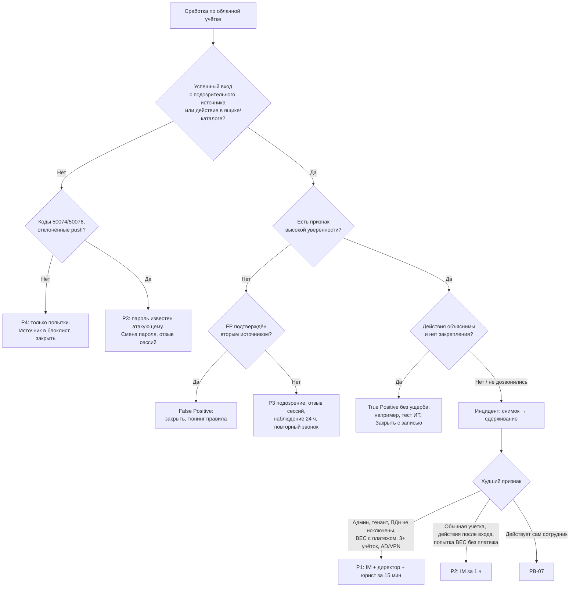

# PB-10 Компрометация облачного аккаунта

> Учебный плейбук для вымышленной компании «Альфа-Трейд». Опирается на IR-план (`source/ir-plan.md`): роли, критичность P1–P4, сроки и каналы связи берутся оттуда. **[проверить]** означает факт, который зависит от продукта, лицензии, редакции закона или версии ATT&CK; перед реальным применением его нужно сверить с первоисточником. **[допущение]** означает то, чего нет в IR-плане, но что типично для компании такого размера. Облачный провайдер почты и файлов в IR-плане не назван. Примеры журналов, полей, запросов и команд даны для Microsoft 365 / Entra ID, потому что у них лучше всего документированы журналы. Для Яндекс 360, VK WorkSpace или Google Workspace эквиваленты (или их отсутствие и компенсирующую меру) нужно записать в приложение к плейбуку на этапе подготовки, а не во время инцидента. Все IP, домены и учётки в примерах вымышленные (`alfa-trade.example`, 203.0.113.0/24, 198.51.100.0/24).

**Главная мысль.** В облаке у атакующего почти никогда нет «только пароля». У него может быть украденная сессия (cookie), токен обновления, OAuth-приложение с согласием пользователя, собственный метод MFA, зарегистрированное устройство или права в тенанте. Каждый из этих путей переживает смену пароля. Поэтому порядок такой: **снять снимок → заблокировать вход и отозвать сессии → убрать все точки закрепления одним окном → найти первопричину и других жертв → закрыть вектор → вернуть доступ с проверкой личности и под наблюдением.**

## 1. Паспорт плейбука

| Поле | Значение |
| --- | --- |
| ID | PB-10 |
| Версия | 1.0 (31.10.2026) |
| Владелец | Руководитель ИБ (IM). Технический соавтор: администратор облака из ИТ |
| Пересмотр | Раз в 6 месяцев, после каждого P1/P2 по сценарию и после смены облачного провайдера или лицензии |
| Стек | Облачная почта и файлы; журналы входов и аудита поступают в SIEM; часть учёток синхронизируется из локального AD **[допущение: гибридная схема; уточнить способ синхронизации]** |
| Критичность по умолчанию | **P2** для подтверждённого входа постороннего в облачную учётку обычного сотрудника. **P3** для подозрения без подтверждения |
| Изменение критичности | **P4:** только неудачные попытки (подбор, spraying), пароль не подошёл. **P3:** пароль известен атакующему (ошибка «требуется MFA», отклонённые push), но успешного входа нет; или вход был, сдержан в течение часа, действий и доступа к данным не найдено. **P2:** подтверждённый вход и хотя бы одно действие (правило, пересылка, рассылка, согласие, метод MFA); попытка BEC без платежа. **P1:** администратор облака или любая привилегированная роль; изменения уровня тенанта (политики доступа, федерация, аудит, транспортные правила, приложения с правами на весь тенант); доступ к ящику или файлам с ПДн клиентов с признаками чтения или синхронизации либо невозможность это исключить; BEC с совершённым платежом или изменёнными реквизитами; 3 и более учётки одной кампанией **[допущение: порог]**; та же учётка использована атакующим в AD или VPN (по IR-плану «затронут AD» = P1). Критичность пересматривается после поиска других жертв и оценки доступа к данным (раздел 8) |
| MITRE ATT&CK | **Initial Access:** T1566.002 Spearphishing Link, T1078.004 Cloud Accounts. **Credential Access:** T1557 Adversary-in-the-Middle (AiTM-фишинг), T1539 Steal Web Session Cookie, T1528 Steal Application Access Token (consent и device code phishing), T1621 MFA Request Generation, T1110.003 Password Spraying, T1110.004 Credential Stuffing. **Defense Evasion:** T1550.001 Application Access Token, T1550.004 Web Session Cookie, T1564.008 Email Hiding Rules, T1070.008 Clear Mailbox Data, T1562.008 Disable or Modify Cloud Logs, T1484.002 Trust Modification. **Persistence / Privilege Escalation:** T1098.001 Additional Cloud Credentials, T1098.002 Additional Email Delegate Permissions, T1098.003 Additional Cloud Roles, T1098.005 Device Registration, T1556.006 Modify Authentication Process: MFA, T1556.007 Hybrid Identity, T1136.003 Create Cloud Account. **Collection:** T1114.002 Remote Email Collection, T1114.003 Email Forwarding Rule, T1530 Data from Cloud Storage. **Lateral Movement:** T1534 Internal Spearphishing. **Impact:** T1656 Impersonation (BEC). Идентификаторы сверить с актуальной версией матрицы **[проверить]** |
| Связанные плейбуки | PB-01 Фишинг (вектор, массовая часть), PB-03 Компрометация учётной записи (AD, VPN, внутренние системы), PB-04 Вредонос на рабочей станции (стилер), PB-05 Утечка данных (ПДн, запускается параллельно), PB-07 Инсайдер, PB-09 Потеря устройства |
| Граница с PB-03 | **PB-10 ведущий**, если активность атакующего видна только в облаке (почта, файлы, приложения, тенант), в том числе у синхронизированной из AD учётки. **PB-03 становится ведущим**, если та же учётка или тот же источник замечены в AD, VPN или внутренних системах; PB-10 при этом продолжает облачную часть (закрепление в облаке, проверка тенанта) |

**Целевые сроки по фазам** (учебные, от сработки T0):

| Этап | P1 | P2 | P3 |
| --- | --- | --- | --- |
| Взятие в работу L1 (IR-план) | 15 мин | 1 ч | 4 ч |
| Триаж и решение TP/FP | +15 мин | +30 мин | +1 ч |
| Снимок состояния учётки | 10 мин, параллельно с эскалацией | 15 мин | 30 мин |
| Блок входа и отзыв сессий после подтверждения TP | ≤ 15 мин | ≤ 30 мин | отзыв сессий ≤ 4 ч |
| Полное сдерживание (все точки закрепления, все учётки) | ≤ 2 ч | ≤ 4 ч | 1 рабочий день |
| Факты о доступе к ПДн переданы DPO | ≤ 4 ч от выявления | ≤ 8–12 ч | 1 рабочий день |
| Финансы и контрагенты при признаках BEC | немедленно (≤ 15 мин) | немедленно | — |
| Полный скоуп (вектор, все жертвы, данные) | 24 ч | 48 ч | 5 рабочих дней |
| Усиленное наблюдение | 30 дней | 30 дней (IOC), 14 дней ручной разбор | 14 дней |

Срок «факты для DPO за 8–12 часов» нужен, чтобы юрист успел подать первичное уведомление в Роскомнадзор в пределах 24 часов с момента выявления (152-ФЗ, ст. 21 ч. 3.1, по IR-плану **[проверить редакцию]**).

## 2. Назначение и область применения

**Цель:** за первый час установить, работает ли посторонний в облачной учётке, отрезать его от **всех** видов доступа одновременно, остановить финансовый ущерб (BEC) и выяснить, что он прочитал, отправил и кого ещё затронул.

**Входит:**

- Учётки сотрудников в облачной почте, файлах, календаре, мессенджере и SSO к другим SaaS через облачный каталог.
- Общие ящики (orders@, support@, info@), сервисные учётки и сервисные принципалы (интеграции с 1С, CRM, выгрузка заказов).
- Администраторы облака и изменения уровня тенанта.
- Векторы: AiTM-фишинг, кража cookie стилером, device code phishing, consent phishing (вредоносное OAuth-приложение), MFA fatigue, password spraying и credential stuffing, вход через устаревшие протоколы (IMAP/POP/SMTP AUTH), социальная инженерия на сервис-деск.
- Последствия: BEC (подмена реквизитов), внутренняя рассылка фишинга, захват внешних сервисов через сброс пароля на почту.

**Не входит:**

- Фишинговое письмо, по ссылке из которого никто не вводил данные: **PB-01**.
- Учётка, активная только в AD, VPN, 1С: **PB-03**.
- Стилер или другой вредонос на ПК: **PB-04** параллельно с этим плейбуком.
- Подтверждённая или не исключённая утечка ПДн: **PB-05** параллельно; PB-10 отвечает за техническую часть, PB-05 за юридический трек.
- Действия самого сотрудника (сам переслал данные себе): **PB-07**.
- Потерянный телефон или ноутбук с активной сессией: **PB-09**.
- Учётки покупателей интернет-магазина: отдельный сценарий, в каталоге пока нет.

**Предусловия (Preparation).** Невыполненный пункт записывается в тикет как ограничение расследования:

- [ ] Включён аудит облака: входы (интерактивные, неинтерактивные, сервисных принципалов), аудит каталога, аудит ящиков и файлов. В Exchange Online аудит ящиков включён по умолчанию **[проверить]**; доступность `MailItemsAccessed` и `SearchQueryInitiatedExchange` зависит от лицензии **[проверить]**
- [ ] Все эти журналы поступают в SIEM и хранятся ≥ 90 дней по IR-плану, лучше 180 дней. Срок хранения у провайдера записан: у Entra ID входы и аудит каталога около 7 дней без P1/P2 и около 30 дней с P1/P2; единый журнал аудита Microsoft 365 около 180 дней в стандартном варианте **[проверить для своей лицензии]**
- [ ] У L2 есть отдельная учётка реагирования с правами на чтение журналов и сдерживание (блок входа, отзыв сессий, удаление методов MFA, правки ящика), защищённая FIDO2-ключом. Права не выдаются «в моменте»
- [ ] Две аварийные (break-glass) учётки глобального администратора: облачные, не синхронизированные из AD, с FIDO2, исключённые из политик, которые может сломать атакующий, с алертом на любой вход
- [ ] Заранее созданы и проверены политики доступа в выключенном или «пустом» состоянии: «SOC-блоклист IP» (именованное расположение, куда L2 добавляет адреса), «блок для группы INC-blocked», «блок device code flow». Ночью их только наполняют или включают
- [ ] Скрипты снимка состояния и сдерживания лежат в репозитории IR и проверены на тестовой учётке; при возможности установлен и проверен набор для массовой выгрузки (например, Microsoft-Extractor-Suite **[проверить актуальность]**)
- [ ] Реестр VIP, финансовых, привилегированных и сервисных учёток, общих ящиков с ПДн и их владельцев
- [ ] Справочник телефонов сотрудников из HR-системы; телефоны ключевых контрагентов (поставщики, логистика, маркетплейсы, платёжный агрегатор, банк) из договоров, а не из писем
- [ ] Контакт банка для приостановки платежа и порядок обращения в поддержку облачного провайдера (номер договора, кто может открыть кейс)
- [ ] Процедура сервис-деска для сброса пароля и MFA с проверкой личности
- [ ] С юристом согласованы момент начала отсчёта 24 часов и объём доступа ИБ к **содержимому** писем сотрудника (тайна переписки; на практике — локальный акт о корпоративной почте и целевой просмотр **[вопрос юристу]**)

## 3. Триггеры и источники обнаружения

| Источник | Что видим | Поля, операции, Event ID (M365 как пример **[проверить]**) | Уверенность / старт |
| --- | --- | --- | --- |
| Аудит почты (UAL → SIEM) | Правило пересылки, удаления или перемещения в RSS / Архив / Журнал бесед; правило по словам «счёт», «оплата», «реквизиты», «invoice»; бессмысленное имя правила («.», «..») | `Operation` = `New-InboxRule`, `Set-InboxRule`, `UpdateInboxRules`; параметры `ForwardTo`, `RedirectTo`, `ForwardAsAttachmentTo`, `DeleteMessage`, `MoveToFolder`, `MarkAsRead`, `SubjectContainsWords` | Высокая, P2 |
| Аудит почты | Пересылка на уровне ящика, выдача FullAccess / SendAs, включение IMAP/POP | `Set-Mailbox` (`ForwardingSmtpAddress`, `DeliverToMailboxAndForward`), `Add-MailboxPermission`, `Add-RecipientPermission`, `Set-CASMailbox` | Высокая, P2 |
| Журнал входов (интерактивные и **неинтерактивные**) | Один `SessionId` с разных ASN за минуты; MFA «пройдена токеном» с нового IP | `SessionId`, `IPAddress`, `AutonomousSystemNumber`, `AuthenticationDetails`, `AuthenticationRequirement` | Высокая (кража сессии, AiTM, стилер), P2 |
| Аудит каталога | Новый метод MFA или устройство вскоре после входа с нового IP | `OperationName` = `User registered security info`, `Register device`, `Add registered owner to device`; `InitiatedBy.user.ipAddress` | Высокая, P2 |
| Аудит каталога | Согласие на приложение с правами на почту и файлы | `Consent to application`, `Add delegated permission grant`; права `Mail.Read`, `Mail.ReadWrite`, `Mail.Send`, `Files.ReadWrite.All`, `offline_access` | Высокая при неверифицированном издателе, P2 |
| Аудит каталога | Новый администратор, изменение политик доступа, федерации, секрет у приложения | `Add member to role`, `Add eligible member to role`, `Update conditional access policy`, `Set federation settings on domain`, `Add service principal credentials` | Высокая, **P1-кандидат** |
| Аудит почты (тенант) | Транспортное правило, коннектор, отключение аудита, поиск eDiscovery | `New-TransportRule`, `New-InboundConnector`, `Set-AdminAuditLogConfig`, `New-ComplianceSearchAction` | Высокая, **P1** |
| Журнал входов | Вход с хостинга/VPS/Tor/анонимайзера; новый ASN, ОС, браузер; нет `deviceId` у пользователя с корпоративным ноутбуком | `AutonomousSystemNumber`, `UserAgent`, `DeviceDetail.deviceId`, `DeviceDetail.isCompliant`, TI по ASN | Средняя, P3 до анализа |
| Журнал входов | Вход через device code flow | `AuthenticationProtocol` = `deviceCode` **[проверить значение]** | Средняя → высокая, если поток в компании не используется |
| Журнал входов | Скриптовый или нехарактерный клиент (python-requests, axios, Azure CLI, Graph Command Line Tools у бухгалтера); устаревший протокол | `UserAgent`, `AppDisplayName`, `ClientAppUsed` = IMAP / POP / SMTP / Other clients | Средняя |
| Журнал входов | Серия отклонённых MFA, затем успех; ошибка «требуется MFA» с чужого IP | `ResultType` 500121, 50074/50076 (см. ниже) | Средняя; пароль уже известен атакующему |
| Журнал входов | Один IP — много пользователей с ошибкой пароля | `ResultType` 50126, `dcount(UserPrincipalName)` | Средняя, P4 → P3 при любом успехе |
| Встроенная защита провайдера | «Аномальный токен», «AiTM», «вредоносный IP», «рискованный пользователь» | `RiskEventType`, `RiskLevel` (Entra ID Protection, лицензия P2 **[проверить]**) | Высокая/средняя по типу |
| Почтовый шлюз, трассировка | Массовая отправка из ящика, всплеск недоставленных (NDR) | Отправитель, число получателей, тема, `EmailDirection` | Высокая, P2 |
| Аудит файлов | Массовое скачивание или синхронизация, анонимные ссылки | `FileDownloaded`, `FileSyncDownloadedFull`, `AnonymousLinkCreated`; порог: > 100 файлов или > 1 ГБ за час с нового IP либо в 10 раз выше 30-дневной нормы **[допущение: настроить под компанию]** | Средняя |
| EDR на ПК пользователя | Стилер, неброузерный процесс читает `Cookies` / `Login Data`, запуск PowerShell/mshta из Win+R (ClickFix) | Сработки EDR; Sysmon 1, 3, 11; PowerShell 4104 | Высокая, параллельно PB-04 |
| Внешние | Контрагент: «просили сменить реквизиты»; банк; сервис мониторинга утечек нашёл учётку в логах стилера | Звонок, письмо, TI | Высокая (BEC) / средняя |
| Пользователь, сервис-деск | «Ночью пришёл запрос на подтверждение входа», «пропадают письма» | Обращение | Средняя; пароль скомпрометирован |
| Журналы AD (гибрид) | Та же учётка входит в домен или VPN с необычных адресов | 4624/4625, 4768/4769/4771, журнал VPN на NGFW | Высокая, переход в PB-03 |

**Коды результата входа Entra ID, которые надо узнавать** **[проверить по официальной таблице AADSTS]**:

| `ResultType` | Значение | Как читать |
| --- | --- | --- |
| 0 | Успех | Ключевое: успешный вход с подозрительного источника |
| 50126 | Неверный логин или пароль | Серия по многим учёткам с одного IP — spraying |
| 50053 | Блокировка (smart lockout) | Подбор |
| 50057 | Учётка отключена | После сдерживания: атакующий ещё пытается — полезно для контроля |
| 50074 / 50076 | Требуется MFA | **Пароль у атакующего верный.** Это не «неудачная попытка»: смена пароля обязательна |
| 500121 | MFA не пройдена | Серия — MFA fatigue |
| 53003 | Заблокировано политикой доступа | Пароль, возможно, верный; спасла политика |
| 50140 | Запрос «Оставаться в системе?» | Обычный промежуточный шаг, не признак атаки |

**Примеры правил детекта** (пример, синтаксис нейтральный; перенести на язык SIEM «Альфа-Трейд»):

```text
# D1. Правило ящика с признаками BEC (псевдо-KQL)
cloud_mail_audit
| where Operation in ("New-InboxRule","Set-InboxRule","UpdateInboxRules","Set-Mailbox")
| where Parameters has_any ("ForwardTo","RedirectTo","ForwardAsAttachmentTo","ForwardingSmtpAddress","DeleteMessage")
     or Parameters has_any ("RSS","Archive","Conversation History","Архив","Журнал бесед")
     or Parameters has_any ("счет","счёт","оплат","реквизит","invoice","payment","взлом","фишинг")

# D2. Одна сессия с нескольких ASN (псевдо-SPL), интерактивные + неинтерактивные входы
index=cloud_signin result=success SessionId=*
| stats dc(asn) AS asns values(src_ip) AS ips values(user_agent) AS uas BY SessionId, user
| where asns > 1
# FP: переключение Wi-Fi ↔ мобильная сеть; хостинг среди ASN — почти наверняка атака

# D3. Новый метод MFA в течение 24 ч после входа с ASN, которого не было 30 дней (Sigma-подобно)
title: MFA method registered after sign-in from new ASN
logsource: { product: cloud_idp, service: directory_audit }   # таксономию сверить
detection:
  registration: { operation: ["User registered security info", "Register device"] }
  condition: registration and correlated_signin.new_asn_30d == true within 24h
level: high
```

## 4. Роли и RACI

R — выполняет, A — утверждает, C — консультирует, I — информируется.

| Действие | L1 | L2 | IM | ИТ (админ облака) | Владелец системы | Юрист/DPO | PR | Директор |
| --- | --- | --- | --- | --- | --- | --- | --- | --- |
| Тикет, обогащение, проверки 5.1, звонок пользователю | R | C | I | | | | | |
| Снимок состояния учётки | | R | I | C | | | | |
| Отзыв сессий при подозрении (P3) | | R/A | I | | | | | |
| Блок входа, отзыв сессий, чистка закрепления у обычной учётки | | R/A | I | C | I (руководитель сотрудника) | | | |
| То же для VIP, финансов, администратора, сервисной учётки | | R | A | R | C | | | I |
| IP атакующего в заранее созданный «SOC-блоклист» | | R/A | I | | | | | |
| Новые или изменённые политики доступа, блок стран | | C | A | R | C | | | |
| Отключение OAuth-приложения во всём тенанте | | R (A, если им пользуется только жертва) | A | R | C | | | |
| Доступ к содержимому писем сотрудника | | R | A | | | C | | |
| Смена пароля, перерегистрация MFA, возврат доступа | | C | I | R | | | | |
| Приостановка платежей, звонок в банк | | C | R | | R (финдиректор, бухгалтерия) | C | | A при крупных суммах |
| Звонки контрагентам | | C | A | | R (менеджер отношений) | C (текст) | C | |
| Решение «есть ли инцидент с ПДн», запуск PB-05 | | C (факты) | R | | | A | I | I |
| Уведомление Роскомнадзора | | C | C | | | R | C | A |
| Отзыв сессий у всех пользователей / администраторов | | C | R | R | | | | A |
| Заявление в полицию | | C (улики) | C | | | R | | A |
| Внешнее сообщение клиентам | | | C | | | C | R | A |
| Обращение в поддержку провайдера, внешняя IR-команда | | R | A | R | | | | I (A по бюджету) |

**Полномочия ночью** (дополнение к правилу IR-плана «L2 сам изолирует одну станцию или блокирует один IP»): при признаке высокой уверенности L2 сам блокирует вход, отзывает сессии и чистит закрепление у **одной** учётки обычного сотрудника и сообщает IM. Для VIP-учётки при активном ущербе (идёт рассылка, готовится платёж) L2 действует сразу и звонит IM параллельно. Всё, что меняет правила для всего тенанта, — только с IM.

## 5. Триаж (первые 15–30 минут)

Цель: ответить на три вопроса. (1) TP или FP? (2) Одна учётка или несколько? (3) Задеты ли привилегии, деньги или ПДн? Решение принимается **по журналам**; звонок пользователю даёт контекст, но не вердикт: жертва AiTM честно скажет «вводил пароль и код как обычно».

### 5.1. Карточка L1

1. **(≤ 5 мин) Тикет.** Сработка, правило, учётка, IP, приложение; время в UTC и UTC+3 (облака пишут в UTC, отчёт IR-плана в UTC+3).
2. **(≤ 3 мин) Контекст учётки.** Где смотреть: HR-справочник, реестр учёток, каталог.
   - Должность и отдел: продажи, поддержка, логистика, бухгалтерия → ящик считается содержащим ПДн клиентов, финансы → риск BEC.
   - VIP? Административные роли? Доступ к общим ящикам? Синхронизирована из AD?
   - Признак: админ-роль → сразу L2 и IM (P1-кандидат).
3. **(≤ 7 мин) Входы за 14–30 дней** (Q1, Q2 в разделе 8), интерактивные **и** неинтерактивные.
   - Есть ли успешный вход с ASN, страны или user-agent, которых не было 30 дней?
   - Тип ASN: хостинг, VPS, Tor, анонимный прокси (признак) или домашний и мобильный провайдер (слабый признак: атакующие используют резидентные прокси в РФ, а геолокация мобильных IP неточна)?
   - Есть ли `deviceId`, управляемое ли устройство?
   - Один `SessionId` с разных ASN (Q3)?
   - Перед успехом были ошибки пароля, отклонённые push, коды 50074/50076?
4. **(≤ 5 мин) Действия после входа** (Q5, Q7, Q8): правила, пересылка, делегирование, согласия OAuth, методы MFA, устройства, массовая отправка — с того же IP или в течение 24 часов.
5. **Проверить признаки FP** и записать, чем подтверждено: IP из списка корпоративных egress/VPN; командировка подтверждена вторым источником (руководитель, заявка); известное утверждённое приложение (CRM, календарь, резервное копирование ящиков); миграция почты; согласованная автопересылка.
6. **Звонок** пользователю по скрипту 5.2. Сам L1 ничего не удаляет и не отключает.

**Признаки высокой уверенности** (любой один = эскалация на L2 немедленно с пометкой «сдерживать до звонка»):

- [ ] правило пересылки, удаления или перемещения в редкие папки; пересылка на уровне ящика;
- [ ] один `SessionId` с разных ASN, один из них хостинг;
- [ ] новый метод MFA или устройство с нового IP;
- [ ] согласие на непроверенное приложение с правами на почту и `offline_access`;
- [ ] вход по device code, если поток в компании не используется;
- [ ] рассылка из ящика, которую пользователь не делал; жалоба контрагента или коллег;
- [ ] встроенная детекция провайдера «аномальный токен» / «AiTM» / «вредоносный IP».

### 5.2. Скрипт звонка

Звонить только по номеру из HR-системы, не из подписи письма. Не писать на скомпрометированную почту и в корпоративный мессенджер на той же учётке: атакующий это увидит. Две попытки с интервалом 5 минут; не дозвонились ночью — решение по журналам. Если есть признаки, что действия совершил сам сотрудник (ветка H), не звонить, сразу IM.

> «Добрый день, это служба ИБ, [имя]. Проверяем вход в вашу учётную запись, ответьте, пожалуйста, на несколько вопросов.»
> 1. Где вы сейчас, через какую сеть работаете, меняли ли телефон или компьютер на днях?
> 2. С каких устройств заходите в почту, включая домашние и личный телефон?
> 3. Приходили ли письма со ссылкой на документ, голосовое сообщение, «подтверждение учётной записи»? Вводили ли пароль после перехода? Когда?
> 4. Были ли запросы на подтверждение входа, которых вы не ждали? Нажимали ли «Подтвердить»?
> 5. Вводили ли код с экрана на странице входа по чьей-то просьбе?
> 6. Давали ли приложению доступ к почте или файлам?
> 7. Устанавливали ли программы, расширения, вставляли ли команду, чтобы «пройти проверку»?
> 8. Не пропадали ли письма, не жаловались ли партнёры на странные письма?

Пользователю сказать: «Не удаляйте письма, не выключайте компьютер, не меняйте пароль сами до звонка ИБ, не обсуждайте это по почте». Самостоятельная смена пароля не убивает токены и ломает скоординированное сдерживание. Ответы дословно в тикет. «Да» на вопросы 4–6 означает TP.

### 5.3. Дерево решений



Правила к дереву: «это был я» не закрывает тикет, если есть объективные противоречия (другое устройство, правило, новый метод MFA). Пользователь подтвердил push, но не входил — это TP.

### 5.4. Ветки сценария

| Ветка | Признак | Чем отличаются действия |
| --- | --- | --- |
| A. Только вход, действий нет | Успешный вход, закрепления не найдено | Ранняя стадия: стандартное сдерживание, поиск вектора и других жертв |
| B. Закрепление в ящике | Правила, пересылка, делегирование | Снимок до чистки обязателен; ключевые слова правил показывают, что искал атакующий |
| C. Consent phishing | Согласие на вредоносное приложение | Пароль мог не утечь. Главное — отключить приложение во всём тенанте и найти всех, кто дал согласие |
| D. AiTM / кража cookie / стилер | Один `SessionId` с разных ASN; MFA «выполнена токеном»; сработка EDR | Проверка всех устройств пользователя в EDR; при стилере PB-04 и смена всех паролей из браузера, включая банк-клиент и маркетплейсы |
| E. Device code phishing | `AuthenticationProtocol = deviceCode` | Токены получены через легитимную страницу провайдера; устранение — политика блока device code flow |
| F. Spraying / stuffing | Один IP — много учёток | Скорее всего, затронуто несколько учёток: Q13, Q14 по всем |
| G. BEC | Правила со словами «счёт/оплата», письма о смене реквизитов, жалоба контрагента | Финансы и банк немедленно, контрагенты по телефону; P1 при платеже или изменённых реквизитах |
| H. Внутренняя рассылка | Письма коллегам с той же ссылкой | Найти получателей и кликнувших, удалить письма после сохранения образца, массовая часть в PB-01 |
| I. ПДн | Ящик продаж/поддержки, общие ящики, выгрузки клиентов | DPO сразу, P1 до опровержения, PB-05 параллельно |
| J. Администратор облака | Роль, изменения тенанта | P1, резервный канал, работа с break-glass, проверка тенанта (6.4) |
| K. Гибридная учётка | Синхронизирована из AD | Блок и пароль в AD, синхронизация, проверка AD/VPN; при находках ведущий PB-03 |
| L. Сервисная учётка / принципал | Интеграция, секрет приложения | Не отключать без владельца системы (остановится выгрузка заказов); ротация секрета |

### 5.5. Критерии эскалации

- **L1 → L2 немедленно:** любой признак высокой уверенности; пользователь не дозвонился, а признаки есть; финансы с признаками BEC.
- **L1/L2 → IM за 15 минут, круглосуточно:** любой признак P1; ветки G (с платежом), I, J, K с активностью в AD; 3+ учётки.
- **L2 → IM за 1 час:** подтверждённый P2.
- **IM → директор и юрист за 15 минут:** P1. **IM → DPO:** сразу, как только у учётки был доступ к ПДн, не дожидаясь подтверждения чтения. **IM → финдиректор:** сразу при признаках BEC.

## 6. Сдерживание

**Принцип:** сначала сохранить, потом удалять; все точки доступа закрываются одним окном 15–30 минут. Если чистить по частям, атакующий с активной сессией заметит удалённое правило и создаст новое, добавит ещё один метод MFA или переключится на другую учётку.

**Исключение:** при активном ущербе (идёт рассылка, готовится платёж, массовая выгрузка) блок входа и отзыв сессий делаются **до** снимка. Эти два действия почти не уничтожают улики: журналы остаются у провайдера. Правила, методы MFA и согласия удаляются только после экспорта.

**Наблюдение вместо сдерживания** допустимо только по решению IM, на ограниченное время и при отсутствии активного ущерба (например, P1 с несколькими точками закрепления, пока собирается полный список). По умолчанию для компании такого размера — быстрое сдерживание.

### 6.1. Шаг 0: снимок состояния (только чтение, 5–10 минут)

```powershell
# Пример для M365; имена командлетов и параметров [проверить]
$case = "INC-2026-XXX"; $u = "i.petrova@alfa-trade.example"
$out  = "E:\IR\$case\$(Get-Date -AsUTC -Format yyyyMMddTHHmmssZ)"; New-Item -ItemType Directory $out | Out-Null
Connect-ExchangeOnline
Get-InboxRule -Mailbox $u -IncludeHidden | Select-Object * | Export-Clixml "$out\inboxrules.xml"
Get-Mailbox $u | Select-Object Forwarding*,DeliverToMailboxAndForward,GrantSendOnBehalfTo | Export-Clixml "$out\forwarding.xml"
Get-MailboxPermission $u | Export-Clixml "$out\mbx-perms.xml"
Get-RecipientPermission $u | Export-Clixml "$out\sendas.xml"
Get-CASMailbox $u | Select-Object * | Export-Clixml "$out\protocols.xml"
Get-MobileDevice -Mailbox $u | Select-Object * | Export-Clixml "$out\mobile.xml"
Connect-MgGraph -Scopes "AuditLog.Read.All","Directory.Read.All","UserAuthenticationMethod.Read.All"
$id = (Get-MgUser -UserId $u).Id
Get-MgUserAuthenticationMethod -UserId $id | Export-Clixml "$out\authmethods.xml"
Get-MgUserRegisteredDevice -UserId $id     | Export-Clixml "$out\devices.xml"
Get-MgOauth2PermissionGrant -Filter "principalId eq '$id'" | Export-Clixml "$out\oauth-grants.xml"
Get-MgUserAppRoleAssignment -UserId $id    | Export-Clixml "$out\app-assignments.xml"
Get-MgUserMemberOf -UserId $id             | Export-Clixml "$out\memberof.xml"
Get-ChildItem $out | Get-FileHash -Algorithm SHA256 | Export-Csv "$out\hashes.csv" -NoTypeInformation
```

### 6.2. Краткосрочное сдерживание одной учётки

| № | Действие | Кто | Инструмент / команда (M365 **[проверить]**) | Апрув |
| --- | --- | --- | --- | --- |
| 1 | Заблокировать вход | L2; для гибридной учётки ИТ в AD | `Update-MgUser -UserId $id -AccountEnabled:$false`; гибрид: `Disable-ADAccount` + `Start-ADSyncSyncCycle -PolicyType Delta` | L2; VIP и сервисные — IM |
| 2 | Отозвать сессии и токены обновления | L2 | `Revoke-MgUserSignInSession -UserId $id` | L2 |
| 3 | Отключить вредоносное приложение, удалить согласия | L2 / ИТ | `Update-MgServicePrincipal -ServicePrincipalId <sp> -AccountEnabled:$false`; `Remove-MgOauth2PermissionGrant` | IM, если приложением пользуются другие |
| 4 | Удалить методы MFA и отключить устройства атакующего (после снимка). Не отличить свои от чужих — удалить все, перерегистрация в разделе 10 | L2 | `Remove-MgUserAuthentication…Method`; `Update-MgDevice -AccountEnabled:$false` | L2 |
| 5 | Ящик: сначала `Disable-InboxRule`, затем удалить после экспорта; снять пересылку и делегирование; отключить IMAP/POP/EWS, пароли приложений, лишние ActiveSync | L2 | `Set-Mailbox $u -ForwardingSmtpAddress $null -DeliverToMailboxAndForward $false`; `Remove-MailboxPermission`; `Remove-RecipientPermission`; `Set-CASMailbox $u -ImapEnabled $false -PopEnabled $false` | L2 |
| 6 | Файлы: отозвать анонимные ссылки, созданные атакующим; отключить приглашённых им гостей и созданные учётки | L2 / ИТ | Консоль файлового сервиса | L2; удаление — IM |
| 7 | IP и подсети атакующего — в «SOC-блоклист» политики доступа; фишинговый домен — на почтовом шлюзе, прокси, DNS, NGFW | L2 | Именованное расположение; шлюз; NGFW | L2 (заранее созданная политика) |
| 8 | Сообщить сервис-деску: «учётку не разблокировать, MFA не сбрасывать без ИБ» | L2 | Чат сервис-деска | — |
| 9 | Стилер: изолировать ПК пользователя в EDR | L2 | Консоль EDR, PB-04 | L2 (IR-план) |
| 10 | Смена пароля и перерегистрация MFA — после проверки устройств, раздел 10 | ИТ | — | — |

**Гибридная учётка.** Признак «включена» и пароль управляются из AD: отключение в облаке может быть перезаписано следующим циклом синхронизации, а сброс только в облаке может не сработать **[проверить поведение для вашей схемы синхронизации и writeback]**. При синхронизации хешей пароль в AD тот же, что в облаке, значит доменная учётка тоже скомпрометирована: проверить входы в домен и VPN (4624/4625/4768/4769, журнал VPN на NGFW) и при находках передать ведущую роль PB-03. Отзыв сессий в облаке делается всегда отдельно.

### 6.3. Ветка G: BEC

1. IM в течение 15 минут связывается с финансовым директором или главным бухгалтером: приостановить платежи по реквизитам, полученным или изменённым по почте за период компрометации; проверить платежи за 30 дней.
2. Если платёж ушёл — немедленный звонок в свой банк; шансы задержать перевод падают с каждым часом **[механизмы отзыва межбанковских платежей юрлиц ограничены, уточнить у банка]**.
3. Менеджер отношений звонит контрагентам по номерам из договора или CRM (шаблон в разделе 11).
4. L2 находит все письма атакующего контрагентам (Q11), домены-двойники (`a1fa-trade.example`) и блокирует их на шлюзе.

### 6.4. Ветка J: администратор облака (P1)

1. IM объявляет P1, переход в резервный канал связи, уведомление директора и юриста.
2. Работать только с break-glass или заведомо чистой учётки SOC с FIDO2, с чистого устройства. Не использовать скомпрометированную учётку и её сессии.
3. Блок и отзыв сессий скомпрометированного администратора; сравнить список всех администраторов (активных и назначаемых через PIM) с утверждённым, лишних — заблокировать.
4. Снять конфигурацию тенанта до изменений и проверить по чек-листу:
   - [ ] назначения ролей за 30–90 дней; новые пользователи и гости;
   - [ ] приложения и сервисные принципалы: новые, с новыми секретами или сертификатами, с прикладными правами на почту и файлы, admin consent;
   - [ ] политики доступа: изменённые, отключённые, новые исключения;
   - [ ] домены: новые, изменения федерации и способа аутентификации;
   - [ ] транспортные правила, коннекторы, удалённые домены (автопересылка);
   - [ ] состояние аудита, обход аудита ящиков, поиски и экспорты eDiscovery;
   - [ ] партнёрский (делегированный) доступ, автоматизации и подписки API;
   - [ ] настройки самообслуживания сброса пароля и методов MFA.
5. Откатить найденное, ротировать секреты всех приложений, которые мог видеть атакующий.
6. Если масштаб не ясен или атакующий активен — отзыв сессий у всех администраторов или у всех пользователей (IM + директор: это остановит работу на время повторного входа). Рассмотреть поддержку провайдера и внешнюю IR-команду.

### 6.5. Долгосрочное сдерживание

- Учётка остаётся в группе «INC-blocked» под отдельной политикой, пока не выполнен раздел 10.
- Временная политика для пострадавших: вход только с управляемого устройства.
- IOC инцидента в списках наблюдения SIEM.
- Блок стран и изменение базовых политик — только как долгосрочная мера по решению IM и руководителя ИТ, не ночью.

### 6.6. Контроль эффективности

Через 15 и через 90 минут после отзыва: Q1 и Q13 по IP атакующего. Ожидаются только неуспешные входы (50057, 53003). Уже выданный токен доступа может работать до истечения срока, порядка 60–90 минут, там, где нет непрерывной оценки доступа (CAE) **[проверить]**. Активность в этот час ожидаема, после него — тревога и поиск пропущенной точки закрепления.

### 6.7. Что НЕ делать

- Не удалять правила, приложения, устройства и учётки атакующего до экспорта; созданное атакующим сначала **отключать**.
- Не связываться с пользователем через его почту или мессенджер на той же учётке.
- Не считать блокировку IP на NGFW сдерживанием: атакующий ходит в облако напрямую, не через периметр компании. NGFW помогает только против VPN и фишинговых доменов.
- Не блокировать страны ночью: атакующий с российского резидентного прокси этого не заметит, а сотрудники в командировках останутся без почты.
- Не чистить тенант из-под скомпрометированной админ-учётки.
- Не отключать сервисную учётку или популярное приложение для всех без владельца системы и IM.
- Не удалять фишинговые письма у получателей до сохранения 1–2 образцов в .eml/.msg с хешем; удалять мягко.
- Не сбрасывать пароль, пока не проверены устройства пользователя: стилер украдёт новый.

## 7. Сбор и сохранение артефактов

Порядок — по летучести: сначала то, что исчезнет со сроком хранения или будет изменено сдерживанием.

| Приоритет | Артефакт | Почему срочно | Как сохранить | Глубина |
| --- | --- | --- | --- | --- |
| 1 | Снимок состояния учётки (6.1) | Изменится при сдерживании | Export-Clixml/JSON, SHA-256 | На момент обнаружения |
| 2 | Журналы входов: интерактивные, неинтерактивные, сервисных принципалов — по пользователю и по IP атакующего | Живут у провайдера 7–30 дней **[проверить]** | Выгрузка из SIEM; если в SIEM их нет — у провайдера **в первый час** (`Get-MgAuditLogSignIn`) | Максимум доступного, не меньше 30 дней до первой аномалии |
| 3 | Аудит каталога | То же | `Get-MgAuditLogDirectoryAudit` / SIEM | То же |
| 4 | Трассировка сообщений из ящика и в ящик | Быстрый поиск около 10 дней, исторический до 90 **[проверить]** | `Get-MessageTraceV2` **[проверить]** | Период компрометации + 7 дней |
| 5 | Единый журнал аудита по пользователю и по IP атакующего | Около 180 дней | `Search-UnifiedAuditLog … -SessionCommand ReturnLargeSet`, постранично до пустого результата | 90 дней, при BEC 90+ |
| 6 | Исходное фишинговое письмо и письма атакующего от имени жертвы | Атакующий удаляет следы | .eml/.msg с заголовками, не скриншот | 1–2 образца каждого вида |
| 7 | Список согласий и сервисных принципалов тенанта; для ветки J — конфигурация тенанта | Изменится при сдерживании | Graph-выгрузка | На момент обнаружения |
| 8 | Триаж-пакет с ПК пользователя (история браузера, загрузки, автозапуск, Prefetch, PowerShell) | Пропадёт при переустановке | Коллектор EDR, по PB-04 | 30 дней |
| 9 | Журналы почтового шлюза, прокси, DNS по фишинговому домену | Ротация | Выгрузка из SIEM | Период кампании |
| 10 | Записи звонков: время, вопросы, ответы | — | В тикет | — |

**Цепочка хранения:** в тикете таблица «артефакт — кто выгрузил — когда (UTC) — откуда — команда — SHA-256 — где хранится — кто имел доступ». Папка инцидента на защищённом ресурсе с доступом только у команды реагирования. Все времена в UTC с UTC+3 рядом; часовой пояс EDR указывать явно. Для полиции скриншоты консоли полезны, но не заменяют выгрузки.

## 8. Расследование

Каждый ответ записывается в тикет со временем, источником и ссылкой на запрос.

| Вопрос | Как ответить, где смотреть |
| --- | --- |
| **Когда и как вошли?** Первый подозрительный успешный вход, тип аутентификации, чем пройдена MFA | Q1–Q4: журнал входов; `AuthenticationDetails`, `AuthenticationProtocol`, `AuthenticationRequirement` |
| **Откуда учётные данные?** | Почтовый шлюз: письма со ссылками за 72 ч до первого входа; прокси/DNS: кто открыл домен; EDR: стилер (Q16); Q14: spraying; Q4, Q7: device code, consent |
| **Как закрепились?** | Q5, Q7, Q8; для админа Q9 и чек-лист 6.4 |
| **К каким данным был доступ?** | `MailItemsAccessed` (Bind — открыто письмо, Sync — синхронизирована папка) с привязкой к сессии/IP атакующего **[проверить доступность]**; Q10 по файлам; ключевые слова правил. Нет данных — считать прочитанным весь ящик |
| **Что сделали от имени жертвы?** | Q11: отправленные письма, получатели; `SoftDelete`/`HardDelete`; письма со словами «реквизиты», «счёт», «оплата» |
| **Кто ещё пострадал?** | Q13 (IP/ASN по всем учёткам), Q15 (то же приложение), Q6 (похожие правила), получатели внутренней рассылки, кликнувшие |
| **Что захвачено через почту?** | Q12: письма о сбросе пароля и коды от маркетплейсов, регистратора домена, хостинга, банка, платёжного агрегатора, CRM за период компрометации |
| **Гибрид:** та же учётка в AD? | DC: 4624/4625, 4768/4769/4771, 4723/4724, 4738/4740; журнал VPN на NGFW |
| **Хронология** | Первая аномалия может быть за недели до сработки: поиск назад ≥ 30 дней, при BEC 90 |

**Запросы** (KQL для Microsoft Sentinel / Defender XDR как иллюстрация логики; для другой SIEM переписать **[проверить имена таблиц и полей]**):

```kusto
// Q1. Лента входов пользователя
let upn = "i.petrova@alfa-trade.example";
union (SigninLogs | extend Kind="interactive"), (AADNonInteractiveUserSignInLogs | extend Kind="non-interactive")
| where TimeGenerated > ago(30d) and UserPrincipalName =~ upn
| project TimeGenerated, Kind, ResultType, IPAddress, AutonomousSystemNumber, AppDisplayName,
          ClientAppUsed, UserAgent, DeviceDetail, AuthenticationRequirement, AuthenticationDetails,
          ConditionalAccessStatus, SessionId
| order by TimeGenerated asc

// Q2. ASN, которых не было у пользователя 30 дней
let upn = "i.petrova@alfa-trade.example";
let known = SigninLogs | where TimeGenerated between (ago(32d)..ago(2d)) and UserPrincipalName =~ upn
            and ResultType == "0" | distinct AutonomousSystemNumber;
union SigninLogs, AADNonInteractiveUserSignInLogs
| where TimeGenerated > ago(2d) and UserPrincipalName =~ upn and ResultType == "0"
| where AutonomousSystemNumber !in (known)
| summarize first=min(TimeGenerated), ips=make_set(IPAddress), apps=make_set(AppDisplayName) by AutonomousSystemNumber

// Q3. Одна сессия с нескольких ASN (кража cookie/токена)
union SigninLogs, AADNonInteractiveUserSignInLogs
| where TimeGenerated > ago(14d) and isnotempty(SessionId)
| summarize asns=dcount(AutonomousSystemNumber), ips=make_set(IPAddress), users=make_set(UserPrincipalName) by SessionId
| where asns > 1

// Q4. Device code
SigninLogs | where TimeGenerated > ago(30d) and AuthenticationProtocol =~ "deviceCode"
| project TimeGenerated, UserPrincipalName, IPAddress, AppDisplayName, ResultType, UserAgent

// Q5. Правила, пересылка, делегирование у пользователя
OfficeActivity | where TimeGenerated > ago(90d)
| where Operation in ("New-InboxRule","Set-InboxRule","UpdateInboxRules","Set-Mailbox",
                      "Add-MailboxPermission","Add-RecipientPermission","Set-CASMailbox")
| where UserId =~ "i.petrova@alfa-trade.example" or Parameters has "i.petrova"
| project TimeGenerated, UserId, ClientIP, Operation, Parameters

// Q7. Согласия OAuth и учётные данные приложений
AuditLogs | where TimeGenerated > ago(90d)
| where OperationName in ("Consent to application","Add delegated permission grant",
        "Add app role assignment to service principal","Add service principal credentials")
     or OperationName startswith "Update application"
| project TimeGenerated, OperationName, InitiatedBy, TargetResources

// Q8. Методы MFA и устройства
AuditLogs | where TimeGenerated > ago(30d)
| where OperationName has_any ("security info","Register device","Add device","registered owner to device")
| project TimeGenerated, OperationName, ActorIP=tostring(InitiatedBy.user.ipAddress), TargetResources

// Q13. Инфраструктура атакующего по всем учёткам
let bad_ips = dynamic(["203.0.113.10","198.51.100.7"]);
union SigninLogs, AADNonInteractiveUserSignInLogs
| where TimeGenerated > ago(30d) and IPAddress in (bad_ips)
| summarize ok=countif(ResultType=="0"), mfa_needed=countif(ResultType in ("50074","50076")),
            failed=countif(ResultType !in ("0","50074","50076")) by UserPrincipalName
// ok > 0 — компрометация; mfa_needed > 0 — пароль известен; только failed — попытка
```

Остальные запросы строятся по тому же образцу: **Q6** — D1 из раздела 3 по всему тенанту; **Q9** — `AuditLogs` по операциям ролей, политик, доменов и федерации; **Q10** — `OfficeActivity` по `FileDownloaded`, `FileSyncDownloadedFull`, `AnonymousLinkCreated` с группировкой по IP; **Q11** — `EmailEvents` или трассировка по отправителю; **Q12** — входящие письма с темами «сброс пароля», «код подтверждения», «новое устройство»; **Q14** — один IP, ≥ 10 пользователей с 50126; **Q15** — входы с `AppId` вредоносного приложения плюс фактический список согласий через Graph; **Q16** — в EDR неброузерный процесс обращается к `Cookies`, `Login Data`, `Local State` в профилях Chrome, Edge, Яндекс.Браузера, Firefox (чтение файлов EDR пишет не всегда, поэтому смотреть и новые процессы из `%APPDATA%`/`%TEMP%` с сетевой активностью).

**Формулировка для IM и DPO** (от неё зависит PB-05):

> «С ___ по ___ (UTC) атакующий имел доступ к ___. Подтверждено: чтение ___ писем / синхронизация ящика целиком / скачивание ___ файлов / пересылка ___ писем на ___. Категории данных: ___. ПДн клиентов или сотрудников: да / нет / не исключено.»

«Да» или «не исключено» означает P1 и PB-05; время выявления фиксируется в тикете как начало отсчёта 24 часов **[момент выявления трактует юрист]**. Если в письмах найдены пароли и API-ключи, инцидент расширяется на эти системы.

## 9. Устранение

Устранение отвечает на вопрос «как именно обошли защиту». «Включить MFA» не подходит: MFA в «Альфа-Трейд» уже есть, и её обошли.

| Вектор | Что закрыть |
| --- | --- |
| AiTM, кража cookie | Фишингоустойчивая MFA (FIDO2, passkeys, Windows Hello for Business) — сначала админы, финансы, руководство, поддержка с ПДн; доступ к почте только с управляемого устройства; привязка токенов к устройству и CAE, где доступно **[зависит от лицензии и провайдера]** |
| Device code phishing | Политика блока device code flow для всех, кроме явно нужных групп **[проверить доступность]** |
| Consent phishing | Запрет пользовательских согласий (или только верифицированные издатели и низкорисковые права), процесс согласования администратором, обзор приложений; отключить и после разбора удалить вредоносное приложение |
| Spraying, stuffing | Блок устаревших протоколов и паролей приложений, проверка паролей по спискам утечек, smart lockout |
| MFA fatigue | Сопоставление чисел и контекст в push (в Microsoft Authenticator включено принудительно **[проверить]**), отказ от SMS и голоса, обучение «неожиданный запрос = звонок в ИБ» |
| Стилер | Переустановка ПК (PB-04), смена всех паролей из браузера, запрет сохранения корпоративных паролей в браузере, ограничение доступа с личных устройств |
| Социальная инженерия на сервис-деск | Сброс MFA только с проверкой личности (раздел 10) |
| Администратор (ветка J) | Отдельные админ-учётки, PIM/JIT, минимум глобальных администраторов, break-glass |

Сопутствующее: сменить пароли во внешних сервисах из Q12 и там, где сотрудник использовал тот же пароль; ротировать секреты, найденные в ящике и файлах; ротировать секреты сервисных принципалов (ветка L) по согласованию с владельцем системы.

## 10. Восстановление и мониторинг после инцидента

**Возврат доступа пользователю:**

1. Устройства пользователя проверены в EDR или переустановлены.
2. Личность подтверждена: лично с документом или видеозвонок плюс подтверждение руководителя. Не по звонку с незнакомого номера.
3. Все старые методы MFA удалены; выдан временный пароль доступа (TAP) с коротким сроком; пользователь сам регистрирует новые методы, по возможности FIDO2/passkey.
4. Новый пароль, не связанный со старым; для гибридной учётки — смена в AD. Пароль передаётся лично или по телефону, не по почте.
5. Учётка включена; первый вход под наблюдением L2 (Q1 в течение часа).
6. Владелец системы подтверждает работу интеграций (ветка L).

**Что мониторить:**

| Что | Как | Сколько |
| --- | --- | --- |
| Входы с IOC инцидента (IP, ASN, user-agent, AppId) по всему тенанту | Правило SIEM | 30 дней |
| Новые правила, пересылка, делегирование, методы MFA, устройства, согласия у пострадавших и у получателей фишинга | Правило SIEM с высоким приоритетом | 30 дней |
| Входы пострадавших без `deviceId` или с нового ASN | Ежедневный ручной разбор L2 | 14 дней (P2), 30 дней (P1) |
| Отправка на адреса пересылки атакующего и домены-двойники | Почтовый шлюз | 30 дней |
| Изменения уровня тенанта (ветка J) | Правило SIEM, ежедневный обзор | 30 дней, затем постоянное правило |
| Контрольный поиск Q13 по всем учёткам | Вручную | через 24–48 ч и через 7 дней |

## 11. Коммуникации и уведомления

**Правила канала:** пока учётка не сдержана, не писать пользователю на его почту и в мессенджер того же облака. При компрометации администратора облака всё обсуждение — только в резервном канале (IR-план). Заявки сервис-деска по инциденту не должны отправлять уведомления на скомпрометированный ящик. Ритм статусов: P1 каждые 2 часа, P2 дважды в день.

| Кому | Когда | Как | Кто |
| --- | --- | --- | --- |
| IM | P1 — 15 мин, P2 — 1 ч | Звонок + рабочий канал | L2 |
| Директор, юрист | P1 — 15 мин | Звонок | IM |
| DPO / юрист | Сразу, как только у учётки был доступ к ПДн | Звонок | IM |
| Финдиректор, бухгалтерия | Сразу при признаках BEC | Звонок | IM |
| Руководитель сотрудника | При блокировке в рабочее время (замена, контекст) | Звонок | IM |
| ИТ / сервис-деск | Сразу после блокировки | Чат | L2 |
| Коллеги — получатели внутреннего фишинга | После удаления писем | Сообщение от IM / ИТ | IM |
| Контрагенты | Сразу после сдерживания при рассылке или BEC | Звонок по известному номеру, затем письмо с незатронутого ящика | IM, текст — юрист |
| Клиенты | Если фишинг или ПДн затронули клиентов | Через PR | PR + юрист |
| Роскомнадзор | 24 ч первичное, 72 ч результаты (152-ФЗ ст. 21 ч. 3.1 **[проверить]**) | По PB-05 | DPO / юрист |
| ГосСОПКА | Обязанность операторов ПДн информировать о компьютерных инцидентах с неправомерной передачей ПДн (152-ФЗ ст. 19 ч. 12, приказ ФСБ **[проверить номер, сроки и применимость]**) | По PB-05 | Юрист |
| Полиция | При хищении денег (ст. 159.6, 272 УК РФ) | По решению директора | Юрист |

**Шаблон для контрагента** (звонок, затем письмо с другого ящика):

> «Здравствуйте, это [ФИО, должность], ООО «Альфа-Трейд». С [дата, время] по [дата, время] почтовым ящиком нашего сотрудника [ФИО, адрес] пользовались посторонние. Если в этот период вы получали с этого адреса письма о смене реквизитов, счета, ссылки или вложения — пожалуйста, не выполняйте платежи, не открывайте ссылки и сообщите нам по телефону [номер]. Наши реквизиты не менялись. Любые изменения реквизитов подтверждайте только звонком по номеру из договора.»

**Шаблон для пользователя:**

> «Ваша учётная запись временно заблокирована, потому что ей воспользовался посторонний. Это не ваша вина, но действовать нужно быстро. Не удаляйте письма и файлы, не выключайте рабочий компьютер, не обсуждайте ситуацию по почте. Специалист ИБ свяжется с вами по телефону и поможет восстановить доступ. Если этот пароль использовался где-то ещё, в том числе в личных сервисах, смените его там.»

**Шаблон для коллег-получателей:**

> «Вам приходило письмо от [имя] с темой [тема]. Письмо отправил посторонний, оно уже удалено. Если вы открывали ссылку или вводили пароль, срочно позвоните в ИБ по номеру [номер].»

**Статус для IM и директора:** что известно (вектор, учётки, данные), что сделано (со временем), что дальше, какие решения нужны (контрагенты, платежи, Роскомнадзор, отзыв сессий тенанта).

## 12. Критерии закрытия

Инцидент закрывает IM, когда выполнены все пункты:

- [ ] Вектор первичного доступа установлен (AiTM, стилер, spraying, consent, device code, другое) или записано «не установлен» с обоснованием
- [ ] Все учётки с индикаторами атакующего найдены (Q13, Q15, получатели внутреннего фишинга) и сдержаны
- [ ] У каждой учётки проверено и записано отсутствие: правил и пересылки атакующего, делегирования, его методов MFA и устройств, паролей приложений, согласий подозрительным приложениям, анонимных ссылок, лишних протоколов
- [ ] Ветка J: тенант проверен по чек-листу 6.4, изменения атакующего откатаны, секреты приложений ротированы, список администраторов совпадает с утверждённым
- [ ] Устройства пользователей проверены или переустановлены, PB-04 закрыт
- [ ] Пароли сменены (в облаке и в AD), MFA перерегистрирована с проверкой личности
- [ ] Внешние сервисы из Q12 проверены, пароли сменены; секреты из ящика ротированы
- [ ] Вектор закрыт мерой из раздела 9 или открыта задача с ответственным и сроком
- [ ] Решение DPO о ПДн записано; уведомления отправлены в срок или обосновано, почему не нужны
- [ ] Финансы и контрагенты уведомлены, статус платежей записан
- [ ] Артефакты собраны, хеши и цепочка хранения заполнены
- [ ] Правила наблюдения работают, 30 дней без повторной активности (пока идёт срок, тикет в статусе «наблюдение»)
- [ ] Назначен разбор в течение 5 рабочих дней (IR-план), отчёт по шаблону IR-плана

## 13. Метрики

| Метрика | Как считать | Ориентир для учений |
| --- | --- | --- |
| Dwell time / MTTD | От первой аномальной активности (часто до сработки) до обнаружения | Цель — часы, не дни |
| Время до сдерживания | От сработки до отзыва сессий | P1 ≤ 30 мин, P2 ≤ 1 ч |
| MTTR | От обнаружения до возврата доступа пользователю с закрытым вектором | ≤ 3 рабочих дней для P2 |
| Полнота сдерживания | Доля точек закрепления, найденных до первого контроля (6.6) | 100 %; каждая найденная позже — разбор |
| Источник обнаружения | СЗИ / пользователь / контрагент | Доля «контрагент сообщил» должна падать |
| Масштаб | Число затронутых учёток, писем, файлов; были ли ПДн | — |
| Финансовый ущерб | Сумма ушедших платежей и возвращённых | 0 ₽ ушедших |
| Повторная компрометация | Повтор у той же учётки или по тем же IOC за 90 дней | 0 |
| Соблюдение сроков | Факты DPO ≤ 12 ч, уведомление РКН ≤ 24 ч | 100 % |

## 14. Типичные ошибки и ловушки

1. Сбросили пароль, но оставили OAuth-приложение: ему пароль не нужен.
2. Сбросили пароль, но не отозвали сессии: украденный cookie работает дальше.
3. Отозвали сессии, но оставили чужой метод MFA или устройство: атакующий вернётся через самообслуживание сброса пароля.
4. Удалили правила до экспорта: неизвестно, что искал атакующий и куда уходила почта.
5. Чистили по частям: атакующий увидел и создал запасной доступ.
6. Сменили пароль в облаке у учётки, синхронизированной из AD; доменная учётка с тем же паролем осталась у атакующего.
7. Написали пользователю на взломанную почту.
8. Заблокировали IP на NGFW или страну через политику и посчитали, что сдержали.
9. Не посмотрели неинтерактивные входы, где видно использование украденного токена.
10. Решили «это был он сам», потому что пользователь подтвердил вход; при AiTM он действительно его делал.
11. Не проверили ноутбук пользователя: стилер украл новый пароль через день.
12. Отозвали согласие у одного пользователя и забыли остальных.
13. Не поискали других жертв и получателей внутреннего фишинга.
14. Не проверили письма о сбросе паролей: атакующий остался в кабинете маркетплейса или у регистратора домена.
15. Сервис-деск сбросил MFA по звонку «от сотрудника», а звонил атакующий.
16. DPO узнал на второй день, срок уведомления Роскомнадзора пропущен.
17. Ответили контрагенту в скомпрометированную ветку переписки, ответ увидел атакующий.
18. Посчитали код 50074 «неудачной попыткой», а пароль уже у атакующего.
19. Перепутали часовые пояса: облако в UTC, тикет в UTC+3, и хронология развалилась.

## 15. Меры по предотвращению и улучшению защиты

**Идентификация и доступ:**

- Фишингоустойчивая MFA поэтапно для всех; number matching для push; отказ от SMS и голоса, где возможно.
- Политики доступа: блок устаревших протоколов, блок device code flow, доступ к почте с управляемых устройств или через браузер без скачивания, CAE и привязка токенов к устройству **[зависит от лицензии]**.
- Регистрация методов MFA только из доверенной сети или с TAP, выданным сервис-деском.
- Отдельные админ-учётки, PIM/JIT, break-glass с алертом.
- Запрет пользовательских согласий и регистрации приложений пользователями; процесс согласования администратором.

**Почта:**

- Запрет автопересылки во внешние домены на уровне политики исходящей почты, исключения по заявке.
- SPF, DKIM, DMARC с `p=reject` для своего домена; мониторинг доменов-двойников; метка «внешний отправитель».
- Организационное правило: смена реквизитов контрагента подтверждается только звонком по номеру из договора. Это самая эффективная мера против BEC.

**Детект и журналы:**

- Журналы облака в SIEM ≥ 180 дней; правила D1–D3 и Q3, Q4, Q6, Q14 как постоянные; алерт на вход break-glass и изменения тенанта.
- Корреляция сработок EDR (стилер) с облачными входами того же пользователя.
- Подписка на мониторинг учёток сотрудников в утечках и логах стилеров.

**Люди и учения:**

- Обучение на примерах AiTM-страниц, запросов device code и consent; учебные рассылки с этими техниками.
- Tabletop по PB-10 раз в год (IR-план: учения ежеквартально по одному из плейбуков), практическая часть в тестовом тенанте.

## 16. Учебная мини-ситуация (tabletop)

**Вводная.** Пятница, 02:40 (UTC+3). SIEM: «В ящике главного бухгалтера Ирины Петровой создано правило: письма, содержащие «счёт» или «оплата», перемещать в RSS-каналы и помечать прочитанными». За 25 минут до этого в неинтерактивных входах та же сессия, что днём была с офисного IP, появилась с адреса хостинг-провайдера. В аудите каталога в 02:31 зарегистрирован новый метод MFA. Учётка синхронизируется из AD. Днём Петрова получила письмо «Акт сверки на подпись» со ссылкой. В понедельник по графику оплата крупному поставщику. Петрова не берёт трубку.

**Вопросы:**

1. Какая критичность и почему? Кого и в какие сроки будит L2?
2. Что L2 делает сам до звонка IM и в каком порядке? Что сохраняет до чистки?
3. Почему отключения учётки в облаке может не хватить и что сделать в AD?
4. Какие ещё учётки и сервисы нужно проверить до утра (письмо «Акт сверки», Q12, Q13)?
5. Что сказать бухгалтерии и поставщику, и почему не письмом в существующую ветку?

На что обратить внимание при разборе: AiTM (одна сессия с двух ASN), закрепление через MFA, BEC-ветка с готовящимся платежом и гибридная учётка дают P1 по нескольким признакам сразу; «пользователь не отвечает» не повод ждать утра.

## 17. Источники и что почитать

Ссылки ведут на официальные сайты и приведены по памяти; глубокие ссылки со временем меняются.

- MITRE ATT&CK, техники T1078.004, T1528, T1539, T1557, T1621, T1098, T1114, T1564.008, T1534; матрица Cloud / Office Suite: https://attack.mitre.org/
- NIST SP 800-61 Rev. 3, Incident Response Recommendations and Considerations for Cybersecurity Risk Management (2025): https://csrc.nist.gov/pubs/sp/800/61/r3/final
- NIST SP 800-63B, Authentication and Lifecycle Management (фишингоустойчивые аутентификаторы): https://pages.nist.gov/800-63-4/
- CISA, Implementing Phishing-Resistant MFA (fact sheet): раздел MFA на https://www.cisa.gov/
- CISA, Secure Cloud Business Applications (SCuBA) — базовые конфигурации безопасности для Microsoft 365 и Google Workspace: https://www.cisa.gov/resources-tools/services/secure-cloud-business-applications-scuba-project
- Microsoft, Incident response playbooks: Phishing, Password spray, App consent grant: https://learn.microsoft.com/security/operations/incident-response-playbooks
- Microsoft, Detect and remediate illicit consent grants; Detect and remediate Outlook rules and custom forms injection (Microsoft Learn, раздел Microsoft 365 Security)
- Microsoft, Microsoft Entra authentication and authorization error codes (AADSTS): https://learn.microsoft.com/entra/identity-platform/reference-error-codes
- Invictus IR, Microsoft-Extractor-Suite (сбор журналов M365 и Entra ID): https://github.com/invictus-ir/Microsoft-Extractor-Suite
- SANS, Incident Handler's Handbook: https://www.sans.org/white-papers/33901/
- FBI IC3, публичные предупреждения о Business Email Compromise: https://www.ic3.gov/
- 152-ФЗ «О персональных данных», ст. 19 и 21; КоАП РФ ст. 13.11 — актуальная редакция на pravo.gov.ru или в справочной правовой системе
