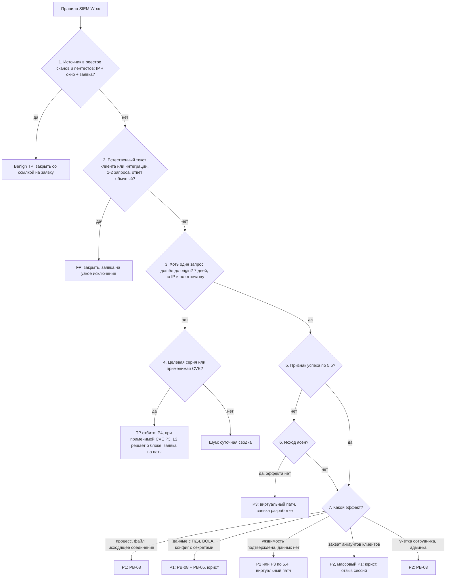

# PB-S1 Сработка WAF (сайт магазина, API мобильного приложения, админка)

> Учебный плейбук для вымышленной компании «Альфа-Трейд». Роли, уровни критичности P1–P4, ритм статусов и шаблон отчёта взяты из [IR-плана](../plan/ir-plan.md). Всё, что нужно сверить с первоисточником, собрано в разделе [«Допущения и ограничения»](#допущения-и-ограничения). Сокращения расшифрованы в [Приложении Г](#приложение-г-сокращения).

## TL;DR

- **Когда применять:** WAF (межсетевой экран веб-приложений) или корреляционное правило SIEM сообщили об атаке на сайт, API мобильного приложения или админку, и запрос либо не был заблокирован, либо это целевая серия.
- **Главный вопрос плейбука:** это шум, отбитая атака или атака, которая дошла и, возможно, удалась? Отдельные заблокированные события вручную не разбирайте.
- **Решение WAF не равно результату атаки.** Ищите три вещи: **запрос дошёл до приложения**, **приложение ответило необычно**, **после запроса что-то изменилось** (процесс, файл, исходящее соединение, данные, вход в аккаунт). Результат показывают журналы веб-сервера, приложения, СУБД, EDR, NGFW и DNS.
- **Атакующий не равен IP.** Ищите по отпечатку клиента, сессии, токену API, параметру и полезной нагрузке, минимум за 7 дней.
- **Сначала понять, потом блокировать.** Блокировка должна быть самой узкой из достаточных мер, со сроком действия (TTL) и владельцем. Исключение: прямо сейчас идёт выгрузка данных или выполнение кода.
- **Любой признак доступа к персональным данным:** сразу сообщите IM (руководителю реагирования) и юристу/DPO, параллельно с расследованием. Время выявления запишите в тикет с первой минуты.

## Шпаргалка: первые 30 минут

| № | Действие | Кто | Срок |
| --- | --- | --- | --- |
| 1 | **Возьмите тикет**, запишите время сработки и время начала работы | L1 | 15 мин для правил «дошло» (круглосуточно), 4 ч для заблокированной целевой серии |
| 2 | **Скопируйте в тикет поля сработки:** время в МСК, реальный IP и поле-источник, путь, параметр, нагрузка (замаскирована), `rule_id`, `anomaly_score`, `action`, `request_id`, отпечаток клиента | L1 | ≤ 5 мин |
| 3 | **Проверьте, дошёл ли запрос:** `action=block` и нет записи по `request_id` в журнале веб-сервера, значит не дошёл | L1 | ≤ 5 мин |
| 4 | **Запустите Q1 за 7 дней:** что ещё делал источник, есть ли дошедшие запросы без сработок | L1 | ≤ 5 мин |
| 5 | **Сверьте IP с реестром сканирований и пентестов** (IP + окно + номер заявки). User-Agent ничего не доказывает | L1 | ≤ 2 мин |
| 6 | **Проверьте применимость CVE по реестру веб-активов.** Нет ответа, значит CVE применима | L1 | ≤ 3 мин |
| 7 | **Вынесите вердикт и критичность** по [дереву решений](#51-дерево-решений), обоснуйте одной-двумя фразами | L1 | ≤ 15 мин от взятия |
| 8 | **Эскалируйте:** P3 через тикет, P2 звонок L2 и сообщение IM, P1 звонок L2 и IM немедленно | L1 | Сразу после вердикта |
| 9 | **Сохраните журналы WAF и веб-сервера** (5–10 мин), только потом сдерживайте | L2, ИТ | Сразу после вердикта «дошло» |
| 10 | **Проверьте признаки успеха** по [таблице 5.5](#55-признаки-успеха-по-типам-атак) и выясните, почему запрос дошёл | L2 | 30–60 мин |
| 11 | **Заблокируйте один внешний IP с TTL** сами; подсеть, страну, challenge и виртуальный патч только с апрувом IM | L2 | По ситуации |
| 12 | **Признак успеха есть:** сохраните журналы и передайте в PB-08; при ПДн подключите юриста/DPO через IM | L2 → IM | Немедленно |

## Чего делать нельзя

- **Не повторяйте нагрузку атакующего на проде и не запускайте sqlmap «для проверки».** Это может изменить данные, нагрузить СУБД, предупредить атакующего и создать юридическую проблему. Воспроизводите только на стенде.
- **Не открывайте страницу, отзыв или обращение со stored/blind XSS в браузере**, особенно с сессией админки или консоли WAF. Смотрите через выгрузку из БД или `curl` в файл, при необходимости в изолированной ВМ.
- **Не отключайте правило целиком и не добавляйте IP клиента в allowlist «на всё»** ради одного ложного срабатывания.
- **Не блокируйте IP CDN, платёжного шлюза, мобильного оператора, поискового робота или собственного мониторинга.**
- **Не удаляйте сохранённый XSS, веб-шелл или запись в БД без копии.** Не перезапускайте PHP-FPM и не пересоздавайте контейнеры до сбора улик.
- **Не включайте полное журналирование тел запросов без маскирования.** Иначе пароли и ПДн клиентов попадут в SIEM.
- **Не делайте массовый сброс паролей всем клиентам** без решения IM и владельца сайта.
- **Не загружайте найденные файлы на публичные сервисы анализа.** Только поиск по хешу, загрузку решает IM.
- **Не блокируйте до того, как поняли масштаб.** Ранний блок во время ручной атаки предупреждает атакующего: он меняет IP и отпечаток, а масштаб уже не определить.
- **Не отвечайте атакующему** и ничего не меняйте на странице «в ответ».

## 1. Цель и область применения

**Цель:** ответить на один вопрос: **это шум, отбитая атака или атака, которая дошла и, возможно, удалась?** По ответу присвоить критичность, включить временные меры и при признаках успеха передать дело в PB-08.

**Что входит:**

- Сработки WAF перед сайтом, API мобильного приложения и админкой CMS, если WAF не заблокировал запрос (`detect`, `log`, `allow`) или заблокировал целевую серию.
- Корреляционные правила SIEM на событиях WAF, журналах веб-сервера, приложения, DNS и NGFW ([Приложение Б](#приложение-б-источники-данных-и-триггеры)).
- Подсценарии:
  - SQLi (внедрение SQL-кода);
  - XSS (reflected, stored, blind);
  - RCE (удалённое выполнение кода) и эксплуатация CVE;
  - LFI и Path Traversal (чтение локальных файлов);
  - SSRF (подделка запросов от имени сервера);
  - загрузка файлов, XXE, десериализация, SSTI, JNDI-нагрузки;
  - находки сканеров (`.env`, `.git`);
  - credential stuffing клиентов;
  - атаки на API (BOLA/IDOR, mass assignment);
  - card testing;
  - обход WAF напрямую на origin.

**Что не входит (куда передать):**

| Ситуация | Куда |
| --- | --- |
| Подтверждённый взлом сайта | **PB-08** |
| Утечка ПДн | **PB-05** |
| L7 DDoS, HTTP flood | **PB-06** (проверьте, не прикрытие ли это для эксплуатации) |
| Перебор и вход в админку, CRM, API операторов, то есть учётки персонала | **PB-03** |
| Сработки NGFW | **PB-S2** |
| Сработки EDR на веб-сервере | **PB-S4** |
| Скиммер на странице оплаты (WAF его не видит) | **PB-08** |

## 2. Паспорт

| Поле | Значение |
| --- | --- |
| ID | PB-S1 |
| Версия | 1.1 (31.10.2026), переработка учебной версии 1.0 |
| Владелец | Руководитель ИБ (IM). Раздел о мерах в WAF согласует администратор WAF, о коде разработчик или подрядчик сайта |
| Пересмотр | Раз в 6 месяцев и после каждого инцидента P1–P2 по этому сценарию |
| Критичность по умолчанию | **P4**: атака отбита WAF (пример P4 из IR-плана), ни один запрос серии не дошёл до приложения |
| Повышение до P3 | Атакующий запрос дошёл до приложения, признаков успеха пока нет; подтверждена уязвимость без извлечения данных (ответ 500 с ошибкой SQL, отражённый XSS); заблокированные попытки под CVE, применимую к нашему стеку; card testing |
| Повышение до P2 | Дошёл запрос под применимую RCE-CVE; подтверждённая time-based SQLi; открыт `.env`, `.git` или бэкап с секретами; единичные захваты клиентских аккаунтов; атакующий трафик в обход WAF прямо на origin; успешный вход в админку из интернета |
| Повышение до P1 | Признаки выполнения кода (процесс от веб-сервера, новый файл, исходящее соединение из DMZ); извлечение данных с ПДн (SQLi, LFI конфига БД, BOLA); массовый захват аккаунтов (более 100, порог учебный) или вывод денег и бонусов; XSS или изменённый скрипт на странице оплаты. Переход в PB-08, при ПДн параллельно PB-05 |
| Правила изменения | Повысить может любой участник. Понижает IM с обоснованием в тикете. Если исход неясен, считайте, что атака удалась, пока не доказано обратное |
| Техники MITRE ATT&CK | [Приложение А](#приложение-а-mitre-attck) |
| Связанные плейбуки | **PB-08** Компрометация веб-приложения (граница: признаки успеха, раздел 5.5); **PB-05** Утечка данных (параллельно при ПДн); **PB-06** DDoS (L7 flood); **PB-03** Компрометация учётки сотрудника (админка, CRM); **PB-S2** Сработка NGFW; **PB-S4** Сработка EDR на веб-сервере |

**Целевые сроки** (учебные):

| Этап | Цель |
| --- | --- |
| Начало работы L1 по правилам «дошло» | **15 мин**, круглосуточно |
| Начало работы L1 по заблокированной целевой серии | **4 ч** |
| Сводка шума | Раз в сутки |
| Вердикт L1 | **15 мин** |
| Проверка признаков успеха L2 | **30–60 мин** |
| Сохранение журналов | Сразу после вердикта «дошло» |
| Виртуальный патч на подтверждённую уязвимость | **До 4 ч** |
| Исправление кода | P2: **24–72 ч**, P3: **до 7 дней** |
| Юрист при признаках ПДн | **Немедленно** |
| Мониторинг после инцидента | **14 дней** |

## 3. Подготовка

Без этих условий половина шагов невыполнима. Если пункт не выполнен, запишите это в тикет как ограничение расследования.

- [ ] Origin-серверы сайта и API принимают 80/443 **только** с адресов WAF/CDN (правило NGFW). Раз в квартал проверяйте прямое обращение к origin извне
- [ ] WAF пишет в SIEM все события по защищаемым хостам, а не только сработки (или хотя бы все запросы с anomaly score > 0). Если пишутся только сработки, «тихие» запросы ищите только по журналу веб-сервера
- [ ] WAF добавляет `X-Request-ID`; веб-сервер и приложение пишут его в журнал
- [ ] Реальный IP клиента: веб-сервер доверяет `X-Forwarded-For` только от адресов WAF/CDN (в nginx `set_real_ip_from` и `real_ip_header`)
- [ ] Журнал веб-сервера содержит время ответа и размер. Пример формата nginx в [Приложении В](#приложение-в-примеры-запросов-и-команд)
- [ ] В SIEM поступают: ошибки приложения и PHP-FPM, ошибки и медленные запросы СУБД (или аудит pgaudit, MariaDB Audit Plugin), журнал входов и действий в личном кабинете, DNS-журналы, исходящие соединения NGFW из DMZ. NTP на всех узлах. Хранение 90 дней (IR-план)
- [ ] EDR на веб-серверах DMZ. Без EDR: auditd с правилом на `execve` от пользователя веб-сервера
- [ ] В WAF замаскированы поля `password`, `card`, `cvv`, `token`
- [ ] **Реестр веб-активов**: домены и поддомены (что за WAF, что нет), CMS и модули, фреймворки, версии, ответственные. Без него на вопрос «применима ли CVE» ночью не ответить
- [ ] **Реестр согласованных сканирований и пентестов**: IP, окно, контакт, номер заявки
- [ ] **Список «не блокировать никогда»**: адреса CDN и WAF, платёжные шлюзы (колбэки об оплате), службы доставки, мониторинг доступности, офисы и VPN, поисковые роботы (проверка по обратному DNS)
- [ ] Видно, какие правила и политики сейчас в `detect`. У каждого такого правила есть владелец и срок перевода в `block`
- [ ] Контакты: дежурный разработчик или подрядчик сайта, администратор WAF, поддержка вендора WAF/CDN, хостинг, платёжный провайдер

## 4. Роли и ответственность

Матрица RACI: **R** выполняет, **A** утверждает и отвечает за результат, **C** консультирует, **I** получает информацию.

| Действие | L1 | L2 | IM | Админ WAF | ИТ | Разработка | Владелец сайта | Юрист/DPO | PR |
| --- | --- | --- | --- | --- | --- | --- | --- | --- | --- |
| Приём сработки, тикет, поля, вердикт L1 | R | A | | | | | | | |
| Проверка признаков успеха, масштаб | C | R/A | I | | | C | | | |
| Присвоение P2/P1 | | R | A | | | | I | I | |
| Сохранение журналов | R | A | | C | R | | | | |
| Блок одного внешнего IP с TTL | | R/A | I | | | | | | |
| Блок подсети, ASN, страны; challenge | | R | A | R | | | I | | |
| Виртуальный патч на URL и параметр | | R | A | R | | C | I | | |
| Перевод политики detect→block на весь сайт | | C | A | R | | C | A | | |
| Узкое исключение для FP | | A | I (широкое — A) | R | | C | | | |
| Ротация секретов из `.env` или конфига | | C | A | | R | R | I | | |
| Отзыв сессий и сброс паролей конкретных клиентов | | C | A | | | R | C | C | C |
| Массовый сброс паролей клиентов | | C | R | | | R | A | C | C |
| Страница техработ | | C | A | | R | | A | | C |
| Решение об уведомлении РКН | | C | C | | | | I | R/A | I |

**Заранее согласованные полномочия:**

- **L1 ничего не блокирует и не меняет политики.**
- **L2 сам блокирует один внешний IP** (по IR-плану), с записью в журнал блокировок.
- **Всё, что могут заметить покупатели** (подсеть, страна, challenge на вход или оплату, политика целиком, отключение функции), требует апрува IM.
- **Меры, влияющие на оплату или вход,** требуют ещё и апрува владельца сайта.

Ролей «Администратор WAF» и «Разработка» в IR-плане нет. Для веб-сценариев они ключевые, их стоит добавить в план.

## 5. Триаж

Триаж делится на две части. **Быстрый триаж (L1, до 15 минут)** отвечает на вопросы «наш ли это источник?», «дошёл ли запрос?» и «насколько всё плохо?». **Глубокий триаж (L2, до 30 минут)** выясняет, почему запрос дошёл, проверяет признаки успеха и расширяет поиск за пределы IP. Оба идут по одному дереву решений.

### 5.1. Дерево решений



Ниже каждый узел дерева расписан подробно. Номера узлов совпадают с номерами в схеме. Узлы 1–4 проходит L1, узлы 5–7 подтверждает L2.

### 5.2. Быстрый триаж (L1, до 15 минут)

**Перед узлом 1. Зарегистрируйте сработку и соберите поля (≤ 5 мин).**

- Возьмите тикет, запишите время сработки и время начала работы.
- Скопируйте в тикет поля:
  - время в МСК (WAF часто пишет в UTC, nginx в локальном времени);
  - реальный IP клиента и поле, из которого он взят;
  - `X-Forwarded-For`, host, метод, путь, параметр и место совпадения (query, body, header, cookie);
  - нагрузку (ПДн и пароли замаскируйте);
  - `rule_id`, `anomaly_score` и порог, **`action`**, режим политики;
  - User-Agent, JA4 (если есть), ASN и страну, признак аутентификации (сессия, токен), `request_id`.
- Запустите **Q1 за 7 дней** ([Приложение В](#приложение-в-примеры-запросов-и-команд)). Запишите первую активность, число разных путей, число вариантов нагрузки на один параметр, есть ли дошедшие запросы без сработок.

**Узел 1. Источник в реестре сканов и пентестов? (≤ 2 мин)**

- Сверьте IP с реестром сканирований и пентестов: нужны **IP + окно + номер заявки**.
- **User-Agent и слова «наш сканер» ничего не доказывают.**
- **Совпало:** вердикт Benign TP, закройте со ссылкой на заявку.

**Узел 2. Естественный текст клиента или интеграции?**

- Это FP, если запрос выглядит как обычная работа клиента или интеграции: 1–2 запроса, естественный текст, ответ приложения обычный.
- **Да:** закройте как FP, заведите заявку на узкое исключение (правило + URL + параметр, владелец, дата пересмотра).
- **Не расширяйте исключение на весь сайт.**

**Узел 3. Хоть один запрос дошёл до origin? (7 дней, по IP и по отпечатку)**

- Если `action=block` и по `request_id` в журнале веб-сервера записи нет, запрос не дошёл. Иначе дошёл.
- **Если `action=block`, а запись в журнале веб-сервера есть, это ошибка конфигурации. Сразу сообщите L2.**
- Проверьте по Q1 не только исходный IP, но и тот же отпечаток за 7 дней.
- Если `request_id` нет, сопоставляйте по IP, URI и времени ±2 с. Это менее точно: запишите в тикет, что сопоставление приблизительное.

**Узел 4. Не дошло. Целевая серия или применимая CVE?**

- **Применимость CVE** проверьте по реестру веб-активов. **Если ответа нет, считайте CVE применимой.**
- **Целевая серия:** много вариантов нагрузки на один параметр (W-04), нагрузки под наш стек, аутентифицированная сессия.
- **Да:** вердикт «TP, отбито», P4, при применимой CVE P3. L2 решает о блокировке, заведите заявку на срочный патч.
- **Нет:** шум, уходит в суточную сводку.

**Узел 5 (предварительно). Признаки успеха для дошедших запросов.**

- Проверьте по [таблице 5.5](#55-признаки-успеха-по-типам-атак) только дошедшие запросы.
- **Ничего не воспроизводите на проде и ничего не открывайте в браузере.**
- **Вердикт и критичность** поставьте по [таблице 5.4](#54-вердикты-и-критичность), обоснуйте одной-двумя фразами.
- **Эскалируйте** по [разделу 5.6](#56-когда-эскалировать). Пока L2 не подключился, продолжайте сбор полей.

### 5.3. Глубокий триаж (L2, до 30 минут)

**Узел 5. Признак успеха по 5.5?** Подтверждайте журналами по лестнице: решение WAF → запрос в журнале веб-сервера → статус, размер и время ответа → журналы приложения и СУБД → поведение хоста (EDR) → сеть (NGFW, DNS).

- **Сравните ответ с базовым.** Для soft-404 запросите заведомо несуществующий путь: только безопасный GET без нагрузки, например `curl -s -o /dev/null -w "%{http_code} %{size_download}" https://<сайт>/soc-baseline-<число>`. Для легитимного ответа возьмите медиану размера этого URL за 7 дней (Q3).
- **SPA и многие CMS отвечают 200 на любой путь**, поэтому код 200 сам по себе ничего не доказывает.
- **Расширьте поиск за пределы IP:** тот же отпечаток (UA + JA4 + cookie/токен) с других адресов, та же нагрузка на тот же параметр из других источников, ASN.
- Проверяйте признаки успеха на всём найденном множестве источников и отпечатков, а не только на исходном IP.

**Параллельно выясните, почему запрос дошёл.** Возможные причины:

- правило или политика в `detect`;
- сумма баллов ниже порога anomaly scoring (в OWASP CRS порог для входящих по умолчанию 5);
- забытое исключение;
- лимит инспекции тела запроса;
- неразобранный формат (JSON, XML, multipart, GraphQL, base64);
- кодировки и HTTP Parameter Pollution;
- запрос пришёл в обход WAF (W-13).

**Узел 6. Исход ясен?**

- **Да, эффекта нет:** P3, виртуальный патч, заявка разработке. После проверки L2 может понизить до P4.
- **Нет, данных недостаточно:** считайте, что атака удалась, пока не доказано обратное, и идите к узлу 7.

**Узел 7. Какой эффект?**

| Эффект | Критичность и действие |
| --- | --- |
| Процесс от веб-сервера, новый файл, исходящее соединение | **P1**, PB-08 |
| Данные с ПДн, BOLA, конфиг с секретами | **P1**, PB-08 + PB-05, юрист через IM |
| Уязвимость подтверждена, данных нет | **P2 или P3** по таблице 5.4, виртуальный патч |
| Захват аккаунтов клиентов | **P2**, массовый (более 100) **P1**: юрист, отзыв сессий |
| Учётка сотрудника, админка | **P2**, PB-03 |

Если есть признак успеха, **сохраните журналы (раздел 7) и передайте в PB-08.**

### 5.4. Вердикты и критичность

| Вердикт | Определение | Критичность | Действие |
| --- | --- | --- | --- |
| FP | Легитимный запрос клиента или интеграции | — | Закрыть, заявка на узкое исключение |
| Benign TP | Атака наша: сканер или пентест, подтверждённые по IP, окну и заявке | — | Закрыть со ссылкой на заявку |
| TP, отбито | Все запросы серии заблокированы, в журнале веб-сервера их нет | P4; P3 при применимой CVE | Решение L2 о блокировке; при применимой CVE заявка на срочный патч |
| TP, дошло, эффекта нет | Хоть один запрос дошёл, признаков успеха нет | P3; L2 может понизить до P4 после проверки | Виртуальный патч, заявка разработчикам |
| TP, уязвимость подтверждена | 500 с ошибкой SQL, отражённый XSS, сохранённый XSS на публичной странице, LFI без чувствительных файлов | P3; time-based SQLi или дошедшая RCE-CVE P2 | Виртуальный патч до 4 ч, исправление кода по сроку |
| TP, успех | Найден хоть один признак успеха (5.5) | P2–P1 по паспорту | PB-08, при ПДн PB-05, юрист |
| Неясно | Данных недостаточно | Как «успех» до опровержения | L2 немедленно |

### 5.5. Признаки успеха по типам атак

| Тип | Признак «дошло» | Признак «успешно» | Где смотреть |
| --- | --- | --- | --- |
| SQLi | Запрос есть в журнале веб-сервера | Размер ответа отличается от базы; две чередующиеся величины размера (boolean-based); время ответа ≈ числу в нагрузке (`SLEEP(5)` → ~5 с); 500 и `SQL syntax`, `SQLSTATE`, `unterminated quoted string`, `ORA-`; запросы учётки приложения к `information_schema`, `pg_catalog`, `mysql.user`; OOB DNS; новые учётки в БД | Веб-сервер, error.log, СУБД, DNS |
| XSS reflected | Нагрузка вернулась без экранирования | Требует жертвы, для SOC это уязвимость | `curl` в файл, стенд |
| XSS stored / blind | Нагрузка сохранена в отзыве, профиле, адресе, обращении | Обращения браузеров клиентов или операторов к домену атакующего; входы в админку с новых IP под учёткой модератора | Выгрузка из БД текстом, прокси/NGFW, CSP-отчёты |
| RCE / CVE | Дошло, и CVE применима | Дочерний процесс веб-сервера, новый файл, исходящее соединение, OOB | EDR, NGFW, DNS |
| LFI / Traversal | Дошло, ответ ≠ soft-404 | Маркеры: `root:x:0:0:`, `[extensions]` (win.ini), `DB_PASSWORD=`; размер ≈ размеру файла | Веб-сервер, WAF (если пишет тело ответа) |
| SSRF | Дошло (параметры `url=`, `image=`, `callback=`) | Соединение веб-сервера на внутренний адрес, `169.254.169.254`, внешний домен из нагрузки | NGFW, DNS, EDR |
| Загрузка файла | Файл принят (200/201) | Обращение к загруженному файлу; исполняемый файл в каталоге загрузок | Веб-сервер, EDR |
| XXE, десериализация, SSTI, JNDI | Дошло | Содержимое файлов в ответе, OOB, LDAP/RMI-соединения наружу, процесс | Веб-сервер, DNS, NGFW, EDR |
| Чувствительные файлы | — | 200 с реальным содержимым на `.env`, `.git/config`, бэкап | Веб-сервер (W-06) |
| Credential stuffing | Попытки дошли до приложения | Успешные входы ботов; после входа смена email, телефона или адреса, заказ на новый адрес, списание бонусов | Журнал приложения (Q5, Q6) |
| BOLA / IDOR | Ответы 200 на чужие ID | Сотни разных ID с одного токена | API, веб-сервер (W-09) |
| Card testing | — | Подтверждённые «рабочие» карты, рост объёма | Платёжный шлюз (W-14) |

### 5.6. Когда эскалировать

- **P3:** L2 через тикет, начало работы до 4 ч. L1 продолжает сбор полей.
- **P2:** звонок L2 и сообщение IM, начало работы до 1 ч.
- **P1:** звонок L2 и IM немедленно, в том числе ночью. IM уведомляет директора и юриста (IR-план).
- **Сразу юрист/DPO через IM, независимо от P:** возможное извлечение данных клиентов (SQLi, BOLA, LFI конфига БД), захват аккаунтов клиентов. Запишите в тикет **время выявления**, от него юрист считает сроки.
- **Сразу L2:** `action=block`, но запрос есть в журнале веб-сервера; атакующий трафик в обход WAF; срабатывание W-03, W-09, W-10, W-11.

## 6. Сдерживание

**Порядок:** сохраните журналы (5–10 мин) → проверьте признаки успеха и закрепления → сдерживайте. Ранний блок во время ручной атаки предупреждает атакующего: он меняет IP и отпечаток, и масштаб уже не определить.

**Исключение:** прямо сейчас идёт выгрузка данных или выполнение кода. Тогда **L2 блокирует сразу и уведомляет IM**, а улики собирает параллельно.

**Перед любой блокировкой проверьте:**

- [ ] IP взят из доверенного поля (не адрес CDN или WAF, не подделанный левый элемент `X-Forwarded-For`)
- [ ] IP нет в списке «не блокировать»
- [ ] ASN не принадлежит мобильному оператору: за CGNAT один адрес делят тысячи абонентов
- [ ] Поисковый робот проверен по обратному DNS: PTR указывает на домен поисковика, а прямой DNS этого имени возвращает тот же IP
- [ ] Мера записана в журнал блокировок: что, кто, когда, по чьему решению, TTL

### 6.1. Краткосрочные меры

| Мера | Когда | Кто | Апрув | Риск | TTL (учебный) |
| --- | --- | --- | --- | --- | --- |
| Блок одного внешнего IP | Целевая серия или активная атака | L2 | Не нужен (IR-план), запись в журнал | CGNAT, CDN | 24–72 ч |
| Блок по отпечатку, сессии, токену | Атака с ротацией IP | L2 | Уведомить IM | Задеть клиентов со старой версией мобильного приложения | 24 ч |
| Блок подсети, ASN, страны | Массовая атака с хостинга | L2, админ WAF | IM, владелец уведомлён | Клиенты и партнёры | ≤ 7 дней |
| Rate limit на URL или метод (`/login`, `/api/auth`, оплата) | Перебор, IDOR, stuffing | Админ WAF / L2 | IM | Отказы в пиковые часы | До исправления |
| Challenge (JS/CAPTCHA) | Боты, stuffing, card testing | Админ WAF | IM; владелец, если на вход или оплату | Конверсия, мобильное приложение | До снятия угрозы |
| Виртуальный патч на URL + параметр | Дошедшая атака на уязвимую точку | L2 готовит, админ WAF вносит | IM | Сломать легитимную функцию | До исправления кода |
| Отзыв сессий и refresh-токенов, сброс паролей конкретных аккаунтов | Подтверждённый захват | Разработка по заявке L2 | IM | Жалобы | — |
| Скрытие записи со stored XSS (флаг модерации) | Stored XSS | Контент или разработка | L2 | — | До удаления после закрытия |

**Виртуальный патч** сначала включите в режиме `detect` на 15–30 минут для проверки ложных срабатываний, потом переведите в `block`. При активной эксплуатации сразу `block`.

### 6.2. Долгосрочные меры

- **Переведите правило из `detect` в `block` точечно** (правило + URL): админ WAF, апрув IM. На весь сайт: апрув IM и владельца, в рабочее время, с мониторингом 403 после включения. Это экстренное изменение, у него должен быть план отката.
- **Закройте origin на NGFW** для всех, кроме адресов WAF/CDN (при W-13).
- **Ротируйте секреты**, раскрытые через `.env`, LFI или `.git`: пароль СУБД, ключи платёжного провайдера, SMTP, секрет подписи сессий и JWT (ИТ + разработка, апрув IM).
- **Запретите исходящие соединения из DMZ**, кроме списка (обновления, платёжный шлюз, SMTP-релей).
- **Отключение функции** (загрузка файлов, отзывы, метод API) утверждают IM и владелец сайта. **Страницу техработ** утверждают IM и владелец, при долгом простое директор (около 1 млн ₽ в час).

## 7. Сбор и сохранение артефактов

**Собирайте по убыванию летучести (RFC 3227).** Для этого сценария самое летучее: журналы с коротким сроком хранения. Консоль облачного WAF может хранить события 7–30 дней, журналы веб-сервера ротируются.

| Порядок | Артефакт | Когда | Как сохранить |
| --- | --- | --- | --- |
| 1 | События WAF за окно атаки ±24 ч по всем источникам и отпечаткам; тела запросов, если пишутся | После вердикта «дошло» | Экспорт CSV/JSON из консоли или SIEM, SHA-256 |
| 2 | Сырые access- и error-журналы веб-сервера, PHP-FPM, приложения | Сразу, до ротации | Копия с сервера (SIEM может нормализовать и обрезать поля), хеши |
| 3 | Журналы СУБД (ошибки, медленные запросы, аудит) | При SQLi | Выгрузка DBA, только чтение |
| 4 | DNS и NGFW: исходящие соединения из DMZ за окно | При SSRF, OOB, RCE | Экспорт из SIEM |
| 5 | Конфигурация политики WAF и исключений на момент инцидента; история изменений за 30 дней | При «почему дошло» | Экспорт из консоли WAF |
| 6 | Запись со stored XSS (текст, автор, время, IP) | До скрытия и удаления | Выгрузка из БД текстом |
| 7 | Для чувствительных файлов: что отдано (размер ответа, хеш файла на сервере) | При W-06 | Без повторного скачивания с прода |
| 8 | Журнал приложения по захваченным аккаунтам (входы, изменения, заказы) | При ATO | Экспорт из SIEM |
| 9 | Память, снимок ВМ, webroot, контейнеры | При признаках RCE | **По PB-08**, здесь не дублируется |

Команды для копии журналов веб-сервера (L2/ИТ, только чтение) собраны в [Приложении В](#приложение-в-примеры-запросов-и-команд).

**Цепочка хранения.** Для каждого файла запишите в тикет:

- что это и откуда снято;
- кто снял и когда (МСК);
- SHA-256;
- где лежит и кто получал доступ.

Хранилище улик доступно только участникам инцидента. **Нагрузки атакующего и найденные секреты в почту и общие чаты не пересылайте.**

## 8. Расследование

| № | Вопрос | Источник | Как |
| --- | --- | --- | --- |
| 1 | Когда источник появился впервые? Была ли разведка? | WAF, веб-сервер | Q1 с окном 30 дней; при подтверждённом успехе вся глубина хранения (90 дней) |
| 2 | Это сканирование или целевая атака? | WAF | Много путей и мало вариантов на путь: сканер. Много вариантов на один параметр, нагрузки под наш стек, аутентифицированная сессия: целевая атака (W-04) |
| 3 | Кто ещё атакует ту же точку? | WAF | Та же нагрузка или правило на том же параметре с других IP и ASN; тот же отпечаток с других адресов |
| 4 | Был ли удачный вариант, который WAF не узнал? | Веб-сервер | Все запросы к атакованному URL за 30 дней без сработок с необычным размером, временем или 5xx (Q3) |
| 5 | Почему запрос дошёл? | Политика WAF, история изменений, NGFW | Detect, порог баллов, исключение, лимит тела, формат, кодировки, обход (5.3) |
| 6 | Есть ли та же уязвимость на других хостах? | Реестр активов, WAF | `api.`, `m.`, старые поддомены, staging с копией боевой БД; за WAF ли они |
| 7 | Удалась ли атака? | 5.5 | На всём найденном множестве источников и отпечатков, а не только на исходном IP |
| 8 | Какие данные затронуты? | СУБД, приложение | Таблицы, число строк, категории ПДн, конкретные аккаунты; что известно и чего не известно |
| 9 | Какова хронология? | Все | Таблица «время, событие, источник, кто» в МСК |

**Итог расследования в тикете:** список источников и отпечатков, атакованные точки, дошедшие запросы, признаки успеха (есть или нет и на основании чего), причина пропуска WAF, IOC.

Готовые запросы для этих вопросов собраны в [Приложении В](#приложение-в-примеры-запросов-и-команд).

## 9. Устранение

**Виртуальный патч** это сдерживание. **Устранение** это исправление кода или обновление компонента.

- [ ] **SQLi:** параметризованные запросы или ORM в уязвимом месте; поиск того же шаблона в остальном коде (SAST); минимальные права учётки приложения в СУБД (без доступа к системным таблицам, без `FILE`, `pg_read_file`, `xp_cmdshell`)
- [ ] **XSS:** контекстное экранирование вывода; Content-Security-Policy (сначала в report-only с отчётами в SIEM); cookie с `HttpOnly`, `Secure`, `SameSite`; удаление внедрённого контента после копии
- [ ] **RCE / CVE:** обновление компонента. При признаках компрометации сервер не лечите, а пересобирайте по PB-08
- [ ] **LFI и находки сканера:** исправление кода; удаление `.git`, бэкапов и служебных файлов из webroot; запрет их отдачи на уровне веб-сервера; ротация всех секретов из прочитанных файлов; вынос секретов из webroot
- [ ] **SSRF:** allowlist адресов назначения в приложении; запрет исходящих из DMZ на NGFW
- [ ] **Загрузка файлов:** проверка типа по содержимому, переименование, хранение вне webroot или в каталоге с запретом исполнения
- [ ] **BOLA:** проверка владельца объекта на сервере для каждого метода API
- [ ] **Credential stuffing:** подтверждение входа с нового устройства или MFA, проверка паролей по базам утечек при смене, антибот на входе
- [ ] **Причина пропуска WAF:** правило переведено в `block`, исключение сужено или удалено, включён парсер формата, origin закрыт

## 10. Восстановление и мониторинг

**Восстановление:**

- [ ] Временные меры сняты по одной и только с записью в журнале. Виртуальный патч остаётся, пока исправление не проверено на стенде или повторным тестом
- [ ] Блоки IP снимаются по TTL автоматически. Ежемесячно проверяйте журнал блокировок: истёкшие и забытые меры
- [ ] После перевода правил в `block` или включения challenge владелец сайта подтвердил, что поиск, корзина, вход, оплата и мобильное приложение работают

**Усиленный мониторинг 14 дней** (IR-план требует не меньше 2 недель; для P1 по PB-08):

| Что | Правило |
| --- | --- |
| IOC инцидента (IP, отпечатки, нагрузки, домены OAST) | Правило в SIEM |
| Атакованный URL и параметр | Любые сработки и ответы 5xx, аномалии размера и времени |
| Дочерние процессы веб-сервера и новые файлы в webroot | W-11, W-12 |
| DNS и исходящие соединения из DMZ | W-10 |
| Доля ответов 403 после изменений WAF | Ложные блокировки покупателей |
| Для ATO: затронутые аккаунты | Входы и изменения профилей, жалобы в поддержку |

## 11. Коммуникации и уведомления

### 11.1. Внутри компании

| Кому | Когда | Как | Что |
| --- | --- | --- | --- |
| Дежурный L2 | P3 и выше | Тикет; P2+ звонок | Вердикт, поля, результаты Q1 и Q2 |
| IM | P2+, любые признаки ПДн, любая мера с апрувом IM | Звонок + канал инцидента | Шаблон 1 |
| Админ WAF | Виртуальный патч, исключения, режимы | Заявка | Правило, URL, параметр, пример нагрузки |
| Разработка / подрядчик | Дошедшая атака на уязвимую точку | Заявка с дедлайном | Точка, класс, примеры запросов без рабочих эксплойтов в общих чатах (шаблон 2) |
| Владелец сайта | Меры, заметные покупателям; ATO; card testing | Через IM | Влияние на бизнес, варианты мер |
| Поддержка клиентов | Блокировки, challenge, сброс паролей | Через IM | Скрипт ответа клиентам |
| Юрист/DPO | Любой признак доступа к ПДн | Через IM, сразу | Что известно о данных и объёме, время выявления |
| PR | Инцидент заметен клиентам | Через IM | — |

**Ритм статусов по IR-плану:** P1 каждые 2 часа, P2 дважды в день. При подозрении на компрометацию почты или репозитория используйте резервный канал.

### 11.2. Вне компании

| Кому | Когда | Кто решает | Основание и срок |
| --- | --- | --- | --- |
| Роскомнадзор | Установлен факт неправомерного доступа к ПДн (выгрузка через SQLi или BOLA, захват аккаунтов клиентов) | Юрист + IM | 152-ФЗ, ст. 21 ч. 3.1: 24 ч первичное уведомление, 72 ч результаты расследования. Трактовка захвата аккаунтов как инцидента с ПДн за юристом |
| НКЦКИ (ГосСОПКА) | Инцидент, повлёкший неправомерную передачу ПДн | Юрист | 152-ФЗ, ч. 12 ст. 19 и приказ ФСБ о порядке взаимодействия операторов ПДн с ГосСОПКА (по памяти № 77 от 2023 г.) |
| Платёжный провайдер / эквайер | Card testing; изменения скриптов на странице оплаты | Владелец + IM | По договору. Если форма карты на нашем домене, вероятно применимы требования PCI DSS v4.0 6.4.3 и 11.6.1 |
| Клиенты с захваченными аккаунтами | Подтверждённый захват | PR + юрист | Письмо без ссылок на сброс пароля: только инструкция зайти на сайт самостоятельно |
| Провайдер WAF/CDN | Нужна выгрузка, помощь, ошибка после обновления сигнатур | IM | По договору |
| Abuse-контакт хостинга атакующего, полиция | После сбора улик | IM, юрист, директор | УК РФ, ст. 272 |

### 11.3. Шаблоны

**Шаблон 1. Сообщение IM.**
> «[P2] PB-S1, INC-2026-XXX. 03:12 W-03: time-based SQLi на `/catalog/search?q=` с 203.0.113.45 (VPS). Правило в detect, 14 запросов дошли до приложения, задержки 5,0–5,1 с совпадают с `SLEEP(5)` — инъекция подтверждена. Признаков выгрузки пока нет (размеры в норме, OOB нет). Сделано: журналы сохранены, IP заблокирован на 24 ч. Нужен ваш апрув: виртуальный патч на параметр `q`. Предлагаю заявку разработке и решение о PB-08. Следующий статус в 04:00.»

**Шаблон 2. Заявка разработке.**
> «Уязвимость [класс] в [URL], параметр [имя], подтверждена [признак] в [время]. Временная мера: [виртуальный патч, ID]. Срок исправления: [дата]. Проверка исправления — на стенде, результат в тикет INC-2026-XXX.»

**Атакующему не отвечайте никак** и ничего не меняйте на странице «в ответ».

## 12. Критерии закрытия

**Для любого вердикта:**

- [ ] Вердикт записан с обоснованием и ссылками на результаты запросов
- [ ] Временные меры записаны в журнал с владельцем и TTL
- [ ] В тикете есть хронология, IOC, техника ATT&CK и исход: заблокирована / прошла без эффекта / с эффектом

**Закрыть как FP можно, когда отмечены все пункты:**

- [ ] Создана заявка на узкое исключение (правило + URL + параметр, владелец, дата пересмотра не позже 6 месяцев)

**Закрыть как Benign TP можно, когда отмечены все пункты:**

- [ ] Есть ссылка на заявку на сканирование или пентест

**Закрыть как TP можно, когда отмечены все пункты:**

- [ ] **Отбито:** проверено, что ни один вариант не дошёл, в том числе по отпечатку и за 7 дней; IOC добавлены в наблюдение
- [ ] **Дошло:** признаки успеха проверены по 5.5 на всём найденном множестве источников
- [ ] Для уязвимых точек есть заявка разработке с дедлайном. Тикет закрывается после исправления и проверки, а не после виртуального патча
- [ ] Причина пропуска WAF устранена или есть заявка на устранение
- [ ] Для применимых CVE есть заявка на патч и правило мониторинга на 14 дней
- [ ] При успехе тикет связан с инцидентом PB-08, PB-05 или PB-03, PB-S1 закрыт как «передано»
- [ ] Решение юриста о ПДн записано (если применимо)

## 13. Метрики

| Метрика | Что показывает | Цель (учебная) |
| --- | --- | --- |
| MTTD | Время от первого атакующего запроса до сработки | Снижение; часто первый запрос находят только ретроспективно |
| MTTR | Время от обнаружения до устранения (исправление кода, а не виртуальный патч) | P2 до 72 ч, P3 до 7 дней |
| Время до вердикта L1 | Скорость триажа | Правила «дошло»: до 15 мин |
| Время от сработки «дошло» до вердикта L2 | Скорость проверки успеха | До 1 ч |
| Доля FP по правилам | Кандидаты на тюнинг | Снижение месяц к месяцу |
| Атаки, дошедшие до приложения и найденные ретроспективно, а не триггером | Качество детекта | Стремится к 0 |
| Число правил и хостов в `detect` и их средний возраст | Риск «ловушки detect» | Возраст не больше 30 дней |
| Время от публикации критичной CVE в нашем стеке до виртуального патча и до обновления | Готовность к массовой эксплуатации | Часы и 1–3 дня |
| Активные меры с истёкшим TTL | Гигиена блокировок | 0 |
| Жалобы клиентов на ложные блокировки после изменений WAF | Цена мер для бизнеса | Отслеживать |

## 14. Типичные ошибки

1. **Ловушка detect.** Сработка есть, а запрос дошёл. Родственные ловушки: сумма баллов ниже порога, забытое исключение, лимит инспекции тела, неразобранный JSON или multipart, обход WAF на origin, API на отдельном поддомене без WAF.
2. **«Больших ответов нет, значит отбито».** Time-based, boolean-based и OOB SQLi большого ответа не дают. Ответ 500 на SQLi: признак уязвимости, а не провала атаки.
3. **«200, значит файл отдан».** Soft-404 на SPA и CMS даёт ложные эскалации. Сравнивайте с базовым ответом и ищите маркеры содержимого.
4. **Атакующий = IP.** Резидентные прокси, CGNAT, IPv6 /64. Ищите по отпечатку, сессии, токену, нагрузке, окно минимум 7 дней.
5. **Блок «не того» IP.** Адрес CDN, мобильного оператора, платёжного шлюза или поискового робота: это простой выручки или потеря SEO.
6. **Блок до понимания.** Атакующий меняет адрес, а веб-шелл, если он уже есть, остаётся.
7. **Проверка XSS в браузере** под учёткой админки: нагрузка исполняется в сессии аналитика.
8. **Повтор нагрузки на проде** «для проверки».
9. **«Наш сканер» по User-Agent** или по словам. Подтверждайте только по реестру.
10. **Сканер «не эскалируется».** Находка сканера (`.env`, `.git`) это утечка секретов, P2.
11. **Сброс пароля без отзыва refresh-токенов** мобильного приложения: атакующий остаётся в аккаунте. Массовый сброс без анализа создаёт нагрузку на поддержку и шаблон для фишинга.
12. **Клиенты и сотрудники в одной ветке.** Перебор на админку это PB-03, а не «клиентский stuffing».
13. **Виртуальный патч как финал.** Уязвимость в коде остаётся, обход правила вопрос времени.
14. **Широкое исключение для FP** («отключить 942100, мешает поиску») открывает дыру на весь сайт.
15. **Тела запросов в SIEM без маскирования:** новая утечка паролей и ПДн.
16. **Юрист узнаёт из PB-08**, когда от 24 часов почти ничего не осталось.
17. **Отсутствие сработки WAF принимается за отсутствие атаки.** BOLA и злоупотребления бизнес-логикой синтаксически чистые, их видно только по аномалиям в журналах приложения.

## 15. Профилактика

**Периметр и WAF**

- [ ] Origin доступен только с адресов WAF/CDN; ежеквартальная проверка прямого доступа и поиск забытых поддоменов (Certificate Transparency, исторический DNS)
- [ ] Сокращение правил в `detect`; у каждого владелец и срок перевода в `block` не больше 30 дней (срок учебный). Уведомление руководителю ИБ о любом изменении политики WAF (перевод в `detect`, новое исключение)
- [ ] Ежемесячный разбор с админом WAF: топ-10 правил по FP, все дошедшие атаки и причины, меры с истёкшим TTL, исключения старше 3 месяцев
- [ ] Позитивная модель для API: валидация запросов по схеме OpenAPI на WAF или API-шлюзе; детект BOLA по журналам приложения
- [ ] Запрет исходящих соединений из DMZ по умолчанию: лишает атакующего reverse shell, OOB-канала и SSRF наружу

**Серверы и приложение**

- [ ] FIM на webroot; webroot только для чтения для пользователя веб-сервера; каталог загрузок без права исполнения
- [ ] Минимальные права учётки приложения в СУБД; канареечные записи (honeytokens) в таблице клиентов
- [ ] Контроль скриптов на странице оплаты: Subresource Integrity, CSP, мониторинг изменений
- [ ] Антибот и подтверждение входа с нового устройства в ЛК; rate limit на вход и оплату по аккаунту и отпечатку

**Процессы**

- [ ] Реестр веб-активов с версиями (в идеале SBOM) и SLA на обновления с учётом CISA KEV, БДУ ФСТЭК и EPSS
- [ ] Регулярный DAST и пентест; `security.txt` для ответственного раскрытия
- [ ] Роли «Разработка/подрядчик сайта» и «Администратор WAF» добавлены в IR-план

## 16. Учебная ситуация

**Вводная.** Суббота, 03:12. Вчера вечером вендор обновил набор правил WAF, и часть правил SQLi после обновления в режиме `detect`. Срабатывает W-03: запросы `GET /catalog/search?q=1' AND SLEEP(5)-- -` с IP хостинг-провайдера, время ответа 5,02 с. За 20 минут таких запросов 14, нагрузки чередуются со `SLEEP(10)`, время ответа меняется соответственно. В 03:25 срабатывает W-10: сервер СУБД резолвит домен, которого не было 30 дней. В понедельник в 10:00 начинается распродажа, простой стоит около 1 млн ₽ в час.

**Задания:**

1. **Вы L1, 03:15.** Пройдите по дереву решений и запишите, на каком узле вы остановились, какой вердикт и какую P поставили. Какие поля вы скопировали в тикет и какой запрос (Q1 или Q2) запустили первым? Кого вы будите и каким способом по разделу 5.6?
2. **Вы L1, 03:26.** Сработал W-10. Запишите, как меняется узел дерева, вердикт и P. Какие признаки успеха из таблицы 5.5 теперь подтверждены и на основании какого источника? Кого и как вы будите теперь?
3. **Вы L2, 03:30.** Перечислите, что вы сохраняете в первые 10 минут и в каком порядке по таблице раздела 7, и почему именно это. Напишите команду для копии журналов nginx.
4. **Вы L2, 03:40.** Составьте список мер: что вы делаете сами, на что нужен апрув IM, на что ещё и апрув владельца сайта (по RACI и таблице 6.1). Запишите, что вы ответите IM на вопрос «переводить ли всю политику в `block` ночью перед распродажей» и почему.
5. **Вы IM, 03:50.** Напишите сообщение по шаблону 1. Сформулируйте, с какой формулировкой и когда вы подключаете юриста. Запишите, от какого момента считаются 24 часа и до какого времени нужно уведомить РКН, если факт доступа к ПДн подтвердится в 05:00.
6. **Вы L2, понедельник.** Пройдите по чек-листу раздела 12 и запишите, какие пункты ещё не выполнены: условия для виртуального патча, исправления кода и мониторинга на 14 дней.

## 17. Источники

Ссылки приведены по памяти и ведут на официальные сайты. Перед использованием проверьте актуальность.

- MITRE ATT&CK, техника T1190 Exploit Public-Facing Application: https://attack.mitre.org/techniques/T1190/
- NIST SP 800-61 r3 (2025): https://csrc.nist.gov/pubs/sp/800/61/r3/final ; r2 проще для новичка: https://csrc.nist.gov/pubs/sp/800/61/r2/final
- SANS Incident Handler's Handbook: https://www.sans.org/white-papers/33901/
- RFC 3227, Guidelines for Evidence Collection and Archiving: https://www.rfc-editor.org/rfc/rfc3227
- OWASP Top 10: https://owasp.org/www-project-top-ten/ (сверить нумерацию категорий редакций 2021 и 2025)
- OWASP API Security Top 10 2023: https://owasp.org/API-Security/
- OWASP Core Rule Set, документация (anomaly scoring, исключения, paranoia levels): https://coreruleset.org/docs/
- OWASP Automated Threats to Web Applications: https://owasp.org/www-project-automated-threats-to-web-applications/
- OWASP Cheat Sheet Series: Virtual Patching, Credential Stuffing Prevention, Logging: https://cheatsheetseries.owasp.org/
- PortSwigger Web Security Academy (blind SQLi, SSRF, загрузка файлов): https://portswigger.net/web-security
- CISA Known Exploited Vulnerabilities Catalog: https://www.cisa.gov/known-exploited-vulnerabilities-catalog
- БДУ ФСТЭК России: https://bdu.fstec.ru/
- FIRST EPSS: https://www.first.org/epss/
- nginx, модуль `ngx_http_realip_module`: https://nginx.org/en/docs/http/ngx_http_realip_module.html
- PCI DSS v4.0, PCI Security Standards Council: https://www.pcisecuritystandards.org/
- 152-ФЗ «О персональных данных», актуальная редакция на официальном портале правовой информации: http://pravo.gov.ru/

## Допущения и ограничения

**Что нужно сверить перед реальным применением:**

| № | Что | Где в плейбуке | Почему нужна проверка |
| --- | --- | --- | --- |
| 1 | Всё, что касается 152-ФЗ, КоАП, ГосСОПКА и PCI DSS | 11.2 | Это ориентиры; окончательную позицию даёт юрист/DPO |
| 2 | Сроки уведомления Роскомнадзора (24 и 72 часа), 152-ФЗ ст. 21 ч. 3.1 | 11.2 | Редакция закона менялась, сроки нужно сверить с текущей |
| 3 | Основание для уведомления НКЦКИ: 152-ФЗ ч. 12 ст. 19 и приказ ФСБ о взаимодействии операторов ПДн с ГосСОПКА (№ 77 от 2023 г.) | 11.2 | Номер и дата приказа приведены по памяти |
| 4 | Применимость PCI DSS v4.0, требования 6.4.3 и 11.6.1 | 11.2 | Зависит от того, где размещена форма карты, решает юрист и платёжный провайдер |
| 5 | Подтехника T1048 для OOB-эксфильтрации через DNS и актуальность всех номеров техник | Приложение А | Номера нужно сверить с актуальной матрицей ATT&CK Enterprise |
| 6 | Хранит ли WAF тела POST-запросов | Приложение Б, 5.2 | Зависит от вендора WAF |
| 7 | Порог anomaly scoring для входящих в OWASP CRS (по умолчанию 5) | 5.3 | Зависит от версии CRS |
| 8 | Лимит инспекции тела запроса в WAF | 5.3 | Зависит от вендора |
| 9 | Срок хранения событий в консоли облачного WAF (7–30 дней) | 7 | Зависит от вендора и тарифа |
| 10 | Есть ли EDR на веб-серверах DMZ | 3 | В IR-плане EDR указан только для серверного и пользовательского сегментов |
| 11 | Нумерация категорий OWASP Top 10 | 17 | Редакции 2021 и 2025 различаются |
| 12 | Все ссылки раздела 17 | 17 | Приведены по памяти, адреса страниц меняются |

**Допущения:**

- Вендоры WAF и SIEM и стек сайта в IR-плане не названы, поэтому имена индексов и полей в запросах условные. Запросы даны на нейтральном псевдо-SPL. Для MaxPatrol SIEM, KUMA или ELK логику нужно переложить на их синтаксис.
- Все пороги корреляционных правил (Приложение Б), TTL блокировок (6.1), целевые сроки (раздел 2), цели метрик (раздел 13), порог «более 100» захваченных аккаунтов (раздел 2) и срок 30 дней для правил в `detect` (разделы 13 и 15) учебные. Их подбирают по реальному трафику магазина за месяц, реальные сроки утверждает руководитель ИБ.
- Ролей «Администратор WAF» и «Разработка/подрядчик сайта» в IR-плане нет; плейбук считает их существующими и предлагает добавить в план.
- Если `request_id` нет, сопоставление WAF и веб-сервера по IP, URI и времени ±2 с считается приблизительным.
- Стоимость простоя около 1 млн ₽ в час и время распродажи в учебной ситуации вымышлены.

## Приложение А. MITRE ATT&CK

| Тактика | Техника | ID |
| --- | --- | --- |
| Разведка (TA0043) | Vulnerability Scanning | T1595.002 |
| Разведка (TA0043) | Wordlist Scanning | T1595.003 |
| Первоначальный доступ (TA0001) | **Exploit Public-Facing Application** | **T1190** |
| Первоначальный доступ (TA0001) | Valid Accounts (после успешного credential stuffing) | T1078 |
| Доступ к учётным данным (TA0006) | Password Guessing / Password Spraying / Credential Stuffing | T1110.001 / T1110.003 / T1110.004 |
| Доступ к учётным данным (TA0006) | Credentials In Files (`.env`, конфиги) | T1552.001 |
| Доступ к учётным данным (TA0006) | Steal Web Session Cookie (XSS) | T1539 |
| Закрепление (TA0003) | Web Shell (загрузка файла) | T1505.003 |
| Выполнение (TA0002) | Unix Shell / PowerShell | T1059.004 / T1059.001 |
| Обнаружение | File and Directory Discovery (LFI) | T1083 |
| Эксфильтрация | Exfiltration Over Alternative Protocol (OOB через DNS) | T1048 (подтехнику уточнить) |
| Воздействие | Endpoint Denial of Service, L7 flood (переход в PB-06) | T1499.002 / T1499.003 |

**Вне ATT&CK:** BOLA/IDOR и mass assignment описаны в OWASP API Security Top 10 2023 (API1, API3); боты и card testing в OWASP Automated Threats (OAT).

## Приложение Б. Источники данных и триггеры

Тикет создаётся не на каждую сработку WAF, а по корреляционным правилам ниже. Заблокированный массовый шум агрегируется в суточную сводку: топ источников и URL, новые категории, всплески. Пороги учебные, запросы примерные.

| ID | Источник | Что видим | Поля / Event ID | Пример правила | Уровень по умолчанию |
| --- | --- | --- | --- | --- | --- |
| W-01 | WAF | Атака по критичной категории не заблокирована | `action` (detect/log/allow), `attack_type`, `rule_id`, `anomaly_score`, `policy_mode`, `request_id` | `action!=block AND attack_type IN (sqli,rce,lfi,ssrf,xxe,upload,deser)` | P3 |
| W-02 | WAF + веб-сервер | Ответ 5xx на запрос с атакующей сигнатурой | WAF `request_id` ↔ веб `status` | join по `request_id`, `status>=500` | P3 |
| W-03 | Веб-сервер | Задержка ответа на запрос с функцией ожидания | nginx `$request_time`, IIS `time-taken`, Apache `%D` | `uri_query содержит sleep, pg_sleep, waitfor delay или benchmark AND request_time>=4` | P2 |
| W-04 | WAF | Целевая серия: много вариантов нагрузки на один параметр | `client_ip`, отпечаток, `uri_path`, `param_name`, `payload` | `dc(payload)>=10 by src, uri_path, param_name за 1 ч` | P4 (P3, если хоть один дошёл) |
| W-05 | WAF + реестр активов | Сигнатура CVE из списка применимых к нашему стеку | `rule_id`/`cve` | `cve IN applicable_cve_list` | P3 (P2, если дошло) |
| W-06 | Веб-сервер | Ответ на чувствительный путь отличается от soft-404 | `uri_path`, `status`, `bytes` | `uri_path IN (/.env, /.git/*, *.sql, *.bak, *.zip, /phpinfo.php, /server-status, /actuator/*) AND status=200 AND bytes!=soft404_size` | P3 → P2 |
| W-07 | Журнал приложения | Всплеск неуспешных входов в ЛК по сайту | `event=login_fail/success`, `username`, `src_ip`, `user_agent`, `ja4`, `device_id` | доля неуспешных > базы ×3 за 15 мин | P4 |
| W-08 | Журнал приложения | Успешные входы с отпечатков, участвовавших в W-07 | то же + `session_id` | join по отпечатку | P3 → P2 |
| W-09 | Веб-сервер / API | Один токен запрашивает много разных ID объектов | `api_token_hash`, `uri_path`, ID из пути | `dc(order_id)>50 by token за 1 ч` | P2 |
| W-10 | DNS, Sysmon EID 22 | Сервер DMZ или СУБД резолвит OAST-домен или новый домен | `src_ip`, `query` | домен, не встречавшийся 30 дней, от серверов DMZ/БД | P2 |
| W-11 | EDR, Sysmon EID 1, Security 4688, auditd | Процесс веб-сервера запускает оболочку или утилиту | `ParentImage`, `Image`, `CommandLine`, `User`; auditd `execve` | `parent IN (nginx, php-fpm*, apache2, httpd, java, node, w3wp.exe) AND child IN (sh, bash, curl, wget, nc, python*, perl, whoami, id, cmd.exe, powershell.exe)` | P1 → PB-08 |
| W-12 | WAF, EDR (Sysmon EID 11) | Загрузка исполняемого файла через форму | `content_type=multipart`, `filename`; путь создаваемого файла | `filename ~ (.php*, .phtml, .phar, .jsp, .aspx, .htaccess, .user.ini)` | P3 (P1, если к файлу обращались) |
| W-13 | NGFW | Входящие на origin не с адресов WAF/CDN | `dst_ip`, `dst_port`, `src_ip` | `dst=origin AND dport IN (80,443) AND src NOT IN waf_cdn` | P3 (P2 при атакующем трафике) |
| W-14 | Журнал приложения / платёжный шлюз | Всплеск отказов на оплате (card testing) | `payment_declined`, `card_bin`, `session_id` | `decline_ratio>0.6 AND total>50 за 15 мин` | P3 |
| W-15 | Журнал входов админки | Перебор или вход в админку из интернета | `user`, `ip`, `result` | вход с внешнего IP вне разрешённых | P3 (P2 при успехе) → PB-03 |

Если `request_id` нет, сопоставляйте запросы по IP, URI и времени ±2 с и отметьте в тикете, что сопоставление приблизительное. Тело POST в журнале веб-сервера обычно не пишется, ищите его в WAF, если WAF хранит тела.

## Приложение В. Примеры запросов и команд

Индексы и поля условные, запросы на псевдо-SPL.

**Формат журнала nginx с временем ответа и размером (раздел 3).**

```nginx
log_format soc '$time_iso8601 $remote_addr xff="$http_x_forwarded_for" rid=$http_x_request_id '
               'host=$host "$request" $status $body_bytes_sent '
               'rt=$request_time urt=$upstream_response_time ups=$upstream_addr '
               '"$http_referer" "$http_user_agent"';
```

**Библиотека запросов Q1–Q6 (разделы 5 и 8).**

```spl
# Q1. Всё, что делал источник за 7 дней, включая запросы без сработок
(index=waf OR index=web) (client_ip="203.0.113.45" OR xff="203.0.113.45") earliest=-7d
| eval decision=coalesce(action,"no_waf_event")
| stats min(_time) as first max(_time) as last count values(decision) as waf_actions
        values(status) as statuses dc(uri_path) as paths by host uri_path
| sort - count

# Q2. Атакующие запросы, дошедшие до приложения, и ответ приложения
index=waf earliest=-24h action IN ("detect","log","allow") attack_type IN ("sqli","rce","lfi","ssrf","xxe","xss")
| join type=left request_id [ search index=web earliest=-24h | fields request_id status bytes request_time upstream_addr ]
| table _time client_ip host uri_path param_name rule_id anomaly_score action status bytes request_time

# Q3. Аномальный размер ответа относительно нормы этого URL
index=web earliest=-7d uri_path="/catalog/search"
| eventstats median(bytes) as med p95(bytes) as p95 by uri_path
| search client_ip="203.0.113.45" | where bytes>p95*1.5 OR bytes<med*0.5

# Q4. OOB: домены, впервые запрошенные серверами DMZ и СУБД за последние сутки
index=dns earliest=-30d src_ip IN ("<подсеть DMZ>","<сервер БД>")
| stats min(_time) as first_seen count by query | where first_seen > relative_time(now(),"-24h")

# Q5. Credential stuffing по отпечатку клиента, а не по IP
index=app event IN ("login_fail","login_success") earliest=-24h
| stats dc(username) as users dc(src_ip) as ips count(eval(event="login_success")) as ok by user_agent ja4
| where users>20 | sort - users

# Q6. Действия после подозрительного входа (захват аккаунта)
index=app earliest=-24h [ search index=app event="login_success" ja4="<отпечаток из Q5>" | fields session_id ]
  event IN ("email_change","phone_change","password_change","address_add","bonus_spend","order_create")
```

**Безопасная проверка soft-404 (раздел 5.3).** Только GET без нагрузки, на заведомо несуществующий путь:

```bash
curl -s -o /dev/null -w "%{http_code} %{size_download}" https://<сайт>/soc-baseline-<число>
```

**Копия журналов веб-сервера (раздел 7, L2/ИТ, только чтение).**

```bash
sudo tar czf /secure/ir/INC-2026-XXX_nginx_$(date -u +%Y%m%dT%H%MZ).tgz /var/log/nginx/access.log* /var/log/nginx/error.log*
sha256sum /secure/ir/INC-2026-XXX_nginx_*.tgz | tee -a /secure/ir/INC-2026-XXX_hashes.txt
```

## Приложение Г. Сокращения

| Сокращение | Расшифровка |
| --- | --- |
| API | Программный интерфейс приложения; здесь интерфейс сайта для мобильного приложения и интеграций |
| ASN | Номер автономной системы: по нему видно, чья сеть (провайдер, хостинг, облако, мобильный оператор) |
| ATO | Account Takeover: захват аккаунта клиента |
| BOLA / IDOR | Broken Object Level Authorization / Insecure Direct Object Reference: доступ к чужим объектам по подмене ID |
| CDN | Сеть доставки контента: общие IP для тысяч сайтов |
| CGNAT | Carrier-Grade NAT: один внешний IP делят тысячи абонентов мобильного оператора |
| CMS | Система управления содержимым сайта |
| CRM | Система управления отношениями с клиентами |
| CRS | OWASP Core Rule Set: базовый набор правил WAF |
| CSP | Content Security Policy: политика браузера, ограничивающая источники скриптов |
| CVE | Публичный идентификатор уязвимости |
| DAST / SAST | Динамическое / статическое тестирование безопасности приложения |
| DBA | Администратор баз данных |
| DDoS | Распределённая атака на отказ в обслуживании |
| DMZ | Демилитаризованная зона: сегмент сети для серверов, доступных из интернета |
| DNS | Система доменных имён |
| DPO | Ответственный за обработку персональных данных |
| EDR | Система обнаружения и реагирования на конечных точках |
| EID | Event ID: номер события в журнале Windows или Sysmon |
| EPSS | Exploit Prediction Scoring System: оценка вероятности эксплуатации уязвимости (FIRST) |
| FIM | Контроль целостности файлов |
| FP / TP | Ложное срабатывание / подтверждённый инцидент. Benign TP: атака настоящая, но наша (сканер, пентест) |
| HTTP Parameter Pollution | Передача одного параметра несколько раз для обхода разбора WAF |
| IM | Incident Manager: руководитель реагирования |
| IOC | Индикатор компрометации: IP, домен, отпечаток, нагрузка |
| IR-план | План реагирования на инциденты |
| JA4 | Отпечаток TLS-клиента |
| JNDI | Java Naming and Directory Interface; нагрузки типа Log4Shell |
| JWT | JSON Web Token: подписанный токен сессии |
| KEV | CISA Known Exploited Vulnerabilities: каталог уязвимостей, которые эксплуатируют в реальных атаках |
| L1 / L2 | Аналитик SOC первой / второй линии |
| L7 | Прикладной уровень сетевой модели (HTTP) |
| LDAP / RMI | Протоколы, по которым JNDI-нагрузки тянут код снаружи |
| LFI | Local File Inclusion: чтение локальных файлов сервера через уязвимый параметр |
| ЛК | Личный кабинет клиента на сайте |
| MFA | Многофакторная аутентификация |
| MTTD / MTTR | Среднее время обнаружения / реагирования |
| NGFW | Межсетевой экран нового поколения |
| NTP | Протокол синхронизации времени |
| OAST | Out-of-band Application Security Testing: внешний домен, через который атакующий получает сигнал об успешной инъекции |
| OAT | OWASP Automated Threats: каталог автоматизированных угроз (боты, card testing) |
| OOB | Out-of-band: сигнал об успехе атаки по стороннему каналу, обычно DNS |
| ORM | Объектно-реляционное отображение: библиотека, которая строит SQL-запросы вместо ручной конкатенации |
| OWASP | Открытый проект по безопасности веб-приложений |
| PCI DSS | Стандарт безопасности данных платёжных карт |
| ПДн | Персональные данные |
| PHP-FPM | Менеджер процессов PHP |
| PR | Связи с общественностью |
| PTR | Обратная DNS-запись: имя по IP |
| RACI | Матрица ответственности: выполняет, утверждает, консультирует, информируется |
| RCE | Remote Code Execution: удалённое выполнение кода |
| RFC | Документ-стандарт IETF |
| РКН | Роскомнадзор |
| SBOM | Перечень компонентов ПО |
| SEO | Поисковая оптимизация |
| SIEM | Система сбора и корреляции событий безопасности |
| SLA | Соглашение об уровне обслуживания; здесь сроки обновлений |
| SMTP | Протокол отправки почты |
| SOC | Центр мониторинга безопасности |
| SPA | Одностраничное приложение: отвечает 200 на любой путь |
| SQLi | Внедрение SQL-кода |
| SRI | Subresource Integrity: контроль целостности подключаемых скриптов |
| SSRF | Server-Side Request Forgery: подделка запросов от имени сервера |
| SSTI | Server-Side Template Injection: внедрение в шаблонизатор |
| СУБД | Система управления базами данных |
| TTL | Срок жизни меры (блокировки) |
| UA | User-Agent: строка браузера или клиента |
| UTC / МСК | Всемирное координированное время / московское время |
| ВМ | Виртуальная машина |
| VPN | Виртуальная частная сеть |
| VPS | Арендованный виртуальный сервер |
| WAF | Web Application Firewall: межсетевой экран веб-приложений |
| XSS | Cross-Site Scripting: внедрение скрипта в страницу |
| XXE | XML External Entity: внедрение внешних сущностей XML |
| БДУ ФСТЭК | Банк данных угроз ФСТЭК России |
| ГосСОПКА / НКЦКИ | Государственная система обнаружения, предупреждения и ликвидации последствий компьютерных атак / Национальный координационный центр по компьютерным инцидентам |
| КоАП | Кодекс об административных правонарушениях |
| УК РФ | Уголовный кодекс Российской Федерации |
