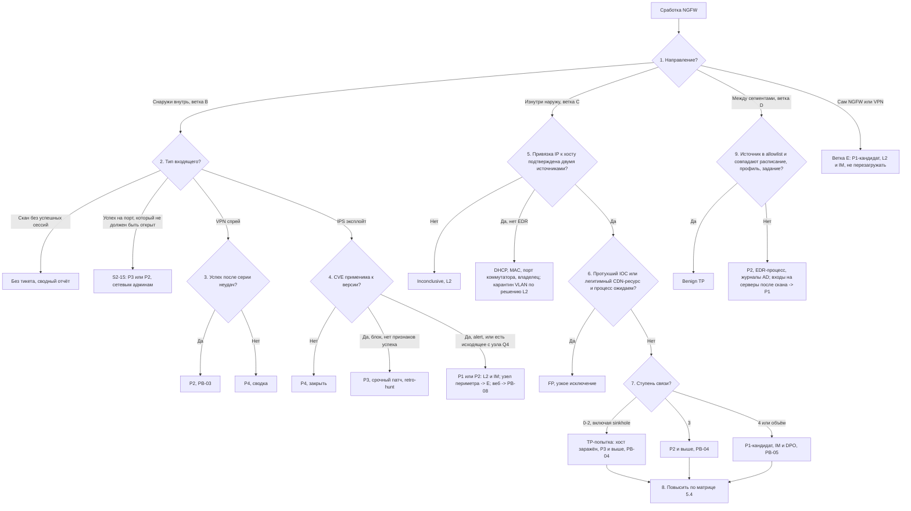

# PB-S2 Сработка NGFW

> Учебный плейбук для вымышленной компании «Альфа-Трейд». Роли, уровни критичности P1–P4, полномочия и ритм статусов взяты из [IR-плана](../plan/ir-plan.md). Всё, что нужно сверить с первоисточником или подобрать под свой стек, собрано в разделе [«Допущения и ограничения»](#допущения-и-ограничения). Сокращения расшифрованы в [Приложении Г](#приложение-г-сокращения).

## TL;DR

- **Когда применять:** NGFW (межсетевой экран нового поколения) дал сработку IPS, URL/DNS-фильтрации, контроля приложений, антивируса или TI-фида; SIEM нашёл аномалию в журналах трафика, VPN или аудита самого NGFW.
- **Изнутри наружу важнее, чем снаружи внутрь.** Входящие атаки из интернета фон. Внутренний хост, который сам ходит к инфраструктуре атакующего, почти всегда уже заражён.
- **Заблокированное обращение к C2 означает заражённый хост.** NGFW остановил соединение, а не вредонос. Вредонос продолжит работу и попробует запасной канал.
- **Сработка не разобрана, пока нет цепочки «IP → хост → пользователь → процесс»** на момент события. NGFW видит адрес, EDR видит программу. Привязку подтверждайте **двумя** независимыми источниками.
- **Порядок действий: снять → изолировать → блокировать.** Сначала таблица сессий и PCAP, потом блокировка. При ручной атаке момент блокировки выбирает IM, сдерживание идёт одновременно по всем точкам.
- **Блокировка узкая и временная:** FQDN/URL, а не IP CDN; с номером тикета, владельцем и сроком действия. **Периметр сам может быть жертвой:** атака на VPN-шлюз или NGFW идёт по ветке E как кандидат в P1, и журналам скомпрометированного устройства доверять нельзя.

## Шпаргалка: первые 30 минут

| № | Действие | Кто | Срок |
| --- | --- | --- | --- |
| 1 | **Примите сработку, заведите или возьмите тикет**, запишите время начала **в UTC и МСК** | L1 | Сразу; начало работы по IR-плану: P1 15 мин 24/7, P2 1 ч, P3 4 ч, P4 1 рабочий день |
| 2 | **Выпишите поля сработки:** зоны, IP до и после NAT, `app`, `rule`, `action`, `direction`, сигнатура/CVE или фид, SNI/URL, байты, `session_id` | L1 | ≤ 5 мин |
| 3 | **Определите направление** ([узел 1](#51-дерево-решений)): снаружи, изнутри, между сегментами или сам NGFW/VPN | L1 | ≤ 5 мин |
| 4 | **Есть признак P1** (источник сервер/DC/DMZ/NGFW, 3 и более хоста, выгрузка с хоста с ПДн, изменения на NGFW): **позвоните L2 сразу**, разбор продолжайте параллельно | L1 | Немедленно |
| 5 | **Привяжите IP → хост → пользователь на момент события** по двум источникам (NAT, VPN, DHCP, CMDB, EDR, User-ID) | L1 | ≤ 15 мин (P1/P2), ≤ 30 мин (P3) |
| 6 | **Найдите процесс** в EDR или Sysmon (Q9), окно ±5 мин. Не нашли за 10 минут, значит эскалируйте на L2 с перечнем того, чего не хватает | L1 | ≤ 10 мин |
| 7 | **Определите ступень связи** по Q1 и **вынесите вердикт** (FP, Benign TP, TP-попытка, TP-успех, Inconclusive) | L1 | ≤ 15 мин (P1), ≤ 30 мин (P2), ≤ 1 ч (P3) |
| 8 | **Проверьте, кто ещё** обращался к индикатору (Q1, Q2 за 30 дней). Больше 1 хоста даёт P2, 3 и более дают P1 | L1 | До эскалации |
| 9 | **Снимите таблицу активных сессий и PCAP 5–15 мин** по хосту и IOC **до любой блокировки** | L2 / сетевой админ | До блокировки |
| 10 | **Изолируйте рабочую станцию в EDR** (L2 делает сам), не выключайте и не перезагружайте, сообщите IM | L2 | ≤ 15 мин после решения (P1/P2) |
| 11 | **Заблокируйте C2 по FQDN/URL/SNI**, правило с комментарием `INC-2026-___ / кто / когда / до какой даты` и сроком 30 дней | L2 / сетевой админ | После снятия артефактов |
| 12 | **IM решает «сдерживать сейчас или после скоупинга»**; при подозрении на выгрузку ПДн IM уведомляет DPO | IM | ≤ 30 мин после TP (P1), ≤ 1 ч (P2); DPO ≤ 1 ч |

## Чего делать нельзя

- **Не закрывайте `action=deny` к C2 как «NGFW отбил».** Попытка связи с C2 означает заражённый хост.
- **Не изолируйте хост, пока привязка IP не подтверждена двумя источниками.** DHCP мог отдать адрес другому ноутбуку.
- **Не меняйте правила NGFW и не изолируйте хосты, если вы L1.** Это полномочия L2 и сетевых администраторов.
- **Не ходите на подозрительный домен** и не запускайте `ping`, `curl`, `nslookup` к нему с корпоративной сети: атакующий видит обращения с нашего IP.
- **Не загружайте файл (только хеш) в VirusTotal и публичные песочницы.** Атакующий узнает, что найден, а в файле могут быть данные компании. Загрузка только с разрешения L2/IM.
- **Не пишите пользователю о подозрении по почте или в мессенджере** и не сообщайте ему ничего до изоляции. Если учётка у атакующего, он узнает; если это инсайдер, он удалит следы; пользователь может перезагрузить или «почистить» ПК.
- **Не блокируйте IP CDN и облаков:** упадут внешние скрипты сайта, оплата, доставка, аналитика. Простой сайта стоит около 1 млн ₽/ч.
- **Не сажайте станции с EDR в карантинный VLAN NGFW:** он рвёт канал EDR и меняет IP. Не сажайте несколько заражённых хостов в общий сегмент без изоляции между ними.
- **Не переводите сигнатуру IPS в блок на проде ночью без проверки:** 1С, банк-клиент, платёжный шлюз, API мобильного приложения.
- **Не меняйте правила без экспорта конфигурации «до».**
- **Не перезагружайте, не обновляйте и не сбрасывайте к заводским настройкам NGFW/VPN при подозрении на компрометацию** до сбора артефактов и решения IM: летучие следы исчезнут, а часть имплантов на пограничных устройствах переживает обновление.

## 1. Цель и область применения

**Цель:** быстро отличить шум от компрометации по сработке NGFW, найти конкретный хост и процесс, присвоить критичность, безопасно сдержать без ущерба для магазина и передать инцидент в сценарный плейбук.

**Что входит:**

- сработки IPS, URL/DNS-фильтрации, контроля приложений, антивируса и песочницы NGFW, индикаторов TI-фидов;
- аномалии журналов трафика: маячки, редкие назначения, объём выгрузки, внутреннее сканирование, исходящее из серверного сегмента и DMZ;
- VPN: перебор и password spraying, аномальные входы;
- аудит самого NGFW/VPN: входы администраторов, изменения политики, исходящее с устройства;
- корреляционные правила SIEM по журналам NGFW, DNS, DHCP и VPN.

**Что не входит:**

| Признак | Куда |
| --- | --- |
| Объёмная атака на канал, перегрузка NGFW | PB-06 |
| Атака на веб-приложение за WAF | PB-S1, PB-08 |
| Сработка EDR или антивируса на хосте (первична) | PB-S4, PB-S3 |
| Подтверждённый вредонос на станции | PB-04 (PB-S2 передаёт туда после триажа) |
| Шифрование, удаление теневых копий | PB-02, P1 |

**Слепые зоны NGFW.** Тишина на NGFW не доказывает, что активности не было. Если подозрение есть, а NGFW молчит, ищите здесь:

| NGFW не видит | Где искать вместо него |
| --- | --- |
| Трафик внутри одного сегмента/VLAN (станция → станция по SMB/RDP/WinRM) | EDR, журналы Windows (4624 тип 3/10, 5140/5145), NetFlow с коммутаторов |
| Содержимое TLS без расшифровки: видны только IP, порт, SNI, отпечаток JA3/JA4, объём. В TLS 1.3 сертификат сервера зашифрован; при Encrypted Client Hello (ECH) скрыт и SNI | EDR (процесс), DNS-журналы |
| QUIC (HTTP/3 по UDP/443), если NGFW его не разбирает | Блокируйте QUIC, чтобы браузер откатился на TCP/TLS |
| DoH/DoT к внешним резолверам | Sysmon 22 / EDR; блок DoH/DoT на NGFW |
| Удалённых сотрудников при split tunneling | EDR на ноутбуке |
| Облачную почту и файлы ↔ интернет | Журналы облачного тенанта (PB-10) |
| Себя самого, если скомпрометирован | Копия журналов в SIEM, снятая ранее; EDR; DNS; провайдер |

## 2. Паспорт

| Поле | Значение |
| --- | --- |
| ID | PB-S2 |
| Версия | 1.0 (дата: ____) |
| Пересмотр | Раз в 6 месяцев и после каждого P1/P2 по этому плейбуку |
| Владелец | Руководитель ИБ, он же руководитель реагирования (IM). Исполнители: L1, L2, сетевые администраторы (ИТ) |
| Критичность по умолчанию | Зависит от типа сработки ([Приложение Б](#приложение-б-источники-данных-и-триггеры)): внешнее сканирование и неприменимые CVE без тикета; заблокированная попытка C2 с рядовой станции **P3**; установленный C2 с рабочей станции **P2** |
| Повышение до P1 | Источник DC, сервер БД/1С/файловый/резервного копирования, DMZ, сам NGFW/VPN; 3 и более хоста; подозрение на выгрузку ПДн; признаки шифровальщика. Критичность берите по худшему признаку ([матрица 5.4](#54-критичность-по-худшему-признаку)) |
| Понижение до P4 | Атака снаружи заблокирована и CVE неприменима или закрыта патчем |
| Техники MITRE ATT&CK | [Приложение А](#приложение-а-mitre-attck) |
| Связанные плейбуки | PB-01 (фишинг: переход по ссылке), PB-02 (шифровальщик), PB-03 (компрометация учётки, в том числе VPN), PB-04 (вредонос на рабочей станции), PB-05 (утечка), PB-06 (DDoS), PB-07 (инсайдер), PB-08 (взлом веб-приложения), PB-S1 (WAF), PB-S3 (антивирус), PB-S4 (EDR) |

**Целевые сроки по фазам** (учебные):

| Контрольная точка | P1 | P2 | P3 | P4 |
| --- | --- | --- | --- | --- |
| Начало работы (по IR-плану) | 15 мин, 24/7 | 1 ч | 4 ч | 1 рабочий день |
| Привязка IP → хост → пользователь | 15 мин от начала | 15 мин | 30 мин | — |
| L1: процесс найден, вердикт, эскалация | 15 мин | 30 мин | 1 ч | — |
| Решение IM «сдерживать сейчас или после скоупинга» | 30 мин после TP | 1 ч | — (L2 сам) | — |
| Изоляция рабочей станции после решения | 15 мин | 15 мин | 1 ч | — |
| Скоупинг (окно 30–90 дней) | 4 ч | 4 ч | 1 рабочий день | — |
| DPO уведомлён при подозрении на выгрузку ПДн | ≤ 1 ч | ≤ 1 ч | — | — |
| Решение по применимой CVE на периметре (виртуальный патч / отключение функции) | 4 ч | 4 ч | 1 рабочий день | — |
| Статус руководству (по IR-плану) | каждые 2 ч | дважды в день | при закрытии | — |

## 3. Подготовка

Проверяйте раз в квартал. Если пункт не выполнен, запишите это в тикет как ограничение расследования.

- [ ] В SIEM поступают журналы NGFW: угрозы, **трафик allow и deny**, URL/DNS, NAT, VPN, аудит; а также DNS и DHCP. Хранение не меньше 90 дней. Готов запрос «IP → хост на момент времени»
- [ ] NTP настроен на NGFW, VPN, DHCP, DNS, EDR и SIEM; часовой пояс журналов зафиксирован
- [ ] EDR стоит на всех станциях и серверах; устройства без EDR перечислены в CMDB
- [ ] Ведутся реестры: сканеры (IP, расписание, профиль), мониторинг, разрешённые RMM, облачные тенанты, allowlist исходящих для серверов и DMZ, согласованные пентесты
- [ ] Решено, кто вносит экстренные правила ночью: роль L2 «экстренная блокировка» или дежурный сетевик с SLA 15 мин
- [ ] Действует подписка на сигнатуры IPS и прошивки; дата обновления в мониторинге
- [ ] Есть резервная копия конфигурации NGFW и эталонная контрольная сумма прошивки
- [ ] L1/L2 умеют снять таблицу сессий и PCAP на своём NGFW
- [ ] Готовы шаблоны сообщений из раздела 11

## 4. Роли и ответственность

Матрица RACI: **R** выполняет, **A** утверждает и отвечает за результат, **C** консультирует, **I** получает информацию.

**Заранее согласованные полномочия.** По IR-плану **L2 сам изолирует одну рабочую станцию и блокирует один внешний IP**; всё остальное делается с IM. Действия на NGFW выполняют сетевые администраторы, если у L2 нет делегированной роли «экстренная блокировка» (только блок-лист адресов и доменов, без правки политики). Решите это заранее. Предложение: расширить полномочия L2 на блокировку FQDN/URL, утверждает IM.

| Действие | L1 | L2 | IM | ИТ (сеть) | Владелец системы | Юрист/DPO | PR | Директор |
| --- | --- | --- | --- | --- | --- | --- | --- | --- |
| Триаж, привязка IP → хост, вердикт | R | A | — | — | — | — | — | — |
| IOC в наблюдение SIEM | R | A | — | — | — | — | — | — |
| Закрытие FP, заявка на тюнинг | R | A | — | C | — | — | — | — |
| Присвоение P1/P2 | C | R | A | — | — | — | — | I (P1) |
| Снятие таблицы сессий, PCAP, экспорт конфигурации | — | R/A | I | R | — | — | — | — |
| Блок одного внешнего IP (не CDN/облако) | — | R/A | I | R* | — | — | — | — |
| Блок FQDN/URL | — | R | A | R* | — | — | — | — |
| Изоляция одной рабочей станции в EDR | I | R/A | I | — | I | — | — | — |
| Карантин устройства без EDR (VLAN/ACL/NAC) | — | A | I | R | C | — | — | — |
| Блок IP CDN/облака, подсети, ASN, страны, категории | — | R | A | R | C | — | — | — |
| Перевод сигнатуры IPS в блок на проде | — | R | A | R | C | — | — | — |
| Изоляция сервера, DMZ-узла | — | R | A | R | A | — | — | I |
| Решение «сдерживать сейчас / после скоупинга» | — | C | **A** | C | — | — | — | — |
| Отключение VPN-портала, сброс всех VPN-сессий | — | C | A | R | C | — | — | A |
| Перезагрузка/обновление/переустановка NGFW при подозрении на компрометацию | — | C | A | R | C | — | — | I |
| Оценка выгрузки ПДн, уведомления | — | C | R | — | C | A | — | A (P1) |
| Внешние сообщения | — | — | C | — | — | C | R | A |

\* R для ИТ, если у L2 нет роли экстренной блокировки.

## 5. Триаж

Триаж делится на две части. **Быстрый триаж (L1, первые 15–30 минут)** отвечает на вопросы «откуда и куда», «чей это хост», «какой процесс» и «была ли связь». **Глубокий триаж (L2)** подтверждает критичность по матрице, разбирает сложные случаи ветки C и готовит решение о сдерживании. Оба идут по одному дереву решений.

### 5.1. Дерево решений

Ветки: **B** снаружи внутрь, **C** изнутри наружу, **D** между сегментами, **E** сам NGFW или VPN.



Ниже каждый узел дерева расписан подробно. Номера узлов совпадают с номерами в схеме.

### 5.2. Быстрый триаж (L1, первые 15–30 минут)

**Перед узлом 1. Зарегистрируйте сработку (≤ 5 мин).**

- Примите сработку, заведите или возьмите тикет, запишите время начала.
- Время пишите **в UTC и МСК**: журнал NGFW часто пишет в UTC («02:14:37 UTC = 05:14:37 МСК»).
- Выпишите поля сработки (таблица источников в [Приложении Б](#приложение-б-источники-данных-и-триггеры)): зоны, IP до и после NAT, `app`, `rule`, `action`, `direction`, сигнатура/CVE или фид, SNI/URL, байты, `session_id`.
- **Увидели признак P1** (источник сервер/DC/DMZ/NGFW, 3 и более хоста, выгрузка с хоста с ПДн, изменения на NGFW): **позвоните L2 сразу**, разбор продолжайте параллельно.

**Узел 1. Направление?**

- Смотрите `src_zone`/`dest_zone`, адреса RFC 1918 и публичные адреса DMZ, с учётом NAT.
- **Снаружи внутрь:** ветка B, узел 2.
- **Изнутри наружу:** ветка C, узел 5.
- **Между сегментами:** ветка D, узел 9.
- **Объект атаки сам NGFW или VPN:** ветка E. Это кандидат в P1, звоните L2 и IM, **устройство не перезагружайте**.

**Узел 2. Тип входящего (ветка B)?**

- **Внешнее сканирование без успешных сессий, неприменимые CVE, заблокированный шум** (триггер S2-16): без тикета, в сводный отчёт смены. Но проверяйте `allow` после скана и опубликованные порты: «сканирование снаружи, ничего» скрывает открытый порт управления, успех после скана и разведку под свежую CVE.
- **Успешное входящее на порт, который не должен быть опубликован** (S2-15): P3; P2 для RDP/SMB/БД/управления. Передайте сетевым администраторам.
- **VPN: спрей** (S2-13): узел 3.
- **IPS: эксплойт на публичный сервис** (S2-06): узел 4.

**Узел 3. VPN: успех после серии неудач?**

- Запустите Q7.
- **Да:** P2, передайте в PB-03.
- **Нет:** P4, в сводку.

**Узел 4. CVE применима к версии?**

- Сверьте версию ПО периметра по CMDB.
- **Неприменима или закрыта патчем:** P4, закройте.
- **Применима, атака заблокирована, признаков успеха нет:** P3, срочный патч, retro-hunt по CVE (раздел 8). Эскалируйте на L2 **даже при блоке**: изменённый вариант эксплойта пройдёт, а успешная попытка могла быть до появления сигнатуры.
- **Применима и `alert`, или есть исходящее с атакованного узла в течение часа (Q4):** P1 или P2, звоните L2 и IM. Узел периметра уходит в ветку E, веб-приложение в PB-08. Результат Q4 даёт кандидата в P1 **независимо от `action`** первой сработки (reverse shell, загрузка второй стадии).

**Узел 5. Чей это внутренний IP на момент события (ветка C)?**

- Если в сработке внешний адрес, начните с NAT: `index=ngfw nat_src_ip=<внешний> nat_src_port=<порт>`.
- Дальше пул VPN (журнал VPN), DHCP (аренда **на время события**, а не сейчас: `index=dhcp ip=10.10.20.57 earliest=<t-12h> latest=<t>`), статический адрес (CMDB), история IP в EDR, User-ID NGFW.
- **Привязка подтверждена, только если совпали два независимых источника.** Не подтверждена, значит не изолируйте, ставьте вердикт Inconclusive и эскалируйте на L2.
- **Привязка есть, но EDR на устройстве нет** (принтер, камера, IoT, Linux без агента, BYOD): соберите DHCP, MAC, порт коммутатора и владельца. Карантинный VLAN по решению L2.
- **Найдите процесс** в EDR или Sysmon 3, 22 (Q9), окно ±5 мин:
  - подозрительно: неподписанный, из `%AppData%`/`%Temp%`/`C:\ProgramData`, родитель Office или скрипт;
  - легитимный процесс (svchost, rundll32, браузер) **не означает FP**: проверьте путь, командную строку, родителя, модули;
  - DNS в Windows делает служба DNS-клиента, поэтому процесс по DNS-запросу даёт только Sysmon 22 или EDR.
- **Процесс не найден за 10 минут:** не тратьте время, эскалируйте на L2 с перечнем того, чего не хватает.

**Узел 6. Протухший IOC или легитимный CDN-ресурс, а процесс ожидаем?**

Оцените надёжность индикатора:

- фид, `ioc_confidence`, `ioc_last_seen`;
- пассивно: whois (возраст домена), passive DNS, crt.sh, не меньше двух источников TI;
- **сильнее подозрение:** молодой домен (моложе 30 дней), редкое назначение (Q5/Q3), самоподписанный сертификат;
- «0 детектов в VirusTotal» для свежей инфраструктуры норма, а не FP.

Проверьте, что это не sinkhole и не CDN (ASN, владелец IP, разметка фида):

- **sinkhole:** это **TP по хосту**, узел 7;
- **IP CDN с известным легитимным SNI:** вероятный FP;
- **неизвестный или молодой SNI на CDN:** не FP.

**Да, протухший IOC или легитимный ресурс и процесс ожидаем:** FP, заведите узкое исключение. **Нет:** узел 7.

**Узел 7. Ступень связи?**

Запустите Q1 по всем сессиям хоста к IOC и возьмите **максимальную ступень за весь период**:

| Ступень | Что видно | Вывод |
| --- | --- | --- |
| 0 | Только DNS-запрос, домен заблокирован/подменён | Попытка. Хост, скорее всего, заражён |
| 1 | TCP SYN без ответа, `deny`, `bytes_in=0` | То же |
| 2 | TCP установлен, сброшен IPS/URL-фильтром | Попытка; проверьте, нет ли **других** сессий с `allow` к тому же IOC, SNI, JA3/JA4 |
| 3 | TLS установлен, регулярный обмен по единицам КБ | Работающий маячок: атакующий может отдавать команды |
| 4 | Длинные сессии, МБ/ГБ | Интерактивная работа или выгрузка → PB-05, P1-кандидат |

- **Ступени 0–2, включая sinkhole:** TP-попытка. Хост **считается заражённым**, P3 и выше, PB-04.
- **Ступень 3:** TP-успех, P2 и выше, PB-04.
- **Ступень 4 или большой объём:** P1-кандидат, звоните IM, IM уведомляет DPO, PB-05.
- Дальше узел 8: L2 повышает критичность по матрице.

**Узел 9. Источник в allowlist и совпадают расписание, профиль, задание (ветка D)?**

- Запустите Q6. Признак атакующего: порты 445, 135, 3389, 5985, 88, 389 и всплеск отказов.
- Сверьте с реестрами сканеров (IP + расписание + профиль + задание в консоли), RMM, пентестов.
- **Совпадает всё:** Benign TP. **Только IP:** недостаточно, скомпрометированный сканер или ноутбук админа остались бы вне подозрений.
- **Не совпадает:** P2, найдите процесс в EDR, проверьте журналы AD. **Входы на серверы после сканирования дают P1.**

### 5.3. Глубокий триаж (L2)

**Узел 8. Повысьте критичность по матрице.** Отвечайте на два вопроса и берите худший признак из [матрицы 5.4](#54-критичность-по-худшему-признаку):

- **Кто ещё?** Q1 и Q2 за 30 дней. Больше 1 хоста даёт P2; 3 и более дают P1.
- **Что за хост и пользователь?** CMDB, AD. Сервер, DC, DMZ, NGFW дают P1; администратор, бухгалтерия, руководство, доступ к базе клиентов дают не ниже P2 при ступени 3 и выше.

**Особые случаи ветки C (исходящее):**

- **RMM, туннель (ngrok, cloudflared, Chisel, frp, SSH наружу на 443), Tor.** Есть заявка, значит Benign TP. Нет заявки, значит смотрите в EDR способ установки. Портативная версия в `%TEMP%`/`%AppData%`, родитель браузер/скрипт/Office, установка ночью, установлен на сервере, есть входящие сессии с неизвестного ID: P2, PB-04. Иначе P3, ИТ и руководитель по телефону; подозрение на умысел уводит в PB-07. Tor-клиент сравнивайте с **полным** списком relay-узлов (Tor Project, onionoo), а не со списком exit-узлов; мосты obfs4/Snowflake по спискам не ловятся, нужен App-ID.
- **Легитимный облачный сервис или мессенджер** (Telegram API, Discord, GitHub, Google Drive, Яндекс Диск, Cloudflare Workers) **от нетипичного процесса** (rundll32, powershell, процесс из `%AppData%`): TP-кандидат, PB-04. Репутационные фиды такое не помечают.
- **Объём.** «Известное облако» не значит «легитимно». Решают процесс (rclone, WinSCP, curl, MEGAsync, архиватор перед выгрузкой), учётка, **чей тенант**, время, первый ли контакт, тип хоста. Сервер БД ходит в облако без заявки, значит P1.
- **Исходящие SMB (445) / RDP (3389) наружу:** P3. Проверьте процесс и документ или ярлык с UNC-путём (утечка NTLM-хеша, PB-01).
- **Майнинг** (Stratum, пулы): P3, на сервере P2 (часто след взлома сервера, PB-08).

**Ветка E (сам NGFW или VPN).** Запустите Q8, сравните конфигурацию с резервной копией, проверьте исходящее с адреса устройства и VPN-сессии после публикации CVE. Журналам самого устройства не доверяйте, берите копию в SIEM. Перед любыми изменениями снимите артефакты (раздел 7, пункт 5).

**Inconclusive.** Нет EDR или нет журналов: эскалируйте на L2 с перечнем недостающего, а пробел видимости запишите задачей в раздел 3.

### 5.4. Критичность по худшему признаку

| Признак | P1 | P2 | P3 | P4 |
| --- | --- | --- | --- | --- |
| Тип хоста | DC, сервер БД/1С/файловый/резервного копирования, DMZ, NGFW/VPN; станция доменного администратора | Привилегированная станция (ИТ, бухгалтерия, руководство, доступ к ПДн) | Рядовая станция | — |
| Число хостов | ≥ 3 или растёт | 2 | 1 | — |
| Ступень связи | 4 (длинные сессии, МБ/ГБ) | 3 (работающий маячок) | 0–2 | — |
| Данные | Подозрение на выгрузку ПДн | Доступ к ПДн возможен | — | — |
| Атакующий | Ручная работа: сканирование + входы на серверы, RMM на сервере, новые админы | RMM/туннель у пользователя без заявки | Массовый вредонос, adware, Tor без других признаков | — |
| Эксплойт на периметр | Признаки компрометации VPN/NGFW или успеха (Q4) | CVE применима, `alert` | CVE применима, блок, патча нет | CVE неприменима или закрыта |
| VPN | Вход с правами администратора | Успех после спрея, аномальный вход | Спрей без успеха на учётки с MFA | Единичные неудачи |
| Конфигурация NGFW | Политику изменил неизвестный | Вход админа с нового адреса без заявки | — | — |

### 5.5. Вердикты

| Вердикт | Что значит | Что дальше |
| --- | --- | --- |
| FP | Сработка ошибочна | Узкое исключение, заявка на тюнинг |
| Benign TP | Сработка верна, активность разрешена | Закрыть с доказательствами |
| TP-попытка | Ступени 0–2 | Хост **считается заражённым**, PB-04 |
| TP-успех | Ступени 3–4 | PB-04, при объёмах PB-05 |
| Inconclusive | Нет данных (нет EDR, нет журналов) | L2 с перечнем недостающего |

### 5.6. Когда эскалировать

- **L1 → L2 (звонок):** любой признак P1 или P2; ступень 3 и выше; привязка IP не удалась; хост без EDR; применимая CVE на периметре **даже при блоке**.
- **L2 → IM (звонок):** P1; признаки ручной атаки (нужно решение «сейчас или после скоупинга»); мера сверх полномочий L2 (сервер, CDN/облако, сигнатура в блок, VPN); ветка E.
- **IM → DPO (≤ 1 ч):** **подозрение** на выгрузку с систем с ПДн, а не подтверждение.
- **IM → директор:** P1; отключение VPN-портала; простой сайта.

## 6. Сдерживание

### 6.1. «Сейчас» или «после скоупинга»: решает IM

| Ситуация | Тактика |
| --- | --- |
| Идёт выгрузка данных, признаки шифрования, скомпрометирован периметр | **Сдерживайте немедленно**, улики собирайте параллельно |
| C2 на одном хосте, массовый вредонос, без ручной работы | Сдерживайте сразу (L2 сам) |
| Признаки ручной атаки: сканирование, боковое перемещение, несколько хостов, RMM, новые учётки | **Сначала скоупинг** (не дольше 2–4 ч), правила блокировки готовьте заранее, затем **одновременно** все хосты, учётки и каналы. Ранняя блокировка одного C2 предупреждает атакующего: он уходит на запасные каналы или ускоряет шифрование |

Решение и его время запишите в тикет.

### 6.2. Краткосрочное сдерживание

| № | Шаг | Кто | Инструмент | Кто утверждает |
| --- | --- | --- | --- | --- |
| 1 | **Снимите таблицу активных сессий NGFW** по хосту и IOC и **PCAP 5–15 мин** (если не идёт выгрузка ПДн) | L2 / сетевой админ | Консоль/CLI NGFW | — |
| 2 | **Изолируйте рабочую станцию в EDR** (канал EDR сохраняется, память не теряется). Не выключайте, не перезагружайте | L2 | EDR | — (L2 сам), сообщите IM |
| 3 | **Устройство без EDR** (принтер, камера, IoT, Linux без агента, BYOD): карантинный VLAN с изоляцией хостов друг от друга (private VLAN/ACL) или порт коммутатора | Сетевой админ | NAC/коммутатор/NGFW | L2 |
| 4 | **Сервер или узел DMZ:** изоляция в EDR или ACL | ИТ / L2 | EDR, NGFW | **IM + владелец системы** |
| 5 | **Заблокируйте C2 по FQDN/URL/SNI**, а не по IP общего назначения. IP блокируйте, только если это VPS, а не CDN/облако (проверьте ASN и число легитимных доменов на IP) | L2 / сетевой админ | NGFW, DNS-фильтр | L2 (один IP); IM для CDN/облака |
| 6 | **Sinkhole домена на внутреннем DNS:** так видно все хосты, которые продолжают его резолвить | ИТ (DNS) | AD DNS | IM |
| 7 | **Учётка пользователя заражённого хоста или вход в VPN:** PB-03 (сброс пароля, отзыв сессий, проверка MFA) | ИТ | AD, VPN | По PB-03 |
| 8 | **VPN под атакой:** ограничьте доступ к порталу (allowlist, геоограничение), отключите уязвимую функцию | Сетевой админ | VPN/NGFW | IM; отключение портала IM + директор |

У каждого временного правила: комментарий `INC-2026-___ / кто / когда / до какой даты`, срок по умолчанию **30 дней**, запись в тикете.

### 6.3. Долгосрочное сдерживание

- **Временное правило исходящей фильтрации** для затронутого сегмента: только allowlist направлений, пока идёт устранение.
- **Перевод сигнатуры IPS по применимой CVE в блок** для конкретного сервиса/направления после проверки её срабатываний на легитимном трафике за 7–30 дней и с планом отката (решает IM).
- **Виртуальный патч** или отключение уязвимой функции периметра до установки обновления.
- **Усиленный мониторинг:** IOC, JA3/JA4, сертификат, хеш процесса в правила SIEM.
- **Откат:** если блокировка задела бизнес-сервис, правило **сужайте** (IP → URL), а не снимайте без решения IM.

## 7. Сбор и сохранение артефактов

**Собирайте по летучести** (от самого летучего, по RFC 3227):

| № | Артефакт | Как сохранить | Когда |
| --- | --- | --- | --- |
| 1 | Таблица активных сессий NGFW по хосту и IOC | CLI/консоль NGFW, вывод в файл | **До** блокировки: после неё сессии пропадут |
| 2 | PCAP трафика хоста к IOC (5–15 мин); PCAP сработки IPS, если устройство его хранит | Захват на NGFW/сенсоре. Даже зашифрованный даёт JA3/JA4, сертификат, размеры и интервалы | До блокировки; PCAP IPS сразу, хранится ограниченно |
| 3 | Память хоста | Функция EDR; иначе WinPmem/Magnet RAM Capture (Windows), AVML/LiME (Linux) на внешний/сетевой носитель | После изоляции в EDR, до любых удалений (передача в PB-04) |
| 4 | Процессы, соединения, кэш DNS, автозапуск | Live response EDR (read-only, L2): `Get-NetTCPConnection`, `Get-CimInstance Win32_Process`, `Get-DnsClientCache`, `netstat -anob`; Linux: `ss -tupna`, `lsof -nP -i`, `ls -l /proc/<pid>/exe`. Пустой `netstat` не значит «чисто»: маячок держит соединение не постоянно | Сразу после изоляции |
| 5 | Конфигурация NGFW/VPN, журнал аудита админов, список VPN-сессий и учёток, диагностический пакет вендора | Экспорт + SHA-256 | До любых изменений правил; обязательно для ветки E |
| 6 | Журналы NGFW (угрозы, трафик, URL, NAT, VPN, системный), DNS, DHCP за окно от 24 ч до первой сработки до текущего момента | Выгрузка из SIEM в исходном формате, SHA-256 | В течение смены: локальные журналы NGFW быстро ротируются |
| 7 | Образец вредоноса | Из карантина EDR, в защищённое хранилище | При передаче в PB-04 |
| 8 | Результаты TI по IOC со временем запроса | Скриншот/экспорт | Репутация меняется |

**Цепочка хранения.** По каждому артефакту запишите в тикет: что это, откуда, кто снял, время (UTC), SHA-256, где лежит. Хранилище улик с ограниченным доступом. Если возможно обращение в полицию, исходники не меняйте до решения юриста.

## 8. Расследование

**Окно поиска:** 30 дней по умолчанию, 90 дней (весь срок хранения по IR-плану) для P1. Медианное время незамеченного присутствия атакующего по отраслевым отчётам порядка 10+ дней, поэтому 7 дней мало.

| № | Вопрос | Где искать |
| --- | --- | --- |
| 1 | **Скоуп:** какие ещё хосты обращались к той же инфраструктуре? | Pivot: домен → все его IP, IP → все домены (Q2, passive DNS); SNI; хеш/издатель сертификата; JA3/JA4; URI и User-Agent (при расшифровке); хеш процесса в EDR (Q1, Q9) |
| 2 | Когда был **первый** контакт и совпадает ли он с первым запуском процесса? | Q1 `first_seen`, EDR |
| 3 | Сменил ли хост канал после блокировки (новые редкие назначения, DoH, облачный сервис)? | Q3, Q5 по хосту после времени блокировки |
| 4 | **Вектор:** как вредонос попал на хост? | EDR (родитель, Zone.Identifier), почта (PB-01), журналы веба; для DMZ WAF и веб-сервер (PB-S1, PB-08) |
| 5 | Был ли успех входящей атаки? | Сигнатура с `direction=server→client`; большой ответ сервера после попытки; Q4; новые файлы/веб-шеллы (EDR на сервере) |
| 6 | Не скомпрометирован ли сам периметр? | Q8; сравнение конфигурации с резервной копией (новые учётки, правила, NAT, маршруты, скрипты); исходящее с адреса NGFW; VPN-сессии после публикации CVE; IOC из бюллетеня вендора, утилита проверки целостности |
| 7 | Retro-hunt по CVE: были ли успешные попытки до появления сигнатуры? | Журналы трафика и VPN с даты публикации CVE; бюллетени вендора, БДУ ФСТЭК, каталог CISA KEV |
| 8 | Использовались ли учётки? | Журнал VPN (откуда ещё входила учётка), AD 4624/4625/4648, 4740, 4771/4776 |
| 9 | Было ли боковое перемещение? | NGFW между сегментами (SMB/RDP/WinRM от не-админских хостов), AD-журналы, EDR; внутри сегмента только EDR/NetFlow |
| 10 | **Затронутые данные:** что ушло наружу? | Q10, объёмы по сессиям ступени 4; к каким шарам/БД хост обращался перед выгрузкой (5140/5145, журналы БД); тенант получателя |
| 11 | **Хронология** | Тикет + все источники в одном часовом поясе |

**Итог расследования в тикете:** хосты, учётки, IOC, первое и последнее время, максимальная ступень, техники ATT&CK **по факту подтверждения**, а не по названию сигнатуры.

Готовые запросы Q1–Q10 собраны в [Приложении В](#приложение-в-примеры-запросов-и-команд).

## 9. Устранение

Здесь только сетевая часть. Хостовое устранение идёт по PB-04, учётки по PB-03, веб по PB-08.

- [ ] Вредонос и закрепление удалены по PB-04; IOC остаются в блок-листе на весь срок наблюдения
- [ ] Точка входа на периметре закрыта: обновление прошивки VPN/NGFW/почтового шлюза. Для уязвимостей из CISA KEV или с подтверждённой эксплуатацией по БДУ в течение 24–72 ч или компенсирующая мера с датой
- [ ] Ошибочно опубликованный порт закрыт, NAT-правило удалено, выяснено, кто и зачем его создал
- [ ] **Ветка E (подтверждённая компрометация периметра):** устройство переустановлено с чистого образа по инструкции вендора (сброса к заводским настройкам может быть недостаточно); сменены **все** секреты устройства: пароли администраторов, ключи и сертификаты VPN, общие ключи IPsec, учётки интеграции с AD/RADIUS/LDAP, ключи API; каждая подозрительная VPN-сессия передана в PB-03
- [ ] Слишком широкое правило политики, через которое прошёл трафик (поле `rule`), сужено
- [ ] Ставшие ненужными временные правила удалены или переведены в постоянные с обоснованием

## 10. Восстановление и мониторинг

**Восстановление:**

- [ ] Хост вернулся в сеть после проверки EDR и при **отсутствии обращений к IOC в течение суток** после восстановления
- [ ] VPN после компрометации периметра включён только после обновления, смены секретов и сверки конфигурации; удалённым сотрудникам отправлено сообщение через ИТ
- [ ] Владелец системы подтвердил, что сервис работает; временные блокировки пересмотрены

**Усиленный мониторинг не менее 2 недель** (по IR-плану), для P1 30 дней:

| Что мониторить | Как |
| --- | --- |
| IOC инцидента: IP, домены, SNI, JA3/JA4, хеш сертификата, хеш процесса | Правила SIEM, алерт на любое совпадение |
| Затронутые хосты: новые редкие назначения, маячки | Q3, Q5 по списку хостов ежедневно |
| Исходящее с серверов и DMZ вне allowlist | Q5 с алертом |
| Учётки инцидента: входы VPN | Q7 по списку учёток |
| Сам NGFW/VPN (ветка E): входы админов, изменения, исходящее с устройства | Q8 с алертом в реальном времени |
| Повторная эксплуатация CVE | Сигнатура IPS в блоке, отчёт по ней ежедневно |

## 11. Коммуникации и уведомления

### 11.1. Внутри компании

| Кому | Когда | Канал |
| --- | --- | --- |
| L2 | P1/P2, ступень 3 и выше, привязка не удалась | Звонок + тикет |
| IM | P1/P2 сразу; решения сверх полномочий L2 | Звонок, канал инцидента |
| Сетевые админы | О каждом изменении на NGFW, сроке правила, кто снимет | Тикет |
| Владелец системы | Любые меры против сервера, блокировки бизнес-сервисов, простой | Звонок через IM |
| Служба поддержки | О блокировках, которые вызовут жалобы («не открывается сайт X»), без деталей | Тикет/чат ИТ |
| Пользователь и руководитель | **После** изоляции, по телефону: «не выключайте компьютер, с вами свяжется ИБ» | Телефон |
| Директор | P1, отключение VPN-портала, простой сайта | IM, статус по ритму IR-плана |

При подозрении на компрометацию учёток или почты не обсуждайте инцидент по корпоративной почте: используйте резервный канал по IR-плану.

### 11.2. Вне компании

| Кому | Когда | Кто | Основание / срок |
| --- | --- | --- | --- |
| Роскомнадзор | Утечка ПДн подтверждена юристом | Юрист/DPO | 152-ФЗ, ст. 21 ч. 3.1: первичное уведомление 24 ч с момента выявления, результаты расследования 72 ч. Время выявления запишите в тикет |
| ГосСОПКА (НКЦКИ) | Инцидент, повлёкший неправомерную передачу ПДн | Юрист/DPO | 152-ФЗ, ст. 19 ч. 12 и приказ ФСБ о порядке взаимодействия. Это не уведомление по 187-ФЗ: «Альфа-Трейд» не субъект КИИ |
| Вендор NGFW/VPN, интегратор | Подозрение на 0-day или компрометацию устройства | L2 через IM | — |
| Провайдер | Нужна фильтрация на его стороне | Сетевые админы | — |
| Полиция | Признаки преступления | Директор по рекомендации юриста | УК РФ, ст. 272–274 |
| Клиенты, СМИ | Инцидент заметен клиентам | PR после решения IM и юриста | — |

### 11.3. Шаблоны

**Шаблон 1. Эскалация L1 → L2 (в тикет и голосом).**

```text
[PB-S2][P2] C2 с рабочей станции, связь установлена (ступень 3)
Сработка: S2-01, правило NGFW <rule>, фид <name>, уверенность high, action=allow
Время: 2026-10-31 02:14:37 UTC (05:14:37 МСК); первое обращение 2026-10-24 09:02 МСК
Хост: PC-ACC-07 (10.10.20.57), a.petrova; привязка: DHCP + EDR
Назначение: 203.0.113.45 / sni cdn-update.example (домен зарегистрирован 12 дней назад)
Процесс: C:\Users\a.petrova\AppData\Roaming\updsvc.exe, не подписан, родитель explorer.exe, SHA-256 <...>
Маячок: 412 соединений за 24 ч, интервал ~300 с, cv 0.18, по ~1.2 КБ
Другие хосты (Q1/Q2, 30 дней): нет
Действия: ничего не блокировал, IOC в наблюдении
Нужно: решение L2 по изоляции, передача в PB-04
```

**Шаблон 2. Короткий статус IM руководству.**

```text
INC-2026-___ [P_] Сработка NGFW: <что>. Затронуто: <хосты/сервисы>. Ступень связи: <0–4>.
Сделано: <изоляция/блокировки>. Риск для ПДн: <нет/оценивается/да>, DPO: <уведомлён в ЧЧ:ММ>.
Дальше: <шаги>. Нужны решения: <какие>. Следующий статус: <время>.
```

## 12. Критерии закрытия

**Закрыть как FP или Benign TP можно, когда отмечены все пункты:**

- [ ] Хост, пользователь и процесс определены, или документально объяснено, почему это невозможно
- [ ] Причина FP подтверждена доказательствами: расписание и задание сканера, владелец ASN, `last_seen` индикатора, заявка на RMM
- [ ] Заведена заявка на тюнинг: узкое исключение (источник + назначение + сигнатура/порт), владелец, срок пересмотра

**Закрыть как TP можно, когда отмечены все пункты:**

- [ ] Инцидент передан в сценарный плейбук (PB-04/PB-03/PB-05/PB-08/PB-02) и закрыт там
- [ ] Скоупинг выполнен за окно 30/90 дней; список хостов, учёток и IOC в тикете
- [ ] После сдерживания нет обращений ни к IOC, ни к новым подозрительным назначениям с затронутых хостов
- [ ] IOC на усиленном мониторинге 2 недели
- [ ] Временные правила NGFW с владельцем и сроком; экспорт конфигурации «до» приложен
- [ ] Для атаки на периметр: обновление установлено или есть компенсирующая мера с датой; для ветки E секреты сменены
- [ ] Юрист подтвердил, нужны ли уведомления; время выявления зафиксировано
- [ ] Артефакты с хешами и цепочкой хранения в тикете
- [ ] Для P1/P2 назначен разбор в течение 5 рабочих дней (по IR-плану)

## 13. Метрики

| Метрика | Цель (учебная) | Что показывает |
| --- | --- | --- |
| MTTD: от первого контакта с IOC (Q1 `first_seen`) до сработки | Снижать | Сколько атакующий работал незамеченным |
| MTTR: от обнаружения до восстановления | Снижать | Общая скорость реагирования |
| Время привязки IP → хост → процесс | ≤ 15 мин | Главный узкий участок L1 на сетевых сработках |
| Время от подтверждения C2 (ступень ≥ 3) до изоляции | ≤ 30 мин | Скорость сдерживания |
| Доля исходящих сработок, закрытых без проверки процесса в EDR | 0 | Дисциплина триажа |
| Доля FP по каждому фиду и сигнатуре | Тренд вниз | Качество источников |
| Доля Inconclusive из-за отсутствия журналов/EDR | Тренд вниз | Пробелы видимости → задачи в раздел 3 |
| Число временных правил старше срока | 0 | Гигиена NGFW |
| Время от публикации критичной CVE на продукт периметра до обновления | ≤ 72 ч для KEV | Управление уязвимостями периметра |
| Давность последнего обновления сигнатур IPS | ≤ 1 сут | Без подписки сигнатур на новые CVE просто нет |

## 14. Типичные ошибки

| Ошибка | Последствие | Как правильно |
| --- | --- | --- |
| Заблокировать C2 и закрыть инцидент | Вредонос остался и ушёл на запасной канал | Передача в PB-04, проверка смены канала |
| `deny` к C2 закрыт как P4 | Заражённый хост в сети | Попытка = заражённый хост |
| «Каждые 60 секунд = маячок» | Поток FP от агентов, NTP, мониторинга; пропуск маячков с jitter и интервалом в часы | Статистика Q3 + редкость + возраст домена + процесс |
| Неверная привязка IP (DHCP, VPN, NAT, часовой пояс) | Изолирован чужой ноутбук, заражённый работает | Время события, два источника |
| Блок IP CDN/облака | Падает сайт, оплата, интеграции | Блок FQDN/URL; IP облака только с IM |
| «Сканер ИБ» подтверждён только по IP | Скомпрометированный сканер или ноутбук админа вне подозрений | IP + расписание + профиль + задание |
| «Известное облако = резервное копирование» | Пропущена выгрузка базы через rclone в личный аккаунт и срок РКН | Процесс, тенант, время, тип хоста |
| Sinkhole закрыт как «безопасный адрес» | Заражённый хост остался | Sinkhole = TP по хосту |
| «Сканирование снаружи, ничего страшного» | Пропущен открытый порт управления, успех после скана, разведка под свежую CVE | Проверять `allow` после скана и опубликованные порты |
| IPS заблокировал эксплойт на VPN, закрыли | Изменённый вариант проходит, уязвимость открыта | Применимая CVE без патча эскалируется всегда |
| Перезагрузка NGFW/VPN при подозрении на взлом | Потеря летучих следов, имплант может выжить | Ветка E: сначала сбор и вендор |
| Доверие журналам скомпрометированного NGFW | Атакующий мог их подменить | Копия в SIEM, EDR, DNS, NetFlow |
| Проверка домена браузером/curl с рабочего места | Атакующий видит обращение компании | Только пассивные источники или изолированная среда |
| Загрузка файла в VirusTotal | Атакующий узнаёт, что найден; утечка данных компании | Только поиск по хешу; загрузка с разрешения L2/IM |
| Окно скоупинга 7 дней | Пропущены ранние заражения, неверное начало инцидента | 30/90 дней |
| Блокировки «навсегда» | Через год тысячи записей, сломанные сервисы | Срок, владелец, ежемесячная ревизия |
| Выяснение «кто поставил AnyDesk» письмом | Атакующий или инсайдер предупреждён | Через руководителя по телефону, после сбора данных |

## 15. Профилактика

Выбирайте меры по вектору инцидента.

- [ ] **Фильтрация исходящего:** серверы и DMZ выходят только к перечню (обновления, платёжный шлюз, доставка, партнёры); пользователи через URL-фильтрацию, без прямых нестандартных портов; исходящие SMB/RDP наружу запрещены
- [ ] **DNS:** только корпоративные резолверы; DoH/DoT наружу и QUIC заблокированы или инспектируются; блок категории «новые домены» хотя бы для серверов
- [ ] **TLS-инспекция** для категорий риска, исключения (банки, медицина, госуслуги) утверждены юристом; минимум журналирование SNI и JA3/JA4
- [ ] **RMM и туннели:** блок категорий, один утверждённый инструмент ИТ
- [ ] **Сегментация:** пользователи → серверы по SMB/RDP/WinRM только с jump-хостов админов; SMB между станциями запрещён (Windows Firewall через GPO)
- [ ] **VPN:** MFA для всех; ограничения по странам; блокировка после серии неудач; полный туннель или обязательный агент безопасности для удалённых
- [ ] **Защита самого NGFW/VPN:** интерфейсы управления недоступны из интернета; вход админов только из выделенного сегмента с MFA; аудит в SIEM с алертом на изменения вне окна; мониторинг исходящего с устройства; своевременные обновления
- [ ] **Детекты в SIEM:** маячки, редкие назначения, DNS-туннелирование, спрей на VPN, RMM, корреляция «эксплойт → исходящее»
- [ ] **Видимость east-west:** NetFlow с коммутаторов или сенсор Suricata/Zeek во внутренних сегментах
- [ ] **Тюнинг:** еженедельно топ-10 сигнатур и фидов по FP; исключения узкие, с владельцем и сроком пересмотра ≤ 90 дней; ежемесячная ревизия временных блокировок и allowlist

## 16. Учебная ситуация

**Вводная.** Суббота, 02:40 МСК. NGFW присылает сработку IPS high на VPN-портал: сигнатура по CVE, опубликованной 4 дня назад, действие `alert`. По CMDB версия VPN-шлюза уязвима, патч ещё не установлен. Через 20 минут в журнале трафика появляется исходящее соединение **с адреса самого VPN-шлюза** на неизвестный VPS-адрес, 3 МБ наружу. В 03:15 L1 видит ещё одну сработку: DNS-запрос со станции бухгалтерии PC-ACC-07 (10.10.20.57, пул DHCP) к домену из фида; ответ адрес, который фид размечает как sinkhole, соединение заблокировано. Дежурный сетевик говорит: «Давайте я просто перезагружу шлюз и поставлю патч, там пять минут».

**Задания:**

1. **02:45. Вы L1.** Пройдите по дереву решений для сработки IPS: запишите узлы (1 → 2 → 4), ветку, стартовую P и кому вы звоните. Какой запрос запускаете первым: Q4 или Q8, и почему?
2. **03:00. Исходящее с адреса шлюза.** Запишите, на какой узел дерева вы попали, какая теперь P и какая ветка. Сформулируйте ответ сетевику в двух предложениях. Перечислите артефакты из раздела 7, которые нужно снять **до** любых изменений на шлюзе, в порядке летучести, и назовите по RACI, кто решает об отключении VPN-портала.
3. **03:15. PC-ACC-07.** Пройдите узлы 5–7. Назовите два независимых источника, которыми вы подтвердите, что 10.10.20.57 в 03:15 был именно PC-ACC-07, и напишите запрос к DHCP. Объясните, почему DNS-запрос к sinkhole не FP, какая это ступень и какая P. Как вы проверите, связаны ли две сработки (какие запросы и по каким полям)?
4. **03:30. Хронология.** Запишите, каким журналам вы будете доверять, если шлюз скомпрометирован, какое окно ретроспективного поиска возьмёте и с какой даты запустите retro-hunt по CVE.
5. **03:45. Вы L2.** Составьте сообщение IM по шаблону 2. Перечислите секреты, которые нужно сменить при подтверждённой компрометации шлюза (раздел 9), и запишите момент, с которого IM обязан подключить DPO, и срок на это.

**Самопроверка:**

- [ ] Почему заблокированное обращение к C2 не P4?
- [ ] Как найти хост, если в сработке только внешний NAT-адрес компании?
- [ ] Почему поиск по списку exit-узлов Tor не найдёт Tor-клиент внутри сети?
- [ ] Почему для станции с EDR изоляция в EDR лучше карантинного VLAN?
- [ ] Когда блокировать C2 сразу, а когда ждать решения IM?

## 17. Источники

- MITRE ATT&CK Enterprise: https://attack.mitre.org/ (номера техник сверяйте с текущей версией)
- NIST SP 800-61 Rev. 3: https://csrc.nist.gov/pubs/sp/800/61/r3/final ; Rev. 2 проще для новичка
- NIST SP 800-41 Rev. 1, Guidelines on Firewalls and Firewall Policy: https://csrc.nist.gov/pubs/sp/800/41/r1/final
- NIST SP 800-94, Guide to Intrusion Detection and Prevention Systems (IDPS): https://csrc.nist.gov/pubs/sp/800/94/final
- NIST SP 800-86, Guide to Integrating Forensic Techniques into Incident Response: https://csrc.nist.gov/pubs/sp/800/86/final
- RFC 3227, Guidelines for Evidence Collection and Archiving: https://www.rfc-editor.org/rfc/rfc3227
- CISA Known Exploited Vulnerabilities Catalog: https://www.cisa.gov/known-exploited-vulnerabilities-catalog
- CISA, Federal Government Cybersecurity Incident and Vulnerability Response Playbooks: https://www.cisa.gov/ ; совместные рекомендации CISA и партнёров по защите пограничных устройств (edge devices)
- БДУ ФСТЭК России (банк данных угроз и уязвимостей): https://bdu.fstec.ru/
- SANS Incident Handler's Handbook: https://www.sans.org/white-papers/33901/
- RITA (Active Countermeasures), инструмент поиска маячков: https://github.com/activecm/rita
- JA4+ (FoxIO), отпечатки TLS/QUIC-клиентов: https://github.com/FoxIO-LLC/ja4
- Zeek: https://zeek.org/ ; Suricata: https://suricata.io/
- Tor Project, Onionoo (список relay-узлов): https://metrics.torproject.org/onionoo.html
- SigmaHQ: https://github.com/SigmaHQ/sigma
- Отраслевые отчёты для контекста: Verizon DBIR, Mandiant M-Trends (эксплуатация пограничных устройств, время присутствия атакующего)
- 152-ФЗ «О персональных данных»: актуальная редакция на consultant.ru / garant.ru
- Документация вендора своего NGFW/VPN: имена полей журналов, значения `action`, захват пакетов, таблица сессий, бюллетени безопасности и утилиты проверки целостности

## Допущения и ограничения

**Что нужно сверить перед реальным применением:**

| № | Что | Где в плейбуке | Почему нужна проверка |
| --- | --- | --- | --- |
| 1 | Поддержка Encrypted Client Hello (ECH) и поведение своего NGFW при нём | 1, слепые зоны | Зависит от вендора и версии |
| 2 | Разбирает ли ваш NGFW QUIC | 1, слепые зоны | Зависит от стека |
| 3 | T1219 Remote Access Software | Приложение А | В новых версиях ATT&CK техника могла быть переименована и получить подтехники; все идентификаторы сверяйте с актуальной версией |
| 4 | События 256/257 журнала Microsoft-Windows-DNSServer/Analytical | Приложение Б | Номера проверьте для своей версии Windows |
| 5 | Коды 10 (новая аренда) и 11 (продление) в журнале DHCP Windows | Приложение Б | Проверьте для своей версии |
| 6 | Фильтрация Sysmon EID 3 | Приложение Б | Часто отфильтрован, зависит от конфигурации |
| 7 | Синтаксис поиска по сетевой телеметрии процесса в EDR | Приложение Б, Q9 | Зависит от EDR |
| 8 | Команды снятия таблицы сессий и PCAP на NGFW | 6.2, 7 | Зависят от стека |
| 9 | Переживает ли имплант на пограничном устройстве обновление прошивки | Чего делать нельзя, 14 | Проверьте по своему вендору |
| 10 | Достаточно ли сброса к заводским настройкам при компрометации периметра | 9 | Проверьте по инструкции вендора |
| 11 | Утилита проверки целостности устройства | 8 | Есть не у каждого вендора |
| 12 | Журналирование SNI и JA3/JA4 | 15 | Поддержка зависит от вендора |
| 13 | Сенсор Suricata/Zeek или NetFlow для видимости east-west | 15 | Оцените по бюджету |
| 14 | Сроки уведомления Роскомнадзора (24 и 72 часа), 152-ФЗ ст. 21 ч. 3.1 | 11.2 | Проверьте по действующей редакции; в IR-плане сроки помечены как приблизительные |
| 15 | Уведомление ГосСОПКА: 152-ФЗ ст. 19 ч. 12 и приказ ФСБ о порядке взаимодействия | 11.2 | Проверьте номер, дату и сроки |
| 16 | УК РФ, ст. 272–274 | 11.2 | Проверьте по действующей редакции |
| 17 | Медианное время незамеченного присутствия атакующего (порядка 10+ дней) | 8 | Проверьте по свежему Mandiant M-Trends |
| 18 | Совместные рекомендации CISA и партнёров по защите пограничных устройств | 17 | Проверьте актуальную публикацию |
| 19 | Цифры из Verizon DBIR и Mandiant M-Trends | 17 | Проверяйте в последнем выпуске |

**Допущения:**

- Вендоры NGFW, SIEM, EDR, DNS/DHCP и VPN в IR-плане не названы. Имена полей, команды и синтаксис запросов в плейбуке условные.
- Запросы даны как примеры на нейтральном псевдо-SPL для понимания логики. Индексы, зоны (`users`, `servers`, `dmz`, `vpn`, `untrust`, `mgmt`) и lookup-таблицы условные. Для MaxPatrol SIEM, KUMA, RuSIEM и других перепишите запросы под их синтаксис.
- IP и домены в примерах документационные (203.0.113.0/24, `*.example`).
- Все пороги в запросах стартовые и учебные, на практике подбирайте их по базовой линии компании: порог выгрузки 500 МБ для станций и 50–100 МБ для серверов с ПДн; параметры маячка в Q3.
- Учебные цифры и правила: целевые сроки раздела 2, стартовая критичность триггеров, окно скоупинга не дольше 2–4 ч при ручной атаке, срок временного правила 30 дней, простой сайта около 1 млн ₽/ч (по IR-плану), SLA 24–72 ч на уязвимости из KEV, мониторинг 30 дней для P1, цели метрик. Реальные значения утверждает руководитель ИБ.
- Расширение полномочий L2 на блокировку FQDN/URL (раздел 4) это предложение, его утверждает IM.
- В исходной версии плейбука IR-план указан как `source/ir-plan.md`; здесь ссылка ведёт на ../plan/ir-plan.md.

## Приложение А. MITRE ATT&CK

| Тактика | Техника | ID |
| --- | --- | --- |
| Разведка | Active Scanning | T1595 |
| Первоначальный доступ | Exploit Public-Facing Application | T1190 |
| Первоначальный доступ | External Remote Services | T1133 |
| Первоначальный доступ | Valid Accounts | T1078 |
| Доступ к учётным данным | Password Spraying | T1110.003 |
| Обнаружение | Network Service Discovery | T1046 |
| Боковое перемещение | Remote Services | T1021 |
| Боковое перемещение | Lateral Tool Transfer | T1570 |
| Управление (C2) | Application Layer Protocol: Web / DNS | T1071.001 / T1071.004 |
| Управление (C2) | Encrypted Channel | T1573 |
| Управление (C2) | Protocol Tunneling | T1572 |
| Управление (C2) | Multi-hop Proxy (Tor) | T1090.003 |
| Управление (C2) | Web Service | T1102 |
| Управление (C2) | Dynamic Resolution: DGA | T1568.002 |
| Управление (C2) | Remote Access Software | T1219 |
| Выгрузка данных | Exfiltration Over C2 Channel | T1041 |
| Выгрузка данных | Exfiltration Over Alternative Protocol | T1048 |
| Выгрузка данных | Exfiltration to Cloud Storage | T1567.002 |
| Воздействие | Resource Hijacking | T1496 |
| Обход защиты (сам NGFW) | Disable or Modify System Firewall | T1562.004 |
| Обход защиты (сам NGFW) | Network Boundary Bridging | T1599 |
| Обход защиты (сам NGFW) | Modify System Image | T1601 |

## Приложение Б. Источники данных и триггеры

### Б.1. Источники данных

| Источник | Что видим | Ключевые поля / Event ID | Пример запроса |
| --- | --- | --- | --- |
| Журнал угроз NGFW (IPS, URL, AV, TI) | Сама сработка | `threat_name`, `signature_id`, `cve`, `severity`, `action` (allow/alert, drop, reset, block-ip), `direction` (client→server / server→client), `feed_name`, `ioc_confidence`, `ioc_last_seen`, `session_id`, `pcap_id` | `index=ngfw_threat action IN (alert,allow) severity>=high` |
| Журнал трафика NGFW (allow **и** deny) | Все сессии, не только сработки | `src_ip`/`src_zone`, `dest_ip`/`dest_zone`, `nat_src_ip`/`nat_dest_ip`, `app` (App-ID), `rule`, `bytes_out`/`bytes_in`, `packets`, `duration`, `session_end_reason`, `sni`, `ja3`/`ja4`, `cert_issuer` | Q1, Q3, Q5 |
| Журнал NAT | Внутренний адрес за внешним | `nat_src_ip`, `nat_src_port`, время | `index=ngfw nat_src_ip=<внешний> nat_src_port=<порт>` |
| Журнал VPN | Учётка ↔ IP из пула | `user`, внешний IP, выданный IP, `mfa_result`, страна/ASN, начало/конец сессии | Q7 |
| Аудит NGFW/VPN | Целостность устройства | вход админа, `config_change`, `policy_commit`, `admin_create`, `export_config`, обновление прошивки | Q8 |
| DNS-сервер (AD DNS) | Кто резолвил домен, даже при блоке соединения | клиент, `query`, `query_type`, `rcode`, ответ. Windows: журнал Microsoft-Windows-DNSServer/Analytical, события 256/257 | Q2 |
| DHCP | IP → MAC → hostname на момент события | Windows: `%windir%\System32\dhcp\DhcpSrvLog-<день>.log`, коды 10 (новая аренда), 11 (продление) | `index=dhcp ip=10.10.20.57 earliest=<t-12h> latest=<t>` |
| EDR | Процесс, родитель, хеш, подпись, учётка | Сетевая телеметрия процесса | Q9 |
| Sysmon (если развёрнут) | Процесс за соединением/DNS | EID 1 (процесс), 3 (сеть: `Image`, `DestinationIp`), 22 (DNS: `QueryName`, `Image`). EID 3 часто отфильтрован | Q9 |
| Журнал безопасности Windows | Боковое перемещение, входы | 4624/4625 (тип 3, 10), 4648, 5140/5145, 4688; 5156 только если включён аудит WFP (шумно) | — |
| CMDB / реестры | Роль хоста, разрешённое | Версии ПО периметра, allowlist сканеров, RMM, облачных тенантов, исходящих направлений серверов, согласованные пентесты | lookup-таблицы |

### Б.2. Типовые триггеры и стартовая критичность

| ID | Триггер | Старт | Кто |
| --- | --- | --- | --- |
| S2-01 | Исходящее к IOC высокой уверенности, `action=allow`, есть `bytes_in` | P2 | L1 → L2 |
| S2-02 | То же с `deny/reset`, DNS-запрос к домену из TI, обращение к sinkhole | P3 | L1 |
| S2-03 | Сигнатура C2-трафика IPS (не TI) | P2 | L1 → L2 |
| S2-04 | Маячок (Q3) к редкому назначению | P3 | L1 |
| S2-05 | S2-01…04, где источник серверы, DMZ, NGFW/VPN, или ≥ 3 хостов | **P1** | L2 + IM |
| S2-06 | IPS: эксплойт на публичный сервис, CVE применима | P3 (блок) / P2 (alert) | L1 → L2 |
| S2-07 | Корреляция: эксплойт на узел DMZ/периметра → исходящее с этого узла ≤ 1 ч (Q4) | **P1** | L2 + IM |
| S2-08 | Исходящее из серверного сегмента/DMZ на назначение не из allowlist (Q5) | P2 | L1 → L2 |
| S2-09 | Внутреннее сканирование не из allowlist (Q6) | P2 | L1 → L2 |
| S2-10 | Объём выше порога на новое назначение (Q10) | P2; **P1** с хоста с ПДн | L1 → L2 (+ DPO) |
| S2-11 | RMM, туннель, Tor без заявки | P3; P2 при признаках установки атакующим или на сервере | L1 |
| S2-12 | DNS: DGA, туннелирование, прямой DNS/DoH наружу | P3 | L1 |
| S2-13 | VPN: спрей без успеха / успех после серии неудач (Q7) | P4 / P2 | L1 → PB-03 |
| S2-14 | Вход админа NGFW или изменение политики вне заявки (Q8) | P1-кандидат | L2 + IM |
| S2-15 | Успешное входящее на порт, который не должен быть опубликован | P3; P2 для RDP/SMB/БД/управления | L1 → сетевые админы |
| S2-16 | Внешнее сканирование, неприменимые CVE, заблокированный шум | Без тикета, сводный отчёт смены | SIEM |

## Приложение В. Примеры запросов и команд

**Q1. Всё по индикатору за 90 дней: кто, когда, чем закончилось**

```
index=ngfw (dest_ip="203.0.113.45" OR sni="*bad-domain.example") earliest=-90d
| stats count min(_time) as first_seen max(_time) as last_seen sum(bytes_out) as out
        sum(bytes_in) as in values(action) as actions values(rule) as rules
        by src_ip user dest_ip dest_port
| sort - last_seen
```

Смотрите: есть ли `allow` с `in > 0`; когда **первый** контакт (компрометация могла начаться раньше сработки); сколько хостов.

**Q2. Кто резолвил домен (видны и хосты, ушедшие на другие IP)**

```
index=dns query="*bad-domain.example" earliest=-90d
| stats count min(_time) as first_seen values(answer) as answers by src_ip query_type
```

Клиенты с DoH сюда не попадут. Если запросы идут через форвардер, в `src_ip` будет форвардер.

**Q3. Маячок: регулярность, а не «ровно 60 секунд»**

```
index=ngfw dest_zone=untrust action=allow earliest=-24h
| sort 0 src_ip dest_ip _time
| streamstats current=f last(_time) as prev by src_ip dest_ip
| eval delta=_time-prev
| stats count avg(delta) as avg_d stdev(delta) as sd_d avg(bytes_out) as avg_o
        stdev(bytes_out) as sd_o values(sni) as sni by src_ip dest_ip
| where count>=30
| eval cv=round(sd_d/avg_d,2), out_cv=round(sd_o/avg_o,2)
| where cv<0.3
| lookup beacon_allowlist dest_ip OUTPUT owner | where isnull(owner)
```

`cv` около 0 означает ровный интервал (примитивный вредонос или служебный агент); 0,1–0,3 маячок с jitter; низкий `out_cv` одинаковый размер запросов. Для интервалов в час и реже берите окно 7 дней. Готовый инструмент для обучения: RITA (Active Countermeasures).

**Q4. Эксплойт на DMZ/периметр → исходящее с атакованного узла в течение часа**

```
index=ngfw threat_category=vulnerability dest_zone=dmz earliest=-24h
| eval victim=coalesce(nat_dest_ip,dest_ip), t_exp=_time
| join type=inner victim
    [ search index=ngfw src_zone=dmz dest_zone=untrust earliest=-24h
      | lookup dmz_egress_allowlist dest_ip OUTPUT ok | where isnull(ok)
      | eval victim=src_ip | stats min(_time) as t_out values(dest_ip) as out_dest by victim ]
| where t_out>t_exp AND t_out-t_exp<3600
```

Результат даёт P1-кандидата **независимо от `action`** первой сработки (reverse shell, загрузка второй стадии).

**Q5. Серверы и DMZ ходят в интернет не по allowlist**

```
index=ngfw src_zone IN (servers,dmz) dest_zone=untrust earliest=-24h
| lookup server_egress_allowlist src_ip sni OUTPUT approved | where isnull(approved)
| stats count sum(bytes_out) as out values(app) as app by src_ip dest_ip sni action
```

**Q6. Внутреннее сканирование между сегментами**

```
index=ngfw src_zone=users dest_zone IN (servers,dmz,users) earliest=-1h
| bin _time span=10m
| stats dc(dest_ip) as targets dc(dest_port) as ports values(dest_port) as plist by _time src_ip
| where targets>=30 OR ports>=15
| lookup scanner_allowlist src_ip OUTPUT owner schedule
```

Признак атакующего: порты 445, 135, 3389, 5985, 88, 389 и всплеск отказов.

**Q7. VPN: спрей и успех после серии неудач**

```
index=vpn earliest=-24h
| sort 0 user _time
| streamstats count(eval(result="fail")) as fails reset_after="(result==\"success\")" by user
| where result="success" AND fails>=5
| table _time user src_ip src_country src_asn mfa_result fails
```

**Q8. Изменения на самом NGFW**

```
index=ngfw_audit earliest=-7d event_type IN (admin_login,config_change,policy_commit,admin_create,export_config)
| stats count values(object) as objects by admin src_ip event_type
```

**Q9. Процесс за соединением (Sysmon; в EDR аналогичный поиск по сетевой телеметрии)**

```
index=sysmon (EventCode=3 DestinationIp="203.0.113.45") OR (EventCode=22 QueryName="*bad-domain.example") earliest=-30d
| stats count min(_time) as first_seen by Computer User Image EventCode
```

**Q10. Выгрузка: большой объём на новое назначение**

```
index=ngfw dest_zone=untrust action=allow earliest=-24h
| stats sum(bytes_out) as out sum(bytes_in) as in values(url_category) as cat by src_ip sni
| where out>524288000
| eval ratio=round(out/(in+1),1)
| join type=left sni [ search index=ngfw earliest=-30d latest=-1d | stats count as seen by sni ]
| lookup known_upload_destinations sni OUTPUT owner
| where isnull(seen) OR isnull(owner)
```

Порог 500 МБ для станций; для серверов с ПДн 50–100 МБ.

## Приложение Г. Сокращения

| Сокращение | Расшифровка |
| --- | --- |
| ACL | Список контроля доступа на сетевом оборудовании |
| AD / DC | Active Directory, служба каталогов Windows / контроллер домена |
| API | Программный интерфейс приложения |
| App-ID | Распознавание приложения в трафике средствами NGFW |
| ASN | Номер автономной системы: по нему видно, чья сеть (провайдер, хостинг, облако) |
| BYOD | Личные устройства сотрудников в корпоративной сети |
| C2 | Command and Control: сервер управления вредоносом |
| CDN | Сеть доставки контента: общие IP для тысяч сайтов |
| CMDB | База конфигурационных единиц: роли хостов, версии ПО, владельцы |
| CVE | Идентификатор публично известной уязвимости |
| DGA | Алгоритм генерации доменов, которым вредонос ищет свой C2 |
| DHCP | Протокол автоматической выдачи IP-адресов |
| DMZ | Демилитаризованная зона: сегмент для опубликованных в интернет сервисов |
| DNS | Система доменных имён |
| DoH / DoT | DNS поверх HTTPS / TLS: DNS-запросы, скрытые от обычного журнала DNS |
| DPO | Ответственный за обработку персональных данных |
| ECH | Encrypted Client Hello: расширение TLS, которое скрывает SNI |
| EDR | Система обнаружения и реагирования на конечных точках |
| EID | Event ID, номер события в журналах Windows и Sysmon |
| FP / TP | Ложное срабатывание / подтверждённый инцидент |
| FQDN | Полное доменное имя |
| GPO | Групповая политика Windows |
| ГосСОПКА / НКЦКИ | Государственная система обнаружения, предупреждения и ликвидации последствий компьютерных атак / Национальный координационный центр по компьютерным инцидентам |
| ИБ / ИТ | Информационная безопасность / информационные технологии |
| IM | Incident Manager: руководитель реагирования |
| IoT | Устройства интернета вещей: камеры, принтеры, датчики |
| IOC | Индикатор компрометации: домен, IP, хеш и т. п. |
| IPS | Система предотвращения вторжений, модуль NGFW |
| IPsec | Набор протоколов для шифрованных VPN-туннелей |
| JA3 / JA4 | Отпечатки TLS-клиента по параметрам рукопожатия |
| KEV | Каталог CISA Known Exploited Vulnerabilities: уязвимости с подтверждённой эксплуатацией |
| КИИ | Критическая информационная инфраструктура (187-ФЗ) |
| L1 / L2 | Аналитик SOC первой / второй линии |
| LDAP / RADIUS | Протоколы доступа к каталогу / сетевой аутентификации |
| MAC | Аппаратный адрес сетевого интерфейса |
| MFA | Многофакторная аутентификация |
| MTTD / MTTR | Среднее время обнаружения / реагирования |
| NAC | Контроль доступа к сети на уровне порта коммутатора |
| NAT | Трансляция сетевых адресов |
| NetFlow | Телеметрия сетевых потоков с коммутаторов и маршрутизаторов |
| NGFW | Межсетевой экран нового поколения |
| NTLM | Протокол аутентификации Windows, чей хеш утекает через UNC-пути |
| NTP | Протокол синхронизации времени |
| PCAP | Захват сетевых пакетов |
| ПДн | Персональные данные |
| PR | Служба связей с общественностью |
| QUIC | Транспортный протокол HTTP/3 поверх UDP |
| RACI | Матрица ответственности: выполняет, утверждает, консультирует, информируется |
| RDP / SMB / WinRM / SSH | Протоколы удалённого рабочего стола / файлового доступа / удалённого управления Windows / защищённой удалённой оболочки |
| RFC | Документ стандарта интернета |
| РКН | Роскомнадзор |
| RMM | ПО удалённого управления (AnyDesk и подобные) |
| SIEM | Система сбора и корреляции событий безопасности |
| SLA | Согласованный срок выполнения |
| SNI | Имя сайта, которое видно в TLS-соединении без расшифровки |
| SOC | Центр мониторинга безопасности |
| SPL | Язык запросов Splunk; в плейбуке псевдо-SPL |
| TI | Threat Intelligence: данные об угрозах |
| TLS | Протокол шифрования соединений |
| UNC | Сетевой путь Windows вида `\\сервер\ресурс` |
| URL | Адрес веб-ресурса |
| UTC / МСК | Всемирное координированное время / московское время (UTC+3) |
| VLAN | Виртуальная локальная сеть |
| VPN | Виртуальная частная сеть, удалённый доступ сотрудников |
| VPS | Арендованный виртуальный сервер |
| WAF | Межсетевой экран для веб-приложений |
| WFP | Windows Filtering Platform: платформа фильтрации трафика Windows |
| БДУ ФСТЭК | Банк данных угроз и уязвимостей ФСТЭК России |
