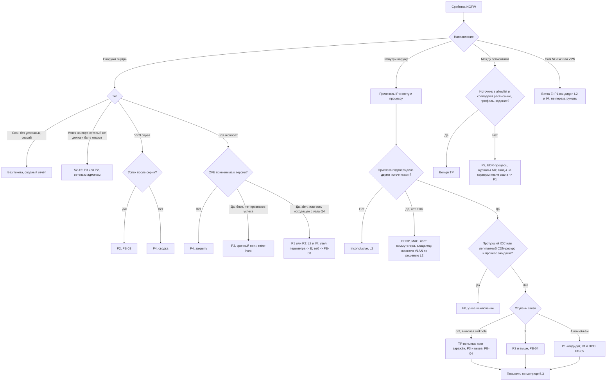

# PB-S2 Сработка NGFW

> Учебный плейбук для вымышленной компании «Альфа-Трейд». Опирается на IR-план (`source/ir-plan.md`): роли, уровни P1–P4, полномочия и ритм статусов берутся оттуда.
>
> Обозначения: **[проверить]** — факт зависит от версии продукта, редакции закона или каталога ATT&CK, сверить с первоисточником; **[зависит от стека]** — вендоры NGFW, SIEM, EDR, DNS/DHCP и VPN в IR-плане не названы, имена полей, команды и синтаксис запросов ниже условные; **[учебное]** — цифра или правило придуманы для учебного примера, на практике подбираются по базовой линии компании.

**Семь принципов этого плейбука**

1. **Изнутри наружу важнее, чем снаружи внутрь.** Входящие атаки из интернета — фон. Внутренний хост, который сам ходит к инфраструктуре атакующего, почти всегда уже заражён.
2. **Заблокированное обращение к C2 — это заражённый хост.** NGFW остановил *соединение*, а не *вредонос*. Вредонос продолжит работу и попробует запасной канал.
3. **NGFW видит адрес, EDR видит программу.** Сработка не разобрана, пока нет цепочки «IP → хост → пользователь → процесс» на момент события.
4. **NGFW видит не всё** (раздел 2). Тишина на NGFW не доказывает, что активности не было.
5. **Периметр сам может быть жертвой.** Атака на VPN-шлюз или сам NGFW — отдельная ветка E, кандидат в P1. Журналам скомпрометированного устройства доверять нельзя.
6. **Снять → изолировать → блокировать.** Сначала таблица сессий и PCAP, потом блокировка. При ручной атаке момент блокировки выбирает IM, сдерживание — одновременно по всем точкам.
7. **Блокировка узкая и временная:** FQDN/URL, а не IP CDN; с номером тикета, владельцем и сроком действия.

## 1. Паспорт плейбука

| Поле | Значение |
| --- | --- |
| ID | PB-S2 |
| Версия | 1.0 (дата: ____; пересмотр раз в 6 месяцев и после каждого P1/P2 по этому плейбуку) |
| Владелец | Руководитель ИБ (IM). Исполнители: L1, L2, сетевые администраторы (ИТ) |
| Критичность по умолчанию | Зависит от типа сработки (раздел 3): внешнее сканирование и неприменимые CVE — без тикета; заблокированная попытка C2 с рядовой станции — **P3**; установленный C2 с рабочей станции — **P2**. **Повышение до P1:** источник — DC, сервер БД/1С/файловый/резервного копирования, DMZ, сам NGFW/VPN; 3 и более хоста; подозрение на выгрузку ПДн; признаки шифровальщика. **Понижение до P4:** атака снаружи заблокирована и CVE неприменима или закрыта патчем. Критичность берётся по худшему признаку (матрица 5.3) |
| MITRE ATT&CK (ключевые) | **Reconnaissance:** T1595 Active Scanning. **Initial Access:** T1190 Exploit Public-Facing Application, T1133 External Remote Services, T1078 Valid Accounts. **Credential Access:** T1110.003 Password Spraying. **Discovery:** T1046 Network Service Discovery. **Lateral Movement:** T1021 Remote Services, T1570 Lateral Tool Transfer. **C2:** T1071.001/.004 Application Layer Protocol (Web/DNS), T1573 Encrypted Channel, T1572 Protocol Tunneling, T1090.003 Multi-hop Proxy (Tor), T1102 Web Service, T1568.002 DGA, T1219 Remote Access Software **[проверить: в новых версиях ATT&CK техника могла быть переименована и получить подтехники]**. **Exfiltration:** T1041, T1048, T1567.002 Exfiltration to Cloud Storage. **Impact:** T1496 Resource Hijacking. **Defense Evasion (сам NGFW):** T1562.004 Disable or Modify System Firewall, T1599 Network Boundary Bridging, T1601 Modify System Image. Идентификаторы сверять с актуальной версией |
| Связанные плейбуки | PB-01 (фишинг: переход по ссылке), PB-02 (шифровальщик), PB-03 (компрометация учётки, в т. ч. VPN), PB-04 (вредонос на рабочей станции), PB-05 (утечка), PB-06 (DDoS), PB-07 (инсайдер), PB-08 (взлом веб-приложения), PB-S1 (WAF), PB-S3 (антивирус), PB-S4 (EDR) |

**Целевые сроки по фазам [учебное]**

| Контрольная точка | P1 | P2 | P3 | P4 |
| --- | --- | --- | --- | --- |
| Начало работы (по IR-плану) | 15 мин, 24/7 | 1 ч | 4 ч | 1 рабочий день |
| Привязка IP → хост → пользователь | 15 мин от начала | 15 мин | 30 мин | — |
| L1: процесс найден, вердикт, эскалация | 15 мин | 30 мин | 1 ч | — |
| Решение IM «сдерживать сейчас или после скоупинга» | 30 мин после TP | 1 ч | — (L2 сам) | — |
| Изоляция рабочей станции после решения | 15 мин | 15 мин | 1 ч | — |
| Скоупинг (окно 30–90 дней) | 4 ч | 4 ч | 1 рабочий день | — |
| DPO уведомлён при подозрении на выгрузку ПДн | ≤ 1 ч | ≤ 1 ч | — | — |
| Решение по применимой CVE на периметре (виртуальный патч / отключение функции) | 4 ч | 4 ч | 1 рабочий день | — |
| Статус руководству (по IR-плану) | каждые 2 ч | дважды в день | при закрытии | — |

## 2. Назначение и область применения

**Цель:** быстро отличить шум от компрометации по сработке NGFW, найти конкретный хост и процесс, присвоить критичность, безопасно сдержать без ущерба для магазина и передать инцидент в сценарный плейбук.

**Входит:**
- сработки IPS, URL/DNS-фильтрации, контроля приложений, антивируса/песочницы NGFW, индикаторов TI-фидов;
- аномалии журналов трафика: маячки, редкие назначения, объём выгрузки, внутреннее сканирование, исходящее из серверного сегмента и DMZ;
- VPN: перебор и password spraying, аномальные входы;
- аудит самого NGFW/VPN: входы администраторов, изменения политики, исходящее с устройства;
- корреляционные правила SIEM по журналам NGFW, DNS, DHCP и VPN.

**Не входит:**

| Признак | Куда |
| --- | --- |
| Объёмная атака на канал, перегрузка NGFW | PB-06 |
| Атака на веб-приложение за WAF | PB-S1, PB-08 |
| Сработка EDR или антивируса на хосте (первична) | PB-S4, PB-S3 |
| Подтверждённый вредонос на станции | PB-04 (S2 передаёт туда после триажа) |
| Шифрование, удаление теневых копий | PB-02, P1 |

**Слепые зоны NGFW** (что делать, если подозрение есть, а NGFW молчит):

| NGFW не видит | Где искать вместо него |
| --- | --- |
| Трафик внутри одного сегмента/VLAN (станция → станция по SMB/RDP/WinRM) | EDR, журналы Windows (4624 тип 3/10, 5140/5145), NetFlow с коммутаторов |
| Содержимое TLS без расшифровки: видны только IP, порт, SNI, отпечаток JA3/JA4, объём. В TLS 1.3 сертификат сервера зашифрован; при Encrypted Client Hello (ECH) скрыт и SNI **[проверить поддержку ECH и поведение своего NGFW]** | EDR (процесс), DNS-журналы |
| QUIC (HTTP/3 по UDP/443), если NGFW его не разбирает **[зависит от стека]** | Блокировать QUIC, чтобы браузер откатился на TCP/TLS |
| DoH/DoT к внешним резолверам | Sysmon 22 / EDR; блок DoH/DoT на NGFW |
| Удалённых сотрудников при split tunneling | EDR на ноутбуке |
| Облачную почту и файлы ↔ интернет | Журналы облачного тенанта (PB-10) |
| Себя самого, если скомпрометирован | Копия журналов в SIEM, снятая ранее; EDR; DNS; провайдер |

## 3. Триггеры и источники обнаружения

Запросы — **примеры на нейтральном псевдо-SPL** для понимания логики; индексы, зоны (`users`, `servers`, `dmz`, `vpn`, `untrust`, `mgmt`) и lookup-таблицы условные **[зависит от стека]**. Для MaxPatrol SIEM, KUMA, RuSIEM и др. запросы переписать под их синтаксис. IP и домены — документационные (203.0.113.0/24, `*.example`). Все пороги стартовые **[учебное]**.

### 3.1 Источники данных

| Источник | Что видим | Ключевые поля / Event ID | Пример (пример запроса) |
| --- | --- | --- | --- |
| Журнал угроз NGFW (IPS, URL, AV, TI) | Сама сработка | `threat_name`, `signature_id`, `cve`, `severity`, `action` (allow/alert, drop, reset, block-ip), `direction` (client→server / server→client), `feed_name`, `ioc_confidence`, `ioc_last_seen`, `session_id`, `pcap_id` | `index=ngfw_threat action IN (alert,allow) severity>=high` |
| Журнал трафика NGFW (allow **и** deny) | Все сессии, не только сработки | `src_ip`/`src_zone`, `dest_ip`/`dest_zone`, `nat_src_ip`/`nat_dest_ip`, `app` (App-ID), `rule`, `bytes_out`/`bytes_in`, `packets`, `duration`, `session_end_reason`, `sni`, `ja3`/`ja4`, `cert_issuer` | Q1, Q3, Q5 ниже |
| Журнал NAT | Внутренний адрес за внешним | `nat_src_ip`, `nat_src_port`, время | `index=ngfw nat_src_ip=<внешний> nat_src_port=<порт>` |
| Журнал VPN | Учётка ↔ IP из пула | `user`, внешний IP, выданный IP, `mfa_result`, страна/ASN, начало/конец сессии | Q7 |
| Аудит NGFW/VPN | Целостность устройства | вход админа, `config_change`, `policy_commit`, `admin_create`, `export_config`, обновление прошивки | Q8 |
| DNS-сервер (AD DNS) | Кто резолвил домен, даже при блоке соединения | клиент, `query`, `query_type`, `rcode`, ответ. Windows: журнал Microsoft-Windows-DNSServer/Analytical, события 256/257 **[проверить номера для своей версии]** | Q2 |
| DHCP | IP → MAC → hostname на момент события | Windows: `%windir%\System32\dhcp\DhcpSrvLog-<день>.log`, коды 10 (новая аренда), 11 (продление) **[проверить]** | `index=dhcp ip=10.10.20.57 earliest=<t-12h> latest=<t>` |
| EDR | Процесс, родитель, хеш, подпись, учётка | Сетевая телеметрия процесса **[синтаксис зависит от EDR]** | Q9 |
| Sysmon (если развёрнут) | Процесс за соединением/DNS | EID 1 (процесс), 3 (сеть: `Image`, `DestinationIp`), 22 (DNS: `QueryName`, `Image`). EID 3 часто отфильтрован **[зависит от конфигурации]** | Q9 |
| Журнал безопасности Windows | Боковое перемещение, входы | 4624/4625 (тип 3, 10), 4648, 5140/5145, 4688; 5156 — только если включён аудит WFP (шумно) | — |
| CMDB / реестры | Роль хоста, разрешённое | Версии ПО периметра, allowlist сканеров, RMM, облачных тенантов, исходящих направлений серверов, согласованные пентесты | lookup-таблицы |

### 3.2 Типовые триггеры и стартовая критичность [учебное]

| ID | Триггер | Старт | Кто |
| --- | --- | --- | --- |
| S2-01 | Исходящее к IOC высокой уверенности, `action=allow`, есть `bytes_in` | P2 | L1 → L2 |
| S2-02 | То же с `deny/reset`, DNS-запрос к домену из TI, обращение к sinkhole | P3 | L1 |
| S2-03 | Сигнатура C2-трафика IPS (не TI) | P2 | L1 → L2 |
| S2-04 | Маячок (Q3) к редкому назначению | P3 | L1 |
| S2-05 | S2-01…04, где источник — серверы, DMZ, NGFW/VPN, или ≥ 3 хостов | **P1** | L2 + IM |
| S2-06 | IPS: эксплойт на публичный сервис, CVE применима | P3 (блок) / P2 (alert) | L1 → L2 |
| S2-07 | Корреляция: эксплойт на узел DMZ/периметра → исходящее с этого узла ≤ 1 ч (Q4) | **P1** | L2 + IM |
| S2-08 | Исходящее из серверного сегмента/DMZ на назначение не из allowlist (Q5) | P2 | L1 → L2 |
| S2-09 | Внутреннее сканирование не из allowlist (Q6) | P2 | L1 → L2 |
| S2-10 | Объём выше порога на новое назначение (Q10) | P2; **P1** с хоста с ПДн | L1 → L2 (+ DPO) |
| S2-11 | RMM, туннель, Tor без заявки | P3; P2 при признаках установки атакующим или на сервере | L1 |
| S2-12 | DNS: DGA, туннелирование, прямой DNS/DoH наружу | P3 | L1 |
| S2-13 | VPN: спрей без успеха / успех после серии неудач (Q7) | P4 / P2 | L1 → PB-03 |
| S2-14 | Вход админа NGFW или изменение политики вне заявки (Q8) | P1-кандидат | L2 + IM |
| S2-15 | Успешное входящее на порт, который не должен быть опубликован | P3; P2 для RDP/SMB/БД/управления | L1 → сетевые админы |
| S2-16 | Внешнее сканирование, неприменимые CVE, заблокированный шум | Без тикета, сводный отчёт смены | SIEM |

### 3.3 Библиотека запросов (примеры)

**Q1. Всё по индикатору за 90 дней: кто, когда, чем закончилось**
```
index=ngfw (dest_ip="203.0.113.45" OR sni="*bad-domain.example") earliest=-90d
| stats count min(_time) as first_seen max(_time) as last_seen sum(bytes_out) as out
        sum(bytes_in) as in values(action) as actions values(rule) as rules
        by src_ip user dest_ip dest_port
| sort - last_seen
```
Смотреть: есть ли `allow` с `in > 0`; когда **первый** контакт (компрометация могла начаться раньше сработки); сколько хостов.

**Q2. Кто резолвил домен (видны и хосты, ушедшие на другие IP)**
```
index=dns query="*bad-domain.example" earliest=-90d
| stats count min(_time) as first_seen values(answer) as answers by src_ip query_type
```
Клиенты с DoH сюда не попадут. Если запросы идут через форвардер, `src_ip` — форвардер.

**Q3. Маячок: регулярность, а не «ровно 60 секунд»**
```
index=ngfw dest_zone=untrust action=allow earliest=-24h
| sort 0 src_ip dest_ip _time
| streamstats current=f last(_time) as prev by src_ip dest_ip
| eval delta=_time-prev
| stats count avg(delta) as avg_d stdev(delta) as sd_d avg(bytes_out) as avg_o
        stdev(bytes_out) as sd_o values(sni) as sni by src_ip dest_ip
| where count>=30
| eval cv=round(sd_d/avg_d,2), out_cv=round(sd_o/avg_o,2)
| where cv<0.3
| lookup beacon_allowlist dest_ip OUTPUT owner | where isnull(owner)
```
`cv` ≈ 0 — ровный интервал (примитивный вредонос или служебный агент); 0,1–0,3 — маячок с jitter; низкий `out_cv` — одинаковый размер запросов. Для интервалов в час и реже — окно 7 дней. Готовый инструмент для обучения — RITA (Active Countermeasures).

**Q4. Эксплойт на DMZ/периметр → исходящее с атакованного узла в течение часа**
```
index=ngfw threat_category=vulnerability dest_zone=dmz earliest=-24h
| eval victim=coalesce(nat_dest_ip,dest_ip), t_exp=_time
| join type=inner victim
    [ search index=ngfw src_zone=dmz dest_zone=untrust earliest=-24h
      | lookup dmz_egress_allowlist dest_ip OUTPUT ok | where isnull(ok)
      | eval victim=src_ip | stats min(_time) as t_out values(dest_ip) as out_dest by victim ]
| where t_out>t_exp AND t_out-t_exp<3600
```
Результат — P1-кандидат **независимо от `action`** первой сработки (reverse shell, загрузка второй стадии).

**Q5. Серверы и DMZ ходят в интернет не по allowlist**
```
index=ngfw src_zone IN (servers,dmz) dest_zone=untrust earliest=-24h
| lookup server_egress_allowlist src_ip sni OUTPUT approved | where isnull(approved)
| stats count sum(bytes_out) as out values(app) as app by src_ip dest_ip sni action
```

**Q6. Внутреннее сканирование между сегментами**
```
index=ngfw src_zone=users dest_zone IN (servers,dmz,users) earliest=-1h
| bin _time span=10m
| stats dc(dest_ip) as targets dc(dest_port) as ports values(dest_port) as plist by _time src_ip
| where targets>=30 OR ports>=15
| lookup scanner_allowlist src_ip OUTPUT owner schedule
```
Признак атакующего — порты 445, 135, 3389, 5985, 88, 389 и всплеск отказов.

**Q7. VPN: спрей и успех после серии неудач**
```
index=vpn earliest=-24h
| sort 0 user _time
| streamstats count(eval(result="fail")) as fails reset_after="(result==\"success\")" by user
| where result="success" AND fails>=5
| table _time user src_ip src_country src_asn mfa_result fails
```

**Q8. Изменения на самом NGFW**
```
index=ngfw_audit earliest=-7d event_type IN (admin_login,config_change,policy_commit,admin_create,export_config)
| stats count values(object) as objects by admin src_ip event_type
```

**Q9. Процесс за соединением (Sysmon; в EDR — аналогичный поиск по сетевой телеметрии)**
```
index=sysmon (EventCode=3 DestinationIp="203.0.113.45") OR (EventCode=22 QueryName="*bad-domain.example") earliest=-30d
| stats count min(_time) as first_seen by Computer User Image EventCode
```

**Q10. Выгрузка: большой объём на новое назначение**
```
index=ngfw dest_zone=untrust action=allow earliest=-24h
| stats sum(bytes_out) as out sum(bytes_in) as in values(url_category) as cat by src_ip sni
| where out>524288000
| eval ratio=round(out/(in+1),1)
| join type=left sni [ search index=ngfw earliest=-30d latest=-1d | stats count as seen by sni ]
| lookup known_upload_destinations sni OUTPUT owner
| where isnull(seen) OR isnull(owner)
```
Порог 500 МБ — для станций; для серверов с ПДн — 50–100 МБ **[учебное]**.

## 4. Роли и RACI

R — выполняет, A — утверждает и отвечает, C — консультирует, I — информируется. По IR-плану **L2 сам изолирует одну рабочую станцию и блокирует один внешний IP**; всё остальное — с IM. Действия на NGFW выполняют сетевые администраторы, если у L2 нет делегированной роли «экстренная блокировка» (только блок-лист адресов и доменов, без правки политики) — это нужно решить заранее.

| Действие | L1 | L2 | IM | ИТ (сеть) | Владелец системы | Юрист/DPO | PR | Директор |
| --- | --- | --- | --- | --- | --- | --- | --- | --- |
| Триаж, привязка IP → хост, вердикт | R | A | — | — | — | — | — | — |
| IOC в наблюдение SIEM | R | A | — | — | — | — | — | — |
| Закрытие FP, заявка на тюнинг | R | A | — | C | — | — | — | — |
| Присвоение P1/P2 | C | R | A | — | — | — | — | I (P1) |
| Снятие таблицы сессий, PCAP, экспорт конфигурации | — | R/A | I | R | — | — | — | — |
| Блок одного внешнего IP (не CDN/облако) | — | R/A | I | R* | — | — | — | — |
| Блок FQDN/URL **[предложение: расширить полномочия L2, утверждает IM]** | — | R | A | R* | — | — | — | — |
| Изоляция одной рабочей станции в EDR | I | R/A | I | — | I | — | — | — |
| Карантин устройства без EDR (VLAN/ACL/NAC) | — | A | I | R | C | — | — | — |
| Блок IP CDN/облака, подсети, ASN, страны, категории | — | R | A | R | C | — | — | — |
| Перевод сигнатуры IPS в блок на проде | — | R | A | R | C | — | — | — |
| Изоляция сервера, DMZ-узла | — | R | A | R | A | — | — | I |
| Решение «сдерживать сейчас / после скоупинга» | — | C | **A** | C | — | — | — | — |
| Отключение VPN-портала, сброс всех VPN-сессий | — | C | A | R | C | — | — | A |
| Перезагрузка/обновление/переустановка NGFW при подозрении на компрометацию | — | C | A | R | C | — | — | I |
| Оценка выгрузки ПДн, уведомления | — | C | R | — | C | A | — | A (P1) |
| Внешние сообщения | — | — | C | — | — | C | R | A |

\* R для ИТ, если у L2 нет роли экстренной блокировки.

## 5. Триаж (первые 15–30 минут)

### 5.1 Немедленные действия и запреты L1

- [ ] Принять сработку, завести/взять тикет, записать время начала. Время — **в UTC и МСК** (журнал NGFW часто пишет в UTC: «02:14:37 UTC = 05:14:37 МСК»).
- [ ] Выписать поля сработки (таблица 3.1): зоны, IP до и после NAT, `app`, `rule`, `action`, `direction`, сигнатура/CVE или фид, SNI/URL, байты, `session_id`.
- [ ] Признаки P1 (источник — сервер/DC/DMZ/NGFW, ≥ 3 хостов, выгрузка с хоста с ПДн, изменения на NGFW) → **звонок** L2 сразу, параллельно с разбором.

**L1 не делает:**
- [ ] изменений на NGFW и изоляции;
- [ ] переходов на подозрительный домен, `ping`/`curl`/`nslookup` к нему с корпоративной сети — атакующий видит обращения с нашего IP;
- [ ] загрузки **файла** (не хеша) в VirusTotal и публичные песочницы;
- [ ] переписки с пользователем о подозрении через почту/мессенджер (если учётка у атакующего, он узнает; если это инсайдер, он удалит следы).

### 5.2 Пошаговые проверки

| № | Вопрос | Где смотреть | Что считать признаком |
| --- | --- | --- | --- |
| 1 | Какое направление? | `src_zone`/`dest_zone`, RFC 1918 + публичные адреса DMZ, с учётом NAT | Снаружи → ветка B; изнутри → C; между сегментами → D; объект — сам NGFW/VPN → E |
| 2 | Чей это внутренний IP **на момент события**? | NAT (если в сработке внешний адрес) → пул VPN (журнал VPN) / DHCP (аренда на время события, не сейчас) / статический (CMDB) → история IP в EDR, User-ID NGFW | Привязка подтверждена **двумя** независимыми источниками. Не подтверждена → не изолировать, Inconclusive, L2 |
| 3 | Какой процесс? | EDR / Sysmon 3, 22 (Q9), окно ±5 мин | Неподписанный, из `%AppData%`/`%Temp%`/`C:\ProgramData`, родитель — Office/скрипт; легитимный процесс (svchost, rundll32, браузер) **не означает FP**: проверить путь, командную строку, родителя, модули. DNS в Windows делает служба DNS-клиента — процесс по DNS даёт только Sysmon 22/EDR |
| 4 | Была ли связь успешной? | Журнал трафика по всем сессиям хоста к IOC (Q1) | Лестница 5.4: максимальная ступень за весь период |
| 5 | Насколько надёжен индикатор? | Фид, `ioc_confidence`, `ioc_last_seen`; пассивно: whois (возраст домена), passive DNS, crt.sh, 2+ источника TI | Молодой домен (< 30 дней), редкое назначение (Q5/Q3), самоподписанный сертификат → сильнее. «0 детектов в VirusTotal» для свежей инфраструктуры — норма, не FP |
| 6 | Это не sinkhole и не CDN? | ASN/владелец IP; разметка фида | Sinkhole → **TP по хосту**. IP CDN с известным легитимным SNI → вероятный FP; неизвестный/молодой SNI на CDN → не FP |
| 7 | Кто ещё? | Q1, Q2 за 30 дней | > 1 хоста → P2; ≥ 3 → P1 |
| 8 | Что за хост и пользователь? | CMDB, AD | Сервер, DC, DMZ, NGFW → P1; админ, бухгалтерия, руководство, доступ к базе клиентов → не ниже P2 при ступени ≥ 3 |
| 9 | Есть ли разрешение? | Реестры сканеров (IP + расписание + профиль + задание в консоли), RMM, облачных тенантов, пентестов | Совпадает **всё** → Benign TP. Только IP → недостаточно |

Если процесс не найден за 10 минут — не тратить время, эскалировать L2 с перечнем того, чего не хватает.

### 5.3 Вердикты и матрица критичности

**Вердикты:** **FP** — сработка ошибочна; **Benign TP** — сработка верна, активность разрешена; **TP-попытка** (ступени 0–2) — хост **считается заражённым** → PB-04; **TP-успех** (ступени 3–4) → PB-04, при объёмах — PB-05; **Inconclusive** — нет данных (нет EDR, нет журналов) → L2 с перечнем недостающего.

| Признак | P1 | P2 | P3 | P4 |
| --- | --- | --- | --- | --- |
| Тип хоста | DC, сервер БД/1С/файловый/резервного копирования, DMZ, NGFW/VPN; станция доменного администратора | Привилегированная станция (ИТ, бухгалтерия, руководство, доступ к ПДн) | Рядовая станция | — |
| Число хостов | ≥ 3 или растёт | 2 | 1 | — |
| Ступень связи | 4 (длинные сессии, МБ/ГБ) | 3 (работающий маячок) | 0–2 | — |
| Данные | Подозрение на выгрузку ПДн | Доступ к ПДн возможен | — | — |
| Атакующий | Ручная работа: сканирование + входы на серверы, RMM на сервере, новые админы | RMM/туннель у пользователя без заявки | Массовый вредонос, adware, Tor без других признаков | — |
| Эксплойт на периметр | Признаки компрометации VPN/NGFW или успеха (Q4) | CVE применима, `alert` | CVE применима, блок, патча нет | CVE неприменима или закрыта |
| VPN | Вход с правами администратора | Успех после спрея, аномальный вход | Спрей без успеха на учётки с MFA | Единичные неудачи |
| Конфигурация NGFW | Политику изменил неизвестный | Вход админа с нового адреса без заявки | — | — |

### 5.4 Лестница «была ли связь»

| Ступень | Что видно | Вывод |
| --- | --- | --- |
| 0 | Только DNS-запрос, домен заблокирован/подменён | Попытка. Хост, скорее всего, заражён |
| 1 | TCP SYN без ответа, `deny`, `bytes_in=0` | То же |
| 2 | TCP установлен, сброшен IPS/URL-фильтром | Попытка; проверить, нет ли **других** сессий с `allow` к тому же IOC, SNI, JA3/JA4 |
| 3 | TLS установлен, регулярный обмен по единицам КБ | Работающий маячок: атакующий может отдавать команды |
| 4 | Длинные сессии, МБ/ГБ | Интерактивная работа или выгрузка → PB-05, P1-кандидат |

### 5.5 Дерево решений



**Отдельные правила ветки C (исходящее):**
- **RMM, туннель (ngrok, cloudflared, Chisel, frp, SSH наружу на 443), Tor:** есть заявка → Benign TP. Нет: смотреть в EDR способ установки. Портативная версия в `%TEMP%`/`%AppData%`, родитель — браузер/скрипт/Office, установка ночью, установлен на сервере, есть входящие сессии с неизвестного ID → P2, PB-04. Иначе P3, ИТ и руководитель по телефону; подозрение на умысел → PB-07. Для Tor-клиента сравнивать с **полным** списком relay-узлов (Tor Project, onionoo), а не со списком exit-узлов; мосты obfs4/Snowflake по спискам не ловятся — нужен App-ID.
- **Легитимный облачный сервис или мессенджер (Telegram API, Discord, GitHub, Google Drive, Яндекс Диск, Cloudflare Workers) от нетипичного процесса** (rundll32, powershell, процесс из `%AppData%`) → TP-кандидат, PB-04. Репутационные фиды такое не помечают.
- **Объём:** «известное облако» ≠ легитимно. Решают процесс (rclone, WinSCP, curl, MEGAsync, архиватор перед выгрузкой), учётка, **чей тенант**, время, первый ли контакт, тип хоста. Сервер БД → облако без заявки — P1.
- **Исходящие SMB (445) / RDP (3389) наружу** → P3: проверить процесс и документ/ярлык с UNC-путём (утечка NTLM-хеша, PB-01).
- **Майнинг** (Stratum, пулы) → P3, на сервере — P2 (часто след взлома сервера, PB-08).

### 5.6 Критерии эскалации

- **L1 → L2 (звонок):** любой признак P1 или P2; ступень ≥ 3; привязка IP не удалась; хост без EDR; применимая CVE на периметре **даже при блоке** (изменённый вариант эксплойта пройдёт, успешная попытка могла быть до появления сигнатуры).
- **L2 → IM (звонок):** P1; признаки ручной атаки (решение «сейчас/после скоупинга»); нужна мера сверх полномочий L2 (сервер, CDN/облако, сигнатура в блок, VPN); ветка E.
- **IM → DPO (≤ 1 ч):** **подозрение** на выгрузку с систем с ПДн, а не подтверждение.
- **IM → директор:** P1; отключение VPN-портала; простой сайта.

## 6. Сдерживание

### 6.1 «Сейчас» или «после скоупинга» — решает IM

| Ситуация | Тактика |
| --- | --- |
| Идёт выгрузка данных, признаки шифрования, скомпрометирован периметр | Сдерживать **немедленно**, сбор улик — параллельно |
| C2 на одном хосте, массовый вредонос, без ручной работы | Сдерживать сразу (L2 сам) |
| Признаки ручной атаки: сканирование, боковое перемещение, несколько хостов, RMM, новые учётки | Сначала скоупинг (не дольше 2–4 ч [учебное]), правила блокировки готовы заранее, затем **одновременно** все хосты, учётки и каналы. Ранняя блокировка одного C2 предупреждает атакующего: он уходит на запасные каналы или ускоряет шифрование |

Решение и время — в тикет.

### 6.2 Краткосрочное сдерживание

| № | Шаг | Ответственный | Инструмент | Апрув |
| --- | --- | --- | --- | --- |
| 1 | Снять таблицу активных сессий NGFW по хосту и IOC; PCAP 5–15 мин (если не идёт выгрузка ПДн) | L2 / сетевой админ | Консоль/CLI NGFW **[зависит от стека]** | — |
| 2 | Изолировать рабочую станцию **в EDR** (канал EDR сохраняется, память не теряется). Не выключать, не перезагружать | L2 | EDR | — (L2 сам), сообщить IM |
| 3 | Устройство без EDR (принтер, камера, IoT, Linux без агента, BYOD): карантинный VLAN с изоляцией хостов друг от друга (private VLAN/ACL) или порт коммутатора | Сетевой админ | NAC/коммутатор/NGFW | L2 |
| 4 | Сервер или узел DMZ: изоляция в EDR или ACL | ИТ / L2 | EDR, NGFW | **IM + владелец системы** |
| 5 | Блок C2: **FQDN/URL/SNI**, а не IP общего назначения. IP блокировать, только если это VPS, а не CDN/облако (проверить ASN и число легитимных доменов на IP) | L2 / сетевой админ | NGFW, DNS-фильтр | L2 (один IP); IM — CDN/облако |
| 6 | Sinkhole домена на внутреннем DNS — видно все хосты, которые продолжают его резолвить | ИТ (DNS) | AD DNS | IM |
| 7 | Учётка пользователя заражённого хоста или вход в VPN → PB-03 (сброс пароля, отзыв сессий, проверка MFA) | ИТ | AD, VPN | по PB-03 |
| 8 | VPN под атакой: ограничить доступ к порталу (allowlist, геоограничение), отключить уязвимую функцию | Сетевой админ | VPN/NGFW | IM; отключение портала — IM + директор |

У каждого временного правила: комментарий `INC-2026-___ / кто / когда / до какой даты`, срок по умолчанию **30 дней** [учебное], запись в тикете.

### 6.3 Долгосрочное сдерживание

- Временное правило исходящей фильтрации для затронутого сегмента: только allowlist направлений, пока идёт устранение.
- Перевод сигнатуры IPS по применимой CVE в блок **для конкретного сервиса/направления** после проверки её срабатываний на легитимном трафике за 7–30 дней и с планом отката (IM).
- Виртуальный патч или отключение уязвимой функции периметра до установки обновления.
- Усиленный мониторинг: IOC, JA3/JA4, сертификат, хеш процесса — в правила SIEM.
- Откат: если блокировка задела бизнес-сервис, правило **сужают** (IP → URL), а не снимают без решения IM.

### 6.4 Что НЕ делать

- Не закрывать `action=deny` к C2 как «NGFW отбил».
- Не изолировать хост, пока привязка IP не подтверждена двумя источниками: DHCP мог отдать адрес другому ноутбуку.
- Не блокировать IP CDN/облака: упадут внешние скрипты сайта, оплата, доставка, аналитика. Простой сайта ≈ 1 млн ₽/ч [учебное, по IR-плану].
- Не использовать карантинный VLAN NGFW для станций с EDR — он рвёт канал EDR и меняет IP; не сажать несколько заражённых хостов в общий сегмент без изоляции между ними.
- Не переводить сигнатуру IPS в блок на проде ночью без проверки: 1С, банк-клиент, платёжный шлюз, API мобильного приложения.
- Не менять правила без экспорта конфигурации «до».
- Не перезагружать, не обновлять и не сбрасывать к заводским настройкам NGFW/VPN при подозрении на компрометацию до сбора артефактов и решения IM: летучие следы исчезнут, а часть имплантов на пограничных устройствах переживает обновление **[проверить по своему вендору]**.
- Не сообщать пользователю до изоляции: он может перезагрузить ПК или «почистить» его.

## 7. Сбор и сохранение артефактов

**Порядок по летучести** (от самого летучего, по RFC 3227):

| № | Артефакт | Как сохранить | Когда |
| --- | --- | --- | --- |
| 1 | Таблица активных сессий NGFW по хосту и IOC | CLI/консоль NGFW, вывод в файл **[зависит от стека]** | **До** блокировки — после неё сессии пропадут |
| 2 | PCAP трафика хоста к IOC (5–15 мин); PCAP сработки IPS, если устройство его хранит | Захват на NGFW/сенсоре. Даже зашифрованный даёт JA3/JA4, сертификат, размеры и интервалы | До блокировки; PCAP IPS — сразу, хранится ограниченно |
| 3 | Память хоста | Функция EDR; иначе WinPmem/Magnet RAM Capture (Windows), AVML/LiME (Linux) на внешний/сетевой носитель | После изоляции в EDR, до любых удалений (передача в PB-04) |
| 4 | Процессы, соединения, кэш DNS, автозапуск | Live response EDR (read-only, L2): `Get-NetTCPConnection`, `Get-CimInstance Win32_Process`, `Get-DnsClientCache`, `netstat -anob`; Linux: `ss -tupna`, `lsof -nP -i`, `ls -l /proc/<pid>/exe`. Пустой `netstat` не значит «чисто»: маячок держит соединение не постоянно | Сразу после изоляции |
| 5 | Конфигурация NGFW/VPN, журнал аудита админов, список VPN-сессий и учёток, диагностический пакет вендора | Экспорт + SHA-256 | До любых изменений правил; обязательно для ветки E |
| 6 | Журналы NGFW (угрозы, трафик, URL, NAT, VPN, системный), DNS, DHCP за окно (от 24 ч до первой сработки до текущего момента) | Выгрузка из SIEM в исходном формате, SHA-256 | В течение смены — локальные журналы NGFW быстро ротируются |
| 7 | Образец вредоноса | Из карантина EDR, в защищённое хранилище | При передаче в PB-04 |
| 8 | Результаты TI по IOC со временем запроса | Скриншот/экспорт | Репутация меняется |

**Цепочка хранения:** по каждому артефакту в тикете — что это, откуда, кто снял, время (UTC), SHA-256, где лежит. Хранилище улик с ограниченным доступом. Если возможно обращение в полицию, исходники не изменять до решения юриста.

## 8. Расследование

Окно: **30 дней** по умолчанию, **90 дней** (весь срок хранения по IR-плану) для P1. Медианное время незамеченного присутствия атакующего по отраслевым отчётам — порядка 10+ дней **[проверить по свежему Mandiant M-Trends]**, поэтому 7 дней мало.

| Вопрос | Источники |
| --- | --- |
| **Скоуп:** какие ещё хосты обращались к той же инфраструктуре? | Pivot: домен → все его IP, IP → все домены (Q2, passive DNS); SNI; хеш/издатель сертификата; JA3/JA4; URI и User-Agent (при расшифровке); хеш процесса в EDR (Q1, Q9) |
| Когда был **первый** контакт и совпадает ли он с первым запуском процесса? | Q1 `first_seen`, EDR |
| Сменил ли хост канал после блокировки (новые редкие назначения, DoH, облачный сервис)? | Q3, Q5 по хосту после времени блокировки |
| **Вектор:** как вредонос попал на хост? | EDR (родитель, Zone.Identifier), почта (PB-01), журналы веба; для DMZ — WAF и веб-сервер (PB-S1, PB-08) |
| Был ли успех входящей атаки? | Сигнатура с `direction=server→client`; большой ответ сервера после попытки; Q4; новые файлы/веб-шеллы (EDR на сервере) |
| Не скомпрометирован ли сам периметр? | Q8; сравнение конфигурации с резервной копией (новые учётки, правила, NAT, маршруты, скрипты); исходящее с адреса NGFW; VPN-сессии после публикации CVE; IOC из бюллетеня вендора, утилита проверки целостности **[если есть у вендора]** |
| Retro-hunt по CVE: были ли успешные попытки до появления сигнатуры? | Журналы трафика и VPN с даты публикации CVE; бюллетени вендора, БДУ ФСТЭК, каталог CISA KEV |
| Использовались ли учётки? | Журнал VPN (откуда ещё входила учётка), AD 4624/4625/4648, 4740, 4771/4776 |
| Было ли боковое перемещение? | NGFW между сегментами (SMB/RDP/WinRM от не-админских хостов), AD-журналы, EDR; внутри сегмента — только EDR/NetFlow |
| **Затронутые данные:** что ушло наружу? | Q10, объёмы по сессиям ступени 4; к каким шарам/БД хост обращался перед выгрузкой (5140/5145, журналы БД); тенант получателя |
| **Хронология** | Тикет + все источники в одном часовом поясе |

Итог расследования в тикете: хосты, учётки, IOC, первое/последнее время, максимальная ступень, техники ATT&CK **по факту подтверждения**, а не по названию сигнатуры.

## 9. Устранение

Сетевая часть (хостовое устранение — по PB-04, учётки — по PB-03, веб — по PB-08):

1. Вредонос и закрепление удаляются по PB-04; IOC остаются в блок-листе на весь срок наблюдения.
2. Точка входа на периметре: обновление прошивки VPN/NGFW/почтового шлюза; для уязвимостей из CISA KEV или с подтверждённой эксплуатацией по БДУ — в течение 24–72 ч **[учебное SLA]** или компенсирующая мера с датой.
3. Ошибочно опубликованный порт закрыть, NAT-правило удалить, проверить, кто и зачем его создал.
4. **Ветка E (подтверждённая компрометация периметра):** переустановка с чистого образа по инструкции вендора (сброса к заводским настройкам может быть недостаточно **[проверить]**); смена **всех** секретов устройства — пароли администраторов, ключи и сертификаты VPN, общие ключи IPsec, учётки интеграции с AD/RADIUS/LDAP, ключи API; каждая подозрительная VPN-сессия → PB-03.
5. Сузить слишком широкое правило политики, через которое прошёл трафик (поле `rule`).
6. Удалить ставшие ненужными временные правила или перевести в постоянные с обоснованием.

## 10. Восстановление и мониторинг после инцидента

1. Хост возвращается в сеть после проверки EDR и при **отсутствии обращений к IOC в течение суток** после восстановления.
2. VPN после компрометации периметра включается только после обновления, смены секретов и сверки конфигурации; удалённым сотрудникам — сообщение через ИТ.
3. **Усиленный мониторинг не менее 2 недель** (по IR-плану), для P1 — 30 дней [учебное]:

| Что мониторить | Как |
| --- | --- |
| IOC инцидента: IP, домены, SNI, JA3/JA4, хеш сертификата, хеш процесса | Правила SIEM, алерт на любое совпадение |
| Затронутые хосты: новые редкие назначения, маячки | Q3, Q5 по списку хостов ежедневно |
| Исходящее с серверов и DMZ вне allowlist | Q5 с алертом |
| Учётки инцидента: входы VPN | Q7 по списку учёток |
| Сам NGFW/VPN (ветка E): входы админов, изменения, исходящее с устройства | Q8 с алертом в реальном времени |
| Повторная эксплуатация CVE | Сигнатура IPS в блоке, отчёт по ней ежедневно |

4. Владелец системы подтверждает, что сервис работает; временные блокировки пересмотрены.

## 11. Коммуникации и уведомления

**Внутренние:**

| Кому | Когда | Канал |
| --- | --- | --- |
| L2 | P1/P2, ступень ≥ 3, привязка не удалась | Звонок + тикет |
| IM | P1/P2 сразу; решения сверх полномочий L2 | Звонок, канал инцидента |
| Сетевые админы | О каждом изменении на NGFW, сроке правила, кто снимет | Тикет |
| Владелец системы | Любые меры против сервера, блокировки бизнес-сервисов, простой | Звонок через IM |
| Служба поддержки | О блокировках, которые вызовут жалобы («не открывается сайт X»), без деталей | Тикет/чат ИТ |
| Пользователь и руководитель | **После** изоляции, по телефону: «не выключайте компьютер, с вами свяжется ИБ» | Телефон |
| Директор | P1, отключение VPN-портала, простой сайта | IM, статус по ритму IR-плана |

Не обсуждать по корпоративной почте при подозрении на компрометацию учёток или почты — резервный канал по IR-плану.

**Внешние:**

| Кому | Когда | Кто | Основание / срок |
| --- | --- | --- | --- |
| Роскомнадзор | Утечка ПДн подтверждена юристом | Юрист/DPO | 152-ФЗ, ст. 21 ч. 3.1: первичное уведомление — 24 ч с момента выявления, результаты расследования — 72 ч **[проверить по действующей редакции; в IR-плане сроки помечены как приблизительные]**. Время выявления — в тикет |
| ГосСОПКА (НКЦКИ) | Инцидент, повлёкший неправомерную передачу ПДн | Юрист/DPO | 152-ФЗ, ст. 19 ч. 12 и приказ ФСБ о порядке взаимодействия **[проверить номер, дату и сроки]**. Это не уведомление по 187-ФЗ: «Альфа-Трейд» не субъект КИИ |
| Вендор NGFW/VPN, интегратор | Подозрение на 0-day или компрометацию устройства | L2 через IM | — |
| Провайдер | Нужна фильтрация на его стороне | Сетевые админы | — |
| Полиция | Признаки преступления | Директор по рекомендации юриста | УК РФ, ст. 272–274 **[проверить]** |
| Клиенты, СМИ | Инцидент заметен клиентам | PR после решения IM и юриста | — |

**Шаблон эскалации L1 → L2 (в тикет и голосом):**
```text
[PB-S2][P2] C2 с рабочей станции, связь установлена (ступень 3)
Сработка: S2-01, правило NGFW <rule>, фид <name>, уверенность high, action=allow
Время: 2026-10-31 02:14:37 UTC (05:14:37 МСК); первое обращение 2026-10-24 09:02 МСК
Хост: PC-ACC-07 (10.10.20.57), a.petrova; привязка: DHCP + EDR
Назначение: 203.0.113.45 / sni cdn-update.example (домен зарегистрирован 12 дней назад)
Процесс: C:\Users\a.petrova\AppData\Roaming\updsvc.exe, не подписан, родитель explorer.exe, SHA-256 <...>
Маячок: 412 соединений за 24 ч, интервал ~300 с, cv 0.18, по ~1.2 КБ
Другие хосты (Q1/Q2, 30 дней): нет
Действия: ничего не блокировал, IOC в наблюдении
Нужно: решение L2 по изоляции, передача в PB-04
```

**Шаблон короткого статуса IM руководству:**
```text
INC-2026-___ [P_] Сработка NGFW: <что>. Затронуто: <хосты/сервисы>. Ступень связи: <0–4>.
Сделано: <изоляция/блокировки>. Риск для ПДн: <нет/оценивается/да>, DPO: <уведомлён в ЧЧ:ММ>.
Дальше: <шаги>. Нужны решения: <какие>. Следующий статус: <время>.
```

## 12. Критерии закрытия

**FP / Benign TP:**
- [ ] Хост, пользователь и процесс определены или документально объяснено, почему это невозможно.
- [ ] Причина FP подтверждена доказательствами (расписание и задание сканера, владелец ASN, `last_seen` индикатора, заявка на RMM).
- [ ] Заведена заявка на тюнинг: узкое исключение (источник + назначение + сигнатура/порт), владелец, срок пересмотра.

**TP:**
- [ ] Инцидент передан в сценарный плейбук (PB-04/PB-03/PB-05/PB-08/PB-02) и закрыт там.
- [ ] Скоупинг выполнен за окно 30/90 дней, список хостов, учёток и IOC в тикете.
- [ ] После сдерживания нет обращений ни к IOC, ни к новым подозрительным назначениям с затронутых хостов.
- [ ] IOC на усиленном мониторинге 2 недели.
- [ ] Временные правила NGFW с владельцем и сроком; экспорт конфигурации «до» приложен.
- [ ] Для атаки на периметр: обновление установлено или есть компенсирующая мера с датой; для ветки E — секреты сменены.
- [ ] Юрист подтвердил, нужны ли уведомления; время выявления зафиксировано.
- [ ] Артефакты с хешами и цепочкой хранения в тикете.
- [ ] Для P1/P2 назначен разбор (в течение 5 рабочих дней, по IR-плану).

## 13. Метрики

| Метрика | Цель [учебное] | Зачем |
| --- | --- | --- |
| MTTD — от первого контакта с IOC (Q1 `first_seen`) до сработки | Снижать | Показывает, сколько атакующий работал незамеченным |
| MTTR — от обнаружения до восстановления | Снижать | Общая скорость реагирования |
| Время привязки IP → хост → процесс | ≤ 15 мин | Главный узкий участок L1 на сетевых сработках |
| Время от подтверждения C2 (ступень ≥ 3) до изоляции | ≤ 30 мин | Скорость сдерживания |
| Доля исходящих сработок, закрытых без проверки процесса в EDR | 0 | Дисциплина триажа |
| Доля FP по каждому фиду и сигнатуре | Тренд вниз | Качество источников |
| Доля Inconclusive из-за отсутствия журналов/EDR | Тренд вниз | Пробелы видимости → задачи в «Подготовку» |
| Число временных правил старше срока | 0 | Гигиена NGFW |
| Время от публикации критичной CVE на продукт периметра до обновления | ≤ 72 ч для KEV | Управление уязвимостями периметра |
| Давность последнего обновления сигнатур IPS | ≤ 1 сут | Без подписки сигнатур на новые CVE просто нет |

## 14. Типичные ошибки и ловушки

| Ошибка | Последствие | Как правильно |
| --- | --- | --- |
| Заблокировать C2 и закрыть инцидент | Вредонос остался и ушёл на запасной канал | Передача в PB-04, проверка смены канала |
| `deny` к C2 закрыт как P4 | Заражённый хост в сети | Попытка = заражённый хост |
| «Каждые 60 секунд = маячок» | Поток FP от агентов, NTP, мониторинга; пропуск маячков с jitter и интервалом в часы | Статистика Q3 + редкость + возраст домена + процесс |
| Неверная привязка IP (DHCP, VPN, NAT, часовой пояс) | Изолирован чужой ноутбук, заражённый работает | Время события, два источника |
| Блок IP CDN/облака | Падает сайт, оплата, интеграции | Блок FQDN/URL; IP облака — только с IM |
| «Сканер ИБ» подтверждён только по IP | Скомпрометированный сканер или ноутбук админа вне подозрений | IP + расписание + профиль + задание |
| «Известное облако = резервное копирование» | Пропущена выгрузка базы через rclone в личный аккаунт и срок РКН | Процесс, тенант, время, тип хоста |
| Sinkhole закрыт как «безопасный адрес» | Заражённый хост остался | Sinkhole = TP по хосту |
| «Сканирование снаружи — ничего» | Пропущен открытый порт управления, успех после скана, разведка под свежую CVE | Проверять `allow` после скана и опубликованные порты |
| IPS заблокировал эксплойт на VPN — закрыли | Изменённый вариант проходит, уязвимость открыта | Применимая CVE без патча эскалируется всегда |
| Перезагрузка NGFW/VPN при подозрении на взлом | Потеря летучих следов, имплант может выжить | Ветка E: сначала сбор и вендор |
| Доверие журналам скомпрометированного NGFW | Атакующий мог их подменить | Копия в SIEM, EDR, DNS, NetFlow |
| Проверка домена браузером/curl с рабочего места | Атакующий видит обращение компании | Только пассивные источники или изолированная среда |
| Загрузка файла в VirusTotal | Атакующий узнаёт, что найден; утечка данных компании | Только поиск по хешу; загрузка — с разрешения L2/IM |
| Окно скоупинга 7 дней | Пропущены ранние заражения, неверное начало инцидента | 30/90 дней |
| Блокировки «навсегда» | Через год тысячи записей, сломанные сервисы | Срок, владелец, ежемесячная ревизия |
| Выяснение «кто поставил AnyDesk» письмом | Атакующий или инсайдер предупреждён | Через руководителя по телефону, после сбора данных |

## 15. Меры по предотвращению и улучшению защиты

**Подготовка (проверять раз в квартал):**
- [ ] В SIEM — журналы NGFW: угрозы, **трафик allow и deny**, URL/DNS, NAT, VPN, аудит; DNS и DHCP. Хранение ≥ 90 дней. Готов запрос «IP → хост на момент времени».
- [ ] NTP на NGFW, VPN, DHCP, DNS, EDR и SIEM; зафиксирован часовой пояс журналов.
- [ ] EDR на всех станциях и серверах; устройства без EDR перечислены в CMDB.
- [ ] Реестры: сканеры (IP, расписание, профиль), мониторинг, разрешённые RMM, облачные тенанты, allowlist исходящих для серверов и DMZ, пентесты.
- [ ] Решено, кто вносит экстренные правила ночью: роль L2 «экстренная блокировка» или дежурный сетевик с SLA 15 мин.
- [ ] Действует подписка на сигнатуры IPS и прошивки; дата обновления в мониторинге.
- [ ] Резервная копия конфигурации NGFW и эталонная контрольная сумма прошивки.
- [ ] L1/L2 умеют снять таблицу сессий и PCAP на своём NGFW.

**Улучшения (выбирать по вектору инцидента):**
1. **Фильтрация исходящего:** серверы и DMZ выходят только к перечню (обновления, платёжный шлюз, доставка, партнёры); пользователи — через URL-фильтрацию, без прямых нестандартных портов; исходящие SMB/RDP наружу запрещены.
2. **DNS:** только корпоративные резолверы; DoH/DoT наружу и QUIC заблокированы или инспектируются; блок категории «новые домены» хотя бы для серверов.
3. **TLS-инспекция** для категорий риска, исключения (банки, медицина, госуслуги) утверждены юристом; минимум — журналирование SNI и JA3/JA4 **[поддержка зависит от вендора]**.
4. **RMM и туннели:** блок категорий, один утверждённый инструмент ИТ.
5. **Сегментация:** пользователи → серверы по SMB/RDP/WinRM только с jump-хостов админов; SMB между станциями запрещён (Windows Firewall через GPO).
6. **VPN:** MFA для всех; ограничения по странам; блокировка после серии неудач; полный туннель или обязательный агент безопасности для удалённых.
7. **Защита самого NGFW/VPN:** интерфейсы управления недоступны из интернета; вход админов только из выделенного сегмента с MFA; аудит в SIEM с алертом на изменения вне окна; мониторинг исходящего с устройства; своевременные обновления.
8. **Детекты в SIEM:** маячки, редкие назначения, DNS-туннелирование, спрей на VPN, RMM, корреляция «эксплойт → исходящее».
9. **Видимость east-west:** NetFlow с коммутаторов или сенсор Suricata/Zeek во внутренних сегментах **[оценить по бюджету]**.
10. **Тюнинг:** еженедельно топ-10 сигнатур и фидов по FP; исключения узкие, с владельцем и сроком пересмотра ≤ 90 дней; ежемесячная ревизия временных блокировок и allowlist.

## 16. Учебная мини-ситуация (tabletop)

**Вводная.** Суббота, 02:40 МСК. NGFW присылает сработку IPS high на VPN-портал: сигнатура по CVE, опубликованной 4 дня назад, действие `alert`. По CMDB версия VPN-шлюза уязвима, патч ещё не установлен. Через 20 минут в журнале трафика появляется исходящее соединение **с адреса самого VPN-шлюза** на неизвестный VPS-адрес, 3 МБ наружу. В 03:15 L1 видит ещё одну сработку: DNS-запрос со станции бухгалтерии PC-ACC-07 (10.10.20.57, пул DHCP) к домену из фида; ответ — адрес, который фид размечает как sinkhole, соединение заблокировано. Дежурный сетевик говорит: «Давайте я просто перезагружу шлюз и поставлю патч, там пять минут».

**Вопросы:**
1. Какие ветки дерева решений и какую критичность вы присвоите каждой сработке? Связаны ли они и как это проверить?
2. Что вы ответите сетевику? Какие артефакты и в каком порядке нужно снять до любых изменений на шлюзе, и кто принимает решение об отключении VPN-портала?
3. Как вы подтвердите, что 10.10.20.57 в 03:15 был именно PC-ACC-07? Почему DNS-запрос к sinkhole — не FP?
4. Каким журналам вы будете доверять для хронологии, если шлюз скомпрометирован, и какое окно ретроспективного поиска возьмёте?
5. Какие секреты нужно сменить при подтверждённой компрометации шлюза, и в какой момент подключать DPO?

**Вопросы для самопроверки:**
- [ ] Почему заблокированное обращение к C2 — не P4?
- [ ] Как найти хост, если в сработке только внешний NAT-адрес компании?
- [ ] Почему поиск по списку exit-узлов Tor не найдёт Tor-клиент внутри сети?
- [ ] Почему для станции с EDR изоляция в EDR лучше карантинного VLAN?
- [ ] Когда блокировать C2 сразу, а когда ждать решения IM?

## 17. Источники и что почитать

- MITRE ATT&CK Enterprise — https://attack.mitre.org/ (номера техник сверять с текущей версией).
- NIST SP 800-61 Rev. 3 — https://csrc.nist.gov/pubs/sp/800/61/r3/final ; Rev. 2 проще для новичка.
- NIST SP 800-41 Rev. 1, Guidelines on Firewalls and Firewall Policy — https://csrc.nist.gov/pubs/sp/800/41/r1/final
- NIST SP 800-94, Guide to Intrusion Detection and Prevention Systems (IDPS) — https://csrc.nist.gov/pubs/sp/800/94/final
- NIST SP 800-86, Guide to Integrating Forensic Techniques into Incident Response — https://csrc.nist.gov/pubs/sp/800/86/final
- RFC 3227, Guidelines for Evidence Collection and Archiving — https://www.rfc-editor.org/rfc/rfc3227
- CISA Known Exploited Vulnerabilities Catalog — https://www.cisa.gov/known-exploited-vulnerabilities-catalog
- CISA, Federal Government Cybersecurity Incident and Vulnerability Response Playbooks — https://www.cisa.gov/ ; совместные рекомендации CISA и партнёров по защите пограничных устройств (edge devices) **[проверить актуальную публикацию]**.
- БДУ ФСТЭК России (банк данных угроз и уязвимостей) — https://bdu.fstec.ru/
- SANS Incident Handler's Handbook — https://www.sans.org/white-papers/33901/
- RITA (Active Countermeasures) — инструмент поиска маячков: https://github.com/activecm/rita
- JA4+ (FoxIO) — отпечатки TLS/QUIC-клиентов: https://github.com/FoxIO-LLC/ja4
- Zeek — https://zeek.org/ ; Suricata — https://suricata.io/
- Tor Project, Onionoo (список relay-узлов) — https://metrics.torproject.org/onionoo.html
- SigmaHQ — https://github.com/SigmaHQ/sigma
- Отраслевые отчёты для контекста: Verizon DBIR, Mandiant M-Trends (эксплуатация пограничных устройств, время присутствия атакующего) **[цифры проверять в последнем выпуске]**.
- 152-ФЗ «О персональных данных» — актуальная редакция на consultant.ru / garant.ru.
- Документация вендора своего NGFW/VPN: имена полей журналов, значения `action`, захват пакетов, таблица сессий, бюллетени безопасности и утилиты проверки целостности.
