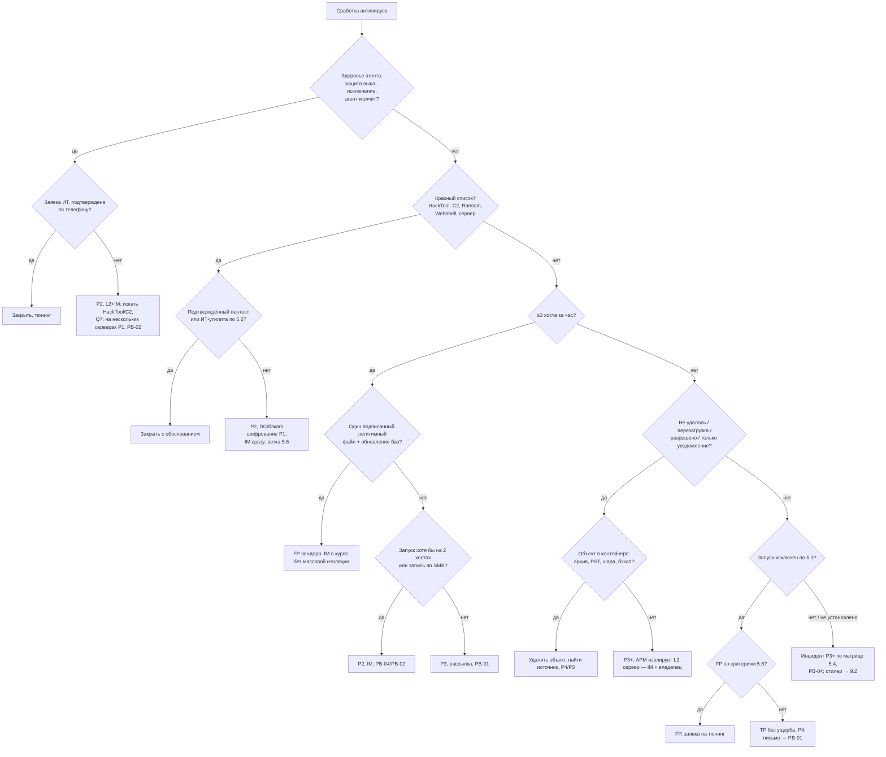

# PB-S3 Сработка антивируса (EPP) на рабочих станциях и серверах

Учебный плейбук для вымышленной компании «Альфа-Трейд». Роли, уровни P1–P4, полномочия, ритм статусов и шаблон отчёта взяты из IR-плана (`source/ir-plan.md`). Здесь только то, что относится к разбору событий антивирусного агента.

Пометки в тексте:
- **[проверить]**: номер события, имя поля, префикс детекта, подтехника ATT&CK, срок или статья закона. Сверить с документацией вендора или с первоисточником. Всё про 152-ФЗ, КоАП и ГосСОПКА — ориентир, окончательную позицию даёт юрист/DPO.
- **[учебное]**: порог или срок придуман для примера и подбирается по реальному парку и шуму.
- **[зависит от стека]**: в IR-плане не названы вендоры антивируса, EDR и SIEM (это может быть Kaspersky Endpoint Security с KSC, Dr.Web, Microsoft Defender, MaxPatrol SIEM, KUMA и т. п.). Запросы даны на нейтральном псевдо-SPL **(пример)**. Коды событий Microsoft Defender приведены как самый документированный образец.

**Шесть принципов плейбука:**
1. Сработка антивируса означает, что **кто-то пытался выполнить вредоносный код на этом хосте**. «Удалён» — начало проверки, а не конец: антивирус мог поймать только одно звено цепочки.
2. Смотрим пять полей в таком порядке: **действие** (остановлена ли угроза), **тип проверки** (при записи, при запуске, AMSI, поведение, по расписанию), **место** (путь), **инициатор** (процесс и учётка), **актив и пользователь**. Имя детекта — шестое: оно часто родовое (`!ml`, `Generic`, `HEUR:`).
3. **Не P4 без доказательства, что запуска не было.** «Не удалось установить» обрабатывается как «запуск был». Отсутствие событий на хосте без работающего EDR ничего не доказывает.
4. Для P3 и выше **сначала изолировать и собрать, потом лечить**. Полная проверка с автолечением и перезагрузка уничтожают улики.
5. **Тишина — тоже сигнал.** Отключённая защита, новое исключение или замолчавший агент — самостоятельная сработка, часто предвестник шифрования.
6. Рабочую станцию L2 изолирует сам. Сервер — только с согласия IM и владельца системы.

---

## 1. Паспорт плейбука

| Поле | Значение |
| --- | --- |
| ID | PB-S3 |
| Версия | 1.0 (учебная), 31.10.2026 |
| Владелец | Руководитель ИБ (IM). Разделы о настройках антивируса согласует администратор антивируса (ИТ). Пересмотр раз в 6 месяцев и после каждого инцидента P1–P2, начавшегося с этой сработки |
| Критичность по умолчанию | **P4**: объект удалён или помещён в карантин **при записи**, запуск исключён по критериям раздела 5.3, хост и пользователь обычные (пример P4 из IR-плана: «антивирус удалил вложение») |
| Повышение до P3 | Детект при запуске или AMSI (пользователь кликнул); детект по расписанию на файле, который мог запускаться; «не удалось удалить» активный объект (пример P3 из IR-плана); «разрешено пользователем», «пропущено (исключение)», «только уведомление»; повторный детект (≥3 за 14 дней [учебное]); кряк или активатор; неодобренный RMM без входящих подключений; на хосте нет работающего EDR |
| Повышение до P2 | Подтверждён запуск на хосте привилегированного пользователя или с доступом к ПДн; запуск стилера; HackTool, дамп LSASS, C2-фреймворк на рабочей станции; детект шифровальщика (даже заблокированный при записи); веб-шелл; отключение защиты или исключение без заявки; запуск на ≥2 хостах или запись файла с другого хоста по SMB; неодобренный RMM с входящими подключениями; детект на сервере (1С, база, файловый сервер, веб) |
| Повышение до P1 | Любой HackTool или C2 на контроллере домена; детект на сервере резервного копирования; признаки начавшегося шифрования; веб-шелл с доступом к базе клиентов; отключение защиты на нескольких серверах; подтверждённое использование украденных учётных данных для доступа к ПДн |
| Правила изменения | Уровень определяется по худшему признаку (IR-план). Повысить может любой участник. Понизить — только L2 (до P3) или IM (с P1/P2) с обоснованием в тикете |
| MITRE ATT&CK: Initial Access (TA0001) | T1566.001 Spearphishing Attachment, T1566.002 Spearphishing Link, T1189 Drive-by Compromise, T1091 Replication Through Removable Media |
| Execution (TA0002) | T1204.002 Malicious File; T1204.004 Malicious Copy and Paste (ClickFix) **[проверить: подтехника добавлена в 2025 г.]**; T1059.001 PowerShell, T1059.005 Visual Basic, T1059.007 JavaScript; T1569.002 Service Execution |
| Persistence (TA0003) | T1547.001 Registry Run Keys / Startup Folder; T1053.005 Scheduled Task; T1543.003 Windows Service; T1546.003 WMI Event Subscription; T1505.003 Web Shell |
| Defense Evasion (TA0005) | T1562.001 Disable or Modify Tools; T1070.001 Clear Windows Event Logs; T1218 System Binary Proxy Execution (в т. ч. .005 Mshta); T1055 Process Injection; T1553.005 Mark-of-the-Web Bypass; T1027 Obfuscated Files or Information |
| Credential Access (TA0006) | T1003.001 LSASS Memory; T1555.003 Credentials from Web Browsers; T1539 Steal Web Session Cookie |
| Lateral Movement, C2, Impact | T1021.002 SMB/Windows Admin Shares; T1570 Lateral Tool Transfer; T1219 Remote Access Software; T1105 Ingress Tool Transfer; T1071.001 Web Protocols; T1486 Data Encrypted for Impact. Номера сверить с актуальной матрицей Enterprise **[проверить]** |
| Связанные плейбуки | **PB-04** Вредонос на рабочей станции (запуск подтверждён); **PB-01** Фишинг (источник — письмо); **PB-02** Шифровальщик; **PB-03 / PB-10** Компрометация учётки / облачной учётки (стилер, дамп LSASS); **PB-05** Утечка данных (ПДн); **PB-07** Инсайдер (сознательный обход защиты, хактулы сотрудника); **PB-08** Взлом веб-приложения (веб-шелл); **PB-S2** Сработка NGFW (C2, источник загрузки); **PB-S4** Сработка EDR (общий тикет по хосту) |
| Целевые сроки по фазам [учебное] | Взятие в работу: «красный список» (раздел 5.1) — **15 мин** круглосуточно, остальное — **до 1 ч** (P4 становится известен только после триажа). Карточка и вердикт L1 — **15 мин**. Факт запуска и источник (L2) — **30–60 мин**. Изоляция АРМ после решения — **15 мин**. Поиск других получателей письма — **до 1 ч**. Отзыв сессий и сброс при стилере — **до 2 ч** от подтверждения. DPO при подозрении на ПДн — **сразу**. Мониторинг после инцидента — **14 дней** |

## 2. Назначение и область применения

**Назначение.** Разобрать любое событие антивирусного агента и ответить на четыре вопроса: был ли запуск; что ещё успело произойти на хосте; есть ли то же самое у других; какую критичность присвоить и в какой сценарный плейбук передать.

**Входит:**

| Класс события | Пример |
| --- | --- |
| Файловый детект (при записи, при запуске, по расписанию, по требованию) | Вложение в `Content.Outlook`, исполняемый файл в `Downloads` |
| Поведенческий детект / детект в памяти | `Behavior:Win32/...` (Defender), `PDM:...` (Kaspersky) **[проверить префиксы]**, инжект в `explorer.exe` |
| AMSI / скриптовый | PowerShell, VBScript, JScript, макрос Office |
| Веб-антивирус | Заблокирован URL или загрузка |
| Защита от сетевых атак, эксплойтов, правила ASR | Эксплойт по сети с другого хоста, блок дочернего процесса Office |
| Контроль устройств и приложений | Запрет запуска, USB-носитель |
| **Здоровье и целостность агента** | Защита отключена, добавлено исключение, остановка службы агента, базы устарели, агент не выходит на связь, агент удалён |

**Не входит:**
- сработки EDR без детекта антивируса — PB-S4 (если есть оба, тикет общий);
- письма, заблокированные почтовым шлюзом или песочницей до доставки — PB-01;
- подтверждённый инцидент после передачи — соответствующий сценарный плейбук (PB-04, PB-02, PB-08 и т. д.); PB-S3 закрывается ссылкой на него.

## 3. Триггеры и источники обнаружения

| Источник | Что видим | Поля / Event ID | Пример правила (пример) |
| --- | --- | --- | --- |
| Консоль антивируса → SIEM | Детект, действие, ошибка действия | хост, пользователь, `threat_name`, `file_path`, `sha256`, `action`, `scan_type`, `initiating_process`, версия баз. Defender: 1116 обнаружено, 1117 действие выполнено, 1118/1119 действие не удалось **[проверить]** | `index=av event_class=detection` → тикет; `threat_name` по «красному списку» → сразу P2 |
| Журнал Defender на хосте | Отключение и изменение защиты | 5001 защита в реальном времени выключена, 5007 изменена конфигурация (в т. ч. исключения), 5010/5012 отключено сканирование, 5013 Tamper Protection заблокировал изменение, 2001 ошибка обновления баз **[проверить]** | `EventCode IN (5001,5010,5012) OR (EventCode=5007 "*Exclusions*")` без заявки ИТ → P2 |
| Консоль антивируса (здоровье) | Агент молчит, базы устарели | время последней связи, версия баз | Хост из CMDB без событий агента >24 ч; базы старше 3 дней [учебное] |
| EDR | Дерево процессов, файлы, сеть, реестр | `ProcessCreate`, `FileCreate`, `NetworkConnect`, хеши, родитель | Детект AV + процесс с тем же SHA256 до времени детекта → «запуск подтверждён» |
| Security (Windows) | Запуск, службы, задачи, входы | 4688 (с командной строкой), 4697 / System 7045, 4698/4702, 4624/4648/4672, 4720/4732, 1102 / System 104 | Детект на хосте + 7045 или 4698 в окне ±1 ч → P3+ |
| Sysmon (если развёрнут) | Независимая телеметрия | 1 процесс, 3 сеть, 10 доступ к процессу (`lsass.exe`), 11 файл, 12/13 реестр, 15 Zone.Identifier, 22 DNS | Sysmon 10 к `lsass.exe` не от агентов защиты → P2 |
| PowerShell Operational | Текст скриптов | 4104 Script Block Logging | AMSI-детект + 4104 с `IEX`, `DownloadString`, `-enc` |
| Файловый сервер | Кто записал файл на шару | 5140/5145, 4663 (нужен аудит) | Детект на сервере → источник по `IpAddress` в 5145 |
| Почтовый шлюз / облачная почта | Отправитель, получатели, вердикт песочницы | `sender`, `recipient`, `attachment_sha256`, `message_id` | Хеш детекта совпал с вложением → PB-01 |
| NGFW / прокси / DNS | Загрузка файла, C2, исходящий объём | `src_ip`, `dest_host`, `url`, `bytes_out` | Новый домен с хоста в течение часа после детекта |

**Опорные запросы (пример, [зависит от стека]).** T — время детекта.

```
# Q1. История антивируса на хосте за 7 дней: повторы, ошибки, исключения
index=av host="<HOST>" earliest=T-7d
| table _time event_class threat_name file_path sha256 action scan_type initiating_process

# Q2. Распространённость хеша (scoping и проверка FP)
(index=av OR index=edr) sha256="<SHA256>" earliest=-30d
| stats dc(host) as hosts values(file_path) min(_time) max(_time) by sha256

# Q3. Полиморфные образцы: тот же детект, имя или папка на других хостах
index=av earliest=-7d (threat_name="<DETECT>" OR file_name="<NAME>")
| stats dc(host) values(host) values(sha256) by threat_name file_name

# Q4. Был ли запуск
(index=wineventlog EventCode=4688 NewProcessName="*\\<NAME>") OR (index=sysmon EventCode=1 Hashes="*<SHA256>*")
host="<HOST>" earliest=T-30d | table _time user ParentImage Image CommandLine

# Q5. Откуда появился файл: процесс-создатель и Mark-of-the-Web
index=sysmon host="<HOST>" EventCode IN (11,15) TargetFilename="*<NAME>*"
| table _time Image TargetFilename Contents

# Q6. Сеть хоста от T-1h до T+24h
(index=sysmon EventCode IN (3,22) host="<HOST>") OR (index=proxy src_ip="<IP>")
| stats count min(_time) max(_time) by dest_host dest_ip Image | sort -count

# Q7. Закрепление и сокрытие в окне T-1h..T+24h
host="<HOST>" ((index=wineventlog EventCode IN (4698,4702,4697,7045,4720,4732,1102,104))
 OR (index=sysmon EventCode IN (12,13) TargetObject="*\\CurrentVersion\\Run*")
 OR (index=sysmon EventCode IN (19,20,21)))

# Q8. Массовый детект за час (рассылка или FP вендора)
index=av earliest=-1h | stats dc(host) as hosts values(file_path) values(action) by threat_name sha256
| where hosts>=3
```

Пример KQL для Defender XDR **[проверить схему и поля `AdditionalFields`]**: `DeviceEvents | where ActionType == "AntivirusDetection" | extend af=parse_json(AdditionalFields) | project Timestamp, DeviceName, FolderPath, SHA256, ThreatName=tostring(af.ThreatName), WasExecutingWhileDetected=tostring(af.WasExecutingWhileDetected), InitiatingProcessFileName`.

## 4. Роли и RACI для этого сценария

R — выполняет, A — утверждает и отвечает, C — консультирует, I — информируется.

| Действие | L1 | L2 | IM | ИТ | Владелец системы | DPO |
| --- | --- | --- | --- | --- | --- | --- |
| Карточка сработки, хеш в TI, предварительная P | R | A | | | | |
| Факт запуска, источник, масштаб | C | R/A | I | | | |
| Звонок пользователю | R (уточнение) | R/A | | | | |
| Изоляция рабочей станции | I | R/A | I (P2+) | I | | |
| Изоляция или остановка сервера | | R | A | R | A (согласие) | |
| Сбор артефактов, образец из карантина | | R/A | | C | | |
| Блокировка вредоносного хеша на всех хостах | | R/A (после проверки 6.1) | I | | | |
| Блокировка легитимной программы (PsExec, AnyDesk) по парку | | R | A | R | | |
| Блок домена/IP источника на NGFW | | R/A (один внешний IP) | A (больше) | | | |
| Удаление письма из всех ящиков | | R | A | R | | |
| Отзыв сессий, сброс паролей пользователя | | R (инициирует) | I | R | | |
| Сброс привилегированных и сервисных учёток, krbtgt | | C | A | R | | |
| Отправка образца вендору / внешней песочнице | | R | A | | | C (если в файле могут быть ПДн) |
| Исключение в антивирусе, восстановление из карантина | | R (вердикт FP) | A | R | | |
| Оценка утечки ПДн, уведомление РКН | | C | R | | C | A |
| Переустановка хоста | | C (подтверждает сбор улик) | A | R | I | |
| Закрытие тикета | R (FP, P4) | A (P3) | A (P1/P2) | | | |

## 5. Триаж (первые 15–30 минут)

### 5.1. Карточка L1 (до 15 минут)

1. Взять сработку, завести тикет. Время детекта записать в **UTC и UTC+3**: консоль антивируса часто показывает локальное время, SIEM и EDR — UTC.
2. Заполнить обязательные поля:

| Поле | Зачем |
| --- | --- |
| Хост, IP, ОС, роль (АРМ / сервер / DMZ), владелец по CMDB | Критичность актива и полномочия |
| Пользователь, подразделение, привилегии | `SYSTEM` ≠ пользователь; админ, бухгалтер с банк-клиентом, доступ к ПДн → повышение |
| Имя детекта полностью, класс (Trojan, HackTool, PUA, Ransom, Exploit, Backdoor, Behavior) | Ветка |
| Тип проверки и модуль | Был ли запуск |
| Полный путь, SHA256, подпись, время создания файла | Место, поиск, сколько файл пролежал до детекта |
| Действие и результат | Остановлена ли угроза |
| Процесс-инициатор, командная строка, родитель | Источник |
| Версия баз, состояние агента, есть ли EDR | Возможны ли проверки |
| Сработки на хосте и у пользователя за 30 дней (Q1) | Повтор, закономерность |

3. **«Красный список»: звонить L2 немедленно, не продолжая триаж**, если есть хотя бы одно:
   - [ ] HackTool, дампер паролей (Mimikatz, LaZagne, procdump на `lsass`), C2-фреймворк (Cobalt Strike, Sliver, Brute Ratel, Havoc), Ransom, Backdoor, Webshell, Exploit;
   - [ ] поведенческий детект или детект в памяти;
   - [ ] любой детект на сервере или на хосте администратора;
   - [ ] действие «не удалось», «требуется перезагрузка», «разрешено пользователем», «только уведомление», «пропущено (исключение)»;
   - [ ] отключение защиты, исключение, остановка или удаление агента;
   - [ ] тот же детект или хеш на ≥3 хостах за час (Q8) [учебное].
4. Поиск хеша в разрешённых сервисах TI (своя песочница почтового шлюза, Kaspersky OpenTIP, VirusTotal, MalwareBazaar **[проверить доступность и политику компании]**). **Искать только по хешу, файл не загружать.** «Хеш не найден» не значит «чисто»: загрузчики собираются под каждую жертву.
5. Q4 и EDR: был ли запуск (раздел 5.3). Q5: источник. Если источник — письмо, найти других получателей в журнале почты и передать в PB-01 (срок до 1 ч).
6. Q2/Q3: есть ли у других.
7. Присвоить предварительную P по разделу 5.4. P4 и FP закрыть по разделу 12, P3+ передать L2 по шаблону 11.3.

**L1 не делает:** не восстанавливает файлы из карантина, не добавляет исключения, не загружает файлы в публичные сервисы, не входит на хост, не просит пользователя перезагрузиться, не пишет пользователю в почту при подозрении на стилер или RAT.

### 5.2. Трактовка полей

**Действие:**

| Действие | Угроза остановлена? | Что делать |
| --- | --- | --- |
| Удалён / карантин при записи | Скорее да | Проверить запуск и другие компоненты. Кандидат на P4 |
| Удалён / карантин при запуске | Запуск блокирован, но пользователь кликнул | Что ещё скачано и запущено в окне ±1 ч. P4→P3 по итогу |
| Удалён / карантин по расписанию или ретро-детект облачной репутации | **Неизвестно** | Файл мог работать днями. Без проверки истории запуска — P3 |
| Вылечен | Частично | Искать источник заражения (файл на шаре, шаблон `Normal.dotm`) |
| Процесс завершён / поведение заблокировано | Код **работал** | P3+, закрепление и сеть |
| Требуется перезагрузка | **Нет** | Угроза активна. Не перезагружать до решения L2; при P2+ сначала летучие данные |
| Не удалось удалить | **Нет** | Развилка «процесс или контейнер» (5.5) |
| Разрешено / пропущено пользователем | **Нет** | Считать как запуск, P3+ |
| Пропущено: объект в исключениях | **Нет** | Кто и когда добавил исключение (T1562.001) |
| Только обнаружено (режим уведомления) | **Нет** | Ошибка конфигурации; считать незаблокированной угрозой |
| Веб-антивирус: URL или загрузка заблокированы | Для этой загрузки да | Другие загрузки с домена (прокси), откуда ссылка |
| Сетевая атака заблокирована | Для этого хоста да | **Объект расследования — источник атаки.** Внутренний источник скомпрометирован, P2 |

**Место (Windows):**

| Путь | Что обычно значит |
| --- | --- |
| `%USERPROFILE%\Downloads\` | Загрузка из браузера; решает факт запуска |
| `%LOCALAPPDATA%\Microsoft\Windows\INetCache\Content.Outlook\` **[проверить для версии Office]** | Вложение открыто или просмотрено из Outlook |
| `%TEMP%\Rar$EX*`, `%TEMP%\7z*`, `%TEMP%\Temp1_*.zip\` **[проверить для архиватора]** | Пользователь дважды кликнул файл внутри архива — **попытка запуска** |
| Кэш браузера | Чаще скрипт со страницы или реклама; обычно P4 без запуска |
| `%APPDATA%\<random>\`, `%LOCALAPPDATA%\<random>\`, `C:\ProgramData\`, `C:\Users\Public\` | Типичные места загрузчиков и RAT → P3+, искать закрепление |
| `...\Start Menu\Programs\Startup\`, `C:\Windows\System32\Tasks\` | Закрепление → P3+ |
| `C:\Windows\System32\`, `SysWOW64\` | Подмена или сайдлоадинг с правами админа (P2) **или** FP на системный файл (удалять нельзя, хост может не загрузиться) |
| `C:\PerfLogs\`, корень `C:\` | Нетипично для пользователя, типично для ручной работы |
| `System Volume Information\`, `$Recycle.Bin\` | Старая копия; часто P4, но проверить, запускался ли когда-то |
| Шара на файловом сервере | Файл записал **другой** хост |
| Съёмный носитель | USB: какой носитель, где ещё был |
| Каталог сайта, `/var/www/`, родитель `w3wp.exe` / `php-fpm` | **Веб-шелл** → PB-08 |
| Каталог резервных копий, PST/OST, архив | Контейнер: удалять объект, а не контейнер |

**Инициатор:** `chrome.exe`/`msedge.exe` — загрузка, ищем URL; `outlook.exe` — вложение; `winrar.exe`/`7zFM.exe` — архив; `explorer.exe` → `powershell`/`mshta` — признак ClickFix (Win+R); `winword.exe`/`excel.exe` → `cmd`/`powershell`/`rundll32` — макрос или эксплойт; `powershell`, `mshta`, `certutil`, `bitsadmin`, `curl` как создатель файла — вторая стадия, **предыдущая уже выполнилась**; `services.exe`/`PSEXESVC.exe`/`wmiprvse.exe` — удалённый запуск с другого хоста; `System` (PID 4) на файловом сервере — запись по SMB; RMM-агент — кто-то работает удалённо; учётка администратора домена на АРМ — тревожно само по себе.

### 5.3. Был ли запуск: лестница доказательств

Проверять сверху вниз до однозначного ответа, каждую находку записывать в тикет со ссылкой на событие.

1. **Событие антивируса:** тип «при запуске», «процесс завершён», AMSI, поведенческий детект → запуск или попытка **были**.
2. **EDR:** процесс с этим SHA256 или путём до времени детекта, его дочерние процессы и соединения.
3. **Журналы в SIEM:** 4688 (с командной строкой) или Sysmon 1 (Q4); 4104 для скриптов.
4. **Артефакты на хосте** (через live response EDR, если журналов нет):
   - Prefetch `C:\Windows\Prefetch\*.pf` — свидетельство и время запусков (на рабочих станциях включён, на серверах часто выключен **[проверить]**);
   - BAM `HKLM\SYSTEM\CurrentControlSet\Services\bam\State\UserSettings\<SID>`, UserAssist;
   - Amcache.hve — присутствие записи не всегда означает запуск **[проверить для версии Windows]**; ShimCache на Windows 10/11 запуск не доказывает;
   - RunMRU (команды из «Выполнить», ключевой артефакт ClickFix), история PowerShell `ConsoleHost_history.txt`;
   - время создания файла (Sysmon 11, EDR, `$MFT`) против времени детекта: файл, пролежавший неделю до обновления баз, мог отработать.
5. **Опрос пользователя** — последним и только если пользователь не под подозрением (иначе PB-07).

**Критерий «удалён до запуска» (только при выполнении всех условий → P4):**
- [ ] тип проверки «при записи» или детект в почте до открытия;
- [ ] в EDR и журналах нет процесса с этим хешем или путём;
- [ ] путь не указывает на открытие из архива или вложения;
- [ ] нет других подозрительных файлов, процессов, соединений в окне ±1 ч;
- [ ] на хосте работает EDR или аудит процессов.

### 5.4. Матрица критичности

Стартовый уровень по классу и факту запуска.

| Класс | Не запускался | Запуск был или не исключён, обычная АРМ | Запуск был: привилегированный пользователь, доступ к ПДн, сервер | DC, сервер бэкапов, запуск на нескольких хостах |
| --- | --- | --- | --- | --- |
| Реклама, тулбар (PUA) | P4 | P4 | P4 (P3 на сервере) | P3 |
| Кряк, активатор, PSWTool | P4 | P3 (проверять как стилер) | P3 | P2 |
| Троян, загрузчик, эксплойт | P4 | P3 | P2 | P2 |
| Стилер | P4 (P3 при массовой рассылке) | P3 → P2 при подтверждении | P2 | P1 при доступе к ПДн/AD |
| RAT, неодобренный RMM | P3 | P2 | P2 | P1 |
| HackTool, дамп LSASS, C2-фреймворк | P2 | P2 | P1 (сервер) | P1 |
| Шифровальщик, вайпер | P2 | P2; P1 при начале шифрования | P1 | P1 |
| Веб-шелл | P2 | P2 | P1 при доступе к базе клиентов | P1 |
| Отключение защиты / исключение без заявки | — | P2 | P2 | P1 |

**Повысить на один уровень**, если: файл записан с другого хоста; подтверждена связь с C2 (PB-S2); детект повторился после чистки; пользователь подтвердил ввод пароля или выполнение команды; на хосте нет работающего EDR.

### 5.5. Дерево решений



### 5.6. Ветки по классам и критерии ложного срабатывания

- **Стилер** с запуском: процедура раздела 9.2. Без запуска — запись в тикете, сброс паролей не нужен.
- **HackTool / C2-фреймворк:** IM сразу. Если IM не ответил за 15 мин или есть признаки шифрования, выгрузки, распространения — L2 изолирует АРМ сам. Иначе IM за 15–30 мин решает о **скоординированном сдерживании**: частичная изоляция одного хоста подсказывает атакующему, что его нашли, и он уходит на другие точки или запускает шифрование раньше. Параллельно по 4624/4648/4672 и Sysmon 10 к `lsass.exe`: какие учётки входили на хост (при дампе LSASS считать их украденными).
- **Шифровальщик / вайпер:** даже заблокированный при записи файл означает, что атакующий уже положил его на хост. PB-02, искать, кто записал (PsExec, GPO, WMI, RMM).
- **Веб-шелл:** PB-08. Не удалять файл до копии каталога сайта и журналов веб-сервера и WAF. Изоляция сайта — IM + владелец (простой ~1 млн ₽/ч по IR-плану); временная мера — правило WAF на путь.
- **RMM** (AnyDesk, RustDesk, ScreenConnect, Atera и т. п., часто класс `not-a-virus:RemoteAdmin` или PUA **[проверить имена]**): сверить со списком одобренных; спросить по телефону, не звонили ли «из банка» или «техподдержки»; журналы RMM: входящие подключения, ID оператора, передача файлов.
- **Кряк / активатор:** частый носитель стилеров, инструкция к нему часто требует отключить антивирус. Проверить запуск, 5001/5007 и соседние детекты.
- **AMSI / ClickFix:** командная строка в 4104/4688, RunMRU, история браузера («подтвердите, что вы не робот»), что скачала следующая стадия.
- **Детект на файловом сервере:** найти пишущий хост по 5145 или EDR; изолировать сам сервер — почти всегда неверный первый шаг. Массовые переименования файлов → PB-02, P1.

**Ложное срабатывание закрывается только с обоснованием:**

| Тип | Критерии |
| --- | --- |
| Легитимное ПО (1С, драйвер, бизнес-приложение) | Подпись валидна; путь установки продукта; распространённость давняя и высокая (Q2); есть в реестре ПО; родитель не браузер и не почта; вендор подтвердил FP |
| Массовый FP вендора | Один хеш/путь легитимного ПО на многих хостах; начало совпадает с обновлением баз; подтверждение вендора (не слухи) |
| Утилита ИТ (PsExec, RMM, сканер) | Учётка из списка админов; источник — АРМ админа или jump-сервер; есть заявка; админ подтвердил **по независимому каналу** (звонок, не ответ в чат с той же учётки) |
| Пентест | Письмо-разрешение с датами, хостами и IP пентестеров |
| EICAR | Это не FP, а TP на тестовый файл. Нужна заявка на тест; без неё — уточнить, кто проверяет реакцию антивируса |

«FP» и «TP без последствий» — разные вердикты, их нельзя смешивать в статистике.

### 5.7. Критерии эскалации

| Кому | Когда | Как |
| --- | --- | --- |
| L1 → L2 | «Красный список» — немедленно; P3 — до 30 мин, ночью звонком при признаках запуска | Звонок + шаблон 11.3 |
| L2 → IM | P1/P2, HackTool/C2/шифровальщик/веб-шелл/tamper, любая мера на сервере, массовые меры | Звонок, затем канал инцидента |
| IM → владелец системы | Изоляция, перезагрузка или остановка сервера | Звонок, шаблон 11.3 |
| IM → DPO | Запуск стилера, RAT или C2 на хосте с доступом к ПДн или с файлами ПДн | Сразу при подозрении |
| IM → директор | P1 (IR-план) | Звонок, статус каждые 2 ч |

## 6. Сдерживание

### 6.1. Краткосрочное

| № | Шаг | Ответственный | Инструмент | Апрув |
| --- | --- | --- | --- | --- |
| 1 | Сетевая изоляция рабочей станции (связь агента с консолью сохраняется) | L2 | EDR | Не нужен (полномочие L2); IM в курсе при P2+ |
| 2 | Если EDR не на связи: блок учётки, отзыв VPN-доступа, физическое отключение от сети (кабель, Wi-Fi), **не выключение** | ИТ по заявке L2 | AD, VPN | Не нужен |
| 3 | Сервер: точечные меры до апрува — блок C2 на NGFW, блок учётки, завершение процесса **после** дампа памяти | L2 / ИТ | NGFW, EDR | Изоляция сервера — IM + владелец |
| 4 | Блок вредоносного хеша на всех хостах — после проверки: не подписанный системный или бизнес-файл, распространённость (Q2) | L2 | Консоль AV / EDR | Не нужен; для легитимной программы — IM |
| 5 | Блок домена, URL, IP источника и C2 | L2 | NGFW, прокси, DNS (PB-S2) | Один внешний IP — L2; больше — IM |
| 6 | Удаление письма из всех ящиков, блок отправителя | L2 + ИТ | Облачная почта | IM (PB-01) |
| 7 | Отзыв сессий и сброс учётных данных | ИТ по заявке L2 | AD, облачная почта | Привилегированные учётки — IM |
| 8 | Скоординированное сдерживание при ручной атаке: все известные хосты, C2, учётки в одно окно | L2 + ИТ | EDR, NGFW, AD | IM |

Блокировка хеша — мера «закрыть известный образец», а не сдерживание: против уникальных сборок она почти бесполезна.

### 6.2. Долгосрочное

- Изолированный хост остаётся в карантинном состоянии до переустановки; пользователю — подменное устройство.
- Временные правила: блок доменов C2 и источника на NGFW/DNS, запрет запуска по хешу и пути, правило WAF для веб-шелла. Каждой блокировке — владелец и срок пересмотра [учебное: 30 дней].
- Усиленные правила SIEM на IOC инцидента и входы затронутых учёток.
- Если затронут AD: план сброса привилегированных учёток; при компрометации домена — двойной сброс krbtgt с интервалом не меньше срока жизни билетов (по умолчанию 10 ч) **[проверить по актуальным рекомендациям Microsoft]**.

### 6.3. Что НЕ делать

- Не запускать полную проверку с автолечением и не удалять файлы до сбора улик (P3+).
- Не перезагружать хост при «требуется перезагрузка» до решения L2 — пропадёт память.
- **Не входить на подозрительный хост по RDP или в консоль под администратором домена**: его учётные данные окажутся в памяти хоста рядом с Mimikatz. Только live response EDR или отдельная учётка без доменных привилегий.
- Не загружать образец в публичные сервисы без апрува IM: атакующие следят за своими образцами, а «вредонос» может быть документом с ПДн.
- Не изолировать сервер (файловый, 1С, веб, база) без IM и владельца.
- Не удалять контейнер (PST, бэкап, архив, VM) целиком, если объект внутри.
- Не восстанавливать файл из карантина на хост «для анализа».
- Не писать пользователю в почту при подозрении на стилер или RAT.
- Не изолировать десятки хостов ночью без проверки FP вендора; массовая изоляция — только решением IM.

## 7. Сбор и сохранение артефактов

Для P3 и выше — **до** лечения, полной проверки и перезагрузки. Порядок по летучести (RFC 3227):

| Порядок | Артефакт | Как сохранить |
| --- | --- | --- |
| 1 | Память (если процесс мог работать и не было перезагрузки) | Сбор EDR или согласованный инструмент (WinPmem и аналоги [зависит от стека]) на сетевую папку ИБ |
| 2 | Процессы с командной строкой и родителем, сетевые соединения с PID, сессии пользователей | Live response: `Get-CimInstance Win32_Process`, `Get-NetTCPConnection` |
| 3 | Образец из карантина | **Через консоль антивируса** (выгрузка объекта), не копированием зашифрованного файла карантина; ZIP с паролем `infected`, SHA256 в тикет |
| 4 | Происхождение файла | `Get-Content <путь> -Stream Zone.Identifier` (ZoneId, HostUrl, ReferrerUrl), `Get-AuthenticodeSignature`, Sysmon 15 |
| 5 | Следы запуска | Prefetch, Amcache.hve, BAM, UserAssist, SRUM (`SRUDB.dat`, трафик по приложениям), RunMRU, история PowerShell |
| 6 | Закрепление | Задачи `System32\Tasks`, службы, Run/RunOnce, Startup, WMI-подписки (`root\subscription`), расширения браузера; `autorunsc64.exe -accepteula -a * -c -h -s` с выводом на папку ИБ **[проверить ключи]** |
| 7 | Журналы | EVTX: Security, System, PowerShell Operational, журнал антивируса, Sysmon, TaskScheduler, WMI-Activity; выгрузки EDR и SIEM за период от 7 дней до первого появления файла до текущего момента |
| 8 | Образ диска | Только P1/P2, при возможных юридических последствиях или если хост переустанавливается до конца расследования |

Пакетный сбор — встроенными средствами EDR, при их отсутствии — Velociraptor или KAPE, если они разрешены [зависит от стека]. Утилиты запускаются с доверенного носителя или сетевой папки, результат пишется не на диск хоста.

**Цепочка хранения.** Для каждого артефакта в тикете: что, с какого хоста, кто собрал, когда (UTC), каким инструментом, SHA256, где хранится. Хранилище — папка ИБ с ограниченным доступом и журналом обращений; образцы — только в зашифрованных архивах с пометкой «вредоносный». Без цепочки хранения улики трудно использовать в споре с сотрудником, подрядчиком или в правоохранительных органах.

## 8. Расследование

| Вопрос | Источники |
| --- | --- |
| **Откуда пришёл файл?** Письмо, сайт, архив, USB, запись по сети, RMM, скрипт | Q5, Zone.Identifier, почтовый шлюз, прокси/NGFW, история браузера, подключения USB, 5145 на файловом сервере |
| **Когда файл появился** и сколько пролежал до детекта? | Sysmon 11, EDR, `$MFT`, версия баз на момент детекта |
| **Был ли запуск** и что запустилось дальше? | Раздел 5.3, дерево процессов EDR |
| **Что сделал код?** Закрепление, новые учётки, доступ к LSASS, отключение защиты, очистка журналов | Q7, Sysmon 10, 5001/5007, 1102 |
| **Была ли связь с C2 и выгрузка?** | Q6, NGFW, DNS, SRUM; признаки стилеров — Telegram API, Discord, файлообменники, прямые обращения на IP |
| **Кто ещё получил или запустил?** Поиск по хешу, имени, пути, детекту, отправителю, URL, C2, подписи — в том числе на хостах **без** детекта (устаревшие базы) | Q2, Q3, Q8, журнал почты, EDR-телеметрия |
| **Куда пошёл атакующий?** Входы с этого хоста на серверы и DC, входы привилегированных учёток на этот хост | 4624/4648/4672 (тип 3, 10), Kerberos 4768/4769 |
| **Используются ли украденные учётные данные?** | Журналы входа облачной почты, VPN, 1С, админки сайта, CRM: новые IP, устройства, правила пересылки (PB-10) |
| **Какие данные были доступны?** Роль пользователя, доступ к ПДн, файлы на рабочем столе и в «Документах» | CMDB, AD-группы, опрос пользователя |
| **Хронология** | Всё в UTC и UTC+3 в тикете, с ссылками на события |

Если ответ на «кто ещё» или «куда пошёл» — «да», критичность пересматривается по 5.4.

## 9. Устранение

### 9.1. Хост

- **Переустановка из эталонного образа обязательна**, если подтверждён запуск чего угодно, кроме рекламного PUA; найдено закрепление; был HackTool, C2 или RAT; детект повторился после чистки; есть сомнения.
- **Чистка допустима**, если запуска не было или это рекламный PUA без закрепления, удалённый штатно.
- Перед переустановкой L2 записывает в тикет, что улики собраны.
- Удалить все механизмы закрепления, найденные на **других** хостах по IOC; удалить письмо из всех ящиков; удалить файл-источник с шары или USB (иначе повторные детекты).
- Закрыть причину: обновить уязвимое ПО (при `Exploit:`), снять локальные права администратора, удалить неодобренный RMM.

### 9.2. Учётные данные (стилер, RAT, дамп LSASS)

Применяется, если запуск **доказан или не исключён**. Порядок важен:

1. Изолировать хост. Пользователь не меняет пароли на этом хосте — новый пароль тоже уйдёт.
2. Оценить, что могло уйти: пароли и cookie браузеров, сессии Telegram Desktop, VPN-конфиги, FTP/SSH/RDP-клиенты (FileZilla, WinSCP, PuTTY), криптокошельки, файлы с рабочего стола.
3. Определить доступы: AD, облачная почта и файлы, VPN, 1С, админка сайта, CRM, база клиентов, банк-клиент, хостинг, DNS-регистратор, маркетплейсы, рекламные кабинеты.
4. **Отозвать все сессии и токены** — до или одновременно со сменой паролей. Украденная cookie обходит и пароль, и MFA.
5. С **чистого устройства** сменить пароли всех учёток из п. 3, общие и сервисные пароли, сохранённые на машине; проверить, не добавлены ли чужие методы MFA и правила пересылки (PB-03/PB-10).
6. При дампе LSASS считать украденными все учётки, входившие на хост; привилегированные — по решению IM.
7. Проверить журналы входа во все системы с момента запуска до сброса.
8. По телефону порекомендовать пользователю сменить личные пароли, сохранённые в рабочем браузере. SOC не собирает список его личных сайтов.

## 10. Восстановление и мониторинг после инцидента

1. Вернуть хост в сеть, когда: переустановлен (или чистка подтверждена L2), установлены обновления, агент антивируса и EDR на связи в режиме блокировки, учётные данные сброшены, закрепление на других хостах устранено.
2. Данные пользователя восстанавливать из копии, сделанной **до первого появления файла**, и сканировать перед восстановлением. Если детект был в бэкапе — отметить заражённые точки восстановления.
3. Пользователь (для сервера — владелец системы) подтверждает работоспособность.
4. **Мониторинг 14 дней** (IR-план: не менее 2 недель):

| Что мониторить | Как |
| --- | --- |
| Повторные детекты на хосте и у пользователя | Правило по хосту и учётке, любой детект → L2 |
| IOC инцидента (хеши, имена, пути, домены и IP C2, URL источника) | Правила SIEM по AV, EDR, NGFW, прокси, DNS, почте |
| Входы учётки пользователя | Новые IP, страны, устройства, user agent в облачной почте, VPN, админке сайта |
| Правила пересылки и делегирования в почте | Создание или изменение |
| Здоровье агента на хосте | Отключение защиты, исключения, потеря связи |
| Хосты с тем же уязвимым ПО (при эксплойте) | Отчёт о версиях, детекты по тому же семейству |

## 11. Коммуникации и уведомления

### 11.1. Внутренние

- Рабочий канал — тикет и чат инцидента. Если могут быть скомпрометированы почта или домен — резервный канал (IR-план).
- С пользователем — **по телефону или лично**, без обвинений. Если почта может читаться атакующим, письмо выдаст ему, что его нашли.
- ИТ — заявкой с перечнем «сделать» и «не делать».
- Статусы руководству: P1 каждые 2 ч, P2 дважды в день (IR-план).
- Сотрудникам при рассылке — только IM или PR, только что сделать.
- Нарушение политики (кряки, личный софт, свой RMM) — IM передаёт руководителю пользователя или HR по процедуре компании, без огласки; сознательный обход защиты — PB-07.

### 11.2. Внешние

| Когда | Кого | Срок | Основание |
| --- | --- | --- | --- |
| Неправомерная передача ПДн (стилер или RAT использованы для доступа к базе клиентов, выгружены файлы с ПДн) | Роскомнадзор, первичное уведомление | 24 ч с момента выявления | 152-ФЗ, ч. 3.1 ст. 21 **[проверить редакцию и порядок отсчёта]** |
| То же | Роскомнадзор, результаты расследования | 72 ч | То же **[проверить]** |
| Инцидент, повлёкший неправомерную передачу ПДн | ГосСОПКА (НКЦКИ) | По порядку ФСБ | 152-ФЗ, ч. 12 ст. 19 **[проверить порядок и приказ]** |
| Ложное срабатывание или новый образец | Вендор антивируса | По необходимости | Официальный портал, с апрувом IM |
| Преступление (вредоносная программа, хищение) | Полиция | По решению руководства | УК РФ, ст. 273 и др. **[проверить]** |

«Альфа-Трейд» не субъект КИИ, уведомление НКЦКИ по 187-ФЗ не требуется. С 2025 года ужесточена ответственность за утечки и неуведомление (КоАП, ст. 13.11) **[проверить части и суммы у юриста]**. Решение DPO «уведомление не требуется» тоже записывается в тикет с обоснованием.

### 11.3. Шаблоны

**L1 → L2:**
> [PB-S3][P_] Хост ___ (АРМ/сервер, владелец ___). Пользователь ___ (роль ___). Детект ___ (класс ___). Действие ___, тип проверки ___. Путь ___, SHA256 ___. Запуск: да / нет / не установлено (основание ___). Источник ___. Другие хосты: ___. EDR: есть/нет. Сделано: ___. Нужно решить: ___.

**L2 → IM (P1/P2):**
> Известно: ___ (факты со временем). Сделано: ___. Дальше: ___. Нужны решения: изоляция сервера / скоординированное сдерживание / сброс привилегированных учёток / DPO. Следующий статус в ___.

**Пользователю (телефон):**
> «Здравствуйте, это служба информационной безопасности. Антивирус заблокировал на вашем компьютере подозрительный файл. Вы открывали сегодня около ___ файл ___ или письмо от ___? Пока мы проверяем, не выключайте и не перезагружайте компьютер, не удаляйте файлы и не вводите на нём пароли. Мы перезвоним до ___.»

Вопросы при подозрении на запуск: что скачивали и откуда; было ли окно «подтвердите, что вы не робот» с просьбой нажать Win+R; звонили ли «из банка» или «техподдержки» с просьбой установить программу; вводили ли пароль после открытия файла; лежат ли на рабочем столе выгрузки клиентов; отключали ли антивирус.

**Задача ИТ:**
> Хост ___ изолирован по INC-___. Требуется: ___ (сброс пароля ___ с отзывом сессий / переустановка после подтверждения L2 / подменное устройство). Не выполнять: вход на хост под привилегированной учёткой, восстановление из карантина, перезагрузку до согласования с L2.

**Владельцу системы:**
> На сервере ___ обнаружен ___. Риск: ___. Предлагаемая мера: ___ на ___ мин. Нужно ваше согласие и согласие руководителя ИБ. Альтернатива без остановки: ___.

**Сотрудникам (только IM/PR):**
> «Сотрудникам пришли письма с темой ___ от ___. Не открывайте вложение. Если уже открыли — позвоните ___ и не выключайте компьютер.»

## 12. Критерии закрытия

**Общие для всех вердиктов:**
- [ ] Классификация с обоснованием: FP / TP без ущерба / тест / нарушение политики / инцидент.
- [ ] Факт запуска: да / нет и **конкретные артефакты**, которые это подтверждают.
- [ ] Источник файла установлен.
- [ ] Результат поиска по другим хостам (хеш, имя, детект, отправитель, C2): «найдено N, запуск на M».
- [ ] Все действия в тикете со временем, исполнителем и апрувом.

**По вердикту:**
- [ ] **FP:** выполнены критерии 5.6; заявка на тюнинг (узкое исключение, обращение к вендору, правка правила SIEM).
- [ ] **TP без ущерба (P4):** выполнен критерий «удалён до запуска»; другие получатели проверены; письмо удалено из ящиков; источник заблокирован.
- [ ] **PUA / нарушение политики:** ПО удалено; проверено отсутствие стилера и RMM-подключений; руководитель уведомлён по процедуре.
- [ ] **Здоровье агента:** причина установлена (заявка или устранённая неисправность); настройки откачены.
- [ ] **Инцидент:** передан в PB-04 / PB-01 / PB-02 / PB-03 / PB-08 с заполненной карточкой и ответами раздела 8; решение DPO записано; PB-S3 закрыт ссылкой на инцидент.
- [ ] Временные блокировки пересмотрены IM; запущен мониторинг 14 дней.

## 13. Метрики

| Метрика | Что показывает |
| --- | --- |
| **MTTD** — от первого появления файла на хосте до детекта | Насколько поздно ловит антивирус (ретро-детекты, устаревшие базы) |
| **MTTR** — от детекта до восстановления хоста | Скорость полного цикла |
| Время от сработки до взятия в работу и до вердикта, по P | Соблюдение сроков IR-плана |
| Время от решения до изоляции (P2/P3) | Скорость сдерживания |
| Доля сработок, где запуск подтверждён или исключён документально (цель для P3+ — 100%) | Зрелость телеметрии |
| Доля TP «с запуском» среди всех TP | Как часто антивирус ловит уже поздно |
| Доля FP и «TP без ущерба» по именам детектов | Качество детекта и тюнинга |
| Число повторных детектов на хосте после закрытия (цель — 0) | Качество устранения |
| Время от подтверждения стилера до отзыва сессий | Окно для использования украденных данных |
| Время от детекта вложения до удаления письма у всех | Связка с PB-01 |
| Доля хостов с работающим агентом, актуальными базами, Tamper Protection; число хостов в режиме уведомления | Покрытие |
| Число исключений и доля просроченных; число событий tamper без заявки | Гигиена настроек |

## 14. Типичные ошибки и ловушки

| Ошибка | К чему приводит | Как правильно |
| --- | --- | --- |
| «Удалён — значит, всё хорошо» | Загрузчик, задача планировщика или украденные cookie остаются | Проверить запуск и вторую половину цепочки |
| Детект по расписанию закрыт как P4 | Стилер отработал неделю назад до обновления баз | Тип проверки «по расписанию» — всегда лестница 5.3 |
| Место файла принято за доказательство | `Rar$EX` или `Content.Outlook` закрыты как «не запускался» | Путь открытия из архива или вложения — попытка запуска |
| «В EDR ничего нет» на хосте без EDR | Ложный вывод «запуска не было» | Нет телеметрии — минимум P3 до проверки артефактов |
| Изоляция сервера по правилу «не удалось удалить» | Остановка бизнеса, превышение полномочий L2 | Развилка «процесс / контейнер»; сервер — IM + владелец |
| Лечение и перезагрузка до сбора | Нет данных о векторе и украденном, нечего дать DPO | Изолировать → собрать → лечить |
| RDP доменного админа на заражённый хост | Учётка админа домена у атакующего; P3 становится P1 | Только live response EDR |
| Загрузка образца на публичный сервис | Атакующий узнаёт о раскрытии; утечка документа | Только хеш; файл — своя песочница или вендор с апрувом IM |
| Сброс пароля без отзыва сессий, с заражённого хоста | Вход по cookie; новый пароль уходит атакующему | Порядок 9.2 |
| Сброс паролей «всегда» без запуска | Лишняя работа ИТ, требование начинают игнорировать | Сброс при доказанном или не исключённом запуске |
| PUA = P4 | Пропущены AnyDesk у бухгалтера и стилер из кряка | RMM и кряки — отдельные ветки |
| PsExec «у ИТ» подтверждён ответом в чат | Атакующий под учёткой админа тоже «из ИТ» | Заявка + звонок по независимому каналу |
| Scoping только по хешу | Полиморфная рассылка: «других нет», а заражены пять | Имя, детект, отправитель, URL, C2 |
| Массовая изоляция после кривого обновления баз | Десятки АРМ без связи ночью | Проверка FP вендора, решение IM |
| Широкое исключение «чтобы не шумело» (`AppData`, `Temp`) | Слепая зона для любого загрузчика | Исключения по хешу или «путь + подпись», со сроком |
| Восстановление из карантина по звонку пользователя | Повторное заражение | Только после вердикта FP от L2 |
| Чистят файловый сервер, а не пишущий хост | Ноутбук продолжает заражать шару | Источник по 5145 / EDR |
| Нет мониторинга здоровья агента | «Спокойная ночь» перед шифрованием | Правила на 5001/5007/молчание агента, P2 |
| DPO узнаёт после закрытия тикета | Пропущены 24 ч на уведомление РКН | DPO сразу при стилере у пользователя с доступом к ПДн |
| Время смешано (UTC и локальное) | Неверная хронология, пропуск событий в окне | В тикете всегда UTC и UTC+3 |

## 15. Меры по предотвращению и улучшению защиты

**Антивирус и EDR:**
- Режим «удалять / карантин» на всех хостах; режим «только уведомление» — по согласованию с IM.
- Включены облачная защита, AMSI, поведенческий модуль, защита от изменения настроек; локальные администраторы не могут отключить защиту.
- Все классы событий, включая здоровье агента, уходят в SIEM; ежедневный отчёт о хостах без агента, с устаревшими базами (>3 дней [учебное]), не выходивших на связь >7 дней; сверка покрытия с CMDB.
- Карантин хранит объекты не менее 30 дней [учебное].
- Исключения — только по хешу или «путь + подпись издателя», с владельцем и сроком до 90 дней [учебное]; запрет исключений на `Temp`, `Downloads`, `C:\Users\`, расширения и интерпретаторы (`powershell.exe`, `wscript.exe`, `rundll32.exe`); пересмотр раз в квартал. Изменение вне процедуры — ветка tamper.
- Шпаргалка по именам детектов используемого вендора.

**Телеметрия:** аудит 4688 с командной строкой, 4104, Sysmon или эквивалент EDR, хранение 90+ дней (IR-план), NTP на всех хостах.

**Почта и выполнение:** блок или песочница для `.iso`, `.img`, `.vhd`, `.lnk`, `.js`, `.hta`, `.wsf`, запароленных архивов; контроль приложений (AppLocker/WDAC или аналог отечественного вендора) хотя бы для пользовательских папок; отключение Windows Script Host для пользователей; блок макросов из интернета **[проверить для используемой версии Office]**; правила ASR, если используется Defender [зависит от стека].

**Учётные данные:** запрет хранения корпоративных паролей в браузере и корпоративный менеджер паролей; защита LSA (RunAsPPL) и Credential Guard; Windows LAPS; модель уровней администрирования (админы домена не входят на АРМ); устойчивая к фишингу MFA для облачной почты и админок; короткий срок жизни сессий критичных сервисов.

**RMM и права:** реестр одобренных RMM и dual-use утилит с хостами и учётками (пересмотр раз в квартал); блок остальных по подписи и доменам на NGFW; снятие локальных прав администратора; установка ПО только по заявке.

**Сеть:** исходящий доступ с АРМ только через прокси; DNS-фильтрация; запрет SMB между рабочими станциями.

**Люди:** короткая памятка по ClickFix, кряках и звонкам «из банка»; учебная рассылка по итогам инцидента.

**Детект:** правила SIEM на TTP инцидента, а не только на хеши; за основу правил предварительной классификации взять категорию антивирусных правил Sigma **[проверить актуальные названия]**; разбор каждого P1–P3 отвечает на вопрос «почему антивирус поймал только этот компонент».

## 16. Учебная мини-ситуация (tabletop)

**Вводная.** Вторник, 02:47. SIEM: на ноутбуке `NB-ACC-03` главного бухгалтера детект `Trojan:Win32/Wacatac.B!ml`, путь `C:\Users\o.petrova\Downloads\Akt_sverki_Q3.exe`, действие «помещён в карантин», тип проверки — **по расписанию**. Файл создан 9 дней назад процессом `msedge.exe`. В Prefetch есть `AKT_SVERKI_Q3.EXE-*.pf` с запуском в день загрузки. По журналу прокси в тот день с ноутбука было 40 обращений к `api.telegram.org`. Ещё через 6 минут на том же ноутбуке событие 5007: добавлено исключение `C:\ProgramData\`. На ноутбуке установлен банк-клиент; пользователь имеет доступ к админке сайта. EDR на ноутбуке работает.

**Вопросы:**
1. Какой вердикт и какая критичность в 02:50 и в 02:53? Почему «в карантине» здесь не означает P4? Кого и как будит L1?
2. Что L2 делает сам, а для чего нужен IM? Изолировать сразу или ждать решения о скоординированном сдерживании — и почему?
3. Что собрать до любой очистки, в каком порядке? Что может рассказать событие 5007 об активности на хосте прямо сейчас?
4. В каком порядке отзывать сессии и менять пароли и с какого устройства? Какие системы, кроме домена и почты, нужно проверить для бухгалтера?
5. Когда и с какой формулировкой подключить DPO? Что должно подтвердиться, чтобы начался отсчёт 24 часов для уведомления Роскомнадзора?

---

## 17. Источники и что почитать

Ссылки приведены по памяти и ведут на официальные сайты. Перед использованием проверьте актуальность.

- MITRE ATT&CK Enterprise: https://attack.mitre.org/ ; T1562.001 Impair Defenses: Disable or Modify Tools: https://attack.mitre.org/techniques/T1562/001/ ; T1555.003 Credentials from Web Browsers: https://attack.mitre.org/techniques/T1555/003/ ; T1539 Steal Web Session Cookie: https://attack.mitre.org/techniques/T1539/
- NIST SP 800-61 r3 (2025): https://csrc.nist.gov/pubs/sp/800/61/r3/final ; r2 проще для новичка: https://csrc.nist.gov/pubs/sp/800/61/r2/final
- NIST SP 800-83 r1, Guide to Malware Incident Prevention and Handling for Desktops and Laptops: https://csrc.nist.gov/pubs/sp/800/83/r1/final
- NIST SP 800-86, Guide to Integrating Forensic Techniques into Incident Response: https://csrc.nist.gov/pubs/sp/800/86/final
- RFC 3227, Guidelines for Evidence Collection and Archiving: https://www.rfc-editor.org/rfc/rfc3227
- SANS Incident Handler's Handbook: https://www.sans.org/white-papers/33901/ ; постеры SANS DFIR (Windows Forensic Analysis, Hunt Evil): https://www.sans.org/posters/
- CISA #StopRansomware Guide: https://www.cisa.gov/stopransomware/ransomware-guide
- Microsoft: события Microsoft Defender Antivirus (Event ID): https://learn.microsoft.com/defender-endpoint/troubleshoot-microsoft-defender-antivirus ; схема Advanced Hunting: https://learn.microsoft.com/defender-xdr/advanced-hunting-schema-tables
- Sysinternals Sysmon и Autoruns: https://learn.microsoft.com/sysinternals/
- Sigma, репозиторий правил: https://github.com/SigmaHQ/sigma
- The DFIR Report (разборы реальных вторжений, от первичного доступа до шифрования): https://thedfirreport.com/
- Kaspersky OpenTIP: https://opentip.kaspersky.com/ ; MalwareBazaar: https://bazaar.abuse.ch/
- 152-ФЗ «О персональных данных» — актуальная редакция на официальном портале правовой информации: http://pravo.gov.ru/
