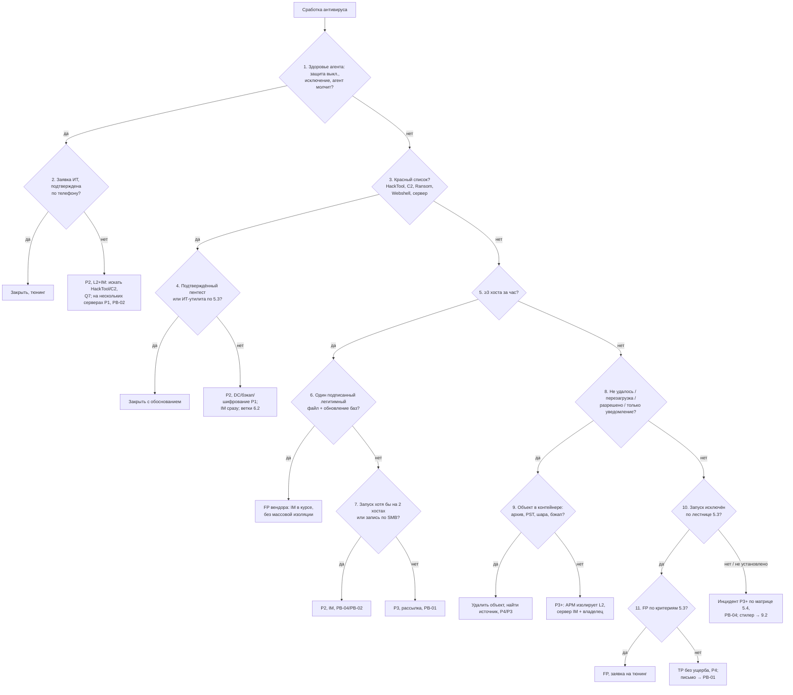

# PB-S3 Сработка антивируса

> Учебный плейбук для вымышленной компании «Альфа-Трейд». Роли, уровни критичности P1–P4, полномочия, ритм статусов и шаблон отчёта взяты из [IR-плана](../plan/ir-plan.md). Всё, что нужно сверить с документацией вендора или первоисточником, собрано в разделе [«Допущения и ограничения»](#допущения-и-ограничения). Сокращения расшифрованы в [Приложении Г](#приложение-г-сокращения).

## TL;DR

- **Когда применять:** антивирусный агент (EPP) на рабочей станции или сервере что-то обнаружил, заблокировал, не смог удалить, или сам агент замолчал, отключён, получил новое исключение.
- **Сработка означает, что кто-то пытался выполнить вредоносный код на хосте.** «Удалён» значит начало проверки, а не её конец: антивирус мог поймать только одно звено цепочки.
- **Смотрите пять полей в таком порядке:** действие (остановлена ли угроза), тип проверки (при записи, при запуске, AMSI, поведение, по расписанию), место (путь), инициатор (процесс и учётка), актив и пользователь. Имя детекта шестое: оно часто родовое (`!ml`, `Generic`, `HEUR:`).
- **Не ставьте P4 без доказательства, что запуска не было.** «Не удалось установить» считайте как «запуск был». Отсутствие событий на хосте без работающего EDR ничего не доказывает.
- **Для P3 и выше сначала изолируйте и соберите улики, потом лечите.** Полная проверка с автолечением и перезагрузка уничтожают улики.
- **Тишина тоже сигнал.** Отключённая защита, новое исключение или замолчавший агент: самостоятельная сработка и частый предвестник шифрования.
- **Рабочую станцию L2 изолирует сам.** Сервер только с согласия IM и владельца системы.

## Шпаргалка: первые 30 минут

| № | Действие | Кто | Срок |
| --- | --- | --- | --- |
| 1 | **Возьмите сработку в работу, заведите тикет.** Время детекта запишите в UTC и UTC+3 | L1 | «Красный список» ≤ 15 мин круглосуточно, остальное ≤ 1 ч |
| 2 | **Проверьте «красный список»** (узлы 1 и 3 дерева). Совпало, значит **звоните L2 немедленно**, триаж не продолжайте | L1 | Сразу |
| 3 | **Заполните карточку сработки:** хост, пользователь, детект, действие, тип проверки, путь, SHA256, инициатор, состояние агента, история за 30 дней (Q1) | L1 | ≤ 15 мин |
| 4 | **Поищите хеш в разрешённых TI-сервисах.** Только по хешу, файл не загружайте | L1 | В рамках карточки |
| 5 | **Проверьте, был ли запуск** (Q4, EDR) и **откуда файл** (Q5) | L1, затем L2 | L2: 30–60 мин |
| 6 | **Источник письмо:** найдите других получателей в журнале почты, передайте в PB-01 | L1 → L2 | ≤ 1 ч |
| 7 | **Проверьте масштаб:** тот же хеш, детект, имя на других хостах (Q2, Q3, Q8) | L1 | В рамках карточки |
| 8 | **Поставьте предварительную P** по [дереву решений](#51-дерево-решений) и [матрице 5.4](#54-матрица-критичности). P4 и FP закройте по разделу 12, P3+ передайте L2 по шаблону из 11.3 | L1 | ≤ 15 мин |
| 9 | **P3+: изолируйте рабочую станцию в EDR.** Сервер только с согласия IM и владельца | L2 | ≤ 15 мин от решения |
| 10 | **Соберите летучие данные до лечения** (память, процессы, сеть), образец из карантина через консоль | L2 | До любой очистки |
| 11 | **Стилер, RAT или дамп LSASS подтверждён или не исключён:** отзовите сессии, смените пароли с чистого устройства (9.2) | L2 + ИТ | ≤ 2 ч от подтверждения |
| 12 | **Подозрение на ПДн:** IM сразу подключает DPO | IM | Сразу |

## Чего делать нельзя

- **Не запускайте полную проверку с автолечением и не удаляйте файлы** до сбора улик (P3+).
- **Не перезагружайте хост** при «требуется перезагрузка» до решения L2: пропадёт память.
- **Не входите на подозрительный хост по RDP или в консоль под администратором домена.** Его учётные данные окажутся в памяти хоста рядом с Mimikatz. Только live response EDR или отдельная учётка без доменных привилегий.
- **Не загружайте образец в публичные сервисы без апрува IM.** Атакующие следят за своими образцами, а «вредонос» может оказаться документом с ПДн. Ищите только по хешу.
- **Не изолируйте сервер** (файловый, 1С, веб, база) без IM и владельца.
- **Не удаляйте контейнер целиком** (PST, бэкап, архив, VM), если объект внутри.
- **Не восстанавливайте файл из карантина** на хост «для анализа» и не добавляйте исключения до вердикта FP от L2.
- **Не пишите пользователю в почту** при подозрении на стилер или RAT. Только звонок или лично.
- **Не изолируйте десятки хостов ночью** без проверки FP вендора. Массовая изоляция только решением IM.
- **L1 не делает:** не восстанавливает файлы из карантина, не добавляет исключения, не загружает файлы в публичные сервисы, не входит на хост, не просит пользователя перезагрузиться.

## 1. Цель и область применения

**Цель:** разобрать любое событие антивирусного агента и ответить на четыре вопроса:

1. Был ли запуск?
2. Что ещё успело произойти на хосте?
3. Есть ли то же самое у других?
4. Какую критичность присвоить и в какой сценарный плейбук передать?

**Что входит:**

| Класс события | Пример |
| --- | --- |
| Файловый детект (при записи, при запуске, по расписанию, по требованию) | Вложение в `Content.Outlook`, исполняемый файл в `Downloads` |
| Поведенческий детект, детект в памяти | `Behavior:Win32/...` (Defender), `PDM:...` (Kaspersky), инжект в `explorer.exe` |
| AMSI, скриптовый детект | PowerShell, VBScript, JScript, макрос Office |
| Веб-антивирус | Заблокирован URL или загрузка |
| Защита от сетевых атак, эксплойтов, правила ASR | Эксплойт по сети с другого хоста, блок дочернего процесса Office |
| Контроль устройств и приложений | Запрет запуска, USB-носитель |
| **Здоровье и целостность агента** | Защита отключена, добавлено исключение, остановка службы агента, базы устарели, агент не выходит на связь, агент удалён |

**Что не входит:**

- **Сработки EDR без детекта антивируса.** Это PB-S4. Если есть оба, тикет общий.
- **Письма, заблокированные почтовым шлюзом или песочницей до доставки.** Это PB-01.
- **Подтверждённый инцидент после передачи.** Дальше работает сценарный плейбук (PB-04, PB-02, PB-08 и т. д.), а PB-S3 закрывается ссылкой на него.

## 2. Паспорт

| Поле | Значение |
| --- | --- |
| ID | PB-S3 |
| Версия | 1.0 (учебная), 31.10.2026 |
| Владелец | Руководитель ИБ (IM). Разделы о настройках антивируса согласует администратор антивируса (ИТ) |
| Пересмотр | Раз в 6 месяцев и после каждого инцидента P1–P2, начавшегося с этой сработки |
| Критичность по умолчанию | **P4**: объект удалён или помещён в карантин **при записи**, запуск исключён по критериям раздела 5.3, хост и пользователь обычные (пример P4 из IR-плана: «антивирус удалил вложение») |
| Повышение до P3 | Детект при запуске или AMSI (пользователь кликнул); детект по расписанию на файле, который мог запускаться; «не удалось удалить» активный объект (пример P3 из IR-плана); «разрешено пользователем», «пропущено (исключение)», «только уведомление»; повторный детект (≥3 за 14 дней); кряк или активатор; неодобренный RMM без входящих подключений; на хосте нет работающего EDR |
| Повышение до P2 | Подтверждён запуск на хосте привилегированного пользователя или с доступом к ПДн; запуск стилера; HackTool, дамп LSASS, C2-фреймворк на рабочей станции; детект шифровальщика (даже заблокированный при записи); веб-шелл; отключение защиты или исключение без заявки; запуск на ≥2 хостах или запись файла с другого хоста по SMB; неодобренный RMM с входящими подключениями; детект на сервере (1С, база, файловый сервер, веб) |
| Повышение до P1 | Любой HackTool или C2 на контроллере домена; детект на сервере резервного копирования; признаки начавшегося шифрования; веб-шелл с доступом к базе клиентов; отключение защиты на нескольких серверах; подтверждённое использование украденных учётных данных для доступа к ПДн |
| Правила изменения | Уровень определяйте по худшему признаку (IR-план). Повысить может любой участник. Понизить может только L2 (до P3) или IM (с P1/P2) с обоснованием в тикете |
| Техники MITRE ATT&CK | [Приложение А](#приложение-а-mitre-attck) |
| Связанные плейбуки | **PB-04** Вредонос на рабочей станции (запуск подтверждён); **PB-01** Фишинг (источник письмо); **PB-02** Шифровальщик; **PB-03 / PB-10** Компрометация учётки / облачной учётки (стилер, дамп LSASS); **PB-05** Утечка данных (ПДн); **PB-07** Инсайдер (сознательный обход защиты, хактулы сотрудника); **PB-08** Взлом веб-приложения (веб-шелл); **PB-S2** Сработка NGFW (C2, источник загрузки); **PB-S4** Сработка EDR (общий тикет по хосту) |

**Целевые сроки** (учебные):

| Этап | Цель |
| --- | --- |
| Взять в работу «красный список» (раздел 5.2) | ≤ 15 мин круглосуточно |
| Взять в работу остальные сработки | ≤ 1 ч (P4 становится известен только после триажа) |
| Карточка и вердикт L1 | ≤ 15 мин |
| Факт запуска и источник (L2) | 30–60 мин |
| Изоляция АРМ после решения | ≤ 15 мин |
| Поиск других получателей письма | ≤ 1 ч |
| Отзыв сессий и сброс при стилере | ≤ 2 ч от подтверждения |
| Подключить DPO при подозрении на ПДн | Сразу |
| Мониторинг после инцидента | 14 дней |

## 3. Подготовка

Без этих условий часть шагов невыполнима. Если пункт не выполнен, запишите это в тикет как ограничение расследования.

- [ ] Все классы событий антивируса, включая здоровье агента, уходят в SIEM: детект, действие, ошибка действия, отключение защиты, изменение исключений
- [ ] На хостах работает EDR или хотя бы аудит процессов: 4688 с командной строкой, 4104, Sysmon или эквивалент EDR; хранение 90+ дней (IR-план); NTP на всех хостах
- [ ] В CMDB по хосту видно роль (АРМ, сервер, DMZ), владельца и привилегии пользователя
- [ ] Есть реестр одобренных RMM и dual-use утилит с хостами и учётками, а также список админов и jump-серверов
- [ ] Известна политика компании по TI-сервисам: куда можно отправлять хеш, куда нельзя отправлять файл
- [ ] L2 умеет выгружать образец из карантина **через консоль антивируса** и знает, что карантин хранит объекты не меньше 30 дней
- [ ] У L2 есть live response в EDR и отдельная учётка без доменных привилегий для работы на подозрительном хосте
- [ ] Есть шпаргалка по именам детектов используемого вендора
- [ ] Ночные контакты L2, IM, дежурного ИТ и владельцев серверов есть в карточке смены
- [ ] Готовы шаблоны сообщений из раздела 11.3

## 4. Роли и ответственность

Матрица RACI: **R** выполняет, **A** утверждает и отвечает за результат, **C** консультирует, **I** получает информацию.

| Действие | L1 | L2 | IM | ИТ | Владелец системы | DPO |
| --- | --- | --- | --- | --- | --- | --- |
| Карточка сработки, хеш в TI, предварительная P | R | A | | | | |
| Факт запуска, источник, масштаб | C | R/A | I | | | |
| Звонок пользователю | R (уточнение) | R/A | | | | |
| Изоляция рабочей станции | I | R/A | I (P2+) | I | | |
| Изоляция или остановка сервера | | R | A | R | A (согласие) | |
| Сбор артефактов, образец из карантина | | R/A | | C | | |
| Блокировка вредоносного хеша на всех хостах | | R/A (после проверки 6.1) | I | | | |
| Блокировка легитимной программы (PsExec, AnyDesk) по парку | | R | A | R | | |
| Блок домена/IP источника на NGFW | | R/A (один внешний IP) | A (больше) | | | |
| Удаление письма из всех ящиков | | R | A | R | | |
| Отзыв сессий, сброс паролей пользователя | | R (инициирует) | I | R | | |
| Сброс привилегированных и сервисных учёток, krbtgt | | C | A | R | | |
| Отправка образца вендору / внешней песочнице | | R | A | | | C (если в файле могут быть ПДн) |
| Исключение в антивирусе, восстановление из карантина | | R (вердикт FP) | A | R | | |
| Оценка утечки ПДн, уведомление РКН | | C | R | | C | A |
| Переустановка хоста | | C (подтверждает сбор улик) | A | R | I | |
| Закрытие тикета | R (FP, P4) | A (P3) | A (P1/P2) | | | |

**Заранее согласованные полномочия (IR-план):**

- L2 изолирует рабочую станцию в EDR сам, IM только в курсе при P2+.
- L2 блокирует один внешний IP на NGFW сам; больше одного утверждает IM.
- Изоляцию, перезагрузку или остановку сервера утверждают IM и владелец системы.
- Массовую изоляцию, блокировку легитимной программы по парку и отправку образца наружу утверждает IM.

## 5. Триаж

Триаж делится на две части. **Быстрый триаж (L1, до 15 минут)** заполняет карточку, ловит «красный список» и ставит предварительную P. **Глубокий триаж (L2, 30–60 минут)** доказывает факт запуска, находит источник и масштаб и выбирает ветку. Оба идут по одному дереву решений.

### 5.1. Дерево решений



Ниже каждый узел дерева расписан подробно. Номера узлов совпадают с номерами в схеме.

### 5.2. Быстрый триаж (L1, до 15 минут)

**Перед узлом 1. Зарегистрируйте сработку.**

- Возьмите сработку, заведите тикет.
- **Время детекта запишите в UTC и UTC+3.** Консоль антивируса часто показывает локальное время, а SIEM и EDR показывают UTC.
- Заполните обязательные поля карточки:

| Поле | Зачем |
| --- | --- |
| Хост, IP, ОС, роль (АРМ / сервер / DMZ), владелец по CMDB | Критичность актива и полномочия |
| Пользователь, подразделение, привилегии | `SYSTEM` не равно пользователь; админ, бухгалтер с банк-клиентом, доступ к ПДн повышают уровень |
| Имя детекта полностью, класс (Trojan, HackTool, PUA, Ransom, Exploit, Backdoor, Behavior) | Ветка |
| Тип проверки и модуль | Был ли запуск |
| Полный путь, SHA256, подпись, время создания файла | Место, поиск, сколько файл пролежал до детекта |
| Действие и результат | Остановлена ли угроза |
| Процесс-инициатор, командная строка, родитель | Источник |
| Версия баз, состояние агента, есть ли EDR | Возможны ли проверки |
| Сработки на хосте и у пользователя за 30 дней (Q1) | Повтор, закономерность |

**Узел 1. Здоровье агента: защита выключена, добавлено исключение, агент молчит?**

- Это самостоятельная сработка, а не фон. Сюда же относятся остановка службы агента, удаление агента, устаревшие базы.
- **Да:** переходите к узлу 2. **Нет:** к узлу 3.

**Узел 3. «Красный список»?** Звоните L2 **немедленно, не продолжая триаж**, если есть хотя бы одно:

- [ ] HackTool, дампер паролей (Mimikatz, LaZagne, procdump на `lsass`), C2-фреймворк (Cobalt Strike, Sliver, Brute Ratel, Havoc), Ransom, Backdoor, Webshell, Exploit;
- [ ] поведенческий детект или детект в памяти;
- [ ] любой детект на сервере или на хосте администратора;
- [ ] действие «не удалось», «требуется перезагрузка», «разрешено пользователем», «только уведомление», «пропущено (исключение)»;
- [ ] отключение защиты, исключение, остановка или удаление агента;
- [ ] тот же детект или хеш на ≥3 хостах за час (Q8).

**Узел 5. Тот же детект или хеш на ≥3 хостах за час?** Запустите Q8. Да, значит это либо рассылка, либо ложное срабатывание вендора, решают узлы 6 и 7 (L2). Нет, переходите к узлу 8.

**Узел 8. Действие «не удалось», «требуется перезагрузка», «разрешено пользователем», «только уведомление»?** Угроза не остановлена. Да, значит узел 9 (L2). Нет, переходите к узлу 10.

**Узел 10 (предварительно). Был ли запуск?**

- **Поищите хеш в разрешённых сервисах TI:** своя песочница почтового шлюза, Kaspersky OpenTIP, VirusTotal, MalwareBazaar. **Ищите только по хешу, файл не загружайте.** «Хеш не найден» не значит «чисто»: загрузчики собираются под каждую жертву.
- Запустите **Q4** и посмотрите EDR: есть ли процесс с этим хешем или путём (подробно в лестнице доказательств 5.3).
- Запустите **Q5**: откуда появился файл. **Источник письмо:** найдите других получателей в журнале почты и передайте в PB-01 (срок до 1 ч).
- Запустите **Q2 и Q3**: есть ли то же самое у других.

**Итог быстрого триажа:**

- Поставьте предварительную P по [матрице 5.4](#54-матрица-критичности).
- **P4 и FP:** закройте по разделу 12.
- **P3 и выше:** передайте L2 по шаблону «L1 → L2» из 11.3.

### 5.3. Глубокий триаж (L2, 30–60 минут)

**Узел 2. Заявка ИТ, подтверждена по телефону?**

- **Да:** закройте, заведите заявку на тюнинг.
- **Нет:** P2, подключайте IM. Ищите HackTool и C2, запускайте Q7 (закрепление и сокрытие). Отключение защиты на нескольких серверах, значит P1 и PB-02.
- Кто и когда добавил исключение: техника T1562.001.

**Узел 4. Подтверждённый пентест или ИТ-утилита?** Проверьте по критериям ложного срабатывания ниже. Да, значит закройте с обоснованием. Нет, значит P2, на контроллере домена, сервере бэкапов или при признаках шифрования P1; IM сразу; дальше по веткам 6.2.

**Узел 6. Один подписанный легитимный файл плюс обновление баз?** Да, значит FP вендора: IM в курсе, массовой изоляции нет. Нет, переходите к узлу 7.

**Узел 7. Запуск хотя бы на 2 хостах или запись по SMB?** Да, значит P2, IM, PB-04 или PB-02. Нет, значит P3, рассылка, PB-01.

**Узел 9. Объект в контейнере (архив, PST, шара, бэкап)?** Развилка «процесс или контейнер».

- **Да:** удалите объект, а не контейнер, найдите источник, P4 или P3.
- **Нет:** активный процесс, P3+. АРМ изолирует L2 сам, сервер только IM и владелец.

**Узел 10. Запуск исключён? Лестница доказательств.** Проверяйте сверху вниз до однозначного ответа, каждую находку записывайте в тикет со ссылкой на событие.

1. **Событие антивируса.** Тип «при запуске», «процесс завершён», AMSI, поведенческий детект, значит запуск или попытка **были**.
2. **EDR.** Процесс с этим SHA256 или путём до времени детекта, его дочерние процессы и соединения.
3. **Журналы в SIEM.** 4688 (с командной строкой) или Sysmon 1 (Q4); 4104 для скриптов.
4. **Артефакты на хосте** (через live response EDR, если журналов нет):
   - Prefetch `C:\Windows\Prefetch\*.pf`: свидетельство и время запусков (на рабочих станциях включён, на серверах часто выключен);
   - BAM `HKLM\SYSTEM\CurrentControlSet\Services\bam\State\UserSettings\<SID>`, UserAssist;
   - Amcache.hve: присутствие записи не всегда означает запуск; ShimCache на Windows 10/11 запуск не доказывает;
   - RunMRU (команды из «Выполнить», ключевой артефакт ClickFix), история PowerShell `ConsoleHost_history.txt`;
   - время создания файла (Sysmon 11, EDR, `$MFT`) против времени детекта: файл, пролежавший неделю до обновления баз, мог отработать.
5. **Опрос пользователя.** Последним и только если пользователь не под подозрением (иначе PB-07).

**Критерий «удалён до запуска».** P4 только при выполнении всех условий:

- [ ] тип проверки «при записи» или детект в почте до открытия;
- [ ] в EDR и журналах нет процесса с этим хешем или путём;
- [ ] путь не указывает на открытие из архива или вложения;
- [ ] нет других подозрительных файлов, процессов, соединений в окне ±1 ч;
- [ ] на хосте работает EDR или аудит процессов.

**Как читать поле «Действие»:**

| Действие | Угроза остановлена? | Что делать |
| --- | --- | --- |
| Удалён / карантин при записи | Скорее да | Проверить запуск и другие компоненты. Кандидат на P4 |
| Удалён / карантин при запуске | Запуск блокирован, но пользователь кликнул | Что ещё скачано и запущено в окне ±1 ч. P4→P3 по итогу |
| Удалён / карантин по расписанию или ретро-детект облачной репутации | **Неизвестно** | Файл мог работать днями. Без проверки истории запуска P3 |
| Вылечен | Частично | Искать источник заражения (файл на шаре, шаблон `Normal.dotm`) |
| Процесс завершён / поведение заблокировано | Код **работал** | P3+, закрепление и сеть |
| Требуется перезагрузка | **Нет** | Угроза активна. Не перезагружать до решения L2; при P2+ сначала летучие данные |
| Не удалось удалить | **Нет** | Развилка «процесс или контейнер» (узел 9) |
| Разрешено / пропущено пользователем | **Нет** | Считать как запуск, P3+ |
| Пропущено: объект в исключениях | **Нет** | Кто и когда добавил исключение (T1562.001) |
| Только обнаружено (режим уведомления) | **Нет** | Ошибка конфигурации; считать незаблокированной угрозой |
| Веб-антивирус: URL или загрузка заблокированы | Для этой загрузки да | Другие загрузки с домена (прокси), откуда ссылка |
| Сетевая атака заблокирована | Для этого хоста да | **Объект расследования источник атаки.** Внутренний источник скомпрометирован, P2 |

**Как читать поле «Место» (Windows):**

| Путь | Что обычно значит |
| --- | --- |
| `%USERPROFILE%\Downloads\` | Загрузка из браузера; решает факт запуска |
| `%LOCALAPPDATA%\Microsoft\Windows\INetCache\Content.Outlook\` | Вложение открыто или просмотрено из Outlook |
| `%TEMP%\Rar$EX*`, `%TEMP%\7z*`, `%TEMP%\Temp1_*.zip\` | Пользователь дважды кликнул файл внутри архива: **попытка запуска** |
| Кэш браузера | Чаще скрипт со страницы или реклама; обычно P4 без запуска |
| `%APPDATA%\<random>\`, `%LOCALAPPDATA%\<random>\`, `C:\ProgramData\`, `C:\Users\Public\` | Типичные места загрузчиков и RAT: P3+, искать закрепление |
| `...\Start Menu\Programs\Startup\`, `C:\Windows\System32\Tasks\` | Закрепление: P3+ |
| `C:\Windows\System32\`, `SysWOW64\` | Подмена или сайдлоадинг с правами админа (P2) **или** FP на системный файл (удалять нельзя, хост может не загрузиться) |
| `C:\PerfLogs\`, корень `C:\` | Нетипично для пользователя, типично для ручной работы |
| `System Volume Information\`, `$Recycle.Bin\` | Старая копия; часто P4, но проверить, запускался ли когда-то |
| Шара на файловом сервере | Файл записал **другой** хост |
| Съёмный носитель | USB: какой носитель, где ещё был |
| Каталог сайта, `/var/www/`, родитель `w3wp.exe` / `php-fpm` | **Веб-шелл**: PB-08 |
| Каталог резервных копий, PST/OST, архив | Контейнер: удалять объект, а не контейнер |

**Как читать поле «Инициатор»:**

| Процесс-инициатор | Что это значит |
| --- | --- |
| `chrome.exe`, `msedge.exe` | Загрузка, ищите URL |
| `outlook.exe` | Вложение |
| `winrar.exe`, `7zFM.exe` | Архив |
| `explorer.exe` → `powershell` / `mshta` | Признак ClickFix (Win+R) |
| `winword.exe`, `excel.exe` → `cmd` / `powershell` / `rundll32` | Макрос или эксплойт |
| `powershell`, `mshta`, `certutil`, `bitsadmin`, `curl` как создатель файла | Вторая стадия: **предыдущая уже выполнилась** |
| `services.exe`, `PSEXESVC.exe`, `wmiprvse.exe` | Удалённый запуск с другого хоста |
| `System` (PID 4) на файловом сервере | Запись по SMB |
| RMM-агент | Кто-то работает удалённо |
| Учётка администратора домена на АРМ | Тревожно само по себе |

**Узел 11. Ложное срабатывание?** Закрывайте FP только с обоснованием:

| Тип | Критерии |
| --- | --- |
| Легитимное ПО (1С, драйвер, бизнес-приложение) | Подпись валидна; путь установки продукта; распространённость давняя и высокая (Q2); есть в реестре ПО; родитель не браузер и не почта; вендор подтвердил FP |
| Массовый FP вендора | Один хеш/путь легитимного ПО на многих хостах; начало совпадает с обновлением баз; подтверждение вендора (не слухи) |
| Утилита ИТ (PsExec, RMM, сканер) | Учётка из списка админов; источник АРМ админа или jump-сервер; есть заявка; админ подтвердил **по независимому каналу** (звонок, не ответ в чат с той же учётки) |
| Пентест | Письмо-разрешение с датами, хостами и IP пентестеров |
| EICAR | Это не FP, а TP на тестовый файл. Нужна заявка на тест; без неё уточните, кто проверяет реакцию антивируса |

**«FP» и «TP без последствий» разные вердикты.** Не смешивайте их в статистике. Если запуск не исключён, это инцидент P3+ по матрице 5.4 и PB-04; стилер ведёт в 9.2.

### 5.4. Матрица критичности

Стартовый уровень по классу и факту запуска.

| Класс | Не запускался | Запуск был или не исключён, обычная АРМ | Запуск был: привилегированный пользователь, доступ к ПДн, сервер | DC, сервер бэкапов, запуск на нескольких хостах |
| --- | --- | --- | --- | --- |
| Реклама, тулбар (PUA) | P4 | P4 | P4 (P3 на сервере) | P3 |
| Кряк, активатор, PSWTool | P4 | P3 (проверять как стилер) | P3 | P2 |
| Троян, загрузчик, эксплойт | P4 | P3 | P2 | P2 |
| Стилер | P4 (P3 при массовой рассылке) | P3 → P2 при подтверждении | P2 | P1 при доступе к ПДн/AD |
| RAT, неодобренный RMM | P3 | P2 | P2 | P1 |
| HackTool, дамп LSASS, C2-фреймворк | P2 | P2 | P1 (сервер) | P1 |
| Шифровальщик, вайпер | P2 | P2; P1 при начале шифрования | P1 | P1 |
| Веб-шелл | P2 | P2 | P1 при доступе к базе клиентов | P1 |
| Отключение защиты / исключение без заявки | — | P2 | P2 | P1 |

**Повысьте на один уровень**, если: файл записан с другого хоста; подтверждена связь с C2 (PB-S2); детект повторился после чистки; пользователь подтвердил ввод пароля или выполнение команды; на хосте нет работающего EDR.

### 5.5. Когда эскалировать

| Кому | Когда | Как |
| --- | --- | --- |
| L1 → L2 | «Красный список» немедленно; P3 до 30 мин, ночью звонком при признаках запуска | Звонок + шаблон 11.3 |
| L2 → IM | P1/P2, HackTool/C2/шифровальщик/веб-шелл/tamper, любая мера на сервере, массовые меры | Звонок, затем канал инцидента |
| IM → владелец системы | Изоляция, перезагрузка или остановка сервера | Звонок, шаблон 11.3 |
| IM → DPO | Запуск стилера, RAT или C2 на хосте с доступом к ПДн или с файлами ПДн | Сразу при подозрении |
| IM → директор | P1 (IR-план) | Звонок, статус каждые 2 ч |

## 6. Сдерживание

**Блокировка хеша закрывает известный образец, а не сдерживает атаку.** Против уникальных сборок она почти бесполезна.

### 6.1. Краткосрочное

| № | Шаг | Кто | Инструмент | Кто утверждает |
| --- | --- | --- | --- | --- |
| 1 | **Изолируйте рабочую станцию по сети** (связь агента с консолью сохраняется) | L2 | EDR | Не нужен (полномочие L2); IM в курсе при P2+ |
| 2 | **EDR не на связи:** блок учётки, отзыв VPN-доступа, физическое отключение от сети (кабель, Wi-Fi), **не выключение** | ИТ по заявке L2 | AD, VPN | Не нужен |
| 3 | **Сервер:** точечные меры до апрува: блок C2 на NGFW, блок учётки, завершение процесса **после** дампа памяти | L2 / ИТ | NGFW, EDR | Изоляция сервера: IM + владелец |
| 4 | **Заблокируйте вредоносный хеш на всех хостах** после проверки: не подписанный системный или бизнес-файл, распространённость (Q2) | L2 | Консоль AV / EDR | Не нужен; для легитимной программы IM |
| 5 | **Заблокируйте домен, URL, IP источника и C2** | L2 | NGFW, прокси, DNS (PB-S2) | Один внешний IP L2; больше IM |
| 6 | **Удалите письмо из всех ящиков, заблокируйте отправителя** | L2 + ИТ | Облачная почта | IM (PB-01) |
| 7 | **Отзовите сессии и сбросьте учётные данные** | ИТ по заявке L2 | AD, облачная почта | Привилегированные учётки IM |
| 8 | **Скоординированное сдерживание при ручной атаке:** все известные хосты, C2, учётки в одно окно | L2 + ИТ | EDR, NGFW, AD | IM |

### 6.2. Ветки по классам

**Стилер.**

- Запуск был или не исключён: процедура раздела 9.2.
- Запуска не было: запись в тикете, сброс паролей не нужен.

**HackTool, C2-фреймворк.**

- **IM сразу.** Если IM не ответил за 15 мин или есть признаки шифрования, выгрузки, распространения, L2 изолирует АРМ сам.
- Иначе IM за 15–30 мин решает о **скоординированном сдерживании**: частичная изоляция одного хоста подсказывает атакующему, что его нашли, и он уходит на другие точки или запускает шифрование раньше.
- Параллельно по 4624/4648/4672 и Sysmon 10 к `lsass.exe` выясните, какие учётки входили на хост. При дампе LSASS считайте их украденными.

**Шифровальщик, вайпер.**

- Даже заблокированный при записи файл означает, что атакующий уже положил его на хост.
- PB-02. Ищите, кто записал файл (PsExec, GPO, WMI, RMM).

**Веб-шелл.**

- PB-08. **Не удаляйте файл** до копии каталога сайта и журналов веб-сервера и WAF.
- Изоляция сайта: IM + владелец (простой около 1 млн ₽/ч по IR-плану). Временная мера: правило WAF на путь.

**RMM** (AnyDesk, RustDesk, ScreenConnect, Atera и т. п., часто класс `not-a-virus:RemoteAdmin` или PUA).

- Сверьте со списком одобренных.
- Спросите по телефону, не звонили ли «из банка» или «техподдержки».
- Журналы RMM: входящие подключения, ID оператора, передача файлов.

**Кряк, активатор.**

- Частый носитель стилеров, инструкция к нему часто требует отключить антивирус.
- Проверьте запуск, 5001/5007 и соседние детекты.

**AMSI, ClickFix.**

- Командная строка в 4104/4688, RunMRU, история браузера («подтвердите, что вы не робот»).
- Что скачала следующая стадия.

**Детект на файловом сервере.**

- Найдите пишущий хост по 5145 или EDR.
- Изолировать сам сервер почти всегда неверный первый шаг.
- Массовые переименования файлов: PB-02, P1.

### 6.3. Долгосрочное

- Изолированный хост остаётся в карантинном состоянии до переустановки; пользователю выдайте подменное устройство.
- Временные правила: блок доменов C2 и источника на NGFW/DNS, запрет запуска по хешу и пути, правило WAF для веб-шелла. **Каждой блокировке назначьте владельца и срок пересмотра** (30 дней).
- Усиленные правила SIEM на IOC инцидента и входы затронутых учёток.
- Затронут AD: план сброса привилегированных учёток. При компрометации домена двойной сброс krbtgt с интервалом не меньше срока жизни билетов (по умолчанию 10 ч).

## 7. Сбор и сохранение артефактов

Для P3 и выше собирайте **до** лечения, полной проверки и перезагрузки. Порядок по летучести (RFC 3227):

| Порядок | Артефакт | Как сохранить |
| --- | --- | --- |
| 1 | Память (если процесс мог работать и не было перезагрузки) | Сбор EDR или согласованный инструмент (WinPmem и аналоги) на сетевую папку ИБ |
| 2 | Процессы с командной строкой и родителем, сетевые соединения с PID, сессии пользователей | Live response: `Get-CimInstance Win32_Process`, `Get-NetTCPConnection` |
| 3 | Образец из карантина | **Через консоль антивируса** (выгрузка объекта), не копированием зашифрованного файла карантина; ZIP с паролем `infected`, SHA256 в тикет |
| 4 | Происхождение файла | `Get-Content <путь> -Stream Zone.Identifier` (ZoneId, HostUrl, ReferrerUrl), `Get-AuthenticodeSignature`, Sysmon 15 |
| 5 | Следы запуска | Prefetch, Amcache.hve, BAM, UserAssist, SRUM (`SRUDB.dat`, трафик по приложениям), RunMRU, история PowerShell |
| 6 | Закрепление | Задачи `System32\Tasks`, службы, Run/RunOnce, Startup, WMI-подписки (`root\subscription`), расширения браузера; `autorunsc64.exe -accepteula -a * -c -h -s` с выводом на папку ИБ |
| 7 | Журналы | EVTX: Security, System, PowerShell Operational, журнал антивируса, Sysmon, TaskScheduler, WMI-Activity; выгрузки EDR и SIEM за период от 7 дней до первого появления файла до текущего момента |
| 8 | Образ диска | Только P1/P2, при возможных юридических последствиях или если хост переустанавливается до конца расследования |

**Пакетный сбор:**

- Встроенными средствами EDR. При их отсутствии Velociraptor или KAPE, если они разрешены.
- Утилиты запускайте с доверенного носителя или сетевой папки, результат пишите не на диск хоста.

**Цепочка хранения.** Для каждого артефакта запишите в тикет: что, с какого хоста, кто собрал, когда (UTC), каким инструментом, SHA256, где хранится.

- Хранилище: папка ИБ с ограниченным доступом и журналом обращений.
- Образцы только в зашифрованных архивах с пометкой «вредоносный».
- Без цепочки хранения улики трудно использовать в споре с сотрудником, подрядчиком или в правоохранительных органах.

## 8. Расследование

| № | Вопрос | Где искать |
| --- | --- | --- |
| 1 | **Откуда пришёл файл?** Письмо, сайт, архив, USB, запись по сети, RMM, скрипт | Q5, Zone.Identifier, почтовый шлюз, прокси/NGFW, история браузера, подключения USB, 5145 на файловом сервере |
| 2 | **Когда файл появился** и сколько пролежал до детекта? | Sysmon 11, EDR, `$MFT`, версия баз на момент детекта |
| 3 | **Был ли запуск** и что запустилось дальше? | Лестница доказательств 5.3, дерево процессов EDR |
| 4 | **Что сделал код?** Закрепление, новые учётки, доступ к LSASS, отключение защиты, очистка журналов | Q7, Sysmon 10, 5001/5007, 1102 |
| 5 | **Была ли связь с C2 и выгрузка?** | Q6, NGFW, DNS, SRUM; признаки стилеров: Telegram API, Discord, файлообменники, прямые обращения на IP |
| 6 | **Кто ещё получил или запустил?** Поиск по хешу, имени, пути, детекту, отправителю, URL, C2, подписи, в том числе на хостах **без** детекта (устаревшие базы) | Q2, Q3, Q8, журнал почты, EDR-телеметрия |
| 7 | **Куда пошёл атакующий?** Входы с этого хоста на серверы и DC, входы привилегированных учёток на этот хост | 4624/4648/4672 (тип 3, 10), Kerberos 4768/4769 |
| 8 | **Используются ли украденные учётные данные?** | Журналы входа облачной почты, VPN, 1С, админки сайта, CRM: новые IP, устройства, правила пересылки (PB-10) |
| 9 | **Какие данные были доступны?** Роль пользователя, доступ к ПДн, файлы на рабочем столе и в «Документах» | CMDB, AD-группы, опрос пользователя |
| 10 | **Хронология** | Всё в UTC и UTC+3 в тикете, со ссылками на события |

Если на вопрос 6 «кто ещё» или вопрос 7 «куда пошёл» ответ «да», пересмотрите критичность по матрице 5.4. Готовые запросы для этих вопросов собраны в [Приложении В](#приложение-в-примеры-запросов-и-команд).

## 9. Устранение

### 9.1. Хост

- [ ] **Переустановите из эталонного образа**, если подтверждён запуск чего угодно, кроме рекламного PUA; найдено закрепление; был HackTool, C2 или RAT; детект повторился после чистки; есть сомнения
- [ ] **Чистка допустима**, если запуска не было или это рекламный PUA без закрепления, удалённый штатно
- [ ] Перед переустановкой L2 записывает в тикет, что улики собраны
- [ ] Удалите все механизмы закрепления, найденные на **других** хостах по IOC
- [ ] Удалите письмо из всех ящиков
- [ ] Удалите файл-источник с шары или USB, иначе детекты повторятся
- [ ] Закройте причину: обновите уязвимое ПО (при `Exploit:`), снимите локальные права администратора, удалите неодобренный RMM

### 9.2. Учётные данные (стилер, RAT, дамп LSASS)

Применяйте, если запуск **доказан или не исключён**. Порядок важен:

1. **Изолируйте хост.** Пользователь не меняет пароли на этом хосте: новый пароль тоже уйдёт.
2. **Оцените, что могло уйти:** пароли и cookie браузеров, сессии Telegram Desktop, VPN-конфиги, FTP/SSH/RDP-клиенты (FileZilla, WinSCP, PuTTY), криптокошельки, файлы с рабочего стола.
3. **Определите доступы:** AD, облачная почта и файлы, VPN, 1С, админка сайта, CRM, база клиентов, банк-клиент, хостинг, DNS-регистратор, маркетплейсы, рекламные кабинеты.
4. **Отзовите все сессии и токены** до или одновременно со сменой паролей. Украденная cookie обходит и пароль, и MFA.
5. **С чистого устройства смените пароли** всех учёток из п. 3, общие и сервисные пароли, сохранённые на машине. Проверьте, не добавлены ли чужие методы MFA и правила пересылки (PB-03/PB-10).
6. **При дампе LSASS считайте украденными все учётки, входившие на хост.** Привилегированные сбрасывайте по решению IM.
7. **Проверьте журналы входа** во все системы с момента запуска до сброса.
8. **По телефону порекомендуйте пользователю сменить личные пароли**, сохранённые в рабочем браузере. SOC не собирает список его личных сайтов.

## 10. Восстановление и мониторинг

**Восстановление:**

- [ ] Хост переустановлен (или чистка подтверждена L2), установлены обновления
- [ ] Агент антивируса и EDR на связи в режиме блокировки
- [ ] Учётные данные сброшены, закрепление на других хостах устранено
- [ ] Данные пользователя восстановлены из копии, сделанной **до первого появления файла**, и просканированы перед восстановлением. Если детект был в бэкапе, заражённые точки восстановления отмечены
- [ ] Пользователь (для сервера владелец системы) подтвердил работоспособность

**Мониторинг 14 дней** (IR-план требует не меньше 2 недель):

| Что мониторить | Как |
| --- | --- |
| Повторные детекты на хосте и у пользователя | Правило по хосту и учётке, любой детект → L2 |
| IOC инцидента (хеши, имена, пути, домены и IP C2, URL источника) | Правила SIEM по AV, EDR, NGFW, прокси, DNS, почте |
| Входы учётки пользователя | Новые IP, страны, устройства, user agent в облачной почте, VPN, админке сайта |
| Правила пересылки и делегирования в почте | Создание или изменение |
| Здоровье агента на хосте | Отключение защиты, исключения, потеря связи |
| Хосты с тем же уязвимым ПО (при эксплойте) | Отчёт о версиях, детекты по тому же семейству |

## 11. Коммуникации и уведомления

### 11.1. Внутри компании

- **Рабочий канал:** тикет и чат инцидента. Если могут быть скомпрометированы почта или домен, используйте резервный канал (IR-план).
- **С пользователем говорите по телефону или лично**, без обвинений. Если почту может читать атакующий, письмо выдаст ему, что его нашли.
- **ИТ ставьте задачу заявкой** с перечнем «сделать» и «не делать».
- **Статусы руководству:** P1 каждые 2 ч, P2 дважды в день (IR-план).
- **Сотрудникам при рассылке** пишут только IM или PR и только о том, что сделать.
- **Нарушение политики** (кряки, личный софт, свой RMM): IM передаёт руководителю пользователя или HR по процедуре компании, без огласки. Сознательный обход защиты ведёт в PB-07.

### 11.2. Вне компании

| Когда | Кого | Срок | Основание |
| --- | --- | --- | --- |
| Неправомерная передача ПДн (стилер или RAT использованы для доступа к базе клиентов, выгружены файлы с ПДн) | Роскомнадзор, первичное уведомление | 24 ч с момента выявления | 152-ФЗ, ч. 3.1 ст. 21 |
| То же | Роскомнадзор, результаты расследования | 72 ч | То же |
| Инцидент, повлёкший неправомерную передачу ПДн | ГосСОПКА (НКЦКИ) | По порядку ФСБ | 152-ФЗ, ч. 12 ст. 19 |
| Ложное срабатывание или новый образец | Вендор антивируса | По необходимости | Официальный портал, с апрувом IM |
| Преступление (вредоносная программа, хищение) | Полиция | По решению руководства | УК РФ, ст. 273 и др. |

- «Альфа-Трейд» не субъект КИИ, уведомление НКЦКИ по 187-ФЗ не требуется.
- С 2025 года ужесточена ответственность за утечки и неуведомление (КоАП, ст. 13.11).
- **Решение DPO «уведомление не требуется» тоже записывайте в тикет с обоснованием.**

### 11.3. Шаблоны

**Шаблон 1. L1 → L2.**
> [PB-S3][P_] Хост ___ (АРМ/сервер, владелец ___). Пользователь ___ (роль ___). Детект ___ (класс ___). Действие ___, тип проверки ___. Путь ___, SHA256 ___. Запуск: да / нет / не установлено (основание ___). Источник ___. Другие хосты: ___. EDR: есть/нет. Сделано: ___. Нужно решить: ___.

**Шаблон 2. L2 → IM (P1/P2).**
> Известно: ___ (факты со временем). Сделано: ___. Дальше: ___. Нужны решения: изоляция сервера / скоординированное сдерживание / сброс привилегированных учёток / DPO. Следующий статус в ___.

**Шаблон 3. Пользователю (телефон).**
> «Здравствуйте, это служба информационной безопасности. Антивирус заблокировал на вашем компьютере подозрительный файл. Вы открывали сегодня около ___ файл ___ или письмо от ___? Пока мы проверяем, не выключайте и не перезагружайте компьютер, не удаляйте файлы и не вводите на нём пароли. Мы перезвоним до ___.»

Вопросы при подозрении на запуск:

- Что скачивали и откуда?
- Было ли окно «подтвердите, что вы не робот» с просьбой нажать Win+R?
- Звонили ли «из банка» или «техподдержки» с просьбой установить программу?
- Вводили ли пароль после открытия файла?
- Лежат ли на рабочем столе выгрузки клиентов?
- Отключали ли антивирус?

**Шаблон 4. Задача ИТ.**
> Хост ___ изолирован по INC-___. Требуется: ___ (сброс пароля ___ с отзывом сессий / переустановка после подтверждения L2 / подменное устройство). Не выполнять: вход на хост под привилегированной учёткой, восстановление из карантина, перезагрузку до согласования с L2.

**Шаблон 5. Владельцу системы.**
> На сервере ___ обнаружен ___. Риск: ___. Предлагаемая мера: ___ на ___ мин. Нужно ваше согласие и согласие руководителя ИБ. Альтернатива без остановки: ___.

**Шаблон 6. Сотрудникам (только IM/PR).**
> «Сотрудникам пришли письма с темой ___ от ___. Не открывайте вложение. Если уже открыли, позвоните ___ и не выключайте компьютер.»

## 12. Критерии закрытия

**Общие для всех вердиктов:**

- [ ] Классификация с обоснованием: FP / TP без ущерба / тест / нарушение политики / инцидент
- [ ] Факт запуска: да / нет и **конкретные артефакты**, которые это подтверждают
- [ ] Источник файла установлен
- [ ] Результат поиска по другим хостам (хеш, имя, детект, отправитель, C2): «найдено N, запуск на M»
- [ ] Все действия в тикете со временем, исполнителем и апрувом
- [ ] Временные блокировки пересмотрены IM; запущен мониторинг 14 дней

**Закрыть как FP можно, когда отмечены все пункты:**

- [ ] Выполнены критерии ложного срабатывания из 5.3 (узел 11)
- [ ] Заведена заявка на тюнинг: узкое исключение, обращение к вендору, правка правила SIEM
- [ ] Файл из карантина восстановлен только после вердикта FP от L2

**Закрыть как TP без ущерба (P4) можно, когда отмечены все пункты:**

- [ ] Выполнен критерий «удалён до запуска» из 5.3
- [ ] Другие получатели проверены
- [ ] Письмо удалено из ящиков
- [ ] Источник заблокирован

**Закрыть как PUA / нарушение политики можно, когда отмечены все пункты:**

- [ ] ПО удалено
- [ ] Проверено отсутствие стилера и RMM-подключений
- [ ] Руководитель уведомлён по процедуре

**Закрыть сработку здоровья агента можно, когда отмечены все пункты:**

- [ ] Причина установлена: заявка или устранённая неисправность
- [ ] Настройки откачены

**Закрыть как инцидент можно, когда отмечены все пункты:**

- [ ] Передан в PB-04 / PB-01 / PB-02 / PB-03 / PB-08 с заполненной карточкой и ответами раздела 8
- [ ] Решение DPO записано
- [ ] PB-S3 закрыт ссылкой на инцидент

## 13. Метрики

| Метрика | Что показывает |
| --- | --- |
| **MTTD**: от первого появления файла на хосте до детекта | Насколько поздно ловит антивирус (ретро-детекты, устаревшие базы) |
| **MTTR**: от детекта до восстановления хоста | Скорость полного цикла |
| Время от сработки до взятия в работу и до вердикта, по P | Соблюдение сроков IR-плана |
| Время от решения до изоляции (P2/P3) | Скорость сдерживания |
| Доля сработок, где запуск подтверждён или исключён документально (цель для P3+ 100%) | Зрелость телеметрии |
| Доля TP «с запуском» среди всех TP | Как часто антивирус ловит уже поздно |
| Доля FP и «TP без ущерба» по именам детектов | Качество детекта и тюнинга |
| Число повторных детектов на хосте после закрытия (цель 0) | Качество устранения |
| Время от подтверждения стилера до отзыва сессий | Окно для использования украденных данных |
| Время от детекта вложения до удаления письма у всех | Связка с PB-01 |
| Доля хостов с работающим агентом, актуальными базами, Tamper Protection; число хостов в режиме уведомления | Покрытие |
| Число исключений и доля просроченных; число событий tamper без заявки | Гигиена настроек |

## 14. Типичные ошибки

| Ошибка | К чему приводит | Как правильно |
| --- | --- | --- |
| «Удалён, значит всё хорошо» | Загрузчик, задача планировщика или украденные cookie остаются | Проверить запуск и вторую половину цепочки |
| Детект по расписанию закрыт как P4 | Стилер отработал неделю назад до обновления баз | Тип проверки «по расписанию» всегда ведёт в лестницу 5.3 |
| Место файла принято за доказательство | `Rar$EX` или `Content.Outlook` закрыты как «не запускался» | Путь открытия из архива или вложения считать попыткой запуска |
| «В EDR ничего нет» на хосте без EDR | Ложный вывод «запуска не было» | Нет телеметрии, значит минимум P3 до проверки артефактов |
| Изоляция сервера по правилу «не удалось удалить» | Остановка бизнеса, превышение полномочий L2 | Развилка «процесс / контейнер»; сервер только IM + владелец |
| Лечение и перезагрузка до сбора | Нет данных о векторе и украденном, нечего дать DPO | Изолировать → собрать → лечить |
| RDP доменного админа на заражённый хост | Учётка админа домена у атакующего; P3 становится P1 | Только live response EDR |
| Загрузка образца на публичный сервис | Атакующий узнаёт о раскрытии; утечка документа | Только хеш; файл в свою песочницу или вендору с апрувом IM |
| Сброс пароля без отзыва сессий, с заражённого хоста | Вход по cookie; новый пароль уходит атакующему | Порядок 9.2 |
| Сброс паролей «всегда» без запуска | Лишняя работа ИТ, требование начинают игнорировать | Сброс при доказанном или не исключённом запуске |
| PUA = P4 | Пропущены AnyDesk у бухгалтера и стилер из кряка | RMM и кряки разбирать по отдельным веткам |
| PsExec «у ИТ» подтверждён ответом в чат | Атакующий под учёткой админа тоже «из ИТ» | Заявка + звонок по независимому каналу |
| Scoping только по хешу | Полиморфная рассылка: «других нет», а заражены пять | Имя, детект, отправитель, URL, C2 |
| Массовая изоляция после кривого обновления баз | Десятки АРМ без связи ночью | Проверка FP вендора, решение IM |
| Широкое исключение «чтобы не шумело» (`AppData`, `Temp`) | Слепая зона для любого загрузчика | Исключения по хешу или «путь + подпись», со сроком |
| Восстановление из карантина по звонку пользователя | Повторное заражение | Только после вердикта FP от L2 |
| Чистят файловый сервер, а не пишущий хост | Ноутбук продолжает заражать шару | Источник по 5145 / EDR |
| Нет мониторинга здоровья агента | «Спокойная ночь» перед шифрованием | Правила на 5001/5007/молчание агента, P2 |
| DPO узнаёт после закрытия тикета | Пропущены 24 ч на уведомление РКН | DPO сразу при стилере у пользователя с доступом к ПДн |
| Время смешано (UTC и локальное) | Неверная хронология, пропуск событий в окне | В тикете всегда UTC и UTC+3 |

## 15. Профилактика

**Антивирус и EDR**

- [ ] Режим «удалять / карантин» на всех хостах; режим «только уведомление» только по согласованию с IM
- [ ] Включены облачная защита, AMSI, поведенческий модуль, защита от изменения настроек; локальные администраторы не могут отключить защиту
- [ ] Все классы событий, включая здоровье агента, уходят в SIEM; ежедневный отчёт о хостах без агента, с устаревшими базами (>3 дней), не выходивших на связь >7 дней; сверка покрытия с CMDB
- [ ] Карантин хранит объекты не менее 30 дней
- [ ] Исключения только по хешу или «путь + подпись издателя», с владельцем и сроком до 90 дней; запрет исключений на `Temp`, `Downloads`, `C:\Users\`, расширения и интерпретаторы (`powershell.exe`, `wscript.exe`, `rundll32.exe`); пересмотр раз в квартал. Изменение вне процедуры ведёт в ветку tamper
- [ ] Есть шпаргалка по именам детектов используемого вендора

**Телеметрия**

- [ ] Аудит 4688 с командной строкой, 4104, Sysmon или эквивалент EDR, хранение 90+ дней (IR-план), NTP на всех хостах

**Почта и выполнение**

- [ ] Блок или песочница для `.iso`, `.img`, `.vhd`, `.lnk`, `.js`, `.hta`, `.wsf`, запароленных архивов
- [ ] Контроль приложений (AppLocker/WDAC или аналог отечественного вендора) хотя бы для пользовательских папок
- [ ] Отключение Windows Script Host для пользователей
- [ ] Блок макросов из интернета
- [ ] Правила ASR, если используется Defender

**Учётные данные**

- [ ] Запрет хранения корпоративных паролей в браузере и корпоративный менеджер паролей
- [ ] Защита LSA (RunAsPPL) и Credential Guard; Windows LAPS
- [ ] Модель уровней администрирования: админы домена не входят на АРМ
- [ ] Устойчивая к фишингу MFA для облачной почты и админок; короткий срок жизни сессий критичных сервисов

**RMM и права**

- [ ] Реестр одобренных RMM и dual-use утилит с хостами и учётками (пересмотр раз в квартал); блок остальных по подписи и доменам на NGFW
- [ ] Снятие локальных прав администратора; установка ПО только по заявке

**Сеть**

- [ ] Исходящий доступ с АРМ только через прокси; DNS-фильтрация; запрет SMB между рабочими станциями

**Люди**

- [ ] Короткая памятка по ClickFix, крякам и звонкам «из банка»; учебная рассылка по итогам инцидента

**Детект**

- [ ] Правила SIEM на TTP инцидента, а не только на хеши
- [ ] За основу правил предварительной классификации взята категория антивирусных правил Sigma
- [ ] Разбор каждого P1–P3 отвечает на вопрос «почему антивирус поймал только этот компонент»

## 16. Учебная ситуация

**Вводная.** Вторник, 02:47. SIEM: на ноутбуке `NB-ACC-03` главного бухгалтера детект `Trojan:Win32/Wacatac.B!ml`, путь `C:\Users\o.petrova\Downloads\Akt_sverki_Q3.exe`, действие «помещён в карантин», тип проверки **по расписанию**. Файл создан 9 дней назад процессом `msedge.exe`. В Prefetch есть `AKT_SVERKI_Q3.EXE-*.pf` с запуском в день загрузки. По журналу прокси в тот день с ноутбука было 40 обращений к `api.telegram.org`. Ещё через 6 минут на том же ноутбуке событие 5007: добавлено исключение `C:\ProgramData\`. На ноутбуке установлен банк-клиент; пользователь имеет доступ к админке сайта. EDR на ноутбуке работает.

**Задания:**

1. **02:50. Вы L1.** Пройдите по дереву решений и запишите, на каком узле вы остановились и какую P поставили. Почему «в карантине» здесь не означает P4? Какие строки из таблицы «Действие» и из лестницы 5.3 вы запишете в тикет как основание? **02:53.** Пришло событие 5007. На какой узел вы возвращаетесь, какая теперь P, кого и как вы будите по таблице 5.5?
2. **03:00. Вы L2.** Разделите действия на две колонки по RACI: что делаете сами, для чего нужен IM. Изолировать ноутбук сразу или ждать решения о скоординированном сдерживании? Обоснуйте по ветке «HackTool, C2-фреймворк» из 6.2 и по сроку ответа IM.
3. **03:10.** Составьте список артефактов из раздела 7 в порядке сбора до любой очистки. Напишите, что событие 5007 говорит об активности на хосте прямо сейчас и какой запрос (Q6, Q7) вы запустите, чтобы это проверить.
4. **03:30.** Запишите по шагам процедуру 9.2 для бухгалтера: в каком порядке отзываете сессии и меняете пароли, с какого устройства, кто из ИТ это делает по шаблону 4. Перечислите системы, кроме домена и почты, которые нужно проверить для бухгалтера.
5. **03:45.** Составьте сообщение IM по шаблону 2. Напишите, когда и с какой формулировкой вы подключаете DPO и что должно подтвердиться, чтобы начался отсчёт 24 часов для уведомления Роскомнадзора.

## 17. Источники

- MITRE ATT&CK Enterprise: https://attack.mitre.org/ ; T1562.001 Impair Defenses: Disable or Modify Tools: https://attack.mitre.org/techniques/T1562/001/ ; T1555.003 Credentials from Web Browsers: https://attack.mitre.org/techniques/T1555/003/ ; T1539 Steal Web Session Cookie: https://attack.mitre.org/techniques/T1539/
- NIST SP 800-61 r3 (2025): https://csrc.nist.gov/pubs/sp/800/61/r3/final ; r2 проще для новичка: https://csrc.nist.gov/pubs/sp/800/61/r2/final
- NIST SP 800-83 r1, Guide to Malware Incident Prevention and Handling for Desktops and Laptops: https://csrc.nist.gov/pubs/sp/800/83/r1/final
- NIST SP 800-86, Guide to Integrating Forensic Techniques into Incident Response: https://csrc.nist.gov/pubs/sp/800/86/final
- RFC 3227, Guidelines for Evidence Collection and Archiving: https://www.rfc-editor.org/rfc/rfc3227
- SANS Incident Handler's Handbook: https://www.sans.org/white-papers/33901/ ; постеры SANS DFIR (Windows Forensic Analysis, Hunt Evil): https://www.sans.org/posters/
- CISA #StopRansomware Guide: https://www.cisa.gov/stopransomware/ransomware-guide
- Microsoft: события Microsoft Defender Antivirus (Event ID): https://learn.microsoft.com/defender-endpoint/troubleshoot-microsoft-defender-antivirus ; схема Advanced Hunting: https://learn.microsoft.com/defender-xdr/advanced-hunting-schema-tables
- Sysinternals Sysmon и Autoruns: https://learn.microsoft.com/sysinternals/
- Sigma, репозиторий правил: https://github.com/SigmaHQ/sigma
- The DFIR Report (разборы реальных вторжений, от первичного доступа до шифрования): https://thedfirreport.com/
- Kaspersky OpenTIP: https://opentip.kaspersky.com/ ; MalwareBazaar: https://bazaar.abuse.ch/
- 152-ФЗ «О персональных данных», актуальная редакция на официальном портале правовой информации: http://pravo.gov.ru/

## Допущения и ограничения

**Что нужно сверить перед реальным применением:**

| № | Что | Где в плейбуке | Почему нужна проверка |
| --- | --- | --- | --- |
| 1 | T1204.004 Malicious Copy and Paste (ClickFix): подтехника добавлена в 2025 г. | Приложение А | Может отсутствовать в вашей версии ATT&CK |
| 2 | Номера всех техник | Приложение А | Сверить с актуальной матрицей Enterprise |
| 3 | Префиксы детектов `Behavior:Win32/...` (Defender), `PDM:...` (Kaspersky) | 1, Приложение Б | Зависят от вендора и версии |
| 4 | Event ID Defender 1116, 1117, 1118/1119 | Приложение Б | Коды Defender; у другого антивируса свои |
| 5 | Event ID Defender 5001, 5007, 5010/5012, 5013, 2001 | Приложение Б, 6.2, 8, 14, 16 | Сверить с документацией Microsoft |
| 6 | Схема KQL для Defender XDR и поля `AdditionalFields` | Приложение В | Схема Advanced Hunting меняется |
| 7 | Доступность TI-сервисов (Kaspersky OpenTIP, VirusTotal, MalwareBazaar) и политика компании | 5.2 | В компании может быть запрет на внешние сервисы |
| 8 | Путь `%LOCALAPPDATA%\Microsoft\Windows\INetCache\Content.Outlook\` | 5.3 | Зависит от версии Office |
| 9 | Пути временных папок архиваторов `%TEMP%\Rar$EX*`, `%TEMP%\7z*`, `%TEMP%\Temp1_*.zip\` | 5.3 | Зависят от архиватора |
| 10 | Prefetch на серверах часто выключен | 5.3 | Зависит от настроек |
| 11 | Трактовка Amcache.hve | 5.3 | Зависит от версии Windows |
| 12 | Имена классов RMM (`not-a-virus:RemoteAdmin`, PUA) | 6.2 | Зависят от вендора |
| 13 | Двойной сброс krbtgt с интервалом не меньше срока жизни билетов (10 ч) | 6.3 | Сверить с актуальными рекомендациями Microsoft |
| 14 | Ключи `autorunsc64.exe -accepteula -a * -c -h -s` | 7 | Сверить с текущей версией Autoruns |
| 15 | Сроки уведомления Роскомнадзора (24 и 72 ч), 152-ФЗ ч. 3.1 ст. 21, редакция и порядок отсчёта | 11.2 | Закон менялся |
| 16 | Уведомление ГосСОПКА (НКЦКИ), 152-ФЗ ч. 12 ст. 19, порядок и приказ ФСБ | 11.2 | Порядок устанавливается подзаконными актами |
| 17 | УК РФ, ст. 273 и другие статьи | 11.2 | Квалификацию даёт юрист |
| 18 | Части и суммы штрафов по ст. 13.11 КоАП | 11.2 | Уточнить у юриста |
| 19 | Блок макросов из интернета | 15 | Зависит от используемой версии Office |
| 20 | Названия категорий антивирусных правил Sigma | 15 | Названия в репозитории меняются |
| 21 | Все ссылки раздела 17 | 17 | Приведены по памяти и ведут на официальные сайты; проверьте актуальность |

**Всё про 152-ФЗ, КоАП и ГосСОПКА в этом плейбуке ориентир.** Окончательную позицию даёт юрист/DPO.

**Допущения:**

- В IR-плане не названы вендоры антивируса, EDR и SIEM. Это может быть Kaspersky Endpoint Security с KSC, Dr.Web, Microsoft Defender, MaxPatrol SIEM, KUMA и т. п. Запросы даны на нейтральном псевдо-SPL как примеры. Коды событий Microsoft Defender приведены как самый документированный образец.
- В исходной версии плейбука IR-план указан как `source/ir-plan.md`; в этой версии ссылка ведёт на `../plan/ir-plan.md`.
- Учебные пороги и сроки, подобранные для примера (подбираются по реальному парку и шуму): повторный детект ≥3 за 14 дней; тот же детект на ≥3 хостах за час; хост без событий агента >24 ч; базы старше 3 дней; хост не выходил на связь >7 дней; все целевые сроки по фазам из раздела 2; срок пересмотра временных блокировок 30 дней; карантин хранит объекты не менее 30 дней; срок исключений до 90 дней.
- Инструменты сбора (WinPmem и аналоги, Velociraptor, KAPE) и правила ASR зависят от стека; используйте только разрешённые в компании.
- Пример простоя сайта около 1 млн ₽/ч взят из IR-плана.

## Приложение А. MITRE ATT&CK

| Тактика | Техника | ID |
| --- | --- | --- |
| Первоначальный доступ (TA0001) | Spearphishing Attachment / Spearphishing Link | T1566.001 / T1566.002 |
| Первоначальный доступ (TA0001) | Drive-by Compromise | T1189 |
| Первоначальный доступ (TA0001) | Replication Through Removable Media | T1091 |
| Выполнение (TA0002) | Malicious File | T1204.002 |
| Выполнение (TA0002) | Malicious Copy and Paste (ClickFix) | T1204.004 |
| Выполнение (TA0002) | PowerShell / Visual Basic / JavaScript | T1059.001 / T1059.005 / T1059.007 |
| Выполнение (TA0002) | Service Execution | T1569.002 |
| Закрепление (TA0003) | Registry Run Keys / Startup Folder | T1547.001 |
| Закрепление (TA0003) | Scheduled Task | T1053.005 |
| Закрепление (TA0003) | Windows Service | T1543.003 |
| Закрепление (TA0003) | WMI Event Subscription | T1546.003 |
| Закрепление (TA0003) | Web Shell | T1505.003 |
| Обход защиты (TA0005) | Disable or Modify Tools | T1562.001 |
| Обход защиты (TA0005) | Clear Windows Event Logs | T1070.001 |
| Обход защиты (TA0005) | System Binary Proxy Execution (в т. ч. Mshta) | T1218 (.005) |
| Обход защиты (TA0005) | Process Injection | T1055 |
| Обход защиты (TA0005) | Mark-of-the-Web Bypass | T1553.005 |
| Обход защиты (TA0005) | Obfuscated Files or Information | T1027 |
| Доступ к учётным данным (TA0006) | LSASS Memory | T1003.001 |
| Доступ к учётным данным (TA0006) | Credentials from Web Browsers | T1555.003 |
| Доступ к учётным данным (TA0006) | Steal Web Session Cookie | T1539 |
| Боковое перемещение | SMB/Windows Admin Shares | T1021.002 |
| Боковое перемещение | Lateral Tool Transfer | T1570 |
| Управление (C2) | Remote Access Software | T1219 |
| Управление (C2) | Ingress Tool Transfer | T1105 |
| Управление (C2) | Web Protocols | T1071.001 |
| Воздействие | Data Encrypted for Impact | T1486 |

## Приложение Б. Источники данных и триггеры

| Источник | Что видим | Поля / Event ID | Пример правила |
| --- | --- | --- | --- |
| Консоль антивируса → SIEM | Детект, действие, ошибка действия | хост, пользователь, `threat_name`, `file_path`, `sha256`, `action`, `scan_type`, `initiating_process`, версия баз. Defender: 1116 обнаружено, 1117 действие выполнено, 1118/1119 действие не удалось | `index=av event_class=detection` → тикет; `threat_name` по «красному списку» → сразу P2 |
| Журнал Defender на хосте | Отключение и изменение защиты | 5001 защита в реальном времени выключена, 5007 изменена конфигурация (в т. ч. исключения), 5010/5012 отключено сканирование, 5013 Tamper Protection заблокировал изменение, 2001 ошибка обновления баз | `EventCode IN (5001,5010,5012) OR (EventCode=5007 "*Exclusions*")` без заявки ИТ → P2 |
| Консоль антивируса (здоровье) | Агент молчит, базы устарели | время последней связи, версия баз | Хост из CMDB без событий агента >24 ч; базы старше 3 дней |
| EDR | Дерево процессов, файлы, сеть, реестр | `ProcessCreate`, `FileCreate`, `NetworkConnect`, хеши, родитель | Детект AV + процесс с тем же SHA256 до времени детекта → «запуск подтверждён» |
| Security (Windows) | Запуск, службы, задачи, входы | 4688 (с командной строкой), 4697 / System 7045, 4698/4702, 4624/4648/4672, 4720/4732, 1102 / System 104 | Детект на хосте + 7045 или 4698 в окне ±1 ч → P3+ |
| Sysmon (если развёрнут) | Независимая телеметрия | 1 процесс, 3 сеть, 10 доступ к процессу (`lsass.exe`), 11 файл, 12/13 реестр, 15 Zone.Identifier, 22 DNS | Sysmon 10 к `lsass.exe` не от агентов защиты → P2 |
| PowerShell Operational | Текст скриптов | 4104 Script Block Logging | AMSI-детект + 4104 с `IEX`, `DownloadString`, `-enc` |
| Файловый сервер | Кто записал файл на шару | 5140/5145, 4663 (нужен аудит) | Детект на сервере → источник по `IpAddress` в 5145 |
| Почтовый шлюз / облачная почта | Отправитель, получатели, вердикт песочницы | `sender`, `recipient`, `attachment_sha256`, `message_id` | Хеш детекта совпал с вложением → PB-01 |
| NGFW / прокси / DNS | Загрузка файла, C2, исходящий объём | `src_ip`, `dest_host`, `url`, `bytes_out` | Новый домен с хоста в течение часа после детекта |

## Приложение В. Примеры запросов и команд

**Опорные запросы (псевдо-SPL, пример).** T означает время детекта.

```
# Q1. История антивируса на хосте за 7 дней: повторы, ошибки, исключения
index=av host="<HOST>" earliest=T-7d
| table _time event_class threat_name file_path sha256 action scan_type initiating_process

# Q2. Распространённость хеша (scoping и проверка FP)
(index=av OR index=edr) sha256="<SHA256>" earliest=-30d
| stats dc(host) as hosts values(file_path) min(_time) max(_time) by sha256

# Q3. Полиморфные образцы: тот же детект, имя или папка на других хостах
index=av earliest=-7d (threat_name="<DETECT>" OR file_name="<NAME>")
| stats dc(host) values(host) values(sha256) by threat_name file_name

# Q4. Был ли запуск
(index=wineventlog EventCode=4688 NewProcessName="*\\<NAME>") OR (index=sysmon EventCode=1 Hashes="*<SHA256>*")
host="<HOST>" earliest=T-30d | table _time user ParentImage Image CommandLine

# Q5. Откуда появился файл: процесс-создатель и Mark-of-the-Web
index=sysmon host="<HOST>" EventCode IN (11,15) TargetFilename="*<NAME>*"
| table _time Image TargetFilename Contents

# Q6. Сеть хоста от T-1h до T+24h
(index=sysmon EventCode IN (3,22) host="<HOST>") OR (index=proxy src_ip="<IP>")
| stats count min(_time) max(_time) by dest_host dest_ip Image | sort -count

# Q7. Закрепление и сокрытие в окне T-1h..T+24h
host="<HOST>" ((index=wineventlog EventCode IN (4698,4702,4697,7045,4720,4732,1102,104))
 OR (index=sysmon EventCode IN (12,13) TargetObject="*\\CurrentVersion\\Run*")
 OR (index=sysmon EventCode IN (19,20,21)))

# Q8. Массовый детект за час (рассылка или FP вендора)
index=av earliest=-1h | stats dc(host) as hosts values(file_path) values(action) by threat_name sha256
| where hosts>=3
```

**KQL для Defender XDR (детекты антивируса с признаком запуска):**

`DeviceEvents | where ActionType == "AntivirusDetection" | extend af=parse_json(AdditionalFields) | project Timestamp, DeviceName, FolderPath, SHA256, ThreatName=tostring(af.ThreatName), WasExecutingWhileDetected=tostring(af.WasExecutingWhileDetected), InitiatingProcessFileName`

**Команды live response (PowerShell):**

- Процессы и сеть: `Get-CimInstance Win32_Process`, `Get-NetTCPConnection`
- Происхождение файла: `Get-Content <путь> -Stream Zone.Identifier`, `Get-AuthenticodeSignature`
- Автозагрузка: `autorunsc64.exe -accepteula -a * -c -h -s`

## Приложение Г. Сокращения

| Сокращение | Расшифровка |
| --- | --- |
| AD | Active Directory: служба каталогов Windows, домен компании |
| AMSI | Antimalware Scan Interface: интерфейс Windows, через который антивирус видит скрипты до выполнения |
| АРМ | Автоматизированное рабочее место |
| ASR | Attack Surface Reduction: правила сокращения поверхности атаки в Microsoft Defender |
| AV | Антивирус |
| BAM | Background Activity Moderator: ветка реестра Windows со следами запуска программ |
| C2 | Command and Control: сервер управления вредоносом |
| CMDB | База конфигурационных единиц: реестр хостов, их ролей и владельцев |
| CRM | Система управления отношениями с клиентами |
| DC | Domain Controller: контроллер домена |
| DMZ | Демилитаризованная зона: сегмент сети для серверов, доступных снаружи |
| DNS | Система доменных имён |
| DPO | Ответственный за обработку персональных данных |
| EDR | Система обнаружения и реагирования на конечных точках |
| EPP | Endpoint Protection Platform: антивирусный агент на хосте |
| EVTX | Формат журналов событий Windows |
| FP / TP | Ложное срабатывание / подтверждённый инцидент |
| ГосСОПКА | Государственная система обнаружения, предупреждения и ликвидации последствий компьютерных атак |
| GPO | Групповая политика Windows |
| HR | Служба персонала |
| ИБ | Информационная безопасность |
| IM | Incident Manager: руководитель реагирования |
| IOC | Индикатор компрометации: домен, IP, хеш и т. п. |
| ИТ | Информационные технологии, ИТ-служба |
| КИИ | Критическая информационная инфраструктура |
| KQL / SPL | Языки запросов Microsoft и Splunk |
| KSC | Kaspersky Security Center: консоль управления антивирусом Kaspersky |
| L1 / L2 | Аналитик SOC первой / второй линии |
| LAPS | Local Administrator Password Solution: управление паролями локальных администраторов |
| LSA / LSASS | Local Security Authority (Subsystem Service): процесс Windows, хранящий учётные данные в памяти |
| MFA | Многофакторная аутентификация |
| MFT | Master File Table: главная таблица файлов NTFS |
| MOTW | Mark-of-the-Web: метка Windows «файл скачан из интернета» |
| MTTD / MTTR | Среднее время обнаружения / реагирования |
| NGFW | Межсетевой экран нового поколения |
| НКЦКИ | Национальный координационный центр по компьютерным инцидентам |
| NTP | Протокол синхронизации времени |
| ПДн | Персональные данные |
| PID | Идентификатор процесса |
| PR | Служба связей с общественностью |
| PST / OST | Файлы данных Outlook |
| PUA | Potentially Unwanted Application: потенциально нежелательная программа |
| RACI | Матрица ответственности: выполняет, утверждает, консультирует, информируется |
| RAT | Remote Access Trojan: троян удалённого доступа |
| RDP | Протокол удалённого рабочего стола |
| РКН | Роскомнадзор |
| RMM | Remote Monitoring and Management: программы удалённого администрирования (AnyDesk, RustDesk и т. п.) |
| SID | Идентификатор безопасности пользователя в Windows |
| SIEM | Система сбора и корреляции событий безопасности |
| SMB | Протокол сетевых папок Windows |
| SOC | Центр мониторинга безопасности |
| SRUM | System Resource Usage Monitor: база Windows с историей использования ресурсов по приложениям |
| TI | Threat Intelligence: данные об угрозах |
| TTP | Тактики, техники и процедуры атакующих |
| USB | Съёмный носитель |
| UTC | Всемирное координированное время |
| VM | Виртуальная машина |
| VPN | Виртуальная частная сеть |
| WAF | Межсетевой экран для веб-приложений |
| WDAC | Windows Defender Application Control: контроль приложений Windows |
| WMI | Windows Management Instrumentation: инфраструктура управления Windows |
| XDR | Extended Detection and Response: расширенное обнаружение и реагирование |
