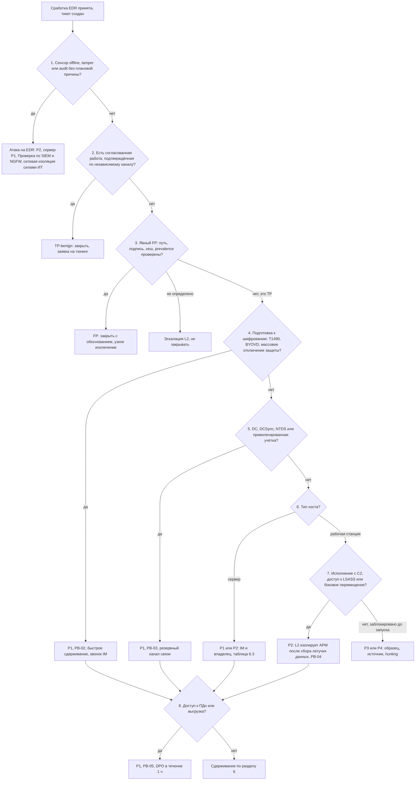

# PB-S4 Сработка EDR

> Учебный плейбук для вымышленной компании «Альфа-Трейд». Роли, уровни критичности P1–P4, полномочия и ритм статусов взяты из [IR-плана](../plan/ir-plan.md). Всё, что нужно сверить с первоисточником, собрано в разделе [«Допущения и ограничения»](#допущения-и-ограничения). Сокращения расшифрованы в [Приложении Г](#приложение-г-сокращения).

## TL;DR

- **Когда применять:** EDR (система обнаружения и реагирования на конечных точках) прислала поведенческую сработку на Windows или Linux, сенсор пропал или перешёл в tamper, threat hunting нашёл подозрительную телеметрию, или SIEM скоррелировала события EDR и журналов Windows.
- **Работайте от инцидента, а не от сработки.** Все сработки по одному хосту или учётке за 60 минут разбирайте вместе: три P3 на одном хосте за час дают один инцидент P2.
- **Сначала узнайте, что сделал EDR.** «Обнаружил» значит, что атака, возможно, идёт прямо сейчас. «Заблокировал» не значит «безопасно»: заблокированный доступ к LSASS означает, что у атакующего уже есть права администратора на хосте.
- **Критичность равна худшему из четырёх:** этап атаки, ценность актива, привилегии учётки, масштаб. Повышайте её по ходу расследования.
- **Порядок действий: соберите → изолируйте → только потом завершайте процессы и удаляйте.** Единственное исключение: активное шифрование, тогда скорость важнее улик.
- **Не верьте тишине и не верьте админу.** «В EDR ничего не нашли» не значит «ничего нет»: есть хосты без агента, офлайн-сенсоры и отключённая телеметрия. Действия администратора подтверждайте заявкой или звонком по независимому каналу, а не предположением.

## Шпаргалка: первые 30 минут

| № | Действие | Кто | Срок |
| --- | --- | --- | --- |
| 1 | **Возьмите сработку в работу**, создайте тикет, запишите время приёма (UTC+3, NTP) | L1 | P1 ≤ 15 мин 24/7, P2 ≤ 1 ч, P3 ≤ 4 ч |
| 2 | **Проверьте открытые инциденты** по этому хосту или учётке за 24 ч. Есть, значит присоедините и уведомите ответственного L2 | L1 | ≤ 2 мин |
| 3 | **Запишите действие EDR:** blocked / killed / quarantined / detected only / failed. «Detected only» и «failed» разбирайте в сроки уровня выше | L1 | ≤ 2 мин |
| 4 | **Проверьте состояние сенсора:** online, heartbeat, режим prevention, tamper. Offline, audit или tamper после других сработок, значит узел 1 дерева и звонок L2 | L1 | ≤ 3 мин |
| 5 | **Определите роль хоста по CMDB.** DC, сервер резервного копирования, БД клиентов, 1С, сайт/API: звоните L2 независимо от результата триажа | L1 | ≤ 3 мин |
| 6 | **Заполните шаблон тикета**, скоррелируйте сработки EDR/AV/NGFW и входы за ±24 ч, посчитайте prevalence за 30 дней | L1 | ≤ 15 мин |
| 7 | **Вынесите предварительный вердикт и стартовую P** по [дереву решений](#51-дерево-решений). «Не определено» не закрывайте, эскалируйте | L1 | P1 ≤ 15 мин, P2 ≤ 30 мин, P3 ≤ 2 ч |
| 8 | **Позвоните L2, не дожидаясь конца триажа**, при LSASS, боковом перемещении, отключении защиты, удалении теневых копий, tamper/offline, сервере или DC, «detected only», «failed» | L1 | Сразу |
| 9 | **Снимите летучие данные и образец** через live response EDR до любых завершений и карантина | L2 | До изоляции |
| 10 | **Изолируйте рабочую станцию** при подтверждённом исполнении с C2, доступе к LSASS или перемещении; уведомите IM | L2 | ≤ 15 мин от подтверждения |
| 11 | **Позвоните IM** при P1/P2, при мере сверх полномочий L2 и при признаках ручной атаки | L2 | P1 сразу, P2 ≤ 1 ч |
| 12 | **Экспортируйте дерево процессов и таймлайн из EDR в тикет**: телеметрия EDR хранится недолго | L2 | P1 ≤ 2 ч, P2 ≤ 4 ч |

## Чего делать нельзя

- **Не перезагружайте, не выключайте, не переустанавливайте и не запускайте полное сканирование** до разрешения L2: теряется память, меняются метки времени.
- **Не завершайте процесс и не помещайте файл в карантин до снятия памяти и образца:** теряются конфигурация C2, ключи, внедрённый код. При внедрении в `svchost`/`explorer` завершение может уронить систему.
- **Не изолируйте сервер или DC «по таблице»** без IM и владельца (кроме утверждённого break-glass).
- **Не входите на подозрительный хост по RDP под доменным администратором.** Работайте через удалённую консоль EDR (live response), иначе атакующий получит хеш администратора.
- **Не загружайте образец в публичные песочницы без разрешения L2/IM** и не открывайте URL C2 с корпоративного IP.
- **Не блокируйте хеш на весь парк и не сбрасывайте пароли до скоупинга** при ручной атаке: атакующий заметит и сменит инструмент.
- **Не сбрасывайте учётки по одной.** После дампа учётных данных готовьте список и сбрасывайте пакетно одновременно с изоляцией.
- **Не удаляйте механизм закрепления, пока не нашли все остальные.**
- **Не звоните пользователю при подозрении на инсайдера** и не пишите в корпоративную почту при подозрении на её компрометацию.
- **Не закрывайте сработку «заблокировано, значит всё хорошо».** Разберите, что было до блокировки.

## 1. Цель и область применения

**Цель:** за 15–30 минут отличить ложную сработку EDR от атаки, определить стадию атаки, ценность хоста и учётки, безопасно сдержать без лишней остановки бизнеса и без потери улик и передать инцидент в сценарный плейбук.

**Что входит:**

- поведенческие сработки EDR на Windows и Linux: исполнение, кража учётных данных, боковое перемещение, закрепление, разведка, отключение защиты, C2, туннели, RMM, выгрузка, веб-шеллы;
- сработки о состоянии сенсора: offline, tamper, переход в режим audit, пропажа телеметрии без плановой причины;
- находки threat hunting по телеметрии EDR;
- корреляционные правила SIEM по событиям EDR и журналам Windows.

**Что не входит:**

| Признак | Куда |
| --- | --- |
| Письмо без запуска вложения или ссылки | PB-01 |
| Началось шифрование | PB-02 (PB-S4 параллельно для улик) |
| Компрометация облачной учётки без активности на хостах | PB-10 |
| Подтверждённый вредонос на рабочей станции после триажа | PB-04 |
| Сработка антивируса без поведенческого контекста | PB-S3 |
| Атака на веб-приложение без исполнения кода на сервере | PB-S1, PB-08 |

## 2. Паспорт

| Поле | Значение |
| --- | --- |
| ID | PB-S4 |
| Версия | 1.0 (дата: ____) |
| Владелец | Руководитель ИБ, он же руководитель реагирования (IM). Исполнители: L1, L2, ИТ-администраторы |
| Пересмотр | Раз в 6 месяцев и после каждого P1/P2 по этому плейбуку |
| Критичность по умолчанию | Зависит от класса сработки ([матрица 5.4](#54-матрица-критичности)). Исполнение заблокировано до запуска полезной нагрузки, одна рабочая станция: **P3** (P4, если заблокировано вложение и ничего не запускалось). Исполнение с выходом в сеть, кража учётных данных, боковое перемещение: **P2** |
| Повышение до P1 | DC, сервер резервного копирования, БД клиентов, 1С, сайт/API; вход привилегированной учётки на хост за 30 дней перед кражей учётных данных; DCSync или NTDS.dit; удаление теневых копий или каталога резервных копий; загрузка уязвимого драйвера (BYOVD); признаки выгрузки ПДн; 3 и более хоста |
| Понижение | Подтверждённый FP или TP-benign (заявка, пентест) |
| Техники MITRE ATT&CK | [Приложение А](#приложение-а-mitre-attck) |
| Связанные плейбуки | PB-01 (фишинг), PB-02 (шифровальщик), PB-03 (компрометация учётки и AD), PB-04 (вредонос на рабочей станции), PB-05 (утечка ПДн), PB-07 (инсайдер), PB-08 (взлом веб-приложения), PB-10 (облачная учётка), PB-S2 (NGFW), PB-S3 (антивирус) |

**Целевые сроки по фазам** (учебные, согласованы с IR-планом):

| Контрольная точка | P1 | P2 | P3 | P4 |
| --- | --- | --- | --- | --- |
| L1 взял сработку в работу (IR-план) | 15 мин, 24/7 | 1 ч | 4 ч | 1 рабочий день |
| L1: триаж и эскалация | 15 мин | 30 мин | 2 ч | — |
| L2 подключился | 15 мин (звонок) | 1 ч | 4 ч | — |
| Решение о сдерживании | 30 мин | 1 ч | 8 ч | — |
| Изоляция рабочей станции после подтверждённого исполнения с C2 | 15 мин | 15 мин | — | — |
| Экспорт дерева процессов и таймлайна из EDR в тикет | 2 ч | 4 ч | 1 рабочий день | — |
| Скоупинг по парку (30 дней) | 4 ч | 8 ч | 2 рабочих дня | — |
| IM не ответил | через 15 мин — заместитель IM, затем директор | через 30 мин | — | — |
| Статус руководству (IR-план) | каждые 2 ч | дважды в день | при закрытии | — |

## 3. Подготовка

Без этих условий половина шагов невыполнима. Если пункт не выполнен, запишите это в тикет как ограничение расследования.

- [ ] EDR с живым сенсором на всех серверах и рабочих станциях; список хостов **без** EDR (ESXi, NAS, сетевое оборудование, Linux без агента) известен SOC
- [ ] Режим prevention на всех группах, Tamper Protection, пароль на удаление агента
- [ ] Аудит Windows: 4688 с командной строкой, PowerShell Script Block Logging (4104), аудит служб, задач (4698) и входов; Sysmon на серверах, если это решение принято; журналы в SIEM ≥ 90 дней
- [ ] Сработки EDR уходят в SIEM; известен срок хранения сырой телеметрии в EDR (зависит от продукта и лицензии, часто дни или недели)
- [ ] CMDB с ролью, владельцем и критичностью хостов; отметка «есть ПДн»
- [ ] Список согласований (deconfliction): пентесты, плановые работы ИТ, разрешённые RMM, сервисные учётки и их ожидаемое поведение
- [ ] Проверенная процедура изоляции и её снятия, в том числе для ноутбука вне офиса (проверка раз в квартал)
- [ ] Утверждённые инструменты сбора памяти и триажа, защищённое хранилище улик
- [ ] LAPS на всех хостах, контакты владельцев систем на нерабочее время
- [ ] Исключения в SIEM хранятся вместе с обоснованием; корреляционное правило из [раздела 15](#15-профилактика) включено

## 4. Роли и ответственность

Матрица RACI: **R** выполняет, **A** утверждает и отвечает за результат, **C** консультирует, **I** получает информацию.

| Действие | L1 | L2 | IM | ИТ | Владелец | Юрист/DPO | Директор |
| --- | --- | --- | --- | --- | --- | --- | --- |
| Приём, тикет, контекст, корреляция | R | A | — | — | — | — | — |
| Вердикт TP/FP | R (предварительно) | A | — | — | — | — | — |
| Раскодирование, анализ скрипта, скоупинг | C | R/A | I | — | — | — | — |
| Изоляция **одной** рабочей станции, завершение процесса на ней | — | R/A | I | I | — | — | — |
| Изоляция нескольких рабочих станций | — | R | A | I | — | — | — |
| Изоляция сервера (1С, БД, файловый, сайт/API) | — | R | A | C | A (согласие) | — | I |
| Действия на DC | — | C | A | R | — | — | I |
| Блокировка хеша или домена на всём парке | — | R | A | — | — | — | — |
| Блокировка одного внешнего IP/домена на NGFW | — | R/A | I | C | — | — | — |
| Отключение и сброс учёток (пакетный) | — | R (список) | A | R | — | — | — |
| Двойной сброс krbtgt | — | C | A | R | — | — | I |
| Сбор памяти и триаж-пакета | — | R/A | I | C | — | — | — |
| Исключение в EDR | — | R | A | C | — | — | — |
| Оценка утечки ПДн, уведомление РКН | — | C | R | — | C | R/A | A |
| Остановка сегмента, простой сайта | — | C | R | R | C | — | A |

**Заранее согласованные полномочия:**

- **L2 сам** изолирует одну рабочую станцию, завершает на ней процесс, блокирует один внешний IP или домен на NGFW (по IR-плану). IM он уведомляет, а не спрашивает.
- **IM решает:** несколько рабочих станций, сервер (вместе с владельцем), блок хеша или домена на всём парке, пакетный сброс учёток, исключения в EDR.
- **Экстренная изоляция (break-glass) пока не действует.** Она требует утверждения директором и внесения в IR-план. Предлагаемая формулировка: при активном шифровании или удалении резервных копий на сервере L2 изолирует этот сервер немедленно и сообщает IM и владельцу в течение 15 минут; если IM не ответил за 15 минут, решение принимает его заместитель. Единственный DC изолируется только при шифровании на самом DC.

## 5. Триаж

Триаж делится на две части. **Быстрый триаж (L1, первые 15 минут)** отвечает на вопросы «это атака?», «что уже сделал EDR?» и «насколько ценен хост?». **Глубокий триаж (L2)** раскодирует командные строки, определяет стадию атаки, скоупит по парку и выбирает ветку сдерживания. Обе части идут по одному дереву решений.

### 5.1. Дерево решений



Ниже каждый узел расписан подробно. Номера узлов совпадают с номерами на схеме. Узлы 1–3 проходит L1, узлы 4–8 подтверждает L2.

### 5.2. Быстрый триаж (L1, первые 15 минут)

**Перед узлом 1. Примите сработку (≤ 5 мин).**

1. **Возьмите сработку в работу**, создайте тикет, запишите время приёма (UTC+3, NTP).
2. **Проверьте, нет ли открытого инцидента** по этому хосту или учётке за 24 ч. Есть, значит присоедините сработку к нему и уведомите ответственного L2.
3. **Запишите действие EDR:** blocked / process killed / quarantined / detected only / remediation failed. «Только обнаружил» или «не смог»: применяйте сроки уровня выше.
4. **Определите роль хоста по CMDB.** DC, резервное копирование, БД клиентов, 1С, сайт/API: позвоните L2 независимо от результата триажа.
5. **Заполните шаблон тикета.** Командную строку вставляйте текстом, не скриншотом.

```text
Сработка:   ID в EDR, правило, ATT&CK, первое/последнее событие (UTC и UTC+3)
Действие:   blocked / killed / quarantined / detected only / failed
Хост:       имя, IP, ОС, OU, роль (АРМ/сервер 1С/DC/БД/веб/бэкап), критичность, ПДн да/нет
Сенсор:     online? heartbeat? режим? tamper?
Учётка:     DOMAIN\user, группы (Domain Admins? админ сервера?), отдел, статус (в отпуске/уволен)
Процесс:    путь, SHA256, подпись, полная командная строка (текстом, не скриншотом), родитель, дед
Сеть:       внешние IP/домены/порты процесса и потомков
Корреляция: сработки EDR/AV/NGFW/входы по хосту и учётке за ±24 ч
Prevalence: на скольких хостах хеш/командная строка за 30 дней
Вывод:      FP / TP-benign / TP / не определено; предложенный P; ветка
```

**Узел 1. Сенсор offline, tamper или audit без плановой причины? (≤ 3 мин)**

- Проверьте в консоли EDR: online, последний heartbeat, режим prevention, tamper protection.
- **Offline, audit или tamper после других сработок:** это ветка «атака на EDR». P2, для сервера P1. Звоните L2.
- **Сенсор пропал на сервере или на нескольких хостах сразу:** проверьте SIEM (Defender 5001/5007, 7045, Sysmon 6) и NGFW (хост жив и куда ходит). Хост в сети, а агент молчит, значит сетевая изоляция силами ИТ.
- **Одиночный offline ноутбука вечером:** P4, проверьте при подключении.

**Узел 2. Есть согласованная работа, подтверждённая по независимому каналу? (≤ 5 мин)**

- Сверьте хост, учётку и время со списком согласований: пентесты, плановые работы ИТ, разрешённые RMM, ожидаемое поведение сервисных учёток.
- **Заявка совпала по хосту, учётке и времени и подтверждена звонком** администратору на номер из справочника или ответственному за пентест по телефону (не в общем чате): это TP-benign. Закройте, заведите заявку на тюнинг.
- **Нет заявки с совпадающими хостом, учёткой и временем:** это не TP-benign, идите дальше. «Админ» не значит «легитимно»: ночью без заявки эскалируйте L2.

**Узел 3. Явный FP: путь, подпись, хеш, prevalence проверены? (≤ 10 мин)**

Пройдите по проверкам 1–4 и 7–9 из таблицы. Проверки 5–6 обычно доделывает L2, но если данные под рукой, запишите их сразу.

| № | Вопрос | Где смотреть | Признак TP |
| --- | --- | --- | --- |
| 1 | Логична ли цепочка «дед → родитель → процесс → потомки»? | Дерево процессов EDR | Office/браузер/архиватор/explorer → интерпретатор; `WmiPrvSE → cmd /Q /c`; `services.exe → cmd`; веб-сервер или 1С → оболочка |
| 2 | Что в командной строке? | EDR, 4688, 4104 | `-enc/-e/-ec`, `-nop`, `-w hidden`, `-ep bypass`, `IEX`, `DownloadString`, `FromBase64String`, `IO.Compression`, `-urlcache -split -f`, URL в аргументах rundll32/regsvr32/mshta, `lsass`, `MiniDump`, `delete shadows` |
| 3 | Путь, подпись, исходное имя файла | EDR | Системное имя не из `System32` (`svchost.exe` в `%TEMP%`); `C:\ProgramData`, `C:\Users\Public`, `AppData`; нет подписи; `OriginalFileName` не совпадает с именем (переименованный PsExec или rclone) |
| 4 | Насколько файл распространён? | EDR, Q9 | 1 хост, впервые за 30 дней. Кандидат в FP: ≥ 20 хостов более 30 дней и подпись известного издателя (порог учебный) |
| 5 | Куда ходит процесс и потомки? | EDR, NGFW, DNS | Внешний IP без DNS-имени, молодой домен, регулярный интервал (маячок), облачные хранилища, ngrok/trycloudflare |
| 6 | Кто и как? | EDR, AD, кадры | Привилегированная учётка; сервисная учётка в интерактивной сессии; ночь; сотрудник в отпуске или уволен; High/System у процесса обычного пользователя |
| 7 | Что ещё было на хосте и у учётки? | SIEM ±24 ч | Любые другие сработки: корреляция в один инцидент |
| 8 | Есть ли согласованная работа? | Список согласований, заявки | Нет заявки с совпадающими хостом, учёткой и временем, значит не TP-benign |
| 9 | Репутация | TI | **Только поиск по хешу.** Загрузка файла в публичные сервисы только с разрешения L2/IM |

Типичные источники FP и как их отличить:

| Источник FP | Как отличить |
| --- | --- |
| SCCM/инвентаризация, скрипты ИТ | Подписанный агент, сотни хостов, расписание; заявка |
| Антивирус, EDR, бэкап, мониторинг у LSASS | Путь + подпись + версия совпадают с эталоном. Имя процесса не доказательство (T1036.005) |
| Надстройки Office, выгрузки 1С с макросами, скрипты печати | Документ внутренний (нет MOTW), потомок без сетевых аргументов, повторяется месяцами |
| Администратор с PowerShell или PsExec | **Только** заявка или звонок администратору по известному номеру. Ночью без заявки: L2 |
| Пентест, red team | Список согласований; сверка с ответственным по телефону, не в общем чате |

Итог узла 3:

- **Явный FP** (путь + подпись + хеш + prevalence сходятся с эталоном): закройте с обоснованием, заведите заявку на узкое исключение по [правилам раздела 15](#15-профилактика).
- **Не определено:** не закрывайте, эскалируйте L2.
- **TP:** поставьте стартовую P по [матрице 5.4](#54-матрица-критичности) и передайте L2 с заполненным тикетом. Дальше узлы 4–8.

**Когда звонить L2, не дожидаясь конца триажа:** LSASS, боковое перемещение, отключение защиты, удаление теневых копий, tamper/offline; хост сервер или DC; действие EDR «detected only» или «failed»; вердикт «не определено».

### 5.3. Глубокий триаж (L2)

L2 подтверждает или меняет вердикт L1, проходит узлы 4–8 и готовит решение о сдерживании. Все раскодирования и анализ только на аналитической машине, ничего не выполнять.

**Как раскодировать `-enc`.** `-EncodedCommand` содержит Base64 от строки в **UTF-16LE**, а не UTF-8. Раскодированный как UTF-8 текст даёт «мусор» и ложный вывод.

```powershell
[Text.Encoding]::Unicode.GetString([Convert]::FromBase64String('<строка>'))
```
```bash
echo '<строка>' | base64 -d | iconv -f UTF-16LE -t UTF-8
```

- В CyberChef (офлайн): From Base64 → Decode text UTF-16LE; если внутри GZip/Deflate, добавьте Gunzip/Raw Inflate.
- Слои обфускации (`[char]`, `-join`, XOR) раскручивайте по шагам, заменяя `IEX` на вывод.
- **Ищите:** URL/IP/домены, `Net.WebClient`, `Invoke-WebRequest`, `Reflection.Assembly::Load`, `VirtualAlloc`, `amsiInitFailed`, `Add-MpPreference -ExclusionPath`.
- **Сверьте с журналом 4104:** там уже раскодированный текст, включая загруженное по сети.
- L1 может раскодировать под контролем L2.

**Узел 4. Подготовка к шифрованию: T1490, BYOVD, массовое отключение защиты?**

- Признаки: `vssadmin delete shadows`, `wmic shadowcopy delete`, `wbadmin delete catalog`, `bcdedit … recoveryenabled no`, `wevtutil cl`, очистка журналов (1102, 104), новые исключения Defender (5007), загрузка уязвимого драйвера (Sysmon 6, 7045 kernel driver).
- **Да:** P1, PB-02, быстрое сдерживание, звонок IM. Запустите Q7 по всему парку, проверьте серверы резервного копирования.
- **Нет:** узел 5.

**Узел 5. DC, DCSync, NTDS или привилегированная учётка?**

- На DC смотрите 4769 с RC4 (`TicketEncryptionType=0x17`) к многим SPN и 4662 с GUID репликации от не-DC, `ntdsutil … ifm`, теневую копию на DC.
- **Кража учётных данных на любом хосте:** найдите файл `.dmp` и проверьте, не ушёл ли он (сеть, общие ресурсы, архив). Соберите список входов на хост за 30 дней (Q4), включая сервисные учётки и учётки задач. Проверьте, включены ли LSA Protection (RunAsPPL) и Credential Guard: от этого зависит, что могли украсть.
- **Да** (DC затронут, есть DCSync или NTDS, или за 30 дней на хост входила привилегированная учётка): P1, PB-03, сразу резервный канал связи.
- **Нет:** узел 6.

**Узел 6. Тип хоста?**

- **Сервер (1С, файловый, БД, веб):** P1 или P2 по [матрице 5.4](#54-матрица-критичности). Любые меры против сервера только через IM и владельца, [таблица 6.3](#63-сдерживание-по-типу-хоста).
- **Рабочая станция:** узел 7.

**Узел 7. Исполнение с C2, доступ к LSASS или боковое перемещение?**

- **Исполнение.** Определите источник: письмо (имя файла или хеш → поиск в почте, PB-01), браузер (`Zone.Identifier`: `HostUrl`, `ReferrerUrl`), Win+R (`RunMRU`), USB. Проверьте, скачана ли вторая стадия: файлы в `%TEMP%`, `AppData`, `ProgramData`. Добейте проверки 5–6 из таблицы узла 3: куда ходит процесс, кто и как его запустил.
- **Боковое перемещение.** Найдите источник и цель, постройте граф перемещений учётки за 24 ч и 7 дней. Легитимность подтверждает только заявка или звонок администратору на номер из справочника.
- **Закрепление.** Запишите, что **именно** запускается: путь, аргументы, подпись, кем и когда создано. Найдите тот же механизм на всех хостах, проверьте RMM и новые учётки. Не удаляйте до конца скоупинга.
- **Разведка.** Единичные `whoami`, `ipconfig`, `net user` коррелируйте с другими сработками. AdFind, SharpHound, `nltest /domain_trusts`, массовые LDAP-запросы от не-ИТ учётки: это ручная работа атакующего.
- **Linux и веб-шелл** (ОС серверов в IR-плане не указана): веб-процесс → оболочка, reverse shell (`/dev/tcp`, `nc -e`, `socat`), `curl | sh`, cron, systemd, `authorized_keys`, `LD_PRELOAD`, майнер. Передавайте в PB-08.
- **Да:** P2, L2 изолирует АРМ после сбора летучих данных, дальше PB-04.
- **Нет, заблокировано до запуска полезной нагрузки:** P3 или P4. Заберите образец, установите источник, запустите hunting по парку (Q1, Q2, Q9).

**Узел 8. Доступ к ПДн или выгрузка?**

- Проверьте доступ к БД клиентов, 1С, выгрузкам; архивацию (`7z a -p`); rclone; объём трафика наружу; облачные хранилища.
- **Да или нельзя исключить:** P1, PB-05, IM подключает DPO в течение 1 ч. Достаточно **подозрения**, а не подтверждения.
- **Нет:** переходите к сдерживанию по [разделу 6](#6-сдерживание).

### 5.4. Матрица критичности

Критичность равна худшему из четырёх: этап атаки, актив, учётка, масштаб. Повышайте её по ходу расследования.

| Признак | Рабочая станция | Сервер (1С, файловый, БД, веб) | DC / резервное копирование |
| --- | --- | --- | --- |
| Заблокировано до запуска полезной нагрузки, нет сети, нет других сработок | P3 (P4 — вложение не запускалось) | P3 | P2 |
| Исполнение без блокировки или скачана вторая стадия, сети наружу нет | P3 | P2 | P1 |
| Исполнение + C2 / туннель / RMM не из списка | P2 | P1 | P1 |
| Разведка AD инструментами (AdFind, SharpHound) | P2 | P2 | P1 |
| Доступ к LSASS / SAM / браузерам (даже заблокированный) | P2; **P1**, если за 30 дней входила привилегированная учётка | P1 | P1 |
| DCSync, NTDS.dit | — | — | P1 → PB-03 |
| Боковое перемещение без подтверждённой заявки | P2 | P1 | P1 |
| Закрепление | P3, если единичное, источник известен и нет C2; иначе P2 | P2 | P1 |
| Отключение защиты, очистка журналов | P2 | P1 | P1 |
| Удаление теневых копий / каталога бэкапов / BYOVD | P1 → PB-02 | P1 → PB-02 | P1 → PB-02 |
| Сенсор offline / tamper без плановой причины | P2 (P4 — одиночный ноутбук вне сети) | P1 | P1 |
| Веб-шелл | — | P1 → PB-08 | — |
| Признаки доступа к ПДн или выгрузки | P1 → PB-05, DPO | P1 → PB-05, DPO | P1 → PB-05, DPO |
| ≥ 3 сработок или ≥ 2 тактик на хосте/учётке за 60 мин | +1 уровень, один инцидент | +1 уровень | P1 |

### 5.5. Когда эскалировать

- **L1 → L2 (звонок, не дожидаясь конца триажа):** LSASS, боковое перемещение, отключение защиты, удаление теневых копий, tamper/offline; хост сервер или DC; действие EDR «detected only» или «failed»; вердикт «не определено».
- **L2 → IM (звонок):** P1/P2; нужна мера сверх полномочий L2 (сервер, массовая блокировка, привилегированная учётка); признаки ручной атаки, когда нужно решение «быстро или скоординированно».
- **IM → DPO (≤ 1 ч):** **подозрение** на доступ к ПДн или выгрузку, а не подтверждение.
- **IM → директор:** P1; простой сайта или 1С; изоляция сегмента.
- **Подозрение на инсайдера** (умысел, ночные действия сотрудника под своей учёткой): PB-07, с пользователем не связывайтесь.

## 6. Сдерживание

### 6.1. Быстро или скоординированно: решает IM

- **Быстрое (по умолчанию для «Альфа-Трейд»):** удаление теневых копий или бэкапов, отключение защиты на нескольких хостах, массовое перемещение, признаки шифрования или выгрузки, активность на DC. **Действуйте сразу**, масштаб уточняйте после.
- **Скоординированное:** тихая разведка без признаков воздействия, масштаб неизвестен. 2–24 ч (по решению IM) скоупинга под наблюдением, затем **в одно окно одновременно:** изоляция хостов, блок C2 на NGFW, пакетный сброс учёток, удаление закрепления. Иначе атакующий заметит реакцию и переключится на запасные каналы.
- **Появился признак из первого списка:** переходите к быстрому.

### 6.2. Краткосрочное сдерживание

| № | Действие | Кто | Инструмент | Апрув |
| --- | --- | --- | --- | --- |
| 1 | **Снимите летучие данные** (процессы, соединения, память подозрительного процесса) | L2 | Live response EDR | — |
| 2 | **Заберите образец файла** с хешем, путём, метками времени и `Zone.Identifier` | L2 | EDR get file | — |
| 3 | **Изолируйте одну рабочую станцию** | L2 | EDR | Уведомить IM |
| 4 | **Проверьте, что изоляция применилась** и канал EDR работает | L2 | Консоль EDR | — |
| 5 | **Завершите процесс, поместите файл в карантин** | L2 | EDR | После п. 1–2; на сервере IM |
| 6 | **Заблокируйте один внешний IP/домен C2** | L2 | NGFW, DNS | — (по IR-плану) |
| 7 | **Заблокируйте хеш или домен на всём парке** | L2 | EDR, NGFW | IM (в скоординированном режиме в окне) |
| 8 | **Отключите учётку, отзовите сессии** (VPN, облачная почта) | ИТ | AD, VPN, облако | IM для привилегированных и сервисных |
| 9 | **Изолируйте сервер** или ограничьте его правилами NGFW | L2 / ИТ | EDR, NGFW | IM + владелец |
| 10 | **Хост без агента или агент молчит:** порт коммутатора, NGFW, VPN | ИТ | Сетевое оборудование | L2 для АРМ, IM для сервера |

Экстренная изоляция (break-glass) описана в [разделе 4](#4-роли-и-ответственность) и действует только после утверждения директором и внесения в IR-план.

### 6.3. Сдерживание по типу хоста

| Хост | Первая мера | Кто решает | Если изоляция недопустима |
| --- | --- | --- | --- |
| Рабочая станция в офисе | Изоляция в EDR | L2, уведомить IM | — |
| Ноутбук вне офиса | Изоляция в EDR + звонок пользователю | L2 | Отключить VPN-доступ учётки |
| Сервер 1С, файловый, БД | Завершение процесса, блок C2 на NGFW/хостовом файрволе, отключение учётки | IM + владелец | Изоляция в окно, перевод на резерв |
| Сайт/API (DMZ) | Блок исходящих на NGFW, правило WAF, вывод узла из балансировки (если есть резерв) | IM + владелец | Страница обслуживания по решению директора (простой ~1 млн ₽/ч, цифра учебная) |
| DC | Блок конкретных соединений, отключение учёток; единственный DC не изолировать | IM + ИТ (AD) | Изоляция одного DC, если есть другие и они проверены |
| ESXi, NAS (без EDR) | NGFW, порт коммутатора, отключение интерфейсов управления | IM + ИТ | — |

### 6.4. Учётные данные после кражи

1. **Считайте скомпрометированными все учётки** с сессиями на хосте с момента загрузки и за окно Q4: хеши NTLM, билеты Kerberos, иногда пароли.
2. **Проверьте по журналам DC** (4624/4768/4769/4776), где эти учётки входили **после** дампа: это масштаб перемещения.
3. **Не сбрасывайте по одной.** L2 готовит список, IM утверждает пакетный сброс одновременно с изоляцией; ИТ отзывает сессии VPN и облачной почты (PB-10).
4. **Локальный администратор:** ротация через LAPS. Без LAPS пароль скомпрометирован на всех хостах с тем же паролем.
5. **Привилегированная учётка домена, DCSync или NTDS:** PB-03 и двукратный сброс krbtgt с интервалом не меньше максимального срока жизни билета (по умолчанию 10 ч). Решение принимает IM вместе с ИТ (AD).
6. **Билеты на хостах** сбрасывайте (`klist purge` или перезагрузка) только после сбора улик.

### 6.5. Долгосрочное сдерживание

- Временные правила NGFW и WAF с владельцем и сроком.
- Отдельный сегмент для хостов в расследовании.
- Усиленная политика EDR на затронутой группе.
- Запрет входа скомпрометированных учёток до сброса.
- Блок неразрешённых RMM и туннелей на NGFW по приложениям.

## 7. Сбор и сохранение артефактов

**Собирайте по летучести** (RFC 3227): сначала то, что исчезает быстрее всего. Каждая команда на хосте меняет его состояние, поэтому используйте только утверждённый набор и записывайте каждую команду с временем в тикет. Команды live response выполняются от SYSTEM.

| № | Артефакт | Как | Зачем |
| --- | --- | --- | --- |
| 1 | Время, состояние хоста, кто залогинен | Консоль EDR | Привязка хронологии |
| 2 | Память: весь RAM или подозрительный процесс | Функция EDR; WinPmem, Magnet RAM Capture; Linux: AVML, LiME (выбрать и проверить заранее) | Расшифрованные нагрузки, C2, ключи |
| 3 | Процессы с командными строками, сетевые соединения, сессии, DNS-кеш, ARP | Live response | Активные каналы |
| 4 | Образцы, `Zone.Identifier`, файлы `.dmp` | EDR get file, в архив с паролем | Анализ, IOC, источник |
| 5 | Триаж-пакет: EVTX, реестр (SYSTEM, SOFTWARE, SAM, SECURITY, NTUSER.DAT, UsrClass.dat), `$MFT`, `$UsnJrnl:$J`, Prefetch, Amcache, SRUM, `System32\Tasks`, WMI-репозиторий, PSReadLine, LNK, Jump Lists, история браузера | KAPE, Velociraptor или DFIR ORC | Хронология, закрепление |
| 6 | Экспорт из EDR: дерево процессов, таймлайн хоста, сработки | Консоль EDR → тикет | Телеметрия EDR хранится недолго |
| 7 | Журналы DC, NGFW, DNS, VPN, почты за окно расследования | SIEM | Масштаб |
| 8 | Полный образ диска | По решению IM: P1, инсайдер, возможное обращение в полицию | Удалённые файлы, суд |

**Минимальный набор read-only команд** собран в [Приложении В](#приложение-в-примеры-запросов-и-команд).

**Цепочка хранения.** Для каждого артефакта запишите в тикет: кто собрал, когда (UTC+3), откуда, SHA256 сразу после снятия, где хранится, кому передан. Хранилище с доступом только у команды реагирования. Это обязательно при возможном обращении в полицию (УК РФ, ст. 272–274).

## 8. Расследование

**Окно расследования:** подробно −1 ч, по хосту и учётке −24 ч, по IOC −30 дней и до **первого** появления любого IOC в парке. Сработка EDR часто ловит третий–пятый шаг атаки, поэтому окно «час до сработки» даёт неверную корневую причину.

| Вопрос | Как ответить | Источник |
| --- | --- | --- |
| Как код попал на хост (вектор)? | Письмо, браузер (`HostUrl`), Win+R (`RunMRU`), USB, VPN с украденным паролем, эксплуатация сервера | Почта, EDR, реестр, VPN, WAF |
| Когда началось? | Первое появление хеша, домена, учётки; первые входы с нетипичных адресов | Q9, NGFW, DNS, 4624 |
| Какие хосты затронуты? | Хеш, имя файла в нетипичном пути, домены/IP из скрипта, пары «родитель → потомок», имена служб и задач, named pipes (Sysmon 17/18) | EDR, SIEM, NGFW |
| Какие учётки использованы? | Q4, 4648, 4624 на всех хостах после времени компрометации | DC, EDR |
| Какое закрепление оставлено? | Службы, задачи, Run, WMI, новые учётки и группы, RMM, веб-шеллы, SSH-ключи | EDR, 4720/4728, триаж-пакет |
| Затронут ли AD? | 4662 (DCSync), NTDS, изменения GPO (5136) | DC |
| Затронуты ли ПДн? | Доступ к БД клиентов, 1С, выгрузкам; архивация; rclone; объём наружу | EDR, NGFW, журналы БД |
| Где слепые зоны? | Хосты без EDR в затронутом сегменте, офлайн-сенсоры, пробелы журналов | Отчёт покрытия EDR |
| Ручная атака или автомат? | Серия команд с паузами, опечатки, интерактивные сессии | Дерево процессов, таймлайн |

**Хронологию ведите в тикете таблицей:** время, событие, источник, кто зафиксировал. Готовые запросы для этих вопросов собраны в [Приложении В](#приложение-в-примеры-запросов-и-команд).

## 9. Устранение

- [ ] Корневая причина установлена и записана. Без неё инцидент не закрывается
- [ ] Все механизмы закрепления найдены и удалены на всех затронутых хостах
- [ ] Хост с подтверждённой ручной атакой переустановлен из эталонного образа; чистка допустима только для P3 с единственным понятным артефактом
- [ ] Учётки из [6.4](#64-учётные-данные-после-кражи) сброшены, сессии отозваны, при необходимости выполнен двойной сброс krbtgt
- [ ] IOC заблокированы: домены и IP на NGFW/DNS, хеши в EDR (с пониманием, что хеш легко меняется), поведенческие правила
- [ ] Вектор закрыт: патч, блокировка типа вложений, удаление неразрешённого RMM, обучение пользователя без наказания
- [ ] Неразрешённые исключения, добавленные атакующим в EDR/антивирус (Defender 5007), удалены

## 10. Восстановление и мониторинг

**Снимайте изоляцию** (L2 для рабочей станции, IM вместе с владельцем для сервера), когда выполнено всё:

- [ ] Улики собраны
- [ ] Хост переустановлен или закрепление удалено и проверено повторным сканированием
- [ ] Учётки сброшены
- [ ] IOC в мониторинге
- [ ] Владелец подтвердил работоспособность

**Мониторинг после инцидента:**

| Что мониторить | Как | Срок |
| --- | --- | --- |
| IOC инцидента (хеши, домены, IP, имена служб и задач) | Правила SIEM и EDR | 14 дней (IR-план), для P1 30 дней (срок учебный) |
| Учётки из 6.4 | Входы, новые хосты, нерабочее время, VPN | 30 дней |
| Затронутые хосты | Повышенный уровень детекта EDR, любая сработка → L2 | 14 дней |
| Состояние сенсоров в затронутом сегменте | Алерт на offline и смену режима | Постоянно |
| Изменения в AD (новые админы, GPO) | 4728/4732/4756, 5136 | 30 дней при атаке на AD |
| Повторная попытка через тот же вектор | Почта, WAF, VPN | 14 дней |

## 11. Коммуникации и уведомления

### 11.1. Внутри компании

| Кому | Когда | Кто | Канал |
| --- | --- | --- | --- |
| L2 | По критериям [5.5](#55-когда-эскалировать) | L1 | Звонок + тикет |
| IM | P1 сразу, P2 ≤ 1 ч | L2 | Звонок, канал инцидента |
| Владелец системы | До любых мер против сервера | IM | Звонок |
| ИТ | Сброс учёток, сетевая изоляция, переустановка | L2/IM | Тикет, звонок ночью |
| Пользователь | После изоляции, если нет подозрения на инсайдера | L2 | Телефон из справочника |
| Директор | P1, простой сайта или 1С | IM | По ритму IR-плана |

**При подозрении на компрометацию AD или почты сразу переходите на резервный канал** (IR-план).

### 11.2. Вне компании

| Кому | Когда | Кто | Основание / срок |
| --- | --- | --- | --- |
| Роскомнадзор | Юрист подтвердил неправомерную передачу ПДн | Юрист/DPO | 152-ФЗ, ст. 21 ч. 3.1: первичное уведомление 24 ч с момента выявления, результаты расследования 72 ч |
| ГосСОПКА (НКЦКИ) | Инцидент, повлёкший неправомерную передачу ПДн | Юрист/DPO | 152-ФЗ, ст. 19 ч. 12 и порядок ФСБ. Это не 187-ФЗ: «Альфа-Трейд» не субъект КИИ |
| Вендор EDR / MDR | Агент сломан или отключён, нужна помощь в анализе | L2 через IM | — |
| Полиция | Признаки преступления | Директор по рекомендации юриста | УК РФ, ст. 272–274 |
| Клиенты, СМИ | Инцидент заметен клиентам | PR после решения IM и юриста | — |

**Записывайте время выявления в тикет с первой минуты:** от него считаются сроки уведомлений. Что считать моментом выявления, юрист определяет заранее.

### 11.3. Шаблоны

**Шаблон 1. Эскалация L1 → L2.**

```text
[PB-S4][P2] EDR, PC-ACC-07 (бухгалтерия), ALFA\a.petrova. 03:12 МСК excel.exe → powershell -nop -w hidden -enc …
Раскодировано: загрузка hxxps://cdn-upd[.]example/a.ps1. Действие EDR: detected only.
Сеть: 203.0.113.10:443, соединение установлено. Prevalence: 1 хост. Других сработок нет.
Тикет INC-2026-___. Нужно: решение об изоляции АРМ.
```

**Шаблон 2. L2 → IM (после звонка, в канал инцидента).**

```text
Что: дамп LSASS на SRV-1C-01 в 03:40 (rundll32 comsvcs MiniDump). Известно: за 30 дней входили 4 учётки,
в т. ч. adm-petrov (Domain Admins). Выгрузки дампа пока не видно.
Предлагаю: P1; изоляция SRV-1C-01 (нужно согласие владельца 1С); пакетный сброс 4 учёток; резервный канал.
Решение нужно: изолировать сейчас или в 07:00.
```

**Шаблон 3. Пользователю (только телефон).**
> Это дежурная служба ИБ. Мы видим техническую проблему на вашем компьютере. Пожалуйста, не выключайте его и ничего не удаляйте. Скажите, открывали ли вы сегодня файлы из письма или вставляли команду по инструкции с сайта?

Не обвиняйте и не раскрывайте деталей.

## 12. Критерии закрытия

**Закрыть как FP или TP-benign можно, когда отмечены все пункты:**

- [ ] Вердикт подтверждён доказательствами: путь + подпись + хеш, prevalence, заявка или звонок администратору
- [ ] Заведена заявка на тюнинг или узкое исключение с владельцем и сроком

**Закрыть как TP можно, когда отмечены все пункты:**

- [ ] Инцидент передан в сценарный плейбук (PB-02/03/04/05/08) или закрыт здесь
- [ ] Корневая причина, хронология, затронутые хосты и учётки записаны в тикете
- [ ] Скоупинг выполнен за 30 дней; слепые зоны перечислены
- [ ] Учётки сброшены, закрепление удалено, хосты переустановлены или проверены
- [ ] Изоляция снята по критериям [раздела 10](#10-восстановление-и-мониторинг); IOC на мониторинге
- [ ] Артефакты с хешами и цепочкой хранения в хранилище
- [ ] Юрист подтвердил, нужны ли уведомления; время выявления зафиксировано
- [ ] Техники ATT&CK и IOC в тикете; предложения по детекту оформлены
- [ ] Для P1/P2 назначен разбор в течение 5 рабочих дней

## 13. Метрики

| Метрика | Как считать | Ориентир (учебный) |
| --- | --- | --- |
| MTTD (среднее время обнаружения) | Начало атаки (первый IOC) → сработка | Снижать от квартала к кварталу |
| MTTA (среднее время взятия в работу) | Сработка → взятие в работу, по P1–P4 | В пределах сроков IR-плана |
| MTTC (среднее время сдерживания) | Подтверждение TP → сдерживание | ≤ 30 мин для P1/P2 на АРМ |
| MTTR (среднее время восстановления) | Обнаружение → восстановление | Отчёт по каждому P1/P2 |
| Доля FP по правилу EDR | FP / все сработки правила за месяц | > 90%, значит правило на тюнинг |
| Доля «detected only» | Сработки без блокировки / все | Рост, значит пересмотрите политику prevention |
| Покрытие EDR | Хосты с живым сенсором / все в CMDB | ≥ 98% рабочих станций, 100% серверов |
| Активные и просроченные исключения | Счёт в консоли EDR | Просроченных 0 |
| Пропущенные сработки | Инциденты, где сработка EDR была, но не разобрана в срок | 0 |

## 14. Типичные ошибки

| Ошибка | Последствие | Как правильно |
| --- | --- | --- |
| Разбирать сработки по одной | Три P3 вместо одного P2 | Корреляция по хосту и учётке за 60 мин |
| «Заблокировано — закрываем» | Пропущен атакующий с правами администратора | Разобрать, что было до блокировки |
| Изоляция сервера «по таблице» ночью | Остановка 1С или сайта без согласования, нарушение полномочий | Таблица 6.3, IM + владелец |
| Карантин и завершение до сбора | Потеря образца и памяти | Порядок 6.2 |
| RDP на заражённый хост под админом | Хеш администратора у атакующего | Live response EDR |
| Сброс одной учётки сразу после дампа | Атакующий работает другими учётками и узнаёт о реакции | Пакетный сброс по 6.4 |
| Массовый блок хеша до скоупинга | Атакующий меняет инструмент | Скоординированное сдерживание |
| Окно «час до сработки» | Неверная корневая причина | Окна раздела 8 |
| «Админ — значит легитимно» | Пропуск атаки под украденной учёткой | Заявка или звонок по независимому каналу |
| Сенсор offline закрыт как технический сбой | Пропуск отключения EDR перед шифрованием | Узел 1 дерева, ветка «атака на EDR» |
| Исключение по имени процесса или пути в `AppData` | Атакующий прячется в исключение | Правила исключений (раздел 15) |
| Base64 декодирован как UTF-8 | «Мусор», ложный вывод | UTF-16LE и журнал 4104 |
| Не сохранили телеметрию EDR | Через неделю нечем доказать хронологию | Экспорт в тикет в первые часы |
| Ищут только Office-родителя | Пропуск ClickFix, LNK, MSI | Q1 + Q2 |

## 15. Профилактика

**Технические меры:**

- [ ] **Исполнение:** правила ASR или аналоги в используемом EDR (запрет дочерних процессов Office, запуска скачанных скриптов); запрет макросов из интернета; блокировка автомонтирования ISO/VHD; AppLocker/WDAC на критичных группах; ограничение `mshta`, `wscript`, `cscript`; Constrained Language Mode для обычных пользователей
- [ ] **Учётные данные:** LSA Protection (RunAsPPL), Credential Guard, `UseLogonCredential=0` (WDigest), группа Protected Users, модель уровней административного доступа (администраторы домена не входят на рабочие станции), отдельные рабочие места администраторов, LAPS
- [ ] **Боковое перемещение:** запрет SMB/RDP/WinRM между рабочими станциями; запрет сетевого входа локальных админов; ограничение NTLM
- [ ] **RMM и туннели:** список разрешённых RMM, блок остальных на NGFW по приложениям и доменам
- [ ] **Защита самого EDR:** Tamper Protection; блок-лист уязвимых драйверов Microsoft, HVCI; алерты на пропажу сенсора, смену режима и добавление исключений
- [ ] **Резервные копии:** неизменяемые или отключённые от домена копии, учётки бэкапа вне AD (IR-план)
- [ ] **Детект:** каждая ручная находка становится правилом SIEM/EDR (Sigma в репозитории)

**Корреляционное правило SIEM** (пороги учебные): сработки EDR + антивирус + NGFW, сгруппированные по `host` и по `user` за 60 минут; ≥ 3 сработок или ≥ 2 тактик ATT&CK → один инцидент не ниже P2.

**Правила исключений в EDR:**

1. Создаёт L2 по заявке, утверждает IM.
2. Минимум два атрибута из «хеш или подпись + путь + хост/группа + учётка + командная строка». Запрещены исключения по имени процесса, по пользовательским и временным каталогам, «весь PowerShell».
3. Срок действия 90 дней (учебный), владелец, ссылка на тикет; пересмотр раз в квартал.
4. Для сканеров и пентестов только на время работ, по заявке, с IP источника.

## 16. Учебная ситуация

**Вводная.** Пятница, 03:40 МСК. EDR присылает сработку high на SRV-1C-01: `rundll32.exe C:\Windows\System32\comsvcs.dll, MiniDump 712 C:\ProgramData\s.dmp full`, действие EDR: detected only. Через 6 минут на PC-IT-03 (рабочая станция администратора) запускается `PsExec.exe \\SRV-FS-01 cmd` от учётки adm-petrov; заявок на ночные работы нет, Петров в отпуске. В 04:20 сенсор EDR на сервере резервного копирования переходит в offline, NGFW показывает, что сервер жив и обменивается трафиком с PC-IT-03. Дежурный администратор предлагает: «Перезагружу бэкап-сервер и сброшу пароль Петрову, пять минут».

**Задания:**

1. **03:42, вы L1.** Запишите, сколько здесь инцидентов и какую P вы ставите. Пройдите по [дереву решений](#51-дерево-решений) и назовите узлы, на которых остановились, и строки [матрицы 5.4](#54-матрица-критичности), которые сработали. Кому и в какую минуту вы звоните по [RACI](#4-роли-и-ответственность)?
2. **03:50, вы L2.** Дежурный администратор ждёт ответа. Напишите ему два предложения, почему перезагрузка и сброс пароля сейчас опасны. Составьте по [таблице 6.2](#62-краткосрочное-сдерживание) порядок действий на SRV-1C-01 до изоляции и укажите, кто вправе разрешить изоляцию сервера 1С в 3:40 ночи и что делать, если IM не ответил за 15 минут.
3. **04:00, вы L2.** Напишите запрос Q4 для SRV-1C-01 и объясните, как из его результата получится список учёток к сбросу по [6.4](#64-учётные-данные-после-кражи). Объясните IM одной фразой, почему сброс одной adm-petrov прямо сейчас навредит.
4. **04:25, вы L2.** Сенсор на сервере резервного копирования ушёл в offline. Пройдите узел 1 дерева: какие Event ID и источники вы проверите в SIEM и NGFW, какие меры примете без агента EDR по [таблице 6.3](#63-сдерживание-по-типу-хоста) и кто их утверждает.
5. **04:40, вы IM.** Составьте сообщение по шаблону 2 из [раздела 11](#113-шаблоны). Назовите признак, по которому вы подключите DPO (узел 8), и момент, с которого переключаетесь на резервный канал связи.

**Самопроверка:**

- [ ] Почему заблокированный доступ к LSASS не P4?
- [ ] В какой кодировке раскодировать `-enc` и где взять уже раскодированный текст?
- [ ] Чем TP-benign отличается от FP и как подтвердить действие администратора?
- [ ] Когда сдерживать сразу, а когда ждать скоупинга?
- [ ] Почему «на других хостах ничего не нашли» может быть ложным выводом?

## 17. Источники

- MITRE ATT&CK Enterprise: https://attack.mitre.org/ (номера техник сверяйте с текущей версией)
- NIST SP 800-61 Rev. 3: https://csrc.nist.gov/pubs/sp/800/61/r3/final ; Rev. 2 проще для новичка
- NIST SP 800-86, Guide to Integrating Forensic Techniques into Incident Response: https://csrc.nist.gov/pubs/sp/800/86/final
- RFC 3227, Guidelines for Evidence Collection and Archiving: https://www.rfc-editor.org/rfc/rfc3227
- CISA #StopRansomware Guide: https://www.cisa.gov/stopransomware
- CISA, совместная рекомендация о злоупотреблении RMM-инструментами (AA23-025A): https://www.cisa.gov/
- SANS Incident Handler's Handbook: https://www.sans.org/white-papers/33901/ ; постер SANS «Hunt Evil» (нормальные родители и пути системных процессов)
- LOLBAS Project: https://lolbas-project.github.io/ ; GTFOBins (Linux): https://gtfobins.github.io/ ; LOLDrivers (уязвимые драйверы): https://www.loldrivers.io/
- SigmaHQ: https://github.com/SigmaHQ/sigma
- Microsoft Sysmon: https://learn.microsoft.com/sysinternals/downloads/sysmon ; документация Microsoft по LSA Protection, Credential Guard и сбросу krbtgt при восстановлении леса AD: https://learn.microsoft.com/
- CyberChef: https://gchq.github.io/CyberChef/ ; Velociraptor: https://docs.velociraptor.app/ ; KAPE (Kroll): документация вендора
- Отраслевые отчёты для контекста: Mandiant M-Trends (время присутствия атакующего), CrowdStrike Global Threat Report (breakout time)
- 152-ФЗ «О персональных данных»: актуальная редакция на consultant.ru / garant.ru
- Документация своего EDR и SIEM: имена полей, режимы политики, live response, срок хранения телеметрии

## Допущения и ограничения

**Что нужно сверить перед реальным применением:**

| № | Что | Где в плейбуке | Почему нужна проверка |
| --- | --- | --- | --- |
| 1 | Подтехника T1204.004 Malicious Copy and Paste (ClickFix) добавлена в ATT&CK в 2025 году; все номера техник | Прил. А | Могут отсутствовать или отличаться в вашей версии каталога ATT&CK |
| 2 | Значения `GrantedAccess` при доступе к LSASS (0x1010, 0x1410, 0x1438, 0x143a, 0x1fffff) | Прил. Б | Маски зависят от инструмента и версии Windows |
| 3 | Имена бинарей RMM и туннелей в Q8 | Прил. В | Это ориентир; имена меняются от версии к версии |
| 4 | Состояние LSA Protection (RunAsPPL) и Credential Guard | 5.3, узел 5 | Зависит от конфигурации; в новых сборках Windows 11 часть защит включена по умолчанию на совместимом оборудовании |
| 5 | Интервал двукратного сброса krbtgt (не меньше максимального срока жизни билета, по умолчанию 10 ч) | 6.4 | Сверить с актуальными рекомендациями Microsoft |
| 6 | Параметры KAPE, Velociraptor, DFIR ORC | 7 | Сверить с документацией инструментов |
| 7 | Событие 5136 (изменения GPO) | 8 | Требует включённого аудита Directory Service Changes |
| 8 | Сроки уведомления Роскомнадзора (24 и 72 ч), 152-ФЗ ст. 21 ч. 3.1; что считать моментом выявления | 11.2 | Проверить по действующей редакции; момент выявления юрист определяет заранее |
| 9 | Уведомление ГосСОПКА (НКЦКИ): 152-ФЗ ст. 19 ч. 12 и порядок ФСБ | 11.2 | Проверить по действующей редакции и порядку |
| 10 | Статьи УК РФ 272–274 | 7, 11.2 | Проверить по действующей редакции |
| 11 | Номер рекомендации CISA о злоупотреблении RMM (AA23-025A) | 17 | Проверить номер документа |
| 12 | Цифры из отчётов Mandiant M-Trends и CrowdStrike Global Threat Report | 17 | Проверять в последнем выпуске |
| 13 | Sysmon на серверах | 3 | Применяется, если такое решение принято в компании |
| 14 | Вывод узла сайта/API из балансировки | 6.3 | Только если есть резерв |
| 15 | Экстренная изоляция (break-glass) | 4, 6.2 | Требует утверждения директором и внесения в IR-план; до этого не действует |

**Допущения:**

- IR-план в исходном репозитории лежит в `source/ir-plan.md`; роли, уровни P1–P4, полномочия и ритм статусов взяты оттуда.
- Вендоры EDR и SIEM в IR-плане не названы. Имена полей, команды и синтаксис запросов (KQL, SPL, Sigma) условные и даны для обучения; в работе нужны версии под реальный продукт, проверенные на стенде. Списки исключений стройте по своему парку и храните в SIEM с обоснованием.
- ОС серверов в IR-плане не указана; ветка Linux и веб-шелла дана на случай Linux-серверов.
- Срок хранения сырой телеметрии в EDR зависит от продукта и лицензии, часто дни или недели.
- Учебные цифры и правила, которые подбираются под базовую линию компании: целевые сроки по фазам (раздел 2); порог FP «≥ 20 хостов более 30 дней» (5.2); корреляционное правило «≥ 3 сработок или ≥ 2 тактик за 60 минут» (15); оценка простоя сайта ~1 млн ₽/ч (6.3); мониторинг IOC 30 дней для P1 (10); ориентиры метрик (13); срок действия исключений 90 дней (15).

## Приложение А. MITRE ATT&CK

Номера сверяйте с текущей версией ATT&CK.

| Тактика | Техника | ID |
| --- | --- | --- |
| Первоначальный доступ | Phishing: Spearphishing Attachment / Link | T1566.001 / T1566.002 |
| Выполнение | Malicious File | T1204.002 |
| Выполнение | Malicious Copy and Paste (ClickFix) | T1204.004 |
| Выполнение | PowerShell / Windows Command Shell / Visual Basic | T1059.001 / T1059.003 / T1059.005 |
| Выполнение | Windows Management Instrumentation | T1047 |
| Закрепление | Scheduled Task | T1053.005 |
| Закрепление | Windows Service | T1543.003 |
| Закрепление | Registry Run Keys | T1547.001 |
| Закрепление | WMI Event Subscription | T1546.003 |
| Закрепление | Create Account | T1136 |
| Закрепление | Web Shell | T1505.003 |
| Повышение привилегий | Exploitation for Privilege Escalation (в т. ч. BYOVD) | T1068 |
| Обход защиты | Disable or Modify Tools | T1562.001 |
| Обход защиты | Disable Windows Event Logging | T1562.002 |
| Обход защиты | Clear Windows Event Logs | T1070.001 |
| Обход защиты | Match Legitimate Name or Location | T1036.005 |
| Обход защиты | System Binary Proxy Execution: mshta / msiexec / regsvr32 / rundll32 | T1218.005 / T1218.007 / T1218.010 / T1218.011 |
| Доступ к учётным данным | OS Credential Dumping: LSASS / SAM / NTDS / DCSync | T1003.001 / T1003.002 / T1003.003 / T1003.006 |
| Доступ к учётным данным | Kerberoasting | T1558.003 |
| Доступ к учётным данным | Credentials from Web Browsers | T1555.003 |
| Разведка | System Owner/User Discovery | T1033 |
| Разведка | Domain Account Discovery | T1087.002 |
| Разведка | Domain Groups Discovery | T1069.002 |
| Разведка | Domain Trust Discovery | T1482 |
| Разведка | Remote System Discovery | T1018 |
| Боковое перемещение | Remote Services: RDP / SMB, Admin Shares / WinRM | T1021.001 / T1021.002 / T1021.006 |
| Боковое перемещение | Service Execution | T1569.002 |
| Боковое перемещение | Lateral Tool Transfer | T1570 |
| Управление и контроль | Web Protocols | T1071.001 |
| Управление и контроль | Ingress Tool Transfer | T1105 |
| Управление и контроль | Remote Access Software | T1219 |
| Управление и контроль | Protocol Tunneling | T1572 |
| Выгрузка | Archive via Utility | T1560.001 |
| Выгрузка | Exfiltration to Cloud Storage | T1567.002 |
| Выгрузка | Exfiltration Over Alternative Protocol | T1048 |
| Воздействие | Inhibit System Recovery | T1490 |
| Воздействие | Data Encrypted for Impact | T1486 |

## Приложение Б. Источники данных и триггеры

Запросы Q1–Q9 из последней колонки собраны в [Приложении В](#приложение-в-примеры-запросов-и-команд).

| Класс | Источник | Что видим | Поля и Event ID | Запрос |
| --- | --- | --- | --- | --- |
| Исполнение из документа | EDR, Sysmon 1, Security 4688, PowerShell 4104 | `winword/excel/outlook/onenote → powershell/cmd/mshta/rundll32/regsvr32/wscript` | `ParentImage`, `CommandLine`, `User`, `IntegrityLevel`, `Zone.Identifier` (MOTW) | Q1 |
| ClickFix / фейковая CAPTCHA | EDR, 4688, реестр | `explorer.exe → powershell -w hidden … http`, `explorer.exe → mshta http…` | Ключ `HKCU\…\Explorer\RunMRU` (история окна «Выполнить») | Q2 |
| LNK, ISO/VHD, MSI, HTA, JS | EDR, Sysmon 1/11 | Запуск из смонтированного образа или архива, LOLBin с URL | `CurrentDirectory`, путь на букве смонтированного диска, `msiexec /i http…` | Q1 |
| Кража учётных данных | EDR, Sysmon 10/11 | Доступ к `lsass.exe`, `rundll32 comsvcs.dll, MiniDump`, procdump, nanodump, `reg save HKLM\SAM` | `TargetImage`, `GrantedAccess` (часто 0x1010, 0x1410, 0x1438, 0x143a, 0x1fffff), `CallTrace` с `dbghelp/dbgcore/comsvcs`, файлы `*.dmp` | Q3 |
| Атака на AD | Security на DC | DCSync, Kerberoasting, копия NTDS.dit | 4662 с GUID `1131f6aa-…` и `1131f6ad-…` от не-DC; 4769 с `TicketEncryptionType=0x17` к многим SPN; `ntdsutil … ifm`, теневая копия на DC | Q4 |
| Боковое перемещение | EDR, Security, System | PsExec, wmiexec/smbexec, WinRM, RDP | Цель: 4624 (Type 3/10), 7045/4697 (служба `PSEXESVC` или случайное имя), 5140/5145 (`ADMIN$`), 1149, 21/24/25 TerminalServices; источник: 4648; `WmiPrvSE → cmd /Q /c … \\127.0.0.1\ADMIN$\__` | Q5 |
| Закрепление | EDR, Security, Sysmon | Задача, служба, Run-ключ, WMI-подписка, новая учётка | 4698/4702, TaskScheduler 106/140/200, 7045, Sysmon 12/13/14, 19/20/21, WMI-Activity 5861, 4720/4728/4732/4756 | Q6 |
| Разведка | EDR, 4688 | `nltest /domain_trusts`, `net group "Domain Admins" /domain`, AdFind, SharpHound, серия команд за минуты | Командные строки, учётка не из ИТ | — |
| Отключение защиты, подготовка к шифрованию | EDR, Security, System, Defender | `vssadmin delete shadows`, `wmic shadowcopy delete`, `wbadmin delete catalog`, `bcdedit … recoveryenabled no`, `wevtutil cl` | 1102, 104, Defender 5001/5007 (в т. ч. новые исключения), Sysmon 6 (драйвер), 7045 kernel driver | Q7 |
| Атака на сам EDR | Консоль EDR, SIEM | Сенсор offline, tamper-alert, тишина после других сработок | Последний heartbeat, режим политики, NGFW: хост жив в сети | — |
| RMM, туннели, выгрузка | EDR, NGFW, DNS | AnyDesk, ScreenConnect, RustDesk, MeshAgent, ngrok, cloudflared, Chisel, plink, rclone, `7z a -p` | `OriginalFileName` (переименованные утилиты), объём наружу | Q8 |
| Сервер 1С | EDR | `1cv8.exe`/`rphost.exe → cmd/powershell` | Внешняя обработка, учётка 1С | Q1 (родитель 1С) |
| Веб-шелл и Linux | EDR (Linux), журналы веб-сервера, WAF | `w3wp/php-fpm/nginx/java → cmd/sh/bash/whoami`, `bash -i >& /dev/tcp/…`, `curl … \| sh`, новые cron/systemd/`authorized_keys` | Новые `.php/.aspx` в веб-каталоге | — |

## Приложение В. Примеры запросов и команд

Логика переносима; синтаксис зависит от продукта и дан как пример. Списки исключений стройте по своему парку и храните в SIEM с обоснованием.

**Q1–Q2. Исполнение из документа и ClickFix (KQL).**

```kql
// Q1. Офис/почта/1С порождают интерпретатор (KQL, пример)
DeviceProcessEvents
| where Timestamp > ago(30d)
| where InitiatingProcessFileName in~ ("winword.exe","excel.exe","powerpnt.exe","outlook.exe","onenote.exe","1cv8.exe","rphost.exe")
| where FileName in~ ("powershell.exe","pwsh.exe","cmd.exe","mshta.exe","wscript.exe","cscript.exe","rundll32.exe","regsvr32.exe","certutil.exe","msiexec.exe")
| project Timestamp, DeviceName, AccountName, InitiatingProcessFileName, FileName, ProcessCommandLine, SHA256

// Q2. ClickFix: интерпретатор от explorer.exe с сетевыми аргументами
DeviceProcessEvents
| where InitiatingProcessFileName =~ "explorer.exe" and FileName in~ ("powershell.exe","mshta.exe","cmd.exe")
| where ProcessCommandLine has_any ("http","iex","-enc","-w hidden","curl","iwr")
```

**Q3–Q6. LSASS, входы на хост, службы, задачи (SPL).**

```spl
# Q3. Доступ к LSASS (SPL по Sysmon, пример)
index=sysmon EventCode=10 TargetImage="*\\lsass.exe"
  NOT SourceImage IN ("*\\MsMpEng.exe","*\\<агент_EDR>.exe","*\\<агент_бэкапа>.exe")
| stats count min(_time) as first max(_time) as last values(GrantedAccess) values(CallTrace) by host SourceImage SourceUser

# Q4. Кто входил на хост, где сняли дамп (список учёток к сбросу), окно 30 дней
index=wineventlog EventCode=4624 host="<host>" LogonType IN (2,7,9,10,11,3)
| stats earliest(_time) as first latest(_time) as last count by TargetUserName LogonType

# Q5. Подозрительные службы (подсказка для ручного разбора, не детект)
index=wineventlog EventCode=7045
| where match(ImagePath,"(?i)(cmd\.exe|%COMSPEC%|powershell|ADMIN\$|\\Temp\\|ProgramData)")
| table _time host ServiceName ImagePath AccountName

# Q6. Новые задачи планировщика вне ИТ-учёток
index=wineventlog EventCode=4698 NOT SubjectUserName IN (<список_ИТ>)
| table _time host SubjectUserName TaskName TaskContent
```

**Q7. Подготовка к шифрованию (Sigma, черновик).**

```yaml
# Q7. Sigma (черновик): удаление теневых копий и отключение восстановления
title: Подготовка к шифрованию — удаление теневых копий
status: experimental
logsource: {category: process_creation, product: windows}
detection:
  vss:  {Image|endswith: '\vssadmin.exe', CommandLine|contains|all: ['delete', 'shadows']}
  wmic: {Image|endswith: '\wmic.exe', CommandLine|contains|all: ['shadowcopy', 'delete']}
  wbad: {Image|endswith: '\wbadmin.exe', CommandLine|contains|all: ['delete', 'catalog']}
  bcd:  {Image|endswith: '\bcdedit.exe', CommandLine|contains: 'recoveryenabled no'}
  condition: 1 of them
level: critical
tags: [attack.impact, attack.t1490]
```

**Q8–Q9. RMM, туннели и скоупинг по хешу (KQL).** Имена бинарей в Q8 служат ориентиром.

```kql
// Q8. RMM и туннели вне утверждённого списка (имена бинарей — ориентир)
DeviceProcessEvents
| where Timestamp > ago(30d)
| where FileName in~ ("anydesk.exe","rustdesk.exe","screenconnect.clientservice.exe","meshagent.exe","ngrok.exe","cloudflared.exe","chisel.exe","plink.exe","rclone.exe")
   or ProcessVersionInfoOriginalFileName in~ ("rclone.exe","ngrok.exe")
| summarize FirstSeen=min(Timestamp), Hosts=make_set(DeviceName) by FileName, SHA256

// Q9. Распространённость хеша или фрагмента командной строки (скоупинг)
DeviceProcessEvents
| where Timestamp > ago(30d)
| where SHA256 == "<sha256>" or ProcessCommandLine has "<уникальный фрагмент>"
| summarize FirstSeen=min(Timestamp), Hosts=dcount(DeviceName), HostList=make_set(DeviceName, 50) by SHA256
```

**Раскодирование `-EncodedCommand`** (Base64 от UTF-16LE, только на аналитической машине, ничего не выполнять):

```powershell
[Text.Encoding]::Unicode.GetString([Convert]::FromBase64String('<строка>'))
```
```bash
echo '<строка>' | base64 -d | iconv -f UTF-16LE -t UTF-8
```

**Минимальный набор read-only команд для live response.**

- Windows: `Get-CimInstance Win32_Process` (с `CommandLine`), `Get-NetTCPConnection`, `Get-ScheduledTask`, `Get-CimInstance Win32_Service`, WMI `__EventFilter` и `CommandLineEventConsumer` в `root\subscription`, `reg query …\CurrentVersion\Run`, `Get-FileHash -Algorithm SHA256`, `wevtutil epl Security <путь>`.
- Linux: `ps auxwwf`, `ss -tunap`, `ls -l /proc/<PID>/exe`, `crontab -l`, `systemctl list-units --type=service`, `authorized_keys`, `last -Faiw`.

## Приложение Г. Сокращения

| Сокращение | Расшифровка |
| --- | --- |
| AD | Active Directory: служба каталогов Windows, хранит учётки и группы домена |
| ARP | Таблица соответствия IP- и MAC-адресов на хосте |
| ASR | Attack Surface Reduction: правила сокращения поверхности атаки в Microsoft Defender |
| АРМ | Автоматизированное рабочее место |
| AV | Антивирус |
| BYOVD | Bring Your Own Vulnerable Driver: загрузка уязвимого подписанного драйвера для получения прав ядра |
| БД | База данных |
| C2 | Command and Control: сервер управления вредоносом |
| CMDB | База конфигурационных единиц: роли, владельцы и критичность хостов |
| DC | Domain Controller: контроллер домена |
| DCSync | Запрос репликации учётных данных у контроллера домена от имени «ещё одного DC» |
| DFIR | Digital Forensics and Incident Response: цифровая криминалистика и реагирование на инциденты |
| DMZ | Демилитаризованная зона: сегмент сети для серверов, доступных из интернета |
| DNS | Система доменных имён |
| DPO | Ответственный за обработку персональных данных |
| EDR | Система обнаружения и реагирования на конечных точках |
| EVTX | Формат файлов журналов событий Windows |
| FP / TP / TP-benign | Ложное срабатывание / подтверждённый инцидент / подтверждённое, но легитимное действие (заявка, пентест) |
| ГосСОПКА / НКЦКИ | Государственная система обнаружения, предупреждения и ликвидации последствий компьютерных атак / Национальный координационный центр по компьютерным инцидентам |
| GPO | Групповая политика Active Directory |
| GUID | Глобальный уникальный идентификатор объекта |
| HVCI | Целостность кода, защищённая гипервизором (Hypervisor-protected Code Integrity) |
| IM | Incident Manager: руководитель реагирования |
| IOC | Индикатор компрометации: домен, IP, хеш и т. п. |
| КИИ | Критическая информационная инфраструктура (187-ФЗ) |
| KQL / SPL | Языки запросов Microsoft (Kusto) и Splunk |
| L1 / L2 | Аналитик SOC первой / второй линии |
| LAPS | Решение Microsoft для уникальных паролей локальных администраторов |
| LDAP | Протокол доступа к каталогу (AD) |
| LOLBin / LOLBAS | Легитимные системные бинари, которые атакующие используют вместо вредоноса (Living Off the Land) |
| LSASS | Процесс Windows, хранящий в памяти учётные данные вошедших пользователей |
| MDR | Managed Detection and Response: внешняя служба мониторинга и реагирования |
| MOTW | Mark-of-the-Web: метка Windows «файл скачан из интернета» (`Zone.Identifier`) |
| MTTD / MTTA / MTTC / MTTR | Среднее время обнаружения / взятия в работу / сдерживания / восстановления |
| NGFW | Межсетевой экран нового поколения |
| NTDS | База данных Active Directory (файл NTDS.dit) с хешами паролей всех учёток |
| NTLM / Kerberos | Протоколы аутентификации Windows |
| NTP | Протокол синхронизации времени |
| OU | Организационное подразделение в AD |
| ПДн | Персональные данные |
| RACI | Матрица ответственности: выполняет, утверждает, консультирует, информируется |
| RDP / SMB / WinRM | Протоколы удалённого рабочего стола / общего доступа к файлам / удалённого управления Windows |
| RKN / РКН | Роскомнадзор |
| RMM | Программы удалённого администрирования (Remote Monitoring and Management) |
| RunAsPPL | LSA Protection: запуск LSASS как защищённого процесса |
| SIEM | Система сбора и корреляции событий безопасности |
| SOC | Центр мониторинга безопасности |
| SPN | Имя сервиса в Kerberos; цель Kerberoasting |
| TI | Threat Intelligence: данные об угрозах |
| UTC | Всемирное координированное время; МСК = UTC+3 |
| VPN | Виртуальная частная сеть для удалённого доступа |
| WAF | Межсетевой экран для веб-приложений |
| WDAC / AppLocker | Механизмы контроля запуска приложений в Windows |
| WMI | Windows Management Instrumentation: интерфейс управления Windows, используется и для закрепления |
